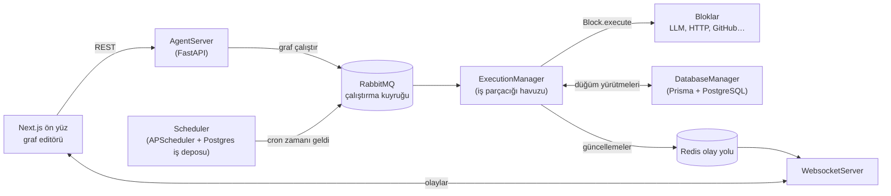
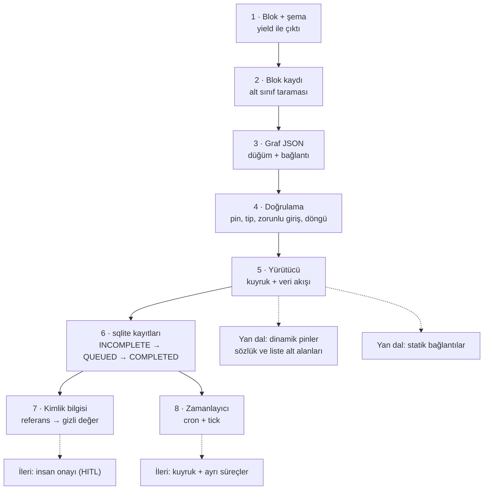

# Significant-Gravitas/AutoGPT — Blok ve graf tabanlı ajan platformu (ve onu ünlü eden "Classic" deneyi)

> **Dal:** [D06 Kişisel ve otonom ajan platformları](../README.md) · **Tür:** kod tabanı
> **Dil:** Python (arka uç), TypeScript/Next.js (ön yüz) · **Lisans:** iki parçalı — `autogpt_platform/` içi
> PolyForm Shield 1.0.0, dışı MIT (GitHub "NOASSERTION" gösteriyor) · **Yıldız:** 187.959 (9 Kasım 2026)
> **İncelenen commit:** `9cb76f9` (2026-11-05)

## 1. Bir bakışta

AutoGPT, Mart 2023'te "GPT-4'e bir hedef ver, kendi kendine plan yapıp araç kullanarak bitirsin" diyen ilk popüler
otonom ajan deneyi olarak patladı; bugün o deney `classic/` altında **desteklenmeyen** bir arşiv olarak duruyor
(`classic/README.md`: "This project is unsupported"). Deponun asıl gövdesi artık **AutoGPT Platform**: ajanları
**bloklardan oluşan graflar** olarak görsel bir editörde kurduğun, bir yürütücünün bu grafları kuyruk ve veritabanı
üzerinden çalıştırdığı, zamanlayıcının tekrar eden işleri tetiklediği, pazar yerinden hazır ajan alabildiğin bir
sistem. 2026 sonunda README ürünü "AI uzmanlarından oluşan ekip" (Otto adlı koordinatör + uzmanlar) olarak
pazarlıyor; bunun altında yine aynı blok/graf motoru ve `backend/copilot/` altındaki sohbet ajanı var. Ünü 2023'teki
viral demodan geliyor; bugünkü teknik değeri, LLM'i **tek bir döngünün** değil, **tipli düğümlerden oluşan bir veri
akışı grafının** parçası yapan mimarisinde. Kimler kullanır: kod yazmadan otomasyon kurmak isteyen ekipler, kendi
sunucusunda çalıştıran şirketler (tek konteyner imajı) ve blok yazan katkıcılar.

## 2. Nasıl yapılmış: mimari

### Klasör haritası

Depoda 10.818 dosya var: `autogpt_platform/frontend` 5.350, `autogpt_platform/backend` 4.084, `classic/` 382.

```text
AutoGPT/
├── LICENSE                         # iki lisans: platform PolyForm Shield, gerisi MIT
├── autogpt_platform/               # bugünkü ürün (PolyForm Shield)
│   ├── backend/
│   │   ├── schema.prisma           # veri modeli: AgentGraph, AgentNode, AgentNodeLink, AgentNodeExecution…
│   │   ├── pyproject.toml          # Poetry; sürüm 0.6.22, Python >=3.11,<3.14
│   │   └── backend/
│   │       ├── app.py              # run_processes(): tüm servis süreçlerini başlatır
│   │       ├── blocks/             # ~690 blok sınıfı (llm.py, branching.py, basic.py, github/, google/…)
│   │       │   ├── _base.py        # Block, BlockSchema, BlockType, BlockEffect, inceleme (HITL) mantığı
│   │       │   └── __init__.py     # load_all_blocks(): klasörü tarar, kuralları denetler, kaydı kurar
│   │       ├── data/               # graph.py, execution.py, model.py (kimlik bilgileri), dynamic_fields.py
│   │       ├── executor/           # manager.py (graf yürütücü), scheduler.py (APScheduler), utils.py
│   │       ├── integrations/       # credentials_store.py, creds_manager.py, oauth/, webhooks/
│   │       ├── sdk/                # ProviderBuilder: yeni sağlayıcı + bloğu az kodla eklemek için
│   │       ├── copilot/            # "Otto": Claude Agent SDK tabanlı sohbet ajanı, bot/ (Discord/Slack/Teams/Telegram)
│   │       ├── api/                # rest_api.py (FastAPI), ws_api.py (WebSocket), features/
│   │       └── util/               # request.py (SSRF koruması), encryption.py (Fernet), settings.py…
│   ├── frontend/                   # Next.js + React; src/app/(platform)/build = graf editörü (@xyflow/react)
│   ├── autogpt_libs/               # ortak kütüphane (kimlik doğrulama vb.)
│   ├── single-container/           # tek konteyner imajı (Docker Hub: significantgravitas/autogpt)
│   ├── docker-compose.yml          # Compose giriş noktası: db + clamav ekler, gerisini platform.yml'den extends
│   └── docker-compose.platform.yml # servis tanımları: rest_server, executor, scheduler_server… (tek başına kalkmaz)
├── classic/                        # 2023 deneyi (MIT, desteklenmiyor)
│   ├── original_autogpt/           # orijinal CLI ajanı; agents/prompt_strategies/ (one_shot, reflexion, rewoo…)
│   ├── forge/                      # ajan yazma çatısı: forge/agent, components/, command/
│   └── direct_benchmark/           # kıyaslama koşucusu (gaia, swe_bench, agent_bench bağdaştırıcıları)
├── docs/                           # agpt.co/docs kaynakları (platform, integrations)
└── .github/workflows/              # platform-backend-ci.yml, platform-frontend-ci.yml, *-docker.yml…
```

### Ana bileşenler ve veri akışı



Platform tek bir program değil, birbirine kuyruk ve RPC ile bağlı **ayrı süreçler** topluluğudur:
`backend/app.py` içindeki `run_processes()` sırasıyla `DatabaseManager`, `SwapCredentialService`, `Scheduler`,
`BatchExecutor`, `NotificationManager`, `PlatformLinkingManager`, `WebsocketServer`, `AgentServer`,
`ExecutionManager`, `CoPilotChatBridge`, `CoPilotExecutor` süreçlerini başlatır. Docker Compose'da da her biri ayrı
servistir (`rest_server`, `executor`, `scheduler_server`, `websocket_server`, `database_manager`…).

**Çekirdek döngü — bir graf nasıl çalışır?** (`executor/manager.py`, `ExecutionProcessor._on_graph_execution`)

1. API ya da zamanlayıcı `add_graph_execution` ile başlangıç düğümlerini (`GraphModel.starting_nodes`: gelen
   bağlantısı olmayanlar + giriş blokları) veritabanına `QUEUED` düğüm yürütmesi satırları olarak yazar
   (`executor/utils.py`). `_on_graph_execution` bu satırları (yarım kalmış `RUNNING`, `TERMINATED`, `REVIEW`
   satırlarıyla birlikte) okuyup yürütme kuyruğuna (`ExecutionQueue`) koyar; yeniden başlatmada kaldığı yerden
   devam etmenin nedeni budur.
2. Ana döngü kuyruktan bir düğüm yürütmesi alır, ücretini düşer (`billing.charge_usage`), düğümü olay döngüsünde
   çalıştırır (`on_node_execution` → `Block.execute`).
3. Blok bir **üreteçtir**: her `yield (pin_adı, değer)` ayrı bir çıktıdır. Her çıktı için `_enqueue_next_nodes`
   çağrılır: o pine bağlı her `Link` için hedef düğümün **bu pini henüz almamış en eski EKSİK (INCOMPLETE)
   yürütmesine** değer eklenir; yoksa yeni bir EKSİK yürütme açılır (`data/execution.py: upsert_execution_input`).
4. Hedefin **bağlı tüm pinleri dolunca** (`BlockSchema.get_missing_links`) yürütme `QUEUED` olur ve kuyruğa girer.
   Hiç değer gelmeyen pine bağlı düğüm sonsuza dek EKSİK kalır: `ConditionBlock` `result` pinini her seferinde,
   `yes_output` / `no_output` çiftinden ise yalnızca birini ürettiği için **dallanma** kendiliğinden olur.
5. `StoreValueBlock` gibi `static_output=True` blokların bağlantıları **statiktir**: değer bir kez gelir, sonraki her
   yürütmede yeniden kullanılır. Kuyruk ve uçuştaki iş bitince graf `COMPLETED`, `FAILED`, `TERMINATED` ya da
   bekleyen insan incelemesi varsa `REVIEW` durumuyla kapanır.

Dikkat: yürütücüde **topolojik sıralama yoktur**; sıra verinin akışından doğar ve `graph.py` döngü denetimi yapmaz.
Bir öğe listesi (`StepThroughItemsBlock`) N kez `item` ürettiğinde aşağı akışta N ayrı yürütme açılır (fan-out).

### Önce okunacak dosyalar

1. `autogpt_platform/backend/backend/blocks/_base.py` — `Block.__init__` parametreleri (id, şemalar, `test_input`,
   `static_output`, `is_irreversible_action`, `effect`) ve `_execute`: giriş doğrulama → `run()` → çıkış doğrulama.
2. `autogpt_platform/backend/backend/blocks/branching.py` ve `basic.py` — en kısa gerçek bloklar; `ConditionBlock`
   dallanmayı, `StoreValueBlock` statik çıkışı gösterir.
3. `autogpt_platform/backend/backend/blocks/__init__.py` — `load_all_blocks`: klasör taraması, "adı `Block` ile
   bitmeli", 36 karakterlik UUID, yinelenen id yasağı, her alanın `SchemaField` olması.
4. `autogpt_platform/backend/backend/data/graph.py` — `Link`, `Node`, `GraphModel.starting_nodes`,
   `_validate_graph_structure` (pin adları ve blok varlığı denetimi).
5. `autogpt_platform/backend/backend/data/execution.py` — `ExecutionQueue`, `upsert_execution_input`, olay yolu.
6. `autogpt_platform/backend/backend/executor/manager.py` — `_on_graph_execution` (ana döngü) ve
   `_enqueue_next_nodes` (veri akışının kalbi).
7. `autogpt_platform/backend/backend/data/model.py` — `APIKeyCredentials`, `OAuth2Credentials`,
   `CredentialsMetaInput`: grafa yalnızca kimlik **referansı** yazılır.
8. `autogpt_platform/backend/backend/executor/scheduler.py` — `Scheduler(AppService)`, `CronTrigger.from_crontab`,
   `add_graph_execution_schedule`.

### Teknoloji yığını, derleme, test, CI, sürüm

- **Arka uç:** Python 3.11–3.13, Poetry, FastAPI, Prisma (Python istemcisi) + PostgreSQL (Compose'daki `db`
  servisi; Supabase tabanlı eski kurulumdan geçiş `docs/platform/getting-started.md` → "Upgrading an existing
  (Supabase-based) installation" bölümünde anlatılır, `autogpt_platform/db/docker/README.md` yalnızca oraya
  yönlendirir), Redis (olay yolu, kilitler), RabbitMQ (`pika`/`aio-pika`, çalıştırma ve iptal kuyrukları),
  APScheduler, Pydantic,
  `jsonschema`, `cryptography` (Fernet), Sentry, Prometheus. Ajan tarafında `anthropic`, `openai`, `ollama`,
  `claude-agent-sdk`, `graphiti-core` + FalkorDB (copilot hafızası), `mem0ai`, `e2b` (kod sandbox'ı).
- **Ön yüz:** Next.js + React, `@xyflow/react` (düğüm editörü), TanStack Query, Radix, Tailwind, Orval ile OpenAPI'den
  üretilen istemci, Playwright (e2e), Vitest, Storybook.
- **Test:** her blok kendi `test_input` / `test_output` / `test_mock` örneklerini taşır; `backend/util/test.py`
  içindeki `execute_block_test` bunları koşar. Depoda 1.583 `*_test.py` dosyası var (pytest, ölçüm: `ls-tree`).
- **CI:** `.github/workflows/platform-backend-ci.yml` (Python 3.11/3.12/3.13 matrisi, RabbitMQ + ClamAV + FalkorDB
  servisleri, `prisma migrate deploy`, parçalı pytest, pyright), `platform-frontend-ci.yml`,
  `platform-fullstack-ci.yml`, CodeQL. Classic için ayrı `classic-*.yml` iş akışları.
- **Sürüm/dağıtım:** `dev` dalına push → `platform-single-container-docker.yml` tek konteyner imajını derleyip Docker
  Hub'a (`significantgravitas/autogpt`) yollar; `platform-autogpt-deploy-dev.yaml` / `-prod.yml` barındırılan
  servise dağıtır. Kendi sunucunda: tek `docker run` ya da `autogpt_platform/` içinde `docker compose up -d` ile
  servis servis. Giriş dosyası `docker-compose.yml`'dir: `db` (pgvector/pgvector:pg15) ve `clamav` servislerini
  ekler, uygulama servislerini `docker-compose.platform.yml`'den `extends` ile alır. `docker-compose.platform.yml`
  tek başına çalıştırılırsa yığın kalkmaz (servisleri tanımlı olmayan `db`'ye bağımlıdır).

### Tasarım kararları ve ödünleşimler

- **Ajan = graf, LLM = bir düğüm.** Classic sürüm "LLM her adımda ne yapacağına karar verir" diyordu; tekrar eden
  işlerde bu pahalı ve öngörülemezdi. Platform kararı tersine çevirdi: akış insan tarafından çizilir, LLM yalnızca
  ihtiyaç duyulan düğümde çalışır. `OrchestratorBlock` (`blocks/orchestrator.py`) yine de "ajan modu" sunar: grafta
  bağlı bloklar araç (`tools_^_<düğüm>_~_<alan>` pinleri) olur ve LLM onları döngüde çağırır.
- **Dataflow, topolojik sıra değil.** Yürütücü yalnızca "girişleri dolan düğümü kuyruğa koy" kuralını bilir. Bu
  dallanmayı, fan-out'u ve tekrar tekrar tetiklenen düğümleri ek kavram olmadan verir; bedeli, bitmeyen dallarda
  EKSİK kayıtların birikmesi ve hata ayıklamanın zorlaşmasıdır.
- **Her şey veritabanında.** Her düğüm yürütmesinin girişleri ve çıktıları `AgentNodeExecutionInputOutput`
  satırlarıdır. Bu, yeniden başlatmada kaldığı yerden devam etmeyi, faturalamayı ve arayüzde canlı izlemeyi sağlar;
  bedeli yoğun veritabanı trafiği ve karmaşık yarış koşullarıdır (`synchronized(...)` Redis kilitleri).
- **Kimlik bilgisi referansı.** Graf JSON'u yalnızca `{id, provider, type}` taşır; gizli anahtar yürütme anında
  depodan çözülüp `run(..., credentials=...)` ile verilir, depoda Fernet ile şifreli durur (`util/encryption.py`).
  Graflar böylece pazar yerinde paylaşılabilir.
- **Geri alınamaz eylemlere insan onayı.** `is_irreversible_action` ve `BlockEffect` (NONE, READ, WORKSPACE,
  PLATFORM, EXTERNAL_JUDGED, EXTERNAL) blok başına beyan edilir; güvenli kipte e-posta, ödeme, silme gibi bloklar
  `HITLReviewHelper` ile duraklar ve graf `REVIEW` durumuna geçer.
- **İki lisans.** Platform PolyForm Shield'dır: kullanım serbest ama yazılımla "rekabet eden bir ürün sunmak"
  yasaktır (açık kaynak tanımına uymaz). Classic ve Forge MIT kaldı. Bu yüzden atlas, platform kodunu **okumayı**
  öğretir; kendi ürünün için kendi kodunu yazmalısın.

## 3. Öğrenmen gerekenler

- [G1 Terminal, kabuk ve Linux](../../../govde/README.md#g1) ve [G2 Git ve GitHub](../../../govde/README.md#g2) —
  mini komut satırından çalışır; gerçek platform Docker Compose ile servis servis kalkar ve günlükleri terminalden
  izlenir. Depoyu incelenen sürümde açmak için `git clone` + `git checkout 9cb76f9` yeterlidir.
- [G3 Python ile programlama](../../../govde/README.md#g3) — üreteçler (`yield`), `dataclass`, tip ipuçları;
  blokların tamamı üreteç (gerçekte `async def` + `yield`). Kaynaklar: resmî belgeler
  ([üreteçler](https://docs.python.org/3/tutorial/classes.html#generators),
  [`dataclasses`](https://docs.python.org/3/library/dataclasses.html),
  [`typing`](https://docs.python.org/3/library/typing.html)); Çince okuyabiliyorsan
  [Python-100-Days](../../09-bilgisayar-bilimi/python-100-days/README.md) (`yield` ileri düzey derste geçer).
- [G6 Ağ ve web temelleri](../../../govde/README.md#g6) — REST, WebSocket, webhook; tetikleyici bloklar ve arayüz
  bunlarla konuşur. Kaynak: [MDN HTTP](https://developer.mozilla.org/en-US/docs/Web/HTTP).
- [G11 LLM API temelleri](../../../govde/README.md#g11) — araç çağırma döngüsü; `OrchestratorBlock` ve copilot onu
  kullanır.
- [G7 Test, CI ve kod kalitesi](../../../govde/README.md#g7) — blok başına örnek testler, parçalı CI.
- [G8 Büyük kod tabanı okuma](../../../govde/README.md#g8) — 4.000 dosyalık arka uçta yolunu bulmak için.
- [G5 Veri yapıları ve algoritmalar](../../../govde/README.md#g5) — graf algoritmaları: topolojik sıralama, döngü
  tespiti, veri akışı programlama (mini'nin doğrulayıcısı Kahn algoritmasını kullanır).
  [TheAlgorithms/Python](../../09-bilgisayar-bilimi/thealgorithms-python/README.md) içindeki
  `graphs/kahns_algorithm_topo.py`.
- [G9 Açık kaynak: lisans](../../../govde/README.md#g9) — iki parçalı lisans (PolyForm Shield + MIT): hangi
  klasörü okuyup hangisinden kod alamayacağını ve "rekabet yasağı"nın ne kapsadığını bilmek için.
- **Kuyruklar ve asenkron işçiler (dal içi kavram):** RabbitMQ'nun neden yürütücüyle API'yi ayırdığını anlamak için
  system-design-primer'ın
  [Asynchronism bölümü](https://github.com/donnemartin/system-design-primer/blob/ae9bbd7b02d90b9866215de185217d33f39ab733/README.md#asynchronism)
  (mesaj ve görev kuyrukları; atlastaki [dosyası](../../09-bilgisayar-bilimi/system-design-primer/README.md)) ve
  [RabbitMQ eğitimleri](https://www.rabbitmq.com/tutorials).
- **JSON Şeması:** blok şemaları arayüze ve LLM'e JSON Şeması olarak gider.
  [json-schema.org öğrenme rehberi](https://json-schema.org/learn).
- **Cron ifadeleri:** [crontab.guru](https://crontab.guru/) ve [APScheduler belgeleri](https://apscheduler.readthedocs.io/).
- Komşu: [D04 n8n](../../04-veri-araclari-otomasyon/n8n/README.md) — aynı "düğüm + bağlantı" fikrinin genel amaçlı
  akrabası. n8n'de LLM/ajan düğümleri (`@n8n/nodes-langchain`) eklenebilir bir düğüm paketidir; AutoGPT'de blok ve
  LLM kavramı çekirdeğe gömülüdür. İkisini yan yana okumak "LLM grafın neresinde durmalı?" sorusunu netleştirir.

## 4. Sıfırdan yol (dallanma)



| Aşama | Ne inşa edersin                       | Öğrendiğin kavram                          | Bitti ölçütü                                                                 | Süre (tahmini) |
| ----- | ------------------------------------- | ------------------------------------------ | ---------------------------------------------------------------------------- | -------------- |
| 1     | `Block`, `SchemaField`, örnek bloklar | Üreteçle çok çıkış, tipli pin              | Her blok kendi `test_input` örneğini geçer                                   | 5 saat         |
| 2     | `load_all_blocks` kuralları           | Eklenti = alt sınıf + içe aktarma          | Yinelenen UUID / kötü ad reddedilir                                          | 2,5 saat       |
| 3     | Graf JSON modeli, gidiş-dönüş         | Düğüm/bağlantı ayrımı                      | `from_json(to_json(g))` eşit                                                 | 2,5 saat       |
| 4     | Doğrulayıcı + Kahn sıralaması         | Statik denetim, döngü tespiti              | Hatalı pin, tip, eksik giriş tek seferde raporlanır                          | 5 saat         |
| 5     | Veri akışlı yürütücü                  | Fan-out, fan-in, dallanma, statik bağlantı | Örnek graf beklenen çıktıları üretir; bir düğümün hatası grafı yarıda kesmez | 10 saat        |
| 6     | sqlite yürütme kayıtları              | Kalıcılık, durum makinesi                  | Yeni bağlantıyla kayıtlar okunabilir                                         | 5 saat         |
| 7     | Kimlik deposu + çözücü                | Gizli değeri kayıtlardan uzak tutmak       | Yürütme kayıtlarının (`ExecutionStore`) dökümünde anahtar geçmez             | 5 saat         |
| 8     | Cron ayrıştırıcı + zamanlayıcı        | "Önce ilerlet, sonra çalıştır"             | Aynı dilim iki kez koşmaz                                                    | 5 saat         |

**Toplam:** mini için ~40 saat; okuma rotası (§5, adım başına ~1 saat) ve alıştırmalarla (§6) birlikte
~66 saat. Hesap kuralı ve birim varsayımı (1 gün ≈ 5 saat odaklı çalışma) [dal sayfasında](../README.md#yapraklar).
Aşama 7'de kimlik deposunun kendisi bilerek düz metin tutar (Python standart kütüphanesinde Fernet yok); ölçüt
yalnızca yürütme kayıtlarına bakar.

**Mini uygulama:** [`sifirdan/`](sifirdan/README.md) — Python standart kütüphanesiyle beş dosya
(`asama1_blok.py` … `asama5_zamanlayici.py`), örnek graf (`ornek_graf.json`), 52 birim testi. Tablodaki sekiz
aşama beş dosyaya şöyle dağılır (gerçek yollar `autogpt_platform/backend/backend/` altında):
`asama1_blok.py` (1–2) → `blocks/_base.py` + `blocks/__init__.py`;
`asama2_graf.py` (3–4) → `data/graph.py`; `asama3_yurutucu.py` (5–6) → `executor/manager.py` + `data/execution.py`;
`asama4_kimlik.py` (7) → `data/model.py` + `integrations/credentials_store.py`; `asama5_zamanlayici.py` (8) →
`executor/scheduler.py`.

**Gerçek ölçeğe giden yol:** mini sürüm tek iş parçacığında, tek süreçte, bellek içi kuyrukla çalışır. Sırasıyla
şunları eklersin: (1) düğümleri eşzamanlı koşturmak (asyncio + iş parçacığı havuzu) ve bunun getirdiği yarışları
kilitle çözmek; (2) API ile yürütücüyü bir mesaj kuyruğuyla ayırmak; (3) iptal (TERMINATED) ve yeniden başlatmada
kuyruğu veritabanından yeniden kurmak; (4) bloğa özel zaman aşımı ve ücretlendirme; (5) OAuth ile kimlik yenileme
ve gerçek şifreleme; (6) webhook tetikleyicileri; (7) alt graf bloğu (`AgentExecutorBlock`) ve araç çağıran
orkestratör; (8) graf editörü. Gerçek depoda bunların çoğu ayrı klasör değil, tek dosyadır (yollar
`autogpt_platform/backend/backend/` altında): (1) ve (3) `executor/manager.py` (`ThreadPoolExecutor`, iptal,
kuyruğun veritabanından yeniden kurulması); (2) `data/rabbitmq.py` + `executor/utils.py` (`add_graph_execution`);
(4) `blocks/_base.py` (`execution_timeout_seconds`) + `executor/billing.py`; (5) `integrations/oauth/` +
`util/encryption.py`; (6) `integrations/webhooks/`; (7) `blocks/agent.py` + `blocks/orchestrator.py`; (8)
`autogpt_platform/frontend/src/app/(platform)/build/`.

## 5. Gerçek depoda okuma rotası

1. `LICENSE` — iki lisansın sınırını gör; hangi klasörü okuyup hangisini kopyalayamayacağını bil.
2. `autogpt_platform/backend/backend/blocks/basic.py` — `StoreValueBlock.run` tek satır; `static_output=True`
   bayrağının yürütücüde neyi değiştirdiğini not al.
3. `autogpt_platform/backend/backend/blocks/_base.py` → `Block._execute` — soru: çıkış pini `error` olursa ne olur?
   (Cevap: `BlockExecutionError` fırlatılır; standart çıkış şemasında `error` pini vardır.)
4. `autogpt_platform/backend/backend/data/graph.py` → `GraphModel.starting_nodes` ve `_validate_graph_structure` —
   soru: döngülü bir graf kaydedilebilir mi? (Burada döngü denetimi yok.)
5. `autogpt_platform/backend/backend/data/execution.py` → `upsert_execution_input` — sorgu filtresini oku:
   `executionStatus: INCOMPLETE` ve "bu girişi henüz almamış" koşulu fan-in'i nasıl kuruyor?
6. `autogpt_platform/backend/backend/executor/manager.py` → `_enqueue_next_nodes` — statik bağlantı dalını izle:
   bekleyen EKSİK yürütmeler nasıl tamamlanıyor?
7. Aynı dosyada `_on_graph_execution` — ücretlendirme, moderasyon (`automod_manager`), iptal bayrağı ve son durum
   kararını (COMPLETED / FAILED / REVIEW) sırayla işaretle.
8. `autogpt_platform/backend/backend/executor/scheduler.py` → `Scheduler` ve `add_graph_execution_schedule` —
   iş deposunun neden PostgreSQL'de durduğunu düşün (süreç yeniden başlasa da zamanlamalar kaybolmaz).
9. `autogpt_platform/backend/backend/util/request.py` → `BLOCKED_IP_NETWORKS` — HTTP bloğu neden özel IP'lere
   gidemez? (SSRF: kullanıcı grafı iç ağa saldırı aracı olmasın.)
10. `classic/original_autogpt/autogpt/agents/prompt_strategies/one_shot.py` — 2023'teki "düşün → komut seç →
    çalıştır" döngüsünü platformla karşılaştır.

## 6. Alıştırmalar ve öz değerlendirme

1. (Kolay) Mini sürüme `MultiplyBlock` ekle; kendi `test_input` / `test_output` örnekleriyle kayda girsin.
2. (Kolay) `ornek_graf.json`'a eşiği girişten alan ikinci bir giriş düğümü ekle; statik bağlantı yine çalışıyor mu?
3. (Orta) Yürütücüye düğüm başına zaman aşımı ekle; süreyi aşan düğüm `FAILED` olsun, diğer dallar devam etsin.
4. (Orta) `TERMINATED` durumunu ekle: `cancel()` çağrısı kuyruğu boşaltsın, çalışan düğüm bitince graf kapansın.
5. (Orta) Bir "alt graf" bloğu yaz: başka bir graf JSON'unu çalıştırıp çıkışlarını kendi çıkışı gibi versin.
6. (Zor) Yürütücüyü `concurrent.futures.ThreadPoolExecutor` ile eşzamanlı yap; `upsert_execution_input` için
   gereken kilidi ekle ve 100 öğelik fan-out'ta yinelenen yürütme olmadığını test et.
7. (Zor) Mini zamanlayıcıyı ayrı bir sürece taşı; aradaki kuyruğu sqlite tablosuyla kur (gerçekteki RabbitMQ'nun
   oyuncak hâli).

<details><summary>Soru 1: Bir düğümün iki giriş pini bağlı ama yalnızca biri değer aldı. Düğüm çalışır mı?</summary>

Hayır. Yürütme `INCOMPLETE` kalır; bağlı tüm pinler dolana kadar kuyruğa girmez (`get_missing_links`). Pinin şemada
isteğe bağlı olması bunu değiştirmez: **bağlı** her pin beklenir.

</details>

<details><summary>Soru 2: ConditionBlock'tan sonra hiç çalışmayan dal bir hata mıdır?</summary>

Hayır, dallanmanın kendisidir. Koşul bloğu her seferinde `result` pinini, `yes_output` / `no_output` pinlerinden ise
yalnızca birini üretir; öbür pine bağlı düğüme veri gelmez. O düğümün yürütmesi hiç açılmaz ya da (başka bağlı pini
dolduysa) EKSİK kalır. `result` pinine bağlanan düğüm ise iki durumda da çalışır.

</details>

<details><summary>Soru 3: Graf JSON'unda OpenAI anahtarı neden yok?</summary>

Grafa yalnızca `CredentialsMetaInput` (`id`, `provider`, `type`) yazılır. Gizli değer çalıştırma anında kullanıcının
kimlik deposundan çözülür ve `run()`'a ayrı bir argüman olarak verilir. Böylece graf paylaşılabilir, kayıtlarda sır
kalmaz ve başka kullanıcının kimliği kullanılamaz.

</details>

<details><summary>Soru 4: Zamanlayıcı bir işi çalıştırırken çökerse aynı iş iki kez koşar mı?</summary>

Doğru tasarımda hayır: "sonraki çalışma zamanı" iş çalıştırılmadan önce kalıcı depoya yazılır (en fazla bir kez).
Bedeli, çöken çalışmanın o dilimde hiç tamamlanmamasıdır; bu yüzden ayrıca yeniden deneme ve geç kalan işleri
yakalama (misfire) politikası gerekir.

</details>

## 7. İş fikri tohumları

- **KOBİ otomasyon atölyesi:** muhasebe bürolarına "e-fatura geldi → tutarı ayıkla → eşiği aşarsa onaya gönder"
  graflarını kurulu teslim eden hizmet. **Kime:** 5–20 kişilik mali müşavirlik büroları.
- **Blok paketi geliştiricisi:** Türk servisleri (e-Devlet dışı açık API'ler, kargo, banka kur servisleri) için
  MIT/kendi lisanslı blok kütüphanesi ve kurulum desteği. **Kime:** kendi sunucusunda AutoGPT/n8n çalıştıran
  ajanslar. (PolyForm Shield'a dikkat: eklenti biçimi tek başına yetmez; lisansın "Competition" bölümü eklentilerin
  de rekabet edebileceğini söyler. Paket AutoGPT'nin sunduğu bir entegrasyonun ikamesi olmamalı, blok kodu özgün
  yazılmalı ve ticari satıştan önce hukuki görüş alınmalı.)
- **Graf denetim aracı:** paylaşılan ajan graflarını "geri alınamaz blok var mı, kimlik referansları kimin, dış ağa
  çıkıyor mu" diye tarayan statik analiz. **Kime:** ajan kullanan şirketlerin BT güvenlik ekipleri.

Ayrıntılı katalog: [is-fikirleri/README.md](../../../is-fikirleri/README.md).

## 8. Kaynaklar

- [README (incelenen commit)](https://github.com/Significant-Gravitas/AutoGPT/blob/9cb76f9026d388c9bf2e098af2beae1cc864f055/README.md)
- [LICENSE](https://github.com/Significant-Gravitas/AutoGPT/blob/9cb76f9026d388c9bf2e098af2beae1cc864f055/LICENSE)
- [blocks/\_base.py](https://github.com/Significant-Gravitas/AutoGPT/blob/9cb76f9026d388c9bf2e098af2beae1cc864f055/autogpt_platform/backend/backend/blocks/_base.py)
- [executor/manager.py](https://github.com/Significant-Gravitas/AutoGPT/blob/9cb76f9026d388c9bf2e098af2beae1cc864f055/autogpt_platform/backend/backend/executor/manager.py)
- [data/graph.py](https://github.com/Significant-Gravitas/AutoGPT/blob/9cb76f9026d388c9bf2e098af2beae1cc864f055/autogpt_platform/backend/backend/data/graph.py)
- [schema.prisma](https://github.com/Significant-Gravitas/AutoGPT/blob/9cb76f9026d388c9bf2e098af2beae1cc864f055/autogpt_platform/backend/schema.prisma)
- [CONTRIBUTING.md](https://github.com/Significant-Gravitas/AutoGPT/blob/9cb76f9026d388c9bf2e098af2beae1cc864f055/CONTRIBUTING.md)
- [classic/README.md](https://github.com/Significant-Gravitas/AutoGPT/blob/9cb76f9026d388c9bf2e098af2beae1cc864f055/classic/README.md)
- Resmî belgeler: [agpt.co/docs](https://agpt.co/docs) (blok yazma ve kendi sunucunda kurma rehberleri; içeriği bu
  incelemede tek tek doğrulanmadı)
- [PolyForm Shield 1.0.0](https://polyformproject.org/licenses/shield/1.0.0) — lisans metni
- [APScheduler](https://apscheduler.readthedocs.io/) · [Prisma](https://www.prisma.io/docs) ·
  [RabbitMQ eğitimleri](https://www.rabbitmq.com/tutorials)
