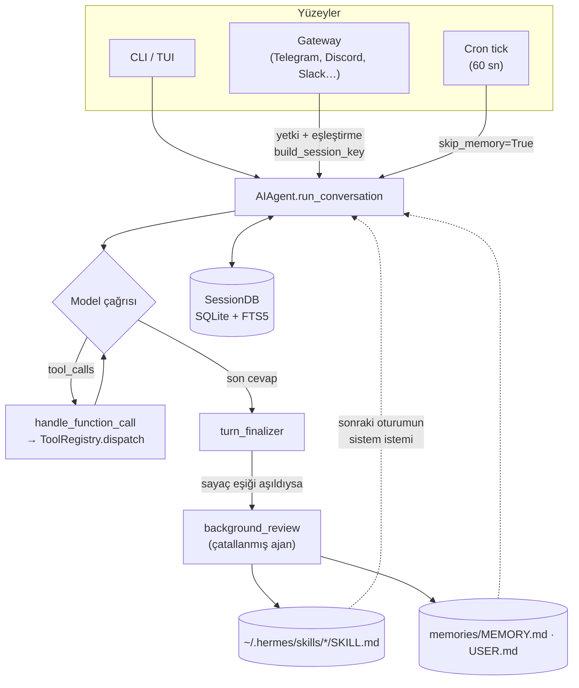
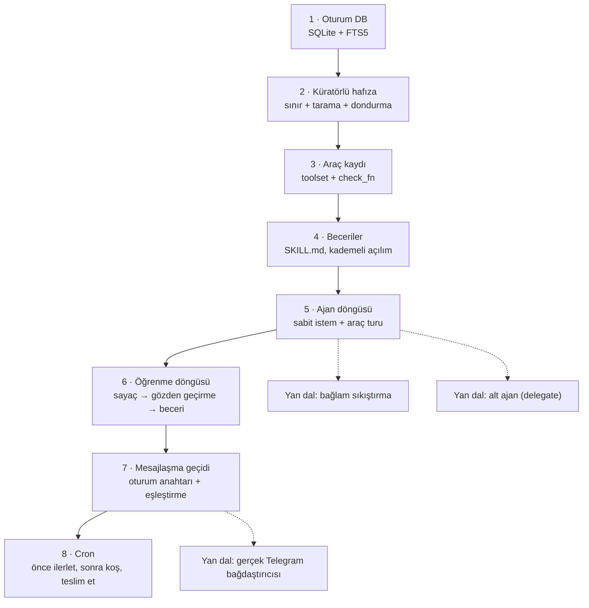

# NousResearch/hermes-agent — Kullandıkça beceri ve hafıza biriktiren kişisel ajan

> **Dal:** [D06 Kişisel ve otonom ajan platformları](../README.md) · **Tür:** kod tabanı
> **Dil:** Python (çekirdek), TypeScript (TUI, masaüstü, web) · **Lisans:** MIT · **Yıldız:** 261.924 (9 Kasım 2026)
> **İncelenen commit:** `8c1a9c0` (2026-11-09)

## 1. Bir bakışta

Hermes Agent, Nous Research'ün Temmuz 2025'te açtığı, kendi makinende ya da 5 dolarlık bir sunucuda çalışan
**kişisel ajanıdır**. Aynı ajan çekirdeği terminalde (CLI ve TUI), bir **mesajlaşma geçidi** üzerinden Telegram,
Discord, Slack, WhatsApp, Signal gibi platformlarda, masaüstü uygulamasında ve editörlerde (ACP) çalışır. Onu öbür ajanlardan ayıran iddia "**öğrenme döngüsü**"dür: ajan karmaşık bir işi bitirince
arka planda konuşmayı gözden geçirip yeniden kullanılabilir bir **beceri** (SKILL.md) yazar, kullanıcı hakkında
öğrendiklerini küçük bir **hafıza** dosyasına not eder, geçmiş oturumlarda **tam metin arama** yapar ve sonraki
oturumda bunları kullanır. Herhangi bir model sağlayıcısıyla çalışır (OpenRouter, OpenAI, Anthropic, yerel uç
noktalar…); zamanlanmış görevler, alt ajanlar ve altı terminal arka ucu (yerel, Docker, SSH, Modal, Daytona,
Vercel Sandbox) içerir. Popülerliği; MIT lisansı, "seninle büyüyen ajan" fikri ve OpenClaw kullanıcılarını doğrudan
hedeflemesinden gelir (belgelerde `hermes import-agent openclaw` göç rehberi var).

## 2. Nasıl yapılmış: mimari

### Klasör haritası

Depoda 23.484 dosya var; 7.573'ü `tests/` altındaki `test_*.py` dosyaları. Kökteki büyük dosyalar "cephe"
(facade) olarak kalmış, asıl kod `<kök>_<konu>.py` kardeş dosyalara bölünmüş (ör. `hermes_state.py` +
`hermes_state_fts.py` + `hermes_state_search.py` …).

```text
hermes-agent/
├── run_agent.py              # AIAgent cephesi; tur döngüsü agent/turn_*.py dosyalarında
├── model_tools.py            # get_tool_definitions(), handle_function_call(): araç orkestrasyonu
├── toolsets.py               # _HERMES_CORE_TOOLS: her platformda açık çekirdek araç listesi
├── cli.py                    # HermesCLI (REPL, eğik çizgi komutları)
├── hermes_state.py           # SessionDB cephesi: SQLite oturum veritabanı (+ hermes_state_*.py kardeşleri)
├── agent/                    # 426 dosya (359'u kökte .py): döngü, istem, sıkıştırma, sağlayıcılar
│   ├── conversation_loop.py  # run_conversation → _run_conversation_turn (ana while döngüsü)
│   ├── turn_*.py             # döngünün her evresi ayrı dosya: turn_tool_round, turn_finalizer…
│   ├── tool_executor.py      # araç çağrılarını yürütür, memory/skill sayaçlarını sıfırlar
│   ├── background_review.py  # tur sonrası "kaydedilecek beceri/hafıza var mı?" çatallanmış ajanı
│   ├── curator.py            # becerilerin yaşam döngüsü (arşivle, birleştir, sabitle)
│   ├── memory_manager.py     # hafıza sağlayıcı eklentilerinin orkestratörü (+ memory_provider.py ABC)
│   └── prompt_builder.py     # sistem istemi + bağlam dosyaları (AGENTS.md vb.) yükleme
├── tools/                    # 384 dosya (298'i kökte .py); her araç modülde registry.register(...) çağırır
│   ├── registry.py           # ToolRegistry, discover_builtin_tools() (AST taramasıyla keşif)
│   ├── memory_tool.py        # MEMORY.md / USER.md küratörlü hafıza
│   ├── session_search_tool.py# FTS5 ile geçmiş oturum araması
│   ├── skills_tool.py        # skills_list / skill_view (kademeli açılım)
│   ├── skill_manager_tool.py # skill_manage: ajan beceri yazar ve düzeltir
│   ├── approval.py           # tehlikeli komut onay kapısı
│   ├── threat_patterns.py    # istem enjeksiyonu / sızdırma kalıpları
│   └── environments/         # terminal arka uçları: local, docker, ssh, modal, daytona, vercel_sandbox
├── gateway/                  # mesajlaşma geçidi: run.py (GatewayRunner), session.py, pairing.py
│   └── platforms/            # base.py (BasePlatformAdapter), api_server, webhook
├── plugins/platforms/        # 26 platform bağdaştırıcısı eklenti olarak: telegram/, discord/, slack/…
├── cron/                     # jobs.py (jobs.json), scheduler.py (tick) + scheduler_*.py kardeşleri
├── skills/ · optional-skills/# paketle gelen 44 beceri + isteğe bağlı 141 beceri (SKILL.md)
├── acp_adapter/              # Agent Client Protocol: editörlerden (ör. Zed) bağlanmak için
├── tui_gateway/ · ui-tui/    # TypeScript TUI (Ink tabanlı) ve onunla JSON-RPC köprüsü
├── apps/desktop/             # Electron masaüstü uygulaması
├── batch_runner.py           # veri kümesi üzerinde paralel ajan koşturup yörünge (trajectory) üretir
├── trajectory_compressor.py  # yörüngeleri token bütçesine sıkıştırır (model eğitimi için)
└── website/                  # Docusaurus belgeleri (developer-guide/ uzun biçimli mimari notlar)
```

### Ana bileşenler ve veri akışı



**Ajan döngüsü** (`agent/conversation_loop.py`, `_run_conversation_turn`): tur bağlamı kurulur
(`build_turn_context`), sonra `api_call_count < max_iterations` ve yineleme bütçesi bitmediği sürece döngü döner. Her
yinelemede evreler sırayla çalışır: `begin_iteration` → `prepare_iteration` → `assemble_api_request` →
`run_preflight_gate` → `_run_api_retry_loop` (istek kur → çağır → cevabı denetle, hata sınıflandırıcıyla yeniden
deneme) → `normalize_model_response` → cevapta araç çağrısı varsa `run_tool_round`, yoksa `finish_text_response`.
Döngü bitince `finalize_turn` kayıtları kapatır. Evreler `agent/turn_*.py` kardeş dosyalarındadır (33 dosya;
yeniden deneme döngüsü `conversation_loop.py` içinde kalır); `_run_phase` yardımcısı evreye yalnızca imzasında
istediği durum alanlarını verir. Mesajlar OpenAI biçimindedir. Canlı `AIAgent` durumuna (depolar, geri çağırmalar,
oturum veritabanı) ihtiyaç duyan araçlar (`todo_list`, `memory`, `session_search`, `clarify`…) kayıt defterini
atlayıp `agent/inline_tool_executors.py` tablosuyla döngü içinde çalışır; diğerleri
`model_tools.py::handle_function_call` → `tools/registry.py::ToolRegistry.dispatch` yolunu izler.

**Öğrenme döngüsü** (doğrulanmış sayaçlar):

1. `agent/turn_iteration_prep.py`: her döngü adımında `_iters_since_skill += 1` (araç listesinde `skill_manage`
   varsa). `agent/turn_context.py` → `_tick_memory_nudge`: her kullanıcı turunun başında `_turns_since_memory += 1`;
   sayaç eşiğe ulaşırsa sıfırlanır ve bu tur için "hafıza gözden geçirmesi" işaretlenir.
2. `agent/tool_executor.py`: ajan kendisi `skill_manage` ya da `memory` çağırırsa ilgili sayaç sıfırlanır.
3. `agent/turn_finalizer.py`: tur bitince `_iters_since_skill >= _skill_nudge_interval` ise (varsayılan 10;
   `skills.creation_nudge_interval`) beceri gözden geçirmesi, tur başında işaretlendiyse (eşik varsayılan 10;
   `memory.nudge_interval`) hafıza gözden geçirmesi tetiklenir.
4. `agent/background_review.py`: konuşmanın anlık kopyası, ana ajanın çalışma zamanını (sağlayıcı, model, önbellekli
   sistem istemi) devralan **çatallanmış bir AIAgent**'a verilir; bu ajan yalnızca hafıza + beceri araçlarına izin
   veren bir beyaz listeyle "kaydedilecek bir şey var mı?" sorusunu cevaplar ve yazar. Ana konuşmaya dokunmaz.
5. Sonraki oturumda sistem istemi beceri dizinini (ad + kısa açıklama) ve dondurulmuş hafızayı içerir; model ayrıntı
   için `skill_view` çağırır. Uzun vadede `agent/curator.py` boşta kalınca becerileri arşivler/birleştirir.

### Önce okunacak dosyalar

1. `AGENTS.md` (kök) — iki değişmez: "konuşma başına istem önbelleği kutsaldır" ve "çekirdek dar bir bel, yetenek
   kenarlarda"; ayrıca cephe + kardeş dosya düzeni. (Yapay zekâ ajanlarına yazılmış bir metindir; mimari belge
   olarak oku.)
2. `agent/AGENTS.md` — döngünün evreleri ve mesaj akışı değişmezleri (rol sırası, sistem isteminin bayt-sabit kalması).
3. `run_agent.py` — `AIAgent` sınıfının karıştırmalarla (mixin) nasıl toplandığı, `chat()` / `run_conversation()`.
4. `agent/conversation_loop.py` — `_run_conversation_turn` içindeki `while` döngüsü ve `_run_api_retry_loop`.
5. `tools/registry.py` — `register()` imzası (`name, toolset, schema, handler, check_fn, requires_env…`),
   `discover_builtin_tools()` (modül gövdesinde `registry.register(...)` arayan AST taraması) ve `dispatch()`.
6. `tools/memory_tool.py` + `tools/memory_tool_store.py` — `ENTRY_DELIMITER = "\n§\n"`, karakter sınırları
   (2200 / 1375), oturum başında dondurulan anlık görüntü.
7. `tools/skills_tool.py` + `tools/skill_manager_tool.py` — kademeli açılım ve ajanın beceri yazma kuralları.
8. `agent/background_review.py` + `agent/turn_finalizer.py` — öğrenme döngüsünün tetiklendiği yer.
9. `gateway/session.py` (`build_session_key`) + `gateway/pairing.py` + `gateway/platforms/base.py`.
10. `cron/AGENTS.md` + `cron/scheduler.py` — zamanlayıcının "en fazla bir kez" değişmezleri.
11. `SECURITY.md` — güven modeli (bkz. tasarım kararları).

### Teknoloji yığını, derleme, test, CI, sürüm

- **Çekirdek:** Python 3.11–3.14 (`requires-python = ">=3.11,<3.15"`), `uv` + `uv.lock`, kendi paket yöneticisi
  katmanı `pm/`; doğrudan bağımlılıklar **tam sürüme sabitlenmiş** (pyproject'teki not: 2026'daki tedarik zinciri
  saldırısından sonra aralık yerine `==`). Kalıcılık: SQLite (WAL, FTS5 + trigram dizini). Biçim/lint: `ruff`,
  `lefthook`, `justfile`, `python scripts/check`.
- **Arayüzler:** TypeScript TUI (`ui-tui`, Ink çatalı `@hermes/ink` + React), Electron masaüstü (`apps/desktop`),
  web paneli (`web/`), Docusaurus sitesi (`website/`), Nix flake.
- **Giriş noktaları** (`pyproject.toml` → `[project.scripts]`): `hermes = hermes_cli.main:main`,
  `hermes-agent = agent.legacy_cli:main`, `hermes-acp = acp_adapter.entry:main`.
- **Test:** pytest, ama her zaman `scripts/run_tests.sh` üzerinden (`tests/AGENTS.md`); ayrıca `evals/` altında
  39 klasör ve 32 tek dosyalık sonda / A-B değerlendirme betiği (bir kısmı canlı sağlayıcıyla, bir kısmı modelsiz
  yerel G/Ç ile çalışır), `tests-js/` JS testleri.
- **CI:** `.github/workflows/tests.yml` (3 dilimli test matrisi), `tests-os.yml` (işletim sistemi testleri),
  `lint.yml`, `nix.yml`, `docker.yml`, `js-tests.yml`, `rust-tests.yml`, kurulum uçtan uca testleri
  (macOS/Windows/Linux), `osv-scanner.yml`.
- **Sürüm:** `canary-release.yml` (ön sürüm kanalı) ve `stable-release.yml` (açıklamalı bir "claim" etiketiyle elle
  tetiklenen kararlı yayın; Docker imajı da bu hatta derlenir), masaüstü paketleri, Termux APT deposu.
  Kurulum: `curl … install.sh | bash` (Linux/macOS/WSL), PowerShell betiği (Windows), Docker Compose.

### Tasarım kararları ve ödünleşimler

- **İstem önbelleği değişmezi.** Sistem istemi ve araç listesi bir konuşma boyunca bayt bayt aynı kalır; oturum
  ortasında yazılan hafıza diske gider ama isteme ancak sonraki oturumda girer. Böylece sağlayıcının önek önbelleği
  bozulmaz, maliyet katlanmaz. Tek izinli istisna bağlam sıkıştırmasıdır. Bedeli: ajan bu oturumda öğrendiğini
  isteminde "görmez", araç sonucundan hatırlar.
- **İki tür hafıza.** Küçük, karakter sınırlı, her oturumda isteme giren _küratörlü_ hafıza (MEMORY.md, USER.md) ile
  büyük, istem dışında duran, aranarak kullanılan _epizodik_ hafıza (SessionDB + `session_search`). Sınır, ajanı
  özetlemeye zorlar; arama ise ayrıntıyı kaybetmeden saklar. Not: README "LLM özetlemeli arama" diyor ama incelenen
  commit'te `tools/session_search_tool.py` açıkça "No LLM calls" yazıyor; kod gerçek mesajları döndürüyor.
- **Beceri = yordamsal hafıza.** "X'i nasıl yaparım" bilgisi SKILL.md dosyası olur (agentskills.io biçimi). İstemde
  yalnızca ad + açıklama durur, gövde `skill_view` ile istenir. Beceri dizini açıklamanın ilk 60 karakterini
  gösterir (`SKILL_PROMPT_DESC_LIMIT`, `agent/skill_utils.py`); `skill_manage` yeni ya da değişen bir açıklamayı
  bu sınırı aşarsa reddeder, `skills/AGENTS.md` de her yeni beceriden bunu ister. Ön bilgideki mutlak sınır ad için
  64, açıklama için 1024 karakterdir (`tools/skill_manager_tool.py`).
- **Dar çekirdek, eklentili kenarlar.** Her araç her API çağrısında modele gönderildiği için yeni çekirdek araç
  eklemek pahalıdır; "basamak" sırası: mevcut kodu genişlet → CLI komutu + beceri → servis kapılı araç → eklenti →
  MCP sunucusu → (en son) çekirdek araç. Platform bağdaştırıcıları ve sağlayıcılar bu yüzden `plugins/` altında.
- **Güvenlik sınırı işletim sistemidir.** `SECURITY.md` açık: §2.2'ye göre tek sınır işletim sistemi düzeyinde
  yalıtımdır; onay kapısı, çıktı maskeleme, Skills Guard ve kalıp tarayıcıları **sezgiseldir** (§2.4), sınır
  değildir. Gerçek sınır, terminal arka ucunu (Docker/SSH/Modal…) ya da
  tüm süreci (Docker imajı, NVIDIA OpenShell) yalıtmaktır. Eklentiler ve beceriler ajanla aynı yetkide çalışır;
  kurmadan önce kodunu okumak gerekir.
- **Profil başına izolasyon, tek süreç.** Gateway birden çok profili (ayrı `HERMES_HOME`) tek süreçte taşır; bu
  yüzden kodda "profil kapsamını açıkça bağla" kuralları ve `secret_scope` gibi korumalar var.

## 3. Öğrenmen gerekenler

- [G1 Terminal, kabuk ve Linux](../../../govde/README.md#g1) ve [G2 Git ve GitHub](../../../govde/README.md#g2) —
  terminal arka uçları (yerel, Docker, SSH) ve kabuk komutlarının neden kara listeyle durdurulamadığı; demo ve
  testler komut satırından çalışır. Depoyu incelenen sürümde açmak için `git clone` + `git checkout 8c1a9c0`.
- [G3 Python ile programlama](../../../govde/README.md#g3) — modüller, `dataclass`, `threading`, `sqlite3`.
  Kaynaklar: resmî [Python eğitimi](https://docs.python.org/3/tutorial/) ve
  [`sqlite3`](https://docs.python.org/3/library/sqlite3.html) belgesi; Çince okuyabiliyorsan
  [Python-100-Days](../../09-bilgisayar-bilimi/python-100-days/README.md).
- [G11 LLM API temelleri](../../../govde/README.md#g11) — araç çağırma döngüsü, istem önbelleği, bağlam penceresi;
  Hermes'in her tasarım kararı bunlara göre şekillenmiş.
- [G6 Ağ ve web temelleri](../../../govde/README.md#g6) — bot API'leri, webhook, uzun yoklama (long polling).
  Kaynak: [build-your-own-x → Build your own Bot](../../10-kuratorluk-topluluk/build-your-own-x/README.md)
  (Telegram botu örnekleri).
- [G7 Test, CI ve kod kalitesi](../../../govde/README.md#g7) ve [G8 Büyük kod tabanı okuma](../../../govde/README.md#g8)
  — cephe + kardeş düzeninde kod bulmak (`grep -rn "def ad" agent/turn_*.py`).
- **Tam metin arama (FTS5, BM25):** [SQLite FTS5 belgesi](https://www.sqlite.org/fts5.html).
- **Beceri biçimi:** [D08 anthropic-skills](../../08-ajan-becerileri/anthropic-skills/README.md) ve
  [agentskills.io](https://agentskills.io) — Hermes'in SKILL.md'si bu standarda uyar.
- **Yerel model:** [D05 ollama](../../05-yapay-zeka-altyapisi/ollama/README.md) — Hermes'i ücretsiz, yerel bir
  modelle denemek için.
- **İstem enjeksiyonu:** hafızaya ve beceriye yazılan metin sonraki oturumlarda isteme girer; zehirli girdi kalıcı
  olur. [OWASP LLM Top 10](https://genai.owasp.org/llm-top-10/).

## 4. Sıfırdan yol (dallanma)



| Aşama | Ne inşa edersin                          | Öğrendiğin kavram                              | Bitti ölçütü                                     | Süre (tahmini) |
| ----- | ---------------------------------------- | ---------------------------------------------- | ------------------------------------------------ | -------------- |
| 1     | `SessionDB` (+ LIKE yedeği)              | Dış içerikli FTS5 dizini, tetikleyiciler, BM25 | Cron oturumları aramada sona itilir              | 5 saat         |
| 2     | `MemoryStore`                            | Atomik yazma, sınır, enjeksiyon taraması       | Sınırı aşan ve zehirli girdi reddedilir          | 2,5 saat       |
| 3     | `ToolRegistry` + çekirdek araçlar        | İçe aktarınca kaydolan araç, hata = metin      | Bilinmeyen araç ve istisna JSON hatası döner     | 2,5 saat       |
| 4     | `SkillStore` + 3 beceri aracı            | Kademeli açılım, ad/yol denetimi               | Listede gövde yok, `skill_view` tam metni verir  | 5 saat         |
| 5     | `AIAgent.run_conversation`               | Mesaj rolleri, araç turu, yineleme sınırı      | Sistem istemi oturum boyunca değişmez            | 5 saat         |
| 6     | Sayaçlar + `run_background_review`       | Çatallanmış ajan, araç beyaz listesi           | Oturum 1'de yazılan beceri oturum 2'de okunur    | 5 saat         |
| 7     | `GatewayRunner`, `PairingStore`          | Oturum anahtarı, DM eşleştirme, hız sınırı     | Bilinmeyen kişinin mesajı ajana ulaşmaz          | 5 saat         |
| 8     | `JobStore` + `CronScheduler` + `cronjob` | Zaman ifadeleri, en fazla bir kez, teslim      | Aynı dilim iki kez koşmaz, çıktı platforma gider | 5 saat         |

**Toplam:** mini için ~35 saat; okuma rotası (§5, adım başına ~1 saat) ve alıştırmalarla (§6) birlikte
~61 saat. Hesap kuralı ve birim varsayımı (1 gün ≈ 5 saat odaklı çalışma) [dal sayfasında](../README.md#yapraklar).

**Mini uygulama:** [`sifirdan/`](sifirdan/README.md) — Python standart kütüphanesiyle altı dosya
(`asama1_hafiza.py` … `asama6_zamanlayici.py`), senaryolu sahte model (`ScriptedLLM`), `demo.py` ve 43 test.
Tablodaki sekiz aşamanın dosyaları: 1–2 → `asama1_hafiza.py`, 3 → `asama2_araclar.py`, 4 → `asama3_beceriler.py`,
5–6 → `asama4_dongu.py`, 7 → `asama5_gecit.py`, 8 → `asama6_zamanlayici.py`.
Gösterim: ajan KDV hesabını araçlarla yapar → tur sonunda gözden geçirme `kdv-hesaplama` becerisini yazar → yeni
oturumda sistem istemi beceriyi listeler, model `skill_view` ile okur → `session_search` önceki oturumu bulur →
Telegram benzeri bağdaştırıcıda eşleştirme kodu → zamanlanmış görev çıktısı platforma teslim edilir.

**Gerçek ölçeğe giden yol:** sırasıyla (1) gerçek sağlayıcı istemcisi (OpenAI uyumlu uç nokta, örn. Ollama) ve
akışlı cevap; (2) bağlam penceresi dolunca sıkıştırma (önce eski araç sonuçlarını buda, sonra özetle); (3) tehlikeli
komut onayı ve terminal arka ucu (Docker) ile yalıtım; (4) gerçek bir platform bağdaştırıcısı (Telegram Bot API,
uzun yoklama) ve gateway'in platformları asyncio ile eşzamanlı dinlemesi; (5) alt ajan (`delegate_task`) ve MCP
istemcisi; (6) profil izolasyonu; (7) beceri merkezi (hub) ve kurulum taraması; (8) TUI/masaüstü arayüzleri.

## 5. Gerçek depoda okuma rotası

1. `toolsets.py` → `_HERMES_CORE_TOOLS` listesini oku; her platformda modele hangi araçların gittiğini not al.
2. `tools/registry.py` → `discover_builtin_tools` — soru: bir araç dosyası nasıl "keşfedilir"? (Modül gövdesinde
   `registry.register(...)` çağrısı olup olmadığına AST ile bakılır, sonuç dosya zaman damgasıyla önbelleklenir.)
3. `tools/session_search_tool.py` → dosyanın sonundaki `registry.register(name="session_search", …)` — bir aracın
   şeması, işleyicisi ve `check_fn`'i yan yana.
4. `agent/conversation_loop.py` → `_run_conversation_turn` — `while` koşulundaki `_budget_grace_call`'ı bul: bütçe
   bitince model bir kez daha "toparlama" çağrısı alıyor.
5. `agent/turn_iteration_prep.py` (satır ~165) ve `agent/turn_finalizer.py` (`_should_review_skills`) — öğrenme
   döngüsünün iki ucu.
6. `agent/background_review.py` — çatallanan ajana hangi araçların açıldığını ve ana önbelleğe neden
   dokunulmadığını izle.
7. `hermes_state_fts.py` — `messages_fts` ve isteğe bağlı `messages_fts_trigram`; soru: trigram dizini neyi çözer?
   (İpucu: kelime sınırına bağlı olmayan alt dizgi araması; FTS5 sürümünde trigram yoksa güvenle devre dışı kalır.)
8. `gateway/session.py` → `build_session_key` — DM, grup ve konu (thread) için anahtar katmanları; profil adı
   `main` olunca neden `main~` kullanılıyor?
9. `gateway/pairing.py` — kod alfabesi, 1 saat ömür, platform başına 3 bekleyen kod, 5 hatalı onaydan sonra kilit.
10. `SECURITY.md` §2.2–2.5 — hangi bileşenin sınır, hangisinin yalnızca sezgisel olduğu.

## 6. Alıştırmalar ve öz değerlendirme

1. (Kolay) Mini sürüme `todo` aracı ekle (oturuma özel yapılacaklar listesi); yalnızca bellek içi dursun.
2. (Kolay) `MemoryStore`'a `stats()` ekle: kullanılan karakter / sınır yüzdesi; sistem istemine yazdır.
3. (Orta) Bağlam sıkıştırma: mesaj sayısı eşiği aşınca en eski araç sonuçlarını "[kısaltıldı]" ile değiştir;
   sistem isteminin değişmediğini test et.
4. (Orta) Gözden geçirme ajanına yalnızca **yamalama** izni ver (`create` yasak); var olan beceriyi iyileştirmesini
   test et.
5. (Orta) `session_search`'e tarih filtresi (`after`, `before`) ekle.
6. (Zor) `ScriptedLLM` yerine Ollama'nın OpenAI uyumlu `/v1/chat/completions` uç noktasını kullanan bir istemci
   yaz; testlerde sahte modeli koru, gerçek modeli yalnızca isteğe bağlı bir entegrasyon testinde çalıştır.
7. (Zor) Gateway'e gerçek bir Telegram uzun yoklama bağdaştırıcısı yaz (`getUpdates` / `sendMessage`); testte yerel
   bir sahte Bot API sunucusu kullan.

<details><summary>Soru 1: Ajan oturum ortasında "kullanıcının adı Ayşe" diye hafızaya yazdı. Aynı oturumun sistem istemi değişir mi?</summary>

Hayır. Hafıza diske yazılır ama sistem istemi oturum başında dondurulmuş anlık görüntüyü taşır. Değişseydi
sağlayıcının önek önbelleği bozulur, her çağrı pahalılaşırdı. Yeni bilgi bir sonraki oturumda isteme girer; bu
oturumda ajan onu araç sonucundan bilir.

</details>

<details><summary>Soru 2: Beceri ile hafızanın farkı nedir?</summary>

Hafıza (MEMORY.md, USER.md) bildirimseldir: kısa olgular ve tercihler, her oturumda istemde. Beceri yordamsaldır:
"şu işi şu adımlarla yap"; istemde yalnızca adı ve açıklaması durur, gövdesi gerekince `skill_view` ile okunur.

</details>

<details><summary>Soru 3: Beceri gözden geçirmesi ne zaman tetiklenir?</summary>

Tur sonunda, son becerinin yazılmasından bu yana model çağrısı sayısı (`_iters_since_skill`) eşiğe
(`skills.creation_nudge_interval`, varsayılan 10) ulaştıysa ve `skill_manage` aracı açıksa. Ajan aradaki bir adımda
kendisi `skill_manage` çağırdıysa sayaç sıfırlanmıştır.

</details>

<details><summary>Soru 4: Onay kapısı (approval) neden "güvenlik sınırı" sayılmıyor?</summary>

Çünkü kabuk Turing-tamdır; tehlikeli komut kalıplarından oluşan bir kara liste hep eksik kalır. Kapı, iş birliği
yapan modelin kazalarını yakalar, saldırgan çıktıyı durdurmaz. Gerçek sınır işletim sistemi düzeyinde yalıtımdır
(konteyner, uzak makine, tüm süreci saran sandbox).

</details>

<details><summary>Soru 5: Telegram'da tanımadığın biri bota yazınca ne olur?</summary>

Mesaj ajana ulaşmaz. Kişiye bir kez 8 karakterlik eşleştirme kodu gönderilir; sahibi
`hermes pairing approve telegram <KOD>` ile onaylarsa kişi izinli listeye girer. Kodlar 1 saatte düşer, platform
başına en çok 3 bekleyen kod olur, aynı kişiye 10 dakikada bir kod üretilir.

</details>

## 7. İş fikri tohumları

- **Esnaf için WhatsApp/Telegram asistanı kurulumu:** Hermes'i işletmenin kendi VPS'ine kurup randevu, sipariş ve
  stok sorularını cevaplayan, becerileri işletmeye göre yazılmış paket. **Kime:** kuaför, diş kliniği, butik
  pansiyon gibi 1–10 çalışanlı işletmeler.
- **Kurumsal beceri kütüphanesi:** şirket içi süreçleri (izin talebi, satın alma, rapor biçimleri) SKILL.md olarak
  yazıp bakımını yapan danışmanlık. **Kime:** ajan kullanmaya başlayan 50–500 kişilik şirketlerin operasyon ekipleri.
- **Ajan güvenlik denetimi:** kurulu beceri ve eklentileri `SECURITY.md` güven modeline göre tarayan, yalıtımı
  (Docker arka ucu) yapılandıran hizmet. **Kime:** çalışanlarına kişisel ajan dağıtan KOBİ BT sorumluları.

Ayrıntılı katalog: [is-fikirleri/README.md](../../../is-fikirleri/README.md).

## 8. Kaynaklar

- [README (incelenen commit)](https://github.com/NousResearch/hermes-agent/blob/8c1a9c0b6da872cca5083b98a7a1022edc3dfb4b/README.md)
- [AGENTS.md (mimari özet ve kurallar)](https://github.com/NousResearch/hermes-agent/blob/8c1a9c0b6da872cca5083b98a7a1022edc3dfb4b/AGENTS.md)
- [agent/AGENTS.md (döngü evreleri)](https://github.com/NousResearch/hermes-agent/blob/8c1a9c0b6da872cca5083b98a7a1022edc3dfb4b/agent/AGENTS.md)
- [SECURITY.md (güven modeli)](https://github.com/NousResearch/hermes-agent/blob/8c1a9c0b6da872cca5083b98a7a1022edc3dfb4b/SECURITY.md)
- [CONTRIBUTING.md](https://github.com/NousResearch/hermes-agent/blob/8c1a9c0b6da872cca5083b98a7a1022edc3dfb4b/CONTRIBUTING.md)
- [cron/AGENTS.md (zamanlayıcı değişmezleri)](https://github.com/NousResearch/hermes-agent/blob/8c1a9c0b6da872cca5083b98a7a1022edc3dfb4b/cron/AGENTS.md)
- [tools/registry.py](https://github.com/NousResearch/hermes-agent/blob/8c1a9c0b6da872cca5083b98a7a1022edc3dfb4b/tools/registry.py)
- [website/docs/guides/migrate-from-openclaw.md](https://github.com/NousResearch/hermes-agent/blob/8c1a9c0b6da872cca5083b98a7a1022edc3dfb4b/website/docs/guides/migrate-from-openclaw.md)
- Resmî belgeler: [hermes-agent.nousresearch.com/docs](https://hermes-agent.nousresearch.com/docs/)
- [SQLite FTS5](https://www.sqlite.org/fts5.html) · [agentskills.io](https://agentskills.io) ·
  [Model Context Protocol](https://modelcontextprotocol.io/)
