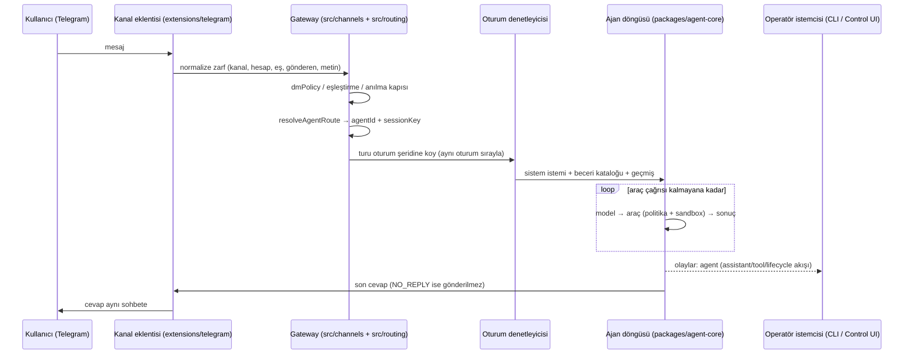
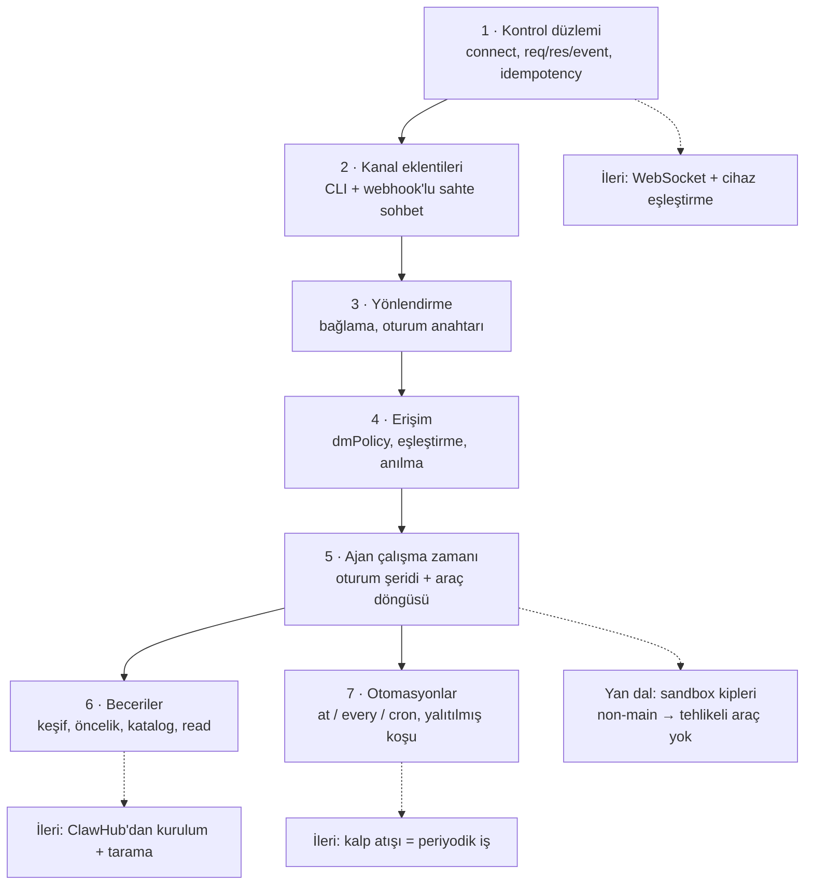

# openclaw/openclaw — Kendi cihazında çalışan, sohbet kanallarına bağlanan kişisel asistan ağ geçidi

> **Dal:** [D06 Kişisel ve otonom ajan platformları](../README.md) · **Tür:** kod tabanı
> **Dil:** TypeScript (Node.js; yerel uygulamalarda Swift, Kotlin, Rust) · **Lisans:** MIT · **Yıldız:** 394.225
> (9 Kasım 2026) · **İncelenen commit:** `7c78826` (2026-11-09)

## 1. Bir bakışta

OpenClaw, kendi bilgisayarında (ya da sunucunda) çalışan ve seni zaten kullandığın sohbet uygulamalarında karşılayan
açık kaynak bir yapay zekâ asistanıdır: WhatsApp, Telegram, Slack, Discord, Signal, iMessage, Teams ve 20'den fazla
kanal; macOS, iOS, Android, Windows ve Linux uygulamaları. Merkezde tek, uzun ömürlü bir **Gateway** süreci var:
kanal bağlantılarını, oturumları, araçları, otomasyonları ve istemcileri (CLI, web tabanlı Control UI, telefon/
masaüstü "düğümleri") o yönetir. Proje Kasım 2025'te açıldı, adı Warelay → Clawdbot → Moltbot → OpenClaw diye
değişti (`VISION.md`), bugün bağımsız bir vakıf (OpenClaw Foundation) tarafından yürütülüyor; atlastaki 51 depo
arasında yıldız sayısında 7. sırada (yalnızca 2025 sonunda açılmış olmasına rağmen). Popülerliğinin sırrı "verin
sende kalsın" vaadi (durum, hafıza ve kimlik bilgileri kendi donanımında), tek kurulumla çok kanala yayılması ve
devasa eklenti/beceri ekosistemi (ClawHub). Kimler kullanır: kişisel asistan isteyen bireyler, aynı Gateway'i
paylaşan ekipler ("multiplayer claw").

## 2. Nasıl yapılmış: mimari

### Klasör haritası

Depoda 65.873 dosya var: `src/` 29.365, `extensions/` 12.881 (185 paket; 183'ü `openclaw.plugin.json` manifestli
eklenti, kalan ikisi `image-generation-core` çalışma zamanı paketi ve `test-support`), `ui/` 7.566, `apps/` 3.174,
`docs/` 1.481, 21.688 `*.test.ts`.

```text
openclaw/
├── openclaw.mjs              # npm "bin" girişi (package.json: "openclaw": "openclaw.mjs")
├── VISION.md · AGENTS.md     # ürün kapsamı; katkıcı/ajan kuralları (mimari ilkeleri de anlatır)
├── src/
│   ├── gateway/              # Gateway çekirdeği: server/ (WS bağlantıları, HTTP), server-methods/ (RPC yöntemleri)
│   ├── channels/             # ortak kanal hattı: DM erişimi, anılma kapısı, oturum zarfı, kayıt
│   ├── routing/              # resolve-route.ts (resolveAgentRoute), session-key.ts (oturum anahtarları)
│   ├── pairing/              # DM ve cihaz eşleştirme deposu (SQLite), kodlar
│   ├── agents/               # agent-command.ts, embedded-agent-runner/, tools/, sandbox/, subagents/
│   ├── skills/               # SKILL.md keşfi, öncelik, <available_skills> kataloğu
│   ├── cron/                 # otomasyonlar: schedule.ts, isolated-agent.ts, delivery.ts, store/
│   ├── plugins/ · plugin-sdk/# eklenti yükleyici ve herkese açık eklenti SDK'sı
│   ├── config/ · state/      # ~/.openclaw/openclaw.json (JSON5) ve SQLite durum veritabanı
│   ├── auto-reply/           # cevap hattı; tokens.ts → NO_REPLY, HEARTBEAT_OK
│   ├── node-host/ · canvas/  # cihaz düğümü ana makinesi, Canvas (barındırılan pencere öğeleri)
│   └── security/ · secrets/  # güvenlik denetimleri, sır yönetimi
├── packages/                 # agent-core (ajan döngüsü), gateway-protocol (TypeBox şemaları), llm-core…
├── extensions/               # 183 eklenti (+2 yardımcı paket): 64 model sağlayıcı, 25 kanal, ses, hafıza…
├── skills/                   # paketle gelen 50 beceri (github, notion, weather, skill-creator, clawhub…)
├── ui/                       # Control UI (Solid + Vite)
├── apps/                     # macos (Swift Package), ios (Swift), android (Kotlin), linux
├── crates/                   # Rust: openclaw-gateway-client, openclaw-node-host, openclaw-iroh-node
└── docs/                     # docs.openclaw.ai kaynakları (concepts/, gateway/, channels/, automation/…)
```

### Ana bileşenler ve veri akışı



**Kontrol düzlemi.** Gateway, istemcilere ve düğümlere varsayılan olarak `127.0.0.1:18789`'da bir WebSocket API'si
sunar (`docs/concepts/architecture.md`). İlk çerçeve `connect` olmak zorundadır (kimlik doğrulama + cihaz kimliği +
rol: operatör ya da `node`); sonra istekler `{type:"req", id, method, params}`, cevaplar
`{type:"res", id, ok, payload|error}`, olaylar `{type:"event", event, payload, seq?, stateVersion?}` biçimindedir.
`send` ve `agent` gibi yan etkili yöntemler idempotency anahtarı ister. Protokol `packages/gateway-protocol` içinde TypeBox ile
tanımlanır; JSON Şeması ve Swift modelleri buradan üretilir.

**Gelen mesaj hattı.** Her kanal bir eklentidir (`extensions/<kanal>/openclaw.plugin.json` +
`defineBundledChannelEntry`). Kanal mesajı ortak bir zarfa çevirir; `src/channels` erişimi denetler (DM politikası:
`pairing` varsayılan, `allowlist`, `open` — yalnızca izin listesinde `"*"` varsa —, `disabled`; gruplarda anılma
kapısı), `src/routing/resolve-route.ts` bağlamalara (bindings) bakıp hangi **ajanın** (ayrı çalışma alanı + oturum
deposu) ve hangi **oturumun** cevap vereceğini seçer. Varsayılan DM kapsamında tüm DM'ler ajanın ana oturumunda
(`agent:<agentId>:main`) birleşir; gruplar `agent:<agentId>:<kanal>:group:<id>` gibi kendi oturumlarını alır. Model
kanal seçmez: cevap mesajın geldiği yere döner.

**Ajan döngüsü** (`docs/concepts/agent-loop.md`): `agent` RPC'si oturumu çözüp hemen `{runId}` döner;
`agentCommand` (`src/agents/agent-command.ts`) modeli ve beceri anlık görüntüsünü çözer, `runEmbeddedAgent`
(`src/agents/embedded-agent-runner/run-orchestrator.ts`) oturum denetleyicisinden tur hakkı alır, sistem istemini
(temel istem + beceri kataloğu + çalışma alanı dosyaları) kurar ve `packages/agent-core/src/agent-loop.ts`
içindeki `runAgentLoop`'u çalıştırır: model cevabı → araç çağrıları (paralel çalışabilir) → sonuçlar → tekrar.
Akış olayları (`assistant`, `tool`, `lifecycle`) kontrol düzlemine yayınlanır; dökümler SQLite'a, aktif yazar
iddiasıyla (writer claim) çit çekilerek yazılır.

### Önce okunacak dosyalar

1. `README.md` + `VISION.md` — ürünün sınırı: kişisel/paylaşılan asistan, yerel öncelikli, ücretli katman yok.
2. `docs/concepts/architecture.md` — Gateway, istemciler, düğümler, tel protokolü, eşleştirme ve yerel güven.
3. `docs/channels/channel-routing.md` — oturum anahtarı biçimleri, `dmScope`, `groupScope`, bağlamalar.
4. `docs/channels/pairing.md` + `src/channels/direct-dm-access.ts` — DM erişim kararı ve eşleştirme kodları.
5. `src/routing/session-key.ts` (`buildAgentPeerSessionKey`) ve `src/routing/resolve-route.ts` (`resolveAgentRoute`).
6. `docs/concepts/agent-loop.md` + `packages/agent-core/src/agent-loop.ts` (`runAgentLoop`, `runLoop`).
7. `docs/tools/skills.md` + `src/skills/loading/skill-contract.ts` — yükleme önceliği ve `<available_skills>`.
8. `docs/automation/cron-jobs/how-it-works.md` + `src/cron/` — otomasyonların Gateway içinde nasıl koştuğu.
9. `docs/gateway/sandboxing/modes-scope-and-backend.md` — `off` / `non-main` / `all` sandbox kipleri.
10. `extensions/telegram/` — gerçek bir kanal eklentisinin dosya düzeni (`index.ts`, `openclaw.plugin.json`).

### Teknoloji yığını, derleme, test, CI, sürüm

- **Çalışma zamanı:** Node.js `>=24.16 <25 || >=26.1`, pnpm 12 çalışma alanı (`pnpm-workspace.yaml`), ESM,
  TypeScript 7 (yerel `tsgo`), şema için TypeBox ve Zod, WebSocket için `ws`, WhatsApp için Baileys, Telegram için
  grammY. Durum ve önbellek SQLite'ta (kök `AGENTS.md`: "SQLite, not new JSON/JSONL/sidecar stores");
  isteğe bağlı PostgreSQL.
- **Arayüz ve uygulamalar:** Control UI Solid + Vite; macOS uygulaması Swift Package (Sparkle güncelleme beslemesi
  kökteki `appcast*.xml`), iOS (Swift), Android (Kotlin), Rust ile düğüm ana makinesi ve iroh tabanlı bağlantı.
- **Test ve kalite:** Vitest 5 (21.688 test dosyası), oxlint, `pnpm check`; davranış değişikliği için "gerçek ürün
  yolunda uçtan uca kanıt" kuralı (izole Gateway + gerçek kanal e2e becerileri).
- **CI:** `.github/workflows/ci.yml` (6.000 satırı aşan ana iş akışı: güvenlik, eklenti/kanal sözleşmeleri, Windows,
  macOS Swift, iOS…), CodeQL, OpenGrep, bağımlılık denetimi, Postgres uyumluluğu.
- **Sürüm:** sürüm biçimi `yıl.ay.yama` (ör. `2026.11.1`); npm kanalları `latest` (stable), `beta`,
  `extended-stable`; etiketler imzalı ve açıklamalı (`docs/reference/RELEASING.md`). Ayrı iş akışları npm
  (`openclaw-npm-release.yml`), Docker (`docker-release.yml`), macOS, iOS/Android mağazaları, Windows düğümü ve
  ClawHub eklenti yayını (`plugin-clawhub-release.yml`) içindir. Hermes'ten göç için `extensions/migrate-hermes`
  eklentisi var (Hermes'te de tersi yönde `hermes import-agent openclaw` var).
- **Kurulum:** `curl -fsSL https://openclaw.ai/install.sh | bash` ya da Node.js'i kendin yönetiyorsan
  `npm install -g openclaw@latest --allow-scripts=openclaw` (npm 12 ya da 11.16+; daha eski npm'de bayrak
  yazılmaz), ardından `openclaw onboard --install-daemon`.

### Tasarım kararları ve ödünleşimler

- **Tek Gateway, çok kanal, çok istemci.** Her şey tek süreçte birleşir: WhatsApp oturumu tek yerde açılır, tüm
  istemciler aynı olay akışını görür. Bedeli: Gateway çökerse her şey durur; bu yüzden launchd/systemd denetimi,
  yeniden başlatmada "kaldığı yerden devam" ve SQLite tabanlı kalıcılık ağır basar.
- **Güvenilir Gateway, güvenilmeyen yürütme.** README'nin özeti: politika kodla uygulanır. Gelen mesaj güvenilmez
  girdidir; DM'ler varsayılan olarak eşleştirme ister; tehlikeli araçlar ve sandbox kipleri oturuma göre değişir
  (`non-main` kipinde ana oturum dışındaki her oturum sandbox'ta koşar). Sandbox varsayılan olarak kapalıdır ve
  belgeler bunu "kusursuz bir sınır değil" diye açıkça yazar.
- **Kararlı istem öneki.** Bir oturum içinde araç tanımları, sistem istemi ve geçmiş yalnızca oturum ve yapılandırma
  gerçeklerine bağlıdır; geçmiş yalnızca sona eklenir, yalnızca sıkıştırma (compaction) geçmişi yeniden yazar
  (kök `AGENTS.md`). Hermes'teki "istem önbelleği kutsaldır" kuralının aynısı.
- **Küçük çekirdek, yetenekli eklentiler.** Model sağlayıcıları (64), kanallar (25), ses, hafıza, tarayıcı birer
  eklentidir; çekirdeğe yeni araç eklemek, her çağrıda modele giden bağlamı büyüttüğü için pahalı sayılır.
- **Beceriler kademeli açılır.** İstemde yalnızca `<available_skills>` kataloğu (ad, açıklama, konum) durur; model
  ilgili SKILL.md'yi okuma aracıyla açar. `metadata.openclaw.requires` (bins, env, config) karşılanmayan beceri hiç
  listelenmez. Varsayılan açık gelen `extensions/skill-workshop` eklentisi ("Learned skills each agent saves from its
  own work") ajanın kendi işinden beceri kaydetmesini sağlar — Hermes'in öğrenme döngüsünün buradaki karşılığı;
  bu beceriler yükleme önceliğinde ayrı bir katmandır (`<state-dir>/agents/<agentId>/agent/workshop-skills`).
- **Kalp atışı (heartbeat) otomasyona dönüştü.** Eskiden çalışma alanındaki `HEARTBEAT.md` periyodik kontrolü
  anlatırdı; incelenen commit'te bu dosya emekliye ayrılmış, `openclaw doctor --fix` eski izleyicileri sıradan
  otomasyon işlerine çeviriyor (`docs/gateway/heartbeat.md`). `HEARTBEAT_OK` ve `NO_REPLY` belirteçleri ise
  `src/auto-reply/tokens.ts` içinde hâlâ duruyor.

## 3. Öğrenmen gerekenler

- [G1 Terminal, kabuk ve Linux](../../../govde/README.md#g1) ve [G2 Git ve GitHub](../../../govde/README.md#g2) —
  `openclaw onboard --install-daemon` bir launchd/systemd hizmeti (Windows'ta Zamanlanmış Görev) kurar; `exec`
  aracı ve sandbox kipleri süreç ve kabuk bilgisi ister; mini komut satırından çalışır. Depoyu incelenen sürümde
  açmak için `git clone` + `git checkout 7c78826` (65.873 dosya: seyrek klon işe yarar).
- [G4 JavaScript / TypeScript ve Node.js](../../../govde/README.md#g4) — ESM, `async`/`await`, `node:http`,
  Promise zincirleri (oturum şeridi bunlarla kurulur). Kaynak:
  [You Don't Know JS](../../01-web-arayuzu/you-dont-know-js/README.md).
- [G6 Ağ ve web temelleri](../../../govde/README.md#g6) — WebSocket, webhook, gizli başlıkla imza doğrulama,
  localhost'a bağlanmanın anlamı. Kaynak: [MDN WebSockets](https://developer.mozilla.org/en-US/docs/Web/API/WebSockets_API).
- [G11 LLM API temelleri](../../../govde/README.md#g11) — araç çağırma döngüsü, istem önbelleği, akış.
- [G7 Test, CI ve kod kalitesi](../../../govde/README.md#g7) ve [G8 Büyük kod tabanı okuma](../../../govde/README.md#g8)
  — 65.000 dosyalık bir monorepoda belgelerden (`docs/`) koda inmek.
- **Bot yazma temelleri:** [build-your-own-x → Build your own Bot](../../10-kuratorluk-topluluk/build-your-own-x/README.md)
  (Node.js ile Telegram botu örneği).
- **Beceri standardı:** [D08 anthropic-skills](../../08-ajan-becerileri/anthropic-skills/README.md) — SKILL.md biçimi.
- **Kodlama ajanı döngüsü:** [D07 opencode](../../07-kodlama-ajanlari/opencode/README.md) — aynı araç döngüsünün tek
  kullanıcılı, terminal odaklı hâli; izin sistemi karşılaştırması için.
- **Yerel model:** [D05 ollama](../../05-yapay-zeka-altyapisi/ollama/README.md) — OpenClaw'ın `extensions/ollama`
  eklentisiyle kullanılabilir.
- **Güvenlik:** [OWASP LLM Top 10](https://genai.owasp.org/llm-top-10/) (istem enjeksiyonu, aşırı yetki).

## 4. Sıfırdan yol (dallanma)



| Aşama | Ne inşa edersin                                       | Öğrendiğin kavram                                     | Bitti ölçütü                                         | Süre (tahmini) |
| ----- | ----------------------------------------------------- | ----------------------------------------------------- | ---------------------------------------------------- | -------------- |
| 1     | `ControlPlane` (çerçeveler, roller, doğrulama)        | Tipli RPC, idempotency, olay sırası                   | Tekrarlanan `send` ikinci kez çalışmaz               | 5 saat         |
| 2     | CLI kanalı + webhook kanalı + sahte sohbet uygulaması | Kanal sözleşmesi, imza doğrulama                      | Yanlış sır 401 alır, doğru sır mesaj teslim eder     | 5 saat         |
| 3     | `buildAgentPeerSessionKey`, `resolveAgentRoute`       | Oturum kapsamları, en özgül bağlama                   | DM/grup/konu anahtarları belgelerle aynı biçimde     | 2,5 saat       |
| 4     | `decideDmAccess`, `PairingStore`, anılma kapısı       | Varsayılan-reddet, kodla onay                         | Bilinmeyen kişinin mesajı ajana ulaşmaz              | 5 saat         |
| 5     | `SessionLanes`, `runAgentLoop`, `AgentRuntime`        | Oturum başına sıralama, araç politikası, sessiz cevap | Grup oturumunda `exec` ne görünür ne çalışır         | 7,5 saat       |
| 6     | `discoverSkills`, `formatSkillsForPrompt`, `read`     | Öncelik, uygunluk süzgeci, yol sınırlama              | Sembolik bağla kök dışına okuma reddedilir           | 5 saat         |
| 7     | `CronService`                                         | Zaman ızgarası, en fazla bir kez, teslim              | HEARTBEAT_OK teslim edilmez, tek seferlik iş silinir | 5 saat         |

**Toplam:** mini için ~35 saat; okuma rotası (§5, adım başına ~1 saat) ve alıştırmalarla (§6) birlikte
~61 saat. Hesap kuralı ve birim varsayımı (1 gün ≈ 5 saat odaklı çalışma) [dal sayfasında](../README.md#yapraklar).

**Mini uygulama:** [`sifirdan/`](sifirdan/README.md) — yalnızca Node.js yerleşik modülleriyle altı aşama dosyası +
`gateway.js` + `demo.js`, 31 test (biri 127.0.0.1 üzerinde uçtan uca HTTP). Tablodaki yedi aşamanın dosyaları:
1 → `asama1_protokol.js`, 2 → `asama2_kanallar.js`, 3–4 → `asama3_yonlendirme.js`, 5 → `asama4_ajan.js`,
6 → `asama5_beceriler.js`, 7 → `asama6_zamanlayici.js`; hepsini `gateway.js` bağlar. Sahte sohbet uygulaması Telegram
webhook modunu taklit eder: kullanıcı yazınca uygulama Gateway'e gizli başlıklı POST yapar, bot cevabını
uygulamanın `/sendMessage` uç noktasına POST eder.

**Gerçek ölçeğe giden yol:** sırasıyla (1) kontrol düzlemini WebSocket'e taşı ve `connect.challenge` imzalı cihaz
eşleştirmesini ekle; (2) oturum dökümlerini ve eşleştirme deposunu SQLite'a yaz, yeniden başlatmada kurtar;
(3) gerçek bir kanal (grammY ile Telegram) ve akışlı taslak mesajlar; (4) Docker sandbox arka ucu; (5) hafıza
eklentisi (SQLite FTS5 + vektör arama); (6) çok ajanlı yapılandırma ve alt ajanlar; (7) Control UI ve düğümler
(kamera, ekran, konum); (8) eklenti yükleyici ve ClawHub.

## 5. Gerçek depoda okuma rotası

1. `docs/concepts/architecture.md` — bağlantı yaşam döngüsü diyagramını çiz; "ilk çerçeve connect" kuralını not al.
2. `packages/gateway-protocol/src/` — bir yöntem şemasını bul; TypeBox → JSON Şeması → Swift zincirini izle.
3. `src/gateway/server-methods.ts` ve `src/gateway/server-methods/` — `agent.ts`, `chat-send-handler.ts`,
   `channel-pairing.ts`: bir RPC yönteminin şema doğrulamadan işleyiciye yolu.
4. `src/routing/session-key.ts` → `buildAgentPeerSessionKey` — `dmScope` değerleri için anahtarları elle üret ve
   `docs/channels/channel-routing.md` ile karşılaştır.
5. `src/channels/direct-dm-access.ts` — soru: `dmPolicy: "open"` iken eşleştirme deposundaki onaylar erişimi
   genişletir mi? (Hayır; yalnızca `pairing` kipinde depo okunur.)
6. `src/agents/agent-command.ts` → `agentCommand` ve `src/agents/embedded-agent-runner/run-orchestrator.ts` →
   `runEmbeddedAgent` (`run.ts` yalnızca bunu yeniden dışa aktarır) — tur hakkı, model çözümü, beceri anlık
   görüntüsü.
7. `packages/agent-core/src/agent-loop.ts` → `runLoop` — iç içe iki `while` döngüsü: içteki araç turlarını ve tur
   sırasında araya giren yönlendirme (steering) mesajlarını, dıştaki ise ajan durduktan sonra kuyrukta bekleyen
   takip (follow-up) mesajlarını işler.
8. `src/skills/loading/skill-contract.ts` — katalog XML'i (`formatSkillsForPromptCore`) ve bağlam bütçesine göre
   açıklama kısaltma (`compactSkillsPromptForContext`, ikili arama ile); `skill-prompt-catalog.ts` oluşan kataloğu
   geri okuyan küçük ayrıştırıcıdır.
9. `src/auto-reply/tokens.ts` — `NO_REPLY` ve `HEARTBEAT_OK`; `src/agents/AGENTS.md`'deki "kaynak cevap
   tamamlama" kurallarıyla birlikte oku.
10. `docs/gateway/sandboxing/modes-scope-and-backend.md` — `non-main` kipinde ana oturum anahtarının neden
    yapılandırılamaz olduğunu anla.

## 6. Alıştırmalar ve öz değerlendirme

1. (Kolay) Mini sürüme `status` yöntemi ekle: bağlı istemci sayısı, açık oturumlar, bekleyen eşleştirmeler.
2. (Kolay) `dmScope: "per-peer"` ile aynı `peerId`'nin iki kanaldan aynı oturuma düştüğünü test et; sonra gerçekteki
   `identityLinks` fikrine benzer bir kimlik eşleme tablosu ekleyip farklı kanal kimliklerini tek kişide birleştir.
3. (Orta) Kontrol düzlemini `node:http` üzerinde basit bir WebSocket el sıkışmasıyla (RFC 6455) sun; mevcut
   `handleFrame` aynen kullanılsın.
4. (Orta) Oturum kuyruk kipleri: aynı oturuma tur sürerken gelen mesaj için `followup` (sıraya al) ve `collect`
   (birleştirip tek tur yap) kiplerini ekle.
5. (Orta) Beceri değişince oturumun beceri anlık görüntüsünü yalnızca **yeni** oturumda yenile; eski oturumun
   istemi değişmesin.
6. (Zor) Tehlikeli araç için onay akışı: araç çağrısı bir onay olayı yayınlasın, operatör bir RPC yöntemiyle
   onaylayana kadar tur beklesin, zaman aşımında reddetsin (gerçek akış için `src/gateway/server-methods/approval*.ts`).
7. (Zor) Eşleştirme deposunu ve dökümleri `node:sqlite` ile kalıcı yap (Node 22'de deneysel uyarısı verir); Gateway
   yeniden başlayınca onaylı kişiler korunsun.

<details><summary>Soru 1: Varsayılan ayarlarda Telegram'dan ve WhatsApp'tan aynı kişi yazarsa kaç oturum olur?</summary>

Bir. Varsayılan `session.dmScope: "main"` tüm DM'leri ajanın ana oturumunda (`agent:<agentId>:main`) birleştirir.
Ayrı oturum istiyorsan `per-channel-peer` ya da `per-peer` kullanırsın. Gruplar ise varsayılan
`session.groupScope: "per-group"` ayarında kendi oturumlarındadır (`groupScope: "main"` onları da ana oturuma
toplar).

</details>

<details><summary>Soru 2: Tanımadığın biri bota DM attı. Mesajı modele gider mi?</summary>

Hayır. `dmPolicy: "pairing"` (varsayılan) altında bilinmeyen gönderene 8 karakterlik bir kod gider ve mesaj
işlenmez. Sahibi `openclaw pairing approve <kanal> <KOD>` ile (ya da Control UI'dan) onaylayınca kişi DM izni alır.
Kod 1 saatte düşer; kanal hesabı başına en çok 3 bekleyen istek tutulur.

</details>

<details><summary>Soru 3: Model "NO_REPLY" yazarsa ne olur?</summary>

Kanala hiçbir şey gönderilmez; bu "sessiz cevap"tır. Gruplarda ya da otomasyonlarda "söyleyecek bir şey yoksa
sus" davranışı böyle kurulur. Belirteç `src/auto-reply/tokens.ts` içinde tanımlıdır ve yalnızca bütün cevap
buysa (büyük/küçük harf fark etmeden) sessiz sayılır.

</details>

<details><summary>Soru 4: `agents.defaults.sandbox.mode: "non-main"` neyi değiştirir?</summary>

Ajanın ana oturumu (`agent:<agentId>:main`) ana makinede çalışmaya devam eder; grup, kanal, otomasyon gibi diğer
tüm oturumların araç yürütmesi sandbox arka ucuna (Docker, Podman, SSH, OpenShell, Crabbox) taşınır. Gateway
sürecinin kendisi her zaman ana makinededir. İnce nokta: dış kanallardan gelen DM'ler ana oturumun geçmişini
paylaşsa da sandbox ve araç politikası için hesap başına türetilmiş bir DM anahtarı kullanılır
(`docs/channels/channel-routing.md`); yani bu DM'ler yerel ana oturum çalışması gibi sayılmaz.

</details>

## 7. İş fikri tohumları

- **Kurulu asistan hizmeti:** küçük ofislere OpenClaw'ı kendi mini PC'lerine kurup WhatsApp/Telegram kanallarını,
  eşleştirme politikasını ve sandbox'ı yapılandıran, aylık bakım yapan hizmet. **Kime:** 3–15 kişilik avukatlık,
  mimarlık, muhasebe ofisleri.
- **Türkçe beceri paketleri (ClawHub):** Türk bankaları, e-Arşiv fatura, kargo takibi, resmî tatil takvimi gibi
  yerel işler için SKILL.md paketleri ve destek. **Kime:** OpenClaw kullanan Türk bireysel kullanıcılar ve ajanslar.
- **Kanal eklentisi geliştirme:** henüz eklentisi olmayan yerel mesajlaşma/çağrı merkezi sistemleri için kanal
  eklentisi yazıp bakımını yapmak. **Kime:** müşteri hizmetini sohbet kanallarına taşıyan orta ölçekli şirketler.

Ayrıntılı katalog: [is-fikirleri/README.md](../../../is-fikirleri/README.md).

## 8. Kaynaklar

- [README (incelenen commit)](https://github.com/openclaw/openclaw/blob/7c78826284047427953b13ed70006e24b4ec5709/README.md)
- [VISION.md](https://github.com/openclaw/openclaw/blob/7c78826284047427953b13ed70006e24b4ec5709/VISION.md) ·
  [CONTRIBUTING.md](https://github.com/openclaw/openclaw/blob/7c78826284047427953b13ed70006e24b4ec5709/CONTRIBUTING.md) ·
  [SECURITY.md](https://github.com/openclaw/openclaw/blob/7c78826284047427953b13ed70006e24b4ec5709/SECURITY.md)
- [docs/concepts/architecture.md](https://github.com/openclaw/openclaw/blob/7c78826284047427953b13ed70006e24b4ec5709/docs/concepts/architecture.md)
- [docs/concepts/agent-loop.md](https://github.com/openclaw/openclaw/blob/7c78826284047427953b13ed70006e24b4ec5709/docs/concepts/agent-loop.md)
- [docs/channels/channel-routing.md](https://github.com/openclaw/openclaw/blob/7c78826284047427953b13ed70006e24b4ec5709/docs/channels/channel-routing.md)
- [docs/channels/pairing.md](https://github.com/openclaw/openclaw/blob/7c78826284047427953b13ed70006e24b4ec5709/docs/channels/pairing.md)
- [docs/tools/skills.md](https://github.com/openclaw/openclaw/blob/7c78826284047427953b13ed70006e24b4ec5709/docs/tools/skills.md)
- [docs/automation/cron-jobs/how-it-works.md](https://github.com/openclaw/openclaw/blob/7c78826284047427953b13ed70006e24b4ec5709/docs/automation/cron-jobs/how-it-works.md)
- [docs/reference/RELEASING.md](https://github.com/openclaw/openclaw/blob/7c78826284047427953b13ed70006e24b4ec5709/docs/reference/RELEASING.md)
- Resmî site ve belgeler: [docs.openclaw.ai](https://docs.openclaw.ai) · [openclaw.ai](https://openclaw.ai)
