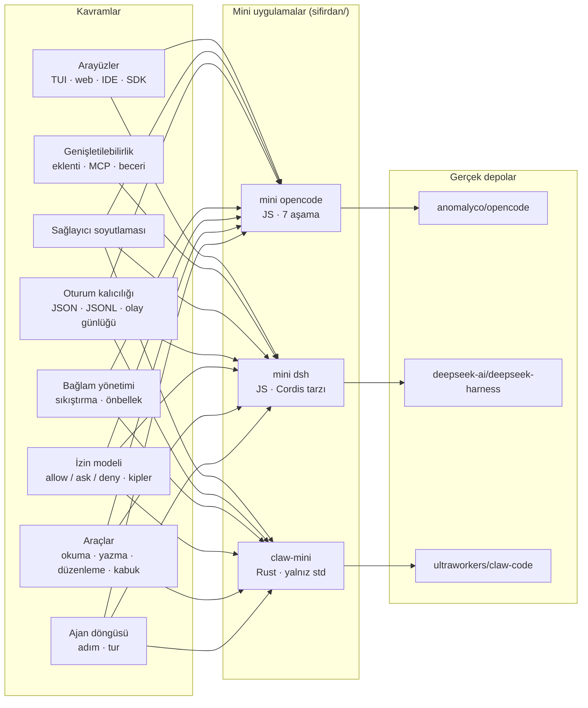

# D07 — Kodlama ajanları ve harness'lar

> Bir dil modelini "kod yazan bir iş arkadaşına" çeviren iskelet: döngü, araçlar, izinler, bağlam yönetimi, oturumlar,
> sağlayıcı bağdaştırıcıları ve arayüzler. Bu dalda üç depo var: **anomalyco/opencode** (TypeScript, ürün),
> **deepseek-ai/deepseek-harness** (TypeScript, eklenti mimarisi) ve **ultraworkers/claw-code** (Rust, ajanlarca
> yürütülen depo). Ağacın tamamı: [AGAC.md](../../AGAC.md).

## Bu dal ne öğretir

"Harness", modelin etrafındaki her şeydir. Model yalnızca metin ve araç çağrısı üretir; harness o çağrıyı **izin**
kurallarından geçirir, **aracı** çalıştırır, sonucu **oturuma** yazar, bağlam penceresi dolunca **sıkıştırır**, farklı
**sağlayıcıların** tel biçimlerine çevirir ve olayları **arayüze** (TUI, web, IDE, SDK) yayınlar. Üç depo aynı soruya üç
farklı cevap verir:

- **opencode** — "iyi tasarlanmış bir ürün": istemci/sunucu ayrımı, kalıcı gelen kutusu, olay kaynaklı oturum.
- **deepseek-harness** — "değiştirilebilir parçalar": döngü dahil her şey bir Cordis eklentisi; davranış olaylara takılır.
- **claw-code** — "okunaklı bir çekirdek + ajanlarca işletilen depo": trait'lerle kurulmuş Rust döngüsü ve deponun
  kendisinin ajan iş akışlarıyla yürütülmesi.

## Önkoşullar

Bu liste üç yaprağın "Öğrenmen gerekenler" bölümlerinin birleşimidir.

| Düğüm                                                                                                                        | Neden                                                                                                                                                                                                                            |
| ---------------------------------------------------------------------------------------------------------------------------- | -------------------------------------------------------------------------------------------------------------------------------------------------------------------------------------------------------------------------------- |
| [G11 LLM API temelleri](../../govde/README.md#g11)                                                                           | Araç çağırma, akış (streaming), token ve istem önbelleği bu dalın dilidir (üç yaprak)                                                                                                                                            |
| [G4 JavaScript / TypeScript ve Node.js](../../govde/README.md#g4)                                                            | opencode ve deepseek-harness TypeScript; iki mini Node ile yazıldı                                                                                                                                                               |
| [G6 Ağ ve web temelleri](../../govde/README.md#g6)                                                                           | opencode istemci/sunucu ayrımı: HTTP API ve SSE olay akışı (mini'nin 7. aşaması); MCP sunucuları için HTTP ve OAuth                                                                                                              |
| [G1 Terminal, kabuk ve Linux](../../govde/README.md#g1)                                                                      | Kabuk aracı, süreç grupları, zaman aşımı, kum havuzu (sandbox) (üç yaprak)                                                                                                                                                       |
| [G2 Git ve GitHub iş akışı](../../govde/README.md#g2)                                                                        | opencode geri alma anlık görüntülerini ayrı bir git deposunda tutar (`packages/core/src/snapshot.ts`); claw-code sistem istemine dalı, son commit'leri ve hazırlanmış dosyaları ekler (`rust/crates/runtime/src/git_context.rs`) |
| [G8 Büyük kod tabanı okuma](../../govde/README.md#g8)                                                                        | opencode 11 bin, deepseek-harness 20 bin dosya; claw-code az dosyalı ama ~132 bin satır Rust ve 21 bin satırlık tek dosya                                                                                                        |
| [G7 Test, CI ve kod kalitesi](../../govde/README.md#g7)                                                                      | Sahte model, kayıt/oynatma ve anlık görüntü testleri bu dalın ortak tekniğidir (üç yaprak)                                                                                                                                       |
| [G10 C ve bellek modeli](../../govde/README.md#g10) (faydalı)                                                                | claw-code için sahiplik/ödünç alma (ownership/borrowing) sezgisi                                                                                                                                                                 |
| [D08 Ajan becerileri](../08-ajan-becerileri/README.md): [anthropic-skills](../08-ajan-becerileri/anthropic-skills/README.md) | Üç harness da `SKILL.md` becerilerini yükler; beceri biçimini önce tanımak işi hızlandırır                                                                                                                                       |
| [D05 Yapay zekâ altyapısı](../05-yapay-zeka-altyapisi/README.md): [ollama](../05-yapay-zeka-altyapisi/ollama/README.md)      | Ajanı internetsiz, ücretsiz bir yerel modelle denemek için (OpenAI uyumlu uç); opencode'un yerel sağlayıcı eklentileri                                                                                                           |
| Dal içi: Effect (TypeScript) ve MCP                                                                                          | opencode'un `core` paketinin büyük kısmı Effect ile yazılmış; harici araç sunucuları MCP ile (stdio ya da HTTP) bağlanır                                                                                                         |
| Dal içi: bağımlılık enjeksiyonu ve olay güdümlü tasarım                                                                      | deepseek-harness'ın Cordis çatısı tam olarak servis + `inject` + olay modelidir                                                                                                                                                  |
| Rust temelleri (yalnızca claw-code için)                                                                                     | trait, generic, `Result`, `Box<dyn Trait>`, sahiplik; The Rust Book'un ilk 10 bölümü yeterli                                                                                                                                     |

## Dalın ağacı

Oklar her mini'nin gerçekten kurduğu kavramları gösterir. Boşluklar da bilgi verir: sıkıştırma (K4) dsh mini'sinde,
eklenti sistemi (K7) opencode ve claw mini'lerinde, arayüz kanalı (K8) claw-mini'de yoktur.

## Önerilen yaprak sırası

1. **opencode** (toplam 54–65 saat) — Önce "normal" bir kodlama ajanının bütün parçalarını tek yerde gör. Mini'si
   döngü, araçlar, izinler, oturum, sıkıştırma ve istemci/sunucu ayrımını yedi aşamada kurar; dalın geri kalanı bu
   kelime dağarcığını varsayar. Diğer iki yaprak da önkoşul olarak bu dosyayı gösterir.
2. **deepseek-harness** (toplam 40–46 saat) — Aynı dilde (TypeScript/JS) kal ama mimariyi bir üst seviyeye taşı:
   bildiğin parçaların hepsini değiştirilebilir eklentilere çevir. Bağımlılık enjeksiyonu, etkiler ve waterfall
   olayları ilk yaprakta gördüğün döngünün üstüne oturur.
3. **claw-code** (toplam 45–52 saat; Rust yeniyse +20–30 saat) — Kavramlar artık tanıdık; şimdi onları yeni bir dilde
   (Rust) ve trait sınırlarıyla yeniden kur. Son olarak deponun kendisini incele: ajanların plan/uygulama/doğrulama
   defterleriyle yürütülen bir depo, önceki iki "geleneksel" projeyle kıyaslanınca daha anlamlı olur.

**Alternatif:** Rust biliyorsan claw-code'u ikinci sıraya al; onun da tek önkoşulu opencode'dur. Eşzamanlı (sync)
`run_turn` döngüsü, üç depo içinde en yalın çekirdektir; deepseek-harness'ın eklenti soyutlamaları en sona kalınca daha
kolay oturur.

## Yapraklar

| Depo                                                       | Tür        | Zorluk (1–5) | Mini                                                        | Mini (saat) | Toplam (saat) |
| ---------------------------------------------------------- | ---------- | ------------ | ----------------------------------------------------------- | ----------- | ------------- |
| [anomalyco/opencode](opencode/README.md)                   | kod tabanı | 4            | [JS, 7 aşama, 44 test](opencode/sifirdan/README.md)         | 30–41       | 54–65         |
| [deepseek-ai/deepseek-harness](deepseek-harness/README.md) | kod tabanı | 5            | [JS, 4 aşama, 17 test](deepseek-harness/sifirdan/README.md) | 17–23       | 40–46         |
| [ultraworkers/claw-code](claw-code/README.md)              | kod tabanı | 4            | [Rust, 7 modül, 22 test](claw-code/sifirdan/README.md)      | 23–30       | 45–52         |
| **Dal toplamı**                                            |            |              |                                                             | **70–94**   | **139–163**   |

**Süre kuralı.** Bu daldaki bütün süreler saattir. Bir dosyada gün ya da hafta geçerse varsayım şudur: 1 gün ≈ 5 saat
odaklı çalışma, 1 hafta ≈ 10 saat (gövdedeki "haftada ~10 saat" temposu). Üç dosyanın "Sıfırdan yol" tabloları zaten
saat cinsindendir.

- **Mini (saat):** yaprağın "Sıfırdan yol" tablosundaki numaralı aşamaların toplamı. Kesik çizgili "yan dal"lar dahil
  değil.
- **Toplam (saat):** Mini + okuma rotası (§5, adım başına ~1 saat: opencode 10, deepseek-harness 9, claw-code 8 adım) +
  alıştırmalar (§6, Kolay ~1, Orta ~2, Zor ~4 saat; her yaprakta 2 kolay, 2 orta, 2 zor = 14 saat).
- Rust temelleri (The Rust Book'un ilk 10 bölümü, ~20–30 saat) önkoşuldur ve toplama girmez.

**Toplam:** dalın tamamı 139–163 saat, yani haftada ~10 saatle yaklaşık 14–16 hafta. Rust yeniyse 20–30 saat daha
(159–193 saat, ~16–19 hafta). Yalnızca mini'ler 70–94 saat, yani yaklaşık 7–9 hafta.

## Üç deponun karşılaştırması

| Boyut                  | opencode                                                                                                                                   | deepseek-harness                                                                                                                              | claw-code                                                                                                         |
| ---------------------- | ------------------------------------------------------------------------------------------------------------------------------------------ | --------------------------------------------------------------------------------------------------------------------------------------------- | ----------------------------------------------------------------------------------------------------------------- |
| Dil / çalışma zamanı   | TypeScript, Bun, Effect 4 (+ Rust ile yazılmış PTY servisi)                                                                                | TypeScript, Node ≥ 24.9, pnpm; gömülü Cordis                                                                                                  | Rust (12 crate) + yardımcı Python                                                                                 |
| Mimari                 | İstemci/sunucu: arka plan servisi + HTTP API + SSE; olay kaynaklı SQLite oturum                                                            | Her şey Cordis eklentisi; profil = paketler (bundle) + yamalar; yalnız-ekle oturum günlüğü                                                    | Tek süreçli CLI; `ConversationRuntime<C, T>` (`C: ApiClient`, `T: ToolExecutor`); JSONL oturum                    |
| Ajan döngüsü           | `drain` → adım başına tek `llm.stream`; geçmiş her adımda yeniden okunur; araçlar fiber'da                                                 | `AgentLoop` eklentisi; adım = istek + araçlar; `agent/*`, `tools/*` waterfall'ları                                                            | `run_turn`: eşzamanlı yineleme; kanca → izin → çalıştır; yineleme sınırı                                          |
| Genişletilebilirlik    | `@opencode/plugin` (transform + runtime kancaları), MCP, `SKILL.md`, ajanlar, Code Mode                                                    | Cordis servisleri/olayları, `dsh plugin`, MCP yöneticisi, beceriler, ön ayarlar, PTC (`run_code`)                                             | `.claude-plugin/plugin.json` eklentileri, kabuk kancaları, MCP, beceriler, eğik çizgi komutları                   |
| Güvenlik / izin modeli | `{action, resource, effect}` kuralları, son eşleşen kazanır, varsayılan `ask`; `once/always/reject`                                        | İzin ön ayarı = kum havuzu kipi + onay politikası; kapalı başarısızlık; yerel kum havuzu (Landlock vb.)                                       | Kip merdiveni (read-only < workspace-write < danger-full-access) + `bash(git:*)` kuralları; `unshare`             |
| Bağlam sıkıştırma      | Model ile şablonlu özet; pencerenin %15'i (en az 16k) boş; taşmada küçültme; arka planda önceden özet (deneysel bayrak, varsayılan kapalı) | `compaction-basic`: ek model isteğiyle özet; taşmada sıkıştır-yeniden dene; araç sonucu budama ayrı eklenti (`compaction-tool-result-pruner`) | Modelsiz yerel özet (`compact.rs`); oturumda biriken girdi token'ı 100k'yı geçince                                |
| Sağlayıcılar           | Kendi `@opencode/ai` kütüphanesi + models.dev; OpenAI/Anthropic/Gemini/Bedrock, yerel sunucular                                            | `llm-deepseek` + çok sağlayıcılı `llm-pi-ai`                                                                                                  | Anthropic + OpenAI uyumlu (xAI, DashScope, Ollama)                                                                |
| Arayüzler              | TUI (OpenTUI + Solid), web, Electron masaüstü, ACP, SDK; VS Code eklentisi TUI'yi editör terminalinde açar                                 | Web (React), Electron masaüstü, başsız CLI, TS/Python JSON-RPC SDK, ACP                                                                       | REPL (rustyline), tek komut, JSON çıktı; ACP yalnızca durum bildirimi                                             |
| Test stratejisi        | bun test, HTTP kayıt/oynatma kasetleri, Playwright, Linux+Windows matrisi                                                                  | Dosya başına %100 kapsama, gerçek API e2e, kayıtlı oturum anlık görüntüleri, performans kapıları                                              | Deterministik sahte Anthropic servisi + parity senaryoları, clippy/fmt                                            |
| Katkı modeli           | Açık; konuya bağlı PR'lar, `dev` dalı                                                                                                      | Şu an dışarıdan PR yok; eklenti ekosistemi (`dsh-plugin`)                                                                                     | Ajan harness'ları (LazyCodex, Gajae-Code; `PHILOSOPHY.md`'ye göre OmX, clawhip, OmO) + PR'lar; son kapı bakımcıda |
| Lisans                 | MIT                                                                                                                                        | MIT                                                                                                                                           | MIT                                                                                                               |

## Dallar arası bağlantılar

- **[D06 Ajan platformları](../06-ajan-platformlari/README.md):** [openclaw](../06-ajan-platformlari/openclaw/README.md),
  [hermes-agent](../06-ajan-platformlari/hermes-agent/README.md) ve [autogpt](../06-ajan-platformlari/autogpt/README.md)
  kişisel asistanlar ve genel ajanlardır; bu daldaki döngü ve izin kavramları onların da çekirdeğidir. Fark: D07 kod ve
  çalışma alanı üzerinde çalışır, D06 mesajlaşma kanalları, hafıza ve zamanlanmış işler üzerinde.
- **[D02 Uygulama platformları](../02-uygulama-platformlari/README.md):** [vscode](../02-uygulama-platformlari/vscode/README.md)
  — opencode'un VS Code eklentisi (`sdks/vscode`) TUI'yi VS Code terminalinde açan ince bir başlatıcıdır; daha derin
  editör entegrasyonu ACP üzerinden yürür. Editör eklenti API'sini anlamak için. Terminal tarafı için
  [ohmyzsh](../02-uygulama-platformlari/ohmyzsh/README.md).
- **[D03 Sistem, ağ, güvenlik](../03-sistem-ag-guvenlik/README.md):** [rea](../03-sistem-ag-guvenlik/rea/README.md) —
  rea, ajanlarla tersine mühendislik yapar ve MCP kullanır; bu daldaki MCP istemcileri (opencode
  `packages/core/src/mcp/`, dsh `packages/mcp/`, claw-code `mcp_stdio.rs`) aynı protokolün öbür ucudur. Kum havuzu ve
  izin konuları da D03'ün güvenlik bakışıyla birleşir.
- **[D08 Ajan becerileri](../08-ajan-becerileri/README.md):** [anthropic-skills](../08-ajan-becerileri/anthropic-skills/README.md)
  — `SKILL.md` biçimi; ayrıca [superpowers](../08-ajan-becerileri/superpowers/README.md) ve
  [ecc](../08-ajan-becerileri/ecc/README.md) kodlama ajanlarına beceri, kanca ve iş akışı ekleyen paketlerdir; bu daldaki
  harness'ların beceri yükleyicileri onların "tüketici" tarafıdır.
- **[D05 Yapay zekâ altyapısı](../05-yapay-zeka-altyapisi/README.md):** [ollama](../05-yapay-zeka-altyapisi/ollama/README.md)
  — üç harness da OpenAI uyumlu yerel uçlarla çalışabilir (opencode: `plugin/provider/ollama.ts`; dsh: `llm-pi-ai`
  özel rotaları; claw-code: `OLLAMA_HOST`).

## Bu dalı bitirdiğinde ne yapabilirsin

- Herhangi bir LLM API'si üzerinde araç çağıran, izin soran ve oturumunu diske yazan bir kodlama ajanını sıfırdan
  yazabilirsin (JS ya da Rust).
- Bir ajanın izin modelini okuyup "bu komut sorulmadan çalışır mı?" sorusunu kurallara bakarak cevaplayabilirsin.
- Bağlam penceresi taşınca ne olacağını (özet, korunan kuyruk, araç çiftinin bölünmemesi) tasarlayabilirsin.
- Ajanı gerçek modele bağlamadan, sahte model / kayıt-oynatma / anlık görüntü ile deterministik test edebilirsin.
- Döngüyü değiştirmeden davranış eklemek için eklenti ve olay tabanlı bir mimari (Cordis tarzı) kurabilirsin.
- opencode, deepseek-harness ya da claw-code'un kaynak kodunda bir hatayı bulup düzeltecek kadar yol bilgisine sahip
  olursun.

İş fikirleri için: [is-fikirleri/README.md](../../is-fikirleri/README.md).
