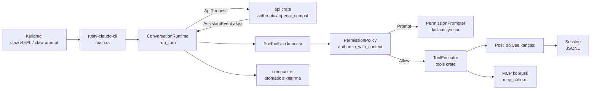
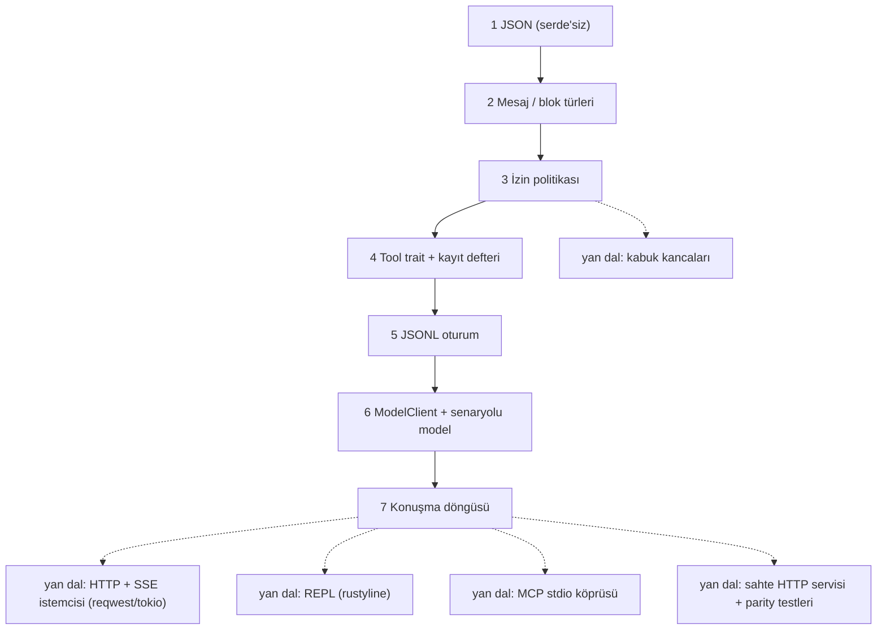

# ultraworkers/claw-code — ajanların geliştirdiği, Rust ile yazılmış bir CLI ajan harness'ı

> **Dal:** [D07 Kodlama ajanları ve harness'lar](../README.md) · **Tür:** kod tabanı
> **Dil:** Rust (+ yardımcı Python) · **Lisans:** MIT · **Yıldız:** 194.928 (9 Kasım 2026) · **İncelenen commit:** `f51a33a` (2026-11-09)

## 1. Bir bakışta

claw-code, `claw` adlı komut satırı kodlama ajanının Rust uygulamasıdır: bir REPL'de ya da tek komutla
(`claw prompt "…"`) modelle konuşur, dosya okur/yazar, kabuk komutu çalıştırır, MCP sunucularına bağlanır, oturumları JSONL olarak
saklar. Depo kendini alışılmadık biçimde tanıtır: README'ye göre "ciddi üretim projesi değil", bir **"ajanların yönettiği
müze sergisi"**dir; planlama, uygulama, doğrulama, etiketleme ve koruma işlerini README'nin başında adı geçen ajan
harness'ları (LazyCodex, Gajae-Code) yürütür. `PHILOSOPHY.md` ise depoyu üreten sistemi üç parçayla anlatır: OmX
(oh-my-codex), clawhip ve OmO (oh-my-openagent). 31 Mart 2026'da açılan depo kısa sürede çok yüksek yıldız ve çatal (fork: 107.446)
sayısına ulaştı. Öğrenci için değeri iki katmanlıdır: (1) okunaklı bir Rust ajan çekirdeği (`ConversationRuntime`,
izin politikası, araç tablosu), (2) bir deponun ajanlarca nasıl yürütüldüğünün açık kaydı.

**Kökeni hakkında (tarafsız not):** README ve kök `AGENTS.md` projeyi "Claude-Code tarzı" bir harness'ın açık Rust
uygulaması olarak tanımlar; README açıkça "orijinal Claude Code kaynak malzemesinin sahipliğini iddia etmediğini" ve
Anthropic ile bağı olmadığını yazar. `src/` altındaki Python ağacı kendi belgesine (`src/AGENTS.md`) göre bir "taşıma
(porting) çalışma alanı"dır: gerçek işlev içermez, başka bir ürünün modül adları ve sayıları gibi metaveri anlık
görüntülerini (`src/reference_data/`) tutar. Bu atlas o metaveriyi ya da herhangi bir özel (proprietary) kodu yeniden
üretmez; yalnızca deponun kendi Rust mimarisini inceler. Deponun MIT lisansı yalnızca deponun kendi koduna uygulanabilir;
üçüncü taraf malzemeye hak vermez.

## 2. Nasıl yapılmış: mimari

### Klasör haritası

İncelenen commit'te 430 dosya; `rust/crates/` altında **12 crate**, 118 `.rs` dosyası ve ~132 bin satır Rust var.
(Belgeler eskidi: `rust/README.md` "11 crate, ~20K satır", `PARITY.md` 3 Nisan 2026 itibarıyla "9 crate, 48.599 satır"
diyor — bu, ajanların hızla büyüttüğü bir depoda belge kaymasının iyi bir örneği.)

```text
rust/
  Cargo.toml                    # çalışma alanı: members = ["crates/*"], unsafe_code = "forbid"
  crates/
    runtime/src/conversation.rs # ConversationRuntime::run_turn — ajan döngüsü
    runtime/src/permissions.rs  # PermissionMode merdiveni + allow/deny/ask kuralları
    runtime/src/permission_enforcer.rs  # araç çağrısı öncesi izin kapısı
    runtime/src/session.rs      # oturum türleri + JSONL kalıcılık (256 KiB'da döndürme)
    runtime/src/compact.rs      # modelsiz, yerel özetle bağlam sıkıştırma
    runtime/src/hooks.rs        # PreToolUse / PostToolUse kabuk kancaları
    runtime/src/mcp_stdio.rs    # MCP sunucu süreçleri (JSON-RPC), mcp_tool_bridge.rs
    runtime/src/bash.rs, sandbox.rs  # bash aracı, Linux'ta unshare ile kum havuzu
    runtime/src/prompt.rs       # sistem istemi + CLAUDE.md / CLAW.md / AGENTS.md belleği
    runtime/src/json.rs         # kendi küçük JsonValue türü
    api/src/providers/          # anthropic.rs, openai_compat.rs (xAI, DashScope, Ollama…)
    api/src/prompt_cache.rs     # istem önbelleği izleme, "önbellek kırılması" tespiti
    tools/src/lib.rs            # mvp_tool_specs: ~57 araç tanımı, araç yürütme
    commands/src/lib.rs         # eğik çizgi (slash) komutları tablosu
    plugins/src/lib.rs          # eklenti yöneticisi (.claude-plugin/plugin.json manifestleri)
    rusty-claude-cli/src/main.rs  # `claw` ikilisi: REPL, alt komutlar, JSON çıktı (~21 bin satır)
    mock-anthropic-service/     # deterministik sahte /v1/messages servisi (testler için)
    claw-analog/                # yalın harness: yalnızca çalışma alanı araçları, NDJSON çıktı
    claw-rag-service/           # axum + SQLite (+ isteğe bağlı Qdrant) ile RAG servisi
    sdk/, telemetry/, compat-harness/
  mock_parity_scenarios.json    # senaryo → PARITY.md eşlemesi
src/, tests/                    # Python taşıma/parity çalışma alanı (stdlib unittest), ürün değil
PARITY.md, ROADMAP.md (1,2 MB), prd.json, progress.txt   # ajan iş akışının izleri
.omx/ultragoal/                 # oh-my-codex hedef defteri: goals.json, ledger.jsonl, kalite kapıları
.claude/, rust/.claude/sessions/, .port_sessions/       # depoya işlenmiş ajan oturum dosyaları
docs/g0XX-*.md                  # "kapı" (gate) doğrulama haritaları
Containerfile, docker-compose.yml, flake.nix, install.sh
```

### Ana bileşenler ve veri akışı



`run_turn` (runtime/src/conversation.rs) her yinelemede şunları yapar: kesme sinyalini denetle → yineleme sınırını
denetle → `ApiRequest { system_prompt, messages }` kur → `api_client.stream(...)` ile olayları al → olaylardan asistan
mesajını kur, kullanımı ve önbellek olaylarını kaydet → mesajı oturuma yaz → otomatik sıkıştırmayı dene (oturum boyunca
biriken girdi token'ı, `usage_tracker.cumulative_usage()`, varsayılan 100.000 eşiğini geçince;
`CLAUDE_CODE_AUTO_COMPACT_INPUT_TOKENS` ile değişir) → araç kullanımı yoksa (sırada bekleyen bir yönlendirme yoksa) turu bitir;
varsa her biri için PreToolUse kancası → izin politikası → `tool_executor.execute` → PostToolUse kancası → araç sonucunu
oturuma yaz. Kesilen turda bile bekleyen her araç kullanımına "Interrupted by user" sonucu yazılır ki oturum bir sonraki
istek için geçerli kalsın. Oturum bir kez sıkıştırıldıysa sonraki her turun başında bir "oturum sağlık sondası" çalışır
(ROADMAP #38): araç yürütücüsü zararsız bir `glob_search` çağrısıyla yoklanır, başarısızsa tur hiç başlamaz.

### Önce okunacak dosyalar

1. `README.md` ve `PHILOSOPHY.md` — projenin ne olduğu ve nasıl işletildiği (ajan koordinasyonu).
2. `rust/README.md` — crate haritası, CLI yüzü, model takma adları (`opus`, `sonnet`, `grok`, `kimi`).
3. `rust/crates/runtime/src/conversation.rs` — `ApiClient` ve `ToolExecutor` trait'leri, `run_turn`.
4. `rust/crates/runtime/src/permissions.rs` — `PermissionMode::covers`, kural ayrıştırma (`bash(git:*)`), karar sırası.
5. `rust/crates/tools/src/lib.rs` — `ToolSpec` (ad, açıklama, girdi şeması, gereken izin) ve `mvp_tool_specs`.
6. `rust/crates/runtime/src/compact.rs` — `should_compact`, `compact_session`, araç çiftini bölmeme döngüsü.
7. `rust/crates/runtime/src/session.rs` — JSONL kayıt türleri, döndürme, alan kırpma.
8. `rust/crates/mock-anthropic-service/src/lib.rs` ve `rust/MOCK_PARITY_HARNESS.md` — test stratejisinin kalbi.
9. `prd.json`, `progress.txt`, `.omx/ultragoal/goals.json` — ajanların iş defteri.

### Teknoloji yığını, derleme, test, CI, sürüm

- **Rust çalışma alanı:** edition 2021, `unsafe_code = "forbid"`, clippy `all=warn`. HTTP için `reqwest`, eşzamansızlık
  için `tokio`, REPL için `rustyline`, terminal için `crossterm`, Markdown çizimi için `pulldown-cmark` + `syntect`,
  RAG servisi için `axum` + `rusqlite` + `qdrant-client`. Ana ikili `rusty-claude-cli` crate'inden çıkar ama adı `claw`.
- **Sağlayıcılar:** Anthropic (`ANTHROPIC_API_KEY` ya da `ANTHROPIC_AUTH_TOKEN`) ve OpenAI uyumlu uçlar (xAI, DashScope,
  Ollama için `OLLAMA_HOST`). Varsayılan model `claude-opus-4-7`, varsayılan izin `workspace-write` (`rust/README.md`).
  Abonelikle giriş desteklenmez; API anahtarı gerekir.
- **Testler:** her crate'te dosya sonunda `#[cfg(test)] mod tests`; entegrasyon testleri `claw` ikilisini alt süreç
  olarak başlatıp **sahte Anthropic servisine** bağlar. Sahte servis, kullanıcı isteminde `PARITY_SCENARIO:` önekiyle
  gelen senaryo adına göre hazır yanıtlar verir (`streaming_text`, `write_file_denied`,
  `bash_permission_prompt_approved` …). `rust/mock_parity_scenarios.json` her senaryoyu PARITY.md'deki bir maddeye
  bağlar. Python tarafı stdlib `unittest` kullanır (`tests/`).
- **CI:** `.github/workflows/rust-ci.yml` — belge "tek doğruluk kaynağı" denetimi
  (`check_doc_source_of_truth.py`), ROADMAP kimlik koruması, `cargo fmt --check`, `cargo test --workspace`,
  `cargo clippy --workspace` ve Windows'ta PowerShell duman (smoke) testleri. Yerel `.github/hooks/pre-push` derlemeyi ve
  ROADMAP kimliklerini denetler.
- **Sürüm:** `.github/workflows/release.yml` etiket (tag) itişinde Linux x64, macOS arm64 ve Windows x64 ikililerini
  sağlama toplamıyla derleyip sürüm varlığı olarak yükler. crates.io'daki `claw-code` adlı crate kullanımdan
  kaldırılmış bir taslaktır (`claw` kurmaz); README bu depo için "build-from-source only" der.
- **Konteyner:** kök `Containerfile` (rust:bookworm + git, pkg-config, libssl-dev) ve `docs/container.md` — depo
  bağlanarak (bind-mount) kullanılır; `docker-compose.yml` RAG servisini ve Qdrant'ı ayağa kaldırır.

### "İnsan müdahalesi olmadan" bakım nasıl işliyor (deponun kendi belgelerine göre)

- **Yön insanlardan, emek ajanlardan:** `PHILOSOPHY.md`'ye göre insan arayüzü bir Discord kanalıdır; bir cümlelik
  yönerge, iş akışı katmanı **OmX (oh-my-codex)** tarafından planlama/uygulama/doğrulama adımlarına çevrilir; olay ve
  bildirim yönlendiricisi **clawhip** git, tmux, GitHub ve ajan yaşam döngüsü olaylarını ajanların bağlam penceresi
  dışında tutar; **OmO (oh-my-openagent)** çok ajanlı koordinasyonu (Mimar / Uygulayıcı / Gözden geçirici) yürütür.
- **İş defterleri:** `prd.json` (24 kullanıcı hikâyesi, kabul ölçütleriyle), `progress.txt` ("Ralph Iteration Summary":
  her yinelemede bir hikâye seçilir, uygulanır, test komutları ve sonuçları yazılır), `ROADMAP.md` (8.040 satır,
  numaralı birikim listesi; `scripts/roadmap-next-id.sh` ve `roadmap-check-ids.sh` çakışan kimlikleri engeller).
- **Hedef defteri:** `.omx/ultragoal/ledger.jsonl` "plan_created … 279 goal(s) created" kaydıyla başlar; her hedefin
  `goal_started` / `goal_completed` olayını, takım işçilerini (worker-1…4), "leader reconciliation" commit'ini ve
  doğrulama komutlarını kaydeder; `quality-gate-*.json` dosyaları kapı sonuçlarını tutar.
- **Fren mekanizmaları:** `docs/anti-slop-triage.md` "Automation lanes must not merge or close remote PRs/issues" der;
  son kapı bakımcıya aittir (`docs/pr-issue-resolution-gate.md`). Kök `AGENTS.md`'ye göre `main`'e doğrudan itiş
  politika ile engellidir.
- **Gözlem:** incelenen commit `f51a33a` bir GitHub kullanıcısının PR'ıdır ve commit mesajında bir yapay zekâ modelinin
  ortak yazar satırı bulunur. Yani depo verisi hem ajan durum dosyalarını hem de insan hesaplarından açılan, yapay zekâ
  destekli PR'ları gösterir. Sürecin ne kadarının gerçekten insansız yürüdüğü depodan doğrulanamaz (doğrulanmadı).

### Tasarım kararları ve ödünleşimler

1. **Kip merdiveni + kurallar.** `read-only < workspace-write < danger-full-access`; `prompt` her şeyi sorar, `allow` hiç
   sormaz. `PermissionMode` enum'u kasıtlı olarak `PartialOrd`/`Ord` türetmez; sıra `privilege_rank` fonksiyonunda her
   varyant elle adlandırılarak verilir. Böylece enum'un ortasına eklenen bir varyant merdiveni sessizce bozamaz, derleme
   hatası verir (dosyadaki yorumlar bunu açıklar). `covers` yalnızca gerçek basamakları karşılaştırır; `Prompt` ve
   `Allow` birer basamak değil, çalışma biçimidir. Kurallar `bash(git:*)` biçimindedir.
2. **Dev, düz dosyalar.** `rusty-claude-cli/src/main.rs` ~21 bin, `tools/src/lib.rs` ~11,6 bin satır. Kök `AGENTS.md` bunu "organizasyon
   konumsaldır: türler → tablo → dağıtım → işleyiciler → testler" diye tanımlar. Ajanların tek dosyada arama yapması
   kolaylaşır; insan okuyucu için bedeli yüksektir.
3. **Modelsiz sıkıştırma.** `compact.rs` eski mesajları yerel bir özetle değiştirir: mesaj sayıları, araç adları, son
   kullanıcı istekleri, bekleyen işler, anılan dosyalar ve kısaltılmış bir zaman çizelgesi. Ek model çağrısı yoktur
   (ucuz ve deterministik, ama özet modelin yazacağı kadar anlamlı değildir). opencode ve deepseek-harness bu iş
   için modeli çağırır.
4. **Her şey makinece okunur.** Hemen her komutun `--output-format json` hâli var; JSON hataları stdout'a, metin
   hataları stderr'e gider. `ROADMAP.md`'ye göre birincil kullanıcılar insanlardan çok "claw"lardır (kancalar, eklentiler ve kanal
   olaylarıyla bağlanmış otomasyon ajanları).
5. **Sahte servisle eşitlik (parity) testleri.** Gerçek API yerine deterministik bir HTTP servisi; senaryolar istem
   metnindeki bir önekle seçilir. Böylece CLI uçtan uca, ağsız ve tekrarlanabilir test edilir.
6. **Belgeler bir ürün yüzeyidir.** CI belge tutarlılığını ve sürüm hazırlık belgelerini de denetler; buna rağmen
   sayılar (crate, satır) hızla eskimiştir.

## 3. Öğrenmen gerekenler

| Önkoşul                                                                                      | Bu depo için neden gerekli                                                 | Ücretsiz kaynak                                                                                        |
| -------------------------------------------------------------------------------------------- | -------------------------------------------------------------------------- | ------------------------------------------------------------------------------------------------------ |
| [G1 Terminal ve kabuk](../../../govde/README.md#g1)                                          | REPL, alt süreçler, süreç grupları, `unshare`                              | [free-programming-books Türkçe listesi](../../10-kuratorluk-topluluk/free-programming-books/README.md) |
| [G11 LLM API temelleri](../../../govde/README.md#g11)                                        | Anthropic Messages biçimi, `tool_use` / `tool_result`, SSE akışı, önbellek | Anthropic "Tool use" belgesi                                                                           |
| [G7 Test, CI ve kod kalitesi](../../../govde/README.md#g7)                                   | Sahte servis, entegrasyon testi, clippy/fmt kapıları                       | The Rust Book, "Writing Automated Tests" bölümü                                                        |
| [G8 Büyük kod tabanı okuma](../../../govde/README.md#g8)                                     | 21 bin satırlık tek dosyada yol bulmak                                     | [build-your-own-x](../../10-kuratorluk-topluluk/build-your-own-x/README.md)                            |
| [G10 C ve bellek modeli](../../../govde/README.md#g10) (faydalı)                             | Sahiplik/ödünç alma (ownership/borrowing) sezgisi                          | [ossu-computer-science](../../09-bilgisayar-bilimi/ossu-computer-science/README.md)                    |
| Rust temelleri                                                                               | trait, generic, `Result`, `Box<dyn Trait>`, yaşam süreleri                 | The Rust Programming Language (doc.rust-lang.org/book)                                                 |
| [opencode dosyası](../opencode/README.md)                                                    | Aynı kavramların (döngü, izin, sıkıştırma) TypeScript karşılığıyla kıyas   | bu dalın ilk yaprağı                                                                                   |
| [D08 Ajan becerileri: anthropic-skills](../../08-ajan-becerileri/anthropic-skills/README.md) | `claw` `SKILL.md` becerilerini ve `.claude-plugin` eklentilerini yükler    | anthropics/skills deposu                                                                               |

Dal içi kavramlar: **izin kipi merdiveni**, **kanca ile izin geçersiz kılma**, **JSONL oturum**, **deterministik sahte
servis**, **ajan iş defteri (PRD/progress/ledger)**, **belge kayması**.

## 4. Sıfırdan yol (dallanma)



| Aşama | Ne inşa edersin                    | Öğrendiğin kavram                                  | Bitti ölçütü                                          | Süre (tahmini) |
| ----- | ---------------------------------- | -------------------------------------------------- | ----------------------------------------------------- | -------------- |
| 1     | JSON çözücü/kodlayıcı              | Özyinelemeli iniş, UTF-8, kaçışlar                 | Emoji vekil çifti gidiş-dönüş testi geçer             | 4–6 saat       |
| 2     | `Role`, `Block`, `Message`         | enum ile veri modelleme                            | Mesaj JSON'a yazılıp aynen okunur                     | 2 saat         |
| 3     | `PermissionMode`, `Rule`, `Policy` | Yetki merdiveni, kural eşleme, soran taraf trait'i | `Prompt` kipi hiçbir aracı sessizce çalıştırmaz       | 3–4 saat       |
| 4     | `Tool` trait'i, 5 araç             | `Box<dyn Trait>`, yol güvenliği, zaman aşımı       | `sleep 5` 200 ms'de grup olarak öldürülür             | 5–7 saat       |
| 5     | JSONL kaydet/ekle/yükle            | Ekleme dostu biçim, atomik yazma                   | Yüklenen oturum bellektekiyle birebir aynı            | 2–3 saat       |
| 6     | `ModelClient`, `ScriptedModel`     | Trait ile test edilebilirlik, satır protokolü      | Senaryo dosyası kod yazmadan model davranışı tanımlar | 2 saat         |
| 7     | `Runtime::run_turn`                | Döngü, kanca → izin → çalıştırma, yerel sıkıştırma | 9 uçtan uca test geçer                                | 5–6 saat       |

**Mini uygulama:** [`sifirdan/`](sifirdan/README.md) — yalnızca std kullanan `claw-mini` crate'i; 13 birim + 9
entegrasyon testi (`cargo test --offline`) ve `cargo run --example demo`. Eşleme: `src/dongu.rs` →
`rust/crates/runtime/src/conversation.rs`, `src/izin.rs` → `runtime/src/permissions.rs`, `src/arac.rs` →
`tools/src/lib.rs` + `runtime/src/bash.rs`.

**Gerçek ölçeğe giden yol:** önce gerçek bir HTTP istemcisi ve SSE akış çözücüsü (Anthropic `content_block_delta`
olayları), sonra kesme/yönlendirme sinyalleri ve tokio ile zaman aşımı, ardından kabuk kancaları (girdi değiştiren,
izin kararı veren), MCP stdio köprüsü, eklenti manifestleri, REPL ve eğik çizgi komutları; en son sahte HTTP servisiyle
uçtan uca parity testleri ve çoklu platform sürüm hattı.

## 5. Gerçek depoda okuma rotası

1. `rust/crates/runtime/src/conversation.rs`, satır ~217–230 — `ApiClient` ve `ToolExecutor` trait'leri. Soru: neden
   `stream` bir `Vec<AssistantEvent>` döndürüyor da bir iterator döndürmüyor? (İpucu: basitlik ve test.)
2. Aynı dosyada `run_turn` — bekleyen her araç kullanımına neden kesintide bile sonuç yazılıyor?
3. `permissions.rs`, `authorize_with_context` — karar sırası: `denied_tools` → deny kuralı → kanca geçersiz kılması →
   ask kuralı → allow kuralı / kip → yükselme sorusu → ret. Bir kanca `allow` dediğinde neden ask kuralı yine çalışır?
4. `permissions.rs`, `PermissionMode::privilege_rank` ve `covers` üstündeki uzun yorumlar — `Ord` türetmemenin ve
   `Prompt`'u bir basamak saymamanın gerekçesi.
5. `tools/src/lib.rs`, `mvp_tool_specs` — her aracın `required_permission` değeri. `bash` neden en üst basamakta?
6. `compact.rs`, `compact_session` içindeki `keep_from` döngüsü — OpenAI uyumlu yolda 400 hatasının nedeni (yorumda).
7. `mock-anthropic-service/src/lib.rs` — `SCENARIO_PREFIX` ile senaryo seçimi;
   `rusty-claude-cli/tests/mock_parity_harness.rs` bunu nasıl kullanıyor?
8. `.omx/ultragoal/ledger.jsonl` — tek bir hedefin başlangıç ve bitiş kaydını oku; "kanıt" (evidence) alanında hangi
   doğrulama komutları var?

## 6. Alıştırmalar ve öz değerlendirme

1. (Kolay) Mini'ye `grep_search` aracı ekle (`read-only`), alt dizinleri gezsin ve `dosya:satır: metin` döndürsün.
2. (Kolay) `Policy`'e `denied_tools` listesi ekle: listede olan araç her kipte reddedilsin.
3. (Orta) `PostToolHook` ekle: araç çıktısını değiştirebilen ve "hata" olarak işaretleyebilen bir kanca.
4. (Orta) Yerel sıkıştırma yerine "model ile özet" seçeneği ekle: `ModelClient`'a ayrı bir özet isteği gönder.
5. (Zor) `std::net::TcpListener` ile basit bir sahte HTTP servisi yaz ve `ModelClient`'ın HTTP uygulamasını
   (`TcpStream` ile düz HTTP/1.1, TLS'siz) bu servise karşı test et — claw-code'un parity yaklaşımının küçük hâli.
6. (Zor) `oturum.rs`'e dosya döndürme ve uzun alanları kırpma ekle; kırpılmış oturumun yeniden yüklenebildiğini test et.

<details><summary>Soru 1: Oturum kipi `workspace-write` iken model `bash` çağırırsa ne olur?</summary>

`bash` `danger-full-access` ister. `workspace-write` bunu kapsamaz, ama `workspace-write` → `danger-full-access`
yükselmesi tanımlı bir yükselme yoludur: soran taraf varsa kullanıcıya sorulur, yoksa reddedilir. Bir `allow` kuralı
(ör. `bash(git:*)`) eşleşirse sormadan çalışır; bir `deny` kuralı eşleşirse hiç sorulmaz.

</details>

<details><summary>Soru 2: claw-code'un sıkıştırması ile opencode'unki arasındaki temel fark nedir?</summary>

claw-code `compact.rs` ile **modeli çağırmadan** yerel bir özet üretir (mesaj sayıları, araç adları, son istekler,
anılan dosyalar, kısaltılmış zaman çizelgesi).
opencode `packages/core/src/session/compaction.ts` ile ayrı bir "compaction" ajanına şablonlu bir özet **yazdırır**;
deneysel bir bayrakla (`background_compaction`, yayın sürümlerinde kapalı) bağlam dolmadan arka planda özet de
hazırlayabilir. İlki ucuz ve deterministik, ikincisi daha bilgili ama ek model maliyeti getirir.

</details>

<details><summary>Soru 3: Testler gerçek API'ye gitmeden CLI'yi uçtan uca nasıl doğruluyor?</summary>

`mock-anthropic-service` yerel bir HTTP servisi olarak `/v1/messages`'ı taklit eder; test, `claw` ikilisini bu servisin
adresine yönlendirip istem içine `PARITY_SCENARIO:<ad>` koyar. Servis senaryoya göre hazır (akışlı) yanıtlar döner;
test hem CLI çıktısını hem de servise giden istekleri doğrular.

</details>

<details><summary>Soru 4: `prd.json` ile `progress.txt` birlikte hangi çalışma biçimini gösterir?</summary>

Kabul ölçütlü hikâye listesinden (PRD) her yinelemede bir hikâye seçen, uygulayan, test eden ve sonucu bir ilerleme
günlüğüne yazan otonom bir ajan döngüsünü ("Ralph" tarzı yineleme). Günlük, bir sonraki yinelemenin bağlamı olur.

</details>

## 7. İş fikri tohumları

- **Ajan iş defteri panosu** — `prd.json` / `progress.txt` / `ledger.jsonl` benzeri dosyaları okuyup insanlara özetleyen
  bir web panosu. **Kime:** birden çok kodlama ajanını paralel çalıştıran 5–30 kişilik yazılım ajansları.
- **Deterministik LLM test sunucusu hizmeti** — `mock-anthropic-service` fikrini çok sağlayıcılı, kayıt/oynatma
  destekli bir ürüne çevirmek. **Kime:** CI'da LLM çağıran ürünler geliştiren girişimlerin QA ekipleri.
- **Rust ile yalın, denetlenebilir ajan çekirdeği danışmanlığı** — `claw-analog` benzeri yalnızca çalışma alanı
  araçlarına sahip, NDJSON çıktılı ajanları kurumsal CI'ya entegre etmek. **Kime:** kod incelemesini otomatikleştirmek
  isteyen orta ölçekli şirketlerin platform ekipleri.

Ayrıntılar: [İş fikirleri kataloğu](../../../is-fikirleri/README.md).

## 8. Kaynaklar

- Depo (incelenen commit): <https://github.com/ultraworkers/claw-code/tree/f51a33a8960d167288db295d1d02ff9cc0586abf>
- Felsefe: <https://github.com/ultraworkers/claw-code/blob/f51a33a8960d167288db295d1d02ff9cc0586abf/PHILOSOPHY.md>
- Rust çalışma alanı: <https://github.com/ultraworkers/claw-code/blob/f51a33a8960d167288db295d1d02ff9cc0586abf/rust/README.md>
- Döngü: <https://github.com/ultraworkers/claw-code/blob/f51a33a8960d167288db295d1d02ff9cc0586abf/rust/crates/runtime/src/conversation.rs>
- İzinler: <https://github.com/ultraworkers/claw-code/blob/f51a33a8960d167288db295d1d02ff9cc0586abf/rust/crates/runtime/src/permissions.rs>
- Sahte servis rehberi: <https://github.com/ultraworkers/claw-code/blob/f51a33a8960d167288db295d1d02ff9cc0586abf/rust/MOCK_PARITY_HARNESS.md>
- Parity durumu: <https://github.com/ultraworkers/claw-code/blob/f51a33a8960d167288db295d1d02ff9cc0586abf/PARITY.md>
- Triage kuralları: <https://github.com/ultraworkers/claw-code/blob/f51a33a8960d167288db295d1d02ff9cc0586abf/docs/anti-slop-triage.md>
- The Rust Programming Language: <https://doc.rust-lang.org/book/>
- Ekosistem (README ve `PHILOSOPHY.md`'de adı geçen harness'lar): LazyCodex, Gajae-Code, oh-my-codex, clawhip,
  oh-my-openagent — bu atlasta incelenmedi (doğrulanmadı).
