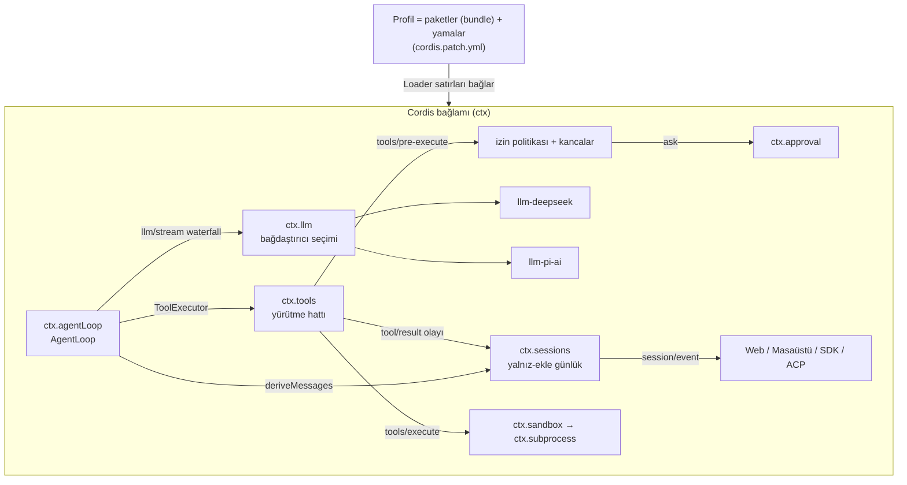
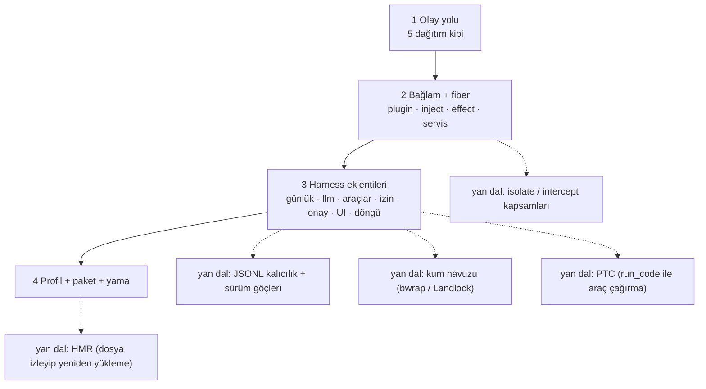

# deepseek-ai/deepseek-harness — "her şey bir eklenti" ilkesiyle kurulmuş ajan harness'ı (dsh)

> **Dal:** [D07 Kodlama ajanları ve harness'lar](../README.md) · **Tür:** kod tabanı
> **Dil:** TypeScript (Node.js ≥ 24.9, pnpm) · **Lisans:** MIT · **Yıldız:** 277.115 (9 Kasım 2026) · **İncelenen commit:** `fcc0ad4` (2026-11-04)

## 1. Bir bakışta

DeepSeek Harness (`dsh`), DeepSeek'in açık kaynak ajan harness'ıdır: modelle konuşan, dosya ve kabuk araçlarını kum
havuzunda (sandbox) çalıştıran, oturumları kalıcı tutan ve web arayüzü, masaüstü uygulaması, başsız (headless) komut,
JSON-RPC SDK'ları ve ACP sunucusu sunan bir sistem. Ayırt edici yanı mimarisidir: **her şey bir eklentidir** — model
bağdaştırıcısı, araç kayıt defteri, oturum günlüğü ve ajan döngüsünün kendisi bile. Bu, deponun altına gömülü
(vendored) **Cordis** eklenti çatısıyla sağlanır; README çatının tasarımını bir makaleye bağlar ("A Programming Paradigm
for Spatiotemporal Composability", arXiv 2608.25512 — içerik doğrulanmadı). Depo 13 Ağustos 2026'da açıldı; incelenen
commit `0.2.2-rc.1` sürüm dalının `master`'a birleştirilmesidir. README açıkça "geliştirici önizlemesi" der ve uyumluluğu
bozan değişiklikler gelebileceğini, `SAFETY.md`'yi okumadan çalıştırılmaması gerektiğini vurgular.

## 2. Nasıl yapılmış: mimari

### Klasör haritası

İncelenen commit'te 20.665 dosya ve 6.134 `.ts` dosyası var. `packages/` altında 53 grup ve 370 npm paketi
(`packages/*/*`; her biri bir eklenti ya da kütüphane) bulunur. Bu katmanda 9 `package.json` daha vardır ama bunlar
paket değil, beceri şablonu ya da test fikstürüdür. `pnpm-workspace.yaml`'ın kapsadığı bütün çalışma alanı 393 pakettir (`vendor/*`,
`native/system`, `apps/*` vb. dahil). İki terimi karıştırmamak için: bu dosyada **npm paketi** `packages/*/*` altındaki
bir pakettir; **paket (bundle)** ise Cordis yapılandırma satırlarını ve yükledikleri kodu birlikte dağıtan katmandır
(`packages/bundle/*`, ör. `dsh-base`). **Profil** (`web`, `headless`, `sdk`, `sdk-minimal`, `acp`) bu paketleri sırayla
üst üste koyan, kullanıcının yamasını da taşıyan adlandırılmış bileşimdir (`docs/architecture.md`, "Profiles and bundles").

```text
vendor/cordis/           # gömülü Cordis (üst kaynak 4.0.0-rc.11 tabanı + yerel değişiklikler; paket sürümü 4.1.0): src/{context,fiber,events,registry,service}.ts
vendor/{loader,include,hmr,schemastery,cosmokit,…}/  # YAML yükleyici, yama, sıcak yeniden yükleme, şema
packages/core/           # çekirdek eklentiler: session, system-prompt, tools, agent, agent-loop, scope
packages/core/agent-loop/src/  # AgentLoop servisi (ctx.agentLoop), ReactLoopAgent, gelen kutusu
packages/core/tools/src/pipeline.ts  # araç yürütme hattı
packages/llm/            # ctx.llm + bağdaştırıcılar: llm-deepseek, llm-pi-ai (çok sağlayıcı), llm-retry, token-meter
packages/bundle/         # paketler (bundle): base (dsh-base), web-app, headless, sdk-app, sdk-minimal, acp-app (cordis.patch.yml)
packages/boot/           # uygulama açılışı, profiller, HMR, eklenti yöneticisi
packages/interaction/    # user-approval (onay), permission-presets (izin ön ayarları)
packages/sandbox/        # sandbox-local (Linux/macOS/Windows), sandbox-policy, sandbox-windows-acl
packages/compaction/     # compaction (dikiş), compaction-basic, compaction-tool-result-pruner, compaction-image-offload, command-compact
packages/mcp/            # mcp-client, mcp-manager, mcp-resources
packages/lsp/            # lsp, lsp-stdio, tool-lsp (salt okunur gezinme)
packages/subagent/       # alt ajan sağlayıcıları: süreç içi, fork, ACP, başka ürünlere devretme
packages/skill/, preset/, goal/, team/, workflow/, schedule/, extensions/  # beceriler ve davranış eklentileri
packages/acp/, sdk/      # ACP sunucusu ve JSON-RPC SDK sunucusu/istemcisi
packages/client/         # web istemci modülleri (UI eklentileri)
apps/cli/                # `dsh` komutu (@deepseek-ai/dsh, bin: lib/bin.js)
apps/web/, apps/desktop/, apps/desktop-host/   # React + Vite web arayüzü, Electron masaüstü
native/system/           # Landlock başlatıcısı ve POSIX flock bağlaması (yerel Node eklentisi)
python/sdk/, python/sdk-runtime/  # Python SDK: stdio üzerinden satır satır JSON-RPC
snapshots/               # kayıtlı oturumlar: session/, web/, sdk/, acp/ (anahtarsız tekrar oynatma testleri)
benchmarks/              # performans kapıları (session-open, conversation-fold, terminal-io…)
docs/                    # architecture.md, cordis-primer.md, cordis-tutorial/, subsystems/, testing.md…
.agents/notes/, .agents/skills/  # karar notları (~4.000 dosya) ve ajan iş akışları
```

### Ana bileşenler ve veri akışı



`docs/architecture.md`'deki tur akışı özetle şöyledir: `turn/start` → sıradaki girdi alınır → oturumun model seçiminin
anlık görüntüsü alınır, istem bölümleri ve araç şemaları birleştirilir → `agent/pre-step` (waterfall; girdiyi kabul
eder, yeniden yazar ya da reddeder) → `step/start` → `agent/request` (kullanımdan kalkan kanca) → bağdaştırıcı çağrıya
bağlanır (`prepareCall`) → sistem ve kullanıcı mesajları günlüğe işlenir → model geçmişi **günlükten** türetilip
dondurulur → çağrı akışla (`llm/stream`) yapılır → `assistant/message` → her araç için `tool/call` → `tools/pre-execute`
→ `tools/execute` → `tools/post-execute` → `tool/result` → `step/end` → araç sonucu ya da yeni girdi varsa yeni adım →
`agent/turn-stopping` (serial) → `turn/end`. `turn/*`, `step/*`, `system/message`, `user/message`, `assistant/message`
ve `tool/*` gibi olaylar kalıcı oturum olaylarıdır; `agent/*`, `tools/*` ve `llm/*` olayları ise canlı genişleme
noktalarıdır. Örneğin günlüğe yazılan sonuç `tool/result` olayıdır; `tools/result` yalnızca donmuş sonucu gözleyen bir
bildirimdir. Davranış eklemek için döngü değiştirilmez, bu noktalara eklenti takılır ("Plugins, not loop changes",
AGENTS.md).

### Önce okunacak dosyalar

1. `README.md` ve `SAFETY.md` — ne olduğu, nasıl çalıştırıldığı, güvenlik sınırları.
2. `docs/cordis-primer.md` — Cordis'in beş fikri ve beş dağıtım kipi (emit, waterfall, parallel, serial, bail).
3. `docs/cordis-tutorial/` (7 bölüm) — her bölüm çalıştırılabilir bir örnek; 7. bölüm gerçek `ctx.tools`'a araç kaydeder.
4. `docs/architecture.md` — profiller ve paketler (bundle), çekirdek paket tablosu, tur akışı, oturum günlüğü, "yeni
   davranış nereye".
5. `docs/tool-execution-pipeline.md` — izin, onay, kum havuzu ve sonuç düzeltmenin hattaki yeri (mermaid şeması).
6. `packages/bundle/base/cordis.patch.yml` — taban paketin (bundle `dsh-base`) tüm satırları: hangi eklenti hangi
   yapılandırmayla. `sdk-minimal` dışındaki profillerin ilk katmanıdır.
7. `packages/core/agent-loop/README.md` ve `src/index.ts` — `AgentLoop` servisi; `static inject` listesi:
   `agents`, `sessions`, `llm`, `tools`, `systemPrompt`, `sessionProjections`.
8. `vendor/cordis/src/context.ts` ve `fiber.ts` — Proxy tabanlı bağlam ve fiber yaşam döngüsü.
9. `docs/testing.md` — test katmanları ve "gerçeği doğrula" ilkeleri.

### Teknoloji yığını, derleme, test, CI, sürüm

- **Yığın:** TypeScript (`strict`), ESM her yerde, pnpm çalışma alanları (`pnpm-workspace.yaml`), Node ≥ 24.9; tsc +
  tsdown ile derleme (`build:artifacts`), oxlint, jscpd (kopya kod tespiti), lefthook (git kancaları). Web arayüzü
  React + Vite; masaüstü Electron; belgeler VitePress (`website/`). Yerel kod: `native/system` (Landlock, flock).
- **Sağlayıcılar:** `llm-deepseek` (DeepSeek Messages taşıması; API anahtarı ya da hesapla kimlik doğrulama),
  `llm-pi-ai` (pi-ai kütüphanesinin sağlayıcı kataloglarıyla çok sağlayıcı ve ağ geçitleri; ayarlarda sağlayıcı
  profili tanımlanınca canlanır). Taban paketin (`dsh-base`) varsayılan modeli `deepseek-official / deepseek-flash`
  (`cordis.patch.yml`, `agent-default-model`).
- **Testler (docs/testing.md):** vitest birim testleri; CI kapısı `test:coverage` — `packages/*/*/src` altında **dosya
  başına %100 kapsama**; `test:e2e` gerçek API ile (anahtar yoksa kendini atlar; "We are DeepSeek — do not ration
  real-API tests"); `test:snapshot` — kayıtlı oturumları depoyla birlikte dağıtılan hazır profiller üzerinden
  **anahtarsız tekrar oynatır**; `test:web` — Chromium (ve kısmen WebKit) tarayıcı anlık görüntüleri; `test:bench` —
  performans kapıları. İlkeler:
  "Mock only the expensive or non-deterministic boundary", "Verify the world, not the self-report" (ajanın kendi
  çıktısına değil, dosyaya ve komuta bak).
- **CI ve sürüm:** `.github/workflows/` altında 32 iş akışı (ci, ci-windows, ci-python, e2e, sandbox, release,
  release-publish, desktop-publish, python-release, node-addon-system-release, docs-pages, weighted-approval…) ve Python
  tekerlek (wheel) paketleri için `.gitlab-ci.yml`. Bir sürüm şöyle çıkar: sürüm commit'i (`pnpm release:dsh`) bir
  sürüm dalında hazırlanıp `master`'a birleşir (incelenen commit, `merge/release-dsh-0.2.2-rc.1-to-master` dalının
  birleşmesidir); ardından bir insan `dsh-v*` etiketini atar ve npm yayını `release-publish.yml` elle tetiklenerek
  (`workflow_dispatch`, `npm-publish` ortamında insan onayıyla) yapılır. `release.yml` ise her PR'da ve `master`
  itişinde yalnızca paketlemeyi doğrular, kimlik bilgisi görmez. Masaüstü paketleri, Python tekerlekleri ve yerel
  eklentiler kendi iş akışlarıyla yayınlanır. İş akışlarındaki koşullar geliştirmenin `deepseek-harness/deepseek-harness`
  adlı bir depoda yürüdüğünü düşündürür (doğrulanmadı).
- **Katkı:** `CONTRIBUTING.md`'ye göre şu an **dışarıdan PR kabul edilmiyor**; geri bildirim GitHub Discussions'tan,
  ekosistem katkısı ise `dsh-plugin` konu etiketli bağımsız eklenti depolarıyla yapılır.

### Tasarım kararları ve ödünleşimler

1. **Ayrıcalıklı çekirdek yok.** Döngü dahil her parça bir eklenti; "yamalanacak bir çekirdek yok, yanına eklenti
   bağlarsın" (architecture.md). Kazanç: model sağlayıcısını, kabuğu, dosya sistemini, hatta döngüyü yapılandırmayla
   değiştirebilmek. Bedel: yüksek kavram yükü (servis, fiber, waterfall, yama katmanı) ve `packages/` katmanında 370
   npm paketi barındıran bir monorepo.
2. **Kayıtlar geri alınabilir etkilerdir.** Her `register()` bir geri alma fonksiyonu döndürür; eklenti kalkınca hepsi
   ters sırada geri sarılır. Sıcak yeniden yükleme (HMR) ve servis değiştirme bunun sayesinde güvenlidir.
3. **Model-görünür ⟺ günlüğe yazılmış.** Modele giden her girdi oturum günlüğünden yeniden kurulabilmelidir; yeni bir
   model-görünür girdi yeni bir oturum olayı ister. Çatallama, sürdürme, döküm ve telemetri hep bu günlükten türer.
   Kalıcı oturum biçimi sürümlüdür (`session.vN.jsonl`), göçler yalnızca bir sonraki sürüme gider ve işlenmiş eski
   dosyalar asla yeniden adlandırılmaz/silinmez.
4. **Yetenek dikişi (capability seam) = üç rol.** Servis Tanımı, Servis Sağlayıcı, Tüketici (çoğunlukla bir araç).
   Dosya sistemi ve alt süreç sağlayıcısı aynı "yürütme dünyasını" paylaştığı için uzak bir kum havuzuna yönlendirmek
   Bash'i, PTY'yi ve LSP'yi birlikte taşır (architecture.md, "Capability seams").
5. **Güvenlik varsayılanı "kapalı başarısızlık".** Onay yanıtlayıcı yoksa istek reddedilir (`user-approval`); kum
   havuzu kullanılamıyorsa komut **çalışmaz** (`SANDBOX_UNAVAILABLE`, `sandbox-local`). İzin ön ayarları kum havuzu
   kipiyle onay politikasını bir arada seçtirir (`workspace-write` + `ask`, `danger-full-access` + `never`).
6. **Profil = veri.** Uygulama; profilin paketlerinin (bundle), profil yamasının, ev dizini yamasının ve `--patch`
   katmanlarının boş satır listesine sırayla uygulanmasıyla doğar. Yama, bir satırı kimliğiyle hedefler ve onun
   config'ini bütünüyle değiştirir ya da yeni satırlar ekler.

## 3. Öğrenmen gerekenler

| Önkoşul                                                                                      | Bu depo için neden gerekli                                                         | Ücretsiz kaynak                                                                                        |
| -------------------------------------------------------------------------------------------- | ---------------------------------------------------------------------------------- | ------------------------------------------------------------------------------------------------------ |
| [G4 JavaScript / TypeScript ve Node.js](../../../govde/README.md#g4)                         | Proxy, sınıflar, async, ESM, TypeScript bildirim birleştirme (declaration merging) | [You-Dont-Know-JS](../../01-web-arayuzu/you-dont-know-js/README.md)                                    |
| [G11 LLM API temelleri](../../../govde/README.md#g11)                                        | Akış, araç çağırma, istem önbelleği ("request series")                             | DeepSeek API belgeleri                                                                                 |
| [G7 Test, CI ve kod kalitesi](../../../govde/README.md#g7)                                   | Kapsama kapısı, anlık görüntü testleri, gerçek API e2e                             | `docs/testing.md` (deponun kendisi)                                                                    |
| [G8 Büyük kod tabanı okuma](../../../govde/README.md#g8)                                     | 370 npm paketlik `packages/` katmanında servis adından sağlayıcıya gitmek          | [ossu-computer-science](../../09-bilgisayar-bilimi/ossu-computer-science/README.md)                    |
| [G1 Terminal ve kabuk](../../../govde/README.md#g1)                                          | `dsh` profilleri, kum havuzu, alt süreçler                                         | [free-programming-books Türkçe listesi](../../10-kuratorluk-topluluk/free-programming-books/README.md) |
| Bağımlılık enjeksiyonu ve olay güdümlü tasarım                                               | Cordis'in servis/inject/olay modeli tam olarak budur                               | `docs/cordis-tutorial/` (7 çalıştırılabilir bölüm)                                                     |
| [opencode dosyası](../opencode/README.md)                                                    | Döngü, izin, sıkıştırma kavramlarını önce daha düz bir mimaride görmek             | bu dalın ilk yaprağı                                                                                   |
| [D08 Ajan becerileri: anthropic-skills](../../08-ajan-becerileri/anthropic-skills/README.md) | `dsh-skill` beceri yükleme ve ön ayarlar (preset)                                  | anthropics/skills deposu                                                                               |

Dal içi kavramlar: **eklenti / servis / fiber**, **inject ile bekleme**, **etki ve geri sarma**, **waterfall ile veto**,
**olay günlüğünden model geçmişi**, **profil = paketler (bundle) + yama**, **kapalı başarısızlık**.

## 4. Sıfırdan yol (dallanma)



| Aşama | Ne inşa edersin                                     | Öğrendiğin kavram                               | Bitti ölçütü                                                          | Süre (tahmini) |
| ----- | --------------------------------------------------- | ----------------------------------------------- | --------------------------------------------------------------------- | -------------- |
| 1     | `EventBus`: emit, parallel, serial, bail, waterfall | Gözlemci, ara katman, veto                      | Waterfall'da içteki dinleyici `next()` çağırmadan zinciri kesebiliyor | 3–4 saat       |
| 2     | `App`, `Fiber`, `Context` (Proxy), `Service`        | Bağımlılık enjeksiyonu, durum makinesi, etkiler | Servis kalkınca bağımlı PENDING'e dönüp servisle geri geliyor         | 6–8 saat       |
| 3     | Günlük, model, araç hattı, izin, onay, UI, döngü    | "Her şey eklenti", günlükten türetilen geçmiş   | Model servisi değiştirilirken döngü kodu hiç değişmiyor               | 6–8 saat       |
| 4     | Katman uygulama ve kompozisyon                      | Yapılandırma olarak mimari                      | Başsız paket onay servisini kapatıp "ask"ı "deny"a çeviriyor          | 2–3 saat       |

Aşamaların toplamı **17–23 saat**; okuma rotası ve alıştırmalarla birlikte **40–46 saat** (hesap kuralı:
[dal README'si](../README.md#yapraklar)).

**Mini uygulama:** [`sifirdan/`](sifirdan/README.md) — `asama1_olaylar.js` → `asama4_profil.js`, 17 test
(`node --test`), `node ornek.js`. Eşleme örnekleri: `asama2_baglam.js` → `vendor/cordis/src/context.ts` + `fiber.ts`;
`ToolsService.execute` → `packages/core/tools/src/pipeline.ts`; `AgentLoop` → `packages/core/agent-loop/src/index.ts`.

**Gerçek ölçeğe giden yol:** async `apply` ve eşzamanlı async temizlik → `isolate`/`intercept` ile kapsamlı servisler →
YAML yükleyici ve `!!js` ifadeleri → HMR → JSONL oturum kalıcılığı ve sürüm göçleri → akışlı LLM bağdaştırıcısı ve
yeniden deneme eklentisi → kum havuzu sağlayıcısı (önce Linux'ta bwrap/Landlock) → MCP yöneticisi → alt ajanlar →
web istemcisi ve uzak erişim (API gateway) → anlık görüntü testleri.

## 5. Gerçek depoda okuma rotası

1. `docs/cordis-tutorial/02-lifecycle-and-effects.md` — fiber durum makinesi (PENDING → … → DISPOSED). Soru: async
   geri alma fonksiyonları sırayla mı çalışır? (Cevap belgede: ters sırada başlarlar ama eşzamanlı yürürler.)
2. `docs/cordis-tutorial/03-services.md` — `inject` bir açılış denetimi değildir, servis kaybı izlenir. Soru:
   `dsh-bash-local` yerine başka bir `shell` sağlayıcısı bağlanınca ne olur?
3. `vendor/cordis/src/context.ts` — `new Proxy(this, ReflectService.handler)`: `ctx.tools` okuması nereye gider?
4. `packages/bundle/base/cordis.patch.yml` — `disabled: !!js "!ctx.get('profileContext')"` satırları: yapılandırma nasıl
   koşullu hâle gelir?
5. `docs/architecture.md`, "Turn flow" — hangi olaylar kalıcı oturum olayı, hangileri canlı genişleme noktası?
6. `packages/core/agent-loop/src/index.ts` — `AgentLoop extends Service`; `static inject` listesindeki her servis
   kaybolduğunda döngüye ne olur?
7. `docs/tool-execution-pipeline.md` + `packages/core/tools/src/pipeline.ts` — onay (`ctx.approval`) neden monoton
   koruyuculardan **önce** çözülür?
8. `packages/interaction/permission-presets/README.md` ve `packages/sandbox/sandbox-local/README.md` — "custom" ön ayarı
   neden seçilemez ama görünür? Kum havuzu yoksa neden komut hiç çalışmaz?
9. `docs/testing.md`, "Verify the world, not the self-report" — ajan testlerinde neden ajanın kendi çıktısına güvenilmez?

## 6. Alıştırmalar ve öz değerlendirme

1. (Kolay) Mini'ye `ctx.get('ad')` ile isteğe bağlı bağımlılık örneği ekle: servis yoksa da çalışan bir eklenti.
2. (Kolay) `permissionGate`'e araç argümanına bakan bir kural ekle (ör. `write_file` yalnızca `docs/` altına).
3. (Orta) Mini'deki `llm/request` waterfall'ına (gerçek dsh'de bu adda bir olay yok; en yakın karşılığı `llm/stream`),
   her isteğe "çalışma klasörü" bağlamını ekleyen bir eklenti yaz ve günlüğe
   yazılmadığı için "model-görünür ⟺ günlükte" ilkesini nasıl bozduğunu göster; sonra bunu bir oturum olayıyla düzelt.
4. (Orta) `asama2_baglam.js`'e `isolate(name)` ekle: bir alt ağaç kendi `tools` servisini görsün (preset fikri).
5. (Zor) `SessionLog`'u sürümlü JSONL'e yaz: `session.v1.jsonl`; `v1 → v2` göçünü ayrı bir fonksiyonla yaz ve eski
   dosyayı hiç değiştirmeden yeni dosyayı yayınla.
6. (Zor) Gerçek dsh'yi kendi makinende, tek kullanımlık bir konteynerde çalıştır (`SAFETY.md`'ye uy) ve
   `dsh --profile web --dump-config` çıktısını mini'nin `dumpConfig` çıktısıyla karşılaştır.

<details><summary>Soru 1: `inject: ['llm']` diyen bir eklenti yüklenmişken `llm` servisi kaldırılırsa ne olur?</summary>

Eklentinin fiber'ı boşaltılır: tüm etkileri (dinleyiciler, kayıtlar, çocuk eklentiler) ters sırada geri sarılır ve
fiber PENDING'e döner. `llm` servisi yeniden sağlandığında eklenti kendiliğinden yeniden yüklenir; böylece eski servise
tutunan bir tüketici kalmaz (docs/cordis-tutorial/03-services.md).

</details>

<details><summary>Soru 2: Waterfall'da bir dinleyici `next()` çağırmadan dönerse ne olur, bu neden izin kapısı için uygundur?</summary>

Zincir orada kesilir: içteki dinleyiciler ve en içteki varsayılan geri çağrı hiç çalışmaz, dinleyicinin döndürdüğü
değer kararın kendisi olur. `tools/pre-execute`'ta varsayılan geri çağrı aracı çalıştırmaz, yalnızca `allow` kararını
üretir; araç gövdesi hat bu kararı okuduktan sonra ayrıca çalışır. Bu yüzden kısa devre yapan dinleyici `deny` dönerse
araç hiç çalışmaz, `ask` dönerse önce onay beklenir, `allow` dönerse araç (koruyuculardan geçince) yine çalışır.
Kararın sahibi olan bir politika dinleyicisi bu yüzden `next()` çağırmadan döner; yalnızca gözlemleyen ya da değiştiren
dinleyiciler `next()`'i çağırmak zorundadır (docs/cordis-primer.md, "Cordis Waterfall Semantics").

</details>

<details><summary>Soru 3: "Model-visible ⟺ logged" kuralı neyi garanti eder?</summary>

Her model isteğinin oturum günlüğünden birebir yeniden kurulabilmesini. Böylece çatallama, sürdürme, döküm, telemetri ve
anlık görüntü testleri aynı kaynaktan türer; bir eklenti modele günlüğe yazmadan bağlam sızdıramaz.

</details>

<details><summary>Soru 4: Başsız (headless) profilde onay soracak kimse yoksa izin isteyen bir araç ne yapar?</summary>

Kapalı başarısız olur: `user-approval` yanıtlayıcı bulamazsa sonuç `unavailable` olur ve araç reddedilir; model bunu
araç sonucu olarak görür. Mini'de başsız paket onay servisini kapatır ve varsayılanı `deny` yapar.

</details>

<details><summary>Soru 5: Bir profilin satır sırası eklentilerin yüklenme sırasını belirler mi?</summary>

Hayır. `cordis.patch.yml`'nin başındaki yorum da bunu söyler: "Row order carries no load semantics (activation is
service-availability driven)". Yükleme sırası `inject` bağımlılıklarından doğar.

</details>

## 7. İş fikri tohumları

- **Kurumsal dsh profili ve eklenti paketi** — kurumun onay politikası, denetim günlüğü ve iç model ağ geçidini içeren
  hazır bir `dsh` profili + bakım. **Kime:** kendi DeepSeek/açık model kurulumunu yapan, regülasyona tabi (fintek,
  sigorta) yazılım ekipleri.
- **Türkçe eklenti pazarı ve beceri kataloğu** — `dsh-plugin` etiketli eklentileri (Türkçe belgelerle) derleyen,
  test eden ve imzalayan bir katalog. **Kime:** dsh'yi deneyen Türk geliştiriciler ve kurum içi araç ekipleri.
- **Kayıtlı oturumla ajan regresyon testi hizmeti** — dsh'nin anlık görüntü (snapshot) yaklaşımını, müşterinin kendi
  ajan akışlarına uygulayan bir CI hizmeti. **Kime:** ajan tabanlı ürün geliştiren girişimlerin QA ekipleri.

Ayrıntılar: [İş fikirleri kataloğu](../../../is-fikirleri/README.md).

## 8. Kaynaklar

- Depo (incelenen commit): <https://github.com/deepseek-ai/deepseek-harness/tree/fcc0ad462172522aaf5c93a7b2e01f6b9f0b0159>
- Mimari: <https://github.com/deepseek-ai/deepseek-harness/blob/fcc0ad462172522aaf5c93a7b2e01f6b9f0b0159/docs/architecture.md>
- Cordis özeti: <https://github.com/deepseek-ai/deepseek-harness/blob/fcc0ad462172522aaf5c93a7b2e01f6b9f0b0159/docs/cordis-primer.md>
- Cordis eğitimi: <https://github.com/deepseek-ai/deepseek-harness/blob/fcc0ad462172522aaf5c93a7b2e01f6b9f0b0159/docs/cordis-tutorial/index.md>
- Araç hattı: <https://github.com/deepseek-ai/deepseek-harness/blob/fcc0ad462172522aaf5c93a7b2e01f6b9f0b0159/docs/tool-execution-pipeline.md>
- Test politikası: <https://github.com/deepseek-ai/deepseek-harness/blob/fcc0ad462172522aaf5c93a7b2e01f6b9f0b0159/docs/testing.md>
- Güvenlik: <https://github.com/deepseek-ai/deepseek-harness/blob/fcc0ad462172522aaf5c93a7b2e01f6b9f0b0159/SAFETY.md>
- Gömülü Cordis ve yerel değişiklik günlüğü: <https://github.com/deepseek-ai/deepseek-harness/blob/fcc0ad462172522aaf5c93a7b2e01f6b9f0b0159/vendor/README.md>
- Cordis (üst kaynak): <https://github.com/cordiverse/cordis> · Belgeler: <https://deepseek-harness.github.io/deepseek-harness/>
- ACP: <https://agentclientprotocol.com> · MCP: <https://modelcontextprotocol.io>
