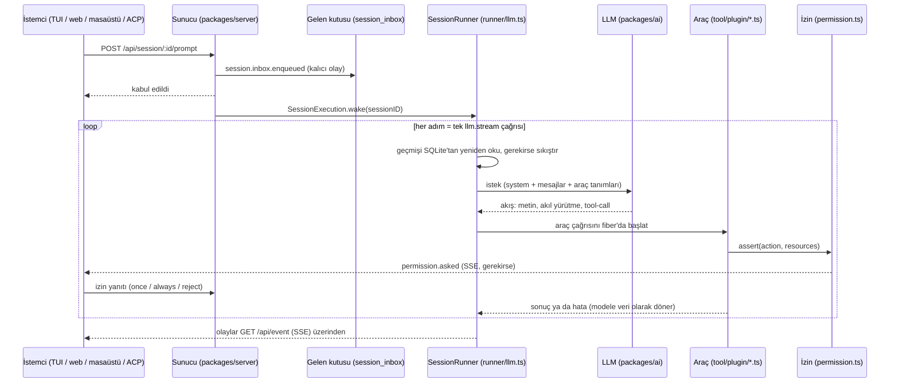
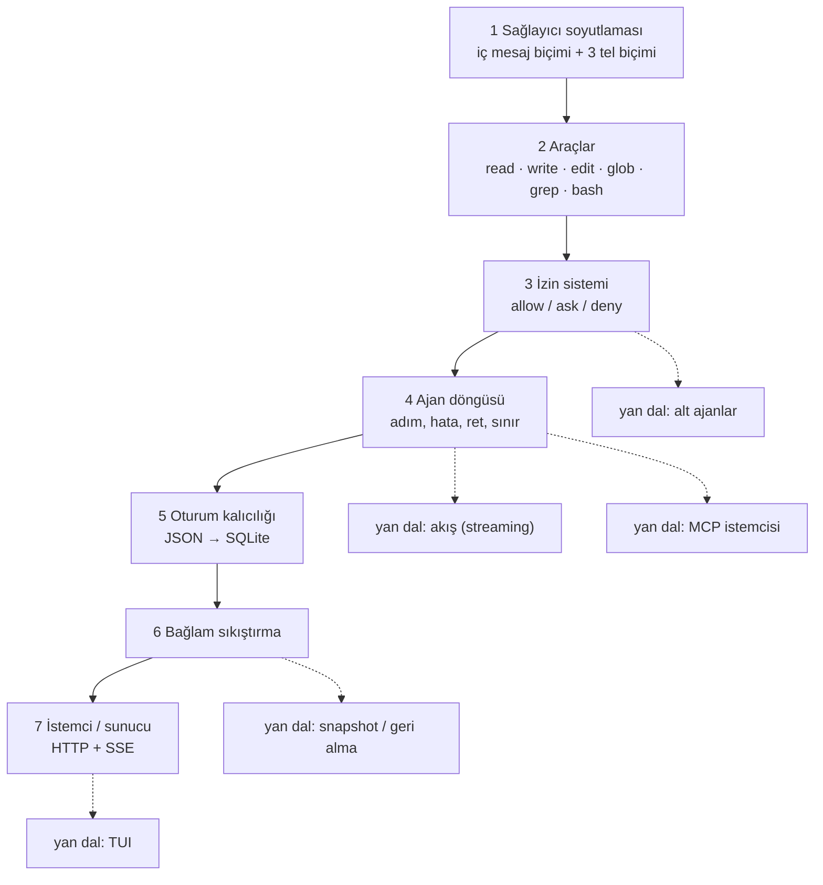

# anomalyco/opencode — terminalde, web'de ve masaüstünde çalışan açık kaynak kodlama ajanı

> **Dal:** [D07 Kodlama ajanları ve harness'lar](../README.md) · **Tür:** kod tabanı
> **Dil:** TypeScript (Bun + Effect) · **Lisans:** MIT · **Yıldız:** 225.656 (9 Kasım 2026) · **İncelenen commit:** `12a661e` (2026-11-08)

## 1. Bir bakışta

opencode, bir dil modelini dosya okuyan, düzenleyen, komut çalıştıran bir **kodlama ajanına** çeviren açık kaynak
bir araçtır; eski adı `sst/opencode`, bugünkü yeri `anomalyco/opencode`. İncelenen sürüm **V2** (`package.json`:
`2.2.5`): ajan bir arka plan sunucusunda çalışır, terminal arayüzü (TUI), web uygulaması, Electron masaüstü uygulaması
ve ACP (Agent Client Protocol) köprüsü aynı HTTP API'nin istemcileridir. VS Code eklentisi (`sdks/vscode`) ise ayrı bir
istemci değil, TUI'yi VS Code terminalinde açan ve ona `@dosya#satır` referansı yazan ince bir başlatıcıdır. Sağlayıcı bağımsızdır:
models.dev kataloğu, OpenAI/Anthropic/Gemini/Bedrock tel biçimleri ve Ollama, LM Studio, vLLM gibi yerel sunucular
desteklenir. Popülerliğinin nedeni; tek bir şirketin modeline bağlı olmayan, terminal öncelikli, eklentiyle
genişletilebilen ve izin sistemi açık kurallarla yazılmış bir ajan olmasıdır.

## 2. Nasıl yapılmış: mimari

### Klasör haritası

İncelenen commit'te 11.291 dosya, 6.688 `.ts/.tsx` dosyası ve `packages/` altında 35 paket var.

```text
packages/
  schema/        # paylaşılan tel ve depolama sözleşmeleri (Effect Schema): agent, permission, session-event…
  core/          # alan davranışı + kalıcılık: oturum, döngü, araçlar, izinler, MCP, eklentiler, SQLite
    src/session/runner/   # ajan döngüsü: llm.ts (drain/runStep), step.ts (tek deneme), max-steps.ts
    src/tool/plugin/      # yerleşik araçlar: read, write, edit, patch, glob, grep, shell, subagent, skill…
    src/plugin/           # iç eklentiler: ajanlar (agent.ts, plan.ts), sağlayıcılar (provider/*.ts), hooks
    src/permission.ts     # allow/ask/deny kuralları ve onay akışı
    src/session/compaction.ts  # bağlam sıkıştırma
    src/mcp/              # MCP istemcisi: stdio, uzak bağlantı, OAuth, havuz
    src/database/         # SQLite + Drizzle, 59 göç dosyası
  ai/            # kendi LLM istemci kütüphanesi: protocols/ (tel biçimleri) + providers/ (uç noktalar)
  codemode/      # araçları çağıran küçük bir JS benzeri dil yorumlayıcısı ("Code Mode")
  protocol/      # genel HTTP API tanımları (HttpApi grupları); openapi.json da bu sözleşmeden üretilir
  server/        # HTTP sunucusu ve çalışma zamanı kompozisyonu (handlers/*.ts)
  client/        # HttpApi sözleşmesinden (ClientApi) httpapi-codegen ile üretilen Promise + Effect istemcisi
  sdk/           # client + core + server'ı birleştiren SDK
  cli/           # komut satırı girişi, arka plan servisinin yaşam döngüsü, ACP (src/acp/)
  tui/           # terminal arayüzü (OpenTUI + Solid)
  app/           # paylaşılan web arayüzü (Solid)
  desktop/       # Electron masaüstü uygulaması
  plugin/        # eklenti API'si (Promise, Effect, TUI ve RPC yüzleri)
  web/           # çok dilli dokümantasyon sitesi (Astro Starlight)
  http-recorder/ # gerçek HTTP trafiğini kaydedip oynatan test kütüphanesi
  process-daemon/ # Rust ile yazılmış kalıcı PTY servisi (Cargo adı opencode-pty)
sdks/vscode/     # VS Code eklentisi: TUI'yi VS Code terminalinde açan başlatıcı
specs/v2/        # V2 sözleşmeleri: session.md, tools.md, karar kayıtları
.opencode/       # deponun kendi ajan yapılandırması: skills/, agent/, command/, themes/
.github/workflows/  # check, check-test, release, nightly-beta, triage-* iş akışları
```

### Ana bileşenler ve veri akışı



Akışın özü şudur. İstem önce **kalıcı bir gelen kutusu kaydı** olur; çalıştırma ondan ayrıdır
(`specs/v2/session.md`: "Prompt Admission Precedes Execution"). `SessionExecution` süreç genelinde oturum kimliğiyle
çalışır, `SessionRunCoordinator` aynı oturumun uyandırmalarını birleştirir ve farklı oturumları paralel yürütür.
`runner/llm.ts` içindeki `drain` döngüsü her adımda `advanceToStep` ile sıradaki girdiyi (yönlendirme/steer, kuyruk,
sıkıştırma ya da taşıma kontrolü) seçer, `runStep` ise bağlamı yükler, otomatik sıkıştırmayı dener, isteği kurar ve
`SessionStep.attempt`'i çağırır. `runner/step.ts` sağlayıcı akışını okurken her tamamlanmış araç çağrısını ayrı bir
Effect fiber'ında başlatır; adım sonunda araç sonuçları, kullanım ve dosya anlık görüntüsü (snapshot) kaydedilir.
Model araç istemeye devam ettikçe yeni adım başlar. AGENTS.md bunu kural olarak yazar: "Each step is one explicit
`llm.stream` call that continues from reloaded history. Do not add an in-memory tool loop."

### Önce okunacak dosyalar

1. `CONTRIBUTING.md` ve `AGENTS.md` — paket listesi, bağımlılık yönü (Schema → Core/Protocol → Server), oturum çekirdeği
   kuralları. AGENTS.md ajanlara yazılmış bir stil rehberidir; burada **konu** olarak okunur.
2. `specs/v2/session.md` ve `specs/v2/tools.md` — tek dosyadan çıkarılması zor sözleşmeler.
3. `packages/core/src/session/runner/llm.ts` — `drain`, `advanceToStep`, `runStep`: döngünün iskeleti.
4. `packages/core/src/session/runner/step.ts` — akışı okuma, araç fiber'ları, sonuç sınıflandırma (`Outcome`).
5. `packages/core/src/tool.ts` — araç kayıt defteri, `snapshot()`, tümüyle yasaklı araçları gizleme, Code Mode.
6. `packages/core/src/permission.ts` — `evaluate` (son eşleşen kural), `assert`, `reply` (once/always/reject).
7. `packages/core/src/tool/plugin/edit.ts` ve `shell.ts` — iki tipik aracın izin isteme biçimi.
8. `packages/core/src/session/compaction.ts` — eşikler, özet şablonu, önceden özetleme.
9. `packages/plugin/src/README.md` — eklenti yazarının gördüğü yüz: transform ve runtime kancaları.
10. `packages/protocol/src/groups/session.ts` — HTTP uç noktaları (`/api/session/:id/prompt` vb.).

### Teknoloji yığını, derleme, test, CI, sürüm

- **Çalışma zamanı ve dil:** Bun (`packageManager: bun@1.4.4`) ve TypeScript. Tip denetimi yerelde `bun check` ile
  yapılır; CI'da ve paket yayınında doğruluk kaynağı resmî TypeScript derleyicisidir (`@typescript/native` =
  `typescript@7.1.0-beta`, `bun run typecheck:tsc`). Kodun büyük kısmı **Effect 4** ile yazılmıştır (servisler,
  katmanlar, fiber'lar, şemalar). Tek istisna Rust ile yazılmış PTY servisi `packages/process-daemon`'dır. Monorepo
  yönetimi Bun çalışma alanları + Turborepo (`turbo.json`).
- **Arayüzler:** TUI için OpenTUI + Solid, web için Solid + Vite, masaüstü için Electron, dokümantasyon için Astro
  Starlight. Altyapı için SST (`sst.config.ts`).
- **Veri:** SQLite + Drizzle ORM; oturumlar olay kaynaklıdır (event-sourced): `packages/core/src/event/sql.ts` olay
  tablosu; `session/sql.ts` projeksiyon tabloları: `session_v2` (Drizzle sabiti `SessionTable`), `session_message`,
  `session_part`, `session_inbox`. Veritabanı çalışma alanında değil, küresel veri klasöründe durur
  (`packages/core/src/database/database.ts`).
- **Kalite:** oxlint, ast-grep kuralları (`script/ast-grep/`), husky. Kök komut `bun run check` = lint + typecheck.
  Testler kökten çalışmaz (`"test": "echo 'do not run tests from root' && exit 1"`); her paket kendi testini çalıştırır.
  `packages/core/script/test.ts` testleri yalıtılmış bir `HOME` ile ve API anahtarlarını ortamdan silerek başlatır.
  `packages/core/test/` altında 311 test dosyası var. Sağlayıcı testleri `packages/http-recorder` ile gerçek trafiği
  bir kez kaydedip "kaset"ten oynatır. Web arayüzü Playwright ile, bileşenler hikâyeler (`packages/stories`) üzerinden
  test edilir.
- **CI:** `.github/workflows/check-test.yml` birim testleri Linux ve Windows matrisinde koşar; `check.yml`
  `bun run lint` ve `bun run typecheck:tsc` çalıştırır; `triage-*` iş akışları konu/PR şablonu uyumunu denetler. Rust
  PTY servisinin ayrı iş akışları vardır (`check-process-daemon.yml`, `release-process-daemon.yml`).
- **Sürüm:** `release.yml` `dev` ve `beta` dallarına itişte derler; sürüm numarası verilerek elle tetiklenince
  `latest` kanalına çıkar. Derleme işleri gizli anahtar görmez; imzalama ve yayın işleri yalnızca `.github/release/`
  betiklerini çalıştırır ("build-* jobs run repository code … with no environment, secrets or id-token"). Dağıtım: npm
  (`@opencode/cli`), Homebrew, `install` betiği, AUR, Nix, masaüstü paketleri.
- **Katkı:** varsayılan dal `dev`; PR başlıkları `type(scope): özet`; hata düzeltmeleri bir konuya bağlanmalı; yeni
  davranışlar `packages/schema/src/config/flag.ts` içindeki özellik bayraklarıyla gelir.

### Tasarım kararları ve ödünleşimler

1. **İstemci/sunucu ayrımı.** Ajan bir arka plan servisidir (`opencode service status`); tüm arayüzler aynı HTTP API'yi
   ve `GET /api/event` SSE akışını kullanır. Kazanç: bir oturumu TUI'de başlatıp masaüstünde sürdürmek. Bedel: kimlik
   doğrulama, sürüm uyumu ve "Location" (proje konumu) gibi dağıtık sistem kavramları.
2. **Kalıcı gelen kutusu + olay kaynaklı oturum.** İstem önce diske, sonra modele gider. Süreç ölürse "yazma öncesi
   sahiplik kaydı" (write-ahead claim) ile başlangıçta oturum kaldığı yerden sürer. Bedel: projeksiyonlar, göçler
   (59 göç dosyası) ve kimlik eşsizliği kuralları.
3. **Her şey eklenti.** Ajanlar (`plugin/agent.ts`), plan modu (`plugin/plan.ts`), sağlayıcılar
   (`plugin/provider/*.ts`) ve araçlar (`tool/plugin/*.ts`) aynı `define({ id, effect })` kalıbıyla yüklenir. Eklentiler
   asenkron yüklenir. HTTP işleyicileri onları **beklemez**; o an yüklü olanla yanıt verir, listeler boş ya da eksik
   olabilir (AGENTS.md: "Plugin Loading"). Oturum döngüsü ise drain başında, her adımın bağlamını hazırlarken ve her
   araç çağrısından önce `plugins.awaitActivation` ile etkinleşmeyi bekler (`runner/llm.ts`).
4. **İzinler veridir.** Kural = `{ action, resource, effect }`; son eşleşen kazanır, eşleşme yoksa `ask`. Varsayılan
   ajan her şeye izin verir ama `.env` okumayı sorar (`packages/schema/src/agent.ts`). Tümüyle yasaklı araçlar modele hiç
   gösterilmez (`tool.ts`, `whollyDisabled`).
5. **Code Mode.** Araçlar modele tek tek değil, bir `execute` aracı içinde JavaScript benzeri programlardan
   çağrılabilir (`packages/codemode`, fikir Cloudflare'in "code mode" yazısından). Kazanç: çok araçlı işlerde daha az
   model turu ve token. Bedel: yorumlayıcının desteklediği dil alt kümesiyle sınırlı.
6. **Önbellek dostu istekler.** Son adımda araçlar kapatılsa bile tanımlar istekte kalır ("preserve the provider's
   cached prefix", `runner/llm.ts`). Otomatik sıkıştırma eşiği pencerenin %15'ini (en az 16k token) boş bırakır
   (`compaction.ts`, `RESERVE_SHARE`, `RESERVE_MIN`); eşiği aşan büyük bir adımda bile konuşma değişmeden gidip önbelleği
   kullanabilir. Arka planda önceden özet (`precompute`) deneyseldir: `background_compaction` özellik bayrağıyla açılır,
   yayın sürümlerinde kapalıdır. Açıksa yalnızca son yanıtın istem önbelleği hâlâ canlıyken başlar
   (`CACHE_LIFETIME` − `CACHE_MARGIN`), çünkü özet isteği aynı öneki önbellekten okur.

## 3. Öğrenmen gerekenler

| Önkoşul                                                                                      | Bu depo için neden gerekli                                                                                       | Ücretsiz kaynak                                                                                        |
| -------------------------------------------------------------------------------------------- | ---------------------------------------------------------------------------------------------------------------- | ------------------------------------------------------------------------------------------------------ |
| [G4 JavaScript / TypeScript ve Node.js](../../../govde/README.md#g4)                         | Depo büyük ölçüde TypeScript (PTY servisi `packages/process-daemon` Rust); async akışlar, modüller, tipler       | [You-Dont-Know-JS](../../01-web-arayuzu/you-dont-know-js/README.md)                                    |
| [G11 LLM API temelleri](../../../govde/README.md#g11)                                        | Araç çağırma, akış, token sayımı, önbellek: döngünün dili                                                        | OpenAI ve Anthropic API belgelerinin "tool use" bölümleri                                              |
| [G6 Ağ ve web temelleri](../../../govde/README.md#g6)                                        | HTTP API, SSE olay akışı, OAuth (MCP sunucuları için)                                                            | MDN: "Using server-sent events"                                                                        |
| [G1 Terminal ve kabuk](../../../govde/README.md#g1)                                          | `shell` aracı, süreç grupları, PTY, TUI                                                                          | [free-programming-books Türkçe listesi](../../10-kuratorluk-topluluk/free-programming-books/README.md) |
| [G7 Test, CI ve kod kalitesi](../../../govde/README.md#g7)                                   | Kayıt/oynatma testleri, Windows matrisi, sürüm güvenliği                                                         | `.opencode/skills/unit-tests/` (deponun kendi test rehberi)                                            |
| [G8 Büyük kod tabanı okuma](../../../govde/README.md#g8)                                     | 35 paket ve Effect katmanları arasında yol bulmak                                                                | [ossu-computer-science](../../09-bilgisayar-bilimi/ossu-computer-science/README.md)                    |
| Effect (TypeScript)                                                                          | Servisler, `Layer`, fiber, `Schema`: `packages/core/src` altındaki 475 `.ts` dosyasının 375'i Effect içe aktarır | effect.website belgeleri                                                                               |
| [D08 Ajan becerileri: anthropic-skills](../../08-ajan-becerileri/anthropic-skills/README.md) | opencode `SKILL.md` becerilerini `.opencode`, `.claude`, `.agents` klasörlerinden yükler                         | anthropics/skills deposu                                                                               |
| [D05 Yapay zekâ altyapısı: ollama](../../05-yapay-zeka-altyapisi/ollama/README.md)           | Yerel sağlayıcı eklentileri (ollama, lmstudio, vllm) ve OpenAI uyumlu rota                                       | Ollama API belgeleri                                                                                   |
| MCP (Model Context Protocol)                                                                 | Harici araç sunucuları stdio ya da HTTP ile bağlanır                                                             | modelcontextprotocol.io belirtimi                                                                      |

Dal içi kavramlar: **adım (step)** ve **tur (turn)** ayrımı, **gelen kutusu ve yönlendirme (steer)**, **izin kuralı**,
**bağlam bütçesi ve sıkıştırma**, **araç sonucunun modele veri olarak dönmesi**, **önbellek öneki**.

## 4. Sıfırdan yol (dallanma)



| Aşama | Ne inşa edersin                                   | Öğrendiğin kavram                                                  | Bitti ölçütü                                                                                                       | Süre (tahmini) |
| ----- | ------------------------------------------------- | ------------------------------------------------------------------ | ------------------------------------------------------------------------------------------------------------------ | -------------- |
| 1     | İç mesaj biçimi, OpenAI/Anthropic/Ollama çevirisi | Tel biçimleri, araç şeması, kullanım sayacı                        | Yerel sahte sunucuyla OpenAI uyumlu gidiş-dönüş testi geçer                                                        | 4–6 saat       |
| 2     | Altı araç + alt komut bölücü                      | Yol güvenliği, tam metin düzenleme, zaman aşımı                    | `sleep 5` 200 ms'de öldürülür; `edit` çoklu eşleşmeyi reddeder; `$(…)` içeren komut çalışmaz                       | 7–9 saat       |
| 3     | Kural motoru ve onay servisi                      | Joker eşleme, son eşleşen kural, kalıcı onay                       | `deny` kuralı `always` ile aşılamıyor                                                                              | 3–4 saat       |
| 4     | Döngü                                             | Adım, araç sonucu, ret/düzeltme, adım sınırı, çökme sonrası onarım | Oku → düzenle → bitir senaryosu dosyayı gerçekten değiştirir; yarım kalan araç çağrısı "kesildi" sonucuyla kapanır | 6–8 saat       |
| 5     | Dosya tabanlı oturum deposu                       | Atomik yazma, yeniden yükleme                                      | Her adım geçmişi diskten okur                                                                                      | 2–3 saat       |
| 6     | Sıkıştırma                                        | Token bütçesi, güvenli bölme, özet şablonu                         | Kuyruk asla araç sonucuyla başlamıyor                                                                              | 3–4 saat       |
| 7     | HTTP sunucu + SSE + istemci                       | Olay akışı, izin sorusunu olayla yayınlama                         | İstemci izin olayını alıp yanıtlıyor, tur bitiyor                                                                  | 5–7 saat       |

**Mini uygulama:** [`sifirdan/`](sifirdan/README.md) bu yedi aşamayı ayrı dosyalarda uygular (`asama1_saglayici.js` …
`asama7_sunucu.js`), 44 testle (`node --test`). Her aşamanın gerçek depodaki karşılığı mini README'deki eşleme
tablosunda: örneğin `asama4_dongu.js` → `packages/core/src/session/runner/llm.ts` + `step.ts`, `asama3_izinler.js` →
`packages/core/src/permission.ts`.

**Gerçek ölçeğe giden yol:** mini; akış, paralel araç yürütme, olay kaynaklı kalıcılık, eklenti yükleyici, MCP, TUI ve
güvenli sürüm hattından yoksundur. Ekleme sırası önerisi: (1) akış + iptal (`AbortSignal`), çünkü kullanıcı deneyimi
buna dayanır; (2) paralel araç fiber'ları ve "her çağrıya bir sonuç" garantisi; (3) SQLite + olay tablosu + projeksiyon;
(4) gelen kutusu, steer/queue ayrımı ve yeniden başlatma kurtarması; (5) MCP istemcisi (stdio, sonra HTTP + OAuth);
(6) eklenti API'si (transform + runtime kancaları); (7) TUI; (8) önbellek bilinçli istek kurma ve arka planda özetleme.

## 5. Gerçek depoda okuma rotası

1. `packages/core/src/session/runner/index.ts` — `SessionRunner.Interface` yalnızca `drain` içerir. Soru: neden
   "çalıştır" değil de "boşalt" (drain)? İpucu: çalıştırma, gelen kutusunu tüketmektir.
2. `packages/core/src/session/inbox.ts`, `pendingSteers` ve `beforeControl` (ardından `runner/llm.ts`,
   `advanceToStep`) — sıradaki girdi nasıl seçilir? Yönlendirilmiş (steer) sıkıştırma neden daha önceki steer'lerin
   önüne alınır da bir `move` kontrolünü asla geçmez? `move` neden bir teslim sınırıdır?
3. `runner/llm.ts`, `runStep` — `SessionCompaction.estimatePrompt` → `compaction.compact({ reason: "auto" })` →
   `context.request.primary(...)` → `steps.attempt(...)`. `stepLimitReached` olduğunda `toolChoice: "none"` olur ama
   araçlar istekte kalır; nedenini yorumda bul.
4. `packages/core/src/session/runner/step.ts`, `attempt` — `Stream.runForEach` içinde her `tool-call` olayı için fiber
   başlatılır. Bir kullanıcı reddi (`Permission.DeclinedError`) neden "defect" olarak tünellenir? (`permission.ts`
   içindeki yoruma bak.)
5. `packages/core/src/tool.ts`, `snapshot` — modele gidecek tanımlar nasıl seçilir, `execute` (Code Mode) aracı ne
   zaman eklenir?
6. `packages/core/src/permission.ts` — `evaluate` ve `evaluateInput`: önce yapılandırılmış `deny`, sonra kaydedilmiş
   onaylar, sonra `permission.evaluate` eklenti kancası, en son gözetimsiz kurallar.
7. `packages/core/src/tool/plugin/shell.ts`, `prepare` — `ShellParse.scan` komutu alt komutlara ayırır; her biri ayrı
   izin kaynağıdır; dış dizinler `authorizeExternal` ile ayrıca sorulur.
8. `packages/core/src/plugin/plan.ts` — plan ajanı izinleri değiştirir, hata mesajını yeniden yazar ve bağlama
   hatırlatma ekler: tek bir eklenti üç farklı kancaya dokunur.
9. `packages/core/src/session/compaction.ts` — `RESERVE_SHARE`, `PRECOMPUTE_LEAD`, `SUMMARY_TEMPLATE`. Bir oturumun
   bağlamı %85'e ulaştığında hangi yol izlenir?
10. `packages/protocol/src/groups/session.ts` ve `event.ts` — HTTP yüzü; `event.subscribe` neden "volatile by contract"?

## 6. Alıştırmalar ve öz değerlendirme

1. (Kolay) Mini'de `grep` aracına `-i` (büyük/küçük harf duyarsız) seçeneği ekle ve testini yaz.
2. (Kolay) `asama3_izinler.js`'e bir `review` ajanı ekle: okumaya izin ver, `bash` için yalnızca `git *` komutlarına
   izin ver, geri kalanını sor.
3. (Orta) OpenAI uyumlu biçime akış desteği ekle; `tool_calls` parçalarını `index`'e göre birleştir; testte yerel
   sunucu `data:` satırları göndersin.
4. (Orta) Araçları paralel çalıştır ve opencode'daki kuralı uygula: bir ret, aynı oturumda bekleyen tüm izin
   sorularını reddeder.
5. (Zor) `asama5_oturum.js`'i olay kaynaklı yap: yalnızca olay ekle (`message.added`, `tool.completed`), oturumu
   olayları katlayarak (fold) üret; bir göç (migration) senaryosu yaz.
6. (Zor) Sunucuya `POST /session/:id/interrupt` ekle; çalışan `bash` aracını süreç grubuyla birlikte durdur ve
   yarım kalan araç çağrısına "kesildi" sonucu yaz (mini'nin `settleDanglingToolCalls`'u yalnızca açılışta çalışır;
   opencode: `settleStaleToolCalls`).

<details><summary>Soru 1: Model bir araç çağrısı istedi ama kullanıcı reddetti. Bir sonraki istekte o çağrı için ne gönderilmeli?</summary>

Mutlaka bir araç sonucu (hata olarak). Sağlayıcılar, `tool_calls` içeren bir asistan mesajından sonra her çağrı için
bir sonuç bekler; eksik sonuç isteğin reddine yol açar. opencode reddi "aborted / The user declined this tool call"
sonucu olarak yazar (`runner/step.ts`); açıklamalı ret (`CorrectedError`) ise modele düzeltme olarak gider.

</details>

<details><summary>Soru 2: Kurallar `[{* * allow}, {read *.env ask}, {read *.env.* ask}, {read *.env.example allow}]` iken `read .env.example` ve `read .env.local` ne olur?</summary>

Bu dört kural opencode'un varsayılan ajanındakilerdir (`packages/schema/src/agent.ts`). Eşleşen **son** kural kazanır
(`permission.ts`, `findLast`). `.env.example` üç kurala uyar (`*`, `*.env.*`, `*.env.example`); sonuncusu `allow`
olduğu için sonuç `allow`. `.env.local` ise `*` ve `*.env.*` kurallarına uyar; sonuncusu `ask` olduğu için sonuç `ask`.
İlk eşleşen kazansaydı ikisi de `allow` olurdu: farkı gösteren `.env.local`'dir. Hiçbir kural eşleşmeseydi sonuç `ask`
olurdu.

</details>

<details><summary>Soru 3: Son adımda araçlar kapatılırken neden araç tanımları istekten silinmez?</summary>

Sağlayıcıların istem önbelleği (prompt cache) isteğin önekine bakar; araç tanımlarını silmek öneki değiştirir ve
önbelleği boşa çıkarır. opencode `toolChoice: "none"` ile çağrıyı engeller ama tanımları korur (`runner/llm.ts`).

</details>

<details><summary>Soru 4: Sıkıştırmada korunan kuyruk neden bir araç sonucuyla başlayamaz?</summary>

Araç sonucu, onu isteyen asistan mesajından hemen sonra gelmelidir. Kuyruk araç sonucuyla başlarsa eşleşen
`tool_calls` özetin içinde kaybolur ve OpenAI uyumlu sağlayıcılar isteği reddeder. Çözüm: bölme noktasını asistan
mesajını da içine alacak şekilde geriye kaydırmak.

</details>

<details><summary>Soru 5: opencode'da "istem kabulü" ile "çalıştırma" neden ayrı?</summary>

Kabul kalıcıdır (gelen kutusu satırı), çalıştırma süreç içidir ve kesilebilir. Böylece süreç ölse bile girdi kaybolmaz,
yeniden denenen istekler aynı kimlikle tekrarlanmaz (idempotent) ve çalışırken gelen yeni istemler steer/queue
kurallarına göre sıraya girer (`specs/v2/session.md`).

</details>

## 7. İş fikri tohumları

- **Kurum içi "izinli" kodlama ajanı paketi** — opencode'u kurumun kural setiyle (yalnızca belirli komutlar, `.env`
  okuma yasak) önceden yapılandırıp dağıtmak. **Kime:** 20–200 geliştiricili, kaynak kodunu dışarı çıkaramayan
  bankacılık/savunma tedarikçisi yazılım ekipleri.
- **Yerel model + opencode kurulum hizmeti** — Ollama/vLLM üzerinde Türkçe destekli kod modelini opencode'a bağlayıp
  ağ dışında çalışan geliştirici istasyonları kurmak. **Kime:** KVKK nedeniyle bulut LLM kullanamayan kamu ve sağlık
  yazılım birimleri.
- **Eklenti pazarı ve denetim eklentisi** — her araç çağrısını ve izin kararını kurumsal günlüğe yazan bir opencode
  eklentisi. **Kime:** ISO 27001 denetimine hazırlanan yazılım şirketlerinin güvenlik ekipleri.

Ayrıntılar ve diğer fikirler: [İş fikirleri kataloğu](../../../is-fikirleri/README.md).

## 8. Kaynaklar

- Depo (incelenen commit): <https://github.com/anomalyco/opencode/tree/12a661ea40cd5863b271a89bb06b8a3ddb7ab5a0>
- Katkı rehberi: <https://github.com/anomalyco/opencode/blob/12a661ea40cd5863b271a89bb06b8a3ddb7ab5a0/CONTRIBUTING.md>
- Oturum sözleşmesi: <https://github.com/anomalyco/opencode/blob/12a661ea40cd5863b271a89bb06b8a3ddb7ab5a0/specs/v2/session.md>
- Araç sözleşmesi: <https://github.com/anomalyco/opencode/blob/12a661ea40cd5863b271a89bb06b8a3ddb7ab5a0/specs/v2/tools.md>
- Döngü: <https://github.com/anomalyco/opencode/blob/12a661ea40cd5863b271a89bb06b8a3ddb7ab5a0/packages/core/src/session/runner/llm.ts>
- İzinler: <https://github.com/anomalyco/opencode/blob/12a661ea40cd5863b271a89bb06b8a3ddb7ab5a0/packages/core/src/permission.ts>
- Eklenti API'si: <https://github.com/anomalyco/opencode/blob/12a661ea40cd5863b271a89bb06b8a3ddb7ab5a0/packages/plugin/src/README.md>
- LLM kütüphanesi: <https://github.com/anomalyco/opencode/blob/12a661ea40cd5863b271a89bb06b8a3ddb7ab5a0/packages/ai/README.md>
- Code Mode: <https://github.com/anomalyco/opencode/blob/12a661ea40cd5863b271a89bb06b8a3ddb7ab5a0/packages/codemode/README.md>
- Resmî belgeler: <https://opencode.ai/docs> · model kataloğu: <https://models.dev>
- Effect: <https://effect.website> · MCP: <https://modelcontextprotocol.io> · ACP: <https://agentclientprotocol.com>
- Not: LSP desteği V2 çekirdeğinde henüz çalışma zamanı olarak yok; yapılandırma şeması
  (`packages/schema/src/config/lsp.ts`) ve belgeler (`packages/web/src/content/docs/lsp.mdx`) var, araç dosyalarında
  "after LSP runtime exists" notu duruyor (`tool/plugin/edit.ts`, `write.ts`).
