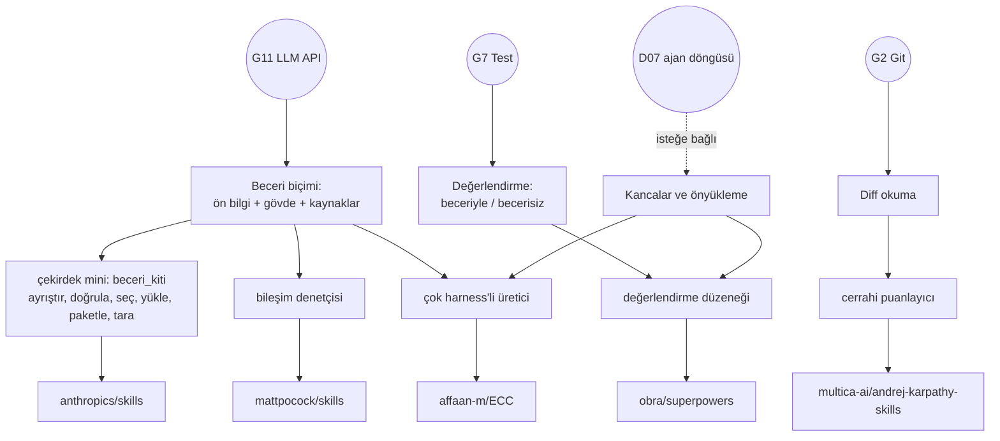

# D08 — Ajan becerileri ve yapılandırma

Bir kodlama ajanının davranışını kodunu değiştirmeden nasıl değiştirirsin? Bu dalın cevabı: **metinle ve küçük
betiklerle**. Beceriler (SKILL.md klasörleri), her oturumda yüklenen talimat dosyaları (CLAUDE.md, AGENTS.md,
GEMINI.md, Cursor kuralları), olaylarda çalışan kancalar (hooks) ve bunları paketleyen eklenti bildirimleri. Dal beş
depodan oluşur: biçimi tanımlayan resmî örnekler (anthropics/skills), tek dosyalık bir ilke seti
(andrej-karpathy-skills), bir geliştirme yöntemi (superpowers), küçük ve birleştirilebilir beceriler (mattpocock/skills)
ve her şeyi 16 kurulum hedefine (15 harness) kuran bir düzenek (ECC). Beşinde de ortak soru aynıdır: _Bu metin ajanın
davranışını gerçekten değiştiriyor mu, ve bunu nasıl ölçersin?_

## Ön koşullar

Liste, beş yaprağın "Öğrenmen gerekenler" tablolarının birleşimidir.

- **Zorunlu (gövde):** [G11 LLM API temelleri](../../govde/README.md#g11) (bağlam penceresi, araç çağırma; beş
  yaprağın hepsi), [G7 Test, CI ve kod kalitesi](../../govde/README.md#g7) (beşi de),
  [G2 Git ve GitHub](../../govde/README.md#g2) (diff, worktree, PR; dört yaprak),
  [G1 Terminal](../../govde/README.md#g1) (kancalar, `claude -p`, kurulum betikleri),
  [G3 Python](../../govde/README.md#g3) (beş mininin dördü Python) ve
  [G4 JavaScript / TypeScript ve Node.js](../../govde/README.md#g4) (ECC'nin kendisi ve minisi Node).
- **Faydalı (gövde):** [G9 Açık kaynak: lisans, katkı süreci](../../govde/README.md#g9) (klasör başına lisans,
  `SCOPE.md`, SLSA) ve [G8 Büyük kod tabanı okuma](../../govde/README.md#g8) (4 701 dosyalık ECC).
- **Önceki dal:** yok; D08'e gövdeden doğrudan başlanır.
- **Komşu dal (ön koşul değil):** [D07 Kodlama ajanları](../07-kodlama-ajanlari/README.md). Becerileri yükleyen,
  araçları çağıran ve kancaları tetikleyen şey ajan döngüsüdür; D07'nin
  [opencode dosyasındaki](../07-kodlama-ajanlari/opencode/README.md) mini ajan bu dalın "harness" dediği şeydir. Ağaçta
  ([AGAC.md](../../AGAC.md)) D07 bu dalı ön koşul sayar; bu yüzden anthropic-skills, superpowers ve ECC dosyalarındaki
  D07 satırları "faydalı" işaretlidir: D07'yi sonra ya da paralel oku.

## Dalın ağacı

## Önerilen sıra

Sıra, yaprakların kendi ön koşul tablolarına uyar: her yaprak yalnızca kendinden önce gelenleri ön koşul sayar.

1. **[anthropic-skills](anthropic-skills/README.md) — biçim.** Her şey SKILL.md'nin üç düzeyli açılımına dayanır ve
   öteki dört yaprak bu dosyayı ön koşul sayar. Çekirdek mini (`beceri_kiti`) superpowers ve mattpocock minilerinin de
   temelidir (`_cekirdek.py` ile içe aktarılır); ECC minisinin ürettiği beceriler de onunla doğrulanabilir. Önce bunu
   kur.
2. **[karpathy-skills](karpathy-skills/README.md) — ilkeler.** Özünde her zaman yüklenen bir talimat dosyası
   (`CLAUDE.md`); aynı metni beceri ve Cursor kuralı olarak da paketler. Üç yükleme biçiminin farkını en yalın hâliyle
   gösterir ve "bir yönerge işe yarıyor mu?" sorusunu diff üzerinden ölçmeyi öğretir. Yalnızca anthropic-skills'i
   ister.
3. **[superpowers](superpowers/README.md) — yöntem.** Oturum başı önyüklemesi, beceri zinciri (sorgula → planla → alt
   ajanlarla uygula → TDD → incele) ve becerileri baskı senaryolarıyla, kontrol gruplu ölçmek. Sonraki iki yaprak onun
   bilindiğini varsayar.
4. **[mattpocock-skills](mattpocock-skills/README.md) — küçük ve birleştirilebilir.** superpowers'ın karşıtı olarak
   okunur (dosya onu ön koşul sayar): becerilerin birbirini nasıl çağırdığı, kimin çağırabildiği (insan / model) ve bu
   kuralların iki harness'te nasıl senkron tutulduğu.
5. **[ecc](ecc/README.md) — bütün düzenek.** Beceri + ajan + kural + kanca + bellek; kanonik kaynaktan ve harness
   kopyalarından 16 kurulum hedefine (15 harness; Claude Code için ev ve proje ayrı hedefler) kurulum, sahiplik durumu,
   sapma ve güvenlik. En geniş ve en karmaşık yaprak; anthropic-skills ve superpowers'ı ön koşul sayar, bir alıştırması
   mattpocock'un kancasına döner. Öncekiler olmadan boğar.

**Süre kuralı.** Bu daldaki bütün süreler saattir; yaprak dosyalarındaki eski gün tahminleri "1 gün ≈ 5 saat odaklı
çalışma" varsayımıyla saate çevrildi. **Mini (saat)** = yaprağın "Sıfırdan yol" tablosundaki aşama sürelerinin
toplamı. **Toplam (saat)** = mini + okuma rotası (adım başına 0,5 saat) + alıştırmalar (kolay 1, orta 2, zor 4 saat).
Hafta hesabı haftada ~10 saat odaklı çalışma varsayar.

| Sıra | Depo                                                           | Tür                              | Zorluk (1–5) | Mini                                                                 | Mini (saat) | Toplam (saat) |
| ---- | -------------------------------------------------------------- | -------------------------------- | ------------ | -------------------------------------------------------------------- | ----------- | ------------- |
| 1    | [anthropics/skills](anthropic-skills/README.md)                | ajan yapılandırması              | 2            | [beceri_kiti: 7 aşama, 86 test](anthropic-skills/sifirdan/README.md) | 25          | 46            |
| 2    | [multica-ai/andrej-karpathy-skills](karpathy-skills/README.md) | ajan yapılandırması              | 1            | [cerrahi puanlayıcı, 13 test](karpathy-skills/sifirdan/README.md)    | 11          | 23            |
| 3    | [obra/superpowers](superpowers/README.md)                      | ajan yapılandırması              | 3            | [değerlendirme düzeneği, 17 test](superpowers/sifirdan/README.md)    | 17,5        | 38,5          |
| 4    | [mattpocock/skills](mattpocock-skills/README.md)               | ajan yapılandırması              | 2            | [bileşim denetçisi, 11 test](mattpocock-skills/sifirdan/README.md)   | 15          | 32            |
| 5    | [affaan-m/ECC](ecc/README.md)                                  | ajan yapılandırması + kod tabanı | 4            | [çok harness'li üretici (Node), 24 test](ecc/sifirdan/README.md)     | 22,5        | 45,5          |
|      | **Dal toplamı**                                                |                                  |              |                                                                      | **91**      | **185**       |

**Toplam:** 185 saat; haftada ~10 saatle yaklaşık 18,5 hafta (yalnızca minilerle 91 saat, ~9 hafta). Aşağıdaki
rehberli alıştırma bu hesaba dahil değil; ona ayrıca ~8 saat ayır. Minilerin hepsi çevrimdışı test edilir; gerçek bir
LLM gerekmez.

## Beş deponun karşılaştırması

Sayılar klonlardan, incelenen commit'lerde ölçüldü.

|                               | anthropics/skills                                | karpathy-skills                         | superpowers                                                                          | mattpocock/skills                          | ECC                                                                                    |
| ----------------------------- | ------------------------------------------------ | --------------------------------------- | ------------------------------------------------------------------------------------ | ------------------------------------------ | -------------------------------------------------------------------------------------- |
| Ne?                           | Biçim + örnek beceriler                          | Tek CLAUDE.md, 4 ilke                   | Yöntem: 15 beceri + önyükleme                                                        | Küçük birleştirilebilir beceriler          | Düzenek: beceri, ajan, kural, kanca, bellek                                            |
| Boyut                         | 446 dosya, 19 beceri                             | 9 dosya, 1 beceri                       | 236 dosya, 15 beceri                                                                 | 184 dosya, 39 beceri (27 yayımlanan)       | 4 701 dosya, 314 beceri, 71 ajan                                                       |
| Ön bilgi alanları             | name, description, license                       | name, description, license              | yalnızca name, description                                                           | + disable-model-invocation, argument-hint  | + metadata, tools, origin …                                                            |
| Açıklama üslubu               | ne + ne zaman, "biraz ısrarcı"                   | ne + ne zaman                           | kural: "Use when…" ile başla, iş akışını özetleme (15 becerinin 14'ünde uygulanıyor) | insan için tek satır / model için tetikler | ne + "Use when…"                                                                       |
| Davranışı nasıl değiştirir?   | Tetiklenen beceri                                | Her zaman yüklenen talimat              | Oturum başı önyükleme + beceri zinciri                                               | İnsan orkestratörü + model disiplinleri    | Kanca + kural + beceri + içgüdü                                                        |
| Kanca                         | yok                                              | yok                                     | SessionStart                                                                         | yok (bir `misc` becerisi kurar)            | 27 girdi, 8 olay türü                                                                  |
| Test / CI                     | yok; skill-creator eval betikleri                | yok                                     | yerel testler; davranış evalleri ayrı depoda                                         | changesets sürüm iş akışı                  | `tests/` altında 534 dosya (≈483 test dosyası), matris CI, tedarik zinciri iş akışları |
| Lisans                        | klasör başına Apache 2.0 (fontlar SIL OFL 1.1)   | "MIT" der, dosya yok                    | MIT                                                                                  | MIT                                        | MIT                                                                                    |
| Klonda bulduğumuz zayıf nokta | claude-api açıklaması 1068 karakter (sınır 1024) | `curl … >> CLAUDE.md` sabitlenmemiş dal | her oturum bağlam maliyeti                                                           | in-progress becerisinde geçersiz YAML      | kopyalar arası sapma (590 / 467 / 414 satır)                                           |

## Hangi harness neyi okur?

Bu tablo klonlarda **gördüğümüz** dosyalardan derlendi; harness'lerin resmî belgeleriyle karşılaştırılmadı. OpenCode
satırı, D07'deki opencode klonunun kendi kaynak kodundan (`12a661e`) okundu. Kaynağı yalnızca bir deponun README'si
olan satırlar "iddia" diye işaretli.

| Harness                | Talimat dosyası                                                              | Beceriler                                                                                                        | Kanca / eklenti                                                    | Görüldüğü yer                                                                                                      |
| ---------------------- | ---------------------------------------------------------------------------- | ---------------------------------------------------------------------------------------------------------------- | ------------------------------------------------------------------ | ------------------------------------------------------------------------------------------------------------------ |
| Claude Code            | `CLAUDE.md`                                                                  | `.claude/skills/<ad>/`, kişisel `~/.claude/skills/`, eklentide `skills/`                                         | eklentide `hooks/hooks.json`, ayarlarda `hooks.PreToolUse`         | ECC `claude-project.js`, mattpocock `link-skills.sh`, superpowers                                                  |
| Codex                  | `AGENTS.md`                                                                  | `.agents/skills/<ad>/` + `agents/openai.yaml`, `~/.agents/skills/`                                               | `.codex-plugin/plugin.json`, `.codex/config.toml`, `agents/*.toml` | ECC, mattpocock, superpowers                                                                                       |
| Cursor                 | `.cursor/rules/*.mdc` (ECC'de `*.md`; `description`, `globs`, `alwaysApply`) | `.cursor/skills/`                                                                                                | `hooks-cursor.json` / `.cursor/hooks.json`                         | karpathy, ECC, superpowers                                                                                         |
| Gemini CLI             | `GEMINI.md` (uzantıda `contextFileName`)                                     | `gemini skills install`                                                                                          | `gemini-extension.json`                                            | superpowers, mattpocock `.agents/install-block.md`                                                                 |
| OpenCode               | `AGENTS.md` (genel yapılandırma klasöründe ve projede yukarı doğru aranır)   | yapılandırma klasörlerinin `skill/`, `skills/` alt klasörleri (ayrıntı doğrulanmadı); eklentiler de klasör ekler | süreç içi JS eklentisi; eklentiler bağlama ayrıca metin ekler      | D07 opencode klonu (`packages/core/src/config/plugin/instruction.ts`, `skill.ts`), superpowers ve ECC `.opencode/` |
| Copilot CLI            | `.github/copilot-instructions.md` (iddia)                                    | `.github/skills/`, `.agents/skills/`, `.claude/skills/` (iddia)                                                  | kendi eklenti sistemi                                              | ECC README                                                                                                         |
| Qwen Code, Kiro, Zed … | `QWEN.md`, `.kiro/steering/` …                                               | hedefe göre                                                                                                      | hedefe göre                                                        | ECC kurulum adaptörleri (`qwen-home`, `zed-project`) ve ECC `.kiro/install.sh`                                     |

superpowers'ın taşıma kılavuzu bütün bunları üç şekle indirger: **A)** oturum başında kabuk komutu çalıştıran kanca,
**B)** süreç içinde çalışan eklenti, **C)** uzantının kendi taşıdığı talimat dosyası (oturum başı olayı da talimat
dosyası da olmayan harness'ler için beceri listesi üzerinden yumuşak bir yedek yol da tarif eder). Bir harness'in
desteklenebilmesi için tek vazgeçilmez şart, her oturumun başında kullanıcı bir şey yapmadan bağlama metin
ekleyebilmektir.

## Kancalar ve riskleri

Kanca, ajanın bir olayında (SessionStart, UserPromptSubmit, PreToolUse, PostToolUse, PostToolUseFailure, PreCompact,
Stop, SessionEnd) **senin yetkilerinle** bir komut çalıştırır. Çıkış kodu 2 aracı engeller, stderr modele geri bildirim
olur, stdout'taki JSON bağlama metin ekleyebilir. Güçlüdür; bu yüzden riskleri de büyüktür:

- **Eklenti kurmak = kod çalıştırmak.** superpowers'ın kancası her oturum başında, ECC'ninkiler her araç çağrısında
  çalışır. Kurmadan önce kanca komutlarını oku; ECC'nin `node -e "…"` tek satırlıkları gibi okunması zor komutlar
  denetimi zorlaştırır.
- **Depodaki proje ayarı da bir saldırı yüzeyidir.** ECC'nin güvenlik rehberi iki Claude Code açığını aktarır: güven
  onayından önce proje kodunun çalışması (CVE-2025-59536) ve proje ayarıyla `ANTHROPIC_BASE_URL` değiştirilerek API
  anahtarının güven onayından önce sızdırılması (CVE-2026-21852); rehberdeki anlatım, bu atlasta doğrulanmadı. Yabancı
  bir depoyu açmadan önce `.claude/` ve `hooks/` klasörlerine, `.mcp.json` dosyasına bak.
- **Alt dizgi eşleşmesi bir güvenlik sınırı değildir.** mattpocock'un `block-dangerous-git.sh` kancası komut metninde
  `git push` gibi dizgileri arar. Araya seçenek koymak (`git -C . push`), çift boşluk ya da komut ikamesi
  (`$(echo git) push`) kaçar; alt kabuk tek başına yetmez (`sh -c "git push"` yine yakalanır). Koruma kancası bir
  emniyet kemeridir, kafes değil.
- **Arka plan yazıcıları belleği besler.** ECC'nin gözlemci ajanı onaysız içgüdü dosyası yazar; bu dosyalar sonraki
  oturumların bağlamına girer. Kalıcı belleği dar, kapsamlı ve atılabilir tut.

## Üçüncü taraf beceri güvenliği

Bir beceri hem **güvenilmeyen istem** hem **güvenilmeyen koddur**. Bu dalda gördüğümüz vektörler: gizli Unicode ve
HTML yorumları (insan görmez, model görür), başvuru dosyalarına gömülü talimatlar, `curl` ile dışarıya veri gönderen
betikler, kancalar, MCP yapılandırmaları, sabitlenmemiş bir dalı `curl … >> CLAUDE.md` ile talimat dosyasına eklemek
ve beceri klasöründe unutulmuş baskı senaryoları (superpowers #2277: ajan bunları gerçek talimat sanabildi).
En düşük çıta:

1. Kurmadan önce oku; çekirdek minideki `python3 -I beceri.py tara <klasör>` okunacak satırları öne çıkarır (gerçek
   depolarda çok sayıda meşru bulgu verir: karar sende).
2. Sürümü bir commit'e sabitle; paketin SHA-256 özetini doğrula (`beceri.py paketle` özet dosyası üretir).
3. Ajanı gereğinden fazla yetkiyle çalıştırma: ağ çıkışı, gizli dosya okuma ve depo dışına yazma için onay iste.
4. Beceriyi ayrı bir kum havuzunda (konteyner) dene, sonra ekibine yay.

## Bir beceri ya da CLAUDE.md işe yarıyor mu?

Dört depo beş ölçüm yolu öğretir (anthropics/skills ikisini); dalın minileri bunların dördünü çevrimdışı modeller,
beşincisi için ECC dosyasında bir alıştırma var:

| Yaklaşım                    | Kaynak                                         | Ne ölçer                                                                                                                 | Bu daldaki karşılığı                                                                                                        |
| --------------------------- | ---------------------------------------------- | ------------------------------------------------------------------------------------------------------------------------ | --------------------------------------------------------------------------------------------------------------------------- |
| Tetiklenme değerlendirmesi  | anthropics/skills `run_eval.py`, `run_loop.py` | Açıklama doğru sorgularda beceriyi açtırıyor mu? (3 koşu, 0.5 eşik, %40 test; yalnızca modelin ilk araç çağrısı sayılır) | [`anthropic-skills/sifirdan/beceri_kiti/tetik_eval.py`](anthropic-skills/sifirdan/beceri_kiti/tetik_eval.py)                |
| Beceriyle / becerisiz kıyas | skill-creator `aggregate_benchmark.py`         | Geçme oranı, süre, token: ortalama ± sapma, fark                                                                         | [`superpowers/sifirdan/degerlendirme.py`](superpowers/sifirdan/degerlendirme.py) (`karsilastir`)                            |
| Baskı senaryosu + RED/GREEN | superpowers `writing-skills`                   | Ajan baskı altında kurala uyuyor mu? Kontrol grubu başarısız mı?                                                         | aynı dosyada `kirmizi_yesil`, `ifade_karsilastir`                                                                           |
| Uyum ölçümü + kancaya terfi | ECC `skills/skill-comply`                      | Destekleyici → nötr → rakip istemlerde adımlar sırasıyla izleniyor mu?                                                   | minide karşılığı yok; [ECC dosyası, alıştırma 6](ecc/README.md#6-alıştırmalar-ve-öz-değerlendirme) sıra denetimini modeller |
| Diff ölçütleri              | karpathy-skills README                         | Daha az gereksiz değişiklik, daha az yeniden yazım                                                                       | [`karpathy-skills/sifirdan/cerrahi.py`](karpathy-skills/sifirdan/cerrahi.py)                                                |

Ortak ders: **kontrol grubu olmadan iyileşme iddia edilemez** ve **tek koşu kanıt değildir**. Tetiklenme minisi bunu
canlı gösterir: dört sorguluk bir test kümesinde zayıf bir açıklama, iyi açıklamayı "yenebilir".

## Kendi beceri paketini yaz (rehberli alıştırma)

Hedef: Türkçe "sürüm notu" becerisini sıfırdan yazıp ölçmek, paketlemek ve iki harness'e dağıtmak. Her adımın bitti
ölçütü var; adımlar bu daldaki minileri kullanır, bu yüzden beş yaprağı bitirdikten sonra yap. Kendi becerilerini ayrı
bir çalışma klasöründe tut ve komutlardaki yolları ona göre ver (`beceri.py` çekirdek minide, `kos.py` superpowers
minisinde, `cli.js` ECC minisinde, `bilesim.py` mattpocock minisinde).

1. **Önce test (tetik).** `surum-notu/evals/tetik-sorgulari.json` dosyasına 10 olumlu ve 10 zor olumsuz sorgu yaz
   (ör. "değişiklik günlüğünü güncelle" yakın-ıska mı?). _Bitti:_ sorgular gerçek kullanıcı cümlesi gibi.
2. **Beceriyi yaz.** `SKILL.md`: kısa bir açıklama ve adımlar. `python3 beceri.py dogrula surum-notu` temiz.
3. **Tetiklenmeyi ölç.** `python3 beceri.py tetik … --aday "…" --aday "…"`; en iyi açıklama test kümesinde seçilsin.
   _Bitti:_ seçilen açıklamanın test puanı ve neden kazandığı yazılı.
4. **Davranışı ölç.** superpowers minisindeki `sahte_model.py`'ye "sürüm notunda Kırıcı değişiklikler başlığı var mı?"
   davranışını, `degerlendirme.olc()`'ye de onu ölçen bir alan ekle; becerinle ve becerisiz karşılaştır. _Bitti:_
   `kirmizi_yesil` kararı YEŞİL. Bu karar ancak becerisiz koşuların geçme oranı 0.5'in altında kaldığında, yani kontrol
   grubu başarısız olduğunda verilir; kontrol zaten geçiyorsa karar GEREKSİZ olur.
5. **Aşamalı açılım.** Uzun biçim kurallarını `references/bicim.md`'ye, etiket bulma işini `scripts/`'e taşı.
   `python3 beceri.py yukle surum-notu references/bicim.md --kok .` ile bağlam günlüğüne bak.
6. **Güvenlik ve paket.** `python3 -I beceri.py tara surum-notu` (yüksek bulgu yok), `python3 beceri.py paketle
surum-notu dist/` ve özet dosyasını yayımla.
7. **Çok harness.** ECC minisinin `kaynak.json`'undaki hazır `surum-notu` girdisini kendi becerinle değiştir (aynı ad
   iki kez kullanılamaz; becerin model-çağırır kalsın diye `kullanici_cagirir` alanını sil, yoksa 8. adımdaki
   orkestratör onu çağıramaz). `node cli.js uygula --cikti <proje> --hedefler claude,codex`, ardından
   `node cli.js denetle --cikti <proje> --hedefler claude,codex` temiz (çıkış kodu 0).
8. **Bileşim.** Bir de kullanıcı-çağırır `/surum-hazirla` orkestratörü yaz: ön bilgide `disable-model-invocation: true`,
   yanında `agents/openai.yaml` içinde `policy.allow_implicit_invocation: false`; gövdesi sürüm notu ve commit mesajı
   becerilerini Beceri aracıyla çağırsın. `python3 bilesim.py denetle <becerilerin-klasörü>` 0 hata.

## Dallar arası bağlantılar

- **[D07 Kodlama ajanları](../07-kodlama-ajanlari/README.md):** beceriyi yükleyen harness'in içi ([opencode](../07-kodlama-ajanlari/opencode/README.md),
  [claw-code](../07-kodlama-ajanlari/claw-code/README.md), [deepseek-harness](../07-kodlama-ajanlari/deepseek-harness/README.md)).
  superpowers ve ECC'nin OpenCode eklentileri D07'deki opencode'un eklenti noktalarına takılır.
- **[D06 Ajan platformları](../06-ajan-platformlari/README.md):** [hermes-agent](../06-ajan-platformlari/hermes-agent/README.md)
  ve [openclaw](../06-ajan-platformlari/openclaw/README.md) superpowers ve ECC'nin kurulum hedefleri arasında
  (`.hermes-plugin/`, ECC `hermes-home.js` ve `openclaw-home.js` adaptörleri).
- **[D05 Yapay zekâ altyapısı](../05-yapay-zeka-altyapisi/README.md):** seçiciyi gömme tabanlı yapmak ve değerlendirmeleri
  yerel modelle koşmak için.
- **[D03 Sistem, ağ, güvenlik](../03-sistem-ag-guvenlik/README.md):** kum havuzu, tedarik zinciri, istem enjeksiyonu.
- Ağaç: [AGAC.md](../../AGAC.md) · İş fikirleri: [katalog](../../is-fikirleri/README.md).

## Bu dalı bitirdiğinde ne yapabilirsin?

- Bir SKILL.md'yi biçim, boyut, taşınabilirlik ve güvenlik açısından denetleyip paketleyebilir, paketin bütünlüğünü
  doğrulayabilirsin.
- Bir becerinin açıklamasını eğitim/test bölmeli tetiklenme ölçümüyle iyileştirebilir, küçük örneklem yanılgısını
  fark edebilirsin.
- Bir becerinin ya da CLAUDE.md'nin davranışı gerçekten değiştirip değiştirmediğini kontrol gruplu, çok koşulu bir
  düzenekle sınayabilirsin.
- Oturum başı önyüklemesinin, kancaların ve eklenti bildirimlerinin harness'e göre nasıl değiştiğini açıklayabilir,
  tek kaynaktan birden çok harness'e sapmasız yapılandırma üretebilirsin.
- Üçüncü taraf bir beceri ya da eklentiyi kurmadan önce saldırı yüzeyini değerlendirebilirsin.
