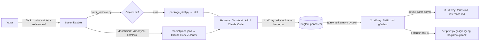
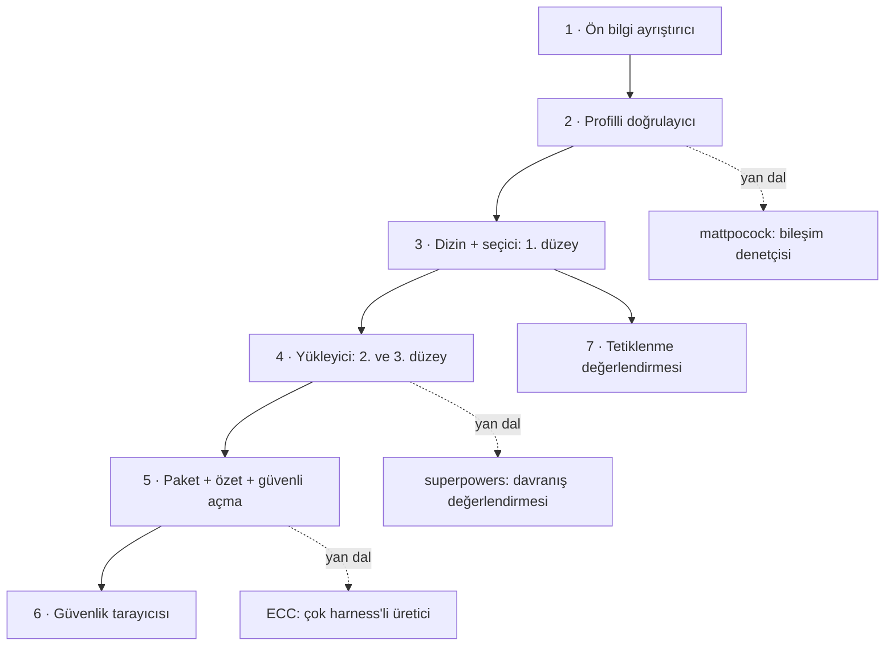

# anthropics/skills — Agent Skills biçiminin başvuru deposu ve örnek beceriler

> **Dal:** [D08 Ajan becerileri](../README.md) · **Tür:** ajan yapılandırması
> **Dil:** Markdown + Python (betikler) · **Lisans:** kök lisans yok; beceri klasörlerinde Apache 2.0 (canvas-fonts: SIL OFL 1.1) · **Yıldız:** 190 146 (9 Kasım 2026) · **İncelenen commit:** `2c5958e` (2026-11-06)

## 1. Bir bakışta

Anthropic'in "Agent Skills" deposu, bir ajana uzmanlık kazandırmanın en sade yolunu gösterir: **beceri bir
klasördür**. İçinde ön bilgisi (`name`, `description`) olan bir `SKILL.md`, isteğe bağlı olarak betikler, başvuru
belgeleri ve şablonlar durur. Ajan açılışta yalnızca ad ve açıklamaları görür, bir görev uyunca gövdeyi okur,
ayrıntıya gerekirse iner. Depoda 19 beceri, bir şablon, belirtime giden bir işaret ve deponun kendisini Claude Code
eklenti pazarına çeviren bir `marketplace.json` var. Popülerliğinin üç nedeni: resmî başvuru olması, Claude'un
Word/Excel/PowerPoint/PDF özelliklerinin arkasındaki "üretim" becerilerini açması ve beceri yazmayı, sınamayı,
paketlemeyi öğreten `skill-creator` meta becerisi.

## 2. Nasıl yapılmış: mimari

### Klasör haritası

```text
.claude-plugin/marketplace.json     # depo = pazar yeri: 5 eklenti, hepsi aynı skills/ klasörünü dilimler
README.md                           # beceri nedir, kurulum (/plugin marketplace add anthropics/skills)
THIRD_PARTY_NOTICES.md              # bildirimler: slack-gif-creator'ın pip bağımlılıkları (imageio, imageio-ffmpeg → FFmpeg GPLv3, Pillow; depoda yok) + canvas-fonts'taki OFL fontlar (depoda var)
spec/agent-skills-spec.md           # tek cümlelik işaret (3 satır): belirtim agentskills.io/specification adresine taşındı
template/SKILL.md                   # en küçük geçerli beceri (6 satır)
skills/
  skill-creator/                    # beceri yazan, sınayan, paketleyen beceri
    SKILL.md                        # süreç: niyet → taslak → test istemleri → değerlendirme → iyileştirme
    scripts/quick_validate.py       # ön bilgi kuralları (izinli alanlar, ad/açıklama sınırları)
    scripts/package_skill.py        # klasörü .skill (zip) dosyasına çevirir
    scripts/run_eval.py             # tetiklenme testi: `claude -p` akışında Skill/Read çağrısını yakalar
    scripts/run_loop.py             # açıklama iyileştirme döngüsü (eğitim/test bölmesi)
    scripts/aggregate_benchmark.py  # beceriyle/becerisiz koşuların ortalama ± sapma ve farkı
    agents/{grader,comparator,analyzer}.md  # değerlendirme alt ajanlarının talimatları
    references/schemas.md           # evals.json, grading.json, benchmark.json şemaları
    eval-viewer/generate_review.py  # insanın sonuçları incelediği HTML görüntüleyici
  pdf/        SKILL.md, forms.md, reference.md, scripts/ (8 betik)   # 3 düzeyli açılımın canlı örneği
  docx/ pptx/ xlsx/                 # belge becerileri; scripts/ altında 51–59 dosya: 39 OOXML XSD şeması + 12–15 Python betiği; scripts/office/ (50 dosya) üçünde birebir kopya
  mcp-builder/  reference/ (5 rehber), scripts/evaluation.py
  claude-api/   96 dosya: python/, go/, java/ … ve shared/   # alana göre bölünmüş başvuru becerisi
  canvas-design/canvas-fonts/       # 54 font (.ttf) + 27 OFL lisans metni = 81 dosya; "assets" türü kaynak, fontlar SIL OFL 1.1
  academy-guide/ discernment-nudge/ doc-coauthoring/ frontend-design/ …
```

Sayılar klondan ölçüldü: 446 dosya, 20 `SKILL.md` (19 beceri + şablon). Kökte `LICENSE` yok; 18 beceri klasöründe
Apache 2.0 `LICENSE.txt` var, `doc-coauthoring` klasöründe yok. Bir istisna daha: `canvas-design/canvas-fonts/`
altındaki fontlar Apache değil SIL Open Font License 1.1 ile gelir. İncelenen commit'in mesajı "Move Office skills to
the Apache 2.0 license (#2146)": Office becerileri bu commit'le Apache 2.0'a taşınmış (önceki lisans, tek commit'lik
klonda görünmüyor).

### Ana bileşenler ve veri akışı



Doğrulama yalnızca `package_skill.py` içinde zorunludur: `validate_skill` başarısız olursa paket üretilmez. Pazar yeri
yolunda ise ne CI ne denetim var; `marketplace.json` yalnızca klasör yollarını listeler (sınırı aşan `claude-api`
açıklaması da bu yoldan yayında).

Döngünün kalbi **tetiklenmedir**. `skill-creator/SKILL.md` bunu açıkça söyler: model, bir beceriye bakıp bakmayacağına
`available_skills` listesindeki ad ve açıklamaya göre karar verir; bu yüzden "ne zaman kullanılır" bilgisinin hepsi
açıklamaya yazılır, gövdeye değil. Aynı belge modelin becerileri az tetiklediğini (undertrigger) söyleyip açıklamaların
biraz "ısrarcı" yazılmasını önerir ve tek adımlık basit işlerin açıklama ne kadar iyi olursa olsun beceri
tetiklemeyebileceğini not eder.

Tetiklenme nasıl ölçülüyor? `scripts/run_eval.py` geçici bir `.claude/commands/<ad>-skill-<rastgele>.md` dosyası
oluşturur (açıklama ön bilgide) ve
`claude -p <sorgu> --output-format stream-json --verbose --include-partial-messages [--model <id>]` çalıştırır; iç içe
çalışabilmek için `CLAUDECODE` ortam değişkenini siler. Yalnızca modelin **ilk araç çağrısı** sayılır: ilk çağrı adı
geçen bir `Skill` ya da `Read` çağrısıysa "tetiklendi", başka bir araçsa ya da hiç araç çağrılmazsa "tetiklenmedi".
Yani model önce `Glob` ya da `Bash` kullanıp sonra beceriyi okursa da "tetiklenmedi" sayılır. Komut satırında her sorgu
varsayılan olarak 3 kez koşulur; tetiklenmesi gereken sorgu oran ≥ 0.5 ise, gerekmeyen sorgu oran < 0.5 ise geçer.

### Önce okunacak dosyalar

1. `template/SKILL.md` — en küçük beceri; biçimin ne kadar az şey istediğini görürsün.
2. `README.md` — "Creating a Basic Skill" bölümü ve üç kullanım yolu (Claude Code, Claude.ai, API).
3. `skills/skill-creator/SKILL.md` — "Anatomy of a Skill", "Progressive Disclosure", açıklama yazımı ve değerlendirme
   döngüsü; dalın kuramsal omurgası.
4. `skills/skill-creator/scripts/quick_validate.py` — kuralların kesin hâli (103 satır).
5. `skills/pdf/SKILL.md` ve `skills/pdf/forms.md` — gerçek bir becerinin 2. ve 3. düzeyi nasıl böldüğü.
6. `skills/skill-creator/scripts/package_skill.py` — dağıtım birimi: zip.
7. `skills/skill-creator/scripts/run_eval.py` ve `run_loop.py` — tetiklenmenin nasıl ölçüldüğü.
8. `.claude-plugin/marketplace.json` — bir deponun birden çok eklentiye nasıl dilimlendiği.

### Teknoloji yığını, derleme, test, CI, sürüm

- **İçerik:** Markdown + YAML ön bilgi. Betikler çoğunlukla Python (skill-creator PyYAML kullanır); bazı beceriler
  Node betikleri ve HTML şablonları taşır.
- **Derleme:** yok. Beceri olduğu gibi dağıtılır; isteğe bağlı olarak `.skill` zip'ine paketlenir.
- **Test ve CI:** depoda `.github/` klasörü ve otomatik test yok. Kalite güvencesi skill-creator'ın önerdiği
  değerlendirme döngüsüdür; o da yazarın kendi makinesinde koşar.
- **Dağıtım:** üç yol (README): Claude Code'da `/plugin marketplace add anthropics/skills` ve
  `/plugin install document-skills@anthropic-agent-skills`; Claude.ai'de yükleme; API'de Skills uç noktaları.
- **Sürüm:** `marketplace.json` içinde `metadata.version: 1.0.0`; değişiklikler PR ile gelir (commit mesajlarında
  `(#2146)` gibi PR numaraları).

### Tasarım kararları ve ödünleşimler

1. **Beceri bir API değil, bir klasör.** Dosya okuyabilen her ajan beceri kullanabilir. Bedeli: biçimde sürüm alanı ve
   yapılandırılmış bağımlılık çözümü yok; izin (`allowed-tools`) ve gereksinim (`compatibility`) isteğe bağlı serbest
   alanlar: doğrulayıcı birincisini hiç, ikincisini yalnızca uzunluk (≤ 500 karakter) bakımından denetler. Harness'ler
   kendi eklentilerini ekliyor (mattpocock'taki `disable-model-invocation` gibi).
2. **Tetik = açıklama.** Yalnızca `name` + `description` her turda bağlamdadır. Açıklama hem "ne yapar" hem "ne zaman"
   anlatır ve sınırı 1024 karakterdir. Bu tasarım ucuzdur ama kırılgandır: kötü yazılmış bir açıklama, mükemmel bir
   gövdeyi görünmez kılar.
3. **Üç düzeyli aşamalı açılım.** Gövde için "500 satırın altı ideal", 300 satırı aşan başvuru dosyalarına içindekiler
   tablosu, çok alanlı becerilerde alana göre ayrı dosyalar (`claude-api/python/`, `claude-api/go/` …). Ödünleşim:
   model ayrıntı dosyasını okumayı unutabilir; işaretçinin (pointer) ifadesi bu yüzden önemlidir.
4. **Betik, kesin işi yapar.** "Betikler yüklenmeden çalışabilir": aritmetik, biçim dönüştürme, form doldurma koda
   bırakılır. skill-creator, test koşularında her alt ajanın aynı yardımcı betiği yeniden yazdığını görürsen o betiği
   beceriye eklemeni söyler.
5. **Değerlendirmeyle yazım.** Beceriyle ve becerisiz (ya da eski sürümle) aynı istemleri koş, iddiaları puanla,
   ortalama ± sapmayı karşılaştır; açıklamayı ayrı bir eğitim/test döngüsüyle iyileştir. Ödünleşim: gerçek model
   koşuları yavaş ve maliyetlidir; küçük örneklemler yanıltır.
6. **Depo = pazar yeri.** `marketplace.json` beş eklenti tanımlar; hepsi `"source": "./"` ve `"strict": false` ile aynı
   `skills/` klasöründen farklı dilimler seçer (`"skills": ["./skills/pdf", …]`). `strict: false` alanının tam anlamı
   klonda açıklanmıyor (doğrulanmadı).
7. **Paylaşılan kod paylaşılmıyor, kopyalanıyor.** `docx`, `pptx` ve `xlsx` becerilerinin `scripts/office/` alt ağacı
   (11 Python betiği + 39 XSD şeması) üçünde de aynı git ağaç özetine sahip. Her beceri tek başına kurulabilsin diye
   ortak kod bir kütüphaneye çıkarılmamış; bedeli, bir düzeltmenin üç yere yapılması gerekmesi.

### Klonda doğrulanan ilginç bulgular

- `skills/claude-api/SKILL.md` açıklaması **1068 karakter**: aynı depodaki `quick_validate.py`'nin 1024 sınırını
  aşıyor (PyYAML ile de ölçtük). Dosya 105 146 bayt; ön bilgi 1–8. satırlarda, gövde 9–616. satırlarda (608 satır),
  yani kendi "500 satır" önerisinin de üstünde.
- `skills/pdf/SKILL.md` 11. satırda `REFERENCE.md` ve `FORMS.md` der; klasördeki dosyalar `reference.md` ve `forms.md`.
  Büyük/küçük harf duyarlı bir dosya sisteminde harfiyen açılmaya çalışılırsa bulunamaz.
- `README.md` "ön bilgi yalnızca iki alan ister" der; doğrulayıcı ise altı alana izin verir (`license`,
  `allowed-tools`, `metadata`, `compatibility` isteğe bağlı).

## 3. Öğrenmen gerekenler

| Ön koşul                                                             | Neden bu depo için                                                                                 | Ücretsiz kaynak                                         |
| -------------------------------------------------------------------- | -------------------------------------------------------------------------------------------------- | ------------------------------------------------------- |
| [G11 LLM API temelleri](../../../govde/README.md#g11)                | Aşamalı açılım bir bağlam bütçesi tasarımıdır; tetiklenme bir araç çağrısıdır (`Skill`/`Read`).    | [Claude belgeleri](https://platform.claude.com/docs)    |
| [G1 Terminal](../../../govde/README.md#g1)                           | Betikler, `claude -p`, eklenti komutları kabuktan çalışır.                                         | Gövdedeki G1 kaynakları                                 |
| [G2 Git ve GitHub](../../../govde/README.md#g2)                      | Pazar yeri bir GitHub deposudur; katkı PR ile gelir.                                               | Gövdedeki G2 kaynakları                                 |
| [G3 Python](../../../govde/README.md#g3)                             | skill-creator betikleri ve bu dalın minisi Python.                                                 | [Python belgeleri](https://docs.python.org/3/tutorial/) |
| [G7 Test ve CI](../../../govde/README.md#g7)                         | Beceri değerlendirmesi, test yazmanın LLM'li hâlidir.                                              | Gövdedeki G7 kaynakları                                 |
| [G9 Açık kaynak ve lisans](../../../govde/README.md#g9)              | Kök lisanssız depo, klasör başına lisans, üçüncü taraf bildirimleri.                               | [choosealicense.com](https://choosealicense.com/)       |
| [D07 opencode dosyası](../../07-kodlama-ajanlari/opencode/README.md) | Faydalı, ön koşul değil (D07 bu dalı ön koşul sayar): becerileri yükleyen tarafın nasıl çalıştığı. | O dosyanın minisi                                       |

Dala özgü kavramlar: YAML ön bilgi ve YAML'in tuzakları (tırnaksız değerde `: `, YAML 1.1 ile 1.2 farkı), Markdown
bağlantıları, zip biçimi ve zip-slip, istem enjeksiyonu. YAML için [YAML 1.2 belirtimi](https://yaml.org/spec/1.2.2/),
istem enjeksiyonu için [OWASP LLM Top 10](https://genai.owasp.org/llm-top-10/) iyi başlangıçtır.

## 4. Sıfırdan yol (dallanma)



| Aşama | Ne inşa edersin                 | Öğrendiğin kavram                           | Bitti ölçütü                                                                                               | Süre (tahmini) |
| ----- | ------------------------------- | ------------------------------------------- | ---------------------------------------------------------------------------------------------------------- | -------------- |
| 1     | `onbilgi.py`: YAML alt kümesi   | Girintiye dayalı ayrıştırma, blok skalerler | Beş klondaki 625 SKILL.md'den (ECC çevirileri hariç) 624'ü okunuyor, bozuk olan doğru satırda hata veriyor | 5 saat         |
| 2     | `dogrulama.py`: üç profil       | Belirtim ile harness eklentisinin ayrımı    | `toplanti-notu` spec'te geçersiz, claude-code'da geçerli                                                   | 2,5 saat       |
| 3     | `dizin.py`: keşif + BM25 seçici | Tetik = açıklama; kullanıcı-çağırır beceri  | KDV görevi `fatura-ozeti`ni seçiyor, ilgisiz görev hiçbir şeyi                                             | 5 saat         |
| 4     | `yukleyici.py`: oturum + günlük | Bağlam maliyeti, yol sınırlama              | `../` ve dışarıyı gösteren sembolik bağlantı reddediliyor                                                  | 2,5 saat       |
| 5     | `paket.py`: zip + SHA-256       | Belirlenimci paket, zip-slip                | İki paketleme aynı baytları veriyor; değiştirilmiş paket yakalanıyor                                       | 2,5 saat       |
| 6     | `guvenlik.py`: tarayıcı         | Gizli Unicode, enjeksiyon kalıbı, kanca     | Testteki kötü niyetli beceride 4 yüksek kural yakalanıyor                                                  | 2,5 saat       |
| 7     | `tetik_eval.py`: eğitim/test    | Aşırı uydurma, küçük örneklem yanılgısı     | Seçim test puanına göre yapılıyor                                                                          | 5 saat         |

Aşamaların toplamı 25 saat; okuma rotası ve alıştırmalarla birlikte yaklaşık 46 saat (hesap kuralı
[dal sayfasında](../README.md#sure-kurali)).

**Mini uygulama:** [sifirdan/](sifirdan/README.md) — yukarıdaki yedi aşama, 86 çevrimdışı test ve üç örnek beceri
(`fatura-ozeti` üç düzeyi de kullanır, `commit-mesaji` tetik sorguları taşır, `toplanti-notu` yalnızca insanın
çağırabildiği bir beceridir). Her aşamanın gerçek depodaki karşılığı mini'nin README'sindeki eşleme tablosunda.

**Gerçek ölçeğe giden yol:** Mini, harness'in model tarafını sözcük eşleştirmeyle taklit eder. Gerçeğe yaklaşmak için
sırasıyla: (1) tetiklenme değerlendirmesini `claude -p` gibi gerçek bir modelle koş ve her sorguyu en az 3 kez
tekrarla; (2) davranış değerlendirmesi ekle: beceriyle/becerisiz çıktıları iddialarla puanla ([superpowers
minisi](../superpowers/sifirdan/README.md)); (3) betikleri çalıştırmak gerekiyorsa bunu yalıtılmış bir kum havuzunda
(konteyner) yap; (4) paketleri imzala ve sürümü sabitle; (5) çok harness'e dağıtımı tek kaynaktan üret ([ECC
minisi](../ecc/sifirdan/README.md)).

## 5. Gerçek depoda okuma rotası

1. `template/SKILL.md` ile `README.md`'deki "Creating a Basic Skill" bölümünü karşılaştır: hangi alanlar zorunlu?
2. `skills/skill-creator/scripts/quick_validate.py` 41–92. satırlar: izinli küme, ad kuralları, uzunluk sınırları.
   README'deki "iki alan" ifadesiyle aradaki fark nedir?
3. `skills/skill-creator/SKILL.md` "Anatomy of a Skill" ve "Progressive Disclosure": üç düzeyi kendi cümlelerinle yaz.
4. `skills/pdf/SKILL.md` 11. ve 307–314. satırlar → `forms.md`: gövde ayrıntıyı hangi koşulla dışarı atıyor? Dosya
   adlarındaki büyük/küçük harf farkını bul.
5. `skills/claude-api/SKILL.md` 1–102. satırlar: açıklama (3–6), "Subcommands" tablosu (53–65, 7 alt komut) ve
   "Language Detection" (69–102: dosya türünden `python/`, `typescript/`, `java/` … klasörüne); ortak `{lang}/claude-api/`
   düzeni için "Reading Guide" (502–508). Açıklamanın uzunluğunu ölç.
6. `skills/skill-creator/scripts/run_eval.py` `run_single_query`: geçici komut dosyası neden `.claude/commands/`
   altına yazılıyor ve tetiklenme akışın hangi olayında anlaşılıyor?
7. `skills/skill-creator/scripts/run_loop.py` `split_eval_set` ve sondaki `best` seçimi: neden test puanı?
8. `skills/skill-creator/scripts/aggregate_benchmark.py` `calculate_stats`: sapma neden `n - 1` ile hesaplanıyor?
9. `skills/skill-creator/agents/grader.md`: "zayıf bir iddiayı geçmek yararsızdan da kötüdür" fikrini bul.
10. `.claude-plugin/marketplace.json`: beş eklenti aynı klasörü nasıl paylaşıyor?

## 6. Alıştırmalar ve öz değerlendirme

1. **(Kolay)** `ornek-beceriler/` altına kendi `toplanti-ozeti` becerini yaz; `python3 beceri.py dogrula` temiz çıksın.
2. **(Kolay)** `commit-mesaji` açıklamasını 3 farklı biçimde yaz ve `beceri.py tetik … --aday` ile karşılaştır. Hangi
   sözcükler yakın-ıska sorguları tetikliyor?
3. **(Orta)** `tetik-sorgulari.json` dosyasını 20 sorguya çıkar (10 olumlu, 10 zor olumsuz). Sonuç kararlı hâle geldi mi?
4. **(Orta)** Doğrulayıcıya `allowed-tools` alanı için bir biçim denetimi ekle. Önce klonlarda bu alanın nasıl
   yazıldığını bul; bulamadığın kısmı "doğrulanmadı" diye işaretle.
5. **(Orta)** `guvenlik.py`'ye bir kural ekle: `SKILL.md` gövdesinde kullanıcıdan gizli tutulması istenen bir eylem.
   Önce geçici klasörde başarısız bir test yaz.
6. **(Zor)** `onbilgi.py`'ye akış eşlemesi (`{a: 1, b: [x, y]}`) desteği ekle; YAML 1.2 belirtimindeki örneklerle sına.
7. **(Zor)** Seçiciyi BM25 yerine küçük bir yerel gömme (embedding) modeliyle değiştir ([D05](../../05-yapay-zeka-altyapisi/README.md)
   dalındaki araçlarla) ve aynı tetik kümesinde karşılaştır.

**Öz değerlendirme**

1. Bir becerinin hangi kısmı her turda bağlam maliyeti yaratır, hangisi yaratmaz?
   <details><summary>Cevap</summary>Ad ve açıklama (1. düzey) her turda bağlamdadır. Gövde yalnızca tetiklenince,
   kaynaklar yalnızca gövde işaret edip model okuyunca girer. Betikler çalıştırılır; içerikleri bağlama girmez.</details>
2. Açıklama neden 1024 karakterle sınırlı olmalı ve neden "ne zaman" bilgisini taşımalı?
   <details><summary>Cevap</summary>Model beceriyi yalnızca açıklamaya bakarak seçer ve bu metin her turda tüm
   becerilerle birlikte bağlamdadır. Uzun açıklamalar her oturumun bütçesini yer; "ne zaman" bilgisi gövdede kalırsa
   model onu tetikten önce hiç görmez.</details>
3. Tetiklenme değerlendirmesinde en iyi açıklama neden eğitim değil test puanına göre seçilir?
   <details><summary>Cevap</summary>Açıklama eğitim sorgularına göre iyileştirildiği için o sorgulara uyar (aşırı
   uydurma). Görülmemiş sorgulardaki başarı, gerçek kullanıcı istemlerindeki davranışın daha dürüst bir tahminidir.</details>
4. `package_skill.py` kökteki `evals/` klasörünü neden pakete koymaz?
   <details><summary>Cevap</summary>Değerlendirme verisi becerinin geliştirme malzemesidir; kurulan beceriyle birlikte
   giderse bağlama girebilir ve boyut büyür. superpowers aynı nedenle baskı senaryolarını beceri klasöründen dışarı
   alır: ajan onları gerçek talimat sanabilir.</details>

## 7. İş fikri tohumları

- **Beceri denetimi için CI eylemi** (doğrulama + güvenlik taraması + boyut raporu) — **kime:** kendi iç beceri
  kütüphanesini yazan 20–200 kişilik yazılım ekiplerinin platform/DevEx sorumluları.
- **Türkçe belge becerileri paketi** (e-fatura, e-arşiv, SGK bildirgesi, KDV beyanı çıktıları için) — **kime:**
  mali müşavirlik büroları ve muhasebe yazılımı geliştiren KOBİ'ler.
- **Açıklama tetiklenme ölçüm hizmeti** (gerçek modelle eğitim/test raporu) — **kime:** beceri pazarlarında
  yayın yapan bağımsız geliştiriciler ve ajanslar.

Ayrıntılar için: [iş fikirleri kataloğu](../../../is-fikirleri/README.md).

## 8. Kaynaklar

- [README.md](https://github.com/anthropics/skills/blob/2c5958ecac7cee2b583967a2c4981d0f4a75c579/README.md)
- [skill-creator/SKILL.md](https://github.com/anthropics/skills/blob/2c5958ecac7cee2b583967a2c4981d0f4a75c579/skills/skill-creator/SKILL.md)
- [quick_validate.py](https://github.com/anthropics/skills/blob/2c5958ecac7cee2b583967a2c4981d0f4a75c579/skills/skill-creator/scripts/quick_validate.py)
  · [package_skill.py](https://github.com/anthropics/skills/blob/2c5958ecac7cee2b583967a2c4981d0f4a75c579/skills/skill-creator/scripts/package_skill.py)
  · [run_eval.py](https://github.com/anthropics/skills/blob/2c5958ecac7cee2b583967a2c4981d0f4a75c579/skills/skill-creator/scripts/run_eval.py)
  · [run_loop.py](https://github.com/anthropics/skills/blob/2c5958ecac7cee2b583967a2c4981d0f4a75c579/skills/skill-creator/scripts/run_loop.py)
- [marketplace.json](https://github.com/anthropics/skills/blob/2c5958ecac7cee2b583967a2c4981d0f4a75c579/.claude-plugin/marketplace.json)
- [Agent Skills belirtimi](https://agentskills.io/specification) — depo belirtimi buraya taşıdı; bu atlasta içeriği
  doğrulanmadı.
- [Equipping agents for the real world with Agent Skills](https://anthropic.com/engineering/equipping-agents-for-the-real-world-with-agent-skills)
  — Anthropic mühendislik yazısı (README'de bağlantılı).
