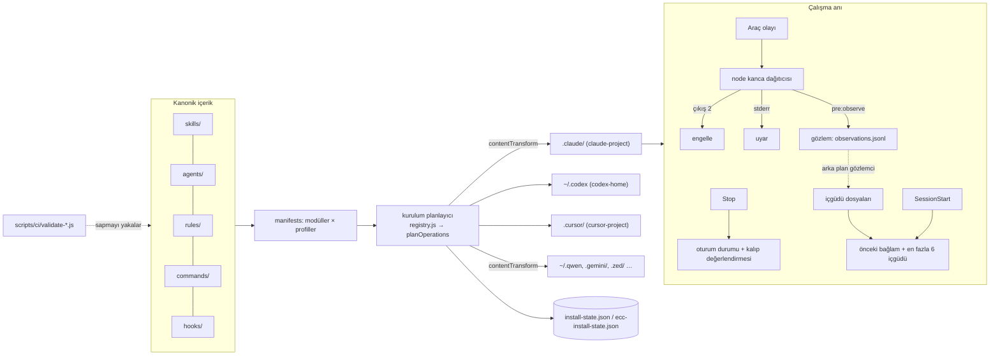
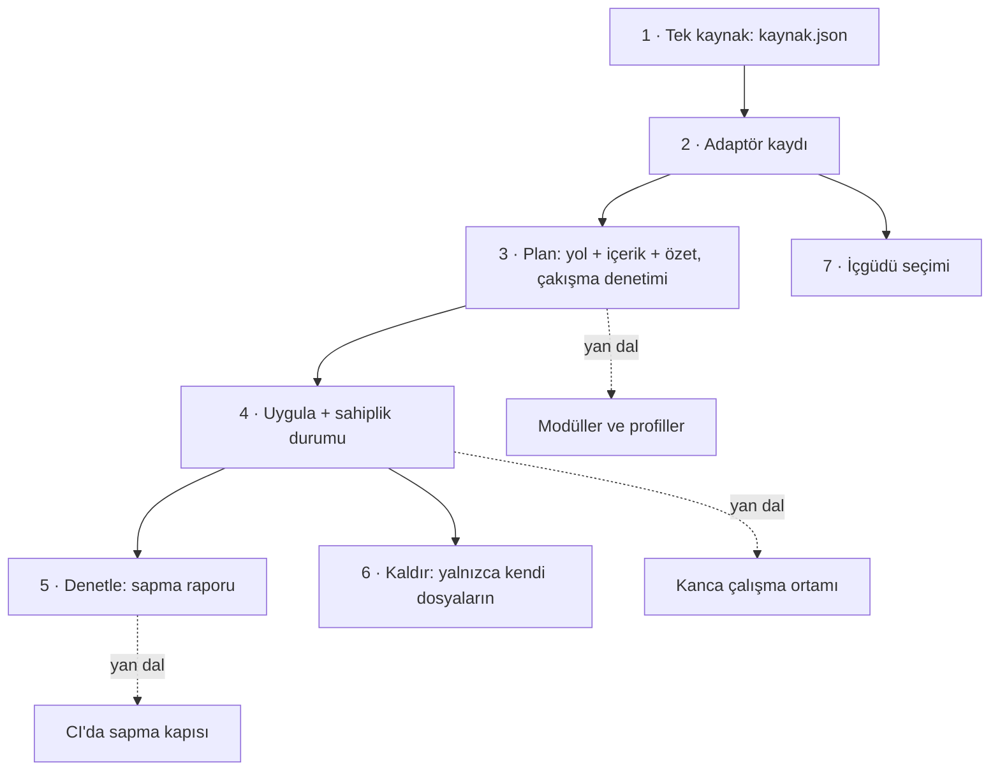

# affaan-m/ECC — çok harness'li ajan düzeneği: beceriler, kancalar, kurallar, içgüdüler

> **Dal:** [D08 Ajan becerileri](../README.md) · **Tür:** ajan yapılandırması (+ kod tabanı)
> **Dil:** JavaScript + Markdown (ayrıca Python, Rust) · **Lisans:** MIT · **Yıldız:** 299 925 (9 Kasım 2026) · **İncelenen commit:** `d2ef268` (2026-11-06)

## 1. Bir bakışta

ECC kendini "ajan düzeneği performans optimizasyon sistemi" diye tanıtır; npm paketi `ecc-universal`, sürümü 2.2.3.
Bir becerinin ötesine geçer: 71 alt ajan, 314 beceri, 98 komut, olaylarda çalışan 27 kanca girdisi, 22 klasörlük
kural seti, oturumlardan "içgüdü" öğrenen bir döngü, bir güvenlik tarayıcısı ve bütün bunları Claude Code, Codex,
Cursor, OpenCode, Gemini, Qwen ve başka harness'lere kuran bir kurulum planlayıcısı (16 hedef adaptörü, 15 harness;
Kiro ise ayrı bir `.kiro/install.sh` ile kurulur). Çözdüğü sorun şu: bir ekip birden çok ajan aracı kullanıyor, her
aracın talimat dosyası, beceri klasörü, kanca biçimi ve eklenti bildirimi farklı; ECC içeriği tek yerde tutup her
hedefe uyarlanmış biçimde dağıtıyor ve çalışma anında kancalarla kalite, bellek ve güvenlik denetimleri ekliyor. README'nin sloganı tasarımı özetler: "Bağlam penceresini optimize et, geri
kalan her şeyi kalıcı kıl." Popülerliğinin nedeni genişliği: tek kurulumla bir "işletim sistemi" vaadi; ama bu
genişlik bakım ve güvenlik maliyetini de büyütür.

## 2. Nasıl yapılmış: mimari

### Klasör haritası

```text
agents/                         # 71 alt ajan: ön bilgide name, description, tools (virgüllü), model
skills/                         # 314 beceri (kanonik kopya)
commands/                       # 98 eğik çizgi komutu; yeni iş akışları önce skills/'e giriyor
legacy-command-shims/           # emekli kısa adlı komutlar, yalnızca açık katılımla
rules/common/ + rules/<dil>/    # her zaman uyulacak kurallar: 21 dil/çerçeve klasörü
hooks/hooks.json                # Claude Code kanca grafiği: PreToolUse 10, Stop 8, SessionStart 2, PostToolUse 2 …
hooks/hooks.metadata.json       # her girdinin kararlı kimliği, açıklaması ve parmak izi (yan dosya)
hooks/codex-hooks.json          # Codex için yalnızca doğrulanmış SessionStart önyüklemesi
manifests/install-modules.json  # 47 modül: tür (rules, agents, skills, hooks, docs …) × hedef listesi × yollar
manifests/install-profiles.json # minimal, opencode, core, developer, security, research, full
scripts/lib/install-targets/    # 16 hedef adaptörü (Claude Code için ev + proje ayrı) + registry.js + helpers.js
scripts/lib/install/            # uygulama, korumalı yazma, sınırlı dosya sistemi, içerik dönüşümü, kanca onayı
scripts/ci/validate-*.js        # ajan, kanca, komut, beceri, host uyumu, bildirim, iş akışı güvenliği denetimleri
schemas/                        # 17 JSON şeması (plugin, hooks, install-state, memory, provenance …)
.claude-plugin/                 # plugin.json, marketplace.json, PLUGIN_SCHEMA_NOTES.md
.codex-plugin/ + .codex/        # Codex eklentisi; config.toml, agents/*.toml, AGENTS.md
.agents/skills/                 # 47 becerinin Codex kopyası + agents/openai.yaml
.cursor/ .kiro/ .opencode/ .gemini/ .qwen/ .zed/ .trae/ .codebuddy/ …  # harness'e özel yüzeyler
skills/continuous-learning-v2/  # gözlem kancası → içgüdü → beceriye evrim
skills/skill-comply/            # beceri ve kurallara gerçekten uyuluyor mu? ölçüm aracı
ecc2/                           # Rust ile 2.0 denetim düzlemi (alfa): TUI, SQLite oturum deposu, daemon
src/llm/                        # Python sağlayıcı soyutlaması (claude, openai, ollama …)
docs/<dil>/                     # 16 dilde çeviri; docs/tr altında 142 dosya ve 38 beceri çevirisi
the-security-guide.md           # ajan güvenliği rehberi
tests/                          # 534 dosya (≈483 test dosyası); node tests/run-all.js
```

Klondan ölçüldü: 4 701 dosya; `skills/*/SKILL.md` 314, `agents/*.md` 71, `commands/*.md` 98 (README'deki sayılarla
aynı). Depoda toplam 1 068 `SKILL.md` var: kanonik 314'e ek olarak çeviriler (`docs/ja-JP` 228, `docs/zh-CN` 183,
`docs/tr` 38 …), `pi/core/skills` 134, `.agents/skills` 47, `.kiro/skills` 43, `.cursor/skills` 12.

### Ana bileşenler ve veri akışı



Üç akış var:

1. **Kurulum.** Bir profil (ör. `developer`) modül listesine açılır; her modülün bir türü, hedef listesi ve yolları
   vardır. `scripts/lib/install-targets/registry.js` hedefe uyan adaptörü bulur; adaptör kök klasörü
   (`rootSegments`), durum dosyası yolunu ve işlem planını üretir. Bazı adaptörler içerik dönüşümü ekler: Qwen hedefi
   `agents/` dosyalarına `qwen-agent-frontmatter` dönüşümü uygular. Gemini adaptörü yalnızca 10 satırdır; Cursor
   adaptörü 231 satır. Plan uygulanınca ECC'ye ait girdiler kararlı kimlikle izlenir; kaldırma yalnızca onları siler.
2. **Çalışma anı (kancalar).** `hooks/hooks.json` her araç olayında `node -e` ile eklenti kökünü bulan küçük bir
   önyükleyici, sonra bir dağıtıcı betik çalıştırır. Örnekler (`hooks.metadata.json` kimlikleriyle):
   `pre:bash:dispatcher` (kalite, tmux, push ve GateGuard denetimleri), `pre:config-protection` (linter/biçimleyici
   ayar dosyalarının düzenlenmesini engeller: "kodu düzelt, ayarı gevşetme"), `pre:mcp-health-check`,
   `stop:format-typecheck` (düzenlenen JS/TS dosyalarını yanıt sonunda toplu biçimlendirir ve tip denetler),
   `stop:session-end` (oturum durumunu kalıcı kılar), `stop:evaluate-session` (çıkarılabilir kalıpları arar),
   `stop:cost-tracker`. Engelleme çıkış kodu 2 ile, uyarı stderr ile yapılır (`hooks/README.md`).
3. **Öğrenme.** `continuous-learning-v2` gözlemleri proje özetine (hash) göre ayrılmış `observations.jsonl` dosyalarına
   yazar; gözlem her araç çağrısında `pre:observe` kancasıyla yapılır (v1'de Stop kancasıydı; Stop'taki
   `stop:evaluate-session` oturumu ayrıca çıkarılabilir kalıplar için değerlendirir). Arka planda çalışan bir gözlemci
   ajan 3+ kez tekrarlanan kalıpları "içgüdü" dosyasına çevirir (id, trigger, confidence, domain, kapsam); `/evolve`
   benzer içgüdüleri beceri, komut ya da ajana dönüştürür. Oturum başında README'deki varsayılanlarla en fazla 6 içgüdü,
   en az 0.7 güvenle ve oturum başı bağlamının toplam 8 000 karakterlik sınırı içinde bağlama girer.

### Önce okunacak dosyalar

1. `README.md` — "Key Concepts" (ajan, beceri, kanca, kural) ve "Cross-tool capability map" tablosu.
2. `CLAUDE.md` ("Prompt Defense Baseline" bölümü, test komutları) ve `AGENTS.md` (ajan listesi, orkestrasyon, güvenlik
   kuralları) — depoda çalışan ajanlar için kurallar.
3. `.claude-plugin/PLUGIN_SCHEMA_NOTES.md` — eklenti doğrulayıcısının belgelenmemiş kuralları ve geri dönüş tarihçesi.
4. `hooks/README.md`, `hooks/hooks.json`, `hooks/hooks.metadata.json` — kanca grafiği ve yan dosya düzeni.
5. `manifests/install-modules.json` ve `install-profiles.json` — modül × hedef × profil modeli.
6. `scripts/lib/install-targets/registry.js`, `helpers.js`, `gemini-project.js`, `qwen-home.js`, `codex-home.js`.
7. `scripts/ci/validate-skill-host-compat.js` — harness'e taşınabilirlik kuralları.
8. `skills/continuous-learning-v2/SKILL.md` — içgüdü modeli.
9. `skills/skill-comply/SKILL.md` — kural ve becerilere uyumun ölçülmesi.
10. `the-security-guide.md` — saldırı yüzeyleri, temizleme, en düşük çıta listesi.

### Teknoloji yığını, derleme, test, CI, sürüm

- **Çalışma ortamı:** Node.js 18+ (README). npm paketi `ecc-universal`; komutlar `ecc`, `ecc-install`,
  `ecc-memory-mcp`, `ecc-plan-canvas`, `ecc-control-pane`. Bağımlılıklar az: `@iarna/toml`, `ajv`, `js-yaml`,
  `sql.js`, `zod`. Ayrıca Python (`src/llm`, beceri betikleri, `pyproject.toml`) ve Rust (`ecc2/`).
- **Test:** `node tests/run-all.js`; `tests/` altında 534 dosya (`tests/lib` 184, `tests/scripts` 91, `tests/hooks` 76,
  `tests/ci` 45 …); bunların ≈483'ü test dosyası (456 `*.test.*` + 27 `test_*.py`), gerisi fixture ve yardımcı.
  Örnek: `tests/hooks/hooks.test.js` içinde "plugin.json'da açık hooks bildirimi yok" testi.
- **CI:** `.github/workflows/ci.yml` işletim sistemi × Node sürümü × paket yöneticisi matrisiyle testleri koşar,
  bağımlılıkları `npm ci --ignore-scripts` ile kurar (kurulum betiklerini çalıştırmamak tedarik zinciri önlemidir),
  paketlenen arşivin SHA-256 özetini çıkarır ve `validate-agents/hooks/commands/skills/skill-host-compat/
install-manifests/workflow-security/rules` doğrulayıcılarını çalıştırır. Ek iş akışları: `supply-chain-watch.yml`
  (6 saatte bir IOC taraması), `npmscan.yml`, SLSA kanıtı üreten `generator-generic-ossf-slsa3-publish.yml`,
  `release.yml`, PR ve issue taşkınlarına karşı korumalar.
- **Sürüm:** kökte `VERSION` (2.2.3); `CHANGELOG.md`; commitlint ile conventional commit.

### Tasarım kararları ve ödünleşimler

1. **Kanonik kopya + harness'e yansıtılmış kopyalar.** superpowers aynı içeriği her harness'e ince bir bağdaştırıcıyla
   taşırken ECC kopyaları da depoda tutar (`.agents/skills`, `.kiro/skills`, `.cursor/skills` …). Kazanç: her harness
   kendi beklediği biçimi bulur. Bedel: **sapma**. Klonda ölçtüğümüz örnek: `tdd-workflow` kanonik `skills/` kopyası 590
   satır, `.agents/skills` kopyası 467, `.kiro/skills` kopyası 414 satır ve açıklamaları farklı; `search-first`
   `.kiro` kopyasında var, `.agents` kopyasında yok. `validate-skill-host-compat.js` ön bilgi izin listesini, Claude'a
   özgü değişkenleri ve "alt küme sapmasını" (openai.yaml'da adı geçen ama kopyası olmayan beceri) yakalar; içerik
   farkını yakalamaz.
2. **"Doğrulayıcı düşmanca ve harfiyendir."** `PLUGIN_SCHEMA_NOTES.md` Claude Code eklenti bildirimi için klonda
   belgelenmiş kurallar: `version` zorunlu; `commands` ve `skills` dizi olmalı; `agents` alanı eklenirse
   "agents: Invalid input"; `hooks/hooks.json` v2.1+ ile otomatik yüklendiği için `hooks` alanı eklenirse "Duplicate
   hooks file"; kök `.mcp.json` otomatik keşfedilmesin ve MCP araç adları 64 karakteri aşmasın diye `"mcpServers": {}`
   tutulur. Belge, `hooks` alanının dört commit boyunca eklenip çıkarıldığı "flip-flop" tarihçesini de verir. Bunlar
   ECC'nin gözlemleridir; Claude Code belgeleriyle bu atlasta karşılaştırılmadı (doğrulanmadı).
3. **Kanca, becerinin sert hâlidir.** Beceri modele "yap" der; kanca yapılmadığında engeller. ECC kancaları profillerle
   (`ECC_HOOK_PROFILE=minimal|standard|strict`) ve kimlikle kapatılabilir (`ECC_DISABLED_HOOKS`). `skill-comply` uyumu
   düşük adımlar için "kancaya terfi" önerir. Bedel: her araç çağrısında node süreçleri, Windows/WSL yol sorunları ve
   denetlenmesi zor, uzun `node -e` tek satırlıkları.
4. **Yan dosya + parmak izi.** `validate-hooks.js`'in yorumuna göre Claude Code `hooks.json` içinde tanımadığı her
   anahtarı (`id`, `description`) yüklemede "bilinmeyen anahtar" diye raporladığı için kimlikler
   `hooks.metadata.json`'da durur; her girdinin parmak izi (eşleyici + komut) tutulur ve `validate-hooks.js` iki dosya
   kayarsa CI'yı düşürür. Sıra değiştirmenin sessizce kimlik takası yapmasını önleyen küçük ama öğretici bir desen.
5. **Seçmeli kurulum, bağlam ekonomisi.** Profiller ve modüller sayesinde `minimal` profil kanca çalışma ortamını hiç
   kurmaz; README "düşük bağlam / kancasız" bir yol da tarif eder. 314 becerinin hepsinin açıklaması her turda bağlama
   girerse 1. düzey maliyet büyür; seçmeli kurulum bunun panzehiridir.
6. **Öğrenen bellek, dar kapsam.** İçgüdüler güven puanı ve kapsam taşır; v2.1 "çapraz proje bulaşmasını önlemek
   için" proje kapsamlı içgüdüler ekledi. Güvenlik rehberinin önerisi de aynı yönde: kalıcı belleği dar ve atılabilir tut.

### Klonda doğrulanan ilginç bulgular

- `skills/continuous-learning-v2/agents/observer-loop.sh` gözlemci ajana "etkileşimsiz kipte çalışıyorsun, izin
  isteme, doğrudan Write aracıyla içgüdü dosyası yaz" der. Arka planda, onaysız çalışan ve gelecekteki oturumların
  bağlamını besleyen bir yazıcı: bellek zehirlenmesi açısından dikkatle izlenmesi gereken bir yüzey.
- README "yalnızca resmî kaynaklardan kurun; üçüncü taraf yeniden yüklemeler kötü amaçlı yazılım içerebilir" uyarısı
  taşır; `.mcp.json` içindeki MCP sunucusu sürümü sabitlenmiştir (`chrome-devtools-mcp@1.10.1`).
- Bu dalın doğrulayıcısı 314 kanonik becerinin hepsini geçerli buldu; 36'sının gövdesi 500 satırı, 29'unun dosyası
  20 000 baytı aşıyor; 32 beceride toplam 40 belirtim dışı ön bilgi alanı var (en çok `tools`, `origin`, `homepage`).
- Kanca çözümleyicisi eklenti klasörlerinde `everything-claude-code` adını da arıyor. `PLUGIN_SCHEMA_NOTES.md` bu adı
  "eski kurulum adı" (legacy-install name) olarak anıyor (`mcp__plugin_everything-claude-code_…` örneği); projenin
  önceki adı olduğu anlaşılıyor, yeniden adlandırma tarihi klonda görünmüyor (doğrulanmadı).

## 3. Öğrenmen gerekenler

| Ön koşul                                                                                               | Neden bu depo için                                                                           | Ücretsiz kaynak                                                |
| ------------------------------------------------------------------------------------------------------ | -------------------------------------------------------------------------------------------- | -------------------------------------------------------------- |
| [G4 JavaScript ve Node.js](../../../govde/README.md#g4)                                                | Kurulum planlayıcı, kancalar, doğrulayıcılar Node; CommonJS/ESM ayrımı.                      | [Node.js belgeleri](https://nodejs.org/docs/latest-v22.x/api/) |
| [G7 Test ve CI](../../../govde/README.md#g7)                                                           | Matris CI, doğrulayıcılar, tedarik zinciri iş akışları.                                      | [GitHub Actions belgeleri](https://docs.github.com/en/actions) |
| [G1 Terminal](../../../govde/README.md#g1)                                                             | Kurulum betikleri, ortam değişkenleri, Windows/WSL yolları.                                  | Gövdedeki G1 kaynakları                                        |
| [G11 LLM API temelleri](../../../govde/README.md#g11)                                                  | Bağlam bütçesi, oturum başı enjeksiyonu, MCP.                                                | [Model Context Protocol](https://modelcontextprotocol.io/)     |
| [G9 Açık kaynak](../../../govde/README.md#g9)                                                          | MIT lisans, sponsorluk, resmî kaynak uyarısı, SLSA.                                          | [SLSA](https://slsa.dev/)                                      |
| [anthropic-skills](../anthropic-skills/README.md) ve [superpowers](../superpowers/README.md) dosyaları | Beceri biçimi ve oturum başı önyüklemesi ECC'nin yapı taşları.                               | Bu dalın minileri                                              |
| [D07 opencode](../../07-kodlama-ajanlari/opencode/README.md)                                           | Faydalı, ön koşul değil (D07 bu dalı ön koşul sayar): harness'in eklenti ve kanca noktaları. | D07 minisi                                                     |
| [G8 Büyük kod tabanı okuma](../../../govde/README.md#g8)                                               | 4 701 dosyalık depoda okuma rotasını kaybetmeden ilerlemek.                                  | Gövdedeki G8 kaynakları                                        |

Dala özgü kavramlar: plan/uygula ayrımlı idempotent kurulum (Terraform'daki gibi), sahiplik durumu, JSON Şeması,
TOML, parmak izi, kanca çıkış kodları, istem enjeksiyonu ve tedarik zinciri.

## 4. Sıfırdan yol (dallanma)



| Aşama | Ne inşa edersin                   | Öğrendiğin kavram                  | Bitti ölçütü                                 | Süre (tahmini) |
| ----- | --------------------------------- | ---------------------------------- | -------------------------------------------- | -------------- |
| 1     | `kaynak.json` + `kaynagiDogrula`  | Tek doğruluk kaynağı               | Bozuk kaynak 8 ayrı hatayla reddediliyor     | 2,5 saat       |
| 2     | `ADAPTORLER` (5 hedef)            | Harness biçim farkları             | Her hedef kendi dosyalarını üretiyor         | 5 saat         |
| 3     | `planla` + `tasinabilirYap`       | Belirlenimci plan, içerik dönüşümü | Aynı kaynak aynı planı veriyor; çakışma hata | 2,5 saat       |
| 4     | `uygula` + `.beceri-kurulum.json` | İdempotent kurulum, sahiplik       | İkinci kurulum hiçbir dosyaya dokunmuyor     | 5 saat         |
| 5     | `denetle`                         | Sapma türleri                      | Beş durum ayrı raporlanıyor                  | 2,5 saat       |
| 6     | `kaldir` + `guvenliYol`           | Güvenli silme, sembolik bağlantı   | Elle değişen dosya korunuyor                 | 2,5 saat       |
| 7     | `icguduler.js`                    | Bellek enjeksiyon bütçesi          | Başka projenin kuralı seçilmiyor             | 2,5 saat       |

Aşamaların toplamı 22,5 saat; okuma rotası ve alıştırmalarla birlikte yaklaşık 45,5 saat (hesap kuralı
[dal sayfasında](../README.md#sure-kurali)).

**Mini uygulama:** [sifirdan/](sifirdan/README.md) — Node.js, yalnızca yerleşik modüller, 24 test. Ürettiği beceriler
dalın Python çekirdeğiyle doğrulandı.

**Gerçek ölçeğe giden yol:** (1) modül/profil katmanını ekle, böylece kullanıcı yalnızca gerekenleri kursun;
(2) ev (`~/.codex`) ve proje (`.claude/`) hedeflerini ayır; (3) kanca çalışma ortamı ekle ve her kancaya kararlı kimlik
ver; (4) Windows yolları ve WSL için ayrı testler yaz; (5) kurulum öncesi önizleme ve kanca onayı (ECC'de
`scripts/lib/install/hook-consent.js`) ekle; (6) CI'da `denetle` çıktısını kapı yap ki kopyalar sapmasın;
(7) paketi imzala ve kaynağını (provenance) yayımla.

## 5. Gerçek depoda okuma rotası

1. `README.md` "Cross-tool capability map": hangi harness'te neyin "Native", neyin "Partial" olduğunu not et.
2. `.claude-plugin/plugin.json` + `PLUGIN_SCHEMA_NOTES.md`: `hooks` ve `agents` alanları neden yok, `mcpServers` neden boş?
3. `hooks/hooks.json` içinden bir `PreToolUse` girdisi seç; `hooks.metadata.json`'da aynı sıradaki kimliği bul.
   Parmak izi neyi korur?
4. `manifests/install-profiles.json`: `minimal` ile `developer` arasındaki modül farkı; hangisi kanca kurar?
5. `scripts/lib/install-targets/registry.js` → `planInstallTargetScaffold`: doğrulama, kök, durum yolu, işlem planı sırası.
6. `scripts/lib/install-targets/qwen-home.js` ve `codex-home.js`: içerik dönüşümü ve "kullanıcı başvuru dosyası"
   işlemleri nasıl ekleniyor?
7. `scripts/ci/validate-skill-host-compat.js` başlık yorumu: dört denetim nedir; hangisi CI'yı düşürür?
8. `skills/tdd-workflow/SKILL.md` ile `.agents/skills/tdd-workflow/SKILL.md`'yi `diff` ile karşılaştır: sapma nerede?
9. `skills/continuous-learning-v2/SKILL.md` "How It Works" çizimi ve `agents/observer-loop.sh` istemi: hangi veri, nereye,
   kimin onayıyla yazılıyor?
10. `the-security-guide.md` "Sanitization" ve "The Minimum Bar Checklist": kendi ortamına hangilerini uygulayabilirsin?

## 6. Alıştırmalar ve öz değerlendirme

1. **(Kolay)** Mini'de önce `node cli.js uygula --cikti /tmp/ornek-proje` çalıştır, sonra `kaynak.json`'a yeni bir kural
   ekle; `node cli.js denetle --cikti /tmp/ornek-proje` hangi dosyaları "eski" gösteriyor ve neden hepsi talimat dosyası?
2. **(Kolay)** Üretilen bir `AGENTS.md`'yi elle değiştir, sonra `node cli.js uygula --cikti /tmp/ornek-proje`
   çalıştır; dosyanın korunduğunu ve `atlanan` listesinde raporlandığını gör (komut 1 ile çıkar).
3. **(Orta)** Altıncı bir hedef ekle: Qwen (`QWEN.md`). Klondaki `.qwen/QWEN.md` dosyasını incele; hangi alanları
   doğrulayabildin, hangileri "doğrulanmadı" kalmalı?
4. **(Orta)** `planla`'ya modül/profil desteği ekle: `profil: "minimal"` yalnızca kuralları üretsin.
5. **(Orta)** ECC'deki `hooks.metadata.json` fikrini mini'ye taşı: üretilen her dosyanın yanına kimlik + parmak izi
   yazan bir yan dosya ve kayma denetimi.
6. **(Orta)** `skill-comply`'ın deterministik sıra denetimini modelle. `skills/skill-comply/fixtures/tdd_spec.yaml`
   (adımlar ve `before_step` / `after_step` kısıtları) ile `compliant_trace.jsonl` ve `noncompliant_trace.jsonl` iz
   dosyalarını yalnızca veri olarak oku (beş adımı elle küçük bir JSON dizisine çevirmen yeterli); her araç olayını bir
   adıma anahtar sözcükle eşleyen ve sıra ihlalini raporlayan küçük bir Node fonksiyonu yaz. İki izi doğru ayırabiliyor
   musun? Gerçek araç eşlemeyi LLM ile yapar (`scripts/classifier.py`), sırayı ise kodla denetler
   (`scripts/grader.py`); senin sözcük eşlemen nerede yanılıyor?
7. **(Zor)** Bir PreToolUse kancası simülatörü yaz: JSON olayı stdin'den oku, eşleyiciye göre dağıt, çıkış 2 ile
   engelle; mattpocock'un `block-dangerous-git.sh` alt dizgi yaklaşımını `shlex` tabanlı ayrıştırmayla karşılaştır.
8. **(Zor)** İki kopya arasındaki içerik sapmasını ölçen bir CI betiği yaz ve ECC klonundaki `.agents/skills` ile
   `skills/` üzerinde çalıştır (yalnızca okuyarak).

**Öz değerlendirme**

1. Kopyaları depoda tutmanın (ECC) ve tek içerik + ince bağdaştırıcı yaklaşımının (superpowers) temel ödünleşimi nedir?
   <details><summary>Cevap</summary>Kopyalar her harness'in kendi biçimini doğrudan sunar ama zamanla birbirinden
   ayrışır; tek içerik sapmayı imkânsız kılar ama her harness'te araç adlarını çeviren ve önyüklemeyi taşıyan bir
   katman ister. Kopya tutuluyorsa onları üretmek ve CI'da sapmayı denetlemek gerekir.</details>
2. Kurulumda sahiplik durumu (install-state) olmasaydı hangi iki hata kaçınılmaz olurdu?
   <details><summary>Cevap</summary>Yeniden kurulum kullanıcının kendi dosyasının (ör. elle yazılmış `CLAUDE.md`)
   üzerine yazardı; kaldırma da hangi dosyaların kurulumdan geldiğini bilemeyip ya fazla siler ya hiç silemezdi.</details>
3. Beceri ile kanca arasındaki fark nedir ve bir kural ne zaman kancaya "terfi" etmeli?
   <details><summary>Cevap</summary>Beceri modelin bağlamına yönerge ekler; uyulup uyulmaması modele kalır. Kanca
   olay anında kod çalıştırır ve engelleyebilir. Ölçümler bir adımın yönergeyle güvenilir biçimde izlenmediğini
   gösteriyorsa ve adım mekanik olarak denetlenebiliyorsa kancaya taşınır.</details>
4. İçgüdü enjeksiyonunda neden hem sayı hem güven hem karakter sınırı var?
   <details><summary>Cevap</summary>Her oturum başında enjekte edilen metin bağlam maliyetidir ve yanlış bir içgüdü
   her oturumu etkiler. Sayı ve karakter sınırı maliyeti, güven eşiği ve proje kapsamı ise yanlış ya da alakasız
   kuralların sızmasını sınırlar.</details>

## 7. İş fikri tohumları

- **Kurumsal ajan yapılandırma dağıtımı** (tek kaynaktan ekip makinelerine, sapma raporu ve geri alma ile) — **kime:**
  birden çok ajan aracını aynı anda kullanan 50+ geliştiricili şirketlerin platform ekipleri.
- **Ajan güvenlik denetimi hizmeti** (kanca, MCP yapılandırması, beceri ve izin taraması + yönetici raporu) — **kime:**
  BDDK ve KVKK kapsamında çalışan bankacılık, sigorta ve sağlık yazılımı ekipleri.
- **Türkçe kural ve içgüdü paketleri** (e-fatura, KVKK, Türkçe yerelleştirme kuralları) — **kime:** Türkiye pazarına
  yazılım geliştiren ajanslar ve ERP entegratörleri.

Ayrıntılar için: [iş fikirleri kataloğu](../../../is-fikirleri/README.md).

## 8. Kaynaklar

- [README.md](https://github.com/affaan-m/ECC/blob/d2ef2680594f9a17526a6e1a2e18b3d242c5d17b/README.md)
- [.claude-plugin/PLUGIN_SCHEMA_NOTES.md](https://github.com/affaan-m/ECC/blob/d2ef2680594f9a17526a6e1a2e18b3d242c5d17b/.claude-plugin/PLUGIN_SCHEMA_NOTES.md)
- [hooks/README.md](https://github.com/affaan-m/ECC/blob/d2ef2680594f9a17526a6e1a2e18b3d242c5d17b/hooks/README.md)
- [scripts/lib/install-targets/registry.js](https://github.com/affaan-m/ECC/blob/d2ef2680594f9a17526a6e1a2e18b3d242c5d17b/scripts/lib/install-targets/registry.js)
- [scripts/ci/validate-skill-host-compat.js](https://github.com/affaan-m/ECC/blob/d2ef2680594f9a17526a6e1a2e18b3d242c5d17b/scripts/ci/validate-skill-host-compat.js)
- [skills/continuous-learning-v2/SKILL.md](https://github.com/affaan-m/ECC/blob/d2ef2680594f9a17526a6e1a2e18b3d242c5d17b/skills/continuous-learning-v2/SKILL.md)
  · [skills/skill-comply/SKILL.md](https://github.com/affaan-m/ECC/blob/d2ef2680594f9a17526a6e1a2e18b3d242c5d17b/skills/skill-comply/SKILL.md)
- [the-security-guide.md](https://github.com/affaan-m/ECC/blob/d2ef2680594f9a17526a6e1a2e18b3d242c5d17b/the-security-guide.md)
- [docs/tr/](https://github.com/affaan-m/ECC/tree/d2ef2680594f9a17526a6e1a2e18b3d242c5d17b/docs/tr) — Türkçe belgeler.
