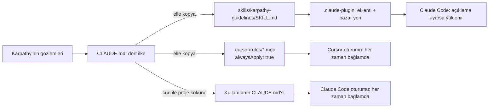
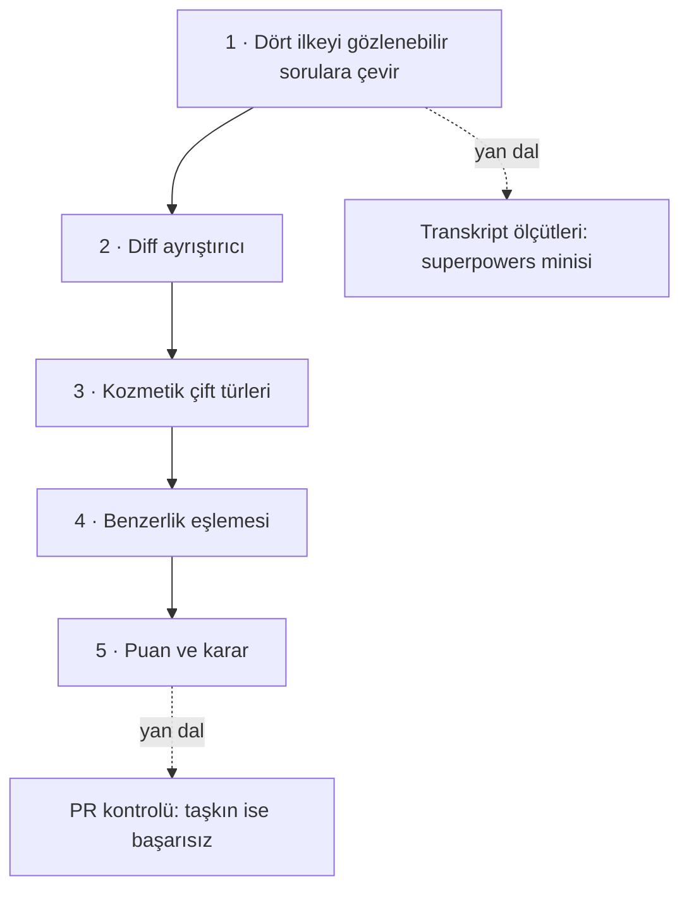

# multica-ai/andrej-karpathy-skills — LLM kodlama hatalarına karşı tek bir CLAUDE.md

> **Dal:** [D08 Ajan becerileri](../README.md) · **Tür:** ajan yapılandırması
> **Dil:** Markdown · **Lisans:** README ve bildirim "MIT" der, depoda LICENSE dosyası yok · **Yıldız:** 231 145 (9 Kasım 2026) · **İncelenen commit:** `2c60614` (2026-04-20)

## 1. Bir bakışta

Bu depo, Andrej Karpathy'nin LLM'lerle kod yazarken gözlediği sorunlardan türetilmiş **65 satırlık bir
`CLAUDE.md`** dosyasıdır: modeller sessizce varsayım yapar, kafa karışıklığını saklar, kodu ve soyutlamaları şişirir,
görevle ilgisiz kodu ve yorumları "yan etki" olarak değiştirir. Dosya dört ilkeyle karşılık verir: kodlamadan önce
düşün, önce sadelik, cerrahi değişiklik, hedefe dayalı yürütme. Aynı metin Claude Code eklentisi (beceri olarak),
Cursor proje kuralı ve düz `CLAUDE.md` olarak üç biçimde dağıtılır. Popülerliğinin nedeni basitliğidir: kurulum bir
dosyayı kopyalamaktan ibarettir, her geliştiricinin yaşadığı dört hatayı adlandırır ve "işe yarıyorsa ne görürsün"
sorusuna ölçülebilir bir cevap verir.

## 2. Nasıl yapılmış: mimari

### Klasör haritası (deponun tamamı)

```text
CLAUDE.md                                  # 65 satır: dört ilke + "işe yarıyorsa" ölçütü
README.md, README.zh.md                    # sorun, ilkeler, kurulum (171'er satır)
EXAMPLES.md                                # 522 satır: her ilke için "LLM'ler ne yapar / ne olmalı" diff örnekleri
CURSOR.md                                  # Cursor'da kullanım ve eşitleme notu
.cursor/rules/karpathy-guidelines.mdc      # aynı metin; description + alwaysApply: true
skills/karpathy-guidelines/SKILL.md        # aynı metin beceri olarak; name, description, license: MIT
.claude-plugin/plugin.json                 # eklenti: skills dizisi, sürüm 1.0.0
.claude-plugin/marketplace.json            # pazar yeri: "karpathy-skills"
```

### Ana bileşenler ve veri akışı



Burada bir "döngü" yok; olan şey **her zaman yüklenen talimat** ile **isteğe bağlı yüklenen beceri** arasındaki
farktır. `CLAUDE.md` ve `alwaysApply: true` kuralı her oturumda bağlamdadır; beceri ise ancak açıklaması göreve uyunca
gövdesini yükler (açıklama: "Use when writing, reviewing, or refactoring code …"). Aynı metin iki farklı maliyet ve
güvenilirlik profiliyle sunuluyor.

### Önce okunacak dosyalar

1. `CLAUDE.md` — dört ilke ve son satırdaki "These guidelines are working if" ölçütü.
2. `EXAMPLES.md` — ilkelerin diff üzerinde nasıl göründüğü (özellikle "Surgical Changes" bölümü).
3. `README.md` — Karpathy alıntıları, kurulum seçenekleri ve "Tradeoff Note".
4. `CURSOR.md` — katkı kuralı: `CLAUDE.md` ile `.mdc` kuralını eşit tut; beceri metni de aynı olsun isteniyorsa
   `SKILL.md`'yi de güncelle.
5. `.claude-plugin/plugin.json` ve `marketplace.json` — en küçük eklenti örneklerinden biri.

### Teknoloji yığını, derleme, test, CI, sürüm

Kod yok, derleme yok, test yok, CI yok. Sürüm eklenti bildiriminde `1.0.0`. Son commit "Sync Chinese README with
English version (add Cursor section) (#95)"; depo Nisan 2026'dan beri itme almamış (depolar.json: son itme
2026-04-20). Kök lisans dosyası yok; README, `plugin.json` ve SKILL.md ön bilgisi "MIT" dediği hâlde GitHub bir
lisans algılamaz ([G9](../../../govde/README.md#g9) için iyi bir tartışma örneği).

### Tasarım kararları ve ödünleşimler

1. **Tek dosya, dört ilke.** Kısa olduğu için her oturumda yüklenmesi ucuzdur ve okunur. Bedeli: projeye özgü hiçbir
   şey içermez; README bunu "projeye özel yönergelerle birleştir" diye açıkça söyler.
2. **Hız yerine dikkat.** "Önemsiz işlerde muhakemeni kullan" notu, kuralların her yazım hatası düzeltmesinde tam
   törenle uygulanmasını istemez.
3. **Yönerge yerine başarı ölçütü.** Karpathy alıntısı: "Ne yapacağını söyleme, başarı ölçütünü ver ve izle."
   "Hatayı düzelt" yerine "hatayı yeniden üreten testi yaz, geçir".
4. **Üç kopya, elle eşitleme.** `CURSOR.md` katkıcıdan `CLAUDE.md` ile `.cursor/rules/karpathy-guidelines.mdc`'yi eşit
   tutmasını, yayımlanan beceri metni de aynı olsun isteniyorsa `SKILL.md`'yi de güncellemesini ister: zorunlu eşitlik
   iki dosya için, üçüncüsü koşullu. Klonda ölçtük: `CLAUDE.md` ile `.mdc` gövdesi yalnızca başlık satırında ayrılıyor;
   `SKILL.md`'de başlık ve giriş cümlesi farklı ("projeye özel yönergelerle birleştir" notu yok), sondaki "These
   guidelines are working if" paragrafı da yok (4 satır). ECC'deki kopya sapmasının küçük ölçekli bir örneği; tek
   kaynaktan üretmek ([ECC minisi](../ecc/sifirdan/README.md)) bu sorunu ortadan kaldırır.

### Klonda doğrulanan ilginç bulgular

- README kurulum komutları depoyu hâlâ `forrestchang/andrej-karpathy-skills` adıyla anar; depo bugün
  `multica-ai` altında. Taşınan depolar için GitHub yönlendirmesine güvenen talimatlar zamanla kırılabilir.
- Kurulum seçeneklerinden biri `curl https://raw.githubusercontent.com/…/main/CLAUDE.md >> CLAUDE.md`. Uzak bir
  dosyayı, sabitlenmemiş `main` dalından, doğrudan ajanın talimat dosyasına eklemek bir tedarik zinciri riskidir:
  yarın o dosyaya eklenen bir satır, senin ajanının talimatı olur. Bir commit'e sabitle ve eklemeden önce oku.

## 3. Öğrenmen gerekenler

| Ön koşul                                                  | Neden bu depo için                                                               | Ücretsiz kaynak                                         |
| --------------------------------------------------------- | -------------------------------------------------------------------------------- | ------------------------------------------------------- |
| [G2 Git ve GitHub](../../../govde/README.md#g2)           | İlkeler diff üzerinden değerlendirilir; birleşik diff biçimini okumak gerekir.   | [git diff belgeleri](https://git-scm.com/docs/git-diff) |
| [G7 Test ve CI](../../../govde/README.md#g7)              | "Hedefe dayalı yürütme" = önce test.                                             | Gövdedeki G7 kaynakları                                 |
| [G11 LLM API temelleri](../../../govde/README.md#g11)     | Her zaman yüklenen talimat ile isteğe bağlı beceri farkı bir bağlam meselesidir. | [Claude belgeleri](https://platform.claude.com/docs)    |
| [anthropic-skills dosyası](../anthropic-skills/README.md) | Aynı içeriğin beceri olarak paketlenmesi.                                        | Çekirdek mini                                           |
| [G3 Python](../../../govde/README.md#g3)                  | Puanlayıcı minisi Python (`difflib`, `re`, `argparse`).                          | [Python belgeleri](https://docs.python.org/3/tutorial/) |

## 4. Sıfırdan yol (dallanma)



| Aşama | Ne inşa edersin              | Öğrendiğin kavram                    | Bitti ölçütü                                   | Süre (tahmini) |
| ----- | ---------------------------- | ------------------------------------ | ---------------------------------------------- | -------------- |
| 1     | `ilkeler-kontrol-listesi.md` | İlkeyi ölçülebilir kılmak            | Her madde "diff'te görünür mü?" sorusuna bağlı | 2 saat         |
| 2     | `diff_ayristir()`            | Birleşik diff biçimi, parça sayıları | `---` ile başlayan içerik başlık sanılmıyor    | 2,5 saat       |
| 3     | `cift_turu()`                | Boşluk/tırnak/yorum/ad değişimi      | `if` → `while` kozmetik sayılmıyor             | 2,5 saat       |
| 4     | `eslestir()`                 | Konuma değil benzerliğe göre eşleme  | Silinen yorum ile eklenen docstring karışmıyor | 2 saat         |
| 5     | `puanla()` + komut satırı    | Sezgisel puanlama, CI kapısı         | Örnek diff'ler 100 ve 49 puan alıyor           | 2 saat         |

Aşamaların toplamı 11 saat; okuma rotası ve alıştırmalarla birlikte yaklaşık 23 saat (hesap kuralı
[dal sayfasında](../README.md#sure-kurali)).

**Mini uygulama:** [sifirdan/](sifirdan/README.md) — `cerrahi.py`, iki özgün örnek diff, 13 test ve kontrol listesi.

**Gerçek ölçeğe giden yol:** (1) dil farkındalığı: yorum ve tanımları gerçek bir ayrıştırıcıyla (Python'da `ast`,
JS'te bir sözdizim ağacı) bul; (2) "görevin dosya listesini" el yerine plan dosyasından ya da issue'dan çıkar;
(3) puanı tek PR yerine zaman içinde izle: aynı CLAUDE.md ile ve onsuz haftalık ortalama — bu, ilkelerin gerçekten
işe yarayıp yaramadığının asıl ölçüsüdür ([superpowers](../superpowers/README.md) kontrol grubu fikri).

## 5. Gerçek depoda okuma rotası

1. `CLAUDE.md`: dört başlık ve kalın yazılmış alt başlıklar (her biri tek cümlelik bir ilke).
2. `EXAMPLES.md` "3. Surgical Changes" → "Drive-by Refactoring": "Problems" listesindeki dört maddeyi bul; hangileri
   bu dalın puanlayıcısında bir işarete karşılık geliyor?
3. `EXAMPLES.md` "Anti-Patterns Summary" tablosu ve "Key Insight": sorun karmaşıklığın kendisi mi, zamanlaması mı?
4. `README.md` "How to Know It's Working": dört ölçütten hangileri otomatik ölçülebilir?
5. `skills/karpathy-guidelines/SKILL.md` ile `CLAUDE.md`'yi karşılaştır: hangi satırlar farklı?
6. `.cursor/rules/karpathy-guidelines.mdc` ön bilgisi: `alwaysApply: true` ne anlama geliyor, beceri açıklamasından
   farkı ne?

## 6. Alıştırmalar ve öz değerlendirme

1. **(Kolay)** Kendi son PR'ının diff'ini `cerrahi.py` ile puanla; her işaret için "bu satır isteğe bağlanıyor mu?" sor.
2. **(Orta)** `cift_turu()`'na yeni bir tür ekle: yalnızca içe aktarma sırası değişmiş satırlar.
3. **(Orta)** `--izinli` listesini bir plan dosyasından (`- [ ] dosya: …` satırları) okuyan bir seçenek ekle.
4. **(Zor)** Aynı küçük görevi bir ajana CLAUDE.md ile ve onsuz 5'er kez yaptır (kendi makinende, kendi projende);
   puan ortalamalarını ve sapmalarını karşılaştır.

**Öz değerlendirme**

1. "Cerrahi değişiklik" ilkesinin testi nedir?
   <details><summary>Cevap</summary>Değişen her satır doğrudan kullanıcının isteğine bağlanabilmelidir. Kendi
   değişikliğin yüzünden kullanılmaz hâle gelen içe aktarmaları temizlersin; önceden var olan ölü kodu yalnızca not
   edersin.</details>
2. Aynı metni `CLAUDE.md` ve beceri olarak sunmanın farkı nedir?
   <details><summary>Cevap</summary>`CLAUDE.md` (ve `alwaysApply: true` kuralı) her oturumda bağlamdadır; uyulma
   ihtimali yüksek, maliyeti sabittir. Beceri yalnızca açıklaması göreve uyunca yüklenir; ucuzdur ama tetiklenmeyebilir.</details>
3. Bir puanlayıcı neden "hakem" değil "sohbet başlatıcı" olmalı?
   <details><summary>Cevap</summary>Bazı görevler tam da biçim değişikliği ya da yeniden adlandırmadır; sezgisel
   işaretler bağlamı bilmez. Puan, insanın hangi satırlara bakması gerektiğini gösterir; kararı yine insan verir.</details>

## 7. İş fikri tohumları

- **PR "cerrahi puan" botu** (diff'e işaret yorumları bırakır, ekip ortalamasını izler) — **kime:** ajanla kod üreten
  ve PR inceleme yükü artan 10–50 kişilik yazılım ekipleri.
- **Türkçe ajan yönergeleri paketi** (kurallar + örnek diff'ler + eğitim atölyesi) — **kime:** üniversite yazılım
  kulüpleri ve kodlama okulları.
- **Ajan yönergesi A/B ölçüm hizmeti** (aynı görevleri farklı CLAUDE.md'lerle koşup rapor eden) — **kime:** kendi
  yönerge dosyasını iyileştirmek isteyen teknik liderler.

Ayrıntılar için: [iş fikirleri kataloğu](../../../is-fikirleri/README.md).

## 8. Kaynaklar

- [CLAUDE.md](https://github.com/multica-ai/andrej-karpathy-skills/blob/2c606141936f1eeef17fa3043a72095b4765b9c2/CLAUDE.md)
- [EXAMPLES.md](https://github.com/multica-ai/andrej-karpathy-skills/blob/2c606141936f1eeef17fa3043a72095b4765b9c2/EXAMPLES.md)
- [README.md](https://github.com/multica-ai/andrej-karpathy-skills/blob/2c606141936f1eeef17fa3043a72095b4765b9c2/README.md)
  · [CURSOR.md](https://github.com/multica-ai/andrej-karpathy-skills/blob/2c606141936f1eeef17fa3043a72095b4765b9c2/CURSOR.md)
- [Karpathy'nin gözlemleri](https://x.com/karpathy/status/2015883857489522876) (README'de bağlantılı gönderi)
