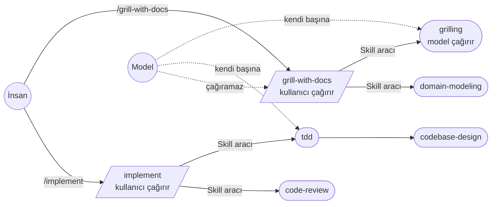
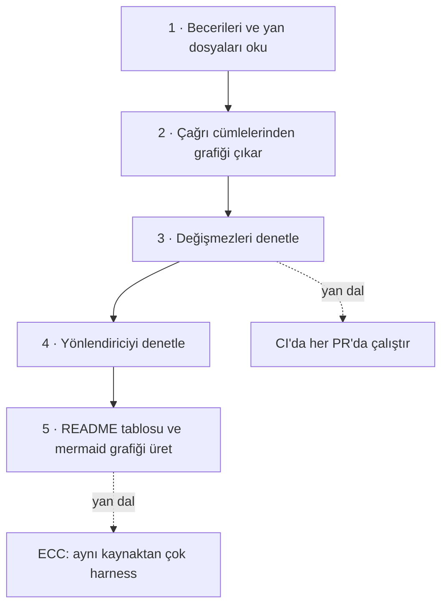

# mattpocock/skills — küçük, birleştirilebilir mühendislik becerileri

> **Dal:** [D08 Ajan becerileri](../README.md) · **Tür:** ajan yapılandırması
> **Dil:** Markdown + Shell · **Lisans:** MIT · **Yıldız:** 319 132 (9 Kasım 2026) · **İncelenen commit:** `4ae2317` (2026-10-31)

## 1. Bir bakışta

Matt Pocock'un "Skills For Real Engineers" deposu, kendi `.agents` klasöründen çıkan ve her gün kullandığı becerileri
yayımlar. Felsefesi superpowers'ın tersidir: süreci sahiplenen büyük bir çerçeve değil, **küçük, uyarlanabilir,
birleştirilebilir** beceriler. Bir kısmı yalnızca insanın `/ad` yazarak çağırdığı "orkestratörler" (`/grill-me`,
`/to-spec`, `/implement`), bir kısmı modelin de kendi başına uzanabildiği "disiplinler"dir (`grilling`, `tdd`,
`code-review`). README dört başarısızlık türünü hedefler: ajanın ne istendiğini anlamaması (sorgulama oturumu),
gereksiz uzun konuşması (ortak dil / sözlük), çalışmayan kod (geri besleme döngüleri, TDD) ve çamur topuna dönen kod
tabanı (derin modüller). Popülerliğinin bir nedeni yazarın TypeScript eğitmeni olarak geniş kitlesi; asıl nedeni ise
becerilerin kısa olması: `grill-me` becerisinin gövdesi tek cümledir.

## 2. Nasıl yapılmış: mimari

### Klasör haritası

```text
skills/
  engineering/      # 20 beceri, yayımlanan (promoted): ask-matt, grill-with-docs, to-spec, to-tickets, implement,
                    #   tdd, code-review, diagnosing-bugs, codebase-design, domain-modeling, wayfinder, wizard …
  productivity/     # 7 beceri, yayımlanan: grill-me, grilling, handoff, teach, to-questionnaire, wait-what, writing-for-agents
  misc/             # 4 beceri, dondurulmuş: git-guardrails-claude-code, setup-pre-commit …
  in-progress/      # 8 beceri, beta: kamuya açık ama eklentide yok
  deprecated/       # yalnızca README
  */<ad>/SKILL.md            # ön bilgi: name, description, (disable-model-invocation), (argument-hint)
  */<ad>/agents/openai.yaml  # Codex arayüz bilgisi + policy.allow_implicit_invocation
.claude-plugin/plugin.json   # yayımlanan 27 becerinin açık listesi (skills dizisi), sürüm 1.3.2
.claude-plugin/marketplace.json  # depo kendi pazar yeri ("mattpocock")
.agents/invocation.md        # kullanıcı-çağırır / model-çağırır kuralları, bağımlılık yazımı
.agents/writing-docs.md      # docs/ sayfa şablonu
.agents/install-block.md     # tek kurulum metni; README ve docs bunu kopyalar
.agents/adr/0002-ship-as-a-claude-code-plugin.md  # eklenti kararı ve Codex kısıtı
.out-of-scope/               # reddedilen fikirlerin gerekçeli kaydı (9 dosya)
docs/engineering/, docs/productivity/  # her yayımlanan beceri için insan sayfası
CLAUDE.md = AGENTS.md        # bayt bayt aynı iki dosya: depoda çalışan ajanlar için kurallar
SCOPE.md, CONTRIBUTING.md, GLOSSARY.md
scripts/link-skills.sh       # becerileri ~/.claude/skills ve ~/.agents/skills'e sembolik bağlar
scripts/sync-plugin-version.mjs  # package.json sürümünü plugin.json'a kopyalar
.changeset/ + .github/workflows/release.yml  # changesets ile sürüm PR'ı
```

Klondan ölçüldü: 184 dosya, 39 `SKILL.md`; yayımlanan 27 becerinin 16'sı kullanıcı-çağırır. `CLAUDE.md` ile
`AGENTS.md` aynı içerikte (`diff` boş).

### Ana bileşenler ve veri akışı



Tek bir eksen her şeyi böler: **kim çağırabilir?** Kullanıcı-çağırır beceride ön bilgide
`disable-model-invocation: true`, `agents/openai.yaml` içinde `policy.allow_implicit_invocation: false` vardır; açıklama
insanın komut listesinde okuyacağı tek satırdır. Model-çağırır becerinin açıklaması ise "Use when …" tetiklerini
taşır. Kullanıcı-çağırır beceri model-çağırır becerileri çağırabilir; tersi ve kullanıcı-çağırırdan kullanıcı-çağırıra
çağrı yasaktır. Bağımlılık açık bir cümleyle yazılır: `Call the Skill tool with "grilling".` İki beceri iki çağrıdır.
Böylece `grill-me` (7 satırlık dosya) ve `grill-with-docs` yalnızca birer giriş noktası, asıl davranış `grilling`
ve `domain-modeling` içinde tek yerde durur.

### Önce okunacak dosyalar

1. `README.md` — dört başarısızlık türü ve "Reference" bölümündeki iki grup.
2. `.agents/invocation.md` — tüm bileşim kuralları tek sayfada.
3. `skills/productivity/grill-me/SKILL.md` ve `skills/productivity/grilling/SKILL.md` — giriş noktası ile disiplin ayrımı.
4. `skills/engineering/implement/SKILL.md` — `tdd` ve `code-review`'u çağıran kısa bir orkestratör.
5. `skills/engineering/ask-matt/SKILL.md` — yönlendirici beceri; "yalan söyleyen yönlendirici" kuralı.
6. `skills/productivity/writing-for-agents/SKILL.md` — ajan için yazmanın kuramı (bağlam işaretçisi, iki yük, öncü sözcük).
7. `.agents/adr/0002-ship-as-a-claude-code-plugin.md` — eklenti bildirimlerinin harness'lere göre farkı.
8. `SCOPE.md` ve `.out-of-scope/` — bir küratörlük deposunun "hayır"ı nasıl yönettiği.
9. `skills/misc/git-guardrails-claude-code/` — kanca kuran bir beceri (PreToolUse, çıkış kodu 2).

### Teknoloji yığını, derleme, test, CI, sürüm

- **İçerik:** Markdown beceriler; birkaç bash şablonu (`wizard/template.sh`, `diagnosing-bugs/scripts/hitl-loop.template.sh`).
- **Test:** depoda otomatik test yok. `CLAUDE.md` eklenti bildirimine dokunulduktan sonra `claude plugin validate . --strict`
  çalıştırılmasını ister.
- **CI ve sürüm:** `.github/workflows/release.yml` her `main` itmesinde `changesets/action` ile "chore: version skills"
  PR'ı açar; `npm run version` hem `changeset version` hem `scripts/sync-plugin-version.mjs` çalıştırır, böylece
  `plugin.json` sürümü `package.json` ile aynı kalır. Diğer iş akışları sorun etiketleme ve "needs-info" yönetimidir.
- **Dağıtım:** Claude Code için resmî pazar yeri `claude-plugins-official`; Codex ve Copilot CLI için deponun kendi pazar
  yeri (`@mattpocock`), VS Code için "Install Plugin From Source"; Gemini CLI için `gemini skills install` (dosya
  kopyalar, kendini güncellemez); diğerleri için skills.sh (`.agents/install-block.md`).

### Tasarım kararları ve ödünleşimler

1. **Küçük ve birleştirilebilir.** "Bir davranış mevcut becerilerden birleştirilebiliyorsa yeni beceri olmaz"
   (`.out-of-scope/new-skills.md`). Bedeli: kullanıcı akışları (ör. to-spec → to-tickets → implement) ezberlemelidir;
   bu yüzden bir yönlendirici beceri (`ask-matt`) vardır.
2. **İnvocation ekseni.** Kullanıcı-çağırır beceriler modele görünmez; bu, iki harness'te iki ayrı mekanizmayla
   (`disable-model-invocation` ve `allow_implicit_invocation`) kurulur ve senkron tutulması gerekir.
3. **Operatif çağrı araç adıyla.** "`/name` bırakmak yerine Skill aracını adlandırmak daha yüksek isabet sağlar" ve
   harness'e özgü sözdizimi taşımaz (`.agents/invocation.md`).
4. **Taze bağlam kuralı.** Alt ajan başlatan her beceri "fresh context" ister; gerekçe: Codex gibi bazı harness'ler
   alt ajanı ana konuşmayı çatallayarak başlatır (`CLAUDE.md`).
5. **Özyineleme koruması beceride değil harness'te.** superpowers `<SUBAGENT-STOP>` bloğu eklerken bu depo bunu
   reddeder: koruma tek beceride yazılırsa yalnızca onu kapsar ve her koşuda token harcar
   (`.out-of-scope/subagent-recursion.md`).
6. **Açık eklenti listesi.** `plugin.json` 27 beceriyi tek tek sayar; böylece `misc/`, `in-progress/` dışarıda kalır.
   ADR 0002, Codex bildiriminin o tarihte yalnızca tek bir yol dizgisi kabul ettiğini ve kurulumda sembolik
   bağlantıları düşürdüğünü, 2026-10-07 güncellemesinde ise dizi desteğinin geldiğini yazar (ADR'nin iddiası;
   doğrulanmadı).

### Klonda doğrulanan ilginç bulgular

- `skills/in-progress/software-factory/SKILL.md` açıklaması tırnaksız ve içinde `: ` geçiyor
  (`… software factory: the tasks …`). Katı YAML ayrıştırıcıları bunu reddeder; PyYAML "mapping values are not allowed
  here" hatası verir. Beceri yayımlanan kümede değil; harness'lerin bunu nasıl okuduğu klonda görünmüyor (doğrulanmadı).
- `CHANGELOG.md` 1.3.2: depoyu klonlayıp çalışan ajanlar kendi spec ve ticket'larını **bu depoya** issue olarak açmış
  (#541–#550); kurulum şablonu artık "issue'yu yalnızca kullanıcının kendi deposuna aç" diyor. Ajanların yan etkileri
  için öğretici bir örnek.
- Bu dalın bileşim denetçisi yayımlanan 27 beceride **0 hata** buldu: kurallar gerçekten uygulanıyor. Bir sınırla:
  denetçi yalnızca çift tırnaklı adları çağrı sayar; `implement-spec` (`tdd`, `code-review`) ve `retro`
  (`writing-for-agents`) çağırdıkları adları ters tırnakla yazdıkları için bu 3 çağrı grafikte görünmez. Üçü de
  model-çağırır becerilere gittiği için sonuç değişmez.

## 3. Öğrenmen gerekenler

| Ön koşul                                                  | Neden bu depo için                                                     | Ücretsiz kaynak                                         |
| --------------------------------------------------------- | ---------------------------------------------------------------------- | ------------------------------------------------------- |
| [anthropic-skills dosyası](../anthropic-skills/README.md) | SKILL.md biçimi, açıklama = tetik.                                     | Çekirdek mini                                           |
| [G11 LLM API temelleri](../../../govde/README.md#g11)     | Araç çağırma: "Skill aracını çağır" bir araç çağrısıdır.               | [Claude belgeleri](https://platform.claude.com/docs)    |
| [G2 Git ve GitHub](../../../govde/README.md#g2)           | Sürüm PR'ları, issue akışı, eklentinin git URL'si üzerinden kurulması. | Gövdedeki G2 kaynakları                                 |
| [G7 Test ve CI](../../../govde/README.md#g7)              | `tdd` ve `diagnosing-bugs` becerileri; changesets iş akışı.            | Gövdedeki G7 kaynakları                                 |
| [G9 Açık kaynak](../../../govde/README.md#g9)             | `SCOPE.md`, `.out-of-scope/`: katkıyı sınırlamak da bir yönetişimdir.  | [opensource.guide](https://opensource.guide/)           |
| [superpowers dosyası](../superpowers/README.md)           | Karşıt felsefe: süreç sahibi çerçeve; bu dosya onu bildiğini varsayar. | O dosyanın minisi                                       |
| [G3 Python](../../../govde/README.md#g3)                  | Bileşim denetçisi minisi Python (ortak çekirdeği kullanır).            | [Python belgeleri](https://docs.python.org/3/tutorial/) |

Dala özgü kavramlar: kullanıcı-çağırır / model-çağırır ayrımı, çağrı grafiği, yönlendirici beceri, derin modül
(Ousterhout), ortak dil (DDD), ADR.

## 4. Sıfırdan yol (dallanma)



| Aşama | Ne inşa edersin            | Öğrendiğin kavram                 | Bitti ölçütü                                                              | Süre (tahmini) |
| ----- | -------------------------- | --------------------------------- | ------------------------------------------------------------------------- | -------------- |
| 1     | `yukle()`                  | Ön bilgi + `agents/openai.yaml`   | Örnek takımın 8 becerisi okunuyor                                         | 2,5 saat       |
| 2     | `cagrilari_cikar()`        | Operatif çağrı yazımı             | İki adlı tek cümle iki çağrı veriyor                                      | 2,5 saat       |
| 3     | `denetle()`                | Değişmez (invariant), döngü bulma | Kullanıcı-çağırır beceriye çağrı hata veriyor; döngü bir kez raporlanıyor | 5 saat         |
| 4     | `yonlendiriciyi_denetle()` | "Yalan söyleyen yönlendirici"     | Eksik ve olmayan beceriler ayrı raporlanıyor                              | 2,5 saat       |
| 5     | `tablo()`, `graf()`        | Belgeyi koddan üretmek            | README tablosu iki gruplu çıkıyor                                         | 2,5 saat       |

Aşamaların toplamı 15 saat; okuma rotası ve alıştırmalarla birlikte yaklaşık 32 saat (hesap kuralı
[dal sayfasında](../README.md#sure-kurali)).

**Mini uygulama:** [sifirdan/](sifirdan/README.md) — `bilesim.py`, 8 becerilik Türkçe örnek takım, 11 test. Ortak
[çekirdeği](../anthropic-skills/sifirdan/README.md) kullanır.

**Gerçek ölçeğe giden yol:** (1) denetçiyi CI'ya bağla ve `plugin.json` listesiyle yayımlanan kovaları karşılaştır;
(2) `docs/<kova>/<ad>.md` sayfasının varlığını ve dört bölümünü ("What it does" …) denetle; (3) çağrı çıkarımını
kalıp yerine küçük bir sınıflandırıcıyla yap; (4) yönlendirici metnini grafikten otomatik üret ve elle yazılan
kısımla farkını göster.

## 5. Gerçek depoda okuma rotası

1. `README.md` "Reference": iki grubu ve "a user-invoked skill may invoke model-invoked skills" cümlesini bul.
2. `.agents/invocation.md`: neden `/name` yerine "Call the Skill tool"? Kullanıcı-çağırır önkoşul nasıl yazılır?
3. `skills/productivity/grill-me/SKILL.md` + `agents/openai.yaml`: iki harness'in aynı kuralı nasıl ifade ettiğini karşılaştır.
4. `skills/productivity/grilling/SKILL.md`: "karar ağacı", "tur", "ön cephe (frontier)" kavramları.
5. `skills/engineering/implement/SKILL.md` ile `skills/engineering/implement-spec/SKILL.md`: tek dal ile görev grafiği farkı.
6. `skills/productivity/writing-for-agents/SKILL.md`: "context load" ve "cognitive load" tanımları; "negation" neden hata?
7. `.agents/adr/0002-ship-as-a-claude-code-plugin.md`: Claude Code ve Codex bildirimleri `skills` alanını nasıl farklı okur?
8. `scripts/sync-plugin-version.mjs` ve `.github/workflows/release.yml`: sürüm nasıl tek kaynaktan dağıtılıyor?
9. `.out-of-scope/subagent-recursion.md` ile superpowers'ın `<SUBAGENT-STOP>` yaklaşımını karşılaştır.
10. `skills/misc/git-guardrails-claude-code/scripts/block-dangerous-git.sh`: alt dizgi eşleşmesiyle engelleme hangi
    komutları kaçırır? (bkz. alıştırma 5)

## 6. Alıştırmalar ve öz değerlendirme

1. **(Kolay)** `ornek-takim/` altına kullanıcı-çağırır bir `/gozden-gecir` becerisi ekle; `kucuk-adim`'ı çağırsın.
   Denetçi temiz çıksın, `tablo` çıktısı güncellensin.
2. **(Kolay)** Aynı beceride `agents/openai.yaml` dosyasındaki `policy` bloğunu sil; hangi kural neden tetiklendi?
3. **(Orta)** Denetçiye yeni bir kural ekle: yayımlanan her becerinin `docs/` altında bir sayfası olmalı.
4. **(Orta)** `cagrilari_cikar()`'ı ters tırnaklı adları (`implement-spec`'teki `` `tdd` `` gibi) ve "grilling becerisini
   kullan" gibi serbest cümleleri de yakalayacak biçimde genişlet; yanlış pozitifleri ölçmek için gerçek depodaki 39
   beceride dene.
5. **(Orta)** `block-dangerous-git.sh` mantığını Python'a çevir ve `git -C . push`, `git  push` (iki boşluk),
   `sh -c "git push"` gibi girdilerle sına. Alt dizgi eşleşmesi yerine `shlex` ile ayrıştırınca ne değişiyor?
6. **(Zor)** Denetçiyi bir PR botu gibi çalıştır: iki commit arasındaki farkta değişen becerileri bul ve yalnızca
   onları raporla ([G2](../../../govde/README.md#g2)).

**Öz değerlendirme**

1. Kullanıcı-çağırır bir becerinin açıklaması neden tetik listesi taşımamalı?
   <details><summary>Cevap</summary>Model o beceriyi zaten göremez; açıklamayı yalnızca insan, komut listesinde okur.
   Tetik cümleleri insan için gürültüdür ve "model bunu çağırabilir" izlenimi verir.</details>
2. `grill-with-docs` neden kendi gövdesinde sorgulama yöntemini anlatmıyor?
   <details><summary>Cevap</summary>Yöntem `grilling` içinde tek yerde durur; `grill-with-docs` yalnızca iki
   becerinin birleşimidir. Aynı anlamı iki yere yazmak bakım yükü ve tutarsızlık demektir (tek doğruluk kaynağı).</details>
3. Alt ajan özyinelemesine karşı koruma neden harness'in işi sayılıyor?
   <details><summary>Cevap</summary>Hangi araç ve becerilerin alt ajana açık olduğuna harness karar verir; orada
   konan sınır her beceri için geçerlidir. Tek bir becerinin metnine yazılan koruma yalnızca onu kapsar, her koşuda
   token harcar ve modelin uymasına bağlıdır.</details>

## 7. İş fikri tohumları

- **Beceri kütüphanesi bileşim denetçisi (CI eylemi)** — **kime:** ortak bir iç beceri deposu tutan platform ekipleri
  ve beceri pazarında yayın yapan bakımcılar.
- **Türkçe "sorgula ve belgele" akışı** (sözlük + ADR üreten tasarım oturumları) — **kime:** dış kaynaklı yazılım
  yaptıran kurumların analiz ekipleri ve yazılım ajansları.
- **Ajan yan etkisi denetimi** (ajanın açtığı issue/PR/commit'leri doğru hedefe yazıp yazmadığını izleyen kanca) —
  **kime:** birden çok depoda ajan çalıştıran açık kaynak bakımcıları.

Ayrıntılar için: [iş fikirleri kataloğu](../../../is-fikirleri/README.md).

## 8. Kaynaklar

- [README.md](https://github.com/mattpocock/skills/blob/4ae2317ddb22b046e26455e4f9c9b3aaaf62212d/README.md)
- [.agents/invocation.md](https://github.com/mattpocock/skills/blob/4ae2317ddb22b046e26455e4f9c9b3aaaf62212d/.agents/invocation.md)
- [.agents/adr/0002-ship-as-a-claude-code-plugin.md](https://github.com/mattpocock/skills/blob/4ae2317ddb22b046e26455e4f9c9b3aaaf62212d/.agents/adr/0002-ship-as-a-claude-code-plugin.md)
- [skills/productivity/writing-for-agents/SKILL.md](https://github.com/mattpocock/skills/blob/4ae2317ddb22b046e26455e4f9c9b3aaaf62212d/skills/productivity/writing-for-agents/SKILL.md)
- [SCOPE.md](https://github.com/mattpocock/skills/blob/4ae2317ddb22b046e26455e4f9c9b3aaaf62212d/SCOPE.md)
  · [.out-of-scope/](https://github.com/mattpocock/skills/tree/4ae2317ddb22b046e26455e4f9c9b3aaaf62212d/.out-of-scope)
- [aihero.dev/skills](https://aihero.dev/skills) — yazarın beceri sayfaları (depo açıklamasındaki ana sayfa).
