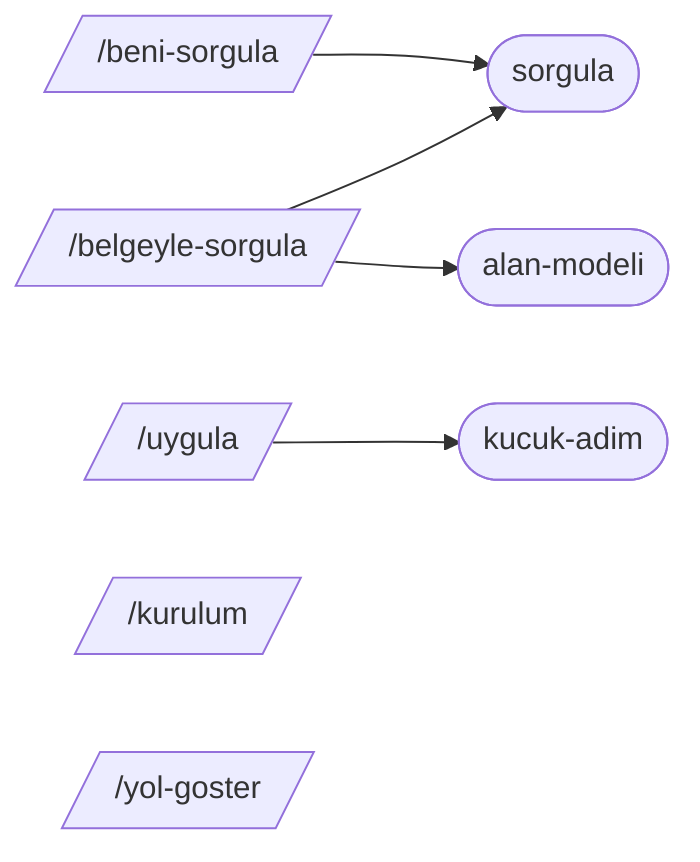

# Bileşim denetçisi — küçük becerileri kurallı biçimde birleştirmek

mattpocock/skills'in iddiası: büyük bir "süreç sahibi" çerçeve yerine **küçük, birleştirilebilir** beceriler. Bunun
bedeli, becerilerin birbirini doğru çağırmasını sağlayan kuralların insan disiplinine kalmasıdır. Depo bu kuralları
`CLAUDE.md` ve `.agents/invocation.md` içinde yazıya döker (commit `4ae2317`). Bu mini, o kuralları **denetlenebilir**
hâle getirir: bir beceri klasörünü okur, çağrı grafiğini çıkarır ve değişmezleri (invariant) doğrular.

## Denetlenen kurallar

| Kod                           | Düzey        | Kural (kaynak)                                                                                                                                                              |
| ----------------------------- | ------------ | --------------------------------------------------------------------------------------------------------------------------------------------------------------------------- |
| `hedef-yok`                   | hata         | Çağrılan beceri var olmalı.                                                                                                                                                 |
| `kullanici-becerisi-cagrildi` | hata         | Hiçbir beceri kullanıcı-çağırır (`disable-model-invocation: true`) bir beceriyi çağıramaz; önkoşulsa "kullanıcıya /x çalıştırmasını söyle" denir (`.agents/invocation.md`). |
| `senkron-degil`               | hata         | `disable-model-invocation: true` ⇔ `agents/openai.yaml` içinde `policy.allow_implicit_invocation: false` ("ya iki harness'te de kullanıcı-çağırır ya hiçbirinde").          |
| `openai-yok`                  | uyarı        | Her becerinin yanında Codex arayüz bilgisi için `agents/openai.yaml` olmalı.                                                                                                |
| `aciklama-kullanici`          | uyarı        | Kullanıcı-çağırır becerinin açıklaması insana yönelik tek satırdır; tetik listesi taşımaz.                                                                                  |
| `aciklama-model`              | uyarı        | Model-çağırır becerinin açıklaması ne zaman kullanılacağını söyler.                                                                                                         |
| `dongu`                       | uyarı        | Çağrı grafiğinde döngü (her döngü bir kez raporlanır).                                                                                                                      |
| `yonlendirici-eksik`          | uyarı        | Yönlendirici (ask-matt benzeri) her kullanıcı-çağırır beceriyi anmalı.                                                                                                      |
| `yonlendirici-yalan`          | hata         | Yönlendirici olmayan bir beceriye yönlendirmemeli ("a router that lies"). `/clear`, `/compact` gibi harness komutları sayılmaz.                                             |
| `slash-operatif`              | bilgi        | Operatif çağrı `/x` ile değil, "Beceri aracını \"x\" ile çağır" ile yazılmalı (sezgisel).                                                                                   |
| `taze-baglam`                 | bilgi        | Alt ajan başlatan beceri "taze bağlam" istemeli; bazı harness'ler alt ajanı ana bağlamı kopyalayarak başlatır (sezgisel).                                                   |
| `onbilgi-bozuk`, `ad-dizin`   | hata / uyarı | Ön bilgi okunamıyor; ad ile klasör adı farklı.                                                                                                                              |

Çağrılar iki dilde tanınır: `Call the Skill tool with "grilling"` ve `Beceri aracını "sorgula" ile çağır`; iki ad
geçen tek cümle (`Beceri aracını iki kez çağır: "sorgula" ve "alan-modeli"`) iki çağrıdır.

## Çalıştırma

```bash
cd repo-atlasi/dallar/08-ajan-becerileri/mattpocock-skills/sifirdan
python3 bilesim.py denetle ornek-takim --yonlendirici yol-goster    # 8 beceri, 0 bulgu
python3 bilesim.py tablo ornek-takim                                # README'ye uygun iki gruplu tablo
python3 bilesim.py graf ornek-takim                                 # mermaid çağrı grafiği
```

`ornek-takim/` sekiz Türkçe beceri içerir: model-çağırır `sorgula`, `alan-modeli`, `kucuk-adim`; kullanıcı-çağırır
`beni-sorgula`, `belgeyle-sorgula`, `uygula`, `kurulum` ve yönlendirici `yol-goster`. Çağrı grafiği:



## Test

```bash
cd repo-atlasi/dallar/08-ajan-becerileri/mattpocock-skills/sifirdan
PYTHONDONTWRITEBYTECODE=1 python3 -m unittest discover -s . -t .
```

11 test. Kural ihlalleri test sırasında geçici klasörde üretilir; depodaki örnek takım temizdir.

## Gerçek depoda deneme

Denetçiyi klondaki gerçek beceriler üzerinde (veri olarak, `python3 -I` ile) çalıştırdık:

- **Yalnızca yayımlanan kovalar** (`skills/engineering` + `skills/productivity`, `--yonlendirici ask-matt`): 27 beceri
  (eklentinin `plugin.json` listesindeki sayıyla aynı), **0 hata**, 3 bilgi notu. Depo kendi kurallarına uyuyor
  (ters tırnaklı 3 çağrı görünmese de; bkz. Sınırlar).
- **Tüm kovalar:** `in-progress/software-factory` ön bilgisi okunamıyor (tırnaksız `: `); `ask-matt` yönlendiricisi
  `in-progress/` becerilerini anmıyor. Bu beklenen bir durum: kural yalnızca yayımlanan küme için geçerli.

## Aşamalar ve eşleme

| #   | Mini'deki parça            | Gerçek depodaki karşılığı (mattpocock/skills, `4ae2317`)                  | Fark                                                             |
| --- | -------------------------- | ------------------------------------------------------------------------- | ---------------------------------------------------------------- |
| 1   | `yukle()` + ortak çekirdek | `scripts/list-skills.sh` (`find . -name SKILL.md`)                        | Ön bilgi ve `agents/openai.yaml` da okunur                       |
| 2   | `cagrilari_cikar()`        | `.agents/invocation.md` "Dependencies between them"                       | Kural insan için yazılmış; burada otomatik çıkarılıyor           |
| 3   | `denetle()` değişmezleri   | `CLAUDE.md` / `AGENTS.md` kuralları                                       | Depoda bu kuralları denetleyen bir betik yok (klonda bulunamadı) |
| 4   | `yonlendiriciyi_denetle()` | `skills/engineering/ask-matt/SKILL.md` + `CLAUDE.md` "a router that lies" | Anılma denetimi `/ad` geçişine bakar                             |
| 5   | `tablo()`                  | Kök `README.md` "Reference" bölümü (User-invoked / Model-invoked)         | Açıklamalar ön bilgiden gelir                                    |
| 6   | `graf()`                   | —                                                                         | Mermaid çıktısı öğretim içindir                                  |
| —   | `_cekirdek.py`             | —                                                                         | Ortak çekirdeği yola ekleyen 12 satırlık köprü                   |

## Sınırlar

- Çağrı çıkarımı cümle kalıbına bağlıdır; "grilling becerisini kullan" gibi serbest ifadeleri ve ters tırnakla yazılan
  adları yakalamaz. Gerçek depoda `implement-spec` (`` `tdd` ``, `` `code-review` ``) ve `retro`
  (`` `writing-for-agents` ``) bu yüzden grafikte çağrısız görünür.
- `slash-operatif` ve `taze-baglam` sezgiseldir; bu yüzden yalnızca bilgi düzeyindedir.
- Harness komutu listesi (`clear`, `compact`, `help`, `init`, `model`, `plugin`) eksik olabilir (doğrulanmadı).
