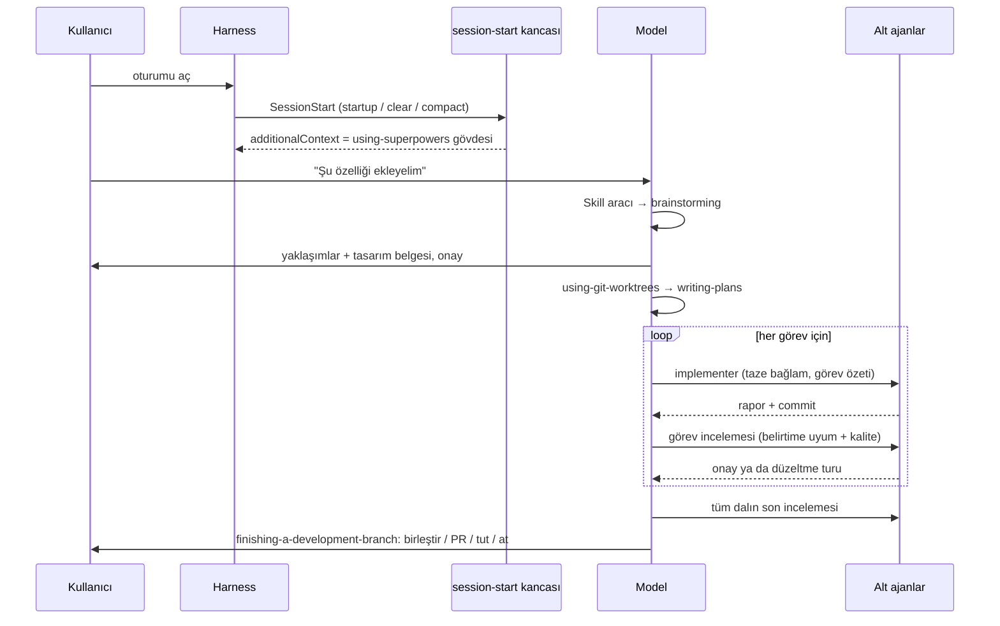
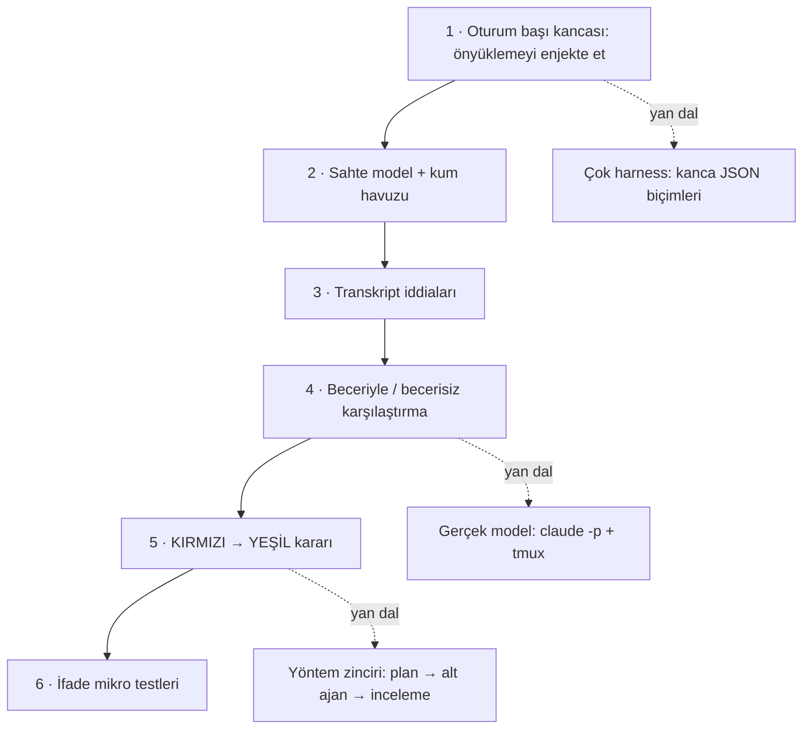

# obra/superpowers — kodlama ajanlarına mühendislik disiplini kazandıran beceri yöntemi

> **Dal:** [D08 Ajan becerileri](../README.md) · **Tür:** ajan yapılandırması
> **Dil:** Markdown + Shell + JavaScript · **Lisans:** MIT · **Yıldız:** 314 826 (9 Kasım 2026) · **İncelenen commit:** `22f0b46` (2026-11-03)

## 1. Bir bakışta

Superpowers, bir kodlama ajanının "hemen kod yazma" alışkanlığını bir yazılım geliştirme yöntemine çeviren 15
becerilik bir eklentidir: önce ne istendiğini sorgula (brainstorming), yalıtılmış bir çalışma alanı aç (worktree),
küçük görevlerden oluşan bir plan yaz (README: "2–5 dakikalık"), her görevi taze bir alt ajana yaptırıp incelet,
testi önce yaz, bitirmeden önce kanıt göster, dalı birleştir ya da PR aç. Mekanizması şaşırtıcı derecede küçüktür: her oturumun
başında bir kanca `using-superpowers` becerisinin tamamını bağlama koyar ve bu metin modele "bir becerinin
uyma ihtimali %1 bile olsa önce onu çağır" der. İçerik harness'ten bağımsızdır; depo Claude Code, Codex, Cursor,
Gemini CLI, OpenCode, Copilot CLI, Kimi, pi ve başka harness'ler için ince bağdaştırıcılar taşır. Popülerliğinin
nedeni, "ajan disiplinli çalışsın" dileğini kurulabilir, sınanabilir bir içeriğe dönüştürmesidir.

## 2. Nasıl yapılmış: mimari

### Klasör haritası

```text
skills/                              # 15 beceri; ön bilgide yalnızca name + description
  using-superpowers/                 # önyükleme becerisi + references/<harness>-tools.md araç eşlemeleri
  brainstorming/                     # yapmadan önce niyeti çıkar; scripts/ görsel yardımcı (sıfır bağımlılıklı sunucu)
  writing-plans/                     # kesin dosya yollu, adım adım plan
  subagent-driven-development/       # görev başına taze alt ajan + görev incelemesi; scripts/, references/
  executing-plans/                   # aynı planı tek bağlamda yürütmek (alt ajan yoksa)
  test-driven-development/           # "Demir Kural": önce başarısız test
  systematic-debugging/              # kök neden süreci; find-polluter.sh
  verification-before-completion/    # "kanıt olmadan başarı iddiası yok"
  requesting-code-review/ receiving-code-review/ dispatching-parallel-agents/
  using-git-worktrees/ finishing-a-development-branch/
  writing-skills/                    # beceri yazmak = TDD; references/testing-skills-with-subagents.md …
  diagnosing-superpowers/            # bir oturumun transkriptinden "ne ters gitti" raporu
hooks/hooks.json                     # Claude Code: SessionStart, matcher "startup|clear|compact"
hooks/hooks-cursor.json              # Cursor: sessionStart
hooks/run-hook.cmd                   # Windows'ta cmd, Unix'te bash olarak çalışan çok dilli sarmalayıcı
hooks/session-start                  # önyüklemeyi okuyup harness'e göre JSON yazan betik
.claude-plugin/ .codex-plugin/ .cursor-plugin/ .kimi-plugin/ .muse-plugin/ .devin-plugin/ .antigravity-plugin/
.agents/plugins/marketplace.json     # Codex tarzı pazar yeri girdisi
.opencode/plugins/superpowers.js     # süreç içi eklenti (alt oturumları algılar)
.pi/extensions/superpowers.ts        # pi eklentisi (yerleşik beceri aracı olmayan harness örneği)
.hermes-plugin/plugin.yaml           # Hermes: pre_llm_call kancası
gemini-extension.json + GEMINI.md    # talimat dosyası: @-include ile önyükleme + araç eşlemesi
.version-bump.json                   # sürüm alanı taşıyan 12 dosyanın listesi (scripts/bump-version.sh)
docs/porting-to-a-new-harness.md     # 850 satırlık taşıma kılavuzu
docs/testing.md                      # tests/ ile evals/ ayrımı
docs/superpowers/specs/              # yöntemin kendisiyle yazılmış 22 tasarım belgesi
tests/                               # eklenti altyapısı testleri: bash, node, python
AGENTS.md                            # yapay zekâ ajanlarına yönelik katkı kuralları
```

Ölçümler klondan: 236 dosya, 15 `SKILL.md` (toplam 3 358 satır), `package.json` sürümü 7.0.2.

### Ana bileşenler ve veri akışı



Döngünün iki yarısı var. **Önyükleme yarısı:** `hooks/hooks.json` Claude Code'a "oturum başında, `clear` ve `compact`
sonrasında `run-hook.cmd session-start` çalıştır" der. `hooks/session-start` betiği `using-superpowers/SKILL.md`'yi
bash'in `read` yerleşiğiyle okur (PATH bozuk olsa bile çalışsın diye `cat` kullanmaz), metni JSON'a kaçırır,
`<EXTREMELY_IMPORTANT>` etiketleri içine sarar ve harness'e göre üç biçimden birini yazar: Cursor için
`additional_context`, Claude Code (ve Muse) için `hookSpecificOutput.additionalContext`, Copilot CLI ve diğerleri için
üst düzey `additionalContext`. Betik "Claude Code iki alanı da okur ve tekilleştirmez" diye yalnızca bir alan yazar.
**Yöntem yarısı:** önyüklenen metin modele her işten önce beceri aramasını, süreç becerilerini (brainstorming,
systematic-debugging) alan becerilerinden önce kullanmasını ve kullanıcı talimatlarının (CLAUDE.md, AGENTS.md)
becerilerden önce geldiğini söyler. Gerisi becerilerin birbirini adlarıyla çağırmasıdır: `writing-plans` planın başına
"REQUIRED SUB-SKILL: Use superpowers:subagent-driven-development (recommended) or superpowers:executing-plans" yazdırır;
`subagent-driven-development` de sonunda `finishing-a-development-branch`'i çağırır.

### Önce okunacak dosyalar

1. `README.md` — "How it works" ve "The Basic Workflow": yedi adımlık zincir.
2. `hooks/hooks.json` ve `hooks/session-start` — önyüklemenin tamamı (18 + 90 satır; Windows sarmalayıcısı
   `hooks/run-hook.cmd` 79 satır daha).
3. `skills/using-superpowers/SKILL.md` — önyüklenen metin: kural, öncelik, "kırmızı bayraklar" tablosu.
4. `skills/brainstorming/SKILL.md` — yöntemin girişi; "ne bildiğini" sorgulatan ilk bölüm.
5. `skills/subagent-driven-development/SKILL.md` — görev döngüsü, defter (ledger), dört durma koşulu.
6. `skills/test-driven-development/SKILL.md` — Demir Kural ve kaçış gerekçeleri tablosu.
7. `skills/writing-skills/SKILL.md` — becerilerin nasıl test edildiği (baskı senaryoları).
8. `docs/porting-to-a-new-harness.md` Bölüm 1–4 — çok harness'li mimarinin değişmezleri.
9. `docs/testing.md` — eklenti testleri ile davranış değerlendirmelerinin ayrımı.

### Teknoloji yığını, derleme, test, CI, sürüm

- **İçerik:** Markdown beceriler. Kod: bash kancalar, Node (görsel yardımcı sunucu, OpenCode eklentisi), TypeScript (pi),
  Python (Hermes eklentisi, test yardımcıları). `AGENTS.md`'ye göre eklenti "tasarım gereği sıfır bağımlılıklı"dır.
- **Test:** `tests/` altında bash betikleri, `node` test dosyaları ve Python testleri: bildirim doğrulama, OpenCode
  yükleme, beceri boyutu (`tests/skill-size`), beceri klasöründe geliştirme dosyası yasağı (`tests/skill-layout`),
  `claude -p` ile "açık beceri isteği" testleri. Davranış değerlendirmeleri ayrı bir depoda
  (superpowers-evals) duruyor ve `evals/` klasörü `.gitignore` ile dışarıda; bu atlasta incelenmedi.
- **CI:** depoda `.github/workflows` yok; testler yerelde koşuyor. `docs/testing.md` canlı model koşularının 3–30+
  dakika sürdüğünü ve herkese açık CI'da yalnızca statik kapıların güvenli olduğunu söylüyor.
- **Sürüm:** `RELEASE-NOTES.md` (v7.0.2, 2026-11-03; v7.0.1, 2026-10-21; v7.0.0, 2026-10-09 …). Sürüm numarası 12
  dosyada (`package.json`, her harness bildirimi, iki pazar yeri) tutulur; `.version-bump.json` bu listeyi tek yerde
  toplar. PR'lar `dev` dalına açılır.

### Tasarım kararları ve ödünleşimler

1. **"Önyükleme tüm entegrasyondur."** (taşıma kılavuzu) Beceriler diskte durur ama modele var olduklarını söyleyen
   oturum başı metni yoksa hiç çağrılmaz. Bedeli: bu metin her oturumda, her `clear` ve `compact` sonrasında
   bağlama girer.
2. **Beceriler araç değil eylem adlandırır.** Gövdelerde "bir alt ajan gönder", "beceriyi çağır" yazar; harness'e özel
   araç adları `using-superpowers/references/<harness>-tools.md` dosyalarında ya da bildirimde durur (Kimi'nin
   `skillInstructions` alanı bunun en açık örneği). Böylece aynı gövde her harness'te çalışır.
3. **Kullanıcının dosyasına dokunma.** Her şey harness'in kendi kurulum mekanizmasıyla gelir; kullanıcının
   `~/.gemini/…/AGENTS.md` ya da `settings.json` dosyası düzenlenmez. Kılavuz üç entegrasyon şekli tanımlar:
   A) kabuk kancası (Claude Code, Cursor, Copilot CLI), B) süreç içi eklenti (OpenCode, pi),
   C) uzantının kendi taşıdığı talimat dosyası (Gemini'nin `contextFileName` → `GEMINI.md`).
4. **Açıklama yalnızca "ne zaman" der.** `writing-skills/references/discovery.md`: açıklama "Use when…" ile başlar ve
   iş akışını asla özetlemez, çünkü özeti okuyan ajan beceriyi okumak yerine özeti uygular. Bu, anthropics/skills'in
   "ne + ne zaman, biraz ısrarcı" önerisinden bilinçli bir sapmadır; `AGENTS.md` "beceri felsefemiz Anthropic'in
   yayımladığı rehberden farklıdır" der.
5. **Disiplin becerileri baskı altında sınanır.** Demir Kural, "kaçış gerekçeleri" tabloları ve kırmızı bayraklar, ajanın
   becerisiz koşularda kullandığı gerekçelerden derlenir. "Biçimi başarısızlığa uydur": kural çiğneniyorsa yasak +
   gerekçe tablosu, çıktının şekli yanlışsa tarif; yasak biçimi şekil sorunlarında geri teper.
6. **Taze alt ajan, iki kararlı görev incelemesi.** Her görev için bağlamı kirlenmemiş bir alt ajan, ardından hem
   belirtime uyum hem kalite kararını birlikte veren bir görev incelemesi; en sonda tüm dalın geniş incelemesi. İlerleme,
   planın `.superpowers/sdd/` altındaki çalışma alanında bir defterde (`progress.md`, ledger) tutulur. Ana ajan dört durumda
   durur: geri alınamaz işlem, güvenlik açısından hassas eylem, çalışma ağacı dışında bir yan etki, her yolun tahmin
   olduğu kadar bozuk bir plan. Alt ajanlara önyükleme enjekte edilmez (`<SUBAGENT-STOP>`; OpenCode eklentisinde
   `parentID` denetimi).
7. **Boyut bütçesi.** `tests/skill-size` her `SKILL.md`'nin 20 000 baytın altında kalmasını ister; gerekçe olarak
   Claude Code'un sıkıştırmadan sonra çağrılmış becerileri 20 000 karakterde kestiğini söyler (#2481; doğrulanmadı).
   Ara sıra gereken içerik `references/` altına iner.

### Klonda doğrulanan ilginç bulgular

- `tests/skill-layout/test-no-dev-files-in-skills.sh`: baskı senaryoları "Bu gerçek bir senaryo, seçmek zorundasın"
  diye başladığı için beceri klasöründe bulunursa ajan bunları canlı talimat sanabiliyor (#2277). Bu, kazara bir istem
  enjeksiyonudur ve bu dalın tarayıcısına `gelistirme-dosyasi` kuralı olarak girdi.
- `AGENTS.md` doğrudan ajanlara seslenir ("If You Are an AI Agent … Stop") ve deponun PR'larının %94'ünün
  reddedildiğini söyler; PR'da model, harness ve kurulu eklentilerin açıklanmasını ister.
- `docs/porting-to-a-new-harness.md` "CLAUDE.md'yi oku" der ama bu commit'te kökte `CLAUDE.md` yok; katkı kuralları
  `AGENTS.md`'de.
- README'deki "Visual companion telemetry" bölümü: isteğe bağlı görsel yardımcı, logoyu proje sitesinden yükleyerek
  sürüm bilgisini iletir; `SUPERPOWERS_DISABLE_TELEMETRY` ile kapatılır.

## 3. Öğrenmen gerekenler

| Ön koşul                                                    | Neden bu depo için                                                                         | Ücretsiz kaynak                                         |
| ----------------------------------------------------------- | ------------------------------------------------------------------------------------------ | ------------------------------------------------------- |
| [G7 Test ve CI](../../../govde/README.md#g7)                | Yöntemin çekirdeği kırmızı-yeşil-düzenle döngüsü; becerilerin kendisi de böyle sınanır.    | Gövdedeki G7 kaynakları                                 |
| [G2 Git ve GitHub](../../../govde/README.md#g2)             | Worktree, dal, PR, birleştirme seçenekleri.                                                | [Pro Git kitabı](https://git-scm.com/book)              |
| [G11 LLM API temelleri](../../../govde/README.md#g11)       | Önyükleme bağlam enjeksiyonudur; alt ajanlar ayrı bağlam pencereleridir.                   | [Claude belgeleri](https://platform.claude.com/docs)    |
| [G1 Terminal](../../../govde/README.md#g1)                  | Kancalar bash betikleridir; çok dilli sarmalayıcı kabuk bilgisi ister.                     | Gövdedeki G1 kaynakları                                 |
| [G3 Python](../../../govde/README.md#g3)                    | Bu dalın değerlendirme minisi Python; deponun test yardımcılarının bir kısmı da.           | [Python belgeleri](https://docs.python.org/3/tutorial/) |
| [anthropic-skills dosyası](../anthropic-skills/README.md)   | SKILL.md biçimi ve aşamalı açılım.                                                         | Bu dalın çekirdek minisi                                |
| [D07 kodlama ajanları](../../07-kodlama-ajanlari/README.md) | Faydalı, ön koşul değil (D07 bu dalı ön koşul sayar): alt ajan ve ajan döngüsünün kendisi. | D07 minileri                                            |

Dala özgü kavramlar: oturum başı kancası, bağlam enjeksiyonu, alt ajan yalıtımı, "kaçış gerekçesi" (rationalization),
baskı senaryosu, kontrol grubu ve varyans.

## 4. Sıfırdan yol (dallanma)



| Aşama | Ne inşa edersin                   | Öğrendiğin kavram                                | Bitti ölçütü                                                    | Süre (tahmini) |
| ----- | --------------------------------- | ------------------------------------------------ | --------------------------------------------------------------- | -------------- |
| 1     | `baslangic_kancasi.py`            | Bağlam enjeksiyonu, harness'e göre çıktı         | Claude, Cursor, Copilot biçimleri doğru; alt ajanda `None`      | 2,5 saat       |
| 2     | `sahte_model.py`, `kum_havuzu.py` | Gözlenebilir davranış = transkript + dosya farkı | Aynı tohum aynı transkripti veriyor                             | 5 saat         |
| 3     | iddialar (`iceriyor`, `sira` …)   | Davranışı metinle sınamak; Türkçe harf küçültme  | `KALDI` aranınca `kaldı` bulunuyor                              | 2,5 saat       |
| 4     | `karsilastir`                     | Ortalama, n−1 sapma, fark                        | Beceri geçme oranını belirgin artırıyor                         | 2,5 saat       |
| 5     | `kirmizi_yesil`                   | Kontrol grubu, RED-GREEN-REFACTOR                | Tam beceri YEŞİL, tek yasak cümlesi KIRMIZI, iyi taban GEREKSİZ | 2,5 saat       |
| 6     | `ifade_karsilastir`               | Yazımın etkisi, varyans                          | Tarif > yasak > kontrol                                         | 2,5 saat       |

Aşamaların toplamı 17,5 saat; okuma rotası ve alıştırmalarla birlikte yaklaşık 38,5 saat (hesap kuralı
[dal sayfasında](../README.md#sure-kurali)).

**Mini uygulama:** [sifirdan/](sifirdan/README.md) — 17 test; örnek `test-once` ve `beceri-kullanimi` becerileri. Becerinin
biçimi ve doğrulaması için ortak [çekirdek](../anthropic-skills/sifirdan/README.md) kullanılır.

**Gerçek ölçeğe giden yol:** (1) sahte modeli başsız (headless) gerçek bir ajanla değiştir; superpowers'ın
`tests/explicit-skill-requests` testleri `claude -p … --output-format stream-json` çıktısında `"name":"Skill"` arar;
(2) koşuları yalıtılmış konteynerde yap, çünkü değerlendirme ajanı izinli kiplerde çalışır; (3) birden çok baskıyı
birleştiren senaryo kütüphanesi kur (zaman + batık maliyet + otorite); (4) token ve süre telemetrisi ekle
(`tests/claude-code/analyze-token-usage.py`); (5) CI'yi katmanla: PR'da statik kapılar, gece canlı koşular.

## 5. Gerçek depoda okuma rotası

1. `hooks/hooks.json`: `matcher` neden yalnızca `startup` değil de `startup|clear|compact`?
2. `hooks/session-start`: hangi ortam değişkeni hangi JSON biçimini seçtiriyor? Neden `cat` yok?
3. `skills/using-superpowers/SKILL.md`: `<SUBAGENT-STOP>` bloğu ve "Red Flags" tablosu hangi davranışı hedefliyor?
4. `.codex-plugin/plugin.json`: `"hooks": {}` neden boş? (Kılavuz: Codex'in `hooks/hooks.json` otomatik keşfini bastırmak için.)
5. `.kimi-plugin/plugin.json` `skillInstructions` ile `skills/using-superpowers/references/codex-tools.md`'yi karşılaştır:
   araç eşlemesi nerede yaşıyor?
6. `skills/writing-plans/SKILL.md` "Task Right-Sizing" ve "Execution Handoff": README "2–5 dakikalık görevler" der,
   beceri ise görevi "kendi test döngüsü olan ve taze bir incelemeye değen en küçük birim" diye tanımlar. Görev sınırı
   neye göre çiziliyor, README ile beceri arasındaki fark ne anlatıyor?
7. `skills/subagent-driven-development/SKILL.md` "The Process" grafiği ve dört durma koşulu: hangi kararları ajan
   kendisi veriyor, hangilerinde insana dönüyor?
8. `skills/writing-skills/SKILL.md` "Match the Form to the Failure" tablosu: dört başarısızlık türü ve doğru biçim.
9. `tests/skill-size/test-skill-size.sh` ve `tests/skill-layout/test-no-dev-files-in-skills.sh`: hangi gerçek sorunlar
   bu testleri doğurdu?
10. `docs/porting-to-a-new-harness.md` Bölüm 2: bir harness'in desteklenebilmesi için tek vazgeçilmez yetenek nedir?

## 6. Alıştırmalar ve öz değerlendirme

1. **(Kolay)** `kos.py kanca` çıktısını üç ortam için al; hangi alanın neden seçildiğini `hooks/session-start` ile eşle.
2. **(Kolay)** `ornek-beceriler/test-once/SKILL.md`'den "Kanıt göstermeden bitti deme" cümlesini sil, `kirmizi-yesil`
   kararının nasıl değiştiğini gözle, sonra geri koy.
3. **(Orta)** Sahte modele dördüncü bir davranış ekle (ör. "plan yazdı mı?"); ölçüme ve iddialara yansıt.
4. **(Orta)** `ifade_karsilastir` ile üç yazımı 50 koşuda karşılaştır; sapmayı da raporla. Hangi yazım "bağlayıcı"?
5. **(Orta)** `baslangic_kancasi.py`'ye `clear` ve `compact` olaylarını ayıran bir parametre ekle; `compact` sonrası
   daha kısa bir önyükleme gönder.
6. **(Zor)** Sahte model yerine yerel bir modeli (Ollama, [D05](../../05-yapay-zeka-altyapisi/README.md)) çağıran bir
   `GercekModel` sınıfı yaz; testleri sahte modelde bırak, gerçek koşuyu isteğe bağlı yap.
7. **(Zor)** Kendi `superpowers:systematic-debugging` benzeri becerin için bir baskı senaryosu yaz (zaman + otorite
   baskısı), becerisiz ve beceriyle koşuların transkriptlerinden "kaçış gerekçeleri" tablosu çıkar.

**Öz değerlendirme**

1. Önyükleme kancası olmasa beceri dosyaları neden işe yaramaz?
   <details><summary>Cevap</summary>Model hangi becerilerin olduğunu ve onlara ne zaman bakması gerektiğini bilmez.
   superpowers'ın taşıma kılavuzu bunu "önyükleme tüm entegrasyondur" diye özetler: dosyalar diskte durur ama hiç
   çağrılmaz.</details>
2. superpowers açıklamalarda neden iş akışını özetlemez?
   <details><summary>Cevap</summary>Açıklama her turda bağlamdadır; içinde süreç özeti varsa ajan beceriyi açıp
   okumak yerine özeti uygular ve ayrıntıları kaçırır. Bu yüzden açıklama yalnızca tetikleyici koşulları anlatır.</details>
3. Değerlendirmede kontrol grubu (becerisiz koşu) neden zorunlu?
   <details><summary>Cevap</summary>Kontrol grubu da istenen davranışı gösteriyorsa beceri hiçbir şey düzeltmiyordur;
   yalnızca bağlam maliyeti ekler. writing-skills bunu "kontrol başarısızlığı göstermiyorsa yönerge yazma" diye kurar.</details>
4. Alt ajanlara önyükleme neden enjekte edilmez?
   <details><summary>Cevap</summary>Alt ajan dar bir görev için çağrılır; "her işten önce beceri ara" kuralı onu
   gereksiz beceri çağrılarına ve onay döngülerine sokar. Görev özeti ve gerekli bağlam ona açıkça verilir.</details>

## 7. İş fikri tohumları

- **Beceri değerlendirme laboratuvarı** (ekip becerilerini kontrol gruplu, çok koşulu ölçen hizmet) — **kime:** ajanla
  kod üreten ekiplerin mühendislik yöneticileri (ör. 30+ geliştiricili ürün şirketleri).
- **Türkçe yazılım süreci beceri paketi + eğitim** (TDD, inceleme, PR, hata ayıklama) — **kime:** kurumsal yazılım
  akademileri ve bootcamp'ler.
- **Harness taşıma kiti** (kanca, bildirim ve araç eşlemesi şablonları + kabul testi) — **kime:** kendi ajan
  CLI'sını çıkaran ve beceri ekosistemine uyum isteyen geliştirici araçları şirketleri.

Ayrıntılar için: [iş fikirleri kataloğu](../../../is-fikirleri/README.md).

## 8. Kaynaklar

- [README.md](https://github.com/obra/superpowers/blob/22f0b463e7a5e579904dd6211a520321035526f7/README.md)
- [hooks/session-start](https://github.com/obra/superpowers/blob/22f0b463e7a5e579904dd6211a520321035526f7/hooks/session-start)
  · [hooks/hooks.json](https://github.com/obra/superpowers/blob/22f0b463e7a5e579904dd6211a520321035526f7/hooks/hooks.json)
- [skills/using-superpowers/SKILL.md](https://github.com/obra/superpowers/blob/22f0b463e7a5e579904dd6211a520321035526f7/skills/using-superpowers/SKILL.md)
- [skills/writing-skills/SKILL.md](https://github.com/obra/superpowers/blob/22f0b463e7a5e579904dd6211a520321035526f7/skills/writing-skills/SKILL.md)
- [skills/subagent-driven-development/SKILL.md](https://github.com/obra/superpowers/blob/22f0b463e7a5e579904dd6211a520321035526f7/skills/subagent-driven-development/SKILL.md)
- [docs/porting-to-a-new-harness.md](https://github.com/obra/superpowers/blob/22f0b463e7a5e579904dd6211a520321035526f7/docs/porting-to-a-new-harness.md)
  · [docs/testing.md](https://github.com/obra/superpowers/blob/22f0b463e7a5e579904dd6211a520321035526f7/docs/testing.md)
- [Superpowers ilk duyuru yazısı](https://blog.fsck.com/2025/10/09/superpowers/) (README'de bağlantılı)
