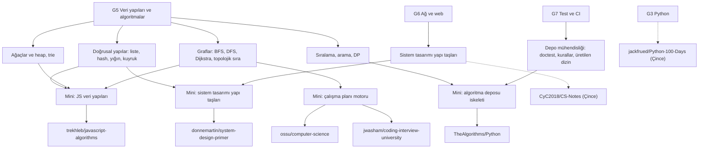

# D09 Bilgisayar bilimi — algoritmalar, müfredatlar ve sistem tasarımı

> Gövde düğümü [G5 Veri yapıları ve algoritmalar](../../govde/README.md#g5)'ın derin hâli. Ayrıca
> [G3 Python](../../govde/README.md#g3), [G4 JavaScript](../../govde/README.md#g4),
> [G6 Ağ ve web](../../govde/README.md#g6) ve [G10 C ve bellek modeli](../../govde/README.md#g10) düğümlerinin bir
> kısmını derinleştirir. Ağacın tamamı: [AGAC.md](../../AGAC.md).

## Bu dal nedir

Diğer dokuz dalın depolarında karşına çıkan "sihirli" parçaların çoğu bu dalda öğrenilir: React'in liste
karşılaştırması, Linux zamanlayıcısının kırmızı-siyah ağacı, bir web tarayıcısının (crawler) ziyaret kümesi, n8n'in iş
akışı grafı, ollama'nın önek önbelleği. Dalın yedi yaprağı üç türdür:

- **Kod tabanları:** [TheAlgorithms/Python](thealgorithms-python/README.md) ve
  [javascript-algorithms](javascript-algorithms/README.md) — algoritmaları okunur kodla ve testle gösterir; ilki aynı
  zamanda çok sayıda katkıcıyı yöneten bir kalite hattı örneğidir.
- **Müfredatlar:** [ossu/computer-science](ossu-computer-science/README.md) (tam lisans müfredatı) ve
  [coding-interview-university](coding-interview-university/README.md) (mülakat odaklı konu listesi) — "ne, hangi
  sırayla" sorusunu yanıtlar.
- **Konu kaynakları:** [system-design-primer](system-design-primer/README.md) (İngilizce, sistem tasarımı) ile iki Çince
  kaynak: [CS-Notes](cs-notes/README.md) (mülakat notları) ve [Python-100-Days](python-100-days/README.md) (Python
  müfredatı).

## Önkoşullar

Bu liste, yedi yaprağın "Öğrenmen gerekenler" tablolarının birleşimidir: G1, G2, G3, G4, G5, G6, G7, G9 ve G10. G8 ve
G11 hiçbir yaprakta geçmez.

**Dala girmeden önce (zorunlu):**

- [G1 Terminal](../../govde/README.md#g1) ve [G2 Git](../../govde/README.md#g2): mini'ler terminalden çalışır ve test
  edilir; CIU ve OSSU ilerlemeyi bir çatal (fork) ve onay kutularıyla izler; TheAlgorithms'e katkı PR ile olur.
- [G3 Python](../../govde/README.md#g3): beş mini'nin dördü Python, biri JavaScript; plan ve ilerleme araçları da
  Python.
- [G5 Veri yapıları ve algoritmalar](../../govde/README.md#g5): gövdedeki temeli yeter; bu dal G5'in derin hâlidir ve
  onunla birlikte ilerler.
- [G7 Test, CI ve kod kalitesi](../../govde/README.md#g7): her mini testlerle gelir; TheAlgorithms yaprağı G7'nin canlı
  bir örneğidir.

**İlgili yaprağa gelince (faydalı, dal içinde tamamlanabilir):**

- [G4 JavaScript](../../govde/README.md#g4): yalnızca javascript-algorithms mini'sini yazmak için. Tek dille gelirsen o
  mini'yi okuyup Python'a çevirebilirsin.
- [G6 Ağ ve web](../../govde/README.md#g6): system-design-primer'den önce bitmeli; CIU "Networking", OSSU Computer
  Networking ve CS-Notes 计算机网络 notları da ister.
- [G9 Açık kaynak ve lisans](../../govde/README.md#g9): TheAlgorithms'e katkı, CS-Notes'un ticari olmayan lisansı ve
  Python-100-Days'in lisanssızlığı için.
- [G10 C ve bellek modeli](../../govde/README.md#g10): OSSU'nun sistem dersleri (Nand2Tetris, OSTEP), CS-Notes'un
  işletim sistemi notları ve CIU'nun C önerisi için.

Gövdenin tırmanış tablosunda bu dal 5. adımdır (G1+G2, bir dil, G7+G6, ikinci dil, sonra G5 ile birlikte D09). Bu dal
için 4. adım (ikinci dil) isteğe bağlıdır; G6 ise en geç system-design-primer yaprağına gelmeden bitmelidir.

## Dalın ağacı



## Önerilen yaprak sırası

1. **[coding-interview-university](coding-interview-university/README.md)** — önce harita. Konu sırasını ve "çatalla,
   işaretle, commit'le" yöntemini verir; mini'deki `ilerleme.py` ile kendi ilerlemeni sayarsın.
2. **[javascript-algorithms](javascript-algorithms/README.md)** — çekirdek veri yapılarını kodla: bağlı liste, hash
   tablosu, heap, trie, graf, LRU. Python yoluna gidiyorsan bu yaprağı yine oku; kavramlar dilden bağımsız.
3. **[TheAlgorithms/Python](thealgorithms-python/README.md)** — algoritmayı değil, algoritma deposunu öğren: doctest,
   adlandırma kuralları, makinenin yazdığı içindekiler, CI. Burada G7 pekişir.
4. **[ossu/computer-science](ossu-computer-science/README.md)** — uzun vadeli müfredat. Mini'deki motorla kendi
   takvimini üret; matematik ve sistem derslerini "ikinci kulvar"da yürüt.
5. **[system-design-primer](system-design-primer/README.md)** — veri yapıları ve G6 oturduktan sonra. Sekiz haftalık
   [nasıl çalışılır](system-design-primer/nasil-calisilir.md) rehberi ve Türkçe Anki destesiyle.
6. **[CS-Notes](cs-notes/README.md)** — sistem tasarımı, işletim sistemi ve ağ için yoğun ikinci kaynak; çeviri iş
   akışıyla, seçerek oku.
7. **[Python-100-Days](python-100-days/README.md)** — sıranın dışında: Python'u yeni öğreniyorsan 1. adımdan önce ya da
   paralel olarak 1–20. günleri alıştırma kaynağı olarak kullan. Çince terimler için önce
   [CS-Notes dosyasındaki](cs-notes/README.md) başlangıç sözlüğünü aç; bu yaprağın sözlüğü onun ekidir.

## Yapraklar

| Sıra | Depo                                                                         | Tür            | Zorluk (1–5) | Mini                                                                           | Mini (saat) | Toplam (saat) |
| ---- | ---------------------------------------------------------------------------- | -------------- | ------------ | ------------------------------------------------------------------------------ | ----------- | ------------- |
| 1    | [jwasham/coding-interview-university](coding-interview-university/README.md) | eğitim içeriği | 2            | [ilerleme.py + konu grafı](coding-interview-university/sifirdan/README.md)     | 6           | 26            |
| 2    | [trekhleb/javascript-algorithms](javascript-algorithms/README.md)            | kod tabanı     | 3            | [6 veri yapısı + graf algoritmaları](javascript-algorithms/sifirdan/README.md) | 21          | 45            |
| 3    | [TheAlgorithms/Python](thealgorithms-python/README.md)                       | kod tabanı     | 3            | [algoritma deposu iskeleti](thealgorithms-python/sifirdan/README.md)           | 12          | 37            |
| 4    | [ossu/computer-science](ossu-computer-science/README.md)                     | eğitim içeriği | 4            | [plan motoru](ossu-computer-science/sifirdan/README.md)                        | 15          | 39            |
| 5    | [donnemartin/system-design-primer](system-design-primer/README.md)           | eğitim içeriği | 4            | [6 yapı taşı + Anki](system-design-primer/sifirdan/README.md)                  | 21          | 76            |
| 6    | [CyC2018/CS-Notes](cs-notes/README.md)                                       | eğitim içeriği | 3 (Çince)    | yok: çeviri iş akışı, 6 bölüm                                                  | 19,5        | 36,5          |
| 7    | [jackfrued/Python-100-Days](python-100-days/README.md)                       | eğitim içeriği | 2 (Çince)    | yok: çeviri iş akışı, 1–20. günler                                             | 49          | 66            |
|      | **Dal toplamı**                                                              |                |              |                                                                                | **143,5**   | **325,5**     |

**Süre kuralı.** Bu daldaki bütün süreler saattir. Bir dosyada gün ya da hafta geçerse 1 gün ≈ 5 saat, 1 hafta ≈ 10 saat
odaklı çalışma sayılır; bir dosya kendi haftasını tanımlıyorsa o kullanılır (system-design-primer rehberinde 1 hafta =
7–8 saat).

- **Mini (saat):** dosyanın "Sıfırdan yol" tablosundaki aşamaların toplamı. Mini'si olmayan iki Çince yaprakta, çeviri
  iş akışının bir turu × dosyanın önerdiği tur sayısı: CS-Notes 6 bölüm × 3,25 saat, Python-100-Days 20 gün × 2,45 saat.
- **Toplam (saat):** Mini + okuma rotası + alıştırmalar. Okuma rotası adım başına ~1 saattir; system-design-primer'de
  okuma, [8 haftalık rehberden](system-design-primer/nasil-calisilir.md) gelir (≈ 60 saat, mini dahil; okuma payı
  60 − 21 = 39 saat). Alıştırmalar kolay ~1, orta ~2, zor ~4 saat sayılır. Her dosyanın 4. bölümündeki "Süre özeti"
  satırı bu hesabı gösterir.
- Müfredatların kendisi bu toplama girmez: CIU'nun konuları ~283 saat (`ciu-konulari.json`), OSSU Intro + Core CS
  ~1.700 saat, tüm OSSU müfredatı README'ye göre haftada ~20 saatle ~2 yıl. Onlar için aşağıdaki 12 aylık plana bak.

Dalın toplamı **~325 saat**: haftada ~10 saatle **~33 hafta** (yaklaşık 7,5 ay). Python'u zaten biliyorsan
Python-100-Days'i atlayabilirsin: ~260 saat, ~26 hafta. Müfredatların kendisiyle birlikte gerçekçi bir derinleşme 12 ay
ve üstü sürer (aşağıda).

## 12 aylık örnek plan

Bu plan, dalın kendi aracıyla üretildi: [`ossu-computer-science/sifirdan/plan_yaz.py`](ossu-computer-science/sifirdan/README.md).
Veri dosyası [`veri/turkce-12-ay.json`](ossu-computer-science/sifirdan/veri/turkce-12-ay.json) 21 kalemdir: OSSU
dersleri, CIU konu blokları ve bu daldaki mini'ler. Varsayımlar: zorunlu önkoşullar (G1, G2, G3, G7) bitmiş ve G5'in
temeli atılmış (G4 yalnızca JS mini'si için gerekir; G6 ve G10 plandaki derslerle tamamlanır), **haftada 15 saat** (hafta
içi her gün 1,5 saat ve hafta sonu 7,5 saat), iki kulvar ("algoritma" ve "matematik-sistem"; OSSU yukarıdan aşağı sırayı
önerir, matematiği giriş dersleriyle paralel almayı "popüler bir seçenek" olarak anar, FAQ de bölümleri paralel
yürütmeye izin verir), başlangıç 4 Ocak 2027. Haftalık onay kutulu tam sürüm:
[ornek-plan-12-ay.md](ossu-computer-science/sifirdan/ornek-plan-12-ay.md).

| Ay  | Takvim       | Algoritma kulvarı                                          | Matematik-sistem kulvarı           |
| --- | ------------ | ---------------------------------------------------------- | ---------------------------------- |
| 1   | Ocak 2027    | Python tekrarı                                             | Missing Semester                   |
| 2   | Şubat 2027   | Büyük-O, Doğrusal yapılar (JS mini)                        | Math for CS                        |
| 3   | Mart 2027    | Doğrusal yapılar (JS mini), Algoritma deposu (Python mini) | Math for CS, Computer Networking   |
| 4   | Nisan 2027   | Algoritma deposu (Python mini), Sıralama ve arama          | Computer Networking                |
| 5   | Mayıs 2027   | Sıralama ve arama, Ağaçlar, heap, trie                     | Computer Networking, Nand2Tetris I |
| 6   | Haziran 2027 | Graflar                                                    | Nand2Tetris I                      |
| 7   | Temmuz 2027  | Özyineleme ve DP                                           | Nand2Tetris I, OSTEP               |
| 8   | Ağustos 2027 | Algorithms 1                                               | OSTEP                              |
| 9   | Eylül 2027   | Algorithms 1, Algorithms 2                                 | OSTEP, System Design Primer        |
| 10  | Ekim 2027    | Algorithms 2                                               | System Design Primer               |
| 11  | Kasım 2027   | Soru pratiği                                               | System Design Primer               |
| 12  | Aralık 2027  | Soru pratiği, Bitirme projesi                              | -                                  |
| 13  | Ocak 2028    | -                                                          | CS-Notes seçmeleri, Veritabanları  |
| 14  | Şubat 2028   | -                                                          | Veritabanları, Nand2Tetris II      |
| 15  | Mart 2028    | -                                                          | Nand2Tetris II                     |

- **Zorunlu kısım** 755 saattir ve 52. haftada (27 Aralık 2027 haftası) biter. 13–15. aylar seçmelidir (170 saat).
- **Haftalık bütçe değişirse** (aynı veriyle, `--karsilastir 8,10,12,15,20`): zorunlu kısım 8 saatle 95 hafta, 10 saatle
  76, 12 saatle 64, 15 saatle 52, 20 saatle 39 hafta sürer.
- **Bitirme projesi:** system-design-primer mini'sindeki parçalardan testli bir kısa link servisi (base62, hız sınırlama,
  LRU, tutarlı hash).
- **İlerlemeyi izle:** kutuları işaretle ve dal kökünden
  `python3 coding-interview-university/sifirdan/ilerleme.py ossu-computer-science/sifirdan/ornek-plan-12-ay.md --seviye 3`
  ile say. Planı kendi depona kopyaladıysan betiğe atlastaki yolunu ver:
  `python3 <atlas>/dallar/09-bilgisayar-bilimi/coding-interview-university/sifirdan/ilerleme.py benim-planim.md --seviye 3`.
  İki hafta üst üste geride kalırsan saati değil kapsamı küçült (bir seçmeliyi düşür, bir dersi temel yoluna indir).
- **Bilerek yapılan sapmalar:** OSSU'da Math for CS'in önkoşulu Calculus 1C ve OSTEP'in önkoşulu Nand2Tetris II'dir;
  bu planda zaman için gevşetildi (gerekçeleri veri dosyasındaki `aciklama` alanında). OSSU'nun Coursera dersleri için
  Temmuz 2025'ten beri ücretsiz izleme büyük ölçüde kalktı; plan bu yüzden edX, MIT OCW ve kitap kaynaklarını tercih eder.

## Dallar arası bağlantılar

Bu dalda öğrenilen kavramların diğer dallardaki somut karşılıkları (dosya yolları ilgili depoların klonlarında
doğrulandı):

| Kavram                                                   | Nerede kullanılıyor                                                                                                                      | Dosya                                                                                                                                                                                 |
| -------------------------------------------------------- | ---------------------------------------------------------------------------------------------------------------------------------------- | ------------------------------------------------------------------------------------------------------------------------------------------------------------------------------------- |
| Liste karşılaştırma (diff), en uzun artan alt dizi (LIS) | [D01 react](../01-web-arayuzu/react/README.md), [D01 vue3-core](../01-web-arayuzu/vue3-core/README.md)                                   | `packages/react-reconciler/src/ReactChildFiber.js` (`reconcileChildrenArray`); `packages/runtime-core/src/renderer.ts` (`getSequence`)                                                |
| Kırmızı-siyah ağaç                                       | [D02 vscode](../02-uygulama-platformlari/vscode/README.md) metin tamponu; [D03 linux](../03-sistem-ag-guvenlik/linux/README.md)          | `src/vs/editor/common/model/pieceTreeTextBuffer/rbTreeBase.ts`; `lib/rbtree.c`, `kernel/sched/fair.c` (EEVDF zamanlayıcı)                                                             |
| LRU benzeri sayfa geri kazanımı                          | [D03 linux](../03-sistem-ag-guvenlik/linux/README.md)                                                                                    | `mm/vmscan.c`, `mm/workingset.c`                                                                                                                                                      |
| DNS (ağaç, önbellek, TTL)                                | [D03 freedomain](../03-sistem-ag-guvenlik/freedomain/README.md)                                                                          | system-design-primer "Domain name system"                                                                                                                                             |
| Kuyruk, BFS, ziyaret kümesi, robots.txt                  | [D04 firecrawl](../04-veri-araclari-otomasyon/firecrawl/README.md)                                                                       | `apps/api/src/lib/crawl-redis.ts`, `apps/api/src/lib/robots-txt.ts`, `apps/api/src/services/queue-service.ts`                                                                         |
| Yönlü graf, döngü (güçlü bağlı bileşenler, Tarjan)       | [D04 n8n](../04-veri-araclari-otomasyon/n8n/README.md)                                                                                   | `packages/core/src/execution-engine/partial-execution-utils/directed-graph.ts` (`getStronglyConnectedComponents`), `packages/@n8n/engine/src/graph/loops.ts` (`computeSccMembership`) |
| Graf olarak ajan, yürütme kuyruğu                        | [D06 autogpt](../06-ajan-platformlari/autogpt/README.md)                                                                                 | `autogpt_platform/backend/backend/data/graph.py` (`Graph`, `Node`, `Link`), `autogpt_platform/backend/backend/executor/manager.py`                                                    |
| Kayıt defteri + sıralı eşleme (ilk uyan kazanır)         | [D04 yt-dlp](../04-veri-araclari-otomasyon/yt-dlp/README.md)                                                                             | `yt_dlp/extractor/extractors.py` (`_CLASS_LOOKUP`), `yt_dlp/YoutubeDL.py` (`extract_info`), `yt_dlp/extractor/common.py` (`suitable`, `_VALID_URL`)                                   |
| Matris çarpımı, lineer cebir                             | [D05 tensorflow](../05-yapay-zeka-altyapisi/tensorflow/README.md), [D05 transformers](../05-yapay-zeka-altyapisi/transformers/README.md) | `tensorflow/core/kernels/matmul_op_impl.h`; OSSU "Advanced math" (Linear Algebra)                                                                                                     |
| Trie + LRU (önek önbelleği)                              | [D05 ollama](../05-yapay-zeka-altyapisi/ollama/README.md)                                                                                | `mlxrunner/cache_trie.go` (sıkıştırılmış önek ağacı, `lastUsed` ile LRU atma)                                                                                                         |
| KV önbelleği                                             | [D05 transformers](../05-yapay-zeka-altyapisi/transformers/README.md)                                                                    | `src/transformers/cache_utils.py`                                                                                                                                                     |
| Metin arama (grep)                                       | [D07 opencode](../07-kodlama-ajanlari/opencode/README.md)                                                                                | `packages/core/src/ripgrep.ts`, `packages/core/src/tool/plugin/grep.ts`                                                                                                               |
| Ajanlara yazılmış katkı kuralları                        | [D08 anthropic-skills](../08-ajan-becerileri/anthropic-skills/README.md)                                                                 | TheAlgorithms'te `AGENTS.md` ve `.github/skills/*/SKILL.md`                                                                                                                           |
| Yol haritası grafı                                       | [D02 developer-roadmap](../02-uygulama-platformlari/developer-roadmap/README.md)                                                         | CIU, tam CS yolu için roadmap.sh'e yönlendirir                                                                                                                                        |
| Türkçe ücretsiz kaynaklar                                | [D10 free-programming-books](../10-kuratorluk-topluluk/free-programming-books/README.md)                                                 | `books/free-programming-books-tr.md`, `courses/free-courses-tr.md`; gövdedeki Türkçe kaynakların çoğu bu listelerden                                                                  |
| Kendin-yap projeleri                                     | [D10 build-your-own-x](../10-kuratorluk-topluluk/build-your-own-x/README.md)                                                             | Gövdedeki G1, G2, G6 ve G10 mini görevleri (Shell, Git, Web Server, Memory Allocator); İngilizce                                                                                      |

İki satırın ayrıntısı:

- **n8n** düğümleri topolojik sırayla değil, `packages/core/src/execution-engine/workflow-execute.ts` içindeki yürütme
  yığınıyla (`nodeExecutionStack`) çalıştırır. Topolojik sıra örneği bu dalda:
  `ossu-computer-science/sifirdan/mufredat.py` (`topolojik_sira`, Kahn).
- **yt-dlp**'de `_CLASS_LOOKUP` bir ad → sınıf sözlüğüdür (önce YouTube, en son genel çıkarıcı). `extract_info` bu
  sözlüğü sırayla gezer ve `suitable()` (yani `_VALID_URL` düzenli ifadesi) ile eşleşen ilk çıkarıcıyı seçer. Sözlükten
  doğrudan erişim yalnızca `ie_key` verildiğinde olur; URL için seçim hash ile değil, sıralı eşlemeyle yapılır.

İş fikirleri için: [is-fikirleri](../../is-fikirleri/README.md).

## Türkçe kaynak durumu

| Depo                                                  | Türkçe                                                                                                                                                                   |
| ----------------------------------------------------- | ------------------------------------------------------------------------------------------------------------------------------------------------------------------------ |
| javascript-algorithms                                 | Var: `README.tr-TR.md` (biraz geride: 144 madde, İngilizcede 162) + 3 klasör README'si (linked-list, heap, factorial)                                                    |
| coding-interview-university                           | Kısmi: `translations/README-tr.md` "Graflar" ve ardından iki maddeye kadar Türkçe, 940. satırdan sonrası büyük ölçüde İngilizce; ana README Türkçeyi "in progress" sayar |
| system-design-primer                                  | Yok: `TRANSLATIONS.md`'ye göre "Stalled", bakımcı aranıyor (issue #39)                                                                                                   |
| TheAlgorithms/Python, OSSU, CS-Notes, Python-100-Days | Yok                                                                                                                                                                      |

Çince iki yaprak için çeviri iş akışı ve terim sözlükleri ilgili dosyalarda.

## Mini'lerin testleri

```bash
cd repo-atlasi/dallar/09-bilgisayar-bilimi   # depo kökünden
for d in thealgorithms-python system-design-primer ossu-computer-science coding-interview-university; do
  python3 -m unittest discover -s $d/sifirdan -t $d/sifirdan
done
(cd javascript-algorithms/sifirdan && node --test)
```

Toplam 147 test (Python 116, JavaScript 31); hepsi çevrimdışı ve bağımlılıksız.

## Bu dalı bitirdiğinde ne yapabilirsin

- Bağlı liste, hash tablosu, heap, trie, graf ve LRU önbelleği sıfırdan yazıp her işlemin Büyük-O'sunu gerekçesiyle
  söyleyebilirsin.
- BFS, DFS, Dijkstra ve topolojik sıralamayı bir problemi (ders sırası, iş akışı, yol bulma) çözmek için seçebilirsin.
- Doctest, sözleşme testi, kural denetleyicisi ve otomatik üretilen belgelerle bir kod deposunu "çok sayıda katkıcıya
  hazır" hâle getirebilirsin.
- Bir müfredatı önkoşul grafına çevirip kendi takvimini kurabilir, ilerlemeni ölçebilirsin.
- Bir sistem tasarımı sorusunu 4 adımda, sayılarla ve ödünleşimleri söyleyerek yanıtlayabilirsin; tutarlı hash, hız
  sınırlama, önbellek stratejileri ve yük dengelemeyi koddan biliyorsun.
- Çince teknik kaynakları terim sözlüğü ve çeviri iş akışıyla kullanabilirsin.
- Diğer dallarda (React, Linux, n8n, ollama) karşına çıkan algoritmaları tanıyıp kaynağında okuyabilirsin.
