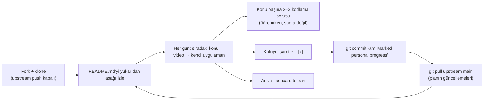
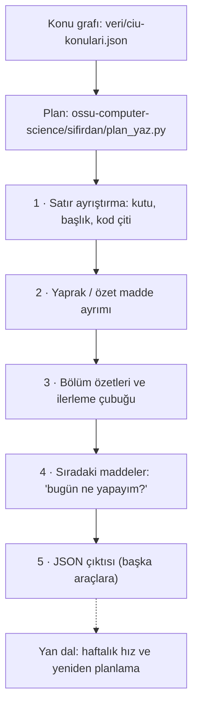

# jwasham/coding-interview-university — onay kutularıyla ilerlenen çok aylık mülakat çalışma planı

> **Dal:** [D09 Bilgisayar bilimi](../README.md) · **Tür:** eğitim içeriği
> **Dil:** Markdown · **Lisans:** CC BY-SA 4.0 · **Yıldız:** 364.126 (9 Kasım 2026) · **İncelenen commit:** `2399df2` (2026-11-07)

## 1. Bir bakışta

Coding Interview University (CIU), John Washam'ın büyük bir şirkette yazılım mühendisi olmak için çıkardığı kişisel
yapılacaklar listesinin büyümüş hâlidir: Büyük-O'dan graflara, dinamik programlamadan önbelleklere kadar konular sırayla
dizilir, her maddenin yanında bir video ya da okuma ve bir **onay kutusu** (`- [ ]`) vardır. Yazar, planı aylarca
günde 8–12 saat çalışarak bitirdiğini ve sonunda Amazon'da işe girdiğini anlatır; README "benim kadar çalışmana gerek
yok" diye de uyarır. GitHub'ın en çok yıldız alan depolarındandır, çünkü "neyi, hangi sırayla" sorusunu tek sayfada yanıtlar ve
ilerlemeyi git ile izlemenin basit bir yolunu verir: depoyu çatalla, kutuları işaretle, commit'le.

## 2. Nasıl yapılmış: mimari

### Klasör haritası

```text
jwasham/coding-interview-university @ 2399df2   (toplam 46 dosya)
├── README.md                          2.019 satır; 463 onay kutulu satır; planın tamamı
├── programming-language-resources.md  C, C++, Python, Java… için kaynaklar ve hile kâğıtları
├── extras/cheat sheets/               10 PDF: Büyük-O, bit işlemleri, C, C++ STL, Java, Python, git, sistem tasarımı
├── translations/                      30 dil dosyası (README-tr.md dahil) + how-to.md
├── .github/workflows/links_checker.yml   ayda bir lychee ile README bağlantılarını denetler, rapor issue'su açar
└── LICENSE.txt                        CC BY-SA 4.0
```

### Ana bileşenler ve veri akışı

README'nin içindekiler tablosu üç bölümdür: **The Study Plan** (nasıl kullanılır, dil seçimi, kitaplar, "hatalarımı
yapma", günlük plan, soru pratiği), **Topics of Study** (asıl müfredat) ve **Getting the Job** (özgeçmiş, mülakat
süreci). Altında "Everything below this point is optional" çizgisiyle ayrılmış isteğe bağlı konular (sistem tasarımı,
derleyiciler, kriptografi, B-ağaçları…) gelir.



Konular sıralıdır ama ders gibi ayrık değildir: "Arrays" maddesi önce videoları, sonra "otomatik büyüyen bir vektör
yaz: `size()`, `capacity()`, `push`, `insert`, `resize`…" alt kutularını içerir; yani her veri yapısı için bir
**uygulama ödevi** vardır. "The Daily Plan": her gün listedeki sıradaki konuyu al, birkaç video izle, seçtiğin dilde
uygula.

### Önce okunacak dosyalar

1. `README.md` > "How to use it" — fork, `git remote add upstream`, `git remote set-url --push upstream DISABLE`.
2. `README.md` > "Don't Make My Mistakes" — "hepsini hatırlamayacaksın", flashcard kullan, öğrenirken soru çöz.
3. `README.md` > "Choose a Programming Language" — çalışma için C + Python, mülakat için C++/Java/Python önerisi.
4. `README.md` > "Data Structures" > "Arrays" — uygulama ödevinin biçimi (kutulu alt maddeler).
5. `README.md` > "What you won't see covered" — JavaScript, HTML/CSS ve SQL bilerek kapsam dışı.
6. `.github/workflows/links_checker.yml` — ~730 dış bağlantılı bir belgenin bakımı nasıl otomatikleşir.
7. `translations/how-to.md` ve README'deki iki çeviri listesi — çeviri süreci.

### Teknoloji yığını, derleme, test, CI, sürüm

- **İçerik:** Tek README + çeviriler + PDF hile kâğıtları. Kod yok; yazarın uygulamaları ayrı depolarda (README'de
  `practice-c`, `practice-cpp`, `practice-python` bağlantıları) ve flashcard sitesi ayrı bir depodadır
  (`computer-science-flash-cards`).
- **CI:** `links_checker.yml` ayda bir (`cron: '0 0 1 * *'`) `lycheeverse/lychee-action` ile yalnızca `README.md`'deki
  bağlantıları denetler (çeviriler hariç), en fazla 3 eşzamanlı istek ve 20 sn zaman aşımıyla. Kırık bağlantı varsa
  "Link checker report" issue'su açar ya da günceller; hepsi düzelince kapatır. Eylemler tam commit SHA'sına
  sabitlenmiştir ve iş akışı yalnızca `contents: read` ve `issues: write` izni ister.
- **Sürüm:** Yok; içerik `main`'den okunur, öğrenci kendi çatalında `git pull upstream main` ile günceller.

### Tasarım kararları ve ödünleşimler

1. **İlerleme durumu = git.** Uygulama, hesap ya da veritabanı yok; GitHub'ın görev listesi biçimi ve çatal yeter.
   Bedeli: istatistik ve hatırlatıcı yok (bu dosyanın mini'si tam bunu ekliyor).
2. **"Öğrenirken soru çöz".** Yazarın en büyük hatası olarak andığı şey, soruları sona bırakmaktır; plan her konudan
   sonra 2–3 soru önerir.
3. **Bilinçli kapsam daraltma.** README, bir CS bölümündeki konuların ~%75'ini bilmenin mülakat için yettiğini söyler;
   ön yüz teknolojileri ve SQL kapsam dışıdır. Tam bir CS eğitimi için roadmap.sh'e (bkz.
   [developer-roadmap](../../02-uygulama-platformlari/developer-roadmap/README.md)) yönlendirir.
4. **Flashcard'a dikkat.** Yazar kendi 1.200–1.800 kartlık destesini **önermez**: "çoğu gereksiz ayrıntı". Kendi
   kartını yazmayı ve aralıklı tekrarı (Anki) önerir.
5. **Bağlantı çürümesine karşı otomasyon.** Video bağlantıları sık kırılır; aylık lychee taraması bakımı sürdürülebilir
   kılar.
6. **Paylaşımlı lisans.** CC BY-SA 4.0: çeviri ve uyarlama serbest, ama türev de aynı lisansla paylaşılmalı.

## 3. Öğrenmen gerekenler

| Düğüm                                                                                | Bu plan için neden                                            | Ücretsiz kaynak                                                                                  |
| ------------------------------------------------------------------------------------ | ------------------------------------------------------------- | ------------------------------------------------------------------------------------------------ |
| [G2 Git ve GitHub](../../../govde/README.md#g2)                                      | Fork, `upstream`, push'u kapatma, kendi çatalını güncel tutma | [Missing Semester: Git](https://missing.csail.mit.edu/2020/version-control/)                     |
| [G3 Python](../../../govde/README.md#g3) ya da [G10 C](../../../govde/README.md#g10) | Plan C + Python önerir; uygulama ödevleri bu dillerde         | [Python-100-Days dosyası](../python-100-days/README.md), K&R (README'de)                         |
| [G5 Veri yapıları ve algoritmalar](../../../govde/README.md#g5)                      | Planın gövdesi                                                | [javascript-algorithms dosyası](../javascript-algorithms/README.md)                              |
| [G6 Ağ ve web temelleri](../../../govde/README.md#g6)                                | "Networking" ve isteğe bağlı sistem tasarımı                  | [system-design-primer dosyası](../system-design-primer/README.md)                                |
| Dal içi: aralıklı tekrar                                                             | "You won't remember it all" bölümü                            | [Anki](https://apps.ankiweb.net/), [nasıl çalışılır](../system-design-primer/nasil-calisilir.md) |

## 4. Sıfırdan yol (dallanma)

CIU'nun "mekanizması" bir onay kutusu listesidir. Yeniden kurulacak şey, o listeyi okuyup **ilerleme raporu** çıkaran
araç ve konuların arasındaki örtük sırayı açık bir grafa çeviren veridir.



| Aşama | Ne inşa edersin                    | Öğrendiğin kavram                          | Bitti ölçütü                                         | Süre (tahmini) |
| ----- | ---------------------------------- | ------------------------------------------ | ---------------------------------------------------- | -------------- |
| 1     | `maddeleri_oku`: düzenli ifadeler  | Satır tabanlı ayrıştırma, kod çiti durumu  | Kod bloğundaki kutu sayılmıyor                       | 2 saat         |
| 2     | Yaprak tespiti                     | Girinti ile hiyerarşi                      | "Vektör yaz:" özet maddesi `--yapraklar` ile düşüyor | 1 saat         |
| 3     | `ozetle`, `cubuk`, `rapor_metni`   | Gruplama, metin raporu                     | Örnekte 6/11 (%55)                                   | 1 saat         |
| 4     | `sonraki_maddeler`                 | Belge sırasını korumak                     | İlk iki işaretsiz yaprak doğru                       | 0,5 saat       |
| 5     | `--json`                           | Araçlar arası sözleşme                     | JSON'daki toplam 11                                  | 0,5 saat       |
| 6     | `veri/ciu-konulari.json` (31 konu) | Örtük sırayı açık önkoşul grafına çevirmek | Döngüsüz; her önkoşul listede önce geliyor           | 1 saat         |

**Süre özeti:** mini 6 saat, okuma rotası ~8 saat (8 adım × 1 saat), alıştırmalar ~12 saat (2 kolay, 3 orta,
1 zor); toplam **~26 saat**. Planın kendisi (CIU'nun konuları) bu toplama girmez: `veri/ciu-konulari.json`'a göre
~283 saat (zorunlu 253 + seçmeli 30). Hesap kuralı: [dal README'si, "Yapraklar"](../README.md#yapraklar).

**Mini uygulama:** [`sifirdan/`](sifirdan/README.md) — `ilerleme.py`, CIU konu grafı ve örnek liste (12 test).
Planlama yarısı: [ossu-computer-science/sifirdan](../ossu-computer-science/sifirdan/README.md). Her parçanın CIU'daki
karşılığı mini'nin eşleme tablosunda.

**Gerçek ölçeğe giden yol:** (1) git geçmişinden tarih çıkarma (`git log -p` ile hangi kutu ne zaman işaretlendi →
haftalık hız), (2) çeviri dosyalarıyla İngilizce README'yi kutu kutu eşleştirip "çevirisi geride kalan bölüm" raporu,
(3) GitHub Actions ile her push'ta ilerleme rozetini güncellemek, (4) Anki'ye kart üretimi.

## 5. Gerçek depoda okuma rotası

1. "How to use it": `set-url --push upstream DISABLE` satırı neyi engelliyor? Neden önemli?
2. "Data Structures" > "Arrays": uygulama ödevindeki her alt kutuyu bir test adına çevir.
3. "Trees" ve "Sorting": hangi konular "genel kavram, ayrıntı değil" diye işaretlenmiş?
4. "Don't Make My Mistakes" > "Use Flashcards": yazar neden kendi destesini önermiyor?
5. "The Daily Plan": günlük döngüyü üç adımda yaz; bu dosyadaki mini'nin `--sonraki` çıktısıyla karşılaştır.
6. "Optional Extra Topics": "System Design, Scalability, Data Handling" hangi deneyim düzeyine önerilmiş?
7. `.github/workflows/links_checker.yml`: rapor issue'su açma, güncelleme ve kapatma koşulları neler?
8. `translations/README-tr.md`: metnin İngilizceye döndüğü ilk maddeyi ve ilk İngilizce `##` başlığını bul (aşağıya
   bak).

### Türkçe çeviri durumu

`translations/README-tr.md` vardır (2.004 satır) ama **kısmi ve eskidir**: "Graflar" bölümü ve ardından gelen "Daha
Fazla Bilgi" bölümünün ilk iki maddesi (Rekürsif, Dinamik Programlama) Türkçedir; 940. satırdaki "Object-Oriented
Programming" maddesinden itibaren metin İngilizce devam eder. İlk İngilizce `##` başlığı 1.131. satırdaki "System
Design, Scalability, Data Handling"dir; sonrasında yalnızca tek tük Türkçe başlık kalır. İçindeki çeviri listesi de
güncel README'den farklıdır. Ana README Türkçeyi hâlâ "Translations in progress" altında
([issue #2005](https://github.com/jwasham/coding-interview-university/issues/2005)) listeler. Okurken: Türkçe dosyayı
yapı ve terimler için, güncel bağlantılar için İngilizce README'yi kullan.

## 6. Alıştırmalar ve öz değerlendirme

1. **(kolay)** Kendi çatalında README'yi `ilerleme.py README.md --seviye 2` ile say; kaç kutu var, kaçı isteğe bağlı
   bölümde?
2. **(kolay)** "Arrays" ödevini (vektör) Python'da yaz, her alt kutu için bir test ekle, kutuları işaretle.
3. **(orta)** `ilerleme.py`'ye `--git` seçeneği ekle: `git log -p` çıktısından her kutunun işaretlendiği tarihi bulsun.
4. **(orta)** İngilizce README ile `translations/README-tr.md`'yi başlık başlık karşılaştırıp çevirisi eksik bölümleri
   listeleyen bir betik yaz.
5. **(orta)** `veri/ciu-konulari.json`'u kendi bildiklerine göre düzenle (bildiğin konuları sil) ve
   `plan_yaz.py --paralel 1` ile kişisel takvimini üret.
6. **(zor)** CIU'nun lychee iş akışını kendi notların için uyarla: yalnızca değişen Markdown dosyalarındaki bağlantıları
   PR'da denetlesin.

<details><summary>Soru 1: Neden "upstream"e push kapatılıyor?</summary>

Çatalda kendi ilerlemeni işaretleyip commit'liyorsun. Yanlışlıkla `git push upstream` yaparsan kişisel ilerlemen
orijinal depoya gönderilmeye çalışılır; `set-url --push upstream DISABLE` bu hatayı imkânsız kılar, `pull` ise
çalışmaya devam eder.

</details>

<details><summary>Soru 2: Bir onay kutusunun "yaprak" olup olmadığı neden önemli?</summary>

"Vektör yaz:" gibi bir üst madde, alt kutularının özetidir. Hem üst hem alt kutular sayılırsa ilerleme olduğundan
yavaş ya da hızlı görünebilir; `--yapraklar` yalnızca gerçekten yapılacak işleri sayar.

</details>

<details><summary>Soru 3: CIU ile OSSU arasındaki temel fark nedir?</summary>

CIU mülakat odaklıdır ve bir CS bölümünün kabaca %75'ini hedefler; sıralı bir konu listesidir, ders değil. OSSU tam bir
lisans müfredatını CS2013'e göre ders ders kurar, önkoşulları açıkça yazar. Bu dalda ikisi birleşir: OSSU'nun
derslerini ve CIU'nun konu bloklarını tek planda kullanırız.

</details>

## 7. İş fikri tohumları

- **İlerleme panosu:** Çataldaki onay kutularını okuyup haftalık hız, tahmini bitiş ve hatırlatma e-postası üreten
  servis. **Kime:** CIU/OSSU izleyen ve kendini takip etmekte zorlanan yeni mezunlar.
- **Türkçe mülakat çalışma grubu:** CIU konularını haftalık eşli çözüm ve sahte mülakatla yürüten ücretli kohort.
  **Kime:** büyük teknoloji şirketlerine başvurmak isteyen Türk geliştiriciler.
- **Kurumsal mülakat hazırlık paketi:** Şirkete özel konu listesi + ilerleme takibi. **Kime:** stajyer ve yeni mezun
  alan yazılım şirketlerinin insan kaynakları ekipleri.

Tüm fikirler: [is-fikirleri](../../../is-fikirleri/README.md).

## 8. Kaynaklar

- [README.md](https://github.com/jwasham/coding-interview-university/blob/2399df2f688ba9fafe11c399cc067d7270921bb1/README.md) ·
  [translations/README-tr.md (kısmi Türkçe)](https://github.com/jwasham/coding-interview-university/blob/2399df2f688ba9fafe11c399cc067d7270921bb1/translations/README-tr.md) ·
  [programming-language-resources.md](https://github.com/jwasham/coding-interview-university/blob/2399df2f688ba9fafe11c399cc067d7270921bb1/programming-language-resources.md)
- [links_checker.yml](https://github.com/jwasham/coding-interview-university/blob/2399df2f688ba9fafe11c399cc067d7270921bb1/.github/workflows/links_checker.yml) ·
  [lychee](https://github.com/lycheeverse/lychee)
- Yazarın yazısı (README'den): [Why I studied full-time for 8 months for a Google interview](https://medium.freecodecamp.org/why-i-studied-full-time-for-8-months-for-a-google-interview-cc662ce9bb13)
- GitHub görev listeleri: [Basic writing and formatting syntax](https://docs.github.com/en/get-started/writing-on-github/getting-started-with-writing-and-formatting-on-github/basic-writing-and-formatting-syntax#task-lists)
