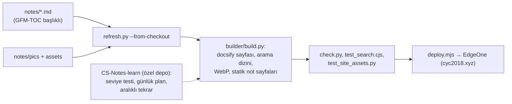
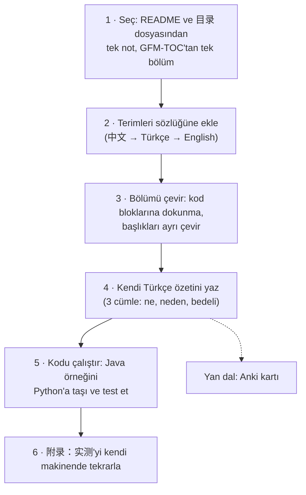

# CyC2018/CS-Notes — Çince mülakat odaklı bilgisayar bilimi notları

> **Dal:** [D09 Bilgisayar bilimi](../README.md) · **Tür:** eğitim içeriği
> **Dil:** Çince Markdown (kod örnekleri çoğunlukla Java; GitHub "JavaScript" gösterir) ·
> **Lisans:** CC BY-NC-SA 4.0 (README'de; GitHub API'de lisans görünmez) · **Yıldız:** 186.466 (9 Kasım 2026) ·
> **İncelenen commit:** `09bc1f9` (2026-11-07)

## 1. Bir bakışta

CS-Notes, Çin'deki teknik mülakatlara (özellikle Java arka uç) hazırlanmak için yazılmış, kısa ve yoğun notlardan
oluşur: algoritmalar ve LeetCode/剑指 Offer çözümleri, işletim sistemleri, ağ, veritabanı, Java, sistem tasarımı,
nesne yönelimli tasarım ve araçlar. 183 Markdown notu ve 1.246 çizim içerir. Notlar başlıklarındaki 🔥 işaretleriyle
"mülakatta ne sık sorulur" bilgisini, sonlarındaki **附录：实测** (ek: ölçüm) bölümleriyle de gerçek ölçümleri verir
(ör. Apple M1 Pro'da Redis 7.4.1 ve Caffeine ile okuma süreleri). README'de gün gün düzenlenmiş dört çalışma rotası
var (sıfırdan, Java arka uç, büyük dil modeli uygulama geliştirme ve mülakattan önceki son iki-üç hafta); her gün 1–2
saatlik okuma, birkaç mülakat sorusu ve bir alıştırma. Türkçe okuyucu için değeri: system-design-primer ve CIU'nun
İngilizce anlattığı konuların **daha yoğun, ölçümlü** bir ikinci kaynağı.

## 2. Nasıl yapılmış: mimari

### Klasör haritası

```text
CyC2018/CS-Notes @ 09bc1f9
├── README.md                     içindekiler: 学习路线 (rotalar), 算法, 操作系统, 网络, 数据库, Java, 系统设计…
├── CONTRIBUTING.md               PR kuralları: bir PR bir iş, başlık numaraları değişmez, Çince yazım kılavuzu
├── notes/                        183 not (dosya adları Çince)
│   ├── 学习路线 - 零基础.md, - Java 后端.md, - 大模型应用开发.md, - 面试冲刺.md   gün gün dört rota
│   ├── 算法 - 目录.md + 算法 - 算法分析/排序/并查集/栈和队列/符号表/其它.md   Sedgewick "Algorithms" tabanlı
│   ├── Leetcode 题解 - 目录.md + 16 konu dosyası (双指针, 动态规划, 图…)   konuya göre LeetCode çözümleri
│   ├── 剑指 Offer 题解 - 目录.md + 76 numaralı dosya (3. … 68.)          klasik Çince mülakat kitabının çözümleri
│   ├── 计算机操作系统 - 概述/进程管理/进程管理 - 进阶/死锁/内存管理/设备管理/链接.md
│   ├── 计算机网络 - 概述/物理层/链路层/网络层/传输层/应用层.md, HTTP.md, Socket.md
│   ├── 数据库系统原理.md, SQL 语法.md, SQL 练习.md, MySQL.md, Redis.md, Redis - 进阶.md
│   ├── 系统设计基础.md, 分布式.md, 集群.md, 微服务.md, 缓存.md, 消息队列.md, 攻击技术.md
│   ├── 大模型应用.md, 大模型应用 - 进阶.md
│   ├── 面向对象思想.md, 设计模式 - 目录.md + 25 desen dosyası
│   ├── Java 基础/容器/并发/虚拟机/IO.md, Spring.md, Git.md, Docker.md, 构建工具.md
│   └── pics/                     1.246 görsel
├── website/                      statik site üreticisi: Python 3.12 (Pillow) + Node 22; docsify şablonu, arama,
│                                 marked ile not başına statik sayfa, Tencent EdgeOne'a yayın
├── docs/                         eski docsify sitesi ("site cyc2018.xyz'e taşındı" notu)
└── .github/workflows/website.yml günde iki kez ve her master push'unda siteyi üretir, doğrular, yayınlar
```

### Ana bileşenler ve veri akışı



Her not `<!-- GFM-TOC -->` ile başlayan bir içindekiler listesiyle açılır; "目录" (içindekiler) dosyaları alt notlara
sıralı bağlantı verir. Site üreticisi bu sırayı kenar çubuğu ve "önceki/sonraki" bağlantıları için kullanır. Sitenin
"öğrenme" kısmı (seviye belirleme, günlük plan, aralıklı tekrar) özel bir depodan (`CyC2018/CS-Notes-learn`) gelir;
dışarıdan gelen PR'larda bu kısım derlenmez (iş akışındaki yorum).

### Önce okunacak dosyalar

1. `README.md` — içindekiler ve dört rota.
2. `notes/学习路线 - 零基础.md` — "bir yemek siparişi verdiğinde ne olur" hikâyesiyle program, işletim sistemi, ağ,
   veritabanı ve veri yapılarına genel giriş; her bölümde alıştırma.
3. `notes/系统设计基础.md` — performans, ölçeklenebilirlik, erişilebilirlik, kısa link, Feed akışı, yüksek eşzamanlılık.
4. `notes/缓存.md` — önbellek konumları, sorunları, tutarlı hash, LRU; sonunda ölçüm eki.
5. `notes/分布式.md` — dağıtık kilit, dağıtık işlem (2PC, TCC, Saga), CAP, BASE.
6. `CONTRIBUTING.md` — not deposu bakım kuralları.
7. `website/README.md` — Markdown notlarından aranabilir statik siteye giden hat.

### Teknoloji yığını, derleme, test, CI, sürüm

- **İçerik:** Çince Markdown; kod blokları çoğunlukla Java (ör. `Java 并发.md`'de 112 `java` bloğu), bazıları Python,
  SQL, Bash.
- **Site:** `website/requirements.txt` yalnızca `Pillow==13.0.0`; Node 22 arama testleri ve yayın için. Docsify 4.13.1
  ve marked 1.2.9 `website/templates/vendor` ve `website/builder/vendor` altında sabit sürümle tutuluyor.
- **CI:** `website.yml` her master push'unda, günde iki kez (cron `17 1,13 * * *`) ve elle tetiklenir; PR'larda yalnızca
  doğrular, yayın adımı master ile sınırlı; eylemler commit SHA'sına sabit.
- **Sürüm:** Yok; içerik sürekli güncellenir.
- **Ajan dosyaları:** `.gitignore` `CLAUDE.md` ve `local/` dosyalarını dışlar; yazar yerel ajan yapılandırmasını depoya
  koymuyor (inceleme notu).

### Tasarım kararları ve ödünleşimler

1. **Kısa ve mülakat odaklı.** CONTRIBUTING "özlü ve doğru" ister; ders kitabı derinliği yerine sıkça sorulanın özeti.
   🔥 işaretleri öncelik verir.
2. **Ölçüm ekleri.** "附录：实测" bölümleri iddiaları sayıyla destekler; system-design-primer'de olmayan bir yaklaşım.
3. **Yapı korunur.** Bölüm numaraları ve görseller değişmez; başlık değişirse içindekiler de güncellenir. Bağlantıların
   ve site kenar çubuğunun kırılmaması için.
4. **Ticari olmayan lisans.** CC BY-NC-SA 4.0: çeviri ve uyarlama serbest ama **ticari kullanım yasak** ve türev aynı
   lisansla paylaşılmalı. Türkçe bir çeviriyi ücretli bir kursa koyamazsın.
5. **Özel + açık karışımı.** Notlar açık, öğrenme sitesi kodu özel; açık depo içerik, özel depo ürün.

## 3. Öğrenmen gerekenler

| Düğüm / beceri                                                  | Neden                                            | Kaynak                                                                                          |
| --------------------------------------------------------------- | ------------------------------------------------ | ----------------------------------------------------------------------------------------------- |
| [G5 Veri yapıları ve algoritmalar](../../../govde/README.md#g5) | 算法, LeetCode ve 剑指 Offer bölümleri           | [javascript-algorithms dosyası](../javascript-algorithms/README.md)                             |
| [G6 Ağ ve web temelleri](../../../govde/README.md#g6)           | 计算机网络, HTTP, Socket, 系统设计               | [system-design-primer dosyası](../system-design-primer/README.md)                               |
| [G10 C ve bellek modeli](../../../govde/README.md#g10)          | 操作系统: süreç, bellek yönetimi, bağlama (链接) | [OSSU: OSTEP](../ossu-computer-science/README.md)                                               |
| Java okuyabilmek                                                | Kod örneklerinin çoğu Java                       | [free-programming-books dosyası](../../10-kuratorluk-topluluk/free-programming-books/README.md) |
| Çince okuma yardımcısı                                          | Aşağıdaki iş akışı ve sözlük                     | Tarayıcı çevirisi, bir LLM, kendi terim sözlüğün                                                |

## 4. Sıfırdan yol (dallanma)

Bu yaprak için ayrı bir mini yok: depo bir kod tabanı değil, Çince mülakat notları derlemesi (`website/` altındaki site
üreticisi bu notları yayımlar). Burada "sıfırdan yol", Çince bir kaynağı **Türkçe çalışma notuna** dönüştürme iş
akışıdır:



| Aşama | Ne yaparsın                          | Öğrendiğin                   | Bitti ölçütü                                      | Süre (tahmini) |
| ----- | ------------------------------------ | ---------------------------- | ------------------------------------------------- | -------------- |
| 1     | `缓存.md`'nin "七、LRU" bölümünü seç | Kaynağı küçük parçaya bölmek | Tek bölüm, tek oturum                             | 0,2 saat       |
| 2     | 10–15 terimi sözlüğe ekle            | Alan terimleri               | Sözlükte Çince, Türkçe, İngilizce karşılık        | 0,3 saat       |
| 3     | Bölümü tarayıcı ya da LLM ile çevir  | Makine çevirisini denetlemek | Kod blokları bozulmadı, terimler sözlükle tutarlı | 0,5 saat       |
| 4     | Kendi özetin                         | Anlamayı yazıya dökmek       | Kaynağa bakmadan 3 cümle                          | 0,25 saat      |
| 5     | Java örneğini Python'a taşı          | Diller arası okuma           | Kendi testlerin geçiyor                           | 1 saat         |
| 6     | Ölçümü tekrarla                      | Deney tasarımı               | Kendi sayın ve kaynağın sayısı yan yana           | 1 saat         |

Bir tur (bir bölüm) ~3,25 saat sürer. Bu dalın önerdiği seçki altı bölümdür: `缓存.md` "六、一致性哈希" ve "七、LRU",
`系统设计基础.md` "八、短链系统", `分布式.md` "一、分布式锁", "二、分布式事务" ve "三、CAP". Bu, 12 aylık plandaki
`cs-notes-secmeler` kalemine (20 saat) denk gelir.

**Süre özeti:** iş akışı 6 bölüm × 3,25 = 19,5 saat, okuma rotası ~7 saat (7 adım × 1 saat), alıştırmalar ~10 saat
(2 kolay, 2 orta, 1 zor); toplam **~36,5 saat**. Hesap kuralı: [dal README'si, "Yapraklar"](../README.md#yapraklar).

**Hazır başlangıç sözlüğü** (sık geçen başlık terimleri):

| 中文      | Türkçe              | English             | 中文       | Türkçe                 | English            |
| --------- | ------------------- | ------------------- | ---------- | ---------------------- | ------------------ |
| 目录      | içindekiler         | contents            | 进程       | süreç                  | process            |
| 进阶      | ileri düzey         | advanced            | 线程       | iş parçacığı           | thread             |
| 题解      | çözüm               | solution            | 死锁       | kilitlenme             | deadlock           |
| 实测      | ölçüm               | measurement         | 内存管理   | bellek yönetimi        | memory management  |
| 练习      | alıştırma           | exercise            | 链接       | bağlama                | linking            |
| 选读      | isteğe bağlı okuma  | optional reading    | 传输层     | taşıma katmanı         | transport layer    |
| 链表      | bağlı liste         | linked list         | 缓存       | önbellek               | cache              |
| 二叉树    | ikili ağaç          | binary tree         | 一致性哈希 | tutarlı hash           | consistent hashing |
| 哈希表    | hash tablosu        | hash table          | 分布式锁   | dağıtık kilit          | distributed lock   |
| 栈 / 队列 | yığın / kuyruk      | stack / queue       | 消息队列   | mesaj kuyruğu          | message queue      |
| 动态规划  | dinamik programlama | dynamic programming | 事务       | işlem (transaction)    | transaction        |
| 贪心思想  | açgözlü yaklaşım    | greedy              | 索引       | indeks                 | index              |
| 双指针    | iki işaretçi        | two pointers        | 秒杀系统   | anlık kampanya sistemi | flash-sale system  |
| 分治      | böl ve yönet        | divide and conquer  | 短链系统   | kısa link sistemi      | URL shortener      |

**Gerçek ölçeğe giden yol:** Sözlüğünü bir CSV'de büyüt, Anki'ye aktar; birkaç not çevirdikten sonra kendi Türkçe not
deponu aç (bu depodaki GFM-TOC + "目录" düzenini taklit et). Paylaşacaksan lisans: CC BY-NC-SA 4.0, ticari olmayan ve
aynı lisansla.

## 5. Gerçek depoda okuma rotası

1. `README.md`: dört rotayı ve bölüm başlıklarını sözlükle oku; hangi bölüm hangi gövde düğümüne denk geliyor (aşağıdaki
   tablo)?
2. `notes/学习路线 - 零基础.md`: içindekilerdeki dokuz bölümü Türkçeye çevir; "附录：实测"te hangi deneyler var?
3. `notes/缓存.md`: "六、一致性哈希" ve "七、LRU" bölümlerini system-design-primer mini'sindeki modüllerle karşılaştır.
4. `notes/系统设计基础.md`: "八、短链系统" (kısa link) bölümünü Primer'in Pastebin çözümüyle karşılaştır.
5. `notes/分布式.md`: dağıtık kilit uygulamalarını (veritabanı benzersiz indeksi, Redis SET NX, RedLock, ZooKeeper) ve
   "三种实现的对比" karşılaştırma tablosunu çevir.
6. `notes/计算机网络 - 目录.md`: "选读" (isteğe bağlı) işaretli bölümü bul; zaman kısıtlıysa atla.
7. `.github/workflows/website.yml`: PR ile master push'u arasındaki farkı (yayın adımı, özel depo) bul.

### Bölümlerin gövde ve dallarla eşleşmesi

| CS-Notes bölümü                                    | Gövde düğümü                                                                                            | İlgili dal / dosya                                                                                                        |
| -------------------------------------------------- | ------------------------------------------------------------------------------------------------------- | ------------------------------------------------------------------------------------------------------------------------- |
| 算法, Leetcode 题解, 剑指 Offer 题解               | [G5](../../../govde/README.md#g5)                                                                       | [javascript-algorithms](../javascript-algorithms/README.md), [thealgorithms-python](../thealgorithms-python/README.md)    |
| 计算机操作系统 (7 not), Linux                      | [G1](../../../govde/README.md#g1), [G10](../../../govde/README.md#g10)                                  | [linux](../../03-sistem-ag-guvenlik/linux/README.md)                                                                      |
| 计算机网络 (6 not), HTTP, Socket                   | [G6](../../../govde/README.md#g6)                                                                       | [freedomain (DNS)](../../03-sistem-ag-guvenlik/freedomain/README.md)                                                      |
| 数据库系统原理, SQL, MySQL, Redis                  | [G5](../../../govde/README.md#g5) (B+ ağacı, hash)                                                      | [system-design-primer](../system-design-primer/README.md) "Database"                                                      |
| 系统设计基础, 分布式, 集群, 微服务, 缓存, 消息队列 | [G6](../../../govde/README.md#g6)                                                                       | [system-design-primer](../system-design-primer/README.md), [n8n (kuyruk)](../../04-veri-araclari-otomasyon/n8n/README.md) |
| 攻击技术                                           | [G6](../../../govde/README.md#g6)                                                                       | [D03 Sistem, ağ, güvenlik](../../03-sistem-ag-guvenlik/README.md)                                                         |
| 大模型应用 (+ 进阶), 学习路线 - 大模型应用开发     | [G11](../../../govde/README.md#g11)                                                                     | [transformers](../../05-yapay-zeka-altyapisi/transformers/README.md), [D06](../../06-ajan-platformlari/README.md)         |
| 面向对象思想, 设计模式                             | [G3](../../../govde/README.md#g3), [G4](../../../govde/README.md#g4)                                    | —                                                                                                                         |
| Git, Docker, 构建工具                              | [G1](../../../govde/README.md#g1), [G2](../../../govde/README.md#g2), [G7](../../../govde/README.md#g7) | —                                                                                                                         |
| Java 基础/容器/并发/虚拟机/IO, Spring              | (gövdede yok)                                                                                           | Yalnızca Java arka uç hedefin varsa                                                                                       |

## 6. Alıştırmalar ve öz değerlendirme

1. **(kolay)** Yukarıdaki sözlüğe `notes/计算机操作系统 - 进程管理.md` içindekilerinden 10 terim ekle.
2. **(kolay)** `缓存.md` "七、LRU" bölümünü çevir ve system-design-primer mini'sindeki `lru_cache.py` ile karşılaştır.
3. **(orta)** `系统设计基础.md` "八、短链系统" bölümündeki tasarımı Primer'in Pastebin çözümüyle bir tabloda karşılaştır.
4. **(orta)** `分布式.md`'deki Redis `SET NX` kilidini Python + yerel `redis-server` ile dene; kilidin süresi dolarken
   ne olur?
5. **(zor)** Bir notun "附录：实测" deneyini kendi makinende tekrarla ve sonucu yan yana yaz.

<details><summary>Soru 1: CS-Notes'u Türkçeye çevirip satılık bir kursa koyabilir miyim?</summary>

Hayır. README'deki lisans CC BY-NC-SA 4.0: atıfla çeviri ve uyarlama serbest, ama ticari kullanım yasak ve türev aynı
lisansla paylaşılmalı. Kendi notlarını kendi cümlelerinle yazmak ise serbesttir.

</details>

<details><summary>Soru 2: Makine çevirisinde kod bloklarına neden dokunulmamalı?</summary>

Çeviri araçları anahtar kelimeleri, değişken adlarını ve noktalama işaretlerini (Çince tam genişlikli virgül gibi)
değiştirip kodu bozabilir. Kodu ayrı tutup yalnızca açıklama metnini çevirmek daha güvenlidir.

</details>

<details><summary>Soru 3: CS-Notes'u system-design-primer'den ayıran özellik nedir?</summary>

Daha kısa ve mülakat önceliklidir (🔥 işaretleri), Çin'deki arka uç mülakatlarının konularını (秒杀 anlık kampanya,
分布式事务 dağıtık işlem, Redis ayrıntıları) kapsar ve ölçüm ekleri vardır; Primer daha geniş, kaynak bağlantılı ve
İngilizcedir.

</details>

## 7. İş fikri tohumları

- **Çince teknik içerik okuma asistanı:** Kod bloklarını koruyan, kişisel terim sözlüğüyle tutarlı çeviri yapan tarayıcı
  eklentisi. **Kime:** Çince kaynaklardan (CS-Notes, Python-100-Days) yararlanmak isteyen Türk geliştiriciler.
- **Türkçe mülakat not deposu (açık):** Bu düzenin Türkçe karşılığı, topluluk katkısıyla. **Kime:** Türkiye'deki arka uç
  mülakatlarına hazırlananlar (ticari olmayan; sponsorlukla sürdürülebilir).

Tüm fikirler: [is-fikirleri](../../../is-fikirleri/README.md).

## 8. Kaynaklar

- [README.md](https://github.com/CyC2018/CS-Notes/blob/09bc1f9ab415ce18d60172b76300924b608bb158/README.md) ·
  [CONTRIBUTING.md](https://github.com/CyC2018/CS-Notes/blob/09bc1f9ab415ce18d60172b76300924b608bb158/CONTRIBUTING.md) ·
  [website/README.md](https://github.com/CyC2018/CS-Notes/blob/09bc1f9ab415ce18d60172b76300924b608bb158/website/README.md)
- Site: <https://www.cyc2018.xyz> (README'deki bağlantı) · Feishu bilgi tabanı (README'de).
- **Türkçe çeviri:** Yok (dosya listesinde Türkçe dosya bulunmadı).
- Lisans metni: [CC BY-NC-SA 4.0](https://creativecommons.org/licenses/by-nc-sa/4.0/deed.tr)
- Çince yazım kılavuzu (CONTRIBUTING'den): [chinese-copywriting-guidelines](https://github.com/sparanoid/chinese-copywriting-guidelines)
