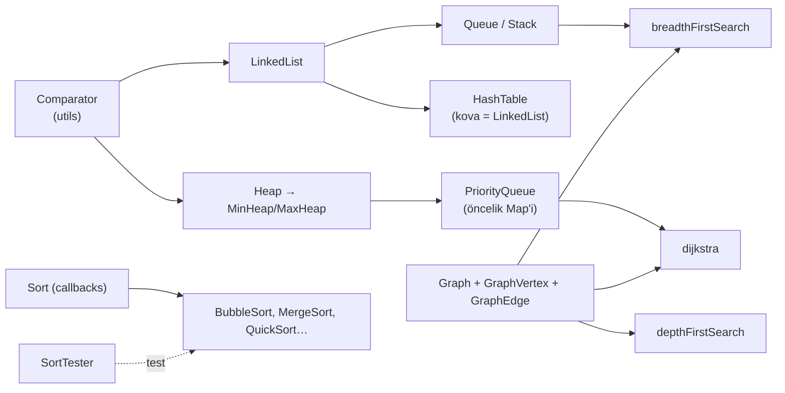
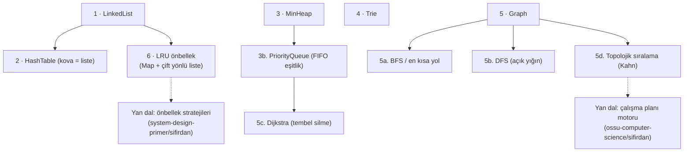

# trekhleb/javascript-algorithms — her yapı için kod, test ve açıklama üçlüsü

> **Dal:** [D09 Bilgisayar bilimi](../README.md) · **Tür:** kod tabanı
> **Dil:** JavaScript · **Lisans:** MIT · **Yıldız:** 196.722 (9 Kasım 2026) · **İncelenen commit:** `85293e3` (2026-07-25)

## 1. Bir bakışta

javascript-algorithms, 14 veri yapısı klasörü ve 14 algoritma kategorisinde yüzlerce yapıyı JavaScript ile uygular;
her klasörde **uygulama + Jest testi + kendi README'si** üçlüsü vardır. README'ler kısa bir açıklama, çizim ve ileri
okuma bağlantıları içerir (111 İngilizce README'nin 56'sında bir YouTube videosu da var); bu yüzden depo bir ders kitabı gibi gezilebilir. Kök README
yapıları zorluk etiketiyle (`B` başlangıç, `A` ileri) ve hem **konuya** hem **paradigmaya** (kaba kuvvet, açgözlü, böl
ve yönet, dinamik programlama, geri izleme, dal ve sınır) göre listeler. Popülerliğinin nedeni bu düzen, %100'e yakın test kapsamı
zorunluluğu ve 18 dile çevrilmiş README'dir; Türkçe çeviri de vardır.

## 2. Nasıl yapılmış: mimari

### Klasör haritası

```text
trekhleb/javascript-algorithms @ 85293e3
├── src/data-structures/                14 yapı: linked-list, doubly-linked-list, queue, stack, deque, hash-table,
│   │                                   heap, priority-queue, trie, tree (bst, avl, red-black, segment, fenwick),
│   │                                   graph, disjoint-set, bloom-filter, lru-cache
│   ├── linked-list/LinkedList.js       uygulama (ES modülü, sınıf)
│   ├── linked-list/__test__/LinkedList.test.js   Jest testi
│   ├── linked-list/README.md           açıklama + sözde kod + karmaşıklık + kaynaklar
│   ├── linked-list/README.tr-TR.md     Türkçe çeviri (bu klasörde var)
│   └── linked-list/images/             çizimler (okso.app)
├── src/algorithms/                     14 kategori: graph, sorting, search, string, math, sets, tree, …
│   ├── graph/dijkstra/dijkstra.js      PriorityQueue + changePriority ile Dijkstra
│   ├── sorting/Sort.js                 tüm sıralamaların ortak tabanı: karşılaştırıcı + visitingCallback
│   └── sorting/SortTester.js           ortak test yardımcıları; ziyaret sayısıyla karmaşıklık testi
├── src/utils/comparator/Comparator.js  her yapının kullandığı karşılaştırma sarmalayıcısı
├── src/playground/                     kendi denemelerin için boş alan + testi
├── README.md, README.xx-XX.md          kök README ve 18 çevirisi (README.tr-TR.md dahil)
├── package.json                        jest, eslint (airbnb), babel, husky; engines: node >=22
├── jest.config.js                      coverageThreshold: satır/fonksiyon %100, dal %95
├── .eslintrc, .babelrc, .nvmrc (v22), .npmrc (engine-strict), .editorconfig
├── .husky/pre-commit                   her commit'te npm run lint
└── .github/workflows/CI.yml            npm i → lint → coverage → Codecov
```

Sayılar (commit `85293e3`): `src` altında test dışı 183 JS dosyası (uygulamalar ve `FourierTester.js` gibi
yardımcılar), 177 test dosyası (`*.test.js`), 111 İngilizce `README.md` ve 126 çeviri README'si (125'i
`README.xx-XX.md` biçiminde, biri `README.pt-br.md`). Kökte ayrıca `README.md` ve 18 çevirisi var.

### Ana bileşenler ve veri akışı



Yapılar birbirinin üstüne kurulur: hash tablosu kovalarında bağlı liste, öncelik kuyruğu min-heap'in alt sınıfı,
Dijkstra öncelik kuyruğunu, BFS kuyruğu kullanır. Grafik algoritmaları `enterVertex`, `leaveVertex`, `allowTraversal`
geri çağrılarını alır; böylece aynı BFS/DFS iskeleti farklı problemlerde (köprü bulma, döngü tespiti) yeniden kullanılır.

### Önce okunacak dosyalar

1. `README.md` — yapıların ve paradigmaların haritası, Büyük-O tabloları.
2. `src/utils/comparator/Comparator.js` — her yapıya özel karşılaştırma vermenin tek noktası.
3. `src/data-structures/linked-list/` — en sade "uygulama + test + README" örneği.
4. `src/data-structures/heap/Heap.js` — dizi üstünde ağaç: `getParentIndex`, `heapifyUp`, `heapifyDown`.
5. `src/data-structures/priority-queue/PriorityQueue.js` — heap'in öncelik Map'iyle genişletilmesi.
6. `src/algorithms/graph/breadth-first-search/breadthFirstSearch.js` — geri çağrılı gezinme iskeleti.
7. `src/algorithms/graph/dijkstra/dijkstra.js` — `hasValue` + `changePriority` ile anahtar azaltma.
8. `src/algorithms/sorting/Sort.js` ve `SortTester.js` — test edilebilir karmaşıklık fikri.
9. `jest.config.js`, `.eslintrc`, `.github/workflows/CI.yml` — kalite kapısının tamamı.

### Teknoloji yığını, derleme, test, CI, sürüm

- **Dil:** ES modülleri (`import`/`export`); Jest için Babel `@babel/preset-env` ile dönüştürülür. Çalışma zamanı
  bağımlılığı yok; yalnızca geliştirme araçları (`devDependencies`).
- **Test:** Jest 30; test dosyaları `__test__/` klasörlerinde durur ve `testRegex` ile bulunur. Desen klasör olarak
  `__tests__` arar, depo ise `__test__` kullanır; dosyaları yakalayan, desenin `.test.js` soneki kısmıdır.
  `coverageThreshold` küresel olarak ifade/fonksiyon/satır %100, dal %95; altına düşen PR CI'da kırmızıdır. CONTRIBUTING de "kodunun %100'ü testle
  kapsanmalı" der.
- **Lint:** ESLint 8 + `eslint-config-airbnb` + `eslint-plugin-jest`; `no-bitwise`, `class-methods-use-this` gibi
  kurallar algoritma koduna uymadığı için kapatılmış.
- **CI:** `.github/workflows/CI.yml` Node 22.x ile `npm i`, `npm run lint`, `npm run coverage` koşar ve Codecov'a yükler.
  Yerelde `husky` her commit'ten önce lint koşar.
- **Sürüm:** `package.json` sürümü `0.0.4`; npm'e paket olarak yayımlanmaz (doğrulanmadı), depo okunmak için vardır.
- **Küçük tutarsızlık:** README "Node `>=16`" der, ama `.nvmrc` `v22` ve `engines` `>=22.0.0`'dır; `.npmrc`'deki
  `engine-strict=true` yüzünden eski Node ile `npm install` reddedilir.

### Tasarım kararları ve ödünleşimler

1. **Klasör başına README.** Açıklama kodun yanında yaşar ve çevrilebilir (`README.xx-XX.md`). Bedeli: `src`
   altındaki 237 README'nin (kökteki 19 hariç) güncel tutulması; çeviriler geride kalır (Türkçe kök README'de 144 madde, İngilizcede 162).
2. **Karmaşıklığı testle ölçmek.** `Sort` sınıfı her ziyarette `visitingCallback` çağırır;
   `SortTester.testAlgorithmTimeComplexity` bu çağrıları sayar (ör. `MergeSort.test.js`'de sıralı dizi için 79
   ziyaret). Böylece "O(n log n)" iddiası somut bir sayıya bağlanır; bedeli, uygulama değişince sabitlerin de
   güncellenmesi.
3. **Okunurluk performanstan önce.** `HashTable` anahtarın karakter kodlarını toplar (yorumunda daha iyi polinom hash
   önerilir); bu yüzden anagramlar hep çakışır. Dijkstra'da `changePriority`, öğeyi heap'te arayıp silip yeniden ekler
   (O(n)). Eğitim için açık, üretim için yavaş.
4. **Ortak karşılaştırıcı.** `Comparator` sayesinde her yapı özel nesnelerle çalışır; testler de bunu kullanır.
5. **Sıkı ama basit kalite kapısı.** Yüksek kapsam eşiği + airbnb lint + husky: katkıcı sayısı artsa da kod tarzı ve
   test disiplini korunur.

## 3. Öğrenmen gerekenler

| Düğüm                                                           | Bu depo için neden                                                   | Ücretsiz kaynak                                                                                       |
| --------------------------------------------------------------- | -------------------------------------------------------------------- | ----------------------------------------------------------------------------------------------------- |
| [G4 JavaScript / TypeScript](../../../govde/README.md#g4)       | ES modülleri, sınıflar, `#private` alanlar, üreteçler, `Map`/`Set`   | [You Don't Know JS dosyası](../../01-web-arayuzu/you-dont-know-js/README.md)                          |
| [G5 Veri yapıları ve algoritmalar](../../../govde/README.md#g5) | Deponun konusu; Büyük-O okuyabilmek                                  | Kök README'deki Büyük-O tabloları; [CIU dosyası](../coding-interview-university/README.md)            |
| [G7 Test, CI ve kod kalitesi](../../../govde/README.md#g7)      | Jest, kapsam eşiği, ESLint, husky, GitHub Actions                    | [Jest belgesi](https://jestjs.io/docs/getting-started), [node:test](https://nodejs.org/api/test.html) |
| [G10 C ve bellek modeli](../../../govde/README.md#g10)          | Dizi ile bağlı listenin bellek farkını, önbellek dostluğunu anlamak  | [OSSU: Nand2Tetris](../ossu-computer-science/README.md)                                               |
| Dal içi: paradigmalar                                           | Aynı problemin kaba kuvvet / açgözlü / DP çözümlerini karşılaştırmak | Kök README "Algorithms by Paradigm" bölümü                                                            |

## 4. Sıfırdan yol (dallanma)



| Aşama | Ne inşa edersin                     | Öğrendiğin kavram                                | Bitti ölçütü                                         | Süre (tahmini) |
| ----- | ----------------------------------- | ------------------------------------------------ | ---------------------------------------------------- | -------------- |
| 1     | `LinkedList` (tail işaretçili)      | İşaretçi güncelleme, sınır durumları             | Baş/orta/kuyruk silme ve `reverse` testleri geçiyor  | 3 saat         |
| 2     | `HashTable` (FNV-1a, yeniden boyut) | Hash, çakışma, doluluk oranı, amortize O(1)      | 100 anahtar büyümede kaybolmuyor                     | 3 saat         |
| 3     | `MinHeap` + `PriorityQueue`         | Dizi üstünde ağaç, siftUp/siftDown, O(n) heapify | 500 rastgele sayı sıralı boşalıyor; eşitlikte FIFO   | 4 saat         |
| 4     | `Trie`                              | Önek paylaşımı, budama, Unicode harf gezme       | `delete` sonrası boş dal kalmıyor                    | 3 saat         |
| 5     | `Graph` + BFS/DFS/Dijkstra/Kahn     | Komşuluk listesi, ziyaret işareti, tembel silme  | İstanbul–Ankara örneği 455 km; döngü yakalanıyor     | 6 saat         |
| 6     | `LRUCache` ve `MapLRUCache`         | İki yapıyı birleştirip O(1) almak, nöbetçi düğüm | Atma sırası ve `has`'in sırayı bozmaması test edildi | 2 saat         |

**Süre özeti:** mini 21 saat, okuma rotası ~8 saat (8 adım × 1 saat), alıştırmalar ~16 saat (2 kolay, 3 orta,
2 zor); toplam **~45 saat**. Hesap kuralı: [dal README'si, "Yapraklar"](../README.md#yapraklar).

**Mini uygulama:** [`sifirdan/`](sifirdan/README.md) — altı modül, Node yerleşikleri dışında bağımlılık yok,
`node:test` ile 31 test. Her dosyanın başında Türkçe açıklama ve Büyük-O tablosu var. Her aşamanın gerçek depodaki
karşılığı (`src/data-structures/…`, `src/algorithms/graph/…`) ve farkları mini'nin eşleme tablosunda.

**Gerçek ölçeğe giden yol:** (1) ağaç ailesi (BST → AVL → kırmızı-siyah; depo bunları `tree/` altında verir),
(2) disjoint set ve Kruskal/Prim, (3) bloom filter, (4) her yapı için README + çizim + çeviri düzeni, (5) Jest ve kapsam
eşiği, (6) `Sort` tabanı gibi "test edilebilir karmaşıklık" kancaları. Üretim düzeyi için ise farklı yön: tipli diziler
(`Int32Array`) ile önbellek dostu heap, `Map` yerine açık adresli hash, d-ary heap.

## 5. Gerçek depoda okuma rotası

1. Kök `README.md`'de bir yapıyı hem "konuya göre" hem "paradigmaya göre" listede bul: neden iki yerde de var?
2. `linked-list/LinkedList.js` → `__test__/LinkedList.test.js`: testler hangi sınır durumlarını yakalıyor?
3. `hash-table/HashTable.js`: `hash()` yorumunu oku; `this.keys` nesnesi neden tutuluyor?
4. `heap/Heap.js`: `new.target === Heap` kontrolü neyi engelliyor? `pairIsInCorrectOrder` alt sınıfta nasıl değişiyor?
5. `priority-queue/PriorityQueue.js` → `graph/dijkstra/dijkstra.js`: `changePriority` maliyeti nedir?
6. `graph/breadth-first-search/breadthFirstSearch.js`: `allowTraversal` geri çağrısı ile ziyaret mantığı nasıl
   dışarıdan değiştiriliyor?
7. `sorting/SortTester.js` ve `merge-sort/__test__/MergeSort.test.js`: ziyaret sayısı sabitleri (79, 102, 87) neyi
   ölçüyor?
8. `jest.config.js` + `CI.yml`: bir PR'ın kırmızı olmasının üç yolu nedir?

## 6. Alıştırmalar ve öz değerlendirme

1. **(kolay)** Mini'deki `LinkedList`'e `removeAt(index)` ekle; baş, kuyruk ve tek elemanlı liste için test yaz.
2. **(kolay)** `charCodeSum` ile çakışan üç farklı Türkçe kelime çifti bul ve testle göster.
3. **(orta)** `PriorityQueue`'ya `changePriority` ekle: heap'te öğenin indeksini bir `Map`'te tutarak O(log n) yap.
4. **(orta)** Mini `Graph`'a Bellman-Ford ekle; negatif döngüyü raporlasın.
5. **(orta)** `Trie`'ye "en uzun ortak önek" ve "harf başına en çok 3 öneri" otomatik tamamlama ekle.
6. **(zor)** Gerçek depodaki gibi ziyaret sayan bir `Sort` tabanı yaz; birleştirme sıralamasının ziyaret sayısını
   n log n ile karşılaştıran bir test yaz.
7. **(zor)** `HashTable`'ı açık adreslemeli (doğrusal yoklama, mezar taşı ile silme) yeniden yaz ve iki sürümü 100.000
   anahtarla zamanla.

<details><summary>Soru 1: Hash tablosunda doluluk oranı aşılınca neden kova sayısını ikiye katlıyoruz?</summary>

Ortalama kova uzunluğu doluluk oranına eşittir; sınırda tutulursa arama ortalama O(1) kalır. İkiye katlamak yeniden
dağıtımı (O(n)) seyrekleştirir: n ekleme boyunca toplam kopyalama 2n'yi geçmez, yani ekleme başına amortize O(1).

</details>

<details><summary>Soru 2: Dijkstra'da "tembel silme" ile "anahtar azaltma" farkı nedir?</summary>

Anahtar azaltma, kuyruktaki kaydın önceliğini yerinde düşürür; bunun için kaydın heap'teki yerini bilmek gerekir.
Tembel silme, yeni mesafeyle ikinci bir kayıt ekler ve heap'ten çıkan eski kaydı "mesafe güncel değil" diye atlar.
Kod basitleşir, heap en fazla E kayıt tutar; toplam karmaşıklık yine O((V + E) log V).

</details>

<details><summary>Soru 3: LRU önbellekte neden hem Map hem çift yönlü bağlı liste kullanılıyor?</summary>

Map anahtarı O(1)'de düğüme götürür; çift yönlü liste o düğümü O(1)'de söküp başa taşımaya ve en eskiyi (kuyruğu)
O(1)'de bulmaya yarar. Tek başına Map sırayı, tek başına liste aramayı hızlı yapamaz.

</details>

<details><summary>Soru 4: Bu depoda karmaşıklık iddiası nasıl "test edilir"?</summary>

`Sort` sınıfı her eleman ziyaretinde `visitingCallback`'i çağırır; testler Jest'in sahte fonksiyonuyla çağrı sayısını
ölçer ve beklenen sabitle karşılaştırır. Sayı, girdinin türüne (sıralı, ters, eşit elemanlı) göre ayrı ayrı sabitlenir.

</details>

## 7. İş fikri tohumları

- **Görsel veri yapısı laboratuvarı:** Kodu adım adım çalıştırıp heap/graf/trie'yi canlandıran Türkçe tarayıcı aracı.
  **Kime:** lise bilişim öğretmenleri ve üniversite birinci sınıf asistanları.
- **Ziyaret sayan test kiti:** Öğrenci kodunun karmaşıklığını işlem sayısıyla puanlayan otomatik değerlendirici.
  **Kime:** kodlama bootcamp'leri ve online kurs platformları.
- **Mülakat simülatörü:** Yapı seç, sınır durumu testlerini geçmeye çalış, Büyük-O'yu açıkla. **Kime:** yazılım
  mülakatına hazırlanan yeni mezunlar.

Tüm fikirler: [is-fikirleri](../../../is-fikirleri/README.md).

## 8. Kaynaklar

- [README.md](https://github.com/trekhleb/javascript-algorithms/blob/85293e3e2b88f4d2ce330d956b139cf628aa1e82/README.md) ·
  [README.tr-TR.md (Türkçe)](https://github.com/trekhleb/javascript-algorithms/blob/85293e3e2b88f4d2ce330d956b139cf628aa1e82/README.tr-TR.md) ·
  [CONTRIBUTING.md](https://github.com/trekhleb/javascript-algorithms/blob/85293e3e2b88f4d2ce330d956b139cf628aa1e82/CONTRIBUTING.md)
- Türkçe klasör README'leri:
  [linked-list](https://github.com/trekhleb/javascript-algorithms/blob/85293e3e2b88f4d2ce330d956b139cf628aa1e82/src/data-structures/linked-list/README.tr-TR.md) ·
  [heap](https://github.com/trekhleb/javascript-algorithms/blob/85293e3e2b88f4d2ce330d956b139cf628aa1e82/src/data-structures/heap/README.tr-TR.md) ·
  [factorial](https://github.com/trekhleb/javascript-algorithms/blob/85293e3e2b88f4d2ce330d956b139cf628aa1e82/src/algorithms/math/factorial/README.tr-TR.md)
- [jest.config.js](https://github.com/trekhleb/javascript-algorithms/blob/85293e3e2b88f4d2ce330d956b139cf628aa1e82/jest.config.js) ·
  [CI.yml](https://github.com/trekhleb/javascript-algorithms/blob/85293e3e2b88f4d2ce330d956b139cf628aa1e82/.github/workflows/CI.yml) ·
  [SortTester.js](https://github.com/trekhleb/javascript-algorithms/blob/85293e3e2b88f4d2ce330d956b139cf628aa1e82/src/algorithms/sorting/SortTester.js)
- Video listesi (README'den): [Data Structures and Algorithms on YouTube](https://www.youtube.com/playlist?list=PLLXdhg_r2hKA7DPDsunoDZ-Z769jWn4R8)
- Node test çalıştırıcısı: [node:test](https://nodejs.org/api/test.html) · Büyük-O özeti: <https://www.bigocheatsheet.com/>
