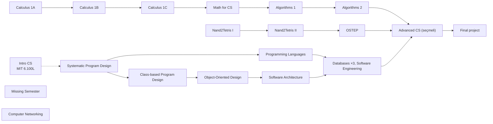
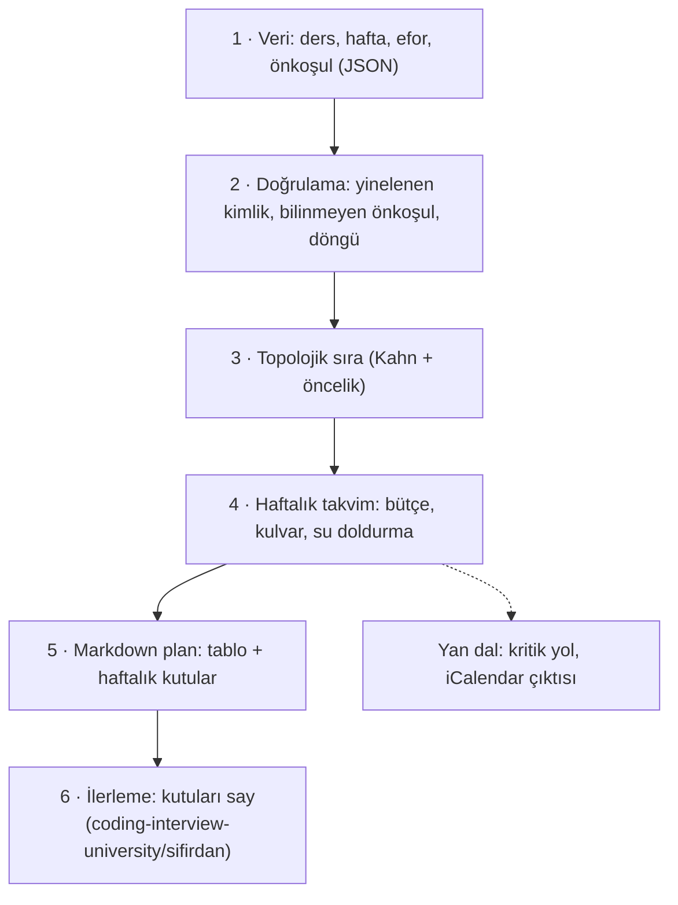

# ossu/computer-science — ücretsiz derslerden kurulmuş bir bilgisayar bilimi lisans müfredatı

> **Dal:** [D09 Bilgisayar bilimi](../README.md) · **Tür:** eğitim içeriği
> **Dil:** Markdown + Jekyll (GitHub "HTML" gösterir) · **Lisans:** MIT · **Yıldız:** 211.010 (9 Kasım 2026) ·
> **İncelenen commit:** `8f8272b` (2026-11-08)

## 1. Bir bakışta

Open Source Society University (OSSU), bir bilgisayar bilimi lisans programının genel kültür dersleri dışındaki
kısmını, açık ve ücretsiz çevrimiçi derslerle karşılar. Müfredat dört katmandır: **Intro CS** (bölümün sana uygun olup
olmadığını dene), **Core CS** (herkesin alması gereken ilk üç yıl), **Advanced CS** (seçmeli uzmanlık) ve **Final
project**. Dersler ACM/IEEE'nin CS2013 müfredat kılavuzuna göre seçilir; her dersin süresi, haftalık eforu ve
önkoşulları tabloda yazar. README'ye göre haftada ~20 saatle yaklaşık 2 yılda bitirilebilir. Popülerliğinin nedeni
"ne çalışayım, hangi sırayla?" sorusuna gerekçeli, topluluk tarafından denetlenen bir cevap vermesidir.

## 2. Nasıl yapılmış: mimari

### Klasör haritası

```text
ossu/computer-science @ 8f8272b
├── README.md                      müfredatın kendisi: 453 satır, bölüm bölüm ders tabloları
├── CURRICULAR_GUIDELINES.md       ACM/IEEE CS2013 (değerlendirme hâlâ CS2013'e göre; CS2023 anılıyor)
├── CONTRIBUTING.md                küçük düzeltme = PR; esaslı değişiklik = RFC issue
├── FAQ.md                         sıra seçenekleri, Coursera'nın ücretsiz erişimi kaldırması (Temmuz 2025)…
├── HELP.md                        Discord ve yardım isteme adabı
├── CHANGELOG.md                   "ruhen" anlamsal sürümleme; günlükteki son sürüm 8.0.0 (2017), v9 incelemesi sürüyor
├── coursepages/                   bazı dersler için ayrıntılı rehber sayfaları
│   ├── intro-cs/, intro-programming/   MIT 6.100L ve ona hazırlık (CS50P…)
│   ├── spd/, class-based/         Systematic Program Design (Racket) → Class-based Program Design (Java)
│   └── ostep/                     OSTEP: "temel" (~80 saat) ve "genişletilmiş" yol, xv6 projeleri
├── extras/                        courses.md, readings.md (system-design-primer burada), other_curricula.md,
│                                  puzzles-practice-plods.md
├── _config.yml, _includes/, _layouts/   Jekyll: remote_theme jekyll/minima, site cs.ossu.dev (CNAME)
├── .github/ISSUE_TEMPLATE/request-for-comment-template.md   RFC şablonu: Problem, Duration, Background, Proposal, Alternatives
└── .github/workflows/delete-empty-issues.yml   boş ya da şablonu doldurulmamış issue'yu yorumlayıp kapatır
```

### Ana bileşenler ve veri akışı

Müfredat bir **önkoşul grafıdır**. Core CS'in özeti (README tablolarındaki "Prerequisites" sütunundan):



Grafın en uzun zinciri matematiktir: Calculus 1A → 1B → 1C → Math for CS → Algorithms 1 → 2 (README'deki hafta ve
efor ortalamalarıyla ~408 saat). FAQ üç ilerleme biçimine izin verir: tablo sırasıyla, bölümleri paralel yürüterek ya da
önkoşullara bakarak kendi sırana göre. İlerleme takibi için önerilen yöntem bir uygulama değil, **fork + ✅**:
depoyu kendi hesabına çatalla, bitirdiğin dersin yanına işaret koy (README "How to show your progress").

### Önce okunacak dosyalar

1. `README.md` > "Summary" — ders seçme ölçütleri, süre, maliyet, süreç.
2. `README.md` > "Curriculum" — her tablonun Duration, Effort, Prerequisites sütunları.
3. `FAQ.md` > "In what order should I take the courses?" ve "Are Coursera courses free to access?".
4. `CURRICULAR_GUIDELINES.md` — neden CS2013, değişiklik önerisi neye dayanmalı.
5. `CONTRIBUTING.md` + `.github/ISSUE_TEMPLATE/request-for-comment-template.md` — müfredat nasıl değişir.
6. `coursepages/ostep/README.md` — bir dersin "temel" ve "genişletilmiş" yolla nasıl uyarlandığı.
7. `CHANGELOG.md` — anlamsal sürümlemenin bir müfredata uyarlanışı.

### Teknoloji yığını, derleme, test, CI, sürüm

- **Site:** GitHub Pages + Jekyll (`remote_theme: "jekyll/minima@7d91bb5"`, alan adı `cs.ossu.dev`). Markdown dosyaları
  doğrudan sayfa olur; `nav_pages` FAQ ve HELP'i menüye koyar.
- **CI:** Tek iş akışı, `delete-empty-issues.yml`: issue gövdesi boşsa ya da RFC şablonunun açıklama cümlesini aynen
  içeriyorsa açıklayıcı bir yorum yazıp kapatır. Eylem tam commit SHA'sına sabitlenmiştir (tedarik zinciri güvenliği).
- **Test:** Yok (bağlantı denetleyicisi de yok; coding-interview-university'de olan lychee iş akışının benzeri burada
  bulunmuyor).
- **Sürüm:** `CHANGELOG.md` "ruhen" semver: MAJOR = çalışılan konular değişti, MINOR = ders değişti ama konu aynı,
  PATCH = sıra ya da biçim. Günlükteki son sürüm 8.0.0 (2017-11-01); v9 için RFC'ler tamamlandıkça değişiklikler doğrudan
  uygulanıyor.

### Tasarım kararları ve ödünleşimler

1. **Dış ölçüt: CS2013.** "Bu ders neden burada?" sorusu kişisel zevke değil, mesleki bir kılavuza dayanır; eleştiriler
   de "kılavuzun şu konusunu karşılamıyor" biçiminde yapılmalıdır.
2. **Ders seçme ölçütleri:** açık kayıt, düzenli açılma (tercihen kendi hızında), kaliteli materyal, CS2013 uyumu.
   Uygun ders yoksa kitap. Bedeli: platformlar değiştikçe müfredat da değişmek zorunda kalır.
3. **"Malzeme ücretsiz olmalı" ilkesi ve Coursera kırılması.** FAQ'e göre Coursera Temmuz 2025'te ücretsiz izleme
   (audit) erişimini büyük ölçüde kaldırdı; OSSU artık Coursera derslerini önermediğini ve yerine ücretsiz
   alternatifler aradığını yazıyor. Tablolarda hâlâ Coursera bağlantıları var: Software Architecture, Nand2Tetris I ve
   II (I için nand2tetris.org alternatifi verilmiş), Core security'deki beş dersin dördü ve Core ethics'in üç dersi.
   Bunlar geçiş dönemi.
4. **RFC ile yönetişim.** Esaslı değişiklik bir aylık tartışma süreli RFC issue'su ister; boş issue'ları bot kapatır.
   Bedeli: yavaşlık; kazancı: tutarlılık ve gerekçeli tarih.
5. **Uygulama değil Markdown.** README, eski bir Firebase uygulamasının ve Trello panosunun artık bakımsız olduğunu
   uyarır; tek doğru kaynak depo ve site. İlerleme takibi fork + işaretle yapılır.
6. **İngilizce varsayımı.** FAQ, müfredatın "makul düzeyde akıcı İngilizce" ve lise matematiği varsaydığını açıkça
   yazar. Depoda Türkçe çeviri yoktur; Türkçe destek için gövdedeki Türkçe kaynaklar ve bu dalın dosyaları var.

## 3. Öğrenmen gerekenler

| Düğüm                                                                             | Bu müfredat için neden                          | Ücretsiz kaynak                                                                 |
| --------------------------------------------------------------------------------- | ----------------------------------------------- | ------------------------------------------------------------------------------- |
| [G1 Terminal](../../../govde/README.md#g1), [G2 Git](../../../govde/README.md#g2) | CS Tools (Missing Semester); ilerleme için fork | <https://missing.csail.mit.edu/>                                                |
| [G3 Python](../../../govde/README.md#g3)                                          | Intro CS (MIT 6.100L) Python ile                | [Python-100-Days dosyası](../python-100-days/README.md) (Çince)                 |
| [G5 Veri yapıları ve algoritmalar](../../../govde/README.md#g5)                   | Core theory (Algorithms 1–2)                    | [coding-interview-university dosyası](../coding-interview-university/README.md) |
| [G6 Ağ ve web temelleri](../../../govde/README.md#g6)                             | Computer Networking: a Top-Down Approach        | [system-design-primer dosyası](../system-design-primer/README.md)               |
| [G10 C ve bellek modeli](../../../govde/README.md#g10)                            | Nand2Tetris, OSTEP (C okuma, işaretçi)          | [linux dosyası](../../03-sistem-ag-guvenlik/linux/README.md)                    |
| Dal içi: önkoşul grafı, topolojik sıra                                            | Kendi takvimini kurmak                          | Bu dosyadaki mini                                                               |

## 4. Sıfırdan yol (dallanma)

OSSU'nun "kodu" yoktur; yeniden kurulacak şey onun **planlama mantığıdır**: README'deki tabloları bir veri dosyasına,
önkoşulları bir grafa, grafı da kişisel bir takvime çevirmek. (README'nin önerdiği tahmin tablosunun programlanmış hâli.)



| Aşama | Ne inşa edersin                 | Öğrendiğin kavram                               | Bitti ölçütü                                      | Süre (tahmini) |
| ----- | ------------------------------- | ----------------------------------------------- | ------------------------------------------------- | -------------- |
| 1     | `veri/ossu.json` (30 ders)      | Tabloyu veriye çevirmek, metin önkoşulu ayırmak | Toplam 1.697,5 saat, README ile tutarlı           | 2 saat         |
| 2     | `mufredat.dogrula`, `dongu_bul` | Üç renkli DFS, döngü yolunu raporlamak          | Döngü testi yolu (a → b → c → a) gösteriyor       | 2 saat         |
| 3     | `mufredat.topolojik_sira`       | Kahn algoritması, öncelik kuyruğuyla eşitlik    | Önkoşullar önce; zorunlu seçmeliden önce          | 2 saat         |
| 4     | `takvim.haftalik_plan`          | Liste zamanlama, kulvar, su doldurma            | Hiçbir ders önkoşulu bitmeden başlamıyor (testli) | 4 saat         |
| 5     | `plan_yaz.py`                   | Markdown/Prettier uyumlu tablo, Türkçe tarih    | Örnek plan birebir yeniden üretiliyor             | 3 saat         |
| 6     | `ilerleme.py` (CIU klasöründe)  | Metin ayrıştırma, düzenli ifade                 | Plan dosyasının kutuları sayılıyor                | 2 saat         |

**Süre özeti:** mini 15 saat, okuma rotası ~8 saat (8 adım × 1 saat), alıştırmalar ~16 saat (2 kolay, 3 orta,
2 zor); toplam **~39 saat**. Müfredatın kendisi bu toplama girmez: Intro + Core CS ~1.700 saat, tüm müfredat README'ye
göre haftada ~20 saatle ~2 yıl. Hesap kuralı: [dal README'si, "Yapraklar"](../README.md#yapraklar).

**Mini uygulama:** [`sifirdan/`](sifirdan/README.md) — çalışma planı motorunun planlama yarısı (25 test). Örnek çıktı:
[12 aylık Türkçe plan](sifirdan/ornek-plan-12-ay.md); özeti dal README'sinde. İlerleme yarısı:
[coding-interview-university/sifirdan](../coding-interview-university/sifirdan/README.md). Her parçanın OSSU'daki
karşılığı mini'nin eşleme tablosunda.

**Gerçek ölçeğe giden yol:** (1) Advanced CS ve Final project derslerini veriye eklemek, (2) "birini seç" gruplarını
(ör. C/C++ ya da Java güvenlik dersi) veri modelinde ifade etmek, (3) tatil ve sınav haftalarını takvimden düşmek,
(4) iCalendar (`.ics`) çıktısı, (5) ilerleme dosyasından gerçek hızı ölçüp kalan planı yeniden hesaplamak.

## 5. Gerçek depoda okuma rotası

1. `README.md` "Summary": ders seçme ölçütlerinin dördünü kendi cümlenle yaz.
2. Core math tablosu: Calculus zincirini ve Math for CS'in önkoşulunu bul; zinciri saat olarak hesapla.
3. Core systems tablosu: Nand2Tetris I'in önkoşulu bir ders değil "C-like programming language"; grafta bunu nasıl
   temsil ederdin? (Mini'de `onkosul_metni` alanı.)
4. `FAQ.md`: Coursera bölümünü oku; tablolarda Coursera bağlantılı dersleri say.
5. `coursepages/ostep/README.md`: temel ve genişletilmiş yolun saat farkı nedir?
6. `CONTRIBUTING.md` + RFC şablonu: bir dersi değiştirme önerisi hangi beş başlığı doldurmalı? "Duration" neden
   genellikle bir ay?
7. `.github/workflows/delete-empty-issues.yml`: `if:` koşulu hangi iki durumu yakalıyor?
8. `extras/readings.md`: system-design-primer'in hangi bölümde önerildiğini bul.

## 6. Alıştırmalar ve öz değerlendirme

1. **(kolay)** `python3 plan_yaz.py veri/ossu.json --karsilastir 10,15,20,25` çalıştır; README'deki "20 saatle ~2 yıl"
   iddiasıyla karşılaştır (Core'un tamamı vs. Advanced dahil).
2. **(kolay)** `veri/turkce-12-ay.json`'da `math-for-cs` önkoşulunu `calc-1c` zincirine bağla (ders ekleyerek) ve planın
   kaç hafta uzadığına bak.
3. **(orta)** Kritik yol: sonsuz paralellikte bile en az kaç saat gerektiğini (en uzun önkoşul zinciri) hesaplayan bir
   fonksiyon yaz; OSSU verisinde ~408 saat bulmalısın.
4. **(orta)** Takvime `tatil_haftalari` parametresi ekle (bayram haftalarında bütçe sıfır).
5. **(orta)** Ders başına haftalık üst sınır ekle (OSSU verisindeki `saat_max`); 40 saat/hafta ile planın neden artık
   yarıya inmediğini göster.
6. **(zor)** İlerleme dosyasındaki işaretli kutulardan gerçek haftalık hızını hesaplayıp kalan dersleri yeniden
   planlayan "yeniden planla" komutu yaz (iki mini'yi birleştir).
7. **(zor)** OSSU için bir RFC taslağı yaz: Coursera'ya bağlı bir dersin ücretsiz alternatifini CS2013 konularıyla
   gerekçelendir.

<details><summary>Soru 1: Ders sırası neden "topolojik sıralama" problemidir?</summary>

Dersler düğüm, "A, B'nin önkoşulu" ilişkileri yönlü kenardır. Geçerli bir çalışma sırası, her kenarın kaynağını
hedefinden önce koyan bir dizilimdir; bu tam olarak döngüsüz yönlü grafın topolojik sıralamasıdır. Döngü varsa (A, B'yi;
B, A'yı istiyorsa) hiçbir geçerli sıra yoktur; bu yüzden önce döngü denetlenir.

</details>

<details><summary>Soru 2: Haftalık saati ikiye katlamak süreyi her zaman yarıya indirir mi?</summary>

Mini'nin modelinde neredeyse evet (15 → 30 saat: 52 → 26 hafta), çünkü bir derse haftada sınırsız saat verilebiliyor.
Gerçekte bir ders haftada belli bir saatten fazlasını verimli almaz (OSSU tablosundaki eforun üst sınırı) ve önkoşul
zincirleri paralelleşemez. En uzun zincir (kritik yol) OSSU Core'da ~408 saat, Türkçe 12 aylık planda 236 saattir;
ders başına haftalık bir üst sınır varsa toplam süre, bu zincirdeki derslerin "saat / üst sınır" toplamından kısa
olamaz. Bir noktadan sonra saat eklemek takvimi kısaltmaz.

</details>

<details><summary>Soru 3: OSSU neden bir uygulama yerine "fork + işaret" öneriyor?</summary>

Bakım maliyeti sıfıra yakın, veri öğrencinin kendi hesabında ve müfredat değişince `git pull upstream` ile
güncellenebilir. README, geçmişte yapılan Firebase uygulamasının ve Trello panosunun bakımsız kaldığını uyarıyor.

</details>

## 7. İş fikri tohumları

- **Kişisel müfredat planlayıcı:** OSSU/CIU verisinden haftalık Türkçe plan, takvim entegrasyonu ve ilerleme hatırlatıcı.
  **Kime:** tam zamanlı çalışırken bilgisayar bilimine geçmek isteyen Türk mühendisler (makine, endüstri, elektrik).
- **Çalışma grubu (kohort) işletmesi:** OSSU derslerini 12 haftalık Türkçe kohortlarla, haftalık canlı oturumla yürütmek.
  **Kime:** bootcamp sonrası temeli eksik hisseden yeni geliştiriciler.
- **Kurumsal yetenek haritası:** Ekip üyelerinin müfredat ilerlemesini CS2013 alanlarına göre gösteren pano.
  **Kime:** junior ağırlıklı yazılım ekiplerinin mühendislik yöneticileri.

Tüm fikirler: [is-fikirleri](../../../is-fikirleri/README.md).

## 8. Kaynaklar

- [README.md](https://github.com/ossu/computer-science/blob/8f8272b1d378d31494240aa1d667aa6b045c6552/README.md) ·
  [FAQ.md](https://github.com/ossu/computer-science/blob/8f8272b1d378d31494240aa1d667aa6b045c6552/FAQ.md) ·
  [CURRICULAR_GUIDELINES.md](https://github.com/ossu/computer-science/blob/8f8272b1d378d31494240aa1d667aa6b045c6552/CURRICULAR_GUIDELINES.md) ·
  [CONTRIBUTING.md](https://github.com/ossu/computer-science/blob/8f8272b1d378d31494240aa1d667aa6b045c6552/CONTRIBUTING.md)
- [coursepages/ostep/README.md](https://github.com/ossu/computer-science/blob/8f8272b1d378d31494240aa1d667aa6b045c6552/coursepages/ostep/README.md) ·
  [CHANGELOG.md](https://github.com/ossu/computer-science/blob/8f8272b1d378d31494240aa1d667aa6b045c6552/CHANGELOG.md)
- Site: <https://cs.ossu.dev> · CS2013: [ACM/IEEE Curriculum Guidelines](https://www.acm.org/binaries/content/assets/education/cs2013_web_final.pdf)
- **Türkçe çeviri:** Depoda yok (dosya listesinde ve README'de çeviri bağlantısı bulunmadı).
- Türkçe tamamlayıcılar: gövdedeki Türkçe kaynak listesi ([govde](../../../govde/README.md)) ve
  [free-programming-books dosyası](../../10-kuratorluk-topluluk/free-programming-books/README.md).
