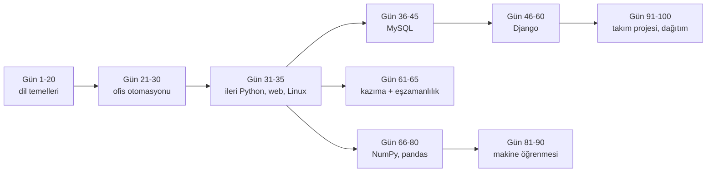
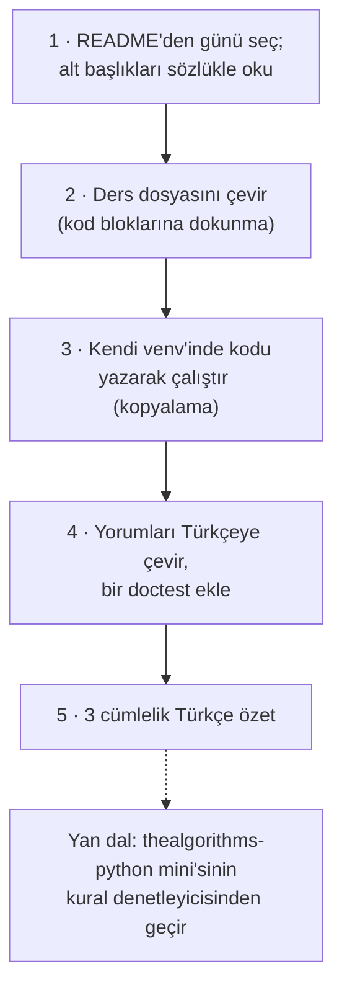

# jackfrued/Python-100-Days — "100 günde acemiden ustaya" Çince Python müfredatı

> **Dal:** [D09 Bilgisayar bilimi](../README.md) · **Tür:** eğitim içeriği
> **Dil:** Çince Markdown + Python (GitHub "Jupyter Notebook" gösterir) · **Lisans:** belirtilmemiş (LICENSE dosyası
> yok; varsayılan olarak tüm hakları saklı) · **Yıldız:** 187.774 (9 Kasım 2026) · **İncelenen commit:** `44b2575` (2026-07-29)

## 1. Bir bakışta

Python-100-Days, Luo Hao'nun (骆昊) Python'u sıfırdan başlayıp web geliştirme, veri toplama, veri analizi, makine
öğrenmesi ve takım projesine kadar götüren **gün gün** bir müfredatıdır: her gün bir Markdown ders dosyası, yanında örnek
kodlar ve görseller. İlk 20 gün dil temelleri, sonra dosya/Excel/PDF otomasyonu, MySQL, Django, web kazıma ve
eşzamanlılık, NumPy/pandas, makine öğrenmesi ve son 10 günde Docker, API tasarımı, test, dağıtım ve mülakat soruları.
Çin'de Python öğrenmeye başlayanların en bilinen yol haritalarındandır; değeri, kapsamının genişliği ve her konunun
çalışan örnekle gelmesidir. Türkçe okuyucu için: gövdedeki [G3 Python](../../../govde/README.md#g3) düğümünün
alıştırma zengini ikinci kaynağı ve "Python ile neler yapılır" haritası.

## 2. Nasıl yapılmış: mimari

### Klasör haritası

```text
jackfrued/Python-100-Days @ 44b2575
├── README.md                   gün gün içindekiler (103 göreli ders bağlantısı), kariyer notları, tanıtımlar
├── Day01-20/                   Python dili: değişken, dallanma, döngü, liste/demet/dize/küme/sözlük, fonksiyon, OOP
├── Day21-30/                   uygulama: dosya ve istisna, serileştirme, CSV, Excel, Word/PowerPoint, PDF, görüntü,
│                               e-posta/SMS, düzenli ifade
├── Day31-35/                   Python ileri konular, web ön yüzüne giriş, Linux (code/ altında example01..)
├── Day36-45/                   ilişkisel veritabanı ve MySQL: DDL/DML/DQL/DCL, görünüm, indeks, Python ile MySQL, Hive
├── Day46-60/                   Django: model, Ajax, çerez/oturum, ara katman, DRF ile REST, önbellek, eşzamansız iş,
│                               birim test, yayına alma
├── Day61-65/                   web kazıma: requests, HTML ayrıştırma, çoklu iş parçacığı/süreç/asyncio, Selenium, Scrapy
├── Day66-80/                   veri analizi: NumPy (4 gün), pandas (6 gün), görselleştirme (3 gün); code/ altında .ipynb
├── Day81-90/                   makine öğrenmesi: k-NN, karar ağacı, Naive Bayes, regresyon, K-Means, sinir ağı, NLP
├── Day91-100/                  takım projesi: Docker, MySQL optimizasyonu, API tasarımı, test, e-ticaret, dağıtım, mülakat
├── 公开课/                      açık dersler: algoritmaya giriş (2 sunum), "iyi kod" dersi (Java + Python örnekleri)
├── 番外篇/                      ekler: PEP 8, Python'un Zen'i, eşyordam örneği, anti-kazıma önlemleri, kitap önerileri
├── res/                        README görselleri
├── Python学习资源汇总.md        kaynak listesi: eğitimler, videolar, kitaplar (veri, ML, büyük modeller, test)
└── 更新日志.md                  değişiklik günlüğü (son kayıt 7 Aralık 2025)
```

Dosya türleri (commit `44b2575`): 125 `.md`, 61 `.py`, 12 `.sql`, 9 `.java`, 7 `.ipynb`; ayrıca `公开课` altında
IntelliJ'nin derleme çıktısı (`out/production/…/*.class`, 6 dosya) ve `.pptx`/`.key` sunumlar depoya girmiş.

### Ana bileşenler ve veri akışı

Bir program değil, bir okuma sırası:



Her ders dosyası aynı kalıptadır: kısa motivasyon, adım adım kod blokları (yorumlar Çince), "说明" (açıklama) kutuları
ve çoğu zaman bir "实战" (uygulama) örneği. Dokuz bölüm klasörünün hepsinde `res/` (görseller) vardır; ayrı bir `code/`
(çalıştırılabilir örnekler) klasörü yalnızca üçünde bulunur (Day31-35, Day36-45, Day66-80). Diğer bölümlerde kod, ders
dosyasındaki kod bloklarındadır.

### Önce okunacak dosyalar

1. `README.md` — içindekiler; her günün alt başlıkları README'de listelenir (dosyayı açmadan kapsamı görürsün).
2. `Day01-20/14.函数和模块.md` — tipik bir ders: faktöriyel örneğiyle fonksiyon, konumsal/anahtar kelimeli parametre,
   `/` ve `*` ile parametre türleri.
3. `Day31-35/31.Python语言进阶.md` — veri yapıları ve algoritmalara (sıralama, arama) Python'dan bakış.
4. `Day61-65/63.Python中的并发编程-1.md` (… `-3`) — iş parçacığı, süreç, asyncio.
5. `Day91-100/99.面试中的公共问题.md` — mülakat soruları.
6. `更新日志.md` — içeriğin ne zaman yenilendiği (Ocak 2025'te 1–30. günler yeniden yazılmış).

### Teknoloji yığını, derleme, test, CI, sürüm

- **İçerik:** Markdown + Python örnekleri + birkaç Jupyter defteri ve SQL betiği. Bağımlılık listesi yok; her bölüm kendi
  kütüphanelerini metin içinde anlatır (openpyxl, Django, requests, Scrapy, NumPy, pandas, scikit-learn…).
- **Test ve CI:** Yok. `.github/` klasörü yok; örnekler otomatik olarak çalıştırılmıyor.
- **Bağlantı sağlığı:** README'deki 103 göreli ders bağlantısından 3'ü kırık (commit `44b2575`): 23. gün (klasör öneki
  yok), 24. gün (bağlantı "用Python读写Excel", dosya "Python读写Excel") ve 95. gün (bağlantının içinde bir sekme
  karakteri). Basit bir bağlantı denetleyicisi (CIU'daki lychee iş akışı gibi) bunları yakalardı.
- **Sürüm:** Yok; değişiklikler `更新日志.md`'ye tarihli maddelerle yazılır.

### Tasarım kararları ve ödünleşimler

1. **Gün birimi.** "100 gün" çerçevesi motivasyon verir ve içeriği yönetilebilir parçalara böler; ama günlerin yükü çok
   farklıdır (bir gün bir fonksiyon kavramı, bir gün tüm Django ara katmanı).
2. **Genişlik.** Dil temelinden makine öğrenmesine kadar her şey tek depoda: harita olarak güçlü, derinlik için ek kaynak
   gerekir.
3. **Kod depoya, test yok.** Örnekler okunmak ve elle çalıştırılmak için; kırık bağlantılar ve depoya girmiş derleme
   çıktıları (`.class`) bakımın el ile yapıldığını gösterir.
4. **Lisans yok, tanıtım var.** README'de bir kurs ("FDE 实战课"), ücretli WeChat grubu ve Zhihu/Bilibili kanallarının
   tanıtımı bulunur; lisans dosyası olmadığı için içerik çevrilip yeniden yayımlanamaz, yalnızca okunabilir.
5. **Öğüt kısmı.** README'nin "yeni başlayanlara" maddeleri dikkat çekici: "İngilizceyi çalışma dilin yap", "pratik
   ustalaştırır", "yapay zekâyı verimliliğin için kullan".

## 3. Öğrenmen gerekenler

| Düğüm / beceri                                          | Neden                                                 | Kaynak                                                                                 |
| ------------------------------------------------------- | ----------------------------------------------------- | -------------------------------------------------------------------------------------- |
| [G1 Terminal](../../../govde/README.md#g1)              | `python3`, `venv`, `pip`; 34–35. günler Linux         | <https://missing.csail.mit.edu/>                                                       |
| [G3 Python](../../../govde/README.md#g3)                | Deponun ana konusu                                    | [Python resmi eğitimi](https://docs.python.org/3/tutorial/) (Türkçe kaynaklar gövdede) |
| Çince okuma yardımcısı                                  | Tüm metin Çince                                       | Aşağıdaki iş akışı; [CS-Notes dosyasındaki sözlük](../cs-notes/README.md)              |
| [G9 Açık kaynak ve lisans](../../../govde/README.md#g9) | Lisansı olmayan içerikle ne yapılabilir, ne yapılamaz | [choosealicense.com: No License](https://choosealicense.com/no-permission/)            |

## 4. Sıfırdan yol (dallanma)

Bu yaprak için ayrı bir mini yok: depo tek bir program değil, günlük Çince derslerden oluşan bir eğitim dizisi. Sıfırdan
yol, Çince ders dosyasını **çalıştırılabilir Türkçe notlara** çevirmektir:



| Aşama | Ne yaparsın                          | Öğrendiğin                      | Bitti ölçütü                      | Süre (tahmini) |
| ----- | ------------------------------------ | ------------------------------- | --------------------------------- | -------------- |
| 1     | 14. gün: 函数和模块                  | Kapsamı başlıklardan çıkarmak   | Alt başlıklar Türkçe listelendi   | 0,2 saat       |
| 2     | Dosyayı tarayıcı ya da LLM ile çevir | Çeviriyi denetlemek             | Kod blokları bozulmadı            | 0,5 saat       |
| 3     | Örnekleri elle yaz ve çalıştır       | Okuyarak değil yazarak öğrenmek | Her örnek kendi makinende çalıştı | 1 saat         |
| 4     | Türkçe yorum + doctest               | Kodu belgelemek                 | `python3 -m doctest -v` geçiyor   | 0,5 saat       |
| 5     | Özet                                 | Anlamayı yazıya dökmek          | Kaynağa bakmadan 3 cümle          | 0,25 saat      |

Bir tur (bir gün) ~2,45 saat sürer; bu yaprağın önerdiği kapsam 1–20. günlerdir.

**Süre özeti:** iş akışı 20 gün × 2,45 ≈ 49 saat, okuma rotası ~7 saat (7 adım × 1 saat), alıştırmalar ~10 saat
(2 kolay, 2 orta, 1 zor); toplam **~66 saat**. Python'u zaten biliyorsan bu yaprak isteğe bağlıdır: 12 aylık plandaki
`python-tekrar` kalemi (24 saat) yalnızca seçme günlerle yapılan kısa bir tekrardır. Hesap kuralı:
[dal README'si, "Yapraklar"](../README.md#yapraklar).

**Python terimleri sözlüğü** (CS-Notes sözlüğüne ek):

| 中文      | Türkçe                 | 中文          | Türkçe                     |
| --------- | ---------------------- | ------------- | -------------------------- |
| 变量      | değişken               | 异常          | istisna                    |
| 运算符    | işleç                  | 正则表达式    | düzenli ifade              |
| 分支/循环 | dallanma / döngü       | 序列化        | serileştirme               |
| 列表      | liste                  | 爬虫          | kazıyıcı (web crawler)     |
| 元组      | demet (tuple)          | 并发编程      | eşzamanlı programlama      |
| 字符串    | dize (string)          | 多线程/多进程 | çoklu iş parçacığı / süreç |
| 集合/字典 | küme / sözlük          | 异步          | eşzamansız                 |
| 函数/模块 | fonksiyon / modül      | 数据分析      | veri analizi               |
| 面向对象  | nesne yönelimli        | 机器学习      | makine öğrenmesi           |
| 入门/进阶 | giriş / ileri düzey    | 实战          | uygulama (pratik)          |
| 三方库    | üçüncü taraf kütüphane | 部署/上线     | dağıtım / yayına alma      |

**Gerçek ölçeğe giden yol:** İlk 20 günü bu yolla bitirdikten sonra sözlüğün iki katına çıkar; ardından yalnızca
hedefinle ilgili bölümleri seç (veri: 66–90, web: 46–60 ve 91–100). Notlarını kendi deponda tut; lisans olmadığı için
çevirilerini **yayımlama**, kendi cümlelerinle yazdığın özetler ise senindir.

## 5. Gerçek depoda okuma rotası

1. `README.md`: "Python应用领域和职业发展分析" bölümündeki alanları ve README'nin uyarısını ("爬虫工程师（不推荐此赛道！！！）",
   kazıma mühendisliği önerilmiyor) bul.
2. `Day01-20/`: dosya adlarını sözlükle oku; G3 öğrenme hedefleriyle eşleştir (aşağıdaki tablo).
3. `Day21-30/23.Python读写CSV文件.md`: README'deki bağlantının neden kırık olduğunu bul (klasör öneki).
4. `Day31-35/31.Python语言进阶.md`: sıralama ve arama örneklerini thealgorithms-python mini'siyle karşılaştır.
5. `Day61-65/`: kazıma ve eşzamanlılık bölümlerini oku; robots.txt ve kullanım koşulları için
   [firecrawl dosyasına](../../04-veri-araclari-otomasyon/firecrawl/README.md) bak.
6. `番外篇/PEP8风格指南.md`: PEP 8 kurallarını TheAlgorithms'in ruff yapılandırmasıyla karşılaştır.
7. `更新日志.md`: hangi bölümler 2025'te yeniden yazılmış?

### Bölümlerin gövde ve dallarla eşleşmesi

| Python-100-Days bölümü                      | Gövde düğümü                                                                                                 | İlgili dal / dosya                                                                                                             |
| ------------------------------------------- | ------------------------------------------------------------------------------------------------------------ | ------------------------------------------------------------------------------------------------------------------------------ |
| Gün 1–20 dil temelleri                      | [G3](../../../govde/README.md#g3)                                                                            | —                                                                                                                              |
| Gün 21–30 dosya, Excel, PDF, e-posta, regex | [G3](../../../govde/README.md#g3)                                                                            | [markitdown (belge dönüştürme)](../../04-veri-araclari-otomasyon/markitdown/README.md)                                         |
| Gün 31–35 ileri Python, web, Linux          | [G3](../../../govde/README.md#g3), [G4](../../../govde/README.md#g4) (JS), [G1](../../../govde/README.md#g1) | [D01 Web arayüzü](../../01-web-arayuzu/README.md) (HTML, CSS, DOM; gövdede düğümü yok)                                         |
| Gün 36–45 MySQL                             | [G5](../../../govde/README.md#g5) (indeks = B+ ağacı)                                                        | [system-design-primer](../system-design-primer/README.md) "Database"                                                           |
| Gün 46–60 Django, REST, önbellek, test      | [G6](../../../govde/README.md#g6), [G7](../../../govde/README.md#g7)                                         | [system-design-primer](../system-design-primer/README.md) "Cache", "REST"                                                      |
| Gün 61–65 kazıma, eşzamanlılık              | [G6](../../../govde/README.md#g6)                                                                            | [firecrawl](../../04-veri-araclari-otomasyon/firecrawl/README.md), [yt-dlp](../../04-veri-araclari-otomasyon/yt-dlp/README.md) |
| Gün 66–90 NumPy, pandas, makine öğrenmesi   | [G3](../../../govde/README.md#g3)                                                                            | [D05 Yapay zekâ altyapısı](../../05-yapay-zeka-altyapisi/README.md)                                                            |
| Gün 91–100 Docker, API, test, dağıtım       | [G1](../../../govde/README.md#g1), [G6](../../../govde/README.md#g6), [G7](../../../govde/README.md#g7)      | [D04](../../04-veri-araclari-otomasyon/README.md)                                                                              |
| 公开课 algoritma sunumları                  | [G5](../../../govde/README.md#g5)                                                                            | [thealgorithms-python](../thealgorithms-python/README.md)                                                                      |

## 6. Alıştırmalar ve öz değerlendirme

1. **(kolay)** 1–20. günlerin dosya adlarını Türkçeye çevir ve G3 öğrenme hedefleri listesiyle eşleştir.
2. **(kolay)** README'deki göreli bağlantıları denetleyen 20 satırlık bir Python betiği yaz; üç kırık bağlantıyı bul.
3. **(orta)** 14. günün örneklerini Türkçe yorumlu ve doctest'li bir modüle dönüştür; thealgorithms-python mini'sindeki
   `kurallari_denetle.py`'den geçir.
4. **(orta)** 63. günün iş parçacığı / süreç / asyncio örneklerini aynı I/O görevinde zamanla ve sonucu yorumla.
5. **(zor)** 61–65. günlerdeki kazıyıcıyı yalnızca yerel bir `http.server`'a karşı çalışacak, robots.txt'e uyan ve hız
   sınırlayan (system-design-primer mini'sindeki `TokenBucket`) bir sürüme dönüştür.

<details><summary>Soru 1: Lisansı olmayan bir depodaki içeriği Türkçeye çevirip blogumda yayımlayabilir miyim?</summary>

Hayır. Lisans yoksa telif hakkı varsayılan olarak yazarındır; okuyabilirsin ama çoğaltma, çeviri ve yeniden yayım için
izin gerekir. Kendi cümlelerinle yazdığın özetler ve kendi kodun ise senindir (bkz. G9).

</details>

<details><summary>Soru 2: Depoya derleme çıktısı (.class) girmesi neden kötü bir alışkanlık?</summary>

Kaynaktan her zaman yeniden üretilebilen dosyalar depoyu şişirir, gereksiz değişiklik gürültüsü yaratır ve kaynakla
uyumsuz kalabilir. Doğrusu `.gitignore`'a eklemektir (`out/`, `*.class`); bu dalın mini'leri de `__pycache__/`'yi böyle
dışarıda tutar.

</details>

<details><summary>Soru 3: Bu depo CS-Notes'tan nasıl ayrılır?</summary>

Python-100-Days bir dil ve uygulama müfredatıdır (Python ile bir şeyler yapmak); CS-Notes ise mülakat odaklı bilgisayar
bilimi notlarıdır (işletim sistemi, ağ, sistem tasarımı). Birincisi G3'ü, ikincisi G5/G6/G10'u besler.

</details>

## 7. İş fikri tohumları

- **Türkçe "100 gün" kohortu:** Özgün Türkçe içerikle (çeviri değil) 100 günlük Python programı ve günlük kod
  incelemesi. **Kime:** kariyer değiştirmek isteyen yetişkinler ve meslek yüksekokulu öğrencileri.
- **Ofis otomasyonu atölyesi:** 21–30. günlerin konularını (Excel, PDF, e-posta) KOBİ çalışanlarına uyarlayan kısa
  eğitimler. **Kime:** muhasebe ve operasyon ekipleri.

Tüm fikirler: [is-fikirleri](../../../is-fikirleri/README.md).

## 8. Kaynaklar

- [README.md](https://github.com/jackfrued/Python-100-Days/blob/44b2575bf42a02d0a38d9dada3f60335c95c5ec2/README.md) ·
  [更新日志.md](https://github.com/jackfrued/Python-100-Days/blob/44b2575bf42a02d0a38d9dada3f60335c95c5ec2/%E6%9B%B4%E6%96%B0%E6%97%A5%E5%BF%97.md)
- **Türkçe çeviri:** Yok (dosya listesinde ve README'de Türkçe bulunmadı).
- Python belgeleri: [Python Tutorial](https://docs.python.org/3/tutorial/) · [PEP 8](https://peps.python.org/pep-0008/)
- Lisanssız içerik: [GitHub Docs: Licensing a repository](https://docs.github.com/en/repositories/managing-your-repositorys-settings-and-features/customizing-your-repository/licensing-a-repository)
