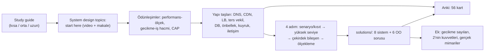
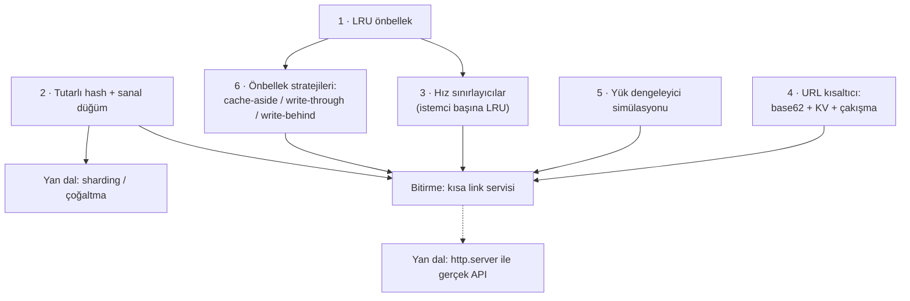

# donnemartin/system-design-primer — büyük ölçekli sistem tasarımının tek dosyalık ders kitabı

> **Dal:** [D09 Bilgisayar bilimi](../README.md) · **Tür:** eğitim içeriği
> **Dil:** Markdown (+ Python taslakları) · **Lisans:** CC BY 4.0 (LICENSE.txt; GitHub bunu "NOASSERTION" gösterir) ·
> **Yıldız:** 377.399 (9 Kasım 2026) · **İncelenen commit:** `ae9bbd7` (2026-03-19)

## 1. Bir bakışta

System Design Primer, ölçeklenebilir sistemlerin yapı taşlarını (DNS, CDN, yük dengeleyici, replikasyon, sharding,
önbellek, kuyruk, RPC/REST…) her biri "nedir, ne zaman, dezavantajları, ileri okuma" kalıbında anlatan **1.839 satırlık
tek bir README**'dir. Yanında sekiz sistem tasarımı ve altı nesne yönelimli tasarım sorusunun çözümleri, üç Anki
destesi ve "mülakatta 4 adım" şablonu gelir. Arka uç mülakatlarının "sistem tasarımı" turuna hazırlanan herkesin ilk
durağıdır; GitHub'ın en çok yıldız alan depolarındandır. Değeri, dağınık blog yazılarını tek bir ödünleşim haritasına
dönüştürmesindedir: "Everything is a trade-off."

## 2. Nasıl yapılmış: mimari

### Klasör haritası

```text
donnemartin/system-design-primer @ ae9bbd7
├── README.md                    1.839 satır: içerik dizini, çalışma rehberi, konular, ek tablolar
├── README-ja.md, README-zh-Hans.md, README-zh-TW.md   tamamlanmış (Live) çeviriler
├── TRANSLATIONS.md              çeviri durumları: Live / In Progress / Stalled (Türkçe: Stalled)
├── CONTRIBUTING.md              PR akışı ve çeviri bakım kuralları (dil kodu öneki, bakımcı onayı)
├── images/                      36 diyagram (README'deki görseller)
├── resources/flash_cards/       3 Anki destesi: System Design, System Design Exercises, OO Design (.apkg)
├── resources/study_guide.png    kısa/orta/uzun süreli çalışma rehberi görseli (+ .graffle kaynağı)
├── solutions/system_design/     8 soru: pastebin, twitter, web_crawler, mint, social_graph, query_cache,
│                                sales_rank, scaling_aws (+ template); her birinde README, diyagram, kod taslağı
├── solutions/object_oriented_design/   6 soru: call_center, deck_of_cards, hash_table, lru_cache,
│                                online_chat, parking_lot (.py + .ipynb)
├── generate-epub.sh             pandoc ile README + çözümlerden e-kitap üretir
├── epub-metadata.yaml           e-kitap başlığı, yazarı
├── .gitattributes               *.ipynb'leri Python sayar: GitHub'ın dil etiketi bu yüzden "Python"
└── .github/PULL_REQUEST_TEMPLATE.md   tek GitHub dosyası; CI yok
```

### Ana bileşenler ve veri akışı

Depo bir program değil, bir **öğrenme akışıdır**. README'nin kendi önerdiği sıra:



Her konu bölümü aynı iskeleti izler: kısa tanım, diyagram, alt türler, **Disadvantage(s)** başlığı ve **Source(s) and
further reading** listesi. Çözüm klasörleri de mülakattaki 4 adımı birebir uygular (ör. Pastebin: kullanım
senaryoları → "10 milyon yazma/ay ≈ 4 yazma/sn" hesabı → MD5 + base62 kısa kod → önbellek, okuma kopyaları, sharding).

### Önce okunacak dosyalar

1. `README.md` > "Study guide" ve "How to approach a system design interview question" — nasıl çalışacağını belirler.
2. `README.md` > "System design topics: start here" — iki giriş kaynağı ve ödünleşim üçlüsü.
3. `README.md` > "Cache" ve "Database" — en çok sorulan iki bölüm; cache-aside/write-through örnek kodları burada.
4. `solutions/system_design/pastebin/README.md` — 4 adımlı çözümün en eksiksiz örneği.
5. `README.md` > "Appendix" — gecikme sayıları ve 2'nin kuvvetleri: zarf arkası hesabın malzemesi.
6. `TRANSLATIONS.md` ve `CONTRIBUTING.md` — gönüllü çeviri yönetiminin kuralları.

### Teknoloji yığını, derleme, test, CI, sürüm

- **İçerik:** Markdown + PNG diyagramlar (OmniGraffle kaynaklı `.graffle` dosyaları da depoda).
- **Kod:** Çözümlerdeki Python dosyaları çalıştırılmak için değil, mülakatta "ne kadar kod yazılır" sorusunu göstermek
  içindir: çok sayıda gövde `pass` ya da `...` ile bırakılmıştır. Örneğin `lru_cache.py`'de bağlı liste metotları
  boştur, `Node.__init__` içindeki `self.next = next` satırı yerleşik `next` fonksiyonunu atar ve `Cache.set` olmayan
  bir `query` alanına başvurur: kod bu hâliyle çalışmaz. MapReduce taslakları `mrjob` kütüphanesini kullanır.
- **Test ve CI:** Yok. Depoda iş akışı yok; tek otomasyon `generate-epub.sh` (pandoc). Bu betikte döngü satırı `:` ile
  başladığı için `[[ -d "$dir" ]]` denetimi aslında hiç çalışmaz (`:` her argümanı yok sayan komuttur); klasörler
  zaten var olduğu için sonuç değişmez.
- **Sürüm:** Yok; içerik doğrudan `master`'dan okunur. Son commit 19 Mart 2026.

### Tasarım kararları ve ödünleşimler

1. **Tek dev README.** Arama (Ctrl+F) ve bağlantı vermek kolay, tek dosya çevrilebilir ve e-kitaba dönüşür. Bedeli:
   1.839 satırlık dosyada güncelleme ve çeviri senkronu zor: `TRANSLATIONS.md`'de üç çeviri yayında (Live), ikisi
   sürüyor (In Progress: Korece, Rusça), on dördü "Stalled".
2. **Kalıp tekrarı.** Her konu "dezavantajlar" ve "ileri okuma" ile biter: okuyucu her yapı taşının bedelini de öğrenir.
3. **Derinlik yerine genişlik + bağlantı.** Tutarlı hash, MapReduce ve scatter-gather "Under development" listesinde
   bekliyor; derinlik dış kaynaklara bırakılmış. Bu dosyanın mini'si tam bu boşlukları kodla dolduruyor.
4. **Aralıklı tekrar.** Anki desteleri (42 + 8 + 6 = 56 kart) bilginin unutulmasına karşı; kartlar İngilizce ve HTML
   biçimli "Basic (Front/Back)" notlarıdır.
5. **Çeviri yönetimi bakımcı sözleşmesiyle.** Her dilin bir bakımcısı olmalı, PR başlıkları dil koduyla başlamalı
   (`ja: Fix …`), yeni çeviri ancak README'nin tamamı çevrilince birleşir.
6. **Lisans.** İçerik CC BY 4.0: atıfla serbestçe kullanılabilir ve çevrilebilir (ticari kullanım dahil).

## 3. Öğrenmen gerekenler

| Düğüm                                                           | Bu depo için neden                                                                         | Ücretsiz kaynak                                                                                    |
| --------------------------------------------------------------- | ------------------------------------------------------------------------------------------ | -------------------------------------------------------------------------------------------------- |
| [G6 Ağ ve web temelleri](../../../govde/README.md#g6)           | DNS, TCP/UDP, HTTP, REST/RPC bölümlerinin önkoşulu                                         | [OSSU: Computer Networking](../ossu-computer-science/README.md)                                    |
| [G5 Veri yapıları ve algoritmalar](../../../govde/README.md#g5) | Hash, LRU, kuyruk, ağaç indeksleri; tutarlı hash                                           | [javascript-algorithms dosyası](../javascript-algorithms/README.md)                                |
| [G3 Python](../../../govde/README.md#g3)                        | Çözüm taslaklarını okumak ve bu dosyanın mini'sini çalıştırmak                             | [Python-100-Days dosyası](../python-100-days/README.md)                                            |
| [G1 Terminal ve Linux](../../../govde/README.md#g1)             | Süreç, dosya tanımlayıcı, ağ araçları (`dig`, `curl`, `ss`)                                | [the-book-of-secret-knowledge](../../03-sistem-ag-guvenlik/the-book-of-secret-knowledge/README.md) |
| Dal içi: zarf arkası hesap                                      | "Saniyede kaç istek, kaç GB" sorularını 2'nin kuvvetleri ve gecikme sayılarıyla yanıtlamak | README > Appendix                                                                                  |

## 4. Sıfırdan yol (dallanma)



| Aşama | Ne inşa edersin         | Öğrendiğin kavram                                   | Bitti ölçütü                                                      | Süre (tahmini) |
| ----- | ----------------------- | --------------------------------------------------- | ----------------------------------------------------------------- | -------------- |
| 1     | `lru_cache.py`          | O(1) atma, isabet oranı                             | Atma sırası ve istatistik testleri geçiyor                        | 2 saat         |
| 2     | `consistent_hashing.py` | Halka, sanal düğüm, ağırlık, çoğaltma               | Düğüm eklenince ~%20 anahtar taşınıyor (mod N'de %70+)            | 4 saat         |
| 3     | `rate_limiter.py`       | Token kovası, sabit/kayan pencere, sahte saat       | Pencere sınırında 2 kat patlama gösterildi ve engellendi          | 4 saat         |
| 4     | `url_shortener.py`      | base62, koşullu yazma, idempotentlik, URL doğrulama | Zorlanmış çakışma bir sonraki denemede çözülüyor                  | 3 saat         |
| 5     | `load_balancer.py`      | Ayrık olay simülasyonu, p95 gecikme                 | Karışık yükte least-connections p95'i round-robin'den düşük       | 4 saat         |
| 6     | `cache_strategies.py`   | Tembel yükleme, yazma yolu, yarış durumu            | Yarış testi bayat değeri gösteriyor; iki senaryoda kazanan farklı | 4 saat         |

**Süre özeti:** mini 21 saat, okuma ~39 saat, alıştırmalar ~16 saat (2 kolay, 3 orta, 2 zor); toplam **~76 saat**.
Okuma payı [nasıl çalışılır rehberinin](nasil-calisilir.md) 8 haftalık planından gelir: 8 hafta × 7–8 saat ≈ 60 saat,
mini dahil, yani okumaya 60 − 21 = 39 saat kalır; 5. bölümdeki 8 adımlık rota bu okumanın içindedir. Hesap kuralı:
[dal README'si, "Yapraklar"](../README.md#yapraklar).

**Mini uygulama:** [`sifirdan/`](sifirdan/README.md) — altı yapı taşı, yalnızca standart kütüphane, 49 test
(doctest'ler dahil); her modülün Primer'deki karşılığı mini'nin eşleme tablosunda. Ayrıca [nasıl çalışılır rehberi](nasil-calisilir.md) ve kendi Türkçe Anki destemiz
(`sifirdan/anki/sistem-tasarimi-tr.tsv`, 40 kart).

**Gerçek ölçeğe giden yol:** (1) Bileşenleri ağ arkasına koy: `http.server` ile kısa link API'si, ayrı süreçte KV
deposu; (2) Redis (SETNX, TTL, Lua ile atomik token kovası); (3) çoklu sunucuda dağıtık hız sınırlama ve saat kayması;
(4) tutarlı hash'i istemci kütüphanesine gömmek, düğüm sağlık kontrolü; (5) gözlemlenebilirlik: p95/p99 metrikleri;
(6) yük testi.

## 5. Gerçek depoda okuma rotası

1. "Study guide" tablosu: kendi takvimin kısa mı, orta mı, uzun mu? Hangi satırlar "Some/Many/Most"?
2. "How to approach…": 4 adımı bir kâğıda yaz; sonraki her çözümde bu kâğıtla ilerle.
3. "Performance vs scalability", "Latency vs throughput", "Availability vs consistency": üç ödünleşimi birer cümleyle
   kendin anlat.
4. "Availability in numbers": seri ve paralel bileşenlerde toplam erişilebilirlik formüllerini bir örnekle hesapla.
5. "Database" > "Sharding": tutarlı hash'e verilen dış bağlantıyı aç; neden bu bölümün içinde değil?
6. "Cache" > "When to update the cache": dört stratejinin dezavantajlarını mini'deki testlerle eşleştir.
7. `solutions/system_design/pastebin/README.md`: kullanım hesabını (ayda 10 milyon yazma → saniyede ~4) kendin yap;
   base62 sözde kodunun neden Python olarak çalışmadığını bul (ipucu: `while` satırının sonu, `push`, `digits.reverse`
   ve kalanların harfe çevrilmemesi).
8. `solutions/object_oriented_design/lru_cache/lru_cache.py`: `pass` gövdelerini mini'deki çalışan sürümle karşılaştır.

## 6. Alıştırmalar ve öz değerlendirme

1. **(kolay)** 99,9 ve 99,95 erişilebilirlikli iki bileşen seri bağlı: yılda kaç dakika kesinti beklenir?
2. **(kolay)** Mini'deki `TokenBucket` için `retry_after` değerini kullanan bir HTTP 429 yanıtı tasarla (başlıklar).
3. **(orta)** `ConsistentHashRing`'e "en fazla yük" sınırı ekle (consistent hashing with bounded loads): bir düğüm
   ortalamanın 1,25 katını aşarsa anahtar sıradaki düğüme gitsin.
4. **(orta)** `cache_strategies.py`'ye TTL ekle ve yarış testindeki bayat değerin TTL sonunda düzeldiğini göster.
5. **(orta)** `load_balancer.py`'ye "iki rastgele seçimden azı" (power of two choices) stratejisini ekle; p95'i
   least-connections ile karşılaştır.
6. **(zor)** Kısa link servisini `http.server` ile ayağa kaldır: `POST /kisalt`, `GET /{kod}` → 301; istemci başına
   token kovası; testleri yerel sunucuya karşı yaz.
7. **(zor)** Primer'in "Design a key-value store for a search engine" çözümünü (query_cache) mini'deki LRU ve tutarlı
   hash ile çalışan bir simülasyona dönüştür.

<details><summary>Soru 1: CAP teoremi "üçünden ikisini seç" diye özetlenir; bu özet neden eksik?</summary>

Ağ bölünmesi (P) dağıtık sistemde seçilen bir özellik değil, yaşanan bir olaydır. Bölünme anında asıl seçim tutarlılık
(C) ile erişilebilirlik (A) arasındadır: CP sistem bazı istekleri reddeder, AP sistem bayat veriyle yanıt verir.
Bölünme yokken iki özellik birlikte sağlanabilir.

</details>

<details><summary>Soru 2: Cache-aside'da yazmadan sonra önbelleği güncellemek yerine neden siliyoruz?</summary>

Silmek, bir sonraki okumayı veritabanındaki taze değeri yüklemeye zorlar ve iki eşzamanlı yazmanın önbelleğe ters
sırada yazılması riskini azaltır. Yine de "okuyucu eski değeri okudu, yazar sildi, okuyucu eski değeri yazdı" yarışı
kalır; TTL, sürüm numarası ya da kiralama (lease) ile kapatılır. Mini'deki `test_cache_aside_race_leaves_stale_value`
bu yarışı adım adım gösterir.

</details>

<details><summary>Soru 3: Tutarlı hash'te sanal düğümler neyi çözer?</summary>

Her sunucu çemberde tek noktada olursa yaylar çok eşitsiz olur ve bir sunucu düşünce yükünün tamamı tek komşuya biner.
Sunucu başına yüzlerce sanal nokta, yükü dengeler (mini'de 200 sanal düğümde standart sapma ortalamanın %15'inin
altında) ve düşen sunucunun yükünü tüm sunuculara yayar.

</details>

<details><summary>Soru 4: Ayda 10 milyon yeni kısa link, 10:1 okuma/yazma: saniyede kaç okuma ve 3 yılda kaç kayıt?</summary>

Bir ay ≈ 2,5 milyon saniye: 10 milyon / 2,5 milyon ≈ 4 yazma/sn, okuma ≈ 40/sn (tepe için 2–10 ile çarp). 3 yılda
36 × 10 milyon = 360 milyon kayıt; 62^7 ≈ 3,5 × 10^12 kod alanının çok küçük bir kısmı.

</details>

## 7. İş fikri tohumları

- **Türkçe sistem tasarımı mülakat koçu:** Primer'in 4 adımını Türkçe sesli/yazılı provaya çeviren, zarf arkası
  hesabı denetleyen web uygulaması. **Kime:** kıdemli pozisyona hazırlanan Türk arka uç geliştiricileri.
- **KOBİ için "kısa link + hız sınırlama" hizmeti:** Kampanya bağlantılarını kendi alan adında kısaltan, KVKK uyumlu,
  Türkiye'de barındırılan servis. **Kime:** e-ticaret siteleri ve dijital ajanslar.
- **Ölçeklenme danışmanlık kontrol listesi:** Mini'deki simülatörlerle "mevcut mimarin 10 kat trafiği kaldırır mı?"
  raporu. **Kime:** büyüme dönemindeki Türk SaaS girişimleri.

Tüm fikirler: [is-fikirleri](../../../is-fikirleri/README.md).

## 8. Kaynaklar

- [README.md](https://github.com/donnemartin/system-design-primer/blob/ae9bbd7b02d90b9866215de185217d33f39ab733/README.md) ·
  [TRANSLATIONS.md](https://github.com/donnemartin/system-design-primer/blob/ae9bbd7b02d90b9866215de185217d33f39ab733/TRANSLATIONS.md) ·
  [CONTRIBUTING.md](https://github.com/donnemartin/system-design-primer/blob/ae9bbd7b02d90b9866215de185217d33f39ab733/CONTRIBUTING.md)
- Çözümler: [pastebin](https://github.com/donnemartin/system-design-primer/blob/ae9bbd7b02d90b9866215de185217d33f39ab733/solutions/system_design/pastebin/README.md) ·
  [query_cache](https://github.com/donnemartin/system-design-primer/blob/ae9bbd7b02d90b9866215de185217d33f39ab733/solutions/system_design/query_cache/README.md) ·
  [lru_cache (OO)](https://github.com/donnemartin/system-design-primer/blob/ae9bbd7b02d90b9866215de185217d33f39ab733/solutions/object_oriented_design/lru_cache/lru_cache.py)
- Anki desteleri: [resources/flash_cards](https://github.com/donnemartin/system-design-primer/tree/ae9bbd7b02d90b9866215de185217d33f39ab733/resources/flash_cards)
- **Türkçe çeviri:** Depoda yok. `TRANSLATIONS.md`'ye göre Türkçe "Stalled" (bakımcı aranıyor); tartışma
  [issue #39](https://github.com/donnemartin/system-design-primer/issues/39), çeviri dalı
  [PR #239](https://github.com/donnemartin/system-design-primer/pull/239) (içeriği ve güncelliği doğrulanmadı).
- Kardeş depo: [interactive-coding-challenges](https://github.com/donnemartin/interactive-coding-challenges) (kodlama
  Anki destesi).
- Okuma: Karger vd., "Consistent Hashing and Random Trees" (1997); Nishtala vd., "Scaling Memcache at Facebook"
  (NSDI 2013, lease fikri); Stripe, ["Scaling your API with rate limiters"](https://stripe.com/blog/rate-limiters).
