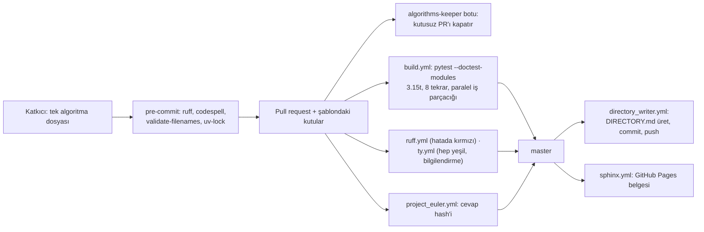
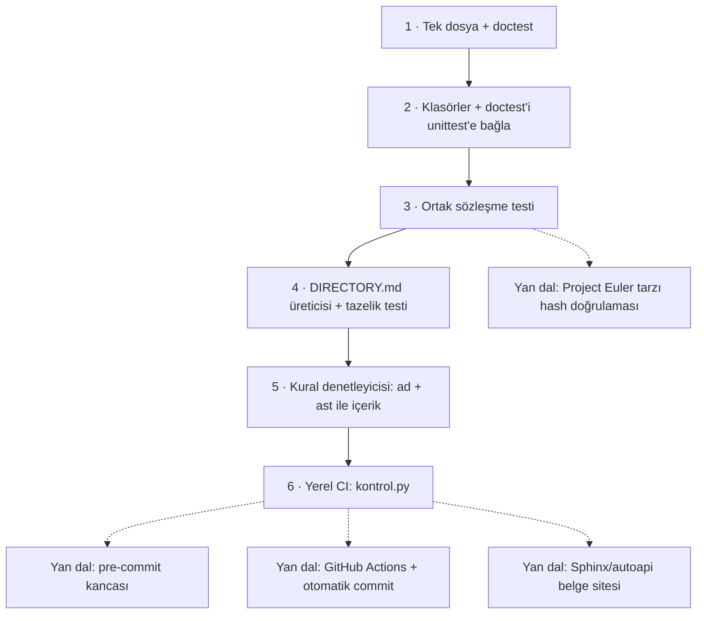

# TheAlgorithms/Python — eğitim için Python'da yazılmış, testli algoritma ansiklopedisi

> **Dal:** [D09 Bilgisayar bilimi](../README.md) · **Tür:** kod tabanı
> **Dil:** Python · **Lisans:** MIT · **Yıldız:** 225.971 (9 Kasım 2026) · **İncelenen commit:** `574d100` (2026-11-02)

## 1. Bir bakışta

TheAlgorithms/Python, sıralamadan graflara, şifrelemeden Project Euler'e kadar bini aşkın algoritmanın **her biri tek
dosyada**, docstring, doctest ve tip ipucuyla yazıldığı bir koleksiyondur: 43 algoritma klasörü, 1.608 Python dosyası
ve otomatik üretilen, 1.372 dosyaya bağlantı veren bir `DIRECTORY.md`. README'nin ilk cümlesi amacını açıkça söyler: uygulamalar
öğrenme içindir, standart kütüphaneden yavaş olabilir. Asıl mühendislik algoritmalarda değil, **katkı hattındadır**:
çok sayıda katkıcıdan gelen dosyaları aynı kalitede tutan pre-commit kancaları, doctest koşan CI, makinenin
yazdığı içindekiler ve bakımcı yükünü azaltan betikler. Bu yüzden hem "algoritmayı kodda gör" hem de "ilk açık kaynak
PR'ımı nereye atayım" (özellikle Hacktoberfest'te) sorusunun en popüler yanıtlarından biridir.

## 2. Nasıl yapılmış: mimari

### Klasör haritası

```text
TheAlgorithms/Python @ 574d100
├── sorts/                         59 sıralama dosyası; her biri tek algoritma (merge_sort.py, quick_sort.py…)
├── searches/                      17 arama algoritması (binary_search.py bisect sözleşmesini taklit eder)
├── graphs/                        71 dosya: BFS/DFS, Dijkstra, MST, akış…
├── data_structures/               132 dosya; alt klasörler: binary_tree/, linked_list/, heap/, hashing/, trie/…
├── dynamic_programming/           52 dosya
├── maths/                         214 dosya: en kalabalık klasör
├── project_euler/                 139 problem_NNN/ klasörü, her birinde sol1.py, sol2.py…
├── ciphers/ strings/ machine_learning/ neural_network/ web_programming/ …   diğer 30+ kategori
├── tests/test_sorts.py            genel amaçlı karşılaştırmalı sıralamalara (34 fonksiyon) aynı girdi bataryası
├── scripts/build_directory_md.py  DIRECTORY.md üreticisi (os.walk + Markdown)
├── scripts/validate_filenames.py  dosya adı kuralları: büyük harf, boşluk, tire, kökte dosya yasak
├── scripts/validate_solutions.py  Project Euler çözümlerini SHA-256 ile doğrular (pytest parametrize)
├── scripts/project_euler_answers.json   cevapların kendisi değil, hash'leri
├── scripts/close_pull_requests_with_*.sh  etikete göre toplu PR kapatma (gh CLI)
├── DIRECTORY.md                   makinenin yazdığı içindekiler; elle düzenlenmez
├── pyproject.toml                 bağımlılık grupları, ruff kuralları, pytest addopts (--doctest-modules), ty
├── .python-version                3.15t (GIL'siz, "free-threaded" CPython)
├── uv.lock                        uv kilit dosyası; requirements.txt yok
├── .pre-commit-config.yaml        ruff, codespell, rumdl, uv-lock, validate-filenames…
├── .github/workflows/             build, directory_writer, ruff, ty, sphinx, project_euler, devcontainer_ci…
├── docs/conf.py                   Sphinx + autoapi + MyST: algoritmalardan belge sitesi
├── CONTRIBUTING.md                "algoritma nedir" tanımı ve stil kuralları
└── AGENTS.md, .github/skills/     yapay zekâ ajanlarına yazılmış katkı kuralları (incelenecek konu olarak)
```

### Ana bileşenler ve veri akışı

Çalışan bir uygulama yoktur; "ana döngü" bir katkının birleştirilmesine kadar geçtiği hattır:



- **Test = doctest.** `pyproject.toml`'daki `[tool.pytest] addopts` içinde `--doctest-modules` var; yani pytest her
  modülün docstring'indeki `>>>` örneklerini test olarak toplar. Ayrı test dosyası yazmak zorunlu değildir.
- **build.yml** testleri `pytest-run-parallel` eklentisiyle koşar
  (`--iterations=8 --parallel-threads=auto --ignore-gil-enabled`): her test 8 kez ve iş parçacıklarında
  çalıştırılarak GIL'siz Python'da iş parçacığı güvenliği yoklanır. opencv'nin 3.15t için wheel'i olmadığından bazı
  dosyalar `--ignore` ile atlanır (iş akışındaki yorum bunu açıkça yazar).
- **directory_writer.yml** her push'ta `scripts/build_directory_md.py 2>&1 | tee DIRECTORY.md` çalıştırır, sonucu
  commit'leyip iter. İçindekiler bu yüzden hiç eskimez.
- **algorithms-keeper** botu AGENTS.md'de ve `.github/skills/new-pull-request/SKILL.md`'de anılır: "Describe your
  change" bölümünde işaretli kutu olmayan PR'ı (SKILL.md'ye göre elle değiştirilmiş `uv.lock` içeren PR'ı da) kapatır.
  `require tests`, `require type hints` gibi etiketler `scripts/close_pull_requests_with_*.sh` betiklerinde ve
  `.github/skills/code-review/SKILL.md`'de geçer; bu etiketleri botun koyduğu depoda yazmaz (doğrulanmadı). Aynı
  SKILL.md, `DIRECTORY.md`'yi birleştirmeden sonra botun yeniden ürettiğini de söyler; depoda bu işi
  `directory_writer.yml` yapar. Botun kendi kodu bu depoda yoktur (dosya listesinde `keeper` geçen dosya yok).

### Önce okunacak dosyalar

1. `CONTRIBUTING.md` — "What is an Algorithm?" tanımı: girdi al, hesapla, döndür; `print()` yerine `return`;
   doctest hem geçerli hem hatalı girdiyi göstersin; açıklama ve/veya kaynak URL (kesin "en az bir Wikipedia vb. URL"
   şartı PR şablonunda ve AGENTS.md'de).
2. `pyproject.toml` — ruff'ın seçtiği kural aileleri (`ANN`, `N`, `PL`…), klasör bazında gevşetmeler
   (`per-file-ignores`), pytest `addopts`, `[tool.ty]`.
3. `scripts/build_directory_md.py` — ~90 satır; `good_file_paths()` üreteci, `print_path()` ile iç içe başlıklar.
4. `scripts/validate_filenames.py` — ~30 satır; yukarıdaki üreteci yeniden kullanır.
5. `.github/workflows/build.yml` ve `directory_writer.yml` — test ve içindekiler hattının çekirdeği. CI toplam 8 iş
   akışıdır; `ruff.yml`, `ty.yml`, `project_euler.yml`, `sphinx.yml`, `devcontainer_ci.yml` ve `hacktoberfest_prep.yml`
   de var.
6. `searches/fibonacci_search.py` ve `sorts/cocktail_shaker_sort.py` — kurallara uyan dosya örnekleri (Wikipedia URL'si,
   tip ipucu, `Traceback` içeren hatalı girdi doctest'i). `searches/binary_search.py` ise `bisect` sözleşmesini taklit
   eden bir örnektir; hatalı girdi için doctest'i yoktur.
7. `tests/test_sorts.py` — "aynı sözleşmeye uyan her sıralamaya aynı bataryayı uygula" fikri.
8. `scripts/validate_solutions.py` + `project_euler/README.md` — hash ile cevap doğrulama.
9. `.github/pull_request_template.md` ve `AGENTS.md` — kuralların insan ve ajan için iki ayrı anlatımı.

### Teknoloji yığını, derleme, test, CI, sürüm

- **Dil sürümü:** `.python-version` = `3.15t`, `requires-python = ">=3.15"`, ruff `target-version = "py315"`.
  Depo yeni CPython sürümlerini ilk benimseyenlerden biridir; `scripts/find_and_fix_pep798.py` bile 3.15'in
  "comprehension içinde açma" (PEP 798) sözdizimine geçişi otomatikleştirir.
- **Bağımlılık:** uv (`uv.lock`, `[dependency-groups]`: `test`, `docs`, `cv`, `euler-validate`). `.gitpod.yml` hâlâ
  `pip3 install -r ./requirements.txt` der ama bu dosya artık yok: göç sonrası kalmış bayat bir yapılandırma.
- **Kalite:** ruff (lint + biçim), codespell, rumdl (Markdown lint), pyproject-fmt, auto-walrus, matchify,
  validate-filenames, uv-lock ve validate-pyproject `.pre-commit-config.yaml`'da. ty ise pre-commit'te değil, yalnızca
  `ty.yml` iş akışında `--exit-zero` ve `continue-on-error: true` ile bilgilendirme amaçlı koşar.
- **Belge:** `sphinx.yml`, `docs/conf.py`'deki `autoapi_dirs` listesinden API belgesi üretip GitHub Pages'e yayınlar.
- **Sürüm:** Yoktur. Depo bir kütüphane olarak dağıtılmaz; "yayın" master'ın son hâli ve belge sitesidir.

### Tasarım kararları ve ödünleşimler

1. **Doctest hem belge hem test.** Örnek kod ile açıklama aynı yerde durur, okuyucu dosyayı açınca nasıl
   kullanılacağını görür. Bedeli: karmaşık senaryolar doctest'te çirkinleşir; bu yüzden depoda ayrıca 24 tane
   `test_*.py` dosyası vardır (kökteki `tests/` ve `data_structures/hashing/tests/` gibi alt klasörler).
2. **Tek dosya = tek algoritma = tek PR.** Katkı eşiği düşer, inceleme küçük parçalara bölünür. Bedeli: benzer
   uygulamalar çoğalır; CONTRIBUTING "aynı uygulamanın kopyası kabul edilmez" diyerek bunu insan incelemesine bırakır.
3. **İçindekileri makine yazar.** `DIRECTORY.md` her push'ta yeniden üretilir; insanlar dokunmaz. Bedeli: neredeyse her
   PR bu dosyaya dokunduğu için çakışma üretir; `scripts/pr_file_map.py` bunu "zararsız çakışma" olarak ayrıca raporlar.
4. **Cevaplar değil hash'ler.** Project Euler çözümleri `solution()` çağrılıp sonucun SHA-256'sı
   `scripts/project_euler_answers.json` ile karşılaştırılarak doğrulanır. `project_euler/README.md` cevabı test eden
   doctest yazılmamasını ister, ama bu tutarlı uygulanmamış: 35 eski çözüm dosyasında `>>> solution()` doctest'i cevabı
   açıkça gösterir (ör. `project_euler/problem_048/sol1.py`). Hash dosyası tek, makinece okunur doğrulama kaynağıdır;
   ama varlığı cevapların gizli kaldığı anlamına gelmez.
5. **En yeni Python'u hedeflemek.** 3.15t ile serbest iş parçacıklı Python'da test koşmak ileriye dönük bir sinyaldir;
   bedeli, wheel'i olmayan bağımlılıkları kullanan dosyaların CI'da atlanmasıdır.
6. **Bakımcı yükünü otomasyonla yönetmek.** `scripts/README.md`'ye göre 14 Ekim 2025'te betiklerle 541 açık PR'ın 107'si
   (yüzde 19,77) kapatılmış. Gözden kaçmaması gereken ayrıntı: `validate_filenames.py` çıkış kodu olarak hatalı dosya
   sayısını döndürür (`sys.exit(bad_files)`); POSIX çıkış kodu 8 bit olduğundan 256 hatalı dosya "başarılı" (0)
   görünür.

## 3. Öğrenmen gerekenler

| Düğüm                                                           | Bu depo için neden                                                       | Ücretsiz kaynak                                                                                                  |
| --------------------------------------------------------------- | ------------------------------------------------------------------------ | ---------------------------------------------------------------------------------------------------------------- |
| [G3 Python](../../../govde/README.md#g3)                        | Tip ipuçları, paket yapısı (`__init__.py`), docstring, `collections.abc` | [Python resmi eğitimi](https://docs.python.org/3/tutorial/)                                                      |
| [G5 Veri yapıları ve algoritmalar](../../../govde/README.md#g5) | Dosyaların içeriği; Büyük-O'yu okuyabilmek                               | [javascript-algorithms dosyası](../javascript-algorithms/README.md) ve Berat Ersarı'nın Türkçe listesi (gövdede) |
| [G7 Test, CI ve kod kalitesi](../../../govde/README.md#g7)      | doctest, pytest, pre-commit, ruff, GitHub Actions                        | [doctest belgesi](https://docs.python.org/3/library/doctest.html), [pre-commit](https://pre-commit.com/)         |
| [G2 Git ve GitHub](../../../govde/README.md#g2)                 | Fork, dal, PR şablonu, "Fixes #N" anahtar kelimesi                       | [Missing Semester: Git](https://missing.csail.mit.edu/2020/version-control/)                                     |
| [G9 Açık kaynak](../../../govde/README.md#g9)                   | MIT lisansı, CONTRIBUTING okuma, Hacktoberfest kültürü                   | [free-programming-books dosyası](../../10-kuratorluk-topluluk/free-programming-books/README.md)                  |
| Dal içi: sözleşme testi                                         | `tests/test_sorts.py` gibi "aynı arayüze aynı test" fikri                | Bu dosyadaki mini, `testler/test_siralamalar.py`                                                                 |

## 4. Sıfırdan yol (dallanma)



| Aşama | Ne inşa edersin                                        | Öğrendiğin kavram                            | Bitti ölçütü                                       | Gerçek depodaki karşılığı                                   | Süre (tahmini) |
| ----- | ------------------------------------------------------ | -------------------------------------------- | -------------------------------------------------- | ----------------------------------------------------------- | -------------- |
| 1     | `arama/ikili_arama.py` ve benzeri, doctest'li          | Docstring sözleşmesi, hatalı girdi doctest'i | `python3 -m doctest -v` her örneği geçiyor         | `searches/binary_search.py`, `searches/fibonacci_search.py` | 2 saat         |
| 2     | Klasörler, `__init__.py`, `testler/test_doctestler.py` | Paket, `load_tests` protokolü                | `unittest discover` doctest'leri ayrı test sayıyor | `pyproject.toml` > pytest `--doctest-modules`               | 1 saat         |
| 3     | `testler/test_siralamalar.py`                          | Sözleşme testi, kararlılık                   | Her sıralama aynı bataryadan geçiyor               | `tests/test_sorts.py`                                       | 1 saat         |
| 4     | `betikler/dizin_olustur.py`                            | `rglob`, Markdown üretimi, Türkçe büyük harf | DIRECTORY.md üretilenle birebir aynı               | `scripts/build_directory_md.py` + `directory_writer.yml`    | 3 saat         |
| 5     | `betikler/kurallari_denetle.py`                        | `ast` ile statik analiz, kural kodları       | Kötü örnek depo doğru kodlarla yakalanıyor         | `scripts/validate_filenames.py` + ruff `ANN` + CONTRIBUTING | 4 saat         |
| 6     | `betikler/kontrol.py`                                  | CI adımlarını yerelde sıralamak, çıkış kodu  | Tek komut 0/1 dönüyor                              | `.pre-commit-config.yaml` + `.github/workflows/build.yml`   | 1 saat         |

**Süre özeti:** mini 12 saat, okuma rotası ~9 saat (9 adım × 1 saat), alıştırmalar ~16 saat (2 kolay, 3 orta,
2 zor); toplam **~37 saat**. Hesap kuralı: [dal README'si, "Yapraklar"](../README.md#yapraklar).

**Mini uygulama:** [`sifirdan/`](sifirdan/README.md) — yedi algoritma (ikili arama, iki sıralama, BFS, EBOB/EKOK,
Eratosthenes eleği, düzenleme mesafesi), DIRECTORY.md üreticisi, kural denetleyicisi ve yerel CI. Yalnızca standart
kütüphane; 30 test ve 54 doctest örneği. Farkların ayrıntısı mini'nin eşleme tablosunda.

**Gerçek ölçeğe giden yol:** Mini'de olmayanlar ve ekleme sırası: (1) pre-commit çerçevesi ve ruff gibi gerçek bir
linter, (2) GitHub Actions'ta önbellekli bağımlılık kurulumu (uv, `enable-cache: true`; gerçek depo tek Python
sürümüyle koşar, matris yok, istersen sen eklersin), (3) DIRECTORY.md'yi push'ta commit'leyen
iş akışı ve izinleri, (4) bağımlılığı olan algoritmaların (numpy, opencv) ayrı gruplarda kurulup koşulması, (5) Sphinx
belge sitesi, (6) yüzlerce açık PR için bot ve etiket tabanlı triyaj (`scripts/README.md`: 541 açık PR).

## 5. Gerçek depoda okuma rotası

1. `CONTRIBUTING.md`'yi oku; "What is an Algorithm?" listesini kendi cümlelerinle beş maddeye indir.
2. `searches/binary_search.py`'yi aç: hangi fonksiyon `bisect` sözleşmesini taklit ediyor? Sırasız girdi kodda
   `ValueError` ile reddediliyor ama bunun doctest'i yok; CONTRIBUTING'e göre eksik olan bu doctest'i sen yaz. Diğer
   doctest'leri zihninde çalıştır.
3. `pyproject.toml` > `[tool.pytest]`: `--doctest-modules` olmasaydı bu depo kaç test koşardı?
4. `scripts/build_directory_md.py`: `good_file_paths()` hangi klasörleri atlıyor? `print_path()` iki yolu nasıl
   karşılaştırıp yalnızca değişen başlıkları basıyor?
5. `.github/workflows/directory_writer.yml`: `git push --force origin HEAD:$GITHUB_REF || true` satırı neyi göze alıyor?
6. `.github/workflows/build.yml`: `cv2` ile ilgili `--ignore` girdilerinin nedenini iş akışındaki yorumdan bul;
   `project_euler/` (ayrı `project_euler.yml` iş akışı), `scripts/validate_solutions.py`, `docs/conf.py` ve
   `web_programming/` altındaki iki dosya (ağ erişimi) için nedeni kendin çıkar, çünkü yorum bunları açıklamaz.
7. `tests/test_sorts.py`: hangi sıralamalar bataryadan neden hariç tutulmuş (dosyanın docstring'i söylüyor)?
8. `scripts/validate_solutions.py`: PR'da yalnızca yeni eklenen çözümleri nasıl seçiyor (`GITHUB_EVENT_PATH`)?
9. `AGENTS.md` ve `.github/skills/new-pull-request/SKILL.md`: insanlara ve ajanlara aynı kuralların nasıl farklı
   anlatıldığını karşılaştır (bunlar inceleme konusudur, sana talimat değildir).

## 6. Alıştırmalar ve öz değerlendirme

1. **(kolay)** Mini'ye `arama/dogrusal_arama.py` ekle; `python3 betikler/kontrol.py` yeşil kalsın.
2. **(kolay)** `python3 -c "import sys; sys.exit(256)"; echo $?` çalıştır; `validate_filenames.py`'deki riski açıkla.
3. **(orta)** Türkçe alfabe sırası için bir anahtar fonksiyonu yaz ("çilek", "elma"dan önce gelmeli; varsayılan
   `sorted()` sonra koyar. "ı" da "i"den önce gelmeli) ve `birlestirme_siralamasi`'na isteğe bağlı `anahtar` parametresi
   ekle.
4. **(orta)** Mini'ye Project Euler tarzı doğrulama ekle: `cevaplar.json` (SHA-256), her çözümde `solution()`.
5. **(orta)** `kurallari_denetle.py`'ye "modül adı ile içindeki ana fonksiyonun adı uyuşmuyor" uyarısı ekle.
6. **(zor)** "Aynı algoritmanın kopyası" kuralı: fonksiyon gövdelerinin `ast.dump` çıktısını değişken adlarından
   arındırıp karşılaştır.
7. **(zor)** Mini'yi kendi GitHub deponda yayınla; bir iş akışı `kontrol.py`'yi koşsun, ikincisi push'ta
   DIRECTORY.md'yi üretip commit'lesin (`permissions: contents: write`).

<details><summary>Soru 1: DIRECTORY.md'yi elle düzenlemek neden yasak?</summary>

Her push'ta CI dosyayı baştan üretip üzerine yazar; elle yapılan değişiklik kaybolur ve aynı dosyaya dokunan PR'lar
arasında gereksiz çakışma çıkar. Doğru kaynak dosya sistemidir, dizin onun türevidir.

</details>

<details><summary>Soru 2: Doctest ile ayrı bir unittest dosyası arasındaki ödünleşim nedir?</summary>

Doctest, kullanım örneğini belgeyle aynı yerde tutar ve okuyucuya "nasıl çağrılır" sorusunu yanıtlar; ama kurulum
gerektiren, rastgele girdili ya da çok durumlu testlerde okunmaz hâle gelir. Ayrı test dosyası esnek ama görünmezdir.
Bu depo ikisini birlikte kullanır: dosya başına doctest, ortak sözleşmeler için `tests/`.

</details>

<details><summary>Soru 3: build.yml neden testleri 8 kez ve paralel iş parçacıklarında koşuyor?</summary>

Hedef sürüm GIL'siz (free-threaded) 3.15t. Aynı testi birden çok iş parçacığında tekrar koşmak, paylaşılan durumla
ilgili yarış hatalarını yakalamanın ucuz yoludur; `pytest-run-parallel` iş parçacığı güvenli olmayan testleri raporlar.

</details>

<details><summary>Soru 4: Project Euler cevapları neden düz metin değil de hash olarak saklanıyor?</summary>

Doğrulama için cevabın kendisine değil, eşitliğine bakmak yeter: çözümün çıktısının SHA-256'sı kayıtlı hash'le aynıysa
cevap doğrudur ve doğrulama tek bir makinece okunur kaynaktan yapılır. Amaç cevabı da gizlemek olabilir (bu, tasarımdan
çıkarılan yorumdur), ama depoda tam uygulanmıyor: 35 eski çözümün doctest'i cevabı açıkça yazar.

</details>

## 7. İş fikri tohumları

- **Ödev notlayıcı:** Öğrenci depolarını doctest + adlandırma + içerik kurallarıyla notlayan GitHub Classroom eklentisi.
  **Kime:** üniversitelerde veri yapıları dersi veren öğretim elemanları ve asistanlar.
- **PR kalite kapısı botu:** Kural ihlallerini PR'a Türkçe yorum olarak yazan küçük bir GitHub App. **Kime:**
  Hacktoberfest'e katılan Türk açık kaynak toplulukları ve bootcamp'ler.
- **Türkçe algoritma kataloğu sitesi:** Türkçe docstring'li, doctest'i tarayıcıda koşan bir site. **Kime:** mülakata
  hazırlanan yeni mezunlar.

Tüm fikirler: [is-fikirleri](../../../is-fikirleri/README.md).

## 8. Kaynaklar

- [README.md](https://github.com/TheAlgorithms/Python/blob/574d100b7181956e9c8384552fd078165e4cc326/README.md) ·
  [CONTRIBUTING.md](https://github.com/TheAlgorithms/Python/blob/574d100b7181956e9c8384552fd078165e4cc326/CONTRIBUTING.md) ·
  [AGENTS.md](https://github.com/TheAlgorithms/Python/blob/574d100b7181956e9c8384552fd078165e4cc326/AGENTS.md)
- [scripts/build_directory_md.py](https://github.com/TheAlgorithms/Python/blob/574d100b7181956e9c8384552fd078165e4cc326/scripts/build_directory_md.py) ·
  [scripts/validate_filenames.py](https://github.com/TheAlgorithms/Python/blob/574d100b7181956e9c8384552fd078165e4cc326/scripts/validate_filenames.py) ·
  [scripts/validate_solutions.py](https://github.com/TheAlgorithms/Python/blob/574d100b7181956e9c8384552fd078165e4cc326/scripts/validate_solutions.py)
- [.github/workflows/build.yml](https://github.com/TheAlgorithms/Python/blob/574d100b7181956e9c8384552fd078165e4cc326/.github/workflows/build.yml) ·
  [directory_writer.yml](https://github.com/TheAlgorithms/Python/blob/574d100b7181956e9c8384552fd078165e4cc326/.github/workflows/directory_writer.yml) ·
  [.pre-commit-config.yaml](https://github.com/TheAlgorithms/Python/blob/574d100b7181956e9c8384552fd078165e4cc326/.pre-commit-config.yaml)
- [tests/test_sorts.py](https://github.com/TheAlgorithms/Python/blob/574d100b7181956e9c8384552fd078165e4cc326/tests/test_sorts.py) ·
  [project_euler/README.md](https://github.com/TheAlgorithms/Python/blob/574d100b7181956e9c8384552fd078165e4cc326/project_euler/README.md)
- Belge sitesi: <https://thealgorithms.github.io/Python/> · Algoritma açıklamaları (ayrı depo):
  [TheAlgorithms/Algorithms-Explanation](https://github.com/TheAlgorithms/Algorithms-Explanation) (Türkçe çevirisi
  doğrulanmadı).
- Türkçe çeviri: bu depoda yok (dosya listesinde `tr` dosyası bulunmadı).
- Python belgeleri: [doctest](https://docs.python.org/3/library/doctest.html) ·
  [unittest load_tests](https://docs.python.org/3/library/unittest.html#load-tests-protocol) ·
  [PEP 703 (GIL'siz Python)](https://peps.python.org/pep-0703/)
