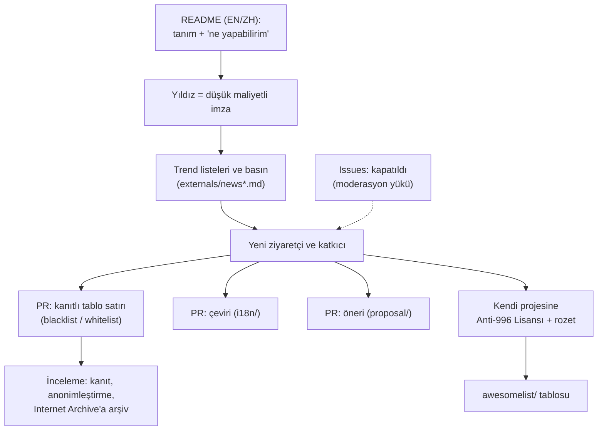
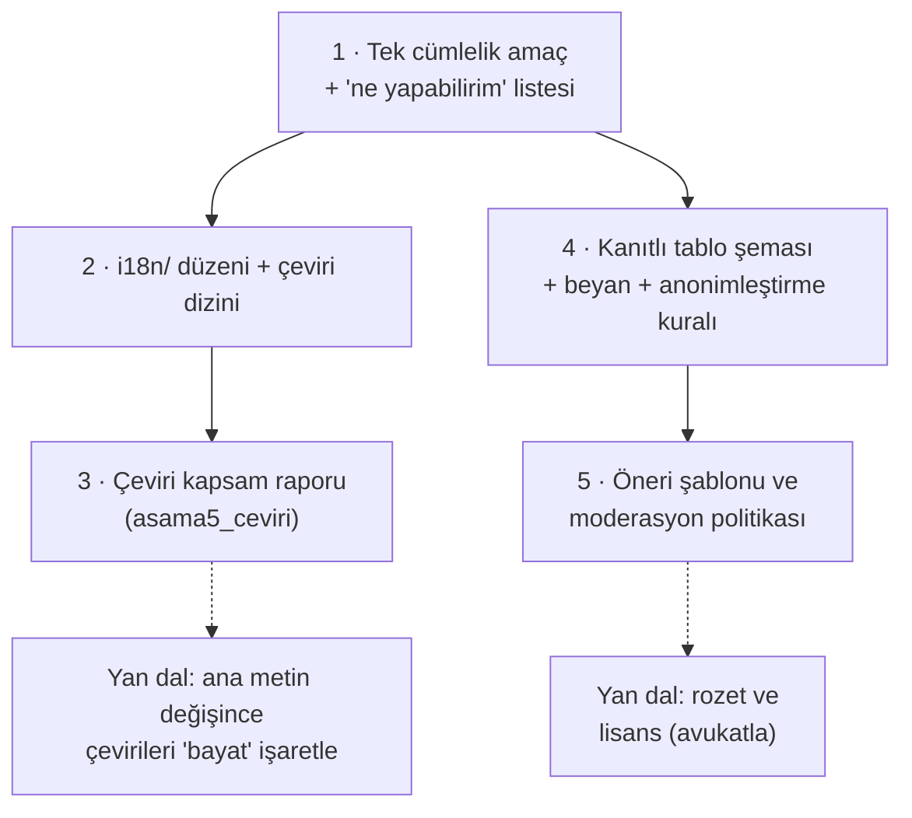

# 996icu/996.ICU — bir çalışma saatleri protestosunun GitHub'daki evi ve Anti-996 Lisansı

> **Dal:** [D10 Küratörlük ve topluluk](../README.md) · **Tür:** topluluk
> **Dil:** — (dil algılama kapalı) · **Lisans:** Anti-996 License 1.0 (taslak; GitHub "NOASSERTION" gösteriyor) · **Yıldız:** 277.221 (9 Kasım 2026) · **İncelenen commit:** `f5e35f4` (2025-08-22)

> Bu dosya bir toplumsal hareketin GitHub'ı nasıl kullandığını betimler; hareketin iddialarını değerlendirmez. Lisans ve
> hukukla ilgili bölümler hukuki tavsiye değildir.

## 1. Bir bakışta

"996", sabah 9'dan akşam 9'a, haftada 6 gün çalışma düzeninin adı; "996.ICU" ise "996 çalış, yoğun bakımda (ICU)
yat" esprisi. 26 Mart 2019'da bir Çinli geliştirici (`@996icu`) bu düzeni eleştiren bir depo açtı; depodaki
`ANTI-996 DAY.MD` dosyasına göre depo üç günde 100 binden fazla yıldız aldı ve gönüllüler metni pek çok dile çevirdi.
Depo bir yazılım projesi değil: README'ler, kanıt isteyen şirket listeleri, çeviriler, öneriler ve bir lisans metni.
Yıldızlar imza işlevi gördü; GitHub'ın görünürlük mekanizmaları (trend listeleri, yıldız sayısı) hareketin megafonu
oldu. Bugün 277 bin yıldızla en çok yıldızlı depolar arasında; son commit Ağustos 2025.

## 2. Nasıl yapılmış: mimari

### Klasör haritası

```text
996.ICU/                                      (326 dosya; çalışan kod yok)
├── README.md, README_CN.md                   İngilizce ve Çince ana metin: tanım, "ne yapabilirim", ilkeler, lisans, bağış
├── LICENSE, LICENSE_CN                       Anti-996 Lisansı 1.0 (taslak), İngilizce ve Çince
├── ANTI-996 DAY.MD                           26 Mart'ı "Anti-996 Günü" önerisi (dosya adında boşluk var)
├── blacklist/README.md                       kanıtlı "996 uygulayan şirketler" tablosu (235 satır) + iptal kayıtları
├── whitelist/README.md                       "965" (makul saatler) uygulayan şirketler tablosu
├── awesomelist/README.md                     Anti-996 Lisansını kullanan projeler (~165 satır)
├── i18n/                                     35 çeviri (Türkçe: tr_TR.md; Esperanto ve Klingonca dahil) + dizin
├── proposal/                                 öneri şablonu (PEP benzeri başlık tablosu) + 6 öneri
├── externals/                                basın listeleri, rozet ve lisans ekleme talimatı, videolar, müzik
├── remotelist/                               beş şehir için uzaktan çalışma listeleri
├── archived/                                 eski taslaklar: MIT-996, "fazla mesaisiz" Apache, lisans üretici araçlar (Go/Python/Rust)
├── logo.svg
└── .gitattributes                            `* linguist-detectable=false` → GitHub dil göstermez
```

### Ana bileşenler ve veri akışı



### Önce okunacak dosyalar

1. `README.md` — "What can I do?" bölümü: katılımı beş eyleme indirgemek (listeyi kanıtla güncelle, rozet ekle, lisansla,
   öneri yaz, "18:00'de vicdan azabı duymadan eve git").
2. `LICENSE` — 46 satır: MIT'e benzer izin + üç koşul + garanti reddi.
3. `blacklist/README.md` "贡献指南" (katkı rehberi) ve "声明与注意事项" (beyan) bölümleri — kanıt türleri, ekran
   görüntüsünde kişisel veriyi silme, filigran uyarısı, sorumluluk reddi.
4. `externals/instruction.md` — rozet kodu ve lisansı başka bir lisansla birlikte kullanma talimatı.
5. `i18n/README.md` ve `i18n/tr_TR.md` — çeviri dizini ve Türkçe çeviri.
6. `proposal/proposal_template.md` — topluluk kararlarını belgeleme biçimi.
7. `archived/licenses[WIP]/README.md` — lisansın ilk varyantları ve üretici araçlar.

### Teknoloji yığını, derleme, test, CI, sürüm

Yok. Depo tamamen Markdown, görsel ve metin. `archived/` altında eski lisans üretici araçların kaynak kodu **ve derlenmiş
ikilileri** (Linux, macOS, Windows) var: güvenilmeyen ikili dosyaları depoda tutmak bugün önerilmeyen bir uygulama
(çalıştırma!). CI, lint, bağlantı denetimi yok; kalite insan incelemesine kalmış.

### Tasarım kararları ve ödünleşimler

1. **Yıldız bir oy pusulası.** Tek tıklık, herkese açık, sayılabilir; manşete dönüşebilen bir sayı. Ödünleşim: yıldız
   desteğin derinliğini ölçmez ve geri alınabilir.
2. **Çok dillilik ama sınırla.** 35 çeviri hareketi ülke dışına taşıdı; README yine de "çok fazla çeviri eklemek konuyu
   dağıtıyor" diye not düşüyor. Çeviriler zamanla ana metinden ayrışıyor: kök `README.md` 996 düzenini "en az 60 saat"
   olarak anlatırken `i18n/en_US.md` (ve Türkçe çeviri) "en az 72 saat" (12 × 6) diyor.
3. **Kanıt zorunlu liste.** Kara listeye satır eklemek için dış kanıt (resmî duyuru, haber, ilan) ya da kişisel bilgileri
   silinmiş ekran görüntüsü gerekiyor; kanıt bağlantıları Internet Archive'a arşivleniyor; listeden çıkarılan şirketler
   ayrı bir tabloda, çıkarıldığı commit'in özetiyle tutuluyor (Git geçmişi denetim izi olarak). Beyan bölümü bilgilerin
   doğrulanması gerektiğini ve bir şirketin tüm birimlerini temsil etmeyebileceğini söylüyor.
4. **Moderasyonun sınırı.** README'ye göre "etkileşim sınırları açıkken bile" issue alanı denetlenemez hale gelince sahibi
   issue'ları kişisel kararıyla kapattı. Viral ölçekte topluluk yönetiminin en somut örneklerinden biri.
5. **Lisansı araç yapmak.** Kod lisansı, kullanım koşuluna bir iş hukuku şartı ekleyerek bir savunu (advocacy) aracına
   dönüştürüldü. Ayrıntısı aşağıda.
6. **Kimliği korumak.** README'de başlığın hemen altındaki ilk cümle "resmî alan adı ve bu depo dışında resmî hesap, uygulama ya da ürün yok"
   uyarısı: viral bir hareketin adını kullanan sahte hesaplara karşı. Bağış için README'de kripto para adresleri var.

### Anti-996 Lisansının hukuki tasarımı (betimleyici özet)

| Öğe           | Metindeki karşılığı (`LICENSE`)                                                                                                                                                                                                                                                     | Gözlem                                                                                                  |
| ------------- | ----------------------------------------------------------------------------------------------------------------------------------------------------------------------------------------------------------------------------------------------------------------------------------- | ------------------------------------------------------------------------------------------------------- |
| İzin          | Kullanma, çoğaltma, değiştirme, türev eser, dağıtma, alt lisans: ücretsiz, her amaçla                                                                                                                                                                                               | MIT'e benzer geniş izin                                                                                 |
| Koşul 1       | Lisans ve bildirim her kopyada değiştirilmeden gösterilmeli                                                                                                                                                                                                                         | Standart atıf koşulu                                                                                    |
| Koşul 2       | Kişinin bulunduğu / doğduğu / vatandaşı olduğu ya da tüzel kişinin kayıtlı / faaliyet gösterdiği yerin iş hukukuna (hangisi daha katıysa) uymak; böyle bir hukuk yoksa ya da uygulanamıyorsa temel uluslararası çalışma standartlarına ("Core International Labor Standards") uymak | Lisansı kullanıcının **davranışına** bağlar; uyum, çok sayıda yargı alanının hukukuna atıfla belirlenir |
| Koşul 3       | Çalışanı haklarından vazgeçmeye yöneltmemek; ihlali bildirmesini kısıtlamamak                                                                                                                                                                                                       | Sözleşme dışı (sözlü) baskıları da kapsamaya çalışır                                                    |
| Garanti reddi | "OLDUĞU GİBİ"                                                                                                                                                                                                                                                                       | MIT ile aynı mantık                                                                                     |
| Durum         | "Version 1.0 (Draft)"; ayrıntılı tartışma ayrı bir depoya (`kattgu7/996-License-Draft`) yönlendirilmiş                                                                                                                                                                              | Taslak; `LICENSE` dosyasında `<year> <copyright holders>` yer tutucuları duruyor                        |

Bu tasarımın tartışılan sonuçları:

- **"Açık kaynak" tanımıyla gerilim.** Open Source Initiative'in Açık Kaynak Tanımı, kişi/grup ve kullanım alanı ayrımı
  yapmamayı şart koşar (madde 5 ve 6). Kullanıcının iş hukukuna uyumunu şart koşan bir lisans bu maddelerle çelişir;
  lisans OSI onaylı lisanslar arasında yer almıyor (doğrulanmadı: OSI listesi bu çalışmada taranmadı).
- **GPL ile birleştirme.** README lisansın "tüm büyük açık kaynak lisanslarıyla uyumlu" tasarlandığını söylüyor; ancak GPL
  ailesi ek kısıtlama getirilmesini yasaklar (GPLv2 §6, GPLv3 §10). Anti-996 koşulu taşıyan kodu GPL'li bir eserle
  birleştirmek bu yüzden sorunlu kabul edilir.
- **Uygulanabilirlik.** Koşul ihlal edilirse kullanıcının lisansı yoktur; yaptırım ancak telif hakkı sahibinin ilgili
  yargı alanında dava açmasıyla mümkündür. Bu çalışmada lisansın bir mahkemede sınandığına dair bir kayıt incelenmedi.
- **Algılanamama.** GitHub lisansı standart bir metinle eşleştiremediği için "NOASSERTION" gösteriyor; şirketlerin
  otomatik lisans tarayıcıları da genellikle bu tür özel lisansları "bilinmeyen" olarak işaretler.
- **Çoklu lisans önerisi.** `externals/instruction.md`, lisansı MIT gibi bir lisansla birlikte kullanmayı (`LICENSE`
  içinde `AND`, ayrı `LICENSE.996ICU` dosyası) tarif ediyor.

Türkiye bağlamı için karşılaştırma noktası: 4857 sayılı İş Kanunu'nda haftalık çalışma süresi en çok 45 saat (m. 63),
yıllık fazla çalışma en çok 270 saat (m. 41). (Hukuki tavsiye değildir.)

## 3. Öğrenmen gerekenler

| Düğüm / kavram                                     | Bu depo için neden                                                      | Ücretsiz kaynak                                                                                                                                      |
| -------------------------------------------------- | ----------------------------------------------------------------------- | ---------------------------------------------------------------------------------------------------------------------------------------------------- |
| [G9 Açık kaynak](../../../govde/README.md#g9)      | Lisans metni okumak, OSD, GPL uyumluluğu, çoklu lisans                  | [Açık Kaynak Tanımı](https://opensource.org/osd), [GNU lisans SSS](https://www.gnu.org/licenses/gpl-faq.html)                                        |
| [G2 Git ve GitHub](../../../govde/README.md#g2)    | Yıldız, trend, issue kapatma, etkileşim sınırları, commit geçmişi kanıt | [GitHub: etkileşim sınırları](https://docs.github.com/en/communities/moderating-comments-and-conversations/limiting-interactions-in-your-repository) |
| [G3 Python](../../../govde/README.md#g3) (faydalı) | Çeviri raporunu ortak araç kutusuyla üretmek ve uyarlamak               | [Python resmî eğitimi](https://docs.python.org/3/tutorial/)                                                                                          |
| Çeviri yönetimi                                    | 35 çeviri ve ayrışma (60 / 72 saat)                                     | Bu dalın araç kutusu: [`asama5_ceviri.py`](../awesome/sifirdan/asama5_ceviri.py)                                                                     |
| Kanıt ve kişisel veri                              | Ekran görüntüsünde kişisel veriyi silmek, arşivlemek                    | [KVKK](https://www.kvkk.gov.tr/), [Internet Archive](https://web.archive.org/)                                                                       |
| Topluluk yönetişimi                                | Öneri şablonu, ilkeler bölümü, moderasyon                               | [Open Source Guides: Leadership and Governance](https://opensource.guide/leadership-and-governance/)                                                 |

## 4. Sıfırdan yol (dallanma)

Burada "sıfırdan yazılacak" bir program yok; inşa edilecek şey **çok dilli, kanıta dayalı bir savunu deposu**.



| Aşama | Ne inşa edersin                          | Öğrendiğin kavram                 | Bitti ölçütü                                              | Süre (tahmini) |
| ----- | ---------------------------------------- | --------------------------------- | --------------------------------------------------------- | -------------- |
| 1     | README: amaç, ilkeler, katılım eylemleri | Mesaj tasarımı                    | Bir yabancı 30 saniyede ne istendiğini anlıyor            | 2 saat         |
| 2     | `i18n/<dil>.md` + dizin                  | Dosya adlandırma, dil kodları     | 2 çeviri, dizinde bağlantılı                              | 2 saat         |
| 3     | Çeviri raporu (CI'da)                    | Yapısal karşılaştırma, bayatlık   | Ana metne bölüm eklenince çeviriler "gözden geçir" alıyor | 2 saat         |
| 4     | Tablo şeması + kanıt kuralları           | Kanıt, gizlilik, sorumluluk reddi | Her satırda kanıt bağlantısı ve arşiv bağlantısı var      | 3 saat         |
| 5     | `proposal_template.md` + `GOVERNANCE.md` | Karar kaydı, moderasyon           | Bir öneri şablonla açılıp karara bağlanabiliyor           | 2 saat         |

Toplam yaklaşık 11 saat (dalın süre kuralı [D10 README](../README.md)'de). `GOVERNANCE.md` kendi deponda yazacağın
dosyadır; 996.ICU'da böyle bir dosya yok (ilkeler README'de, öneri süreci `proposal/` klasöründe).

**Mini uygulama:** Ayrı bir mini yok; [ortak araç kutusundaki](../awesome/sifirdan/README.md) çeviri aracı bu depoya
uygulanabilir. İncelenen commit'te `i18n/en_US.md` temel alındığında: `tr_TR.md` yapısal olarak tam; `de_DE.md` 36 satır
(temel 101) ve başlıkların çoğu yok; `ja_JP.md` başlık yerine kalın etiketler kullandığı için araç "eksik başlık" diyor.
Sonuncusu bir yanlış alarm: yapısal karşılaştırmanın sınırını gösteriyor.

**Gerçek ölçeğe giden yol:** çevirileri dize düzeyinde izleyen bir araç (Weblate, Crowdin) → tablo verisini CSV/JSON'da
tutup README'yi üretmek (bkz. [awesome-selfhosted](../awesome-selfhosted/README.md)) → kanıt bağlantılarını otomatik
arşivleme → moderasyon için issue formları ve etiketler.

## 5. Gerçek depoda okuma rotası

1. `README.md` → "Principles and purposes": hareket kendini nasıl konumluyor ("siyasi bir hareket değil, iş hukukuna uyum")?
2. `ANTI-996 DAY.MD` → başlangıç hikâyesinin kendi anlatımı.
3. `LICENSE` → koşul 2'deki "hangisi daha katıysa" ifadesini bir örnekle yorumla.
4. `externals/instruction.md` → çoklu lisans önerisi; GPL'li bir projede neden işlemez?
5. `blacklist/README.md` → kanıt ve beyan kuralları; iptal tablosundaki commit özeti sütunu.
6. `i18n/tr_TR.md` → Türkçe çeviri; kök README ile hangi bilgiler farklı?
7. `proposal/proposal_template.md` → başlık tablosu (Status, Type, Created, Post-History): Python PEP'lerine benzerlik.
8. `archived/licenses[WIP]/README.md` → lisansın ilk denemeleri; neden "WIP" klasörüne alınmış olabilir?

## 6. Alıştırmalar ve öz değerlendirme

1. **(Kolay)** Araç kutusuyla `i18n/` klasöründeki üç çeviriyi `en_US.md`'ye karşı karşılaştır; bir yanlış alarmı açıkla.
2. **(Kolay)** Anti-996 Lisansını MIT ile satır satır karşılaştıran bir tablo hazırla: hangi cümleler aynı, hangileri yeni?
3. **(Orta)** Kanıtlı tablo için bir doğrulayıcı yaz: her satırda zorunlu sütunlar dolu mu, kanıt bağlantısı http(s) mi,
   arşiv bağlantısı (`web.archive.org`) var mı?
4. **(Orta)** Ana metin her değiştiğinde çevirileri "bayat" işaretleyen bir CI adımı tasarla: hangi bilgiyi saklarsın
   (ör. çevirinin dayandığı commit özeti)?
5. **(Zor)** "Lisans tarayıcısı" yaz: bir deponun `LICENSE` dosyasını SPDX metinleriyle karşılaştırıp benzerlik oranı
   veren, MIT'e yakın ama ek koşullu metinleri "özel/ek koşullu" diye işaretleyen araç (standart kütüphane `difflib`).

**Öz değerlendirme**

1. Bu depoda yıldızlar neden bir yazılım deposundakinden farklı bir anlam taşıyor?

<details><summary>Cevap</summary>

Yazılım depolarında yıldız çoğunlukla "işe yarar, sonra bakarım" anlamına gelir. Burada yıldız, açık ve sayılabilir bir
destek beyanıdır: tek tıklık bir imza. Sayı basına manşet, trend listelerine giriş ve yeni ziyaretçi olarak geri döner.

</details>

2. Anti-996 Lisansı neden OSI'nin Açık Kaynak Tanımı'yla gerilim içinde?

<details><summary>Cevap</summary>

Tanım, lisansın kişi veya grupları ve kullanım alanlarını ayırt etmemesini ister. Anti-996, lisansı kullanıcının iş
hukukuna uyumuna bağlayarak belirli davranıştaki kullanıcıları dışarıda bırakır. Bu yüzden genel olarak "açık kaynak"
değil "kaynağı açık, ek koşullu" bir lisans olarak değerlendirilir.

</details>

3. Kara listeye satır eklemek neden kanıt ve anonimleştirme kuralına bağlanmış?

<details><summary>Cevap</summary>

Herkesin yazabildiği bir listede yanlış ya da kötü niyetli bilgi kolayca girer; kanıt kuralı doğruluğu, arşivleme kalıcılığı
artırır. Ekran görüntülerinde ad, kimlik numarası, e-posta gibi kişisel bilgiler katkıcıyı ve üçüncü kişileri riske atar;
`blacklist/README.md` görünmez filigranla takip ihtimaline karşı ekranın fotoğrafını çekmeyi bile öneriyor.

</details>

## 7. İş fikri tohumları

- **Çalışma süresi uyum panosu:** Giriş-çıkış ve fazla mesai verisinden 4857 sayılı Kanun sınırlarına (haftalık 45 saat,
  yıllık 270 saat fazla çalışma) yaklaşan ekipleri uyaran pano. **Kime:** 20–200 çalışanlı yazılım şirketlerinin İK ve
  bordro sorumluları.
- **Doğrulanmış ve anonim çalışan deneyimi endeksi:** Çalışma koşullarını KVKK uyumlu, doğrulanmış ama anonim anketlerle
  ölçen ve şirketlere iyileştirme raporu satan hizmet (hukuki risk yüksek: kişilik hakları ve ticari itibar). **Kime:** iş
  arayan yazılımcılar (ücretsiz) ve işveren markasını güçlendirmek isteyen şirketler (ücretli).
- **Lisans uyumluluk tarayıcısı:** Bağımlılıklardaki standart dışı ve ek koşullu lisansları (Anti-996 gibi) bulup raporlayan
  araç. **Kime:** yazılım satın alan ya da dağıtan kurumların hukuk ve uyum birimleri.

Ayrıntı: [İş fikirleri kataloğu](../../../is-fikirleri/README.md).

## 8. Kaynaklar

- [README.md](https://github.com/996icu/996.ICU/blob/f5e35f48d769bf92ed885888bfe911d3e5b5a63d/README.md)
- [LICENSE](https://github.com/996icu/996.ICU/blob/f5e35f48d769bf92ed885888bfe911d3e5b5a63d/LICENSE)
- [externals/instruction.md](https://github.com/996icu/996.ICU/blob/f5e35f48d769bf92ed885888bfe911d3e5b5a63d/externals/instruction.md)
- [i18n/tr_TR.md](https://github.com/996icu/996.ICU/blob/f5e35f48d769bf92ed885888bfe911d3e5b5a63d/i18n/tr_TR.md)
- [Wikipedia: 996 working hour system](https://en.wikipedia.org/wiki/996_working_hour_system) (README'nin verdiği kaynak)
- [The Open Source Definition](https://opensource.org/osd) ve [GPLv3 §10](https://www.gnu.org/licenses/gpl-3.0.html)
- [4857 sayılı İş Kanunu (mevzuat.gov.tr)](https://www.mevzuat.gov.tr/mevzuatmetin/1.5.4857.pdf)
