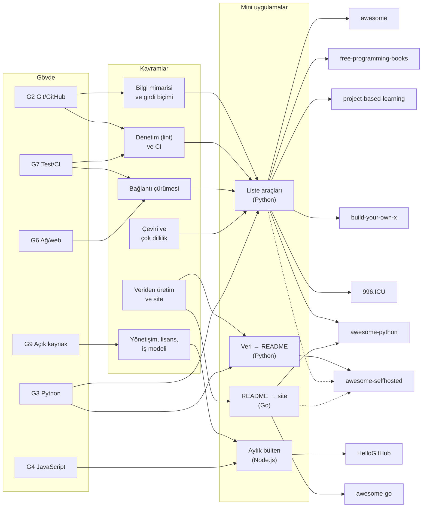

# D10 — Küratörlük, listeler ve topluluk

Bu dal tek bir soruya cevap arar: **yüz binlerce yıldız toplayan bir _içerik_ deposu sıfırdan nasıl kurulur ve yıllarca
nasıl ayakta tutulur?** Dokuz depo, aynı problemin dokuz farklı çözümü: bir listenin bilgi mimarisi ve girdi biçimi,
katkı rehberleri ve PR şablonları, denetleyiciler (lint), bağlantı çürümesine karşı taramalar, veriden README ve site
üreten araçlar, çeviriler, yönetişim ve moderasyon, liste lisansları (CC0, CC BY), keşfedilebilirlik ve işin para
tarafı (sponsor alanları, eğitim hunisi, bülten). Kod tabanı dallarının aksine burada "mimari" çoğunlukla Markdown, YAML
ve GitHub Actions'tan oluşur; ama awesome-go, awesome-python ve awesome-selfhosted'ın arkasında ciddi yazılımlar var.

## Ön koşullar

| Gövde düğümü                                 | Ne kadar                                | Bu dalda neden                                                                   |
| -------------------------------------------- | --------------------------------------- | -------------------------------------------------------------------------------- |
| [G2 Git ve GitHub](../../govde/README.md#g2) | zorunlu                                 | Fork, PR, fark (diff), birleştirme, issue formları: bu depolar PR akışıyla büyür |
| [G9 Açık kaynak](../../govde/README.md#g9)   | zorunlu                                 | Liste lisansları, katkı rehberleri, davranış kuralları, sponsorluk etiği         |
| [G7 Test ve CI](../../govde/README.md#g7)    | zorunlu                                 | Her PR'da lint, zamanlanmış taramalar, bot commit'leri, otomatik PR'lar          |
| [G3 Python](../../govde/README.md#g3)        | zorunlu (mini'ler için)                 | Ortak araç kutusu (yedi yaprak kullanır) ve veri → README mini'si Python         |
| [G6 Ağ ve web](../../govde/README.md#g6)     | faydalı; bağlantı denetimi için gerekli | HTTP yöntemleri, yönlendirmeler, durum kodları, hız sınırı                       |
| [G4 JavaScript](../../govde/README.md#g4)    | faydalı                                 | Bülten mini'si Node.js; awesome-lint ve fpb-lint kuralları JavaScript            |
| [G5 Veri yapıları](../../govde/README.md#g5) | faydalı                                 | build-your-own-x'teki rehberlerin çoğu (regex motoru, veritabanı, derleyici)     |
| [G1 Terminal](../../govde/README.md#g1)      | faydalı                                 | Komut satırı araçları, Makefile                                                  |

Yalnızca listeleri okuyup ilk PR'ını açmak için G1 + G2 yeter; mini'leri yazmak için G3 gerekir. Site mini'si Go ile
yazıldı ve Go gövdede yok: okumak yine de mümkün, yazmak için [A Tour of Go](https://go.dev/tour/) yeterli.

## Dalın ağacı



## Yapraklar

| Depo                                                                           | Tür      | Zorluk (1–5) | Mini                                                                                                                           | Mini (saat) | Toplam (saat) |
| ------------------------------------------------------------------------------ | -------- | ------------ | ------------------------------------------------------------------------------------------------------------------------------ | ----------- | ------------- |
| [sindresorhus/awesome](awesome/README.md)                                      | liste    | 2            | [Liste araçları](awesome/sifirdan/README.md) (ortak araç kutusu; burada aşama 1–2)                                             | 24          | 42            |
| [practical-tutorials/project-based-learning](project-based-learning/README.md) | liste    | 3            | [Ortak araç kutusu](awesome/sifirdan/README.md), aşama 3 (bağlantı denetimi ve durum dosyası)                                  | 19          | 33            |
| [EbookFoundation/free-programming-books](free-programming-books/README.md)     | liste    | 2            | [Ortak araç kutusu](awesome/sifirdan/README.md): `fpb` seti, Türkçe sıralama, çeviri matrisi                                   | 14          | 32            |
| [avelino/awesome-go](awesome-go/README.md)                                     | liste    | 4            | [README → statik site (Go)](awesome-go/sifirdan/README.md)                                                                     | 14          | 32            |
| [vinta/awesome-python](awesome-python/README.md)                               | liste    | 3            | [Ortak araç kutusu](awesome/sifirdan/README.md) (`python` seti, metrik sıralama) + [Go mini'si](awesome-go/sifirdan/README.md) | 26          | 44            |
| [awesome-selfhosted/awesome-selfhosted](awesome-selfhosted/README.md)          | liste    | 3            | [Veri → README (Python)](awesome-selfhosted/sifirdan/README.md)                                                                | 13          | 31            |
| [codecrafters-io/build-your-own-x](build-your-own-x/README.md)                 | liste    | 1            | [Ortak araç kutusu](awesome/sifirdan/README.md) (İçindekiler denetimi)                                                         | 9           | 22            |
| [521xueweihan/HelloGitHub](hellogithub/README.md)                              | topluluk | 2            | [Aylık bülten üretici (Node.js)](hellogithub/sifirdan/README.md)                                                               | 8           | 22            |
| [996icu/996.ICU](996-icu/README.md)                                            | topluluk | 2            | [Ortak araç kutusu](awesome/sifirdan/README.md), aşama 5 (çeviri kapsamı)                                                      | 11          | 25            |
| **Dal toplamı**                                                                |          |              |                                                                                                                                | **138**     | **283**       |

**Süreler nasıl hesaplandı?** Dosyalardaki süreler saat cinsindendir; 1 gün ≈ 5 saat, 1 hafta ≈ 10 saat odaklı çalışma
sayıldı (eski "1–2 gün" aralıkları 8 saate çevrildi). **Mini (saat)**, yaprağın "Sıfırdan yol" tablosundaki aşamaların
toplamıdır. **Toplam (saat)** = mini + okuma rotası (adım başına yarım saat, yukarı yuvarlanır) + alıştırmaların hepsi
(Kolay 1, Orta 2, Zor 4 saat). Dalın tamamı 283 saat: haftada 10 saatle yaklaşık 28 hafta (7 ay). Ortak araç kutusunu
kullanan beş yaprakta (project-based-learning, free-programming-books, awesome-python, build-your-own-x, 996.ICU)
aşamaların bir kısmı awesome'da yazdığın kodu uyarlamaktır; önerilen sırayla gidersen gerçek süre daha kısa olur.

## Önerilen sıra ve nedenleri

1. **awesome** (~42 saat) — Standardın kaynağı. Küçük depo, net kurallar; ortak araç kutusunun ilk iki aşamasını (ayrıştırıcı,
   denetleyici) burada yazarsın. Sonraki her depo bu kurallara göre "sapma" olarak okunur.
2. **project-based-learning** (~33 saat) — Bağlantı çürümesinin en olgun çözümü; araç kutusunun üçüncü aşamasını (paralel bağlantı
   denetimi, ardışık hata sayacı) onun `check_readme.py`'siyle karşılaştırarak yazarsın.
3. **free-programming-books** (~32 saat) — Çok dillilik ve dile duyarlı sıralama; Türkçe listeler burada. İlk gerçek PR'ın için iki
   hazır fırsat var (Türkçe İçindekiler'deki kırık bağlantılar, eksik `CONTRIBUTING-tr.md`).
4. **awesome-go** (~32 saat) — Listenin etrafındaki otomasyonun zirvesi: PR robotları, güvenli `pull_request_target`, otomatik
   birleştirme, Go ile site üretimi. Dalın en zor mini'si.
5. **awesome-python** (~44 saat) — Yönetişimin zirvesi: kısa liste kararı (ADR), kotalar, istisna günlüğü, sponsor kademeleri,
   SEO ve `llms.txt`. awesome-go'dan sonra okununca "aynı problem, farklı değerler" net görünür.
6. **awesome-selfhosted** (~31 saat) — Mimari dönüşüm: README'den veri dosyalarına, bot ile ayrı depoya yayın. Mini'de kendi
   veri → README hattını kurarsın.
7. **build-your-own-x** (~22 saat) — Karşıt örnek: neredeyse hiç otomasyon yok ama en çok yıldız; bir şirketin eğitim hunisi olarak
   liste. Dalın en kısa yapraklarından; iş modeli tartışması için.
8. **HelloGitHub** (~22 saat) — Listeden medya ürününe: takvim, editoryal seçim, rozet döngüsü, sponsorlar, tıklama ölçümü. Mini'de
   Türkçe bir bülten üreticisi yazarsın.
9. **996.ICU** (~25 saat) — GitHub'ın bir toplumsal hareket için kullanılması; lisansın savunu aracı olarak tasarlanması. En sona
   bırakıldı çünkü lisans ve yönetişim konularını önceki sekiz depo hazırlıyor.

## Depolar yan yana

| Depo                   | Yıldız | Girdi biçimi                               | Sıra                      | Denetim                         | Bağlantı taraması                       | Üretim                 | Lisans                        | Para                                 |
| ---------------------- | ------ | ------------------------------------------ | ------------------------- | ------------------------------- | --------------------------------------- | ---------------------- | ----------------------------- | ------------------------------------ |
| awesome                | 534 B  | `- [Ad](url#readme) - Açıklama.`           | sona eklenir              | awesome-lint (önerilen listeye) | yok                                     | yok                    | CC0                           | başlıkta sponsor ve uygulama vitrini |
| awesome-python         | 334 B  | `- [pypi-adı](url) - Açıklama.`            | kademe + PyPI indirme     | pytest + site derlemesi         | yok (yıldız/indirme verisi çekilir)     | README → site (Jinja2) | CC BY 4.0 (dosya eksik metin) | sponsor kademeleri                   |
| awesome-go             | 193 B  | `- [ad](url) - Açıklama.`                  | alfabetik (bayt sırası)   | `go test` + PR robotları        | haftalık bakımsızlık testi (issue açar) | README → site (Go)     | MIT                           | sponsor tablosu, GitHub Sponsors     |
| awesome-selfhosted     | 335 B  | YAML kaydı → üretilen satır                | alfabetik                 | hecat `awesome_lint`            | günlük `url_check`                      | YAML → README + HTML   | CC-BY-SA-3.0                  | Liberapay (alan adı masrafı)         |
| free-programming-books | 401 B  | `* [Başlık](url) - Yazar (PDF)`            | alfabetik, dile duyarlı   | fpb-lint + RTL denetimi         | değişen dosyalarda awesome_bot          | Jekyll sitesi          | CC BY 4.0                     | vakıf bağışı                         |
| build-your-own-x       | 561 B  | `* [**Dil**: _Başlık_](url)`               | dile göre gruplu (gevşek) | yok                             | yok                                     | yok                    | CC0 (dosyasız)                | şirket afişi (CodeCrafters)          |
| project-based-learning | 289 B  | `- [Başlık](url)`                          | serbest                   | `check_readme.py lint`          | haftalık + durum dosyası + budama PR'ı  | yok                    | MIT                           | yok                                  |
| HelloGitHub            | 188 B  | `N、[ad](sayaç?target=…)：Başlık.Açıklama` | sabit kategori sırası     | yok (issue formu)               | yok                                     | site depo dışında      | CC BY-NC-ND 4.0 (dosyasız)    | sponsorlar, site                     |
| 996.ICU                | 277 B  | kanıtlı tablo satırları                    | —                         | yok                             | yok (kanıtlar arşivlenir)               | yok                    | Anti-996 1.0 (taslak)         | kripto bağış                         |

Yıldızlar 9 Kasım 2026 anlık görüntüsü (B = bin).

## Rehberli alıştırma: Türkçe bir awesome listesi başlat

Hedef: `awesome-turkce-acik-kaynak` adında, "Türkiye'de geliştirilen ya da Türkçeyi birinci sınıf destekleyen açık kaynak
projeler" listesi. (Ad bir öneri; önce aynı kapsamda canlı bir liste olup olmadığını ara: GitHub'da `awesome` konusu +
"turkish"/"türkçe" araması. Varsa ona katkı ver.)

### 1. Kapsam ve kurallar (1 saat)

- Kapsamı tek cümleyle yaz ve "girmez" örnekleri ekle (ör. "yalnızca Türkçe çevirisi olan yabancı proje girmez" ya da
  girer: karar senin, ama yazılı olsun).
- Kabul ölçütü: lisanslı, en az 3 aylık, son 12 ayda commit almış, README'si olan depo. Ölçütleri `contributing.md`'ye yaz.

### 2. Depo ve dosyalar (2 saat)

- Depo adı küçük harf ve tireli; varsayılan dal `main`; açıklama tek cümle; konular: `awesome`, `awesome-list`,
  `turkish`, `turkce`.
- Dosyalar: `README.md`, `license` (CC0 tam metni; awesome'ın PR şablonundaki adres lisans şablonunu hazır açar:
  `https://github.com/<kullanıcı>/<depo>/community/license/new?branch=main&template=cc0-1.0`), `contributing.md`,
  `code-of-conduct.md`, `.github/PULL_REQUEST_TEMPLATE.md`, bir öneri issue formu.
- Veriyi `veri.json`'da tut, README'yi üret: [ortak araç kutusu](awesome/sifirdan/README.md) içindeki
  `ornekler/turkce-kaynaklar.json` bir başlangıç şablonu (girdileri klonlarda doğrulanmış Türkçe kaynaklardan). Dikkat:
  awesome'ın şablonu "Non-generated Markdown file" şartı koyuyor; veriden üretilen bir README'nin dizine kabul edilip
  edilmeyeceği yoruma açık. Başvurmayı planlıyorsan README'yi elle düzenlemeyi düşün.

```bash
python3 liste.py uret veri.json -o README.md
python3 liste.py denetle README.md --yerel tr
```

### 3. Türkçeye özgü tuzaklar (okuma: 30 dakika)

- **Başlık kimlikleri:** GitHub `İ`'yi `i̇` (i + görünmez birleşen nokta) yapar, `ı`, `ş`, `ğ`'yi korur. "İş Akışı"
  başlığına `#is-akisi` diye bağlanamazsın. Üreticinin `ascii_capa` seçeneği başlıklara açık çapa koyar.
- **Sıralama:** Türkçe alfabede `ç`, `c`'den sonra gelir; `ı` ise `i`'den önce gelir (… h, ı, i, j …). `I`'nın küçüğü
  `ı`, `İ`'nin küçüğü `i`'dir. Denetleyiciyi `--yerel tr` ile çalıştır.
- **awesome kuralları İngilizce merkezli:** İçindekiler bölümünün adı `Contents` olmalı (PR şablonu kuralı; awesome-lint
  bu adı taşımayan bölümü İçindekiler saymaz, dolayısıyla denetlemez). Ana başlık "title case" olmalı (lint hatası).
  Teknoloji adlarının yazımı (GitHub, JavaScript, Node.js) uyarı düzeyinde denetlenir; sözlüğe dayalı genel bir yazım
  denetimi yoktur. sindresorhus/awesome'a başvuracaksan bu kurallara uy.
- **Açıklamalar:** Büyük harfle başla (Türkçe büyük harf kuralıyla), nokta ile bitir, reklam dili kullanma ("en iyi",
  "muhteşem" denetleyicide uyarı verir).

### 4. CI (2 saat)

`.github/workflows/liste.yml` için bir başlangıç (araç kutusunu deponda `araclar/` altına kopyaladığını varsayar; eylem
sürümlerini commit SHA'sına sabitlemek daha güvenlidir):

```yaml
name: liste
on:
  pull_request:
    paths: [README.md, veri.json]
  schedule:
    - cron: '17 6 * * 1'
permissions:
  contents: read
jobs:
  denetle:
    if: github.event_name == 'pull_request'
    runs-on: ubuntu-latest
    steps:
      - uses: actions/checkout@v4
      - run: python3 araclar/liste.py uret veri.json -o README.md --denetle
      - run: python3 araclar/liste.py denetle README.md --yerel tr
  baglantilar:
    if: github.event_name == 'schedule'
    runs-on: ubuntu-latest
    permissions:
      contents: write # yalnızca bu iş: durum dosyasını commit'lemek için
    steps:
      - uses: actions/checkout@v4
      # Ölü bağlantı bulununca çıkış kodu 1 olur; bu beklenen sonuç, iş sürmeli.
      - run: python3 araclar/liste.py baglanti README.md --durum baglanti-durumu.json || true
      - name: Durum dosyasını commit'le
        run: |
          git config user.name "github-actions[bot]"
          git config user.email "41898282+github-actions[bot]@users.noreply.github.com"
          git add baglanti-durumu.json
          git diff --cached --quiet || git commit -m "chore: bağlantı durumu [skip ci]"
          git push
```

Durum dosyası çalışmalar arasında saklanmazsa ardışık hata sayacı hep 1'de kalır ve kaldırma adayı hiç çıkmaz. Bu
yüzden tarama işi dosyayı depoya commit'liyor (project-based-learning'in `link-rot.yml` deseni); yazma izni yalnızca bu
işe verildi, PR denetimi salt okunur kalıyor.

### 5. Yayın ve büyüme (sürekli)

- İlk 30 gün listeyi olgunlaştır (sindresorhus/awesome'a başvuru için en az 30 gün şartı var).
- Başvururken kontrol listesini baştan sona oku, 4 açık PR'ı gerçekten incele, PR'a "unicorn" yaz. PR başlığı
  `Add Ad` biçiminde olmalı ve "Awesome" sözcüğünü içermemeli (ör. `Add Turkish Open Source`).
- Listede yer alan projelere "Mentioned in Awesome" rozetini öner: her rozet sana geri dönen bir bağlantı.
- Türk geliştirici topluluklarında (ör. awesome-go'nun listelediği Golang Turkey) bir kez, spam olmadan duyur.
- Ölç: yıldızdan çok "kabul edilen dış PR sayısı" ve "ölü bağlantı oranı" sağlığı gösterir.

### Yayın kontrol listesi

- [ ] Kapsam tek cümle, `contributing.md`'de kabul/ret ölçütleri yazılı
- [ ] `license` dosyası tam metin (CC0 ya da CC BY 4.0); README'de lisans bölümü yok
- [ ] README: başlık + rozet, tek cümlelik açıklama, `## Contents`, en az 3 kategori, her kategoride en az 3 girdi
- [ ] Her girdi `- [Ad](https://…) - Açıklama.`; reklam dili yok; Türkçe büyük harf kuralı doğru
- [ ] `liste.py denetle README.md --yerel tr` 0 hata; İçindekiler bağlantılarının hepsi tarayıcıda çalışıyor
- [ ] Veri dosyası varsa README ondan üretiliyor ve CI tazelik denetimi yapıyor
- [ ] PR şablonu ve öneri issue formu var; tek PR'da tek girdi kuralı yazılı
- [ ] Haftalık bağlantı taraması çalışıyor; durum dosyası commit'leniyor, sonuç bir yerde (issue ya da iş özeti) görünüyor
- [ ] GitHub konuları (`awesome`, `awesome-list`) ve depo açıklaması girildi
- [ ] Davranış kuralları ve bakımcı listesi (karar nasıl alınır) yazılı
- [ ] Liste yapay zekâ ile üretilmemiş, PR tamamen yapay zekâ ile hazırlanmamış (awesome ikisini de reddeder)
- [ ] PR başlığı `Add Ad` biçiminde, "Awesome" sözcüğü olmadan (ör. `Add Turkish Open Source`)
- [ ] 30 gün olgunlaşma; sonra dizine başvuru

## Diğer dallarla bağlantılar

- **[D09 Bilgisayar bilimi](../09-bilgisayar-bilimi/README.md):** Öğrenme listeleri ve müfredatlar
  ([ossu/computer-science](../09-bilgisayar-bilimi/ossu-computer-science/README.md),
  [coding-interview-university](../09-bilgisayar-bilimi/coding-interview-university/README.md),
  [system-design-primer](../09-bilgisayar-bilimi/system-design-primer/README.md)) aynı küratörlük sorunlarını yaşar. Bu
  müfredatları izlerken ek ücretsiz kitap ve kurs için free-programming-books'a, proje fikri için build-your-own-x'e
  başvurabilirsin. Atlasın [gövdesi](../../govde/README.md) de Türkçe kaynaklarının çoğunu free-programming-books'tan,
  mini görevlerinin bir kısmını build-your-own-x'ten alıyor.
- **[D04 public-apis](../04-veri-araclari-otomasyon/public-apis/README.md):** O da doğrulayıcılı bir liste; README'yi veri
  gibi ayrıştırıp denetleme fikri bu dalla ortak.
- **[D03 the-book-of-secret-knowledge](../03-sistem-ag-guvenlik/the-book-of-secret-knowledge/README.md):** Kişisel bir
  bilgi listesinin 250 bin yıldıza ulaşması; kürasyon ilkeleri burada da geçerli.
- **[D02 developer-roadmap](../02-uygulama-platformlari/developer-roadmap/README.md) ve
  [freeCodeCamp](../02-uygulama-platformlari/freecodecamp/README.md):** İçeriğini depoda tutup etkileşimli bir ürüne
  (roadmap.sh, freeCodeCamp.org) dönüştüren eğitim projeleri; bu daldaki listelerin bir sonraki basamağı.
- **[D08 Ajan becerileri](../08-ajan-becerileri/README.md):** awesome-python'ın `.claude/skills/` klasöründeki denetim iş
  akışları, insan onaylı yapay zekâ destekli kürasyonun gerçek bir örneği.

## Bu dalı bitirdiğinde ne yapabilirsin

- Bir listenin girdi biçimini, sıralama kuralını ve kabul ölçütlerini yazılı bir standarda dökebilir, bunları denetleyen
  bir lint aracı yazabilirsin.
- Yüzlerce bağlantıyı sunucuları yormadan paralel denetleyen, tek seferlik hatayı ölümden ayıran bir tarama kurabilirsin.
- README'yi veri dosyalarından üreten ve README'den statik site (sitemap, güvenli HTML) çıkaran hatlar kurabilirsin.
- GitHub Actions'ta fork PR'ları için güvenli desenleri (iki aşamalı yorum, `pull_request_target` kuralları) uygulayabilirsin.
- Çok dilli bir içerik deposunda çeviri kapsamını izleyebilir, Türkçe metinde sıralama ve bağlantı tuzaklarından kaçınabilirsin.
- Bir liste için doğru lisansı (CC0, CC BY, CC BY-SA, CC BY-NC-ND) gerekçesiyle seçebilir, ek koşullu lisansların
  (Anti-996) sonuçlarını tartışabilirsin.
- Bir içerik deposunun gelir modelini (sponsor alanı, eğitim hunisi, bülten, bağış) ve editoryal bağımsızlık sınırlarını
  tasarlayabilirsin.

Ağacın tamamı: [AGAC.md](../../AGAC.md) · Gövde: [govde/README.md](../../govde/README.md) · İş fikirleri:
[is-fikirleri/README.md](../../is-fikirleri/README.md)
