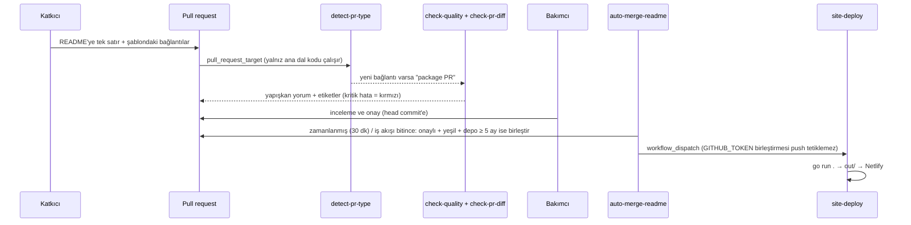
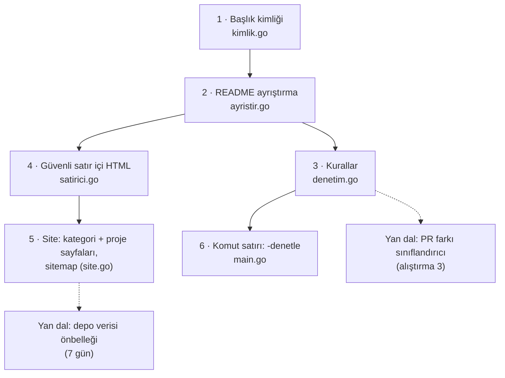

# avelino/awesome-go — Go ekosisteminin listesi, PR robotları ve site üreticisi

> **Dal:** [D10 Küratörlük ve topluluk](../README.md) · **Tür:** liste
> **Dil:** Go · **Lisans:** MIT · **Yıldız:** 192.914 (9 Kasım 2026) · **İncelenen commit:** `499762c` (2026-11-06)

## 1. Bir bakışta

awesome-go, Go paketlerinin ve kaynaklarının 2014'ten beri tutulan listesidir (README'nin kendi ifadesiyle
"awesome-python'dan esinlenildi"). README 4.157 satır, yaklaşık 3.170 girdi, 87 ana ve 60 alt bölüm içeriyor. Onu bu dalın
en öğretici deposu yapan şey, listenin etrafına kurulan **Go ile yazılmış otomasyon**: PR'ı sınıflandıran, eklenen
paketin deposunu denetleyen (go.mod, SemVer etiketi, lisans, 5 ay yaşı), uygun PR'ları onaydan sonra kendisi birleştiren
robotlar ve README'den awesome-go.com'u üreten bir site derleyicisi. Bakım, adları `MAINTAINERS` dosyasında yazılı bir
gönüllü ekiple ve uzlaşıyla yürüyor.

## 2. Nasıl yapılmış: mimari

### Klasör haritası

```text
awesome-go/                                   (108 dosya)
├── README.md                                 liste: <details> içinde İçindekiler, sponsor tablosu, kategoriler
├── CONTRIBUTING.md                           kalite standartları, otomatik denetimler tablosu, kaldırma süreci
├── MAINTAINERS                               8 etkin bakımcı + emekliler
├── main.go                                   site üretici: README → HTML → kategoriler → proje sayfaları → sitemap (770 satır)
├── main_test.go                              README testleri: TestAlpha, TestDuplicatedLinks, TestSeparator
├── maturity_test.go                          5 ay olgunluk testi (GitHub API)
├── stale_repositories_test.go                haftalık "bakımsız depo" taraması; issue açar
├── pkg/markdown/convert.go                   goldmark + bluemonday: güvenli Markdown → HTML
├── pkg/slug/generator.go                     başlık → kimlik
├── tmpl/                                     index/category-index/project şablonları, sitemap, robots.txt, CSS, yazı tipleri
├── netlify.toml                              yayın yeri, eski adres yönlendirmeleri
├── .github/scripts/detect-pr-type/           PR farkını "paket / kaldırma / biçim" diye sınıflar
├── .github/scripts/check-quality/            eklenen deponun kalitesini denetler (go.mod, SemVer, lisans, yaş ...)
├── .github/scripts/check-pr-diff/            farkın kurallara uygunluğu (tek girdi, sıra, nokta, reklam dili, HTML yok)
├── .github/scripts/auto-merge-readme/        onaylı ve yeşil PR'ları birleştirir (depo en az 5 aylık olmalı)
├── .github/workflows/                        tests, pr-quality-check, auto-merge-readme, run-check, site-deploy, recheck-open-prs
├── AGENTS.md, .cursorrules, .github/copilot-instructions.md   yapay zekâ asistanları için proje notları (inceleme konusu)
└── go.mod                                    goquery, goldmark, bluemonday, slugify, oauth2, copy
```

### Ana bileşenler ve veri akışı



Site üretimi (`main.go` → `buildStaticSite`): README'yi goldmark ile HTML'e çevir → goquery ile `#contents` altındaki
bağlantılardan kategorileri bul → her kategori için sayfa → GitHub/GitLab depoları için proje sayfası (API'den yıldız,
lisans, son itme; `.cache/repos` altında 7 gün önbellek) → ana sayfadaki bağlantıları yeniden yaz → `sitemap.xml` →
statik dosyaları kopyala.

### Önce okunacak dosyalar

1. `CONTRIBUTING.md` — "What is checked automatically": engelleyici ve uyarı denetimlerinin tablosu.
2. `.github/workflows/pr-quality-check.yaml` — `pull_request_target` güvenliği: "PR'dan hiçbir şey çalıştırılmaz".
3. `.github/scripts/detect-pr-type/classify.go` — 85 satırda fark sınıflandırma; en okunur Go dosyası.
4. `.github/scripts/auto-merge-readme/rules.go` — "yalnızca saf ekleme" ve takvim ayı hesabı.
5. `main.go` — `buildStaticSite` ve çağırdığı fonksiyonlar, yukarıdan aşağı.
6. `main_test.go` ve `stale_repositories_test.go` — README'nin "test edilen veri" olması.

### Teknoloji yığını, derleme, test, CI, sürüm

- **Go 1.26** (`go.mod`), CI kapsayıcısı `golang:1.27.3`. Üçüncü taraf eylemler commit SHA'sına sabitlenmiş;
  `dependabot.yml` haftalık toplu güncelleme açıyor.
- **tests.yaml:** `go test main_test.go main.go && go test ./pkg/...` + `go test ./.github/scripts/...`.
- **pr-quality-check.yaml:** üç iş: tür tespiti → kalite ve fark denetimi (sonuçlar `GITHUB_OUTPUT` ile) → yorum ve
  etiket. Çıktı ayıracı her çağrıda `crypto/rand` ile üretiliyor: sabit bir `EOF` ayıracı, PR metnindeki bir satırla başka
  bir adım çıktısı enjekte etmeye açık olurdu.
- **run-check.yaml:** her pazar `TestStaleRepository`: bir yıldır commit almayan, arşivlenen, 404/301 dönen depoları issue
  olarak açar.
- **site-deploy.yaml:** `main`'e itmede ve elle tetiklemede `go run .` → Netlify.
- **Sürüm yok:** yayın = birleştirme + site dağıtımı.

### Tasarım kararları ve ödünleşimler

1. **Liste, test edilen veri.** README'nin alfabetik olması ve yinelenen bağlantı içermemesi `go test` ile denetleniyor.
   İlginç bir bulgu: `TestSeparator`'ın düzenli ifadesi `* [` ile başlayan satırları arıyor, README ise `- [` kullanıyor;
   test hiçbir satırla eşleşmediği için hiç kırmızı olamaz. Bu iş artık `check-pr-diff`'te yapılıyor.
2. **Kalite ölçütü pakete uzanıyor.** Girdinin kendisi değil, gösterdiği depo denetleniyor: `go.mod`, `vX.Y.Z` etiketi,
   açık kaynak lisans, 5 ay geçmiş, pkg.go.dev sayfası, kapsam raporu bağlantısı (≥ %80 hedefi). PR denetiminde lisans
   ve yaş yalnızca uyarıdır; otomatik birleştirme için ise 5 ay şarttır.
3. **Güvenli PR otomasyonu.** `pull_request_target` ana dalın bağlamında, gizli değişkenlere erişebilen ve yazma izni
   verilebilen bir jetonla çalışır. Bu yüzden iş akışı izinleri iş akışı düzeyinde okumaya indiriyor (yazma izni yalnız
   yorum işinde: `pull-requests: write`), yalnızca ana dalın kodunu çalıştırıyor (`ref: github.sha`,
   `persist-credentials: false`) ve PR'ı yalnızca veri olarak okuyor: tür tespiti API'den, fark denetimi `git fetch` +
   `git diff` ile. Fork'tan gelen kod asla çalışmıyor.
4. **İnsan onayı + makine birleştirmesi.** Bakımcı yalnızca onaylar; birleştirmeyi robot "head commit onaylı, denetimler
   yeşil, eklenen depolar ≥ 5 ay" koşuluyla yapar. Kaldırma talepleri en az 7 gün bekletilir.
5. **Ağır yük sitede.** Proje sayfaları (her GitHub deposu için ayrı sayfa) uzun kuyruk arama trafiği getirir; API
   sınırları için dosya başına önbellek ve istekler arası 50 ms bekleme.
6. **Belgeler kayabiliyor.** `AGENTS.md` PR denetimini `.github/scripts/check-quality.js` olarak anlatıyor; depodaki
   betik Go'ya taşınmış (`check-quality/main.go`). Belgeleri koddan üretmeyen her projede bu kayma olur.

## 3. Öğrenmen gerekenler

| Düğüm / kavram                                  | Bu depo için neden                                                     | Ücretsiz kaynak                                                                                                     |
| ----------------------------------------------- | ---------------------------------------------------------------------- | ------------------------------------------------------------------------------------------------------------------- |
| [G2 Git ve GitHub](../../../govde/README.md#g2) | PR farkı, inceleme durumları, etiketler, birleştirme API'si            | [Pro Git (Türkçe)](https://git-scm.com/book/tr/v2)                                                                  |
| [G7 Test ve CI](../../../govde/README.md#g7)    | `go test`, altı iş akışı, `workflow_run`, `pull_request_target`        | [GitHub Actions güvenlik rehberi](https://docs.github.com/en/actions/security-for-github-actions)                   |
| [G6 Ağ ve web](../../../govde/README.md#g6)     | GitHub/GitLab API, önbellek, hız sınırı, HTTP durum kodları            | [GitHub REST API](https://docs.github.com/en/rest)                                                                  |
| [G9 Açık kaynak](../../../govde/README.md#g9)   | Kabul ölçütleri, bakımcılık, uzlaşı, kaldırma süreci                   | [Open Source Guides](https://opensource.guide/)                                                                     |
| Go dili                                         | Tüm otomasyon ve site Go; standart kütüphane: `html/template`, `embed` | [A Tour of Go](https://go.dev/tour/), Türkçe: [Go El Kitabı](https://github.com/umutphp/the-little-go-book)         |
| HTML güvenliği (XSS)                            | Herkesin PR açabildiği içerik siteye basılıyor                         | [OWASP XSS Önleme](https://cheatsheetseries.owasp.org/cheatsheets/Cross_Site_Scripting_Prevention_Cheat_Sheet.html) |

## 4. Sıfırdan yol (dallanma)



| Aşama | Ne inşa edersin                                  | Öğrendiğin kavram                                            | Bitti ölçütü                                    | Süre (tahmini) |
| ----- | ------------------------------------------------ | ------------------------------------------------------------ | ----------------------------------------------- | -------------- |
| 1     | `Slugify` + benzersizlik                         | Unicode harf/işaret sınıfları, `İ` tuzağı                    | `TestSlugify` geçiyor                           | 1 saat         |
| 2     | `Parse`: başlık, alt başlık, liste blokları      | Satır tabanlı durum makinesi                                 | Örnek README'de 3 kategori, 2 liste bloğu doğru | 3 saat         |
| 3     | `Check`: alfabe (bayt), yineleme, biçim, en az 3 | Kuralları veri üzerinde test etmek                           | Bozuk örnekte beklenen 5 sorun                  | 2 saat         |
| 4     | `RenderInline`                                   | Kaçışlama, URL şeması izin listesi                           | `<script>` ve `javascript:` etkisiz             | 2 saat         |
| 5     | `Build`: şablonlar, proje sayfaları, sitemap     | `html/template`, `embed`, `encoding/xml`, belirlenimci çıktı | 12 sayfa; iki üretim bayt bayt aynı             | 5 saat         |
| 6     | `main.go` bayrakları                             | CLI tasarımı, çıkış kodu                                     | Gerçek README'de 3.015 sayfa < 1 sn             | 1 saat         |

Toplam yaklaşık 14 saat (1 gün ≈ 5 saat odaklı çalışma; dalın süre kuralı [D10 README](../README.md)'de).

**Mini uygulama:** [`sifirdan/`](sifirdan/README.md) — Go, yalnızca standart kütüphane, 11 test. Gerçek awesome-go
README'si üzerinde 146 kategori ve 3.015 sayfa üretiyor. Eşleşme tablosu mini'nin README'sinde.

**Gerçek ölçeğe giden yol:** gerçek Markdown ayrıştırıcı + HTML temizleyici → GitHub API ile depo verisi (jeton, önbellek,
hata toleransı) → PR robotları (fark sınıflandırma, kalite denetimi, yapışkan yorum) → zamanlanmış bakımsızlık taraması →
otomatik birleştirme ve ardından açık dağıtım tetiklemesi.

## 5. Gerçek depoda okuma rotası

1. `CONTRIBUTING.md` → "Blocking checks" tablosundaki her satırı `.github/scripts/` altında bir fonksiyona bağla.
2. `detect-pr-type/classify.go` → bir girdinin yalnızca taşındığı (silinip başka yere eklendiği) farkta sonuç ne olur?
3. `detect-pr-type/testdata/*.patch` → gerçek PR farklarıyla yazılmış testler; birini açıp beklenen türü tahmin et.
4. `check-pr-diff/main.go` → `promotionalWords` ve `reviewEntrySafety`: hangi saldırı hangi kuralla engelleniyor?
5. `auto-merge-readme/rules.go` → `addMonthsClamped`: 30 Eylül + 5 ay neden 28 Şubat?
6. `main.go` → `extractCategory` içindeki "FIXME" notları: bilinen hatalar nasıl belgelenmiş?
7. `stale_repositories_test.go` → bir test neden issue açıyor? Testin "yan etkisi" ne kadar doğru bir tasarım?
8. `README.md` "Meetups" bölümü → Türkiye'den iki topluluk: "Golang Turkey" ve "Istanbul Golang".

## 6. Alıştırmalar ve öz değerlendirme

1. **(Kolay)** Mini'yi gerçek README ile `-denetle` kipinde çalıştır; "asgari" bulgusu veren 11 kategoriyi bul. Hangileri
   alt başlıklı üst kategori olduğu için yanlış alarm olurdu?
2. **(Kolay)** `TestSeparator`'ı düzelt: düzenli ifadeyi `- [` biçimine uyarla ve gerçek README'de kaç satırın
   başarısız olacağını say.
3. **(Orta)** Mini'ye `classify(patch)` ekle: birleşik farktan eklenen ve silinen bağlantıları bul, "paket / kaldırma /
   biçim" döndür; `testdata/` altına iki `.patch` örneği koy.
4. **(Orta)** Proje sayfalarına "arşivlendi" rozeti zaten var; bir adım ileri git: arşivlenmiş depoları kategori
   sayfasında üstü çizili göster ve `Check`'e uyarı olarak ekle.
5. **(Zor)** Yerel bir HTTP sunucusuyla GitHub API'sini taklit et; `fetchMeta` yaz: önbellekte 7 günden yeni kayıt varsa
   isteme, yoksa çek ve dosyaya yaz; testi internetsiz geçsin.
6. **(Zor)** "Onaylı + yeşil + 5 ay" kuralını saf bir fonksiyon olarak yaz (`eligible(reviews, checks, createdAt, now)`);
   en son incelemesi "değişiklik iste" olan bakımcı varsa birleştirmeyi engelle.

**Öz değerlendirme**

1. `pull_request_target` neden tehlikeli ve awesome-go riski nasıl azaltıyor?

<details><summary>Cevap</summary>

`pull_request_target` ana dalın bağlamında çalışır: gizli değişkenlere erişebilir ve jetonuna yazma izni verilebilir.
Fork'taki kodu çalıştırırsan saldırgan jetona ve gizli değişkenlere erişebilir. awesome-go izinleri iş akışı düzeyinde
okumaya indirir (yazma izni yalnız yorum işinde), yalnızca ana dalın kodunu çalıştırır (`ref: github.sha`), PR içeriğini
yalnızca metin olarak okur (API ve `git diff`), `persist-credentials: false` kullanır ve çıktı ayıracını rastgele üretir.

</details>

2. Robotun birleştirmesinden sonra site neden ayrıca tetikleniyor?

<details><summary>Cevap</summary>

`GITHUB_TOKEN` ile yapılan işlemler, sonsuz döngüleri önlemek için başka iş akışlarını (`push` olayını) tetiklemez. Bu
yüzden `auto-merge-readme.yaml`, birleştirme olduysa `site-deploy.yaml`'ı API ile `workflow_dispatch` olarak çağırır.

</details>

3. Mini'deki `Slugify`, `İ` harfini neden elle çeviriyor?

<details><summary>Cevap</summary>

GitHub başlık kimliğini tam Unicode küçültmesiyle üretir (onu taklit eden github-slugger paketi JavaScript'in
`toLowerCase`'ini kullanır); bu eşleme `İ`'yi `i` + U+0307 yapar. Go'nun
`strings.ToLower`'ı basit eşleme kullanır ve düz `i` döndürür. Elle çevirmezsek "İçindekiler" bağlantısı GitHub'daki
kimlikle eşleşmez. (Türkçe doğru küçültme için Go'da `strings.ToLowerSpecial(unicode.TurkishCase, s)` var.)

</details>

4. Alfabetik sıra testinde "Bärner" neden "Brisbane"den sonra geliyor?

<details><summary>Cevap</summary>

awesome-go adları küçültüp bayt sırasıyla karşılaştırır. UTF-8'de `ä` iki bayttır ve ilk baytı (0xC3) `r`'den (0x72)
büyüktür. Dile duyarlı bir sıralamada (ICU) "Bärner" önce gelirdi. Sıralama kuralı bir sözleşmedir; belgelenmesi gerekir.

</details>

## 7. İş fikri tohumları

- **README'den SEO'lu site hizmeti:** Bir GitHub listesini bağlayınca kategori ve proje sayfaları, sitemap, arama üreten
  barındırılan hizmet. **Kime:** 1.000+ yıldızlı liste ve dokümantasyon deposu sahipleri.
- **Go paketi kalite karnesi:** go.mod, SemVer, lisans, kapsam, son sürüm ve bakım sinyalini tek rozet ve raporda veren
  araç. **Kime:** Go kullanan şirketlerde bağımlılık onayı veren mimarlar ve güvenlik ekipleri.
- **PR robotu kiti:** Liste depoları için hazır "sınıflandır → denetle → yorumla → onaylıysa birleştir" iş akışları.
  **Kime:** yoğun PR alan topluluk depolarının gönüllü bakımcıları.

Ayrıntı: [İş fikirleri kataloğu](../../../is-fikirleri/README.md).

## 8. Kaynaklar

- [CONTRIBUTING.md](https://github.com/avelino/awesome-go/blob/499762cd36b35c31c2ae860f3d17d2086464411a/CONTRIBUTING.md)
- [main.go](https://github.com/avelino/awesome-go/blob/499762cd36b35c31c2ae860f3d17d2086464411a/main.go) ve
  [main_test.go](https://github.com/avelino/awesome-go/blob/499762cd36b35c31c2ae860f3d17d2086464411a/main_test.go)
- [.github/workflows/pr-quality-check.yaml](https://github.com/avelino/awesome-go/blob/499762cd36b35c31c2ae860f3d17d2086464411a/.github/workflows/pr-quality-check.yaml)
- [.github/scripts/auto-merge-readme/rules.go](https://github.com/avelino/awesome-go/blob/499762cd36b35c31c2ae860f3d17d2086464411a/.github/scripts/auto-merge-readme/rules.go)
- [pkg/markdown/convert.go](https://github.com/avelino/awesome-go/blob/499762cd36b35c31c2ae860f3d17d2086464411a/pkg/markdown/convert.go)
- [GitHub Actions: pull_request_target ve güvenlik](https://securitylab.github.com/resources/github-actions-preventing-pwn-requests/)
- [goldmark](https://github.com/yuin/goldmark), [bluemonday](https://github.com/microcosm-cc/bluemonday), [goquery](https://github.com/PuerkitoBio/goquery)
