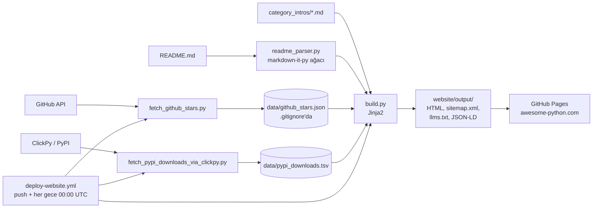
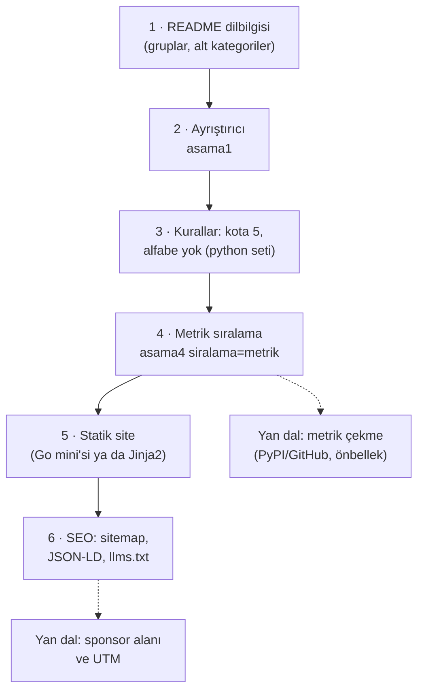

# vinta/awesome-python — "X için hangi Python aracı?" kısa listesi ve sitesi

> **Dal:** [D10 Küratörlük ve topluluk](../README.md) · **Tür:** liste
> **Dil:** Python (site üreticisi) · **Lisans:** CC BY 4.0 (`LICENSE`; GitHub "NOASSERTION" gösteriyor) · **Yıldız:** 333.539 (9 Kasım 2026) · **İncelenen commit:** `bcd8459` (2026-11-08)

## 1. Bir bakışta

2014'ten beri yaşayan, "Python'da X için ne kullanırım?" sorusunu cevaplayan liste. README 74 kullanım bölümünde 548
proje girdisi taşıyor; tematik gruplar (AI & ML, Web, Data & Science…) ve en üstte ücretli sponsor alanı var. 2026
ortasında alınan bir kararla (`docs/adr/0001-shortlist-not-catalog.md`) liste **katalogdan kısa listeye** dönüştü: her
kullanım alanında en çok 3 "bariz seçim" + 2 "aday", sert sınır 5; dolu bir alana girmek için birini yerinden etmek
gerekiyor; kanıt olarak GitHub yıldızı değil PyPI indirme sayısı kullanılıyor. README tek doğruluk kaynağı; `website/`
klasöründeki Python kodu ondan her gece awesome-python.com sitesini üretiyor.

## 2. Nasıl yapılmış: mimari

### Klasör haritası

```text
awesome-python/                              (132 dosya)
├── README.md                                tek kaynak: Sponsors, Categories (gruplu İçindekiler), Projects (74 ###), Resources
├── CONTRIBUTING.md                          kalite şartları, kotalar, yerinden etme, otomatik ret, girdi biçimi
├── SPONSORSHIP.md                           3 kademe (aylık 500 / 200 / 99 $), UTM, "editoryal bağımsızlık"
├── docs/adr/0001-shortlist-not-catalog.md   kısa liste kararı (Architecture Decision Record)
├── docs/audit-logs.md                       istisna kayıtları: ad, kararlılık, aday, kota istisnaları; reddedilenler
├── AGENTS.md, CLAUDE.md, .claude/skills/    sorumlunun yapay zekâ ajanlarıyla yürüttüğü denetim iş akışları (inceleme konusu)
├── DESIGN.md                                sitenin tasarım belgesi (renk, yazı tipi, ton)
├── Makefile                                 install, test, lint (ruff), typecheck (ty), build, preview, fetch_*
├── pyproject.toml, uv.lock                  uv bağımlılık grupları: build (httpx2, jinja2, markdown-it-py), lint, test
├── website/
│   ├── readme_parser.py                     README → gruplar/bölümler/girdiler (markdown-it-py sözdizimi ağacı, 454 satır)
│   ├── build.py                             site üretimi: sayfalar, JSON-LD, sitemap, llms.txt, yönlendirmeler (1043 satır)
│   ├── fetch_github_stars.py                yıldız ve sahip bilgisi (GitHub API, 12 saatlik önbellek)
│   ├── fetch_pypi_downloads_via_*.py        aylık indirme: ClickPy (varsayılan), BigQuery, pepy (çapraz kontrol)
│   ├── data/category_intros/*.md            74 bölüm için elle yazılmış giriş ve "How to choose" metni
│   ├── data/redirects.json                  eski kategori adreslerinden yenilerine yönlendirme
│   ├── data/pypi_name_overrides.json        README adı ile PyPI paket adı farklıysa eşleme
│   ├── templates/                           Jinja2 HTML şablonları + llms.txt şablonu
│   ├── static/                              style.css, main.js (arama/filtre), yazı tipleri
│   └── tests/                               pytest: test_build.py (1647 satır), test_readme_parser.py, ...
└── .github/workflows/ci.yml, deploy-website.yml
```

### Ana bileşenler ve veri akışı



Akış: PR'lar yalnızca README'yi (ve gerekirse bölüm girişini) değiştirir. `ci.yml` her PR'da testleri koşup siteyi
üretmeyi dener (bozuk README = kırmızı PR). `master`'a birleşince ve her gece `deploy-website.yml` yıldızları ve
indirmeleri taze çeker (günlük önbellek anahtarıyla), siteyi üretir ve GitHub Pages'e yayınlar. Veri çekme adımı
düşerse önbellekteki dünkü veriyle devam edilir (`continue-on-error` + "veri dosyası var mı" kontrolü).

### Önce okunacak dosyalar

1. `docs/adr/0001-shortlist-not-catalog.md` — neden ve hangi bedelle kısa liste (uzun kuyruk arama trafiğini bilerek kaybetme).
2. `CONTRIBUTING.md` — "Admission", "Entry Ordering", "Automatic Rejection": kuralların makineye ve insana bölünüşü.
3. `README.md` 1–194. satırlar — sponsorlar, gruplu İçindekiler, kalın grup işaretleri (`**AI & ML**`) ve ilk kullanım
   bölümü "AI and Agents"in alt kategori maddeleri (`- Orchestration` gibi).
4. `website/readme_parser.py` — `parse_readme`, `_parse_grouped_sections`, `parse_sponsors`: README'nin "dilbilgisi".
5. `website/build.py` — `build`, `sort_entries`, `section_line_range`, `write_sitemap_xml`, `build_homepage_json_ld`.
6. `.github/workflows/deploy-website.yml` — önbellek, hata toleransı, `fetch-depth: 0` gerekçesi.
7. `docs/audit-logs.md` — kuralların istisnaları nasıl kayda geçiriliyor.

### Teknoloji yığını, derleme, test, CI, sürüm

- **Python ≥ 3.14, uv**: `uv sync --locked`; `[tool.uv] exclude-newer = "3 days"` ile yalnızca en az 3 gün önce
  yayımlanmış paket sürümleri seçilir, `no-build` + `only-binary` ile kaynak paket derlenmez (tedarik zinciri önlemi).
- **Kalite**: `ruff` (lint/format), `ty` (tip denetimi, uyarı = hata), `pytest` (`make test`).
- **CI** (`ci.yml`): `push` (master) ve her PR: `uv sync --group build --locked` → `make test` → `make build`.
- **Yayın** (`deploy-website.yml`): `pages: write` + `id-token: write` izinleri, `actions/upload-pages-artifact` →
  `actions/deploy-pages`. `fetch-depth: 0`: `build.py` her sayfanın `lastmod` tarihini `git log` ile README'deki ilgili
  satır aralığından okur (`section_line_range`).
- **Sürüm yok**: yayın = `master` + gece derlemesi.

### Tasarım kararları ve ödünleşimler

1. **README tek kaynak, site türetilmiş.** Katkıcı yalnızca Markdown bilmeli. Bedeli: site, README'nin dilbilgisine
   bağımlı; bu yüzden ayrıştırıcının 539 satırlık, üreticinin 1647 satırlık test dosyası var.
2. **Kısa liste ve yerinden etme.** "Bu proje iyi mi?" yerine "bu alanın en iyi 3'ünden biri mi?" sorulur. Bedeli: çoğu PR
   "alan dolu" diye reddedilir; ADR bunu açıkça kabul ediyor.
3. **Kanıt: indirme > yıldız.** Yıldız popülerliği, indirme kullanımı ölçer; ama CI kaynaklı şişkinlik ve bağımlılık
   zincirleri (bir paket diğerini çekiyor) bilinen hatalar. `AGENTS.md` bunu bir örnekle anlatıyor.
4. **İstisnalar kayıt altında.** Kural çiğnenecekse `docs/audit-logs.md`'ye tarih ve gerekçeyle yazılıyor. Bu dalın araç
   kutusu `--hazir python` ile 5 sınırını aşan tam üç kullanım alanı buluyor; üçü de günlükte "Cap Exceptions" altında.
5. **Görünen ad = PyPI paket adı.** Okur adı kopyalayıp `pip install` yazabilsin diye. `(part of X)` öneki site tarafından
   ayrıştırılıp "Bundled" rozetine çevriliyor: biçim kuralı, verinin bir alanı haline gelmiş.
6. **Keşfedilebilirlik.** Kategori başına sayfa, JSON-LD (`WebSite`, `ItemList`, `BreadcrumbList`), dürüst `lastmod`,
   eski adreslere yönlendirme (`redirects.json`) ve dil modelleri için `llms.txt`. `SPONSORSHIP.md` "ChatGPT ve diğer
   modeller bu listeyi referans veriyor" diyerek bunu satış argümanına çeviriyor.
7. **Para ve bağımsızlık.** Sponsor alanı README'nin tepesinde; bağlantılarda UTM; `SPONSORSHIP.md` sponsorluğun listeye
   girişi etkilemediğini yazılı taahhüt ediyor.
8. **Lisans belirsizliği.** `LICENSE` dosyası tam metin yerine 3 satır ("CC BY 4.0" ve adres) içerdiği için GitHub lisansı
   tanıyamıyor; `pyproject.toml` ise `license = "MIT"` diyor. Ders: içerik ve kod lisansını ayrı dosyalarda, tam metinle
   yaz.

## 3. Öğrenmen gerekenler

| Düğüm / kavram                                                            | Bu depo için neden                                                   | Ücretsiz kaynak                                                                                                                      |
| ------------------------------------------------------------------------- | -------------------------------------------------------------------- | ------------------------------------------------------------------------------------------------------------------------------------ |
| [G3 Python](../../../govde/README.md#g3)                                  | Site üretici, ayrıştırıcı, veri çekiciler Python                     | [Python-100-Days](../../09-bilgisayar-bilimi/python-100-days/README.md); resmi [Python eğitimi](https://docs.python.org/3/tutorial/) |
| [G7 Test ve CI](../../../govde/README.md#g7)                              | pytest, ruff, ty, iki iş akışı                                       | [uv belgeleri](https://docs.astral.sh/uv/), [pytest](https://docs.pytest.org/)                                                       |
| [G6 Ağ ve web](../../../govde/README.md#g6)                               | GitHub API, PyPI JSON API, önbellek, hız sınırı                      | [GitHub REST API](https://docs.github.com/en/rest)                                                                                   |
| [G9 Açık kaynak](../../../govde/README.md#g9)                             | Lisans dosyası tuzağı, sponsorluk etiği, yönetişim (ADR)             | [Open Source Guides](https://opensource.guide/)                                                                                      |
| [D04 public-apis](../../04-veri-araclari-otomasyon/public-apis/README.md) | O da doğrulayıcılı bir liste; README'yi veri gibi işleme fikri ortak | —                                                                                                                                    |
| Şablon motoru, sözdizimi ağacı                                            | Jinja2 ile HTML, markdown-it-py ile ağaç                             | [Jinja belgeleri](https://jinja.palletsprojects.com/), [markdown-it-py](https://markdown-it-py.readthedocs.io/)                      |
| Yapılandırılmış veri ve site haritası                                     | JSON-LD ve `lastmod` ile arama motoru görünürlüğü                    | [schema.org ItemList](https://schema.org/ItemList), [sitemaps.org](https://www.sitemaps.org/protocol.html)                           |

## 4. Sıfırdan yol (dallanma)



| Aşama | Ne inşa edersin                    | Öğrendiğin kavram                      | Bitti ölçütü                                                           | Süre (tahmini) |
| ----- | ---------------------------------- | -------------------------------------- | ---------------------------------------------------------------------- | -------------- |
| 1     | Kalın grup işaretli README taslağı | Biçim = veri şeması                    | Gruplar, bölümler, alt kategoriler elle tutarlı                        | 2 saat         |
| 2     | README → yapı (ayrıştırıcı)        | Satır/ağaç tabanlı ayrıştırma          | Her girdinin grup/bölüm/alt kategorisi doğru                           | 5 saat         |
| 3     | Kota ve biçim kuralları            | Kural seti, istisna listesi            | `liste.py denetle --hazir python` gerçek README'de 3 istisnayı buluyor | 3 saat         |
| 4     | Metriğe göre sıralı üretim         | Kararlı sıralama, eşitlik bozma        | Aynı veri → aynı sıra                                                  | 3 saat         |
| 5     | Kategori sayfalı statik site       | Şablon, kaçışlama, belirlenimci çıktı  | İki üretim bayt bayt aynı                                              | 8 saat         |
| 6     | `sitemap.xml`, JSON-LD, `llms.txt` | Arama motoru ve dil modeli görünürlüğü | Sitemap doğrulanıyor; `lastmod` gerçek değişiklik tarihini gösteriyor  | 5 saat         |

Toplam yaklaşık 26 saat (1 gün ≈ 5 saat odaklı çalışma; dalın süre kuralı [D10 README](../README.md)'de).

**Mini uygulama:** Bu depo için ayrı bir mini yok; iki mini birlikte kullanılır. Aşama 2–4:
[ortak araç kutusu](../awesome/sifirdan/README.md) (`python` kural seti, `asama4_uretici.py` içinde `siralama: "metrik"`).
Aşama 5–6: [awesome-go mini'si](../awesome-go/sifirdan/README.md) (README → statik site, sitemap, güvenli HTML).

**Gerçek ölçeğe giden yol:** markdown-it-py ile tam ağaç → PyPI ve GitHub verisini çekip önbellekleyen ayrı betikler →
CI'da günlük önbellek anahtarı ve düşerse dünkü veri → bölüm başına `git log -L` ile `lastmod` → arama/filtre için
istemci JavaScript'i → sponsor alanını README'den ayrıştırma (`parse_sponsors`).

## 5. Gerçek depoda okuma rotası

1. `CONTRIBUTING.md` "Admission": kotaları ve "Displacement"ı kendi cümlelerinle yaz.
2. `README.md` → bir alt kategori seç (ör. "AI and Agents > Orchestration"); sıranın önce kademeye (bariz seçimler,
   sonra adaylar), kademe içinde aylık PyPI indirme sayısına göre olduğunu `CONTRIBUTING.md` "Entry Ordering" ile
   doğrula. (Sitede ana sayfadaki tüm projeler listesini sıralayan `sort_entries` kademe bilmez; kategori sayfaları
   README sırasını korur.)
3. `website/readme_parser.py` → `_parse_grouped_sections`: kalın tek satırlık paragraf nasıl "grup" olarak algılanıyor?
4. `website/build.py` → `sort_entries`: dört katman var (indirmesi olanlar, yıldızı olanlar, standart kütüphane, kalanlar). İndirme sayısı olmayan bir girdi nereye düşer?
5. `website/build.py` → `section_line_range` + `git_last_change_date`: `lastmod` nasıl hesaplanıyor?
6. `website/templates/llms.txt` → dil modellerine hangi bilgi, hangi uyarıyla veriliyor?
7. `.github/workflows/deploy-website.yml` → yıldız çekme düşerse site yine de yayınlanır mı? Hangi adım engeller?
8. `docs/audit-logs.md` "Cap Exceptions" → araç kutusunun bulduğu üç alanla karşılaştır.

## 6. Alıştırmalar ve öz değerlendirme

1. **(Kolay)** `python3 liste.py denetle README.md --hazir python` çalıştır; `yinelenen-baglanti` bulgularının neden hata
   olmadığını `CONTRIBUTING.md` "Dual-listing" ile açıkla ve araca bir izin listesiyle bunu öğret.
2. **(Kolay)** Araç kutusunun `Ayarlar` sınıfına "istisna listesi" ekle: `audit-logs.md`'deki üç alan için kota uyarısı
   çıkmasın.
3. **(Orta)** `asama4_uretici.py`'ye `(part of X)` desteği ekle: açıklama bu önekle başlıyorsa girdiye `paket=False` yaz
   ve metrik sıralamasında en sona koy.
4. **(Orta)** Go mini'sine `llms.txt` çıktısı ekle: başlık, açıklama, kategori sayısı, her kategori için bir satır.
5. **(Zor)** PyPI JSON API'sini taklit eden yerel bir sunucu kur, aylık indirme sayılarını çeken ve 12 saat önbellekleyen
   bir betik yaz; testleri internetsiz geçsin.
6. **(Zor)** README'den JSON-LD `ItemList` üreten bir fonksiyon yaz ve çıktıyı schema.org örnekleriyle karşılaştır.

**Öz değerlendirme**

1. Liste neden yıldız yerine indirme sayısını kanıt sayıyor; bu ölçütün zayıf yanı ne?

<details><summary>Cevap</summary>

Yıldız ilgi ölçer, indirme kullanım ölçer. Zayıf yanlar: CI ve aynalar sayıyı şişirir; bir paket başka bir paketin
bağımlılığıysa indirmenin çoğu dolaylıdır (`AGENTS.md`'deki mkdocs/mkdocs-material örneği); pip dışında dağıtılan
araçlar (SDK, servis) görünmez. Bu yüzden son karar sorumlunun yargısı.

</details>

2. `deploy-website.yml` neden `fetch-depth: 0` ile klonluyor?

<details><summary>Cevap</summary>

`build.py`, sitemap'teki `lastmod` tarihini her bölümün README'deki satır aralığının son değişikliğinden (`git log`)
hesaplar. Sığ klonda geçmiş olmadığı için tarih bulunamaz.

</details>

3. Kısa liste kararının site üzerindeki bilinen bedeli nedir?

<details><summary>Cevap</summary>

Listeden çıkan yüzlerce niş aracın adıyla gelen uzun kuyruk arama trafiği kaybedilir. ADR bunu "okur güveni, arama
yüzeyinden önce gelir" diyerek bilinçli kabul ediyor.

</details>

4. `LICENSE` dosyası neden GitHub'da "NOASSERTION" görünüyor?

<details><summary>Cevap</summary>

Dosya lisansın tam metnini değil, adını ve adresini içeren 3 satır. GitHub'ın lisans tanıyıcısı bilinen metinlerle
karşılaştırma yapar; eşleşme bulamayınca "NOASSERTION" yazar.

</details>

## 7. İş fikri tohumları

- **Türkçe "hangi kütüphane?" rehberi:** Python kütüphanelerini kullanım alanına göre karşılaştıran, indirme ve bakım
  verisi gösteren Türkçe site; gelir sponsor alanından. **Kime:** Türk Python geliştiricileri ve bootcamp öğrencileri;
  sponsor olarak Türk bulut/SaaS şirketleri.
- **Bağımlılık seçim raporu:** Bir projenin `requirements.txt`'ini okuyup her paket için indirme eğilimi, son sürüm, arşiv
  durumu ve lisans özeti çıkaran ücretli rapor. **Kime:** ajansların ve 10–50 kişilik yazılım ekiplerinin teknik liderleri.
- **Sponsor alanı yönetimi:** Liste ve bülten sahipleri için kademe, UTM, fatura ve tıklama raporunu tek yerde tutan araç.
  **Kime:** 10 bin+ yıldızlı liste ya da 5 bin+ aboneli bülten sahipleri.

Ayrıntı: [İş fikirleri kataloğu](../../../is-fikirleri/README.md).

## 8. Kaynaklar

- [CONTRIBUTING.md](https://github.com/vinta/awesome-python/blob/bcd84599acc172208f0544a61f3bfa47fd39e9b6/CONTRIBUTING.md)
- [docs/adr/0001-shortlist-not-catalog.md](https://github.com/vinta/awesome-python/blob/bcd84599acc172208f0544a61f3bfa47fd39e9b6/docs/adr/0001-shortlist-not-catalog.md)
- [docs/audit-logs.md](https://github.com/vinta/awesome-python/blob/bcd84599acc172208f0544a61f3bfa47fd39e9b6/docs/audit-logs.md)
- [SPONSORSHIP.md](https://github.com/vinta/awesome-python/blob/bcd84599acc172208f0544a61f3bfa47fd39e9b6/SPONSORSHIP.md)
- [website/build.py](https://github.com/vinta/awesome-python/blob/bcd84599acc172208f0544a61f3bfa47fd39e9b6/website/build.py)
  ve [website/readme_parser.py](https://github.com/vinta/awesome-python/blob/bcd84599acc172208f0544a61f3bfa47fd39e9b6/website/readme_parser.py)
- [.github/workflows/deploy-website.yml](https://github.com/vinta/awesome-python/blob/bcd84599acc172208f0544a61f3bfa47fd39e9b6/.github/workflows/deploy-website.yml)
- [Architecture Decision Records](https://adr.github.io/) — ADR yazım biçimi.
- [llms.txt önerisi](https://llmstxt.org/) — dil modelleri için site özeti (doğrulanmadı: önerinin güncel durumu).
