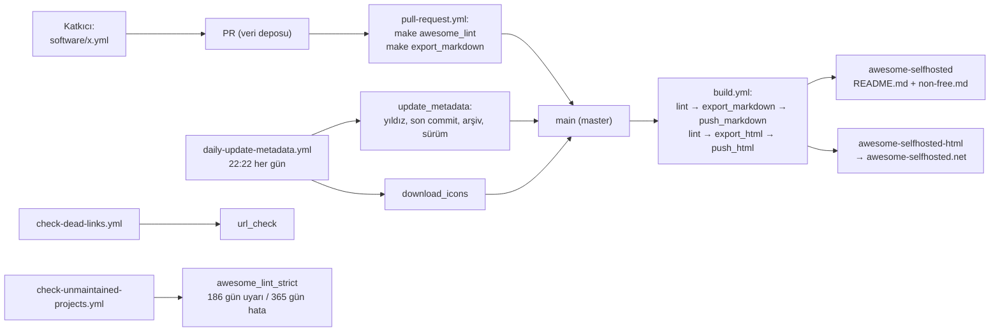
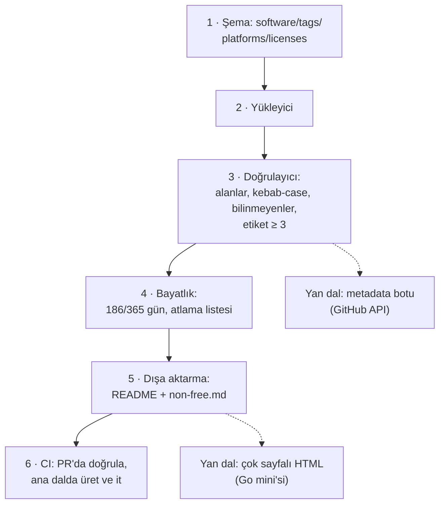

# awesome-selfhosted/awesome-selfhosted — veriden üretilen, kendi sunucunda çalışan yazılımlar listesi

> **Dal:** [D10 Küratörlük ve topluluk](../README.md) · **Tür:** liste
> **Dil:** — (Markdown çıktısı) · **Lisans:** CC-BY-SA-3.0 (`LICENSE`; GitHub "NOASSERTION" gösteriyor) · **Yıldız:** 335.309 (9 Kasım 2026) · **İncelenen commit:** `55d61d8` (2026-11-07)
> Veri deposu (51 depo dışında, salt okunur incelendi): `awesome-selfhosted/awesome-selfhosted-data` `a54bbea` (2026-11-09)

## 1. Bir bakışta

Kendi sunucunda barındırabileceğin özgür yazılım ağ hizmetlerinin (dosya eşitleme, parola yöneticisi, medya sunucusu…)
listesi. 2015'ten beri yaşıyor; 2.372 satırlık README'si 95 kategoride yaklaşık 1.270 yazılım taşıyor (`non-free.md`'de 93 daha). Bu
depoda neredeyse hiçbir şey yok: 6 dosya. Çünkü README **elle yazılmıyor**: her yazılım ayrı bir depodaki
(`awesome-selfhosted-data`) ayrı bir YAML dosyası; `hecat` adlı Python aracı veriyi denetliyor, README'yi ve HTML sitesini
(awesome-selfhosted.net) üretiyor, bot sonucu bu depoya itiyor. Bu depoya PR açmak yasak. Liste büyüdükçe "README = veri
tabanı" yaklaşımının nereye evrildiğinin en temiz örneği.

## 2. Nasıl yapılmış: mimari

### Klasör haritası

```text
awesome-selfhosted/                      (6 dosya: yalnızca ÇIKTI)
├── README.md                            üretilmiş liste (330 KB): kategoriler, lisans listesi, anti-özellikler
├── non-free.md                          özgür olmayan lisanslı yazılımlar (ayrı sayfa)
├── LICENSE                              CC-BY-SA-3.0
├── _static/awesome.png                  rozet
└── .github/
    ├── PULL_REQUEST_TEMPLATE.md         "Bu depoya PR açma; awesome-selfhosted-data'yı kullan."
    └── ISSUE_TEMPLATE/config.yml        boş issue kapalı; issue'lar veri deposuna yönlendiriliyor

awesome-selfhosted-data/                 (KAYNAK; a54bbea)
├── software/*.yml                       1.360 dosya, her yazılım bir dosya
├── tags/*.yml                           95 kategori (açıklama, ilgili etiketler, dış bağlantılar)
├── platforms/*.yml                      36 dil/kurulum biçimi
├── licenses.yml, licenses-nonfree.yml   lisans kimlikleri (SPDX), adları, adresleri
├── markdown/header.md, footer.md, non-free-header.md   elle yazılan tek parçalar
├── icons/*.webp                         bot tarafından indirilen simgeler
├── Makefile                             install (hecat@1.7.0), awesome_lint, export_markdown, export_html, url_check ...
├── .hecat/*.yml                         hecat adım yapılandırmaları (lint, dışa aktarma, metadata, bağlantı denetimi)
├── CONTRIBUTING.md, AUTHORS             katkı kuralları, hazır yanıtlar; yazar listesi (git shortlog)
└── .github/workflows/                   pull-request, build, daily-update-metadata, check-dead-links, check-unmaintained-projects
```

### Ana bileşenler ve veri akışı



Yayın bir deploy anahtarıyla yapılır: `build.yml` iki SSH anahtarını gizli değişkenden okur, üretilen dosyaları hedef
depolara `awesome-selfhosted-bot` adıyla commit eder (HTML deposunda önceki commit'i `--amend` ile değiştirip zorla
iter, geçmiş şişmesin diye).

### Önce okunacak dosyalar

1. Bu depoda `README.md`'nin bir kategorisi — çıktının biçimi:

   ```text
   - [Ad](site) `⚠` - Açıklama. ([Demo](…), [Source Code](…)) `Lisans` `Platform`
   ```

2. Veri deposunda `software/jellyfin.yml` gibi bir dosya — girdinin alanları ve botun eklediği alanlar
   (`stargazers_count`, `updated_at`, `archived`, `current_release`, `commit_history`).
3. Veri deposunda `Makefile` — tüm hat 14 hedefte (`make help` hepsini açıklamasıyla listeler).
4. `.hecat/export-markdown.yml` — iki dışa aktarma adımı: özgür lisanslar README'ye, diğerleri `non-free.md`'ye.
5. `.hecat/awesome-lint-strict.yml` ve `url-check.yml` — bakımsızlık eşikleri, atlanan projeler, "bu site botları
   engelliyor" istisnaları (her biri bir yorumla).
6. `CONTRIBUTING.md` (veri deposu) — kabul ölçütleri, kategoride en az 3 yazılım, hazır yanıtlar.

### Teknoloji yığını, derleme, test, CI, sürüm

- **Python + hecat 1.7.0** (`pip install git+https://github.com/nodiscc/hecat.git@1.7.0`, sanal ortamda), HTML için
  `sphinx-build` ve furo teması.
- **CI:** PR'da lint + Markdown üretimi (fark görülsün diye); `master`'da üret ve iki depoya it; her gün metadata, ölü
  bağlantı ve bakımsızlık taramaları. Durum rozetleri README'nin başında; ölü bağlantı ve bakımsızlık rozetleri 1 numaralı
  issue'ya gidiyor (CONTRIBUTING: sorunlar otomatik raporlanır).
- **Sürüm yok:** yayın = bot commit'i.

### Tasarım kararları ve ödünleşimler

1. **Veri ile görünüm ayrı.** Bir yazılım = bir dosya: iki PR aynı satırı değiştirmez, birleştirme çakışması neredeyse
   yok; alanlar şemayla denetlenir; aynı veriden README, HTML ve başka çıktılar üretilebilir. Bedeli: katkıcı YAML ve
   dosya adı kuralı (kebab-case) öğrenmek zorunda.
2. **Çıktı deposu dokunulmaz.** PR ve issue'lar veri deposuna yönlendirilir; README'yi elle değiştirmek anlamsız (bot
   ezer).
3. **Tek sayfa, ilk etiket.** Bir yazılımın birden çok etiketi olabilir, ama tek sayfalık README'de yalnızca ilk
   etiketinin altında görünür (CONTRIBUTING: "choose wisely"). Çok sayfalı HTML sitesi her etikette gösterebilir (doğrulanmadı: hecat kodu incelenmedi).
4. **Özgürlük, lisansla ayrıştırılıyor.** Özgür olmayan lisanslar (`licenses-nonfree.yml`) ayrı sayfaya düşer;
   üçüncü taraf hizmete bağımlılık `⚠` anti-özellik işaretiyle görünür.
5. **Bakım otomatik izleniyor.** Bot her gün yıldız, son commit ve arşiv durumunu yazar; katı lint 186 günde uyarır,
   365 günde hata verir. Bakım gerektirmeyen küçük projeler gerekçeli bir atlama listesinde.
6. **İnsan emeği korunuyor.** CONTRIBUTING, makine ya da dil modeli üretimi katkıları yasaklıyor (yasak = ban); PR
   şablonunda "gönderim bir insan tarafından yapıldı" kutusu var. Dosyada, otomatik ajanlara hitap eden bir yorum bloğu
   da bulunuyor: ajanın kuralları açıklayabileceğini ama gönderimi üretemeyeceğini söylüyor. Bu, yapay zekâ çağında liste
   yönetişiminin güncel bir örneği.

## 3. Öğrenmen gerekenler

| Düğüm / kavram                                                | Bu depo için neden                                           | Ücretsiz kaynak                                                                                                                                                     |
| ------------------------------------------------------------- | ------------------------------------------------------------ | ------------------------------------------------------------------------------------------------------------------------------------------------------------------- |
| [G3 Python](../../../govde/README.md#g3)                      | hecat ve mini üretici Python                                 | [Python-100-Days](../../09-bilgisayar-bilimi/python-100-days/README.md)                                                                                             |
| [G7 Test ve CI](../../../govde/README.md#g7)                  | Zamanlanmış iş akışları, deploy anahtarı, bot commit'i       | [GitHub Actions: zamanlanmış olaylar](https://docs.github.com/en/actions/writing-workflows/choosing-when-your-workflow-runs/events-that-trigger-workflows#schedule) |
| [G9 Açık kaynak](../../../govde/README.md#g9)                 | Özgür/özgür olmayan lisans ayrımı, SPDX kimlikleri, CC-BY-SA | [SPDX lisans listesi](https://spdx.org/licenses/)                                                                                                                   |
| [G1 Terminal ve Linux](../../../govde/README.md#g1) (faydalı) | Listedeki yazılımları kurmak; Makefile                       | [Linux dosyası](../../03-sistem-ag-guvenlik/linux/README.md)                                                                                                        |
| YAML ve şema doğrulama                                        | Her kayıt bir YAML; alanların türü ve zorunluluğu            | [JSON Schema](https://json-schema.org/learn/getting-started-step-by-step)                                                                                           |
| Statik site üretimi (Sphinx)                                  | HTML sitesi Markdown'dan Sphinx ile                          | [Sphinx belgeleri](https://www.sphinx-doc.org/)                                                                                                                     |

## 4. Sıfırdan yol (dallanma)



| Aşama | Ne inşa edersin                         | Öğrendiğin kavram                               | Bitti ölçütü                                                     | Süre (tahmini) |
| ----- | --------------------------------------- | ----------------------------------------------- | ---------------------------------------------------------------- | -------------- |
| 1     | `veri/` klasör düzeni ve örnek kayıtlar | Kayıt başına dosya, referans bütünlüğü          | 13 yazılım, 4 etiket, 8 platform, 2 lisans dosyası               | 2 saat         |
| 2     | `yukle()`                               | Dosya sistemi → bellek modeli                   | Tüm dosyalar ada göre sözlüklerde                                | 1 saat         |
| 3     | `dogrula()`                             | Hataları toplu raporlamak                       | Bozuk kayıtta 7 farklı hata türü yakalanıyor                     | 3 saat         |
| 4     | Bayatlık denetimi                       | Normal ve katı kip, istisna listesi             | Katı kipte 526 günlük proje hata, normalde uyarı                 | 1 saat         |
| 5     | `readme()`                              | İlk etiket kuralı, lisansla ayrıştırma, çapalar | İki dosya; İçindekiler bağlantılarının hepsi bir başlığa gidiyor | 3 saat         |
| 6     | İş akışı taslağı (alıştırma 5)          | Bot commit'i, deploy anahtarı                   | PR'da yalnızca doğrulama, ana dalda üretim                       | 3 saat         |

Toplam yaklaşık 13 saat (dalın süre kuralı [D10 README](../README.md)'de).

**Mini uygulama:** [`sifirdan/`](sifirdan/README.md) — Python, standart kütüphane, kurgusal JSON verisi, 15 test. Bağlantı
denetimi için [ortak araç kutusundaki](../awesome/sifirdan/README.md) `asama3_baglanti.py`, HTML için
[awesome-go mini'si](../awesome-go/sifirdan/README.md).

**Gerçek ölçeğe giden yol:** YAML + JSON Schema → GitHub/GitLab metadata botu (günde bir, hız sınırına saygılı) → bağlantı
denetimi ve istisna listesi → çok sayfalı HTML ve arama → simge indirme → ayrı çıktı depolarına bot ile yayın.

## 5. Gerçek depoda okuma rotası

1. Bu depoda `.github/PULL_REQUEST_TEMPLATE.md` ve `ISSUE_TEMPLATE/config.yml` → katkıyı başka depoya nasıl yönlendiriyorlar?
2. README'de "Analytics" bölümü → `_Related:_` satırı ve girdi biçimi; `⚠` işaretli bir girdi bul.
3. README sonu → "List of Licenses" ve "Anti-features": lisans listesi de veriden üretiliyor.
4. Veri deposunda `software/nextcloud.yml` → iki etiketi var; README'de yalnızca birinde göründüğünü doğrula.
5. Veri deposunda `Makefile` → `export_markdown` ve `push_markdown` hedeflerini sırayla izle.
6. `.hecat/url-check.yml` → istisnaların gerekçeleri ("DDoS koruma sayfası, hep 403"): bağlantı denetiminin gerçek dünyası.
7. `.github/workflows/daily-update-metadata.yml` → üç işin `needs` ile zincirlenmesi. Son iş `build.yml`'yi neden
   doğrudan (`uses:`) çağırıyor? (İpucu: `GITHUB_TOKEN` ile yapılan push başka bir iş akışını tetiklemez; awesome-go'daki
   `site-deploy` çağrısının aynı nedeni.)

## 6. Alıştırmalar ve öz değerlendirme

1. **(Kolay)** Mini'ye `software/` altında yeni bir kurgusal yazılım ekle; dosya adını bilerek yanlış yaz, hatayı gör, düzelt.
2. **(Kolay)** Üretilen README'yi ortak araç kutusuyla denetle (`liste.py denetle cikti/README.md --yerel tr`); "nokta"
   kuralı neden bu biçimle çatışıyor? Hangi ayarla susturursun?
3. **(Orta)** `commit_history` alanı ekle (ay → commit sayısı) ve son 6 ayda hiç commit yoksa uyarı ver.
4. **(Orta)** `readme()`'ye "tüm etiketlerde göster" seçeneği ekle; çıktının boyutunu ve tekrarını karşılaştır.
5. **(Zor)** Bir GitHub Actions iş akışı yaz (çalıştırmadan, YAML olarak): PR'da `python3 uretici.py veri --kati`, ana
   dalda üretip ayrı bir depoya it. Deploy anahtarını neden ortamda (`environment: production`) saklarsın?
6. **(Zor)** JSON Schema yaz ve doğrulayıcıyı şemadan üret (standart kütüphaneyle küçük bir şema yorumlayıcısı).

**Öz değerlendirme**

1. "Bir yazılım = bir dosya" düzeni neden birleştirme çakışmalarını azaltır?

<details><summary>Cevap</summary>

Tek README'de herkes aynı dosyanın yakın satırlarını değiştirir; Git aynı bölgeye yapılan iki değişikliği çakışma sayar.
Ayrı dosyalarda iki katkıcı farklı dosyalara dokunur; ancak aynı yazılımı düzenlerlerse çakışırlar.

</details>

2. Neden PR denetiminde normal, günlük taramada katı lint çalışıyor?

<details><summary>Cevap</summary>

PR'ı açan kişi, listedeki başka bir projenin bakımsız kalmasından sorumlu değil; PR'ı bu yüzden kırmamak gerekir. Günlük
tarama ise bakım ekibine "bu projelere bak" listesi üretir; orada sert eşik (365 gün = hata) doğru yerdedir.

</details>

3. HTML deposunda neden `git commit --amend` ve zorla itme kullanılıyor?

<details><summary>Cevap</summary>

Üretilen HTML her gün değişir; her derlemeyi ayrı commit olarak tutmak depoyu büyütür ve geçmişin değeri yoktur (kaynak
geçmişi veri deposunda zaten var). Tek commit'i yeniden yazmak depo boyutunu sabit tutar.

</details>

## 7. İş fikri tohumları

- **KOBİ'lere kendi sunucusunda kurulum ve bakım:** Dosya paylaşımı, parola kasası, e-posta gibi hizmetleri yurt içindeki
  sunucuda kurup güncelleyen aylık hizmet. **Kime:** KVKK nedeniyle veriyi yurt içinde tutmak isteyen 5–50 kişilik
  muhasebe ve hukuk büroları, klinikler.
- **Yazılım envanteri ve bakım uyarısı:** Bir şirketin kullandığı açık kaynak bileşenleri izleyip "arşivlendi, 1 yıldır
  sürüm yok, lisans değişti" uyarısı veren pano. **Kime:** 20–200 kişilik şirketlerin BT yöneticileri.
- **Türkçe self-hosted kataloğu:** Türkçe arayüzü olan ya da Türkiye'de barındırmaya uygun yazılımları KVKK notlarıyla
  listeleyen site. **Kime:** Türk sistem yöneticileri ve homelab meraklıları.

Ayrıntı: [İş fikirleri kataloğu](../../../is-fikirleri/README.md).

## 8. Kaynaklar

- [README.md (üretilmiş)](https://github.com/awesome-selfhosted/awesome-selfhosted/blob/55d61d874370f213f5553d5bbd0f5814b2872e45/README.md)
- [awesome-selfhosted-data: CONTRIBUTING.md](https://github.com/awesome-selfhosted/awesome-selfhosted-data/blob/a54bbea6735307d62f22f3cd682e73ba2f494492/CONTRIBUTING.md)
- [awesome-selfhosted-data: Makefile](https://github.com/awesome-selfhosted/awesome-selfhosted-data/blob/a54bbea6735307d62f22f3cd682e73ba2f494492/Makefile)
- [awesome-selfhosted-data: .hecat/](https://github.com/awesome-selfhosted/awesome-selfhosted-data/tree/a54bbea6735307d62f22f3cd682e73ba2f494492/.hecat)
- [hecat](https://github.com/nodiscc/hecat) — veri → Markdown/HTML aracı (kodu bu çalışmada incelenmedi).
- [awesome-selfhosted.net](https://awesome-selfhosted.net/) — HTML sürümü.
- [Free Software Definition](https://www.gnu.org/philosophy/free-sw.html) — "özgür yazılım" ölçütü.
