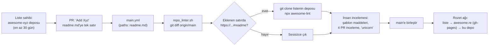
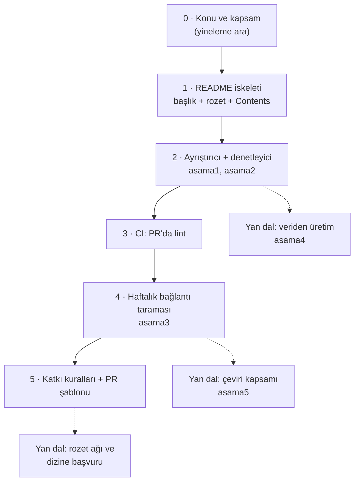

# sindresorhus/awesome — listelerin listesi ve bir kürasyon standardı

> **Dal:** [D10 Küratörlük ve topluluk](../README.md) · **Tür:** liste
> **Dil:** Markdown (GitHub dil göstermiyor: tek kod dosyası `.gitattributes` ile dil istatistiğinden çıkarılmış) · **Lisans:** CC0-1.0 · **Yıldız:** 534.158 (9 Kasım 2026) · **İncelenen commit:** `bc98e51` (2026-09-02)

## 1. Bir bakışta

`sindresorhus/awesome`, GitHub'daki "awesome-\*" listelerinin dizinidir: 26 konu başlığı altında, adresi `#readme` ile
biten 671 liste bağlantısı. Asıl ürünü ise bir **standarttır**: "kürasyon, koleksiyon değil" diyen manifesto
(`awesome.md`), listeye girmek için uzun bir kontrol listesi (`pull_request_template.md`) ve bu kuralları denetleyen
`awesome-lint` aracı. Standardı benimseyen binlerce liste aynı rozetle (`awesome.re/badge.svg`) merkeze bağlanır; ağ
büyüdükçe merkez yıldız toplar. 2014'te açılan depo bugün GitHub'ın en çok yıldızlanan depolarından biri. Depo
açıklamasındaki "PR'lar geçici olarak kapalı" notu, gönüllü bakımın ölçek karşısındaki sınırını gösteriyor.

## 2. Nasıl yapılmış: mimari

### Klasör haritası

```text
awesome/                               (23 dosya; tek kod 23 satırlık CI betiği)
├── readme.md                          asıl liste: 866 satır, 26 bölüm + "Related"; üstte sponsor alanı (HTML)
├── awesome.md                         manifesto: "Only awesome is awesome", rozet kuralları, CC0 önerisi
├── pull_request_template.md           listeye girme koşulları: 35 onay kutusu, "4 PR incele" kuralı
├── contributing.md                    tarayıcıdan düzenleme adımları (ekran görüntüleriyle)
├── create-list.md                     kendi listeni açma: önce ara, en az 30 gün bekle
├── code-of-conduct.md                 davranış kuralları
├── license                            CC0 1.0 tam metni
├── media/                             logo ve rozetler (badge.svg, mentioned-badge.svg, .ai/.sketch kaynakları)
│   └── readme.md                      renk (#fc60a8, #494368) ve yazı tipi (Orbitron)
├── .github/workflows/main.yml         PR'da readme.md değişirse lint işini başlatır
├── .github/workflows/repo_linter.sh   eklenen satırdaki listeyi klonlar, `npx awesome-lint` çalıştırır
├── .editorconfig                      sekme girinti, LF, sondaki boşluğu sil
└── .gitattributes                     4 satır: `readme.md merge=union`, betiğe `-linguist-detectable`
```

### Ana bileşenler ve veri akışı



Kritik nokta: CI bu deponun `readme.md`'sini değil, **önerilen listenin deposunu** denetler (`repo_linter.sh`, 23 satır;
yorumlar hariç ~15 satırlık Bash).
Merkez liste yalnızca bir dizin; kalite yükü her listenin kendi bakımcısına itilmiş, `awesome-lint` ortak sözleşme olmuş.

### Önce okunacak dosyalar

1. `awesome.md` — felsefe: neden "her şey" değil "en iyisi", neden açıklama yazılır, neden CC0.
2. `pull_request_template.md` — gerçek kural kitabı. Her maddeyi "hangi sorunu önlüyor?" diye oku.
3. `.github/workflows/repo_linter.sh` — tüm otomasyon: diff'ten URL çıkar, klonla, lint et.
4. `readme.md` — üstte HTML sponsor alanı, `## Contents`, sekmeyle iç içe alt listeler, en sonda `## Related`.
5. `create-list.md` ve `contributing.md` — katkı yolunun iki ucu.
6. `.gitattributes` — 4 satır; `merge=union` (birleştirme sürücüsü) ve `-linguist-detectable` (dil istatistiği) öğretici.

### Teknoloji yığını, derleme, test, CI, sürüm

- **Derleme yok, sürüm yok:** "yayın" = `main`'e birleştirme; etiket ya da sürüm yok. `awesome.re` kısa adresi bu depoya
  gider (README: "Just type awesome.re to go here").
- **Rozetlerin ikinci yayın kanalı:** `awesome.re/badge.svg` gibi rozet adresleri, `gh-pages` dalındaki kopyalardan
  GitHub Pages ile sunulur (dalda `CNAME` = `awesome.re`; son commit 2019-01-26). `media/` kaynak, `gh-pages` yayın
  kopyasıdır.
- **CI:** `main.yml` yalnızca `main`'e açılan ve `readme.md`'ye dokunan PR'larda çalışır (`actions/checkout@v6`,
  `fetch-depth: 0`). Neden `fetch-depth: 0`? Varsayılan sığ PR checkout'unda yalnızca PR'ın birleştirme commit'i gelir,
  `origin/main` dalı hiç yoktur; `fetch-depth: 0` tüm dalları getirir, böylece `git diff origin/main` karşılaştıracak ucu
  bulur. (Fark iki ağacı karşılaştırır; geçmişin kendisine ihtiyacı yoktur.)
- **awesome-lint** (ayrı npm paketi; npm'deki 2.3.0 sürümü incelendi): remark tabanlı; `rules/index.js`'te kayıtlı 12
  özel kural: başlık (title case), rozet, `contributing.md` varlığı, GitHub konuları (`awesome`, `awesome-list`),
  lisansın README'de bölüm olmaması, liste maddesi biçimi, dengeli noktalama, CI rozeti yasağı, açıklamada öğe adını
  tekrarlamama (`no-repeat-item-in-description`), İçindekiler (`Contents`) tutarlılığı, çift bağlantı ve teknoloji
  adlarının yazımı (ör. `javascript` → `JavaScript`; 200'ü aşkın adlık sabit bir liste, yalnızca uyarı; sözlüğe dayalı
  genel bir yazım denetimi değil). Depo yaşı kuralı kodda kapalı (yorum: sığ klonla çalışmıyor).
- **Biçim:** `.editorconfig` sekme ister; alt listeler sekmeyle girintili.

### Tasarım kararları ve ödünleşimler

1. **Kürasyon, koleksiyon değil.** "Kişisel olarak önerebileceğin şeyleri koy; fazlasını koymaktansa eksik bırak."
   Ödünleşim: kapsam azalır, güven artar.
2. **Dağıtık kalite.** Merkez liste konu listelerine bağlanır; her konu listesinin kendi bakımcısı vardır. Merkezin işi
   standardı korumaktır. Ödünleşim: merkez, alt listelerin güncelliğini garanti edemez.
3. **İnceleme yükünü katkıcıya dağıtmak.** Öneren kişi başka 4 PR'ı gerçekten incelemek, PR'a "unicorn" yazmak, taslak
   PR açmamak ve listesini 30 gün olgunlaştırmak zorunda. Tamamen yapay zekâ ile üretilmiş PR kabul edilmez; önerilen
   liste ise hiç yapay zekâ ile üretilmemiş olmalıdır. Böylece bakımcının zamanı korunur, sistem kendi kendini besler.
4. **Lisans: CC0 önerisi.** MIT/GPL gibi kod lisansları listeler için kabul edilmez; lisans README'de bölüm değil, kökte
   `license` dosyası olmalıdır (GitHub zaten gösterir). Lisanssız liste "tüm hakları saklı" demektir.
5. **Tekdüze biçim.** İlk bölüm `Contents`, girdi `- [Ad](https://...#readme) - Açıklama.`, başlık "title case",
   açıklama nesnel (slogan değil). Ana listede alfabetik sıra **yok**: yeni girdi kategorinin sonuna eklenir.
6. **`merge=union`.** `.gitattributes` içindeki bu ayar, iki PR aynı yere satır eklediğinde Git'in iki tarafı da tutmasını
   sağlar; çakışma azalır ama sıra ya da yineleme hatası insan gözüne kalır.
7. **README bir vitrin.** Başlıkta bakımcının macOS uygulaması ve bir sponsor (Depot) yer alıyor, GitHub Sponsors
   bağlantısı var: yarım milyon yıldızlı bir sayfa, bakımcının ürünleri için dağıtım kanalı.

## 3. Öğrenmen gerekenler

| Düğüm / kavram                                         | Bu depo için neden                                                        | Ücretsiz kaynak                                                                                    |
| ------------------------------------------------------ | ------------------------------------------------------------------------- | -------------------------------------------------------------------------------------------------- |
| [G2 Git ve GitHub](../../../govde/README.md#g2)        | Fork, PR, `git diff origin/main`, birleştirme sürücüleri (`merge=union`)  | [Pro Git (Türkçe)](https://git-scm.com/book/tr/v2) — free-programming-books Türkçe listesinde      |
| [G9 Açık kaynak](../../../govde/README.md#g9)          | CC0 ve CC-BY farkı, davranış kuralları, katkı rehberi yazmak              | [choosealicense.com](https://choosealicense.com/), [Open Source Guides](https://opensource.guide/) |
| [G7 Test ve CI](../../../govde/README.md#g7)           | `paths` filtreli iş akışı, PR'da çalışan betik                            | [GitHub Actions belgeleri](https://docs.github.com/en/actions)                                     |
| [G3 Python](../../../govde/README.md#g3)               | Dalın ortak araç kutusunu (ayrıştırıcı, denetleyici) Python'la yazarsın   | [Python resmî eğitimi](https://docs.python.org/3/tutorial/)                                        |
| [G4 JavaScript](../../../govde/README.md#g4) (faydalı) | awesome-lint'in kurallarını okumak (remark/unified)                       | [You Don't Know JS](../../01-web-arayuzu/you-dont-know-js/README.md)                               |
| Markdown, CommonMark, GFM                              | Liste aslında bir veri dosyası; sözdizimini bilmeden denetleyici yazılmaz | [CommonMark spesifikasyonu](https://spec.commonmark.org/)                                          |
| GitHub başlık kimlikleri                               | İçindekiler bağlantıları; Türkçe başlıklarda `İ` → `i̇` tuzağı             | Bu dalın araç kutusu: [`sifirdan/asama1_ayristirici.py`](sifirdan/asama1_ayristirici.py)           |

## 4. Sıfırdan yol (dallanma)



| Aşama | Ne inşa edersin                                          | Öğrendiğin kavram                            | Bitti ölçütü                                                         | Süre (tahmini) |
| ----- | -------------------------------------------------------- | -------------------------------------------- | -------------------------------------------------------------------- | -------------- |
| 0     | Konu seçimi ve rakip liste taraması                      | Kapsam, yineleme önleme                      | Kapsamı tek cümleyle yazabiliyorsun; aynı konuda liste yok ya da ölü | 1 saat         |
| 1     | `README.md` iskeleti, `license` (CC0), `contributing.md` | awesome manifestosu                          | 10 girdi, her biri `- [Ad](url) - Açıklama.`                         | 2 saat         |
| 2     | Ayrıştırıcı ve 12 kurallı denetleyici                    | Satır tabanlı ayrıştırma, kural kaydı deseni | `python3 liste.py denetle README.md` 0 ile çıkıyor                   | 8 saat         |
| 3     | GitHub Actions iş akışı                                  | `pull_request` + `paths`, çıkış kodları      | Bozuk satırlı PR kırmızı, düzeltilmiş PR yeşil                       | 2 saat         |
| 4     | Paralel bağlantı denetleyicisi + ardışık hata dosyası    | HEAD/GET, 301/302, zaman aşımı, semafor      | Yerel sunucu testleri geçiyor; haftalık zamanlanmış iş çalışıyor     | 8 saat         |
| 5     | PR şablonu, issue formu, davranış kuralları              | Yönetişim, katkıcı deneyimi                  | Yeni bir katkıcı yalnızca belgeleri okuyarak doğru PR açabiliyor     | 3 saat         |

Toplam yaklaşık 24 saat (1 gün ≈ 5 saat odaklı çalışma sayıldı; dalın süre kuralı [D10 README](../README.md)'de).

**Aşamaların gerçek depodaki karşılıkları:** 0 → `create-list.md` ("önce ara", "30 gün bekle"); 1 → `awesome.md`,
`license`, `readme.md`; 2 → awesome-lint'in `rules/` klasörü (ayrı depo); 3 → `.github/workflows/main.yml` +
`repo_linter.sh`; 4 → **bu depoda karşılığı yok** (depoda yalnızca `main.yml` var; bağlantı taraması fikri awesome-go'nun
`stale_repositories_test.go` ve project-based-learning'in `link-rot.yml` dosyalarından alındı); 5 →
`pull_request_template.md`, `contributing.md`, `code-of-conduct.md`.

**Mini uygulama:** [`sifirdan/`](sifirdan/README.md) — bu dalın ortak araç kutusu (Python, standart kütüphane, 71
test). Aşama 2'nin `awesome` kural seti bu deponun kurallarını (sona ekleme, alfabe yok), `go` seti awesome-go'nunkileri
taklit eder. Gerçek awesome-lint ile eşleşme tablosu `sifirdan/README.md` içinde.

**Gerçek ölçeğe giden yol:** (1) remark gibi gerçek bir Markdown ağacına geç; (2) yalnızca PR farkını denetle; (3)
önerilen listenin deposunu da denetle (konular, lisans, `contributing.md`, yaş) — bunun için GitHub API'si gerekir; (4)
yazım denetimi ve kısaltma/özel ad listeleri; (5) rozet ve "mentioned in awesome" rozetiyle ağ etkisi.

## 5. Gerçek depoda okuma rotası

1. `awesome.md` → "Bir girdiyi listeye almadan önce hangi kanıtı isterdim?" sorusunu cevapla.
2. `pull_request_template.md` → maddeleri üç gruba ayır: biçim (makine denetleyebilir), içerik (insan), süreç (yönetişim).
3. `.github/workflows/main.yml` → `paths` filtresi olmasa ne olurdu? `fetch-depth: 0` neden gerekli?
4. `.github/workflows/repo_linter.sh` → `grep -Eo 'https.*#readme'` iki URL'li bir satırda ne yapar? Kafanda çalıştır.
5. `readme.md` 67–96. satırlar (`Contents`) ve 108–113. satırlar (`- Linux` ve sekmeyle girintili alt maddeleri) →
   bağlantısız ara maddeler nasıl iç içe?
6. `readme.md` "Related" bölümü → keşif araçları (awesomelists.top, trackawesomelist.com, Umut Işık'ın `awesome-cli`'ı).
7. `.gitattributes` → `merge=union` ile aynı satıra iki PR'ın farklı girdi eklemesini simüle et (yerel bir depoda dene).

## 6. Alıştırmalar ve öz değerlendirme

1. **(Kolay)** Bu dalın araç kutusuyla kendi seçtiğin bir awesome listesini `--hazir awesome` ve varsayılan setle denetle;
   iki sonuç neden farklı?
2. **(Kolay)** `pull_request_template.md`'deki 5 kuralı awesome-lint kural adlarıyla eşleştir; hangileri otomatikleşemez?
3. **(Orta)** `repo_linter.sh`'nin Python karşılığını yaz: `git diff` çıktısını standart girdiden oku, `#readme` ile biten
   URL'leri çıkar, birden fazla URL'yi de yakala.
4. **(Orta)** Yerel bir depoda `merge=union` deneyi yap: iki dalda aynı bölümün sonuna farklı satır ekle, birleştir,
   sonucu `liste.py denetle` ile kontrol et.
5. **(Zor)** Araç kutusuna "GitHub konuları" kuralı ekle: bir depo adresi listesi için (önbellekten okunan JSON) `awesome`
   ve `awesome-list` konularını iste; testini yerel sunucuyla yaz.
6. **(Zor)** Bir PR'ın "4 başka PR'ı incelemiş mi?" koşulunu otomatik doğrulamanın yolunu tasarla. Neden bu kural
   bilerek insana bırakılmış olabilir?

**Öz değerlendirme**

1. Bu deponun CI'ı neden kendi `readme.md`'sini lint etmiyor?

<details><summary>Cevap</summary>

Ana liste yalnızca bir dizin; kalitenin asıl taşıyıcısı önerilen listeler. `repo_linter.sh` PR'da eklenen satırdaki listeyi
klonlayıp `awesome-lint` çalıştırır. Ana listenin biçimi de zaten basit (alfabetik sıra bile yok); insan incelemesi yeter.

</details>

2. Listelerde neden MIT değil de CC0 önerilir?

<details><summary>Cevap</summary>

Liste kod değil, bir derleme/metin eseridir. MIT gibi kod lisansları "yazılım" için yazılmıştır. CC0 hakları mümkün
olduğunca bırakır; liste serbestçe kopyalanıp çevrilebilir, siteye dönüştürülebilir. Lisans hiç yoksa varsayılan "tüm
hakları saklı"dır ve kimse yasal olarak çoğaltamaz.

</details>

3. `merge=union` hangi sorunu çözer, hangisini yaratır?

<details><summary>Cevap</summary>

Çözdüğü: aynı bölümün sonuna satır ekleyen iki PR birleştirildiğinde çakışma çıkmaz, iki satır da tutulur. Yarattığı:
Git içeriğe bakmaz; yinelenen ya da yanlış sıralı satırlar sessizce oluşabilir. Bu yüzden ardından bir denetleyici gerekir.

</details>

4. "4 PR incele" kuralı bir bakımcı için ne kazandırır?

<details><summary>Cevap</summary>

İnceleme işinin bir kısmını katkıcılara dağıtır ve yalnızca kendi PR'ını bırakıp giden "tek seferlik" katkıyı pahalı
hale getirir. Ayrıca katkıcı kuralları başkalarının hatalarında görerek öğrenir.

</details>

## 7. İş fikri tohumları

- **Liste sağlığı hizmeti (GitHub App):** PR'da lint, haftalık ölü bağlantı raporu, yıllık "bayat girdi" özeti. **Kime:**
  1.000+ yıldızlı awesome listesi bakımcıları ve dokümantasyon sitesi işleten açık kaynak ekipleri.
- **Türkçe kürasyon sitesi + sponsor alanı:** Türkçe kaynak listelerini tek sitede toplayıp aranabilir yapan, başlığa
  aylık sponsor alan bir yayın. **Kime:** Türk yazılımcılar (okur) ve onlara ulaşmak isteyen Türk SaaS/bulut şirketleri.
- **Kurum içi "awesome" kataloğu:** Şirketin onaylı araç ve kütüphane listesi, lisans ve bakım denetimiyle. **Kime:**
  50+ geliştiricili şirketlerin platform/mimari ekipleri.

Ayrıntı ve diğer fikirler: [İş fikirleri kataloğu](../../../is-fikirleri/README.md).

## 8. Kaynaklar

- [awesome.md (manifesto)](https://github.com/sindresorhus/awesome/blob/bc98e517ddca672f55f9857d714fc3ea3c3540b2/awesome.md)
- [pull_request_template.md](https://github.com/sindresorhus/awesome/blob/bc98e517ddca672f55f9857d714fc3ea3c3540b2/pull_request_template.md)
- [create-list.md](https://github.com/sindresorhus/awesome/blob/bc98e517ddca672f55f9857d714fc3ea3c3540b2/create-list.md)
- [.github/workflows/repo_linter.sh](https://github.com/sindresorhus/awesome/blob/bc98e517ddca672f55f9857d714fc3ea3c3540b2/.github/workflows/repo_linter.sh)
- [awesome-lint](https://github.com/sindresorhus/awesome-lint) — kurallar `rules/` klasöründe.
- [CommonMark spesifikasyonu](https://spec.commonmark.org/) ve [GitHub Flavored Markdown](https://github.github.com/gfm/).
- [Creative Commons CC0](https://creativecommons.org/publicdomain/zero/1.0/).
- Bu dal: [D10 genel bakış](../README.md) · [Ağaç](../../../AGAC.md) · [Gövde](../../../govde/README.md).
