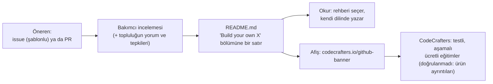
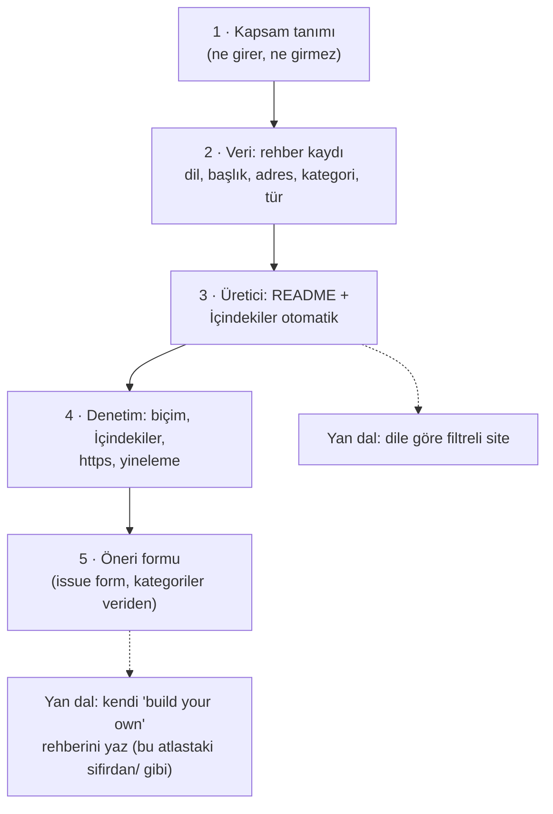

# codecrafters-io/build-your-own-x — "kendi X'ini yaz" rehberleri ve bir şirketin vitrini

> **Dal:** [D10 Küratörlük ve topluluk](../README.md) · **Tür:** liste
> **Dil:** Markdown · **Lisans:** CC0 (README'de beyan; `LICENSE` dosyası yok, GitHub lisans göstermiyor) · **Yıldız:** 561.215 (9 Kasım 2026) · **İncelenen commit:** `b2daa23` (2026-11-09)

## 1. Bir bakışta

"Yaratamadığım şeyi anlamam" (Feynman) sözüyle açılan bu liste, sevdiğin bir teknolojiyi (Git, Docker, veritabanı,
işletim sistemi, programlama dili, ağ yığını…) **sıfırdan yeniden yazdıran** adım adım rehberleri topluyor: 31 kategoride
360 rehber, her biri programlama diliyle etiketli. 2018'de Daniel Stefanovic başlattı; bugün CodeCrafters, Inc. bakımını
yapıyor ve README'nin en üstündeki afiş şirketin ücretli "kendin yap" eğitimlerine gidiyor. Bu dalın en çok yıldızlı
deposu, en az otomasyona sahip olanı: 4 dosya, hiç CI yok. Bu atlasın kendisi de aynı fikirle yazıldı: pek çok dosyanın
yanında çalışan bir `sifirdan/` klasörü var.

## 2. Nasıl yapılmış: mimari

### Klasör haritası

```text
build-your-own-x/                (4 dosya)
├── README.md                    506 satır: afiş, İçindekiler (30 kategori), "Tutorials", "Contribute", "Origins & License"
├── ISSUE_TEMPLATE.md            öneri şablonu: dil, başlık, adres, kategori onay kutuları (kökte, eski usul tek şablon)
├── codecrafters-banner.png      afiş görseli (README ise afişi codecrafters.io'dan yüklüyor)
└── .gitattributes               *.md dosyalarını "dil" say → GitHub depo dilini "Markdown" gösterir
```

### Ana bileşenler ve veri akışı



Girdi biçimi tek tip ve bilgi yoğun: `* [**Dil**: _Rehberin özgün başlığı_](adres)`, video ise sonda `[video]`. Dil
etiketi okuru filtreler (en çok: Python 72, JavaScript 51, C 49, C++ 33, Go 23, Rust 18 rehber).

### Önce okunacak dosyalar

1. `README.md` ilk 40 satır — afiş, Feynman alıntısı, İçindekiler.
2. `README.md` "Build your own `Git`" ve "`Database`" bölümleri — rehber türleri (makale, kitap, video, kod deposu).
3. `ISSUE_TEMPLATE.md` — kabul ölçütü yorum satırında: "adım adım rehber olmalı; çerçeve/kütüphane rehberi ya da
   kütüphaneleri birbirine yapıştıran öğreticiler kabul edilmez".
4. `README.md` "Contribute" ve "Origins & License" — katkı yolu ve CC0 feragati.
5. `.gitattributes` — iki satırla GitHub'ın dil istatistiğini değiştirmek.

### Teknoloji yığını, derleme, test, CI, sürüm

Yok. Tek "araç" GitHub'ın kendisi: issue şablonu, PR, tepkiler. Bu, yüz binlerce yıldızlı bir listenin hiç otomasyon
olmadan da ayakta kalabildiğini gösteriyor; bedelini aşağıdaki tutarsızlıklar ödüyor.

### Tasarım kararları ve ödünleşimler

1. **Dar ve net kapsam.** Yalnızca "sıfırdan bir şey inşa ettiren" rehberler; kütüphane öğreticileri değil. Kapsam
   netliği, listeyi bir yıldız mıknatısı yapan şeyin büyük kısmı.
2. **Dil etiketi başlıkta.** `**Python**:` öneki okura "kendi dilimde var mı?" sorusunu tek bakışta cevaplatır.
3. **Şirket bakımlı topluluk listesi.** CodeCrafters listeyi bakıyor, karşılığında README'nin en görünür yeri şirketin
   afişi. Liste ücretsiz kalıyor; şirket, "rehberi okudum ama yapılandırılmış ve testli bir yol istiyorum" diyen okuru
   müşteriye çeviriyor (eğitim hunisi).
4. **Lisans dosyasız CC0.** Feragat README'nin sonunda; kökte `LICENSE` olmadığı için GitHub lisans algılamıyor (depo
   metadata'sında lisans `null`). Ders: lisansı makinenin de okuyabileceği yere koy.
5. **Otomasyon yok, kayma var.** İçindekiler'de 30 kategori var ama "Build your own `Distributed Systems`" bölümü
   İçindekiler'de yok (bu dalın araç kutusu bunu buluyor). `ISSUE_TEMPLATE.md`'deki kategori listesinde README'deki
   "AI Model, Distributed Systems, Memory Allocator, Processor, Text Editor, Web Browser" yok; şablonda README'de olmayan
   "Web Search Engine" var. 69 bağlantı hâlâ `http://`.
6. **Sunum hilesi.** `.gitattributes` Markdown'ı "dil" saydırıyor; GitHub depo dilini "Markdown" gösteriyor (normalde
   belgeler dil istatistiğine girmez).

## 3. Öğrenmen gerekenler

| Düğüm / kavram                                                  | Bu depo için neden                                                           | Ücretsiz kaynak                                                                     |
| --------------------------------------------------------------- | ---------------------------------------------------------------------------- | ----------------------------------------------------------------------------------- |
| [G2 Git ve GitHub](../../../govde/README.md#g2)                 | Issue şablonu, PR, tepkilerle topluluk incelemesi                            | Gövdedeki G2 mini görevi zaten bu listenin "Git" bölümünü kullanıyor                |
| [G9 Açık kaynak](../../../govde/README.md#g9)                   | CC0, lisans dosyası, açık kaynağın iş modeli (eğitim hunisi)                 | [Open Source Guides: Getting Paid](https://opensource.guide/getting-paid/)          |
| [G5 Veri yapıları ve algoritmalar](../../../govde/README.md#g5) | Rehberlerin çoğu (regex motoru, veritabanı, derleyici) bunu ister            | [TheAlgorithms/Python](../../09-bilgisayar-bilimi/thealgorithms-python/README.md)   |
| [D09 Bilgisayar bilimi](../../09-bilgisayar-bilimi/README.md)   | "Kendin yaz" yaklaşımının akademik karşılığı                                 | [ossu/computer-science](../../09-bilgisayar-bilimi/ossu-computer-science/README.md) |
| [G3 Python](../../../govde/README.md#g3)                        | Ortak araç kutusunu çalıştırmak ve aşama 3'teki üreticiyi uyarlamak          | [Python resmî eğitimi](https://docs.python.org/3/tutorial/)                         |
| Eğitim tasarımı                                                 | Bir rehberi "adım adım" yapan nedir: küçük adımlar, her adımda çalışan sonuç | [project-based-learning](../project-based-learning/README.md) — kardeş liste        |

## 4. Sıfırdan yol (dallanma)



| Aşama | Ne inşa edersin                                           | Öğrendiğin kavram                          | Bitti ölçütü                                                  | Süre (tahmini) |
| ----- | --------------------------------------------------------- | ------------------------------------------ | ------------------------------------------------------------- | -------------- |
| 1     | `KAPSAM.md`: kabul ve ret örnekleri                       | Kürasyon politikası                        | 5 aday için kabul/ret kararını belgeye bakarak verebiliyorsun | 1 saat         |
| 2     | `rehberler.json` (dil, başlık, adres, kategori, video)    | Veri modeli                                | 20 kayıt, 4 kategori                                          | 2 saat         |
| 3     | JSON → README (byox biçimiyle)                            | Şablon, sıralama (kategori → dil → başlık) | İçindekiler ile bölümler her zaman tutarlı                    | 3 saat         |
| 4     | Denetim                                                   | Kural seti, `*` madde işareti              | `liste.py denetle README.md --hazir pbl --isaret '*'` temiz   | 1 saat         |
| 5     | Issue formu (YAML) ve kategori listesinin veriden üretimi | Şablon kaymasını önleme                    | Formdaki kategoriler README ile aynı kaynaktan                | 2 saat         |

Toplam yaklaşık 9 saat (dalın süre kuralı [D10 README](../README.md)'de).

**Mini uygulama:** Ayrı bir mini yok; [ortak araç kutusu](../awesome/sifirdan/README.md) kullanılır. Gerçek README'de:
`python3 liste.py denetle README.md --hazir pbl --isaret '*'` → "Distributed Systems" İçindekiler eksiği ve 69 `http://`
uyarısı. Aşama 3 için `asama4_uretici.py` küçük bir değişiklikle (girdi satırını `* [**Dil**: _Başlık_](adres)` yapan
bir biçim fonksiyonu) uyarlanabilir: bu alıştırma 3.

**Gerçek ölçeğe giden yol:** veri dosyası + üretilen README → issue formu ve kategori listesi aynı veriden → haftalık
bağlantı taraması (eski blog yazıları hızla ölür) → dile ve kategoriye göre filtreli site.

## 5. Gerçek depoda okuma rotası

1. `README.md` İçindekiler (11–40. satırlar) ile `#### Build your own` başlıklarını karşılaştır; eksik olanı bul.
2. "Build your own `Git`" bölümü → aynı konunun farklı dillerdeki rehberleri; hangisi sana uygun?
3. "Build your own `Programming Language`" → en kalabalık bölümlerden biri; tür çeşitliliğine (kitap, seri, video) bak.
4. `ISSUE_TEMPLATE.md` → kategori listesini README ile karşılaştır.
5. "Contribute" → "pending submissions" bağlantısı: incelemeyi topluluğa nasıl açıyorlar?
6. "Origins & License" → feragatin hukuki dili ve `LICENSE` dosyasının yokluğu.

## 6. Alıştırmalar ve öz değerlendirme

1. **(Kolay)** Araç kutusuyla README'yi denetle ve "Distributed Systems" eksikliğini İçindekiler'e ekleyen bir yama yaz.
2. **(Kolay)** README'deki dil etiketlerini say (`**Dil**:` deseni) ve kendi en sevdiğin dil için kaç rehber olduğunu bul.
3. **(Orta)** `asama4_uretici.py`'ye "satır biçimi" parametresi ekle; byox biçiminde (`* [**Dil**: _Başlık_](adres)`)
   README üret, kategoriler içinde önce dile sonra başlığa göre sırala.
4. **(Orta)** Kategori listesini tek bir JSON'dan okuyup hem README İçindekiler'ini hem GitHub issue formunu (YAML) üreten
   bir betik yaz.
5. **(Zor)** Bu atlastaki bir `sifirdan/` klasörünü örnek alarak kendi "build your own" rehberini yaz: her aşamada
   çalışan bir program ve bir test. Listeye öneri şablonunu doldurarak sun.

**Öz değerlendirme**

1. Hiç CI'ı olmayan bir liste neden 500 binden fazla yıldız toplayabildi?

<details><summary>Cevap</summary>

Değer, otomasyondan değil kürasyondan ve kapsamdan geliyor: "sıfırdan inşa et" fikri net, girdiler seçilmiş, dil etiketi
taraması kolay. Ayrıca bir şirket listeyi kendi pazarlama kanalı olarak bakıyor ve görünürlüğünü sürdürüyor. Otomasyonun
yokluğu ise tutarsızlık olarak geri dönüyor (eksik İçindekiler, kaymış şablon, `http` bağlantıları).

</details>

2. Bu depo GitHub'da neden lisanssız görünüyor?

<details><summary>Cevap</summary>

CC0 feragati yalnızca README'nin son paragrafında. GitHub lisansı kökteki `LICENSE`/`COPYING` benzeri dosyalardan
algılar; böyle bir dosya yok, bu yüzden depo metadata'sında lisans boş.

</details>

3. CodeCrafters için bu listenin iş değeri ne?

<details><summary>Cevap</summary>

Ücretsiz, çok yıldızlı bir liste; hedef kitlesi (kendini geliştirmek isteyen yazılımcılar) ile şirketin müşterisi aynı.
README'nin tepesindeki afiş bu kitleyi şirketin ücretli, testli eğitimlerine yönlendiriyor: içerik pazarlaması ve eğitim
hunisi. (Ürünün ayrıntıları bu çalışmada doğrulanmadı.)

</details>

## 7. İş fikri tohumları

- **Türkçe "kendi X'ini yaz" eğitimleri (testli aşamalar):** Her aşaması otomatik testle doğrulanan Türkçe projeler
  (kendi Redis'in, kendi Git'in…), aylık abonelik. **Kime:** 1–3 yıllık deneyimli Türk yazılımcılar, kıdem atlamak isteyenler.
- **Teknik mülakat ödev platformu:** "Kendi X'ini yaz" aşamalarını adaylara ödev olarak veren, testlerle puanlayan araç.
  **Kime:** yılda 10+ yazılımcı alan Türk teknoloji şirketlerinin işe alım ekipleri.
- **Üniversite proje ödevleri:** Bilgisayar mühendisliği derslerine hazır, otomatik değerlendirmeli proje setleri.
  **Kime:** işletim sistemi, derleyici, ağ dersi veren öğretim üyeleri.

Ayrıntı: [İş fikirleri kataloğu](../../../is-fikirleri/README.md).

## 8. Kaynaklar

- [README.md](https://github.com/codecrafters-io/build-your-own-x/blob/b2daa235c4fb774402d219c48adfea2a81d94ce7/README.md)
- [ISSUE_TEMPLATE.md](https://github.com/codecrafters-io/build-your-own-x/blob/b2daa235c4fb774402d219c48adfea2a81d94ce7/ISSUE_TEMPLATE.md)
- [GitHub Linguist: dil istatistiğini geçersiz kılma](https://github.com/github-linguist/linguist/blob/main/docs/overrides.md)
- [GitHub: lisans algılama](https://docs.github.com/en/repositories/managing-your-repositorys-settings-and-features/customizing-your-repository/licensing-a-repository)
- [codecrafters.io](https://codecrafters.io) — bakımcı şirket.
