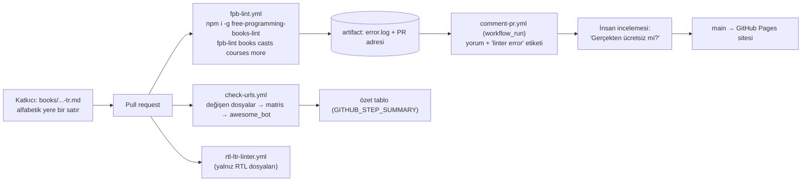
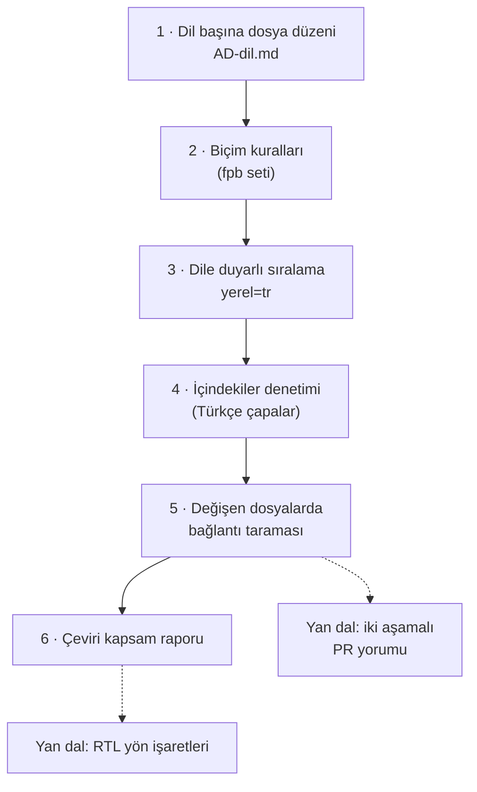

# EbookFoundation/free-programming-books — 40'tan fazla dilde ücretsiz programlama kaynakları

> **Dal:** [D10 Küratörlük ve topluluk](../README.md) · **Tür:** liste
> **Dil:** Markdown (+ Python betiği) · **Lisans:** CC-BY-4.0 · **Yıldız:** 401.346 (9 Kasım 2026) · **İncelenen commit:** `8bc5e37` (2026-11-07)

## 1. Bir bakışta

Ücretsiz programlama kitapları, kursları, podcast'leri, etkileşimli eğitimler ve problem setlerinin listesi. 2013'te bir
StackOverflow sorusunun kopyası olarak doğdu, GitHub'a taşındı ve bugün kâr amacı gütmeyen Free Ebook Foundation
tarafından yönetiliyor. Asıl gücü **çok dillilik**: kitap listesi 40'tan fazla dilde ayrı dosyalarda, katkı belgeleri
(CONTRIBUTING, HOWTO, davranış kuralları) gönüllülerce onlarca dile çevrilmiş. Türkçe dahil: `books/`, `courses/` ve
`casts/` altında Türkçe listeler, `docs/` altında Türkçe "nasıl katkı verilir" belgesi var. Her PR'ı dil duyarlı bir
alfabetik sıra denetimi, biçim denetimi ve bağlantı taraması karşılıyor.

## 2. Nasıl yapılmış: mimari

### Klasör haritası

```text
free-programming-books/                       (235 dosya)
├── README.md                                 giriş, dil listeleri dizini, arama kutusu, paylaşım bağlantıları
├── books/free-programming-books-<dil>.md     49 dosya: kitaplar (İngilizce: -langs.md ve -subjects.md)
├── courses/free-courses-<dil>.md             41 dosya: kurslar
├── casts/free-podcasts-screencasts-<dil>.md  21 dosya: podcast ve ekran kayıtları
├── more/                                     11 dosya: kopya kâğıtları, etkileşimli eğitimler, oyun alanları, problem setleri
├── docs/                                     CONTRIBUTING, HOWTO, CODE_OF_CONDUCT ve çevirileri; README.md çeviri dizini
├── scripts/rtl_ltr_linter.py (+ config.yml)  sağdan sola diller (Arapça, İbranice, Farsça, Urduca) için yön denetimi
├── _config.yml, _includes/head-custom.html   GitHub Pages (Jekyll, minimal tema) statik sitesi
├── LICENSE                                   CC BY 4.0 tam metni
└── .github/
    ├── workflows/fpb-lint.yml                PR'da fpb-lint (npm) çalıştırır, hatayı artifact olarak saklar
    ├── workflows/comment-pr.yml              lint bitince (workflow_run) PR'a hata yorumu + "linter error" etiketi
    ├── workflows/check-urls.yml              değişen her dosya için matris işinde awesome_bot (Ruby) bağlantı taraması
    ├── actions/awesomebot-gh-summary-action/ sonuçları özet tabloya çeviren yerel bileşik eylem (PowerShell)
    ├── workflows/rtl-ltr-linter.yml          RTL dosyası ya da "RTL" etiketi varsa yön denetimi
    ├── workflows/detect-conflicting-prs.yml  çakışan PR'lara etiket ve yorum
    ├── workflows/stale.yml                   60 gün sessiz PR "stale", 30 gün sonra kapanır (issue'lara dokunmaz)
    ├── workflows/issues-pinner.yml           sabitlenen issue'ya etiket
    └── PULL_REQUEST_TEMPLATE.md, dependabot.yml
```

### Ana bileşenler ve veri akışı



**İki aşamalı yorum deseni:** Fork'tan gelen PR'larda `pull_request` olayının jetonu salt okunurdur; PR'a yorum yazamaz.
Bu yüzden lint işi sonucunu bir artifact'a koyar, `workflow_run` ile tetiklenen ikinci iş akışı (yazma yetkili) artifact'ı
indirip yorumu yazar. Fork'un kodu yazma yetkili bağlamda hiç çalışmaz. Yine de artifact'ın içeriği güvenilmez girdidir
(fork, `pull_request` iş akışının dosyasını PR'ında değiştirebilir); ikinci iş akışı onu yalnızca veri olarak
kullanmalı. Bu açıdan `comment-pr.yml`'deki tırnaksız `$(<PRurl)` kullanımı zayıf bir nokta.

### Önce okunacak dosyalar

1. `docs/CONTRIBUTING.md` — "In a nutshell", "Guidelines", "Formatting", "Alphabetical order", "Notes" (başlık, URL,
   yaratıcı, platform kuralları). Kuralların çoğu "bağlantı çürümesi" ve "gerçekten ücretsiz mi" sorusundan doğuyor.
2. `books/free-programming-books-tr.md` — Türkçe kitap listesi: 56 kitap (İçindekiler'deki 25 bağlantı hariç); biçimi ve
   sorunlarını (aşağıda) gör.
3. `.github/workflows/fpb-lint.yml` + `comment-pr.yml` — iki aşamalı desen.
4. `.github/workflows/check-urls.yml` — değişen dosyalardan matris üretme (`tj-actions/changed-files`, `fromJSON`).
5. `scripts/rtl_ltr_linter.py` (605 satır) — çok dilliliğin teknik bedeli: sağdan sola yazılan metinde soldan sağa
   kelimeler (`HTML`, `C#`) için görünmez yön işaretleri.
6. `docs/README.md` — hangi dile hangi belgenin çevrildiğinin elle tutulan dizini.

### Teknoloji yığını, derleme, test, CI, sürüm

- **fpb-lint** (ayrı npm paketi; 4.0.1 incelendi): remark-lint ön ayarları (ATX başlık, `*` madde işareti, sondaki `/`
  yok, boş bölüm yok, boş satır düzeni "1-0-2") + `remark-lint-alphabetize-lists`. Dil, dosya adından okunur (`-tr.md` →
  `tr`) ve sıralama `Intl.Collator('tr')` ile yapılır: Türkçede "ç", "c"den sonra; "ı", "i"den önce gelir. Karşılaştırmadan
  önce baştaki `-._("'` karakterleri ve **yalnızca ilk** virgül/iki nokta silinir (düzenli ifadelerde `g` bayrağı yok).
- **awesome_bot** (Ruby gem): değişen dosyalardaki bağlantıları denetler; yönlendirme ve SSL istisnalarına izin verilir.
- **Site:** `_config.yml` ile GitHub Pages (Jekyll). Arama sitesi ayrı bir depoda (`free-programming-books-search`;
  yapısı doğrulanmadı).
- **Sürüm yok.**

### Tasarım kararları ve ödünleşimler

1. **Dil başına dosya.** Her dilin listesi ayrı dosya, ayrı bakım topluluğu; dil kodu dosya adında olduğu için araçlar
   (sıralama dili, RTL denetimi) dosya adından yapılandırılır. Bedeli: aynı kaynak birden çok dosyada olabilir, eşgüdüm zor.
2. **"Ücretsiz" kanıt ister.** PR şablonu "Gerçekten ücretsiz olduğunu nereden biliyoruz?" diye sorar; Google Drive,
   Dropbox gibi dosya barındırma bağlantıları, kısaltılmış adresler, süreli ücretsizlikler kabul edilmez.
3. **Metadata disiplini.** Başlık kaynaktan alınır, yazar biçimden önce gelir, çevirmen MARC kodu `trl.:` ile anılır,
   arşivden kurtarılan bağlantı `*( :card_file_box: archived)*` notu alır, lisans kısaltması (CC BY …) eklenebilir.
4. **Bağlantı çürümesine karşı arşiv.** Ölü sayfa silinmek yerine Wayback Machine bağlantısıyla değiştirilebilir;
   Türkçe kitap listesindeki altı `belgeler.org` kaynağının hepsi bu yolla yaşıyor.
5. **Çeviri bir katkı türü.** `docs/` altındaki belgeler onlarca dile çevrilmiş; ama dizin elle tutuluyor ve kapsam
   eşit değil (bkz. Türkçe bölümü).
6. **Yorum yazan bot, yalnızca kırmızı rozet değil.** Hatalar PR'a okunur bir yorum olarak da düşüyor. HOWTO belgesi
   yeni katkıcıya hâlâ başarısız denetimin "Details" bağlantısına bakmayı öğretiyor; yorum bu yolu kısaltıyor.

### Türkçe içerik (incelenen commit'te)

| Dosya                                                                                                                                                                                  | İçerik                                                                               |
| -------------------------------------------------------------------------------------------------------------------------------------------------------------------------------------- | ------------------------------------------------------------------------------------ |
| [books/free-programming-books-tr.md](https://github.com/EbookFoundation/free-programming-books/blob/8bc5e371226d32ce14ee85ce304f56d4ba190a1c/books/free-programming-books-tr.md)       | 56 kitap; algoritma, Go, Java, Linux, Python (Django, Flask), R, Rust, yapay zekâ... |
| [courses/free-courses-tr.md](https://github.com/EbookFoundation/free-programming-books/blob/8bc5e371226d32ce14ee85ce304f56d4ba190a1c/courses/free-courses-tr.md)                       | 43 kurs (çoğu YouTube oynatma listesi)                                               |
| [casts/free-podcasts-screencasts-tr.md](https://github.com/EbookFoundation/free-programming-books/blob/8bc5e371226d32ce14ee85ce304f56d4ba190a1c/casts/free-podcasts-screencasts-tr.md) | 6 podcast/ekran kaydı (codefiction, devPod, kodpod, Trendyol Tech Podcasts ...)      |
| [docs/HOWTO-tr.md](https://github.com/EbookFoundation/free-programming-books/blob/8bc5e371226d32ce14ee85ce304f56d4ba190a1c/docs/HOWTO-tr.md)                                           | İlk PR rehberi (Türkçe)                                                              |
| [docs/CODE_OF_CONDUCT-tr.md](https://github.com/EbookFoundation/free-programming-books/blob/8bc5e371226d32ce14ee85ce304f56d4ba190a1c/docs/CODE_OF_CONDUCT-tr.md)                       | Davranış kuralları (Türkçe)                                                          |

İki somut gözlem (ilk katkın için fırsat):

- **`docs/CONTRIBUTING-tr.md` yok.** Bu dalın araç kutusundaki çeviri matrisi bunu gösteriyor: `tr` için eksik belge
  `CONTRIBUTING`.
- **Türkçe kitap listesinin İçindekiler'inde iki kırık bağlantı:** `#algoritma-ve-veri-yapilari` ve
  `#guvenlik-ve-gizlilik`. GitHub'ın (github-slugger kuralı) bu başlıklar için ürettiği kimlikler Türkçe harfleri korur:
  `algoritma-ve-veri-yapıları`, `güvenlik-ve-gizlilik`. Aynı depodaki Türkçe podcast listesi doğru biçimi kullanıyor
  (`#dil-bağımsız`); kurs listesi ise başlığa açık çapa koyuyor (`<a id='makine-ogrenmesi'></a>`). Düzeltmeden önce
  tarayıcıda bağlantıya tıklayarak doğrula.

## 3. Öğrenmen gerekenler

| Düğüm / kavram                                                                      | Bu depo için neden                                                                                                                           | Ücretsiz kaynak                                                                                                                              |
| ----------------------------------------------------------------------------------- | -------------------------------------------------------------------------------------------------------------------------------------------- | -------------------------------------------------------------------------------------------------------------------------------------------- |
| [G2 Git ve GitHub](../../../govde/README.md#g2)                                     | Fork, PR, çakışma çözme (çakışma etiketi var)                                                                                                | [docs/HOWTO-tr.md](https://github.com/EbookFoundation/free-programming-books/blob/8bc5e371226d32ce14ee85ce304f56d4ba190a1c/docs/HOWTO-tr.md) |
| [G9 Açık kaynak](../../../govde/README.md#g9)                                       | CC BY 4.0, "ücretsiz" ile "özgür" farkı, lisans notları                                                                                      | [Creative Commons lisansları](https://creativecommons.org/licenses/)                                                                         |
| [G7 Test ve CI](../../../govde/README.md#g7)                                        | `workflow_run`, matris, artifact, bileşik eylem                                                                                              | [GitHub Actions belgeleri](https://docs.github.com/en/actions)                                                                               |
| [G6 Ağ ve web](../../../govde/README.md#g6)                                         | Yönlendirme, SSL, ölü bağlantı, Wayback Machine                                                                                              | [MDN: HTTP yanıt kodları](https://developer.mozilla.org/en-US/docs/Web/HTTP/Status)                                                          |
| [G3 Python](../../../govde/README.md#g3)                                            | Ortak araç kutusunu çalıştırıp uyarlamak (depodaki `rtl_ltr_linter.py` da Python)                                                            | [Python resmî eğitimi](https://docs.python.org/3/tutorial/)                                                                                  |
| Unicode harmanlama ve çift yönlü metin                                              | Türkçe sıralama (`Intl.Collator`), RTL dillerde yön işaretleri                                                                               | [Unicode Bidi algoritması (UAX #9)](https://unicode.org/reports/tr9/)                                                                        |
| [D09 öğrenme listeleri](../../09-bilgisayar-bilimi/ossu-computer-science/README.md) | OSSU gibi bir müfredatı izlerken ek ücretsiz kitap ve kurs bulmak için bu listeye başvurabilirsin (müfredatlar bu listeye bağlantı vermiyor) | —                                                                                                                                            |

## 4. Sıfırdan yol (dallanma)



| Aşama | Ne inşa edersin                                       | Öğrendiğin kavram                           | Bitti ölçütü                                              | Süre (tahmini) |
| ----- | ----------------------------------------------------- | ------------------------------------------- | --------------------------------------------------------- | -------------- |
| 1     | `books/`, `courses/` altında iki dilde örnek dosyalar | Dosya adı = yapılandırma                    | Dil kodu dosya adından okunuyor                           | 1 saat         |
| 2     | `fpb` kural seti                                      | `*` madde, yazar–biçim sırası, boş satırlar | Örnek Türkçe liste 0 hata                                 | 2 saat         |
| 3     | Türkçe sıralama anahtarı                              | Harmanlama, büyük/küçük harf (I/ı, İ/i)     | "ırmak" < "incir", "çay" > "ceviz"                        | 2 saat         |
| 4     | İçindekiler denetimi                                  | GitHub kimlik kuralı, açık çapa             | Gerçek `-tr.md` dosyasındaki iki kırık bağlantı bulunuyor | 2 saat         |
| 5     | Bağlantı denetimi (yalnız değişen dosyalar)           | Eşzamanlılık, kibar tarama                  | Yerel sunucu testleri geçiyor                             | 5 saat         |
| 6     | Çeviri matrisi                                        | Kapsam takibi                               | `tr` için `CONTRIBUTING` eksikliği raporlanıyor           | 2 saat         |

Toplam yaklaşık 14 saat (1 gün ≈ 5 saat odaklı çalışma; dalın süre kuralı [D10 README](../README.md)'de).

**Mini uygulama:** Ayrı bir mini yok; [ortak araç kutusu](../awesome/sifirdan/README.md) bu deponun ihtiyaçlarını
karşılar: `--hazir fpb` kural seti ve `--yerel tr` sıralaması (araç kutusunun `asama1`–`asama2` dosyaları), bağlantı
denetimi (`asama3`) ve çeviri matrisi (`asama5`). Örnek: `python3 liste.py denetle free-programming-books-tr.md --hazir fpb --yerel tr`.

**Gerçek ölçeğe giden yol:** remark tabanlı lint ve ICU harmanlaması → değişen dosyalara sınırlı bağlantı taraması ve
özet tablo → iki aşamalı PR yorumu → RTL yön denetimi → arama sitesi için listeleri JSON'a çeviren ayrı bir derleme.

## 5. Gerçek depoda okuma rotası

1. `README.md` → dil dizini: bir dil eklemek için hangi dosyalara dokunmak gerekir?
2. `docs/CONTRIBUTING.md` "Formatting" → örnek satırları `liste.py denetle --hazir fpb` ile kendin dene.
3. `books/free-programming-books-tr.md` → İçindekiler'deki 25 bağlantıyı başlıklarla karşılaştır.
4. `courses/free-courses-tr.md` → açık çapalı başlıklar (`<a id='c-sharp'></a>C#`): neden gerekli?
5. `.github/workflows/fpb-lint.yml` → `sed` ile hata kaydındaki yollar neden siliniyor?
6. `.github/workflows/comment-pr.yml` → artifact'ı indirip yorum yazan adımlar; izinler bloğu.
7. `.github/workflows/check-urls.yml` → `set-matrix` adımı: dosya listesi JSON'dan nasıl iş matrisine dönüşüyor?
8. `scripts/rtl_ltr_linter_config.yml` → hangi kelimeler RTL metinde işaret ister?

## 6. Alıştırmalar ve öz değerlendirme

1. **(Kolay)** `books/free-programming-books-tr.md`'deki iki İçindekiler bağlantısını düzelten bir yama hazırla; tarayıcıda
   doğrula. (İstersen gerçek PR'a çevir: depo bu tür katkıyı kabul ediyor.)
2. **(Kolay)** `docs/HOWTO-tr.md`'yi oku; İngilizce bırakılmış cümleleri ("So... why not join our ...") bul.
3. **(Orta)** `docs/CONTRIBUTING.md`'yi Türkçeye çevirmeye başla: önce "In a nutshell" ve "Formatting" bölümleri.
   `liste.py ceviri --temel CONTRIBUTING.md CONTRIBUTING-tr.md` ile yapısal karşılaştır.
4. **(Orta)** Araç kutusuna fpb'nin normalleştirmesini birebir taklit eden bir kip ekle (yalnızca ilk virgül/iki nokta
   silinir, ilk `-` boşluğa dönüşür) ve iki yaklaşımın farklı sonuç verdiği bir örnek bul.
5. **(Zor)** Değişen dosyaları `git diff --name-only` ile bulup yalnızca onlardaki bağlantıları denetleyen bir betik yaz;
   sonuçları Markdown tablo olarak `GITHUB_STEP_SUMMARY`'ye yazacak biçimde üret.
6. **(Zor)** İki aşamalı yorum desenini kendi deponda kur: lint işi artifact üretsin, `workflow_run` işi yorum yazsın.

**Öz değerlendirme**

1. Lint sonucu neden doğrudan lint işinden değil, ikinci bir iş akışından yorumlanıyor?

<details><summary>Cevap</summary>

Fork'tan gelen PR'larda `pull_request` olayının jetonu salt okunurdur. Yazma izni gereken yorumu, ana deponun
bağlamında çalışan `workflow_run` iş akışı yazar; fork'un kodu bu bağlamda çalışmaz, yalnızca artifact'taki metin okunur.

</details>

2. fpb-lint Türkçe listeyi hangi dil kuralıyla sıralar ve bunu nereden bilir?

<details><summary>Cevap</summary>

Dosya adının sonundaki dil kodundan (`-tr.md` → `tr`); `tr`, sıralanacak diller listesinde olduğu için
`remark-lint-alphabetize-lists` eklentisi `Intl.Collator('tr')` ile karşılaştırma yapar.

</details>

3. `#guvenlik-ve-gizlilik` bağlantısı neden "Güvenlik ve Gizlilik" başlığına gitmez?

<details><summary>Cevap</summary>

GitHub başlık kimliğini üretirken Türkçe harfleri korur (yalnızca noktalama ve sembolleri atar, boşlukları `-` yapar):
kimlik `güvenlik-ve-gizlilik` olur. ASCII'ye indirgenmiş bağlantı bu kimlikle eşleşmez. Çözüm: bağlantıyı Türkçe harfle
yazmak ya da başlığa `<a id="guvenlik-ve-gizlilik"></a>` eklemek.

</details>

## 7. İş fikri tohumları

- **Türkçe ücretsiz kaynak arama ve öğrenme planı:** Türkçe listeleri tek arama arayüzünde toplayıp kişisel okuma planı
  çıkaran site. **Kime:** bilgisayar mühendisliği öğrencileri ve bootcamp katılımcıları.
- **Kurum içi eğitim kataloğu (lisans filtreli):** Ücretsiz kaynakları lisansına göre (CC BY / NC / ND) süzüp eğitim
  materyaline dönüştürülebilir olanları işaretleyen katalog. **Kime:** üniversite kütüphaneleri ve kurumsal akademiler.
- **Bağlantı kurtarma hizmeti:** Belge sitelerindeki ölü bağlantıları bulup Wayback Machine karşılığını öneren bot.
  **Kime:** dokümantasyon ekipleri ve eğitim içeriği yayıncıları.

Ayrıntı: [İş fikirleri kataloğu](../../../is-fikirleri/README.md).

## 8. Kaynaklar

- [docs/CONTRIBUTING.md](https://github.com/EbookFoundation/free-programming-books/blob/8bc5e371226d32ce14ee85ce304f56d4ba190a1c/docs/CONTRIBUTING.md)
- [.github/workflows/fpb-lint.yml](https://github.com/EbookFoundation/free-programming-books/blob/8bc5e371226d32ce14ee85ce304f56d4ba190a1c/.github/workflows/fpb-lint.yml)
  ve [comment-pr.yml](https://github.com/EbookFoundation/free-programming-books/blob/8bc5e371226d32ce14ee85ce304f56d4ba190a1c/.github/workflows/comment-pr.yml)
- [free-programming-books-lint](https://github.com/vhf/free-programming-books-lint) ve
  [remark-lint-alphabetize-lists](https://www.npmjs.com/package/remark-lint-alphabetize-lists)
- [awesome_bot](https://github.com/dkhamsing/awesome_bot)
- [GitHub: workflow_run ile güvenli PR yorumu](https://securitylab.github.com/resources/github-actions-preventing-pwn-requests/)
- [Free Ebook Foundation](https://ebookfoundation.org)
