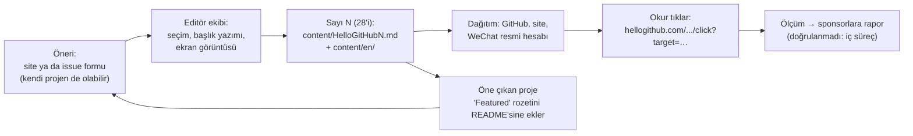
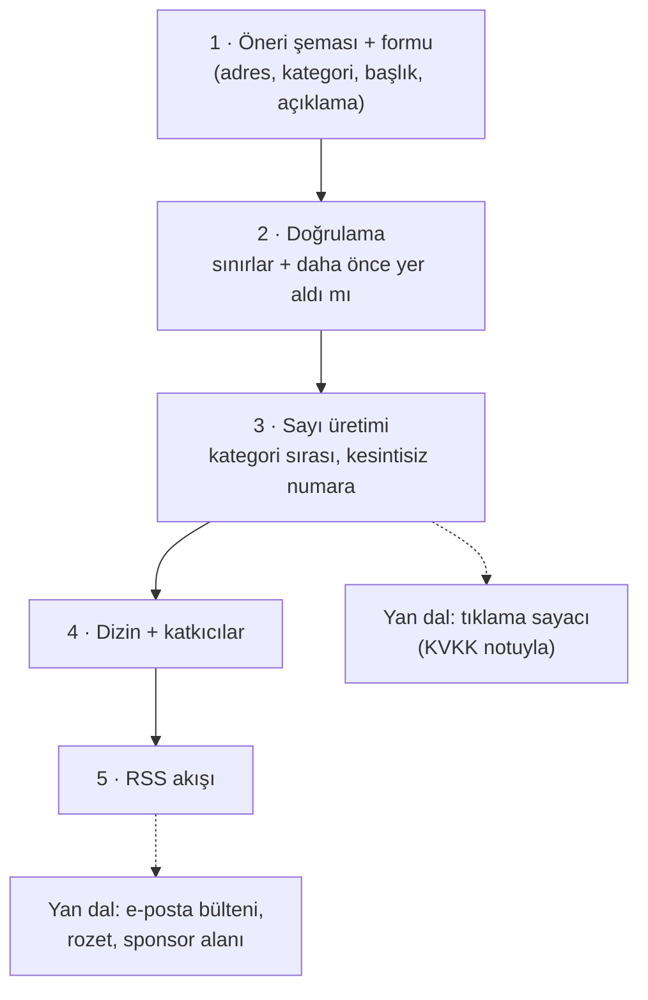

# 521xueweihan/HelloGitHub — her ay ilginç açık kaynak projeler: bir bülten, bir site, bir topluluk

> **Dal:** [D10 Küratörlük ve topluluk](../README.md) · **Tür:** topluluk
> **Dil:** Python (eski betikler) · **Lisans:** CC BY-NC-ND 4.0 (README'de beyan; GitHub lisans göstermiyor) · **Yıldız:** 187.757 (9 Kasım 2026) · **İncelenen commit:** `d65699c` (2026-11-01)

## 1. Bir bakışta

HelloGitHub, Çinli geliştirici "削微寒" (xueweihan) tarafından 2016'da başlatılan aylık bir bülten: her ayın 28'inde
GitHub'dan "ilginç ve başlangıç dostu" projeleri dil kategorilerine ayırıp kısa bir başlık, birkaç cümle ve bir ekran
görüntüsüyle tanıtıyor. Depo bültenin **arşivi**: 127 sayının Çince ve İngilizce Markdown dosyaları, Çince/İngilizce/
Japonca README ve öneri formları. Asıl ürün depo dışında büyüdü: hellogithub.com (öneri ve proje sayfaları; sitenin
ayrıntıları doğrulanmadı),
WeChat resmi hesabı ve "HelloGitHub'da öne çıktı" rozeti. Bu dosya, "liste" ile "medya ürünü" arasındaki çizginin nasıl
aşıldığını gösteriyor.

## 2. Nasıl yapılmış: mimari

### Klasör haritası

```text
HelloGitHub/                                  (268 dosya)
├── README.md, README_en.md, README_ja.md     tanıtım, sayı tablosu (satırda 5), sponsorlar, lisans
├── content/
│   ├── HelloGitHub01.md … HelloGitHub127.md  Çince sayılar
│   ├── en/HelloGitHub01.md … 127.md          İngilizce sayılar
│   └── contributors.md                       çekirdek ekip ve öneren katkıcılar (avatarlı HTML tablo)
├── script/
│   ├── make_content/make_content.py          (2016) şablon + içerik → sayı dosyası; ortak metni tek yerde tutma fikri
│   └── github_bot/github_bot.py              (2016–2017) takip edilenlerin yıldızladığı depoları API'den toplayıp e-postayla gönderir
├── .github/ISSUE_TEMPLATE/
│   ├── submit-en.yaml, submit-cn.yaml        proje öneri formu: adres, kategori, başlık (≤50), açıklama (32–256), öne çıkanlar
│   └── config.yml                            boş issue kapalı; öneri için site bağlantısı
├── .github/FUNDING.yml                       GitHub Sponsors, site, Buy Me a Coffee
└── .gitignore                                (ilginç: `.github/skills/` yok sayılıyor)
```

### Ana bileşenler ve veri akışı



Bir sayının iskeleti (`content/en/HelloGitHub127.md`): başlık ve slogan → "Table of Contents" (GitHub'ın kendi gezinme
düğmesine yönlendirir) → "Content" altında kategoriler (C, C#, C++, Go, JavaScript, Kotlin, Python, Rust, Skills, Swift,
AI, Other, Book) → her projede `N、[ad](tıklama-sayacı?target=depo)：Başlık.Açıklama` + resim, öneren varsa "Shared by"
→ sponsor tablosu → lisans notu. Numaralar kategoriler boyunca kesintisiz.

### Önce okunacak dosyalar

1. `README_en.md` — konumlandırma ("novice programmers"), yayın günü, sayı tablosu, sponsorlar, CC BY-NC-ND 4.0.
2. `content/en/HelloGitHub127.md` — bir sayının tam yapısı.
3. `content/HelloGitHub01.md` — 2016'daki ilk sayı: format nasıl evrildi (kategori adları, WeChat çağrısı).
4. `.github/ISSUE_TEMPLATE/submit-en.yaml` — öneri formunun alanları ve uzunluk sınırları, "kopya metin kullanma" uyarısı.
5. `script/make_content/make_content.py` — 100 satırlık şablon motoru: `{{ hello_github_content }}` yer tutucusu.
6. `script/github_bot/github_bot.py` — aday toplamanın ilk otomasyonu (kimlik bilgilerinin betikte tutulması dahil).

### Teknoloji yığını, derleme, test, CI, sürüm

- Depoda CI yok; sayılar Markdown olarak elle (ya da depo dışındaki araçlarla) hazırlanıp commit'leniyor.
- Eski Python betikleri (Python 2/3 uyumlu, `requests`) artık süreçte görünmüyor; asıl iş akışı siteye taşınmış
  (doğrulanmadı: sitenin teknik yapısı depoda yok).
- Resimler ayrı depolarda (`521xueweihan/img`, `img4`) ve `raw.githubusercontent.com` üzerinden yükleniyor.
- "Sürüm" = her ayın 28'inde yeni sayı dosyası.

### Tasarım kararları ve ödünleşimler

1. **Takvim bir sözleşmedir.** "Her ayın 28'i" okura beklenti, ekibe ritim verir; on yılı aşkın süre, 127 sayı.
2. **Seçici ve açıklayıcı.** Her proje bir cümlelik başlık + 2–4 cümle açıklama + görsel alır; liste değil, editoryal
   içerik. Öneri formu bile "neyi çözüyor, kimin işine yarar, başlangıç seviyesi ne öğrenir" diye sorar.
3. **Kendi projeni önerebilirsin.** Form "kendi projeni ya da başkasınınkini öner" der; öneren, sayıda adıyla ve
   `contributors.md`'de anılır: katkının ödülü görünürlük.
4. **Rozet döngüsü.** Öne çıkan projeler README'lerine HelloGitHub rozetini ekler; her rozet, bültene geri giden bir
   bağlantı ve yeni okur kaynağıdır. HelloGitHub'ın kendi README'sinde de bu rozet var.
5. **Ölçülebilir dağıtım.** Bağlantılar doğrudan GitHub'a değil, sitenin tıklama sayacına gider; sponsorluk ve editoryal
   kararlar için veri üretir. Bedeli: okurun gizliliği ve "nereye gidiyorum?" şeffaflığı.
6. **Çok dilli arşiv.** Çince ana dil; İngilizce ve Japonca README, İngilizce sayılar. Kitle Çin dışına açılıyor.
7. **Lisans: CC BY-NC-ND 4.0.** Ticari kullanım ve **türev eser** yasak. Çeviri bir türev eser sayıldığı için, örneğin
   sayıların Türkçe çevirisini yayımlamak hak sahibinin izni olmadan mümkün değil. Bu, içeriği korur ama topluluk
   çevirisinin önünü keser (free-programming-books'un CC BY 4.0 seçimiyle karşılaştır).

## 3. Öğrenmen gerekenler

| Düğüm / kavram                                  | Bu depo için neden                                     | Ücretsiz kaynak                                                                                                                                                |
| ----------------------------------------------- | ------------------------------------------------------ | -------------------------------------------------------------------------------------------------------------------------------------------------------------- |
| [G2 Git ve GitHub](../../../govde/README.md#g2) | Issue formları (YAML), içerik arşivi olarak depo       | [GitHub: issue formları sözdizimi](https://docs.github.com/en/communities/using-templates-to-encourage-useful-issues-and-pull-requests/syntax-for-issue-forms) |
| [G9 Açık kaynak](../../../govde/README.md#g9)   | CC BY-NC-ND'nin sonuçları, sponsorluk, katkıcıyı anmak | [Creative Commons lisans seçici](https://creativecommons.org/choose/)                                                                                          |
| [G4 JavaScript](../../../govde/README.md#g4)    | Mini uygulama Node.js                                  | [You Don't Know JS](../../01-web-arayuzu/you-dont-know-js/README.md)                                                                                           |
| [G6 Ağ ve web](../../../govde/README.md#g6)     | RSS, tıklama sayacı, yönlendirme, URL kodlama          | [RSS 2.0 belirtimi](https://www.rssboard.org/rss-specification)                                                                                                |
| Editoryal üretim                                | Seçim ölçütü, başlık yazımı, takvim                    | [awesome manifestosu](../awesome/README.md) — "kürasyon, koleksiyon değil"                                                                                     |
| KVKK ve çerezsiz ölçüm                          | Tıklama sayacı kişisel veri işler (IP, zaman)          | [KVKK: aydınlatma yükümlülüğü](https://www.kvkk.gov.tr/)                                                                                                       |

## 4. Sıfırdan yol (dallanma)



| Aşama | Ne inşa edersin                         | Öğrendiğin kavram                                   | Bitti ölçütü                                                      | Süre (tahmini) |
| ----- | --------------------------------------- | --------------------------------------------------- | ----------------------------------------------------------------- | -------------- |
| 1     | `veri/sayi-NNN.json` şeması             | Editoryal veri modeli                               | İki örnek sayı, 9 proje                                           | 1 saat         |
| 2     | `dogrula()`                             | Form sınırları, birikimli tekrar denetimi           | Sayı 3'te tekrar eden proje hata veriyor, hiçbir dosya yazılmıyor | 2 saat         |
| 3     | `sayiyiOlustur()`                       | Kararlı sıralama, CommonMark liste numarası         | Numaralar 1..N kesintisiz, kategoriler sabit sırada               | 2 saat         |
| 4     | `dizinTablosu()`, `katkidaBulunanlar()` | Toplama, sıralama                                   | 7 sayı → 2 satırlık tablo                                         | 1 saat         |
| 5     | `rssOlustur()`                          | RSS 2.0, RFC 822 tarih, XML kaçışı, belirlenimcilik | Aynı veri → aynı dosya                                            | 2 saat         |

Toplam yaklaşık 8 saat (dalın süre kuralı [D10 README](../README.md)'de).

**Mini uygulama:** [`sifirdan/`](sifirdan/README.md) — Node.js, bağımlılıksız, 16 test. Örnek sayılar bu atlastaki
depolardan (markitdown, ollama, yt-dlp…) seçildi; açıklamalar doğrulanmış depo bilgisine dayanıyor.

**Gerçek ölçeğe giden yol:** öneri sitesi ya da issue formu → ön eleme (GitHub API: yaş, lisans, etkinlik) → editör
paneli → görsel barındırma → çok kanallı dağıtım (RSS, e-posta, sosyal medya) → proje sayfaları ve rozet → sponsor
raporlaması (KVKK uyumlu ölçüm).

## 5. Gerçek depoda okuma rotası

1. `README.md` (Çince) ile `README_en.md`'yi yan yana aç: hangi bilgiler yalnızca Çince sürümde (ör. Weibo bağlantısı,
   WeChat resmî hesabındaki yayın arşivi)?
2. `content/HelloGitHub01.md` ile `content/en/HelloGitHub127.md`: 2016'dan 2026'ya biçim nasıl değişti?
3. `content/en/HelloGitHub127.md` → "Skills" ve "AI" kategorileri: kategori listesi dönemin ilgisini nasıl izliyor?
4. `submit-en.yaml` → `validations` alanları; mini'deki `dogrula()` ile karşılaştır.
5. `script/make_content/make_content.py` → şablonu "tüm sayıları yeniden üret" diye tasarlamanın faydası ve riski.
6. `script/github_bot/README.md` → kimlik bilgilerini betik içinde tutmanın sorunları; bugün nasıl yapardın?
7. `content/contributors.md` → topluluğu görünür kılmanın biçimi.

## 6. Alıştırmalar ve öz değerlendirme

1. **(Kolay)** Mini'ye üçüncü bir sayı ekle (kendi seçtiğin 4 proje); bilerek bir önceki sayıdan bir projeyi tekrar et ve
   hatayı gör.
2. **(Kolay)** `sayiyiOlustur()`'a "Bu sayının öne çıkanı" alanı ekle (tek proje, sayının başında).
3. **(Orta)** Her sayı için ayrı bir `sayi-NNN.html` üret (şablon dizgesiyle); HTML kaçışını test et.
4. **(Orta)** Bir JSON Feed (jsonfeed.org) çıktısı ekle ve RSS ile aynı verinin iki biçimini karşılaştır.
5. **(Zor)** Tıklama sayacını yerel bir HTTP sunucusu olarak yaz: `?hedef=` parametresini doğrula (yalnız izinli alan
   adlarına yönlendir: açık yönlendirme açığını önle), sayacı IP saklamadan tut, günlük toplamları JSON'a yaz.

**Öz değerlendirme**

1. Rozet neden bir büyüme mekanizmasıdır?

<details><summary>Cevap</summary>

Öne çıkan her proje, kendi README'sine bültene giden bir bağlantı ekler. O projenin okurları bülteni keşfeder, bir kısmı
abone ya da öneren olur; yeni öneriler yeni projeleri, yeni projeler yeni rozetleri getirir. Bu, merkeze yıldız ve
trafik taşıyan bir ağ etkisidir (sindresorhus/awesome'un "mentioned in awesome" rozetiyle aynı fikir).

</details>

2. CC BY-NC-ND 4.0, bir Türkçe çeviri projesi için ne anlama gelir?

<details><summary>Cevap</summary>

"ND" (türetme yok) maddesi değiştirilmiş eserin paylaşılmasını yasaklar; çeviri bir türev eserdir. Bu yüzden sayıların
Türkçe çevirisini yayımlamak hak sahibinin ayrıca iznini gerektirir. "NC" ise ticari kullanımı yasaklar. (Hukuki tavsiye
değildir.)

</details>

3. Tıklama sayacı neden bağlantıyı "kodlayarak" taşımalı?

<details><summary>Cevap</summary>

Hedef adres kendi içinde `?` ya da `&` taşırsa, kodlanmadan eklendiğinde sayacın sorgu dizgesine karışır ve hedefin bir
kısmı kaybolur. `encodeURIComponent` hedefi tek bir parametre değeri olarak güvenle taşır.

</details>

## 7. İş fikri tohumları

- **Türkçe aylık açık kaynak bülteni:** Türk geliştiricilerin projelerine ağırlık veren, her ayın belli bir gününde çıkan
  bülten; gelir sayı başına sponsor alanından. **Kime:** Türk yazılımcılar (okur); sponsor olarak Türk bulut ve SaaS
  şirketleri, işe alım yapan teknoloji firmaları.
- **"Öne çıktı" rozet ve proje sayfası platformu:** Türk açık kaynak projelerini toplayan, öne çıkanlara rozet veren site.
  **Kime:** ilk kullanıcılarını arayan Türk açık kaynak geliştiricileri ve öğrenci toplulukları.
- **Şirket içi "haftanın açık kaynağı" bülteni:** Şirketin teknoloji yığınına göre seçilmiş projeleri iç kanallara
  gönderen hizmet. **Kime:** 100+ geliştiricili şirketlerin mühendislik kültürü/DevRel ekipleri.

Ayrıntı: [İş fikirleri kataloğu](../../../is-fikirleri/README.md).

## 8. Kaynaklar

- [README_en.md](https://github.com/521xueweihan/HelloGitHub/blob/d65699c2892f3ad7516398a3fbd3855913f9d17d/README_en.md)
- [content/en/HelloGitHub127.md](https://github.com/521xueweihan/HelloGitHub/blob/d65699c2892f3ad7516398a3fbd3855913f9d17d/content/en/HelloGitHub127.md)
- [.github/ISSUE_TEMPLATE/submit-en.yaml](https://github.com/521xueweihan/HelloGitHub/blob/d65699c2892f3ad7516398a3fbd3855913f9d17d/.github/ISSUE_TEMPLATE/submit-en.yaml)
- [script/make_content/make_content.py](https://github.com/521xueweihan/HelloGitHub/blob/d65699c2892f3ad7516398a3fbd3855913f9d17d/script/make_content/make_content.py)
- [hellogithub.com](https://hellogithub.com) — bültenin sitesi.
- [CC BY-NC-ND 4.0](https://creativecommons.org/licenses/by-nc-nd/4.0/) — lisans özeti.
