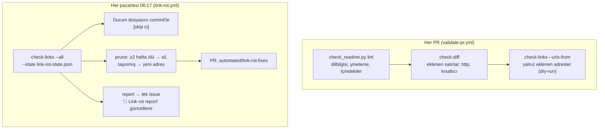
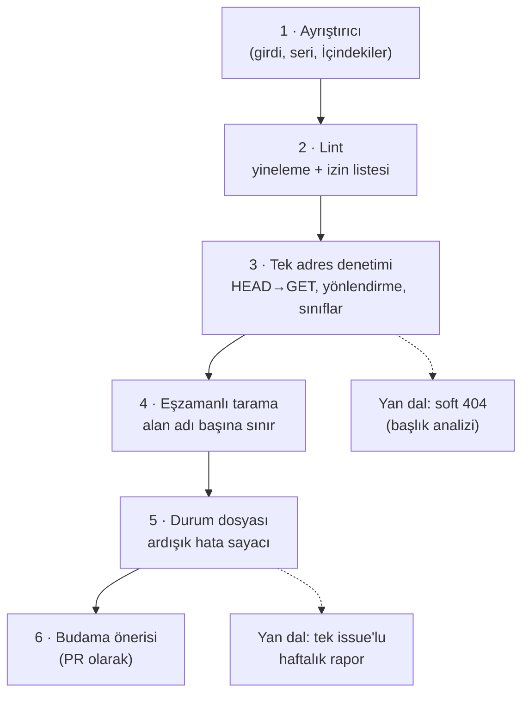

# practical-tutorials/project-based-learning — proje yaparak öğreten öğreticiler ve bağlantı çürümesine karşı bir sistem

> **Dal:** [D10 Küratörlük ve topluluk](../README.md) · **Tür:** liste
> **Dil:** Markdown + Python (denetim betiği) · **Lisans:** MIT · **Yıldız:** 289.393 (9 Kasım 2026) · **İncelenen commit:** `322fb30` (2026-11-09)

## 1. Bir bakışta

Dile göre gruplanmış (C/C++, Go, Python, JavaScript, Rust…) "uygulamayı baştan sona yaparak öğren" öğreticileri:
22 dil bölümünde yaklaşık 460 bağlantı; çok parçalı seriler iç içe listeleniyor. 2017'de açıldı. Liste basit (açıklama yok,
alfabetik sıra yok), ama 2026'da eklenen otomasyonu bu dalın en olgun **bağlantı çürümesi** sistemi: tek bir standart
kütüphane Python betiği README'yi veri gibi ayrıştırıyor, PR'daki farkı denetliyor, her hafta tüm bağlantıları
tarıyor, sonuçları depodaki bir JSON durum dosyasında biriktiriyor, iki hafta üst üste ölü görünen girdileri silen bir
PR'ı **kendisi açıyor** ve tek bir "Link rot report" issue'sunu güncelliyor.

## 2. Nasıl yapılmış: mimari

### Klasör haritası

```text
project-based-learning/                        (14 dosya)
├── README.md                                  liste: İçindekiler + 22 dil bölümü + "Additional Resources"
├── CONTRIBUTING.md                            biçim, "ücretsiz ve proje tabanlı" şartı, yerelde lint komutu
├── LICENSE.md                                 MIT
├── scripts/check_readme.py                    1.178 satır, yalnızca standart kütüphane: lint, check-diff, check-links, report, prune
├── scripts/linkcheck-domains.txt              otomatik denetimi engelleyen alan adları (Medium, Reddit, LinkedIn ...) → BLOCKED
├── scripts/lint-allow-duplicates.txt          bilerek iki kez listelenen adresler, gerekçeleriyle
└── .github/
    ├── link-rot-state.json                    456 adresin durumu: ardışık hata, ilk hata, son sınıf, yönlendirme hedefi
    ├── workflows/validate-pr.yml              PR'da: lint + eklenen satır denetimi + eklenen bağlantıların canlılığı
    ├── workflows/link-rot.yml                 haftalık: tüm bağlantılar → durumu commit'le → güvenli düzeltme PR'ı → rapor issue'su
    ├── workflows/stale-prs.yml                yalnız PR'lar: 90 gün sessizlik → stale, +30 gün → kapat (issue'lara dokunmaz)
    ├── ISSUE_TEMPLATE/1-broken-link.yml       kırık bağlantı formu ("önce haftalık rapora bak")
    ├── ISSUE_TEMPLATE/2-tutorial-suggestion.yml  öneri formu
    └── PULL_REQUEST_TEMPLATE.md               tek öğretici, ücretsiz, proje tabanlı, yakınlık beyanı (yazarı mısın?)
```

### Ana bileşenler ve veri akışı



Sınıflandırma (`_classify_result`): DNS hatası, TLS hatası, bağlantı reddi, 404/410 → `HARD_DEAD`; 401/403/429 ve
tekrar denemeye rağmen 5xx → `BLOCKED`; 200 dönen ama başlığı "not found" diyen sayfa ya da kök adrese yönlendirme →
`SUSPECT`; politika dosyasındaki alan adlarında ölü/şüpheli sonuçlar `BLOCKED`'a çevrilir (GitHub Actions IP'lerini
engelleyen siteler yanlışlıkla "ölü" sayılmasın). Eşzamanlılık: 8 iş parçacığı, kayıtlı alan adı başına en çok 2 istek
ve istekler arası 1 saniye (`DomainLimiter`).

### Önce okunacak dosyalar

1. `scripts/check_readme.py` ilk 30 satır — modül belgesi ve **güvenlik sabiti**: README ve PR farkı güvenilmez girdidir;
   asla `eval`/`exec` edilmez, kabuğa verilmez.
2. `classify_line` ve `parse_readme` — tek dilbilgisi, tüm alt komutlar onu paylaşır ("kurallar birbirinden kaymasın").
3. `check_url`, `_classify_result`, `DomainLimiter`, `check_urls_concurrently` — ağ katmanı.
4. `cmd_prune` belgesi — "yalnızca güvenli, belirsizliği olmayan düzeltmeler; şüpheli olan insana kalır".
5. `.github/workflows/link-rot.yml` — durum commit'i, düzeltme PR'ı, tek issue'nun "upsert" edilmesi.
6. `.github/workflows/stale-prs.yml` başındaki yorum — eski stale botunun kırık bağlantı raporlarını yıllarca gömmesi.

### Teknoloji yığını, derleme, test, CI, sürüm

- **Python 3, yalnızca standart kütüphane** (`http.client`, `ssl`, `concurrent.futures`, `html.parser`): "denetlenecek
  üçüncü taraf bağımlılık yok".
- **GitHub Actions:** eylemler commit SHA'sına sabit; `concurrency` grupları; haftalık iş `contents/issues/pull-requests:
write` izinli, PR işi `contents: read`.
- **gh CLI:** PR açma/güncelleme ve issue upsert'i iş akışı içinde.
- **Sürüm yok;** README'nin kendisi yayın.

### Tasarım kararları ve ödünleşimler

1. **README-as-data.** Tek ayrıştırıcı; lint, fark denetimi ve tarama aynı modeli kullanır. Kural değişince hepsi
   birlikte değişir.
2. **Durum depoda.** `link-rot-state.json` commit'lenir: tarihçe Git'te, kimse ayrı bir veritabanı işletmez. Bedeli: her
   hafta bir bot commit'i (`[skip ci]` ile CI tetiklenmez).
3. **Tek seferlik hata ≠ ölü.** İki hafta üst üste ölü görünmeyen girdi silinmez; sunucu bizi engelliyorsa (`BLOCKED`)
   hiç sayılmaz. İncelenen commit'te durum dosyasında 456 adres var: 368 `OK`, 73 `BLOCKED`, 12 `HARD_DEAD`, 3 `SUSPECT`;
   16 adres en az iki ardışık hatada.
4. **Makine önerir, insan birleştirir.** `prune` doğrudan `main`'e yazmaz; PR açar.
5. **Gürültüyü azalt.** Haftalık rapor her seferinde yeni issue açmaz, tek issue'yu günceller; kırık bağlantı formu
   "önce rapora bak" der; stale botu issue'lara dokunmaz.
6. **Şeffaflık:** PR şablonunda "öğreticinin yazarı mısın / bağlantın var mı?" beyanı — kendi içeriğini tanıtmak yasak
   değil ama açık olmalı.

## 3. Öğrenmen gerekenler

| Düğüm / kavram                                    | Bu depo için neden                                                   | Ücretsiz kaynak                                                                                   |
| ------------------------------------------------- | -------------------------------------------------------------------- | ------------------------------------------------------------------------------------------------- |
| [G6 Ağ ve web](../../../govde/README.md#g6)       | HTTP yöntemleri, yönlendirmeler, durum kodları, `Retry-After`, TLS   | [MDN HTTP](https://developer.mozilla.org/en-US/docs/Web/HTTP)                                     |
| [G3 Python](../../../govde/README.md#g3)          | `http.client`, `concurrent.futures`, `argparse`, JSON                | [Python belgeleri: concurrent.futures](https://docs.python.org/3/library/concurrent.futures.html) |
| [G7 Test ve CI](../../../govde/README.md#g7)      | Zamanlanmış iş, bot commit'i, otomatik PR, `gh` CLI                  | [GitHub CLI kılavuzu](https://cli.github.com/manual/)                                             |
| [G9 Açık kaynak](../../../govde/README.md#g9)     | Yakınlık beyanı, stale politikası, katkıcı deneyimi                  | [Open Source Guides](https://opensource.guide/)                                                   |
| Güvenilmez girdi işleme                           | Fork PR'ındaki metin asla komut olmaz                                | [OWASP Komut Enjeksiyonu](https://owasp.org/www-community/attacks/Command_Injection)              |
| [build-your-own-x](../build-your-own-x/README.md) | Kardeş liste: proje tabanlı öğrenmenin "sistemleri yeniden yaz" kolu | —                                                                                                 |

## 4. Sıfırdan yol (dallanma)



| Aşama | Ne inşa edersin                             | Öğrendiğin kavram                          | Bitti ölçütü                                                      | Süre (tahmini) |
| ----- | ------------------------------------------- | ------------------------------------------ | ----------------------------------------------------------------- | -------------- |
| 1     | Satır sınıflandırıcı ve belge modeli        | Dilbilgisi, bozuk satırı sessizce yutmamak | Bozuk `- [başlık] (adres)` satırı "malformed" olarak raporlanıyor | 3 saat         |
| 2     | Yineleme denetimi + izin listesi            | URL normalleştirme, gerekçeli istisna      | Gerçek README'deki 2 yineleme, izin listesiyle susuyor            | 1 saat         |
| 3     | `tek_kontrol`                               | 301/302 farkı, 405 → GET, 429 → bekle      | Yerel sunucu testleri geçiyor                                     | 5 saat         |
| 4     | `hepsini_kontrol_et`                        | İş parçacığı havuzu, semafor               | Alan adı başına eşzamanlılık sınırı testle kanıtlanıyor           | 3 saat         |
| 5     | `durum_guncelle`, `kaldirma_adaylari`       | Durum makinesi, JSON kalıcılık             | 2 ardışık hata → aday; 1 başarı → sıfırlanma                      | 2 saat         |
| 6     | README'den adayları çıkaran yama + PR metni | Güvenli otomasyon sınırı                   | Yalnız "kesin ölü ve yönlendirmesiz" girdiler değişiyor           | 5 saat         |

Toplam yaklaşık 19 saat (1 gün ≈ 5 saat odaklı çalışma; dalın süre kuralı [D10 README](../README.md)'de).

**Mini uygulama:** [ortak araç kutusu](../awesome/sifirdan/README.md): aşama 1–2 `asama1_ayristirici.py` +
`asama2_denetim.py` (`--hazir pbl`), aşama 3–5 `asama3_baglanti.py` (durum dosyası `liste.py baglanti --durum`). Gerçek
README'de araç kutusu 52 `http://` uyarısı ve 2 yineleme buluyor; ikisi de depodaki `lint-allow-duplicates.txt` ile
bilerek izin verilmiş adresler (craftinginterpreters.com ve LLVM öğreticisi). Aşama 6 alıştırma olarak kaldı.

**Gerçek ölçeğe giden yol:** soft 404 tespiti (sayfa başlığında "not found") → alan adı politika dosyası → haftalık iş ve
durum commit'i → budama PR'ı → tek issue raporu → ölü girdi için Wayback Machine önerisi.

## 5. Gerçek depoda okuma rotası

1. `CONTRIBUTING.md` → katkıcıdan beklenenler ve "yerelde lint çalıştır" adımı.
2. `scripts/check_readme.py` `classify_line` → "malformed" dalı neden "series"e düşmesin diye ayrı?
3. `github_slug` → İçindekiler için başlık kimliği; araç kutusundaki `github_kimligi` ile karşılaştır.
4. `check_url` + `_attempt_with_fallback` → hangi durum kodları GET'e düşürür, hangileri yeniden denenir?
5. `_classify_result` → "kök adrese yönlendirme şüphelidir" kuralının mantığı.
6. `cmd_prune` → hangi durumlar bilerek insana bırakılıyor?
7. `.github/link-rot-state.json` → `consecutive_failures` en yüksek adresleri bul; gerçekten ölüler mi, tarayıcıda dene.
8. `.github/workflows/link-rot.yml` → `|| true` neden kullanılmış (yorumu oku)?

## 6. Alıştırmalar ve öz değerlendirme

1. **(Kolay)** Araç kutusuna `--izinli-yinelenenler dosya.txt` seçeneği ekle; gerçek README'de yineleme uyarısı kalmasın.
2. **(Kolay)** README'deki bölüm sırasının İçindekiler sırasıyla aynı olup olmadığını denetleyen bir kural yaz (ipucu:
   İçindekiler alfabetik, gövde değil; ilk fark daha ilk satırda: İçindekiler C# ile, gövde C/C++ ile başlıyor).
3. **(Orta)** `asama3_baglanti.py`'ye "soft 404" ekle: 200 dönen sayfanın `<title>`'ında "not found", "404", "sayfa
   bulunamadı" geçiyorsa `SUPHELI` sınıfı; testini yerel sunucuyla yaz.
4. **(Orta)** Alan adı politikası: bir dosyadaki alan adları (`*.medium.com` desteğiyle) için `OLU` sonucunu `ENGELLI`'ye
   çeviren işlev ve testi.
5. **(Zor)** Budama: durum dosyasındaki "kaldırma adaylarını" README'den silen (seri başlıklarının altındaki parçaları da
   hesaba katan) ve PR açıklaması üreten bir komut yaz; README'yi doğrudan değiştirmek yerine yama dosyası çıkarsın.

**Öz değerlendirme**

1. Neden tek bir haftalık hata yeterli sayılmıyor?

<details><summary>Cevap</summary>

Ağ kesintisi, sunucu bakımı, geçici 5xx ya da hız sınırı tek seferlik "ölü" sonucu üretebilir. İki ardışık haftada ölü
görünmek yanlış alarmı büyük ölçüde eler; hata pahalıdır çünkü silinen girdiyi geri bulmak zordur.

</details>

2. `BLOCKED` sınıfı neden ardışık hata sayılmıyor?

<details><summary>Cevap</summary>

401/403/429 ya da politika dosyasındaki alan adları, sayfanın değil otomatik isteğin reddedildiğini gösterir; tarayıcıda
sayfa açılıyor olabilir. Bunları "ölü" saymak iyi kaynakları silerdi.

</details>

3. Betiğin "güvenlik sabiti" neden önemli?

<details><summary>Cevap</summary>

PR iş akışları fork'tan gelen içerikle çalışır; README metni ya da fark bir saldırganın yazdığı metin olabilir. Bu metni
kabuğa vermek ya da kod olarak çalıştırmak, CI ortamındaki jetonların ele geçirilmesine yol açabilir. Metin yalnızca
düzenli ifade ve HTTP isteği hedefi olarak kullanılır.

</details>

## 7. İş fikri tohumları

- **Bağlantı çürümesi izleme hizmeti:** Dokümantasyon ve eğitim sitelerini haftalık tarayıp "iki hafta ölü" girdiler için
  düzeltme PR'ı açan hizmet. **Kime:** açık kaynak dokümantasyon ekipleri, kurumsal bilgi bankası sahipleri.
- **Proje tabanlı Türkçe öğrenme yolu + mentorluk:** Listedeki öğreticilerden Türkçe yol haritası ve ücretli kod
  incelemesi. **Kime:** kariyer değiştirip yazılıma geçmek isteyen yetişkinler.
- **Bootcamp proje kataloğu lisansı:** Seviyeye ve dile göre etiketlenmiş, bağlantısı denetlenen proje kataloğu.
  **Kime:** Türkiye'deki bootcamp ve kodlama okulları.

Ayrıntı: [İş fikirleri kataloğu](../../../is-fikirleri/README.md).

## 8. Kaynaklar

- [scripts/check_readme.py](https://github.com/practical-tutorials/project-based-learning/blob/322fb30147c809574ed71d1c34e3480e80a6b0e8/scripts/check_readme.py)
- [.github/workflows/link-rot.yml](https://github.com/practical-tutorials/project-based-learning/blob/322fb30147c809574ed71d1c34e3480e80a6b0e8/.github/workflows/link-rot.yml)
- [.github/workflows/validate-pr.yml](https://github.com/practical-tutorials/project-based-learning/blob/322fb30147c809574ed71d1c34e3480e80a6b0e8/.github/workflows/validate-pr.yml)
- [.github/link-rot-state.json](https://github.com/practical-tutorials/project-based-learning/blob/322fb30147c809574ed71d1c34e3480e80a6b0e8/.github/link-rot-state.json)
- [CONTRIBUTING.md](https://github.com/practical-tutorials/project-based-learning/blob/322fb30147c809574ed71d1c34e3480e80a6b0e8/CONTRIBUTING.md)
- [Link rot (Vikipedi)](https://en.wikipedia.org/wiki/Link_rot) ve [Wayback Machine](https://web.archive.org/).
