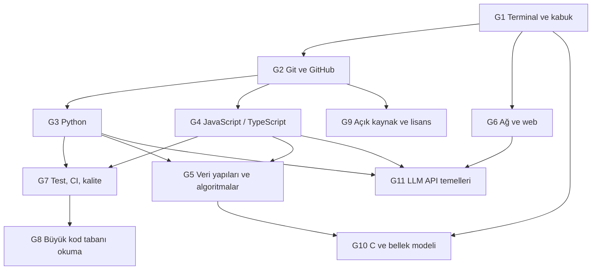

# Gövde — 51 deponun ortak temeli

> Ağacın gövdesi. Her dal (D01–D10) buradaki düğümlerden bir kısmının üstüne kurulur.
> Hepsini baştan bitirmen **gerekmez**: seçtiğin dalın istediği düğümleri bitir, dala çık, eksik kalanı dalda
> ihtiyaç duydukça tamamla ("tam zamanında öğrenme"). Ağacın tamamı için: [AGAC.md](../AGAC.md).

## Gövdenin şekli

## Hangi dal hangi düğümü ister

● zorunlu · ○ faydalı · boş: gerekmez

Tablo, her dal dosyasının "Ön koşullar" bölümüyle aynıdır. O bölüm de dalın yapraklarının "Öğrenmen gerekenler"
listelerinin birleşimine dayanır; zorunlu/faydalı ayrımı dal dosyasının kararıdır (ör. D01'de G5). "Zorunlu", dalın
**sonuna kadar** gerekir demek; bazı düğümler yalnızca birkaç yaprak için gerekir (ör. D04'te G4 ve G5 yalnızca son
iki yaprak için). Hangi yaprağın neyi istediği dal dosyasında yazar.

| Dal                                                                       | G1  | G2  | G3  | G4  | G5  | G6  | G7  | G8  | G9  | G10 | G11 | Önceki ve yardımcı dallar                                    |
| ------------------------------------------------------------------------- | --- | --- | --- | --- | --- | --- | --- | --- | --- | --- | --- | ------------------------------------------------------------ |
| [D01 Web arayüzü](../dallar/01-web-arayuzu/README.md)                     | ●   | ●   |     | ●   | ○   | ○   | ●   | ○   |     |     |     | — (HTML, CSS, DOM dal içinde; D09, D10 yardımcı)             |
| [D02 Uygulama platformları](../dallar/02-uygulama-platformlari/README.md) | ●   | ●   |     | ●   | ○   | ○   | ●   | ●   | ○   | ○   |     | D01 önerilir                                                 |
| [D03 Sistem, ağ, güvenlik](../dallar/03-sistem-ag-guvenlik/README.md)     | ●   | ●   | ●   | ○   | ●   | ●   | ○   | ●   | ●   | ●   | ○   | D09 (önce ya da birlikte); REA için D07, D08 (paralel)       |
| [D04 Veri araçları](../dallar/04-veri-araclari-otomasyon/README.md)       | ●   | ●   | ●   | ●   | ●   | ●   | ●   | ○   | ○   |     |     | —                                                            |
| [D05 Yapay zekâ altyapısı](../dallar/05-yapay-zeka-altyapisi/README.md)   | ●   | ●   | ●   |     | ●   | ●   | ●   | ○   | ○   | ○   | ●   | D09 (+ dal içi matematik M1–M3)                              |
| [D06 Ajan platformları](../dallar/06-ajan-platformlari/README.md)         | ●   | ●   | ●   | ●   | ○   | ●   | ●   | ●   | ○   |     | ●   | — (D08, D10 faydalı; D05, D04, D07 isteğe bağlı)             |
| [D07 Kodlama ajanları](../dallar/07-kodlama-ajanlari/README.md)           | ●   | ●   |     | ●   |     | ●   | ●   | ●   |     | ○   | ●   | D08 → anthropic-skills, D05 → ollama (+ claw-code için Rust) |
| [D08 Ajan becerileri](../dallar/08-ajan-becerileri/README.md)             | ●   | ●   | ●   | ●   |     |     | ●   | ○   | ○   |     | ●   | —                                                            |
| [D09 Bilgisayar bilimi](../dallar/09-bilgisayar-bilimi/README.md)         | ●   | ●   | ●   | ○   | ●   | ○   | ●   |     | ○   | ○   |     | —                                                            |
| [D10 Küratörlük, topluluk](../dallar/10-kuratorluk-topluluk/README.md)    | ○   | ●   | ●   | ○   | ○   | ○   | ●   |     | ●   |     |     | — (ilk PR için G1 + G2 yeter)                                |

## Önerilen tırmanış sırası

Süreler aşağıdaki düğüm bölümlerindeki sürelerin toplamıdır. İkinci dil, kavramlar aktarıldığı için ilkinden kısa
sürer.

| Adım | Düğümler                          | Süre (haftada ~10 saat)   | Bu adımdan sonra başlayabileceğin dallar                                                        |
| ---- | --------------------------------- | ------------------------- | ----------------------------------------------------------------------------------------------- |
| 1    | G1 + G2                           | 3–5 hafta                 | D10'da ilk PR'ın (listeye katkı)                                                                |
| 2    | G3 (Python) **veya** G4 (JS/TS)   | 6–8 hafta                 | —                                                                                               |
| 3    | G7 + G6                           | 6–9 hafta                 | D10 mini'leri (G3 ile), D01 (G4 seçtiysen), D04'ün ilk üç yaprağı (G3 seçtiysen)                |
| 4    | İkinci dil (G3 ya da G4)          | 4–6 hafta                 | D01, D02 (önce D01 önerilir); G4 ile başladıysan D10 mini'leri ve D04'ün ilk üç yaprağı         |
| 5    | G5 (D09 ile birlikte derinleşir)  | 8–12 hafta                | D09, D04'ün son iki yaprağı (firecrawl, n8n)                                                    |
| 6    | G11                               | 3–4 hafta                 | D08, D06, D05 (D09'dan sonra), D07 (D08'in anthropic-skills ve D05'in ollama yaprağından sonra) |
| 7    | G10                               | 6–8 hafta                 | D03 (D09 ile birlikte)                                                                          |
| her  | G8 ve G9 (her yaprakta uygulanır) | G9 1 hafta, sonra sürekli | —                                                                                               |

Toplam: tam gövde yaklaşık 37–53 hafta (9–12 ay).

İlk dil önerisi: **Python** (51 deponun 14'ü Python; G3 yedi dalda zorunlu: D03–D06 ve D08–D10). Web arayüzü
hedefin varsa **JavaScript/TypeScript** ile başla (11 depo TypeScript, 4 depo JavaScript; G4 altı dalda zorunlu: D01,
D02, D04, D06–D08).

---

## G1 Terminal, kabuk ve Linux kullanımı

**Neden:** Depoların hepsi terminalden kurulur, test edilir, çalıştırılır. Bazıları doğrudan terminalin kendisidir:
[ohmyzsh](../dallar/02-uygulama-platformlari/ohmyzsh/README.md) bir kabuk çerçevesi,
[yt-dlp](../dallar/04-veri-araclari-otomasyon/yt-dlp/README.md) bir komut satırı aracı,
[opencode](../dallar/07-kodlama-ajanlari/opencode/README.md) ve [claw-code](../dallar/07-kodlama-ajanlari/claw-code/README.md)
terminalde çalışan ajanlar, [the-book-of-secret-knowledge](../dallar/03-sistem-ag-guvenlik/the-book-of-secret-knowledge/README.md)
tek satırlık komutların ansiklopedisi.

**Öğrenme hedefleri**

- [ ] Dosya sistemi gezintisi, izinler (`chmod`, `chown`), sembolik bağlantılar
- [ ] Süreçler: `ps`, `top`, `kill`, arka plan işleri, çıkış kodları (`$?`)
- [ ] Boru (`|`) ve yönlendirme (`>`, `>>`, `2>&1`), `tee`, `xargs`
- [ ] Metin araçları: `grep`, `sed`, `awk`, `find`, `sort`, `uniq`, `cut`, `jq`
- [ ] Ortam değişkenleri, `PATH`, kabuk başlangıç dosyaları (`.bashrc`, `.zshrc`)
- [ ] Bash betiği: değişken, `if`, `for`, fonksiyon, `set -euo pipefail`, argüman işleme
- [ ] `ssh`, anahtar çifti, uzak sunucuda çalışma; paket yöneticisi (`apt`)

**Mini görev:** Bir klasörü tarih damgalı `.tar.gz` olarak yedekleyen, 7 günden eski yedekleri silen, her adımda
doğru çıkış kodu dönen bir bash betiği yaz ve `cron` ile her gece çalıştır.
**Bitti ölçütü:** Betik yanlış argümanla çağrıldığında anlaşılır hata verip `1` ile çıkıyor; doğru çağrıda yedek
oluşuyor ve eski yedekler siliniyor.

**Kaynaklar**

- [The Missing Semester of Your CS Education](https://missing.csail.mit.edu/) — MIT; ossu müfredatında da önerilir.
- [Linux Sistem Yönetimi](https://web.deu.edu.tr/doc/misc/Linux_Sistem_Yonetimi.pdf) — Linux Kullanıcıları Derneği
  (Türkçe PDF; free-programming-books Türkçe listesinden).
- [GNU Bash Başvuru Kılavuzu](https://web.archive.org/web/20230404020935/http://www.belgeler.org/bashref/bashref.html)
  — Türkçe, arşiv.
- [build-your-own-x → Shell](https://github.com/codecrafters-io/build-your-own-x#build-your-own-shell) — kendi kabuğunu yaz.

**Süre:** 2–3 hafta.

---

## G2 Git ve GitHub iş akışı

**Neden:** 51 deponun tamamı Git'te yaşar ve katkıyı çoğunlukla pull request (PR) ile alır. Liste depoları
([D10](../dallar/10-kuratorluk-topluluk/README.md)) tamamen PR akışıyla büyür; Linux ise hâlâ e-postayla yama
gönderir — iki modeli karşılaştırmak açık kaynağın nasıl yönetildiğini gösterir. Bu atlası hazırlarken depoları
`git clone --depth 1 --filter=blob:none --sparse` ile çektik: 97 bin dosyalık Linux ağacı saniyeler içinde geldi,
çünkü dosya içerikleri ancak istendiğinde indi. Bu tür Git bilgisi büyük depoları okumanın ön koşuludur.

**Öğrenme hedefleri**

- [ ] `commit`, `branch`, `merge`, `rebase`, `cherry-pick`, `stash`, çakışma çözme
- [ ] Nesne modeli: blob, tree, commit, ref; neden "her şey bir hash"
- [ ] Uzak depolar, `fetch`/`pull`/`push`, fork + PR akışı, kod incelemesi
- [ ] Sığ (`--depth`), kısmi (`--filter=blob:none`) ve seyrek (`sparse-checkout`) klon
- [ ] `git log`, `git blame`, `git bisect` ile tarihçe araştırması
- [ ] GitHub Actions'ın temel yapısı (olay → iş → adım)

**Mini görev:** [build-your-own-x → Git](https://github.com/codecrafters-io/build-your-own-x#build-your-own-git)
bölümündeki rehberlerden biriyle `init`, `hash-object`, `cat-file` ve `commit` komutlarını yapan bir mini Git yaz.
**Bitti ölçütü:** Senin aracınla oluşturduğun commit'i gerçek `git log` okuyabiliyor.

**Kaynaklar**

- [Pro Git (Türkçe)](https://git-scm.com/book/tr/v2) — Scott Chacon, Ben Straub; çeviri Murat Yaşar.
- [git — basit rehber (Türkçe)](https://rogerdudler.github.io/git-guide/index.tr.html) — Roger Dudler.
- [Git Giriş Eğitim Serisi](https://youtube.com/playlist?list=PLGrTHqyRDvx4WAg9LPX_GKk7cKF7KBXOg) — Kodluyoruz (Türkçe video).

**Süre:** 1–2 hafta, sonra sürekli.

---

## G3 Python ile programlama

**Neden:** 51 deponun 14'ü Python: [yt-dlp](../dallar/04-veri-araclari-otomasyon/yt-dlp/README.md),
[markitdown](../dallar/04-veri-araclari-otomasyon/markitdown/README.md),
[transformers](../dallar/05-yapay-zeka-altyapisi/transformers/README.md),
[MiroFish](../dallar/05-yapay-zeka-altyapisi/mirofish/README.md),
[hermes-agent](../dallar/06-ajan-platformlari/hermes-agent/README.md),
[AutoGPT](../dallar/06-ajan-platformlari/autogpt/README.md),
[TheAlgorithms/Python](../dallar/09-bilgisayar-bilimi/thealgorithms-python/README.md) ve diğerleri. TensorFlow'un
kullanıcıya bakan yüzü de Python'dur.

**Öğrenme hedefleri**

- [ ] Veri tipleri, kontrol akışı, fonksiyonlar, `*args/**kwargs`, kapsam
- [ ] Sınıflar, kalıtım, `dataclass`, sihirli metotlar (`__repr__`, `__iter__`…)
- [ ] Modül ve paket yapısı, `venv`, `pip`, `requirements.txt`, `pyproject.toml`
- [ ] İstisnalar, bağlam yöneticileri (`with`), iteratör ve üreteçler (`yield`)
- [ ] Dosya, JSON, CSV; `argparse` ile komut satırı aracı
- [ ] Tip ipuçları (`typing`), `async`/`await` temeli
- [ ] `unittest` ve `doctest` ile test

**Mini görev:** Bir CSV dosyasını okuyup Markdown tabloya çeviren, `argparse` ile çalışan ve testleri olan küçük bir
araç yaz. Bu, [markitdown](../dallar/04-veri-araclari-otomasyon/markitdown/README.md)'ın ilk adımıdır.
**Bitti ölçütü:** Boş dosya, tırnak içinde virgül ve Türkçe karakter içeren üç test geçiyor.

**Kaynaklar**

- [Python resmi eğitimi](https://docs.python.org/3/tutorial/) — dilin kendi belgesi.
- [Python Programlama Dili — YazBel](https://web.archive.org/web/20191220075828/https://python-istihza.yazbel.com/)
  — Türkçe, arşiv (free-programming-books Türkçe listesinden).
- [Sıfırdan İleri Seviye Python](https://www.youtube.com/playlist?list=PLK6Whnd55IH5i1klkNSBDasIaO77l-Bm9) — Türkçe video.
- [Python-100-Days](../dallar/09-bilgisayar-bilimi/python-100-days/README.md) — 100 günlük müfredat (Çince; nasıl
  okunacağı dosyasında).

**Süre:** 6–8 hafta.

---

## G4 JavaScript / TypeScript ve Node.js

**Neden:** Web arayüzü dalı ([React](../dallar/01-web-arayuzu/react/README.md),
[Vue](../dallar/01-web-arayuzu/vue3-core/README.md), [Bootstrap](../dallar/01-web-arayuzu/bootstrap/README.md)),
[VS Code](../dallar/02-uygulama-platformlari/vscode/README.md), [n8n](../dallar/04-veri-araclari-otomasyon/n8n/README.md),
[freeCodeCamp](../dallar/02-uygulama-platformlari/freecodecamp/README.md),
[opencode](../dallar/07-kodlama-ajanlari/opencode/README.md), [openclaw](../dallar/06-ajan-platformlari/openclaw/README.md),
[deepseek-harness](../dallar/07-kodlama-ajanlari/deepseek-harness/README.md) ve [rea](../dallar/03-sistem-ag-guvenlik/rea/README.md)
JavaScript/TypeScript ile yazılmış.

**Öğrenme hedefleri**

- [ ] Değerler ve tipler, zorlama (coercion), `===`
- [ ] Kapsam, closure, `this`, prototip zinciri, sınıflar
- [ ] ES modülleri (`import`/`export`), paket yöneticileri, monorepo/workspace kavramı
- [ ] Olay döngüsü, Promise, `async`/`await`, mikro ve makro görevler
- [ ] Node.js: `fs`, `http`, `stream`, `child_process`, `worker_threads`
- [ ] TypeScript: tipler, arayüzler, generics, `tsconfig`
- [ ] `node --test` ile test

**Mini görev:** Yalnızca Node'un yerleşik `http` modülüyle not tutan bir JSON API (GET/POST/DELETE) yaz, `node --test`
ile test et, sonra TypeScript'e çevir.
**Bitti ölçütü:** Hatalı JSON gövdesine `400`, olmayan nota `404` dönüyor; testler bunu doğruluyor.

**Kaynaklar**

- [You Don't Know JS](../dallar/01-web-arayuzu/you-dont-know-js/README.md) — dilin derin anlatımı; atlastaki dosyasında
  çalıştırılabilir "koan"lar var.
- [Learn JavaScript (Türkçe)](https://javascript.sumankunwar.com.np/tr) — free-programming-books Türkçe listesinden.
- [JavaScript Eğitim Serisi](https://youtube.com/playlist?list=PLGrTHqyRDvx6PqKkqSPwph57HNN4RWgR2) — Kodluyoruz (Türkçe video).
- [TypeScript Handbook](https://www.typescriptlang.org/docs/handbook/intro.html) — resmi belge.

**Süre:** 6–8 hafta.

---

## G5 Veri yapıları ve algoritmalar

**Neden:** Depoların içindeki "sihir" çoğu zaman bir algoritmadır: React ve Vue'nun liste karşılaştırması (Vue 3'te
en uzun artan alt dizi), n8n'in iş akışı yürütmesi (yönlü graf), tarayıcıların keşif kuyruğu (genişlik öncelikli
arama), DNS'in ağaç yapısı, Git'in Merkle ağacı, önbelleklerdeki LRU. Bu düğümün derin hâli
[D09 Bilgisayar bilimi](../dallar/09-bilgisayar-bilimi/README.md) dalıdır.

**Öğrenme hedefleri**

- [ ] Büyük-O analizi; zaman ve bellek ödünleşimi
- [ ] Dizi, bağlı liste, yığın (stack), kuyruk, hash tablosu
- [ ] Ağaçlar: ikili arama ağacı, heap, trie; dengeli ağaç fikri
- [ ] Graflar: BFS, DFS, topolojik sıralama, Dijkstra
- [ ] Sıralama ve arama; özyineleme; dinamik programlama

**Mini görev:** [javascript-algorithms](../dallar/09-bilgisayar-bilimi/javascript-algorithms/README.md) veya
[TheAlgorithms/Python](../dallar/09-bilgisayar-bilimi/thealgorithms-python/README.md) içinden 10 yapı/algoritmayı
koda bakmadan, kendi testlerinle yeniden yaz.
**Bitti ölçütü:** Her biri için büyük-O'yu gerekçesiyle yazabiliyor ve sınır durumlarını test ediyorsun.

**Kaynaklar**

- [Algoritmalar ve Veri Yapıları](https://www.youtube.com/playlist?list=PLMQXT_yvb6DUV3usqrNYMfAXoYGXtpmSq) —
  Berat Ersarı (Türkçe video; free-programming-books Türkçe kurs listesinden).
- [Veri Yapıları Ders Notları](https://avesis.kayseri.edu.tr/resume/lessonmaterieldownload/kayaalti?key=a9b67077-3132-489c-a460-53cb34d3afc3)
  — Aybars Uğur (Türkçe PDF).
- [coding-interview-university](../dallar/09-bilgisayar-bilimi/coding-interview-university/README.md) — eksiksiz
  çalışma planı.

**Süre:** 8–12 hafta (D09'da derinleşir).

---

## G6 Ağ ve web temelleri (TCP/IP, DNS, HTTP, REST, JSON)

**Neden:** [FreeDomain](../dallar/03-sistem-ag-guvenlik/freedomain/README.md) doğrudan DNS'tir;
[yt-dlp](../dallar/04-veri-araclari-otomasyon/yt-dlp/README.md) ve [firecrawl](../dallar/04-veri-araclari-otomasyon/firecrawl/README.md)
HTTP istemcisidir; [ollama](../dallar/05-yapay-zeka-altyapisi/ollama/README.md), opencode ve openclaw birer HTTP
sunucusudur ve yanıtı parça parça akıtır; [public-apis](../dallar/04-veri-araclari-otomasyon/public-apis/README.md)
REST API'lerin listesidir; n8n webhook'larla tetiklenir.

**Öğrenme hedefleri**

- [ ] TCP/IP katmanları, IP adresi ve port, TCP ile UDP farkı
- [ ] DNS çözümleme zinciri (kök → TLD → yetkili sunucu), kayıt tipleri (A, AAAA, CNAME, NS, MX, TXT)
- [ ] HTTP: metotlar, durum kodları, başlıklar, çerezler, önbellek, yönlendirmeler; HTTP/2 ve HTTP/3 farkı
- [ ] TLS'in ne sağladığı (gizlilik, bütünlük, kimlik); sertifika zinciri
- [ ] REST tasarımı, JSON, kimlik doğrulama (API anahtarı, OAuth), CORS
- [ ] Akış: WebSocket, Server-Sent Events, NDJSON (Ollama'nın kullandığı biçim)
- [ ] `curl -v` ve tarayıcı geliştirici araçlarıyla hata ayıklama

**Mini görev:** Python `socket` modülüyle statik dosya sunan basit bir HTTP/1.1 sunucusu yaz
([build-your-own-x → Web Server](https://github.com/codecrafters-io/build-your-own-x#build-your-own-web-server)).
**Bitti ölçütü:** `curl -v` ile `200`, `404` ve `Content-Length` doğru görünüyor; tarayıcı bir HTML sayfasını açıyor.

**Kaynaklar**

- [Computer Networking: a Top-Down Approach — çevrim içi dersler](https://gaia.cs.umass.edu/kurose_ross/online_lectures.htm)
  — Kurose & Ross; ossu müfredatında önerilir.
- [Beej'in Ağ Programlama Kılavuzu (Türkçe)](https://web.archive.org/web/20230505175314/http://www.belgeler.org/bgnet/bgnet.html)
  — soket programlama, arşiv.
- [MDN — HTTP](https://developer.mozilla.org/en-US/docs/Web/HTTP) — başvuru belgesi.
- [FreeDomain dosyası](../dallar/03-sistem-ag-guvenlik/freedomain/README.md) — sıfırdan DNS sunucusu.

**Süre:** 4–6 hafta.

---

## G7 Test, CI ve kod kalitesi

**Neden:** Bu depolar her değişikliği otomatik denetimden geçirmeden kabul etmez: TheAlgorithms her algoritmada
doctest ister, liste depoları biçim ve bağlantı denetimi çalıştırır, React ve Vue binlerce test koşar. Bu atlastaki
**her mini uygulama testlidir**; testleri okumak, kodu okumanın en hızlı yoludur.

**Öğrenme hedefleri**

- [ ] Birim, entegrasyon ve uçtan uca test; test piramidi
- [ ] Sahte nesneler (fake, stub, mock) ve bağımlılık enjeksiyonu
- [ ] TDD döngüsü: kırmızı → yeşil → düzenle
- [ ] Lint ve biçimleyici (ESLint, Prettier, ruff), pre-commit kancaları
- [ ] GitHub Actions: tetikleyici, matris, önbellek, gizli değişkenler
- [ ] Kapsam ölçümü ve sınırları

**Mini görev:** G3 veya G4 mini görevine her push'ta test ve lint çalıştıran bir GitHub Actions iş akışı ekle; bilerek
bir testi kır, kırmızıyı gör, düzelt.
**Bitti ölçütü:** PR sayfasında yeşil onay işareti var; kırık testle açılan PR birleştirilemiyor.

**Kaynaklar**

- [Software Testing](https://www.youtube.com/playlist?list=PLAwxTw4SYaPkWVHeC_8aSIbSxE_NXI76g) ve
  [Software Debugging](https://www.youtube.com/playlist?list=PLAwxTw4SYaPkxK63TiT88oEe-AIBhr96A) — Udacity; ossu'da önerilir.
- [superpowers](../dallar/08-ajan-becerileri/superpowers/README.md) — TDD'yi yapay zekâ ajanlarına öğreten yöntem;
  insanlar için de iyi bir özet.
- [GitHub Actions belgeleri](https://docs.github.com/en/actions).

**Süre:** 2–3 hafta, sonra sürekli.

---

## G8 Büyük kod tabanı okuma

**Neden:** Bu listedeki depoların bazıları tek başına bir kütüphane büyüklüğünde. İncelenen commit'lerde dosya
sayıları: Linux 97.362, openclaw 65.873, TensorFlow 37.696, n8n 33.318, hermes-agent 23.484, VS Code 21.007,
deepseek-harness 20.665, freeCodeCamp 19.823, Flutter 16.326. Bunları baştan sona okuyamazsın; bir yöntemin olmalı.

**Yöntem (her yaprakta uygula)**

1. **README, CONTRIBUTING ve mimari belgeler.** Proje kendini nasıl anlatıyor?
2. **Harita çıkar.** `git ls-tree -d --name-only HEAD` ile klasörleri listele; her klasöre tek cümlelik görev yaz.
3. **Giriş noktasını bul.** `main`, `cmd/`, `bin/`, `package.json` içindeki `bin`/`main`, `__main__.py`.
4. **Bir yolu baştan sona izle.** Tek bir komutun veya isteğin hangi dosyalardan geçtiğini sırayla yaz.
5. **Testlerden öğren.** Testler, kodun nasıl kullanılacağının çalışan örnekleridir.
6. **Hata ayıklayıcıyla adım adım ilerle.** `pdb`, `node --inspect`, `gdb`, `dlv`.
7. **Tarihçeye bak.** `git log -p -- <dosya>` ve `git blame` "neden böyle?" sorusunu yanıtlar.
8. **Küçük bir katkı yap.** Bir yazım hatası, eksik test veya küçük bir hata düzeltmesi için PR aç.

Atlastaki her depo dosyasında **"Gerçek depoda okuma rotası"** bölümü bu yöntemin o depoya uygulanmış hâlidir.

**Mini görev:** Bu atlasın yöntemiyle (sığ ve seyrek klon) bir depo çek ve bir sayfalık harita yaz: giriş noktası,
beş ana modül, bir isteğin izlediği yol.
**Bitti ölçütü:** Haritan, depoyu hiç görmemiş birine 10 dakikada anlatılabiliyor.

**Kaynaklar**

- [The Architecture of Open Source Applications](https://aosabook.org/en/) — ünlü açık kaynak projelerin mimarisini
  kendi geliştiricileri anlatıyor (ücretsiz).
- [Software Debugging](https://www.youtube.com/playlist?list=PLAwxTw4SYaPkxK63TiT88oEe-AIBhr96A) — Udacity.

**Süre:** Sürekli.

---

## G9 Açık kaynak: lisans, katkı süreci, topluluk

**Neden:** Lisans, bir depoyu iş fikrinde nasıl kullanabileceğini belirler. Bu 51 deponun lisans dağılımı (GitHub'ın
algıladığı biçimiyle): 24 MIT, 3 AGPL-3.0 (firecrawl, MiroFish, FreeDomain), 2 Apache-2.0 (TensorFlow, transformers),
2 BSD-3-Clause (freeCodeCamp, Flutter), 1 GPL-3.0, 1 Unlicense (yt-dlp), 3 Creative Commons (listeler), 9
"NOASSERTION" ve 6 depoda tanınan lisans yok. "NOASSERTION", GitHub'ın lisansı standart bir kalıba oturtamadığı anlamına
gelir. Örneğin Linux'un `COPYING` dosyası `GPL-2.0 WITH Linux-syscall-note` der; n8n ise kendini "fair-code" olarak
tanımlar. Lisanssız bir depo varsayılan olarak "tüm hakları saklı" demektir.

**Öğrenme hedefleri**

- [ ] İzin verici (MIT, BSD, Apache) ve copyleft (GPL, AGPL) farkı; AGPL'nin **ağ üzerinden sunma** hükmü (SaaS)
- [ ] Apache-2.0'ın patent maddesi; Creative Commons lisansları (CC0, CC-BY, CC-BY-SA)
- [ ] "Fair-code" ve kaynak açık ama ticari kısıtlı lisanslar
- [ ] CONTRIBUTING, davranış kuralları, issue/PR şablonları, CLA/DCO
- [ ] Sürüm yayınlama: semver, changelog, etiketler
- [ ] Açık kaynak iş modelleri: açık çekirdek, bulut hizmeti, destek, eğitim hunisi, sponsorluk

**Mini görev:** [İş fikirleri](../is-fikirleri/README.md) arasından bir fikir seç. Kullandığı depoların lisanslarını
tabloya dök ve "Bunu kapalı kaynak bir SaaS olarak satabilir miyim? Hangi koşulla?" sorusunu yanıtla.
**Bitti ölçütü:** Her depo için yükümlülüğü (atıf, kaynak açma, değişiklik bildirimi) tek cümleyle yazabiliyorsun.

**Kaynaklar**

- [choosealicense.com](https://choosealicense.com/) — lisansların sade karşılaştırması.
- [Open Source Guides](https://opensource.guide/) — GitHub'ın katkı ve bakım rehberleri.
- [SPDX lisans listesi](https://spdx.org/licenses/) — lisansların resmi kısa adları.
- [D10 Küratörlük, topluluk](../dallar/10-kuratorluk-topluluk/README.md) ve [996.ICU](../dallar/10-kuratorluk-topluluk/996-icu/README.md)
  — lisansın bir hareket aracı olarak kullanılması.

**Süre:** 1 hafta.

> Bu bölüm hukuki tavsiye değildir; ticari bir üründe lisans kararını bir avukatla doğrula.

---

## G10 C ve bellek modeli (işaretçi, derleme, bağlama)

**Neden:** [Linux](../dallar/03-sistem-ag-guvenlik/linux/README.md) C ile yazılmış, son yıllarda bir kısmı Rust ile.
[ollama](../dallar/05-yapay-zeka-altyapisi/ollama/README.md)'nın çıkarım motoru C/C++, TensorFlow'un çekirdeği C++,
yt-dlp'nin dayandığı ffmpeg C. Python ve Node'un kendisi de C/C++ ile yazılmış. "Altta ne oluyor?" sorusunun cevabı
burada.

**Öğrenme hedefleri**

- [ ] Derleme zinciri: ön işlemci → derleyici → bağlayıcı; başlık dosyaları, `Makefile`
- [ ] İşaretçiler, diziler, `struct`, işaretçi aritmetiği
- [ ] Yığın (stack) ve öbek (heap); `malloc`/`free`; bellek sızıntısı ve taşmalar
- [ ] Tanımsız davranış; AddressSanitizer ve `valgrind`
- [ ] Sistem çağrıları: `open`, `read`, `write`, `fork`, `exec`, `wait`, `pipe`
- [ ] `gdb` ile hata ayıklama

**Mini görev:** Kendi `malloc`/`free` ikilini yaz
([build-your-own-x → Memory Allocator](https://github.com/codecrafters-io/build-your-own-x#build-your-own-memory-allocator))
ya da [D03'teki mini kabuğu](../dallar/03-sistem-ag-guvenlik/linux/README.md) boru hattı desteğiyle genişlet.
**Bitti ölçütü:** AddressSanitizer açıkken testlerin temiz geçiyor.

**Kaynaklar**

- [Nand2Tetris](https://www.nand2tetris.org/) — mantık kapısından işletim sistemine bilgisayarı sıfırdan kurmak
  (ossu'da önerilir).
- [Operating Systems: Three Easy Pieces](https://pages.cs.wisc.edu/~remzi/OSTEP/) — ücretsiz işletim sistemi kitabı.
- [Beej's Guide to C Programming](https://beej.us/guide/bgc/) — ücretsiz C kitabı.
- [GNU C Kütüphanesi Başvuru Kılavuzu (Türkçe)](https://web.archive.org/web/20210122114428/http://belgeler.org/glibc/glibc.html)
  — arşiv.

**Süre:** 6–8 hafta.

---

## G11 LLM API temelleri (istem, token, araç çağırma, akış)

**Neden:** Listenin dörtte biri 2025–2026'da açıldı ve bu 12 deponun hepsi yapay zekâ ajanlarıyla ilgili: opencode,
hermes-agent, anthropics/skills, superpowers, openclaw, MiroFish, ECC, andrej-karpathy-skills, mattpocock/skills,
claw-code, rea ve deepseek-harness. D05–D08 dallarının ortak dili budur; firecrawl ve markitdown da "LLM'e veri
hazırlamak" için yapılmıştır.

**Öğrenme hedefleri**

- [ ] Token, bağlam penceresi, maliyet ve gecikme
- [ ] Mesaj rolleri (system, user, assistant, tool); sıcaklık ve örnekleme
- [ ] Akışlı yanıt (SSE, NDJSON); yapılandırılmış çıktı (JSON şeması)
- [ ] **Araç çağırma döngüsü:** model araç ister → kod çalıştırır → sonucu geri verir → model devam eder
- [ ] Gömme (embedding), benzerlik araması, RAG
- [ ] Model Context Protocol (MCP): araçları ajanlara standart biçimde sunmak
- [ ] İstem enjeksiyonu ve güvenlik; ajan çıktısını değerlendirme (eval)

**Mini görev:** Yerelde çalışan Ollama'nın `/api/chat` uç noktasına bağlanan, tek araçlı (hesap makinesi) 80
satırlık bir ajan döngüsü yaz; testte gerçek model yerine senaryolu sahte bir model kullan.
[D07'deki mini kodlama ajanı](../dallar/07-kodlama-ajanlari/opencode/README.md) bunun büyümüş hâlidir.
**Bitti ölçütü:** Sahte model "2+3'ü hesapla" deyince aracın çağrıldığı, sonucun modele döndüğü ve döngünün
bittiği test geçiyor.

**Kaynaklar**

- [Ollama API belgesi](https://github.com/ollama/ollama/blob/main/docs/api.md) — yerel model sunucusunun REST API'si.
- [Claude belgeleri](https://platform.claude.com/docs) — araç kullanımı, akış, istem önbelleği.
- [Model Context Protocol](https://modelcontextprotocol.io/) — MCP belirtimi.
- [Neural Networks: Zero to Hero](https://karpathy.ai/zero-to-hero.html) — Andrej Karpathy; GPT'yi sıfırdan kurmak.
- [Derin Öğrenmeye Dalış (Türkçe)](https://tr.d2l.ai/d2l-tr-pytorch.pdf) — Zhang, Lipton, Li, Smola (PDF;
  free-programming-books Türkçe listesinden).

**Süre:** 3–4 hafta.

---

## Not: kaynakların doğrulanması

Türkçe kaynakların çoğu [free-programming-books](../dallar/10-kuratorluk-topluluk/free-programming-books/README.md)
Türkçe listelerinden (`books/free-programming-books-tr.md`, `courses/free-courses-tr.md`), İngilizce derslerin
çoğu [ossu/computer-science](../dallar/09-bilgisayar-bilimi/ossu-computer-science/README.md) müfredatından alındı
(9 Kasım 2026'daki commit'ler). Bağlantılar zamanla bozulabilir; arşivlenmiş olanlar `web.archive.org` üzerinden verildi.
