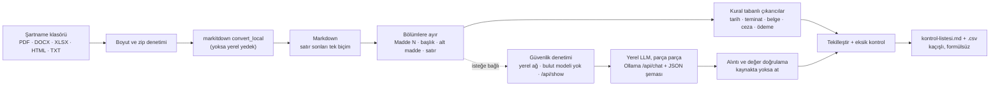

# 01 — İhale şartname analizcisi

> **Kullandığı depolar:** [microsoft/markitdown](../../dallar/04-veri-araclari-otomasyon/markitdown/README.md) (belge →
> Markdown) · [ollama/ollama](../../dallar/05-yapay-zeka-altyapisi/ollama/README.md) (isteğe bağlı yerel LLM) ·
> **Dil:** Python 3.13, yalnızca standart kütüphane (markitdown isteğe bağlı) · **Durum:** çalışan MVP, 85 birim ve
> 3 entegrasyon testi

Kamu ihalesine teklif hazırlayan firma, idari şartname, teknik şartname ve sözleşme tasarısını okuyup tarihleri,
teminat oranlarını, istenen belgeleri, cezaları ve ödeme koşullarını bir listeye döker. Bu araç o listeyi **kaynağıyla
birlikte** otomatik çıkarır. Belgeler bilgisayardan (isteğe bağlı yerel LLM kullanılırsa ofis ağından) dışarı çıkmaz;
tek istisna, kullanıcının açıkça verdiği `--uzak-ollama` seçeneğidir.

## 1. Problem

- Bir ihalenin belge seti onlarca sayfadır; bir belgenin eksik olması ya da bir tarihin kaçırılması teklifin
  değerlendirme dışı kalmasına yol açabilir. Kontrol listesi bugün çoğu firmada elle, Excel'e kopyalanarak hazırlanıyor
  (varsayım: ilk müşteri görüşmelerinde doğrulanmalı).
- Genel amaçlı bulut yapay zekâ araçlarına şartname yüklemek mümkün, ama firmalar **teklif stratejisini ve fiyat
  bilgisini** dışarı göndermekten çekinir (varsayım); ayrıca modelin uydurduğu bir madde ile gerçek madde ayırt
  edilemez.

## 2. Kime

**Kısaca:** Kamu ihalelerine düzenli teklif veren KOBİ tedarikçi ve müteahhitlerin ihale sorumluları ile birden çok
firmanın teklif dosyasını hazırlayan ihale danışmanları.

| Segment                                         | Persona                                                                                                             | Neden ilgilenir                                                                  |
| ----------------------------------------------- | ------------------------------------------------------------------------------------------------------------------- | -------------------------------------------------------------------------------- |
| Kamu ihalelerine giren KOBİ tedarikçiler        | Ankara'da ofis mobilyası satan, yılda 20–40 ihaleye teklif veren 15 kişilik firmanın ihale sorumlusu Ayşe Hanım     | Her ihalede aynı listeyi elle çıkarıyor; teklif fiyatını dışarıya vermek istemez |
| KOBİ müteahhitler (yapım işleri)                | Konya'da 10–30 kişilik inşaat firmasının teklif mühendisi; iş deneyim belgesi ve teminat takibi onun sorumluluğunda | Teminat oranı ya da süre hatası pahalıya mal olur                                |
| İhale danışmanları ve teklif hazırlama ofisleri | Aynı anda 5–10 müşterinin dosyasını hazırlayan serbest ihale danışmanı                                              | Müşteri başına okuma süresi azalır; ürünü birden çok firmaya taşıyan kanaldır    |

Persona ve sayılar örnektir (varsayım); ilk görüşmelerde doğrulanmalı.

**İlk 10 müşteri planı**

1. **5 tedarikçi (Ankara; ofis mobilyası, kırtasiye, temizlik malzemesi):** EKAP'taki herkese açık ihale sonuç
   ilanlarında son 12 ayda birkaç kez yüklenici olarak görünen firmalar (sonuç ilanında yalnızca sözleşme imzalanan
   yüklenicinin yer aldığı varsayımı doğrulanmadı). Firmanın kurumsal iletişim adresine tek seferlik tanıtım, ardından
   firmanın kendi bir ihalesiyle ücretsiz pilot. Tanıtım iletisinin hukuki koşulları §9'da.
2. **3 ihale danışmanı:** Harita uygulamalarında "ihale danışmanlık" araması ve LinkedIn'deki kamu ihale uzmanı grupları. Bir
   danışman ürünü birden çok firmaya taşıdığı için kanal ortağıdır; pilot karşılığında ilk üç ay indirim (varsayım).
3. **2 müteahhit (Konya, yapım işleri):** Bölgesel müteahhit dernekleri ve yapı malzemesi bayilerinin toplantılarında
   iş deneyim belgesi ve teminat takibi örneğiyle gösterim.
4. **Gösterim kanalı:** Ticaret ve sanayi odalarının kamu ihale eğitimlerinde kısa canlı gösterim; belge katılımcının
   kendi bilgisayarında işlenir.

Pilotun başarı ölçütü: aynı belge setinde elle hazırlanan listeye göre kaçırılan madde sayısı ve harcanan süre
(varsayım: ilk pilotlarda ölçülecek).

## 3. Çözüm

```text
python3 -m ihale_analizci ornek/ -o cikti/
→ cikti/kontrol-listesi.md   (okunacak liste, her madde: değer + kaynak + alıntı)
→ cikti/kontrol-listesi.csv  (Excel'de takip: durum, kategori, başlık, değer, uyarı, dosya, bölüm, alt madde, satır, alıntı, yöntem)
→ cikti/markdown/*.md         (dönüştürülmüş belgeler: denetim izi; --markdown-yazma ile yazılmaz)
```

Örnek çıktıdan bir madde (kurgusal [ornek/](ornek/) belgeleri, `--donusturucu yerel` ile):

```text
- [ ] **Geçici teminat**: %3
  - Kaynak: idari-sartname.html › Madde 26 - Geçici teminat › 26.1 (satır 39)
  - Alıntı: “26.1. İstekliler teklif ettikleri bedelin %3'ünden az olmamak üzere geçici teminat vereceklerdir.”
```

Satır numarası, `cikti/markdown/` altına kaydedilen **dönüştürülmüş** dosyadaki satırdır. Kayıttan önce satır sonları
tek biçime getirilir; PDF'nin sayfa sonu karakteri (`\x0c`) bu yüzden numarayı kaydırmaz. Dönüştürücü değişirse (yerel ya
da markitdown) satır numarası da değişebilir; madde ve alt madde numarası değişmez.

Neler çıkarılır:

| Kategori         | Örnek                                                                        | Nasıl                                                                                                                          |
| ---------------- | ---------------------------------------------------------------------------- | ------------------------------------------------------------------------------------------------------------------------------ |
| Tarihler/süreler | İhale tarihi ve saati, teklif geçerlilik süresi, işin süresi, muayene süresi | `gg.aa.yyyy`, `gg/aa/yyyy`, `gg-aa-yyyy`, "5 Şubat 2027"; saat en yakın tarihe bağlanır; takvimde olmayan tarih uyarılır       |
| Teminatlar       | Geçici, kesin, ek kesin teminat oranları                                     | "%3'ünden", "yüzde üç", "yüzde on beş", "yüzde iki buçuk"; oran mevzuattaki değerden farklıysa uyarı                           |
| İstenen belgeler | İş deneyim belgesi, imza sirküleri, ISO 9001…                                | Belge bölümündeki satırlar ya da "sunulması zorunludur" fiilleri                                                               |
| Cezai şartlar    | Gecikme cezası (binde 1), fesih, teminatın gelir kaydı                       | Anahtar kelime + oran ("binde 1", "binde bir"); "uygulanmayacaktır" → yok, "mücbir sebep hallerinde uygulanmaz" → koşula bağlı |
| Ödeme koşulları  | "30 gün içinde ödenir", fiyat farkı yok, avans yok                           | Her konu kendi yüklemine bakar; "30 gün içinde/içerisinde/zarfında"; iş günü ile takvim günü ayrı tutulur                      |

Ayrıca **bulunamayanlar** listelenir: şartnamede beklenen ama bulunamayan kontroller (ör. kesin teminat maddesi) "elle
kontrol edin" diye ayrı bölümde durur. Hiç belge işlenemezse rapor yazılmaz (çıkış kodu 3); belge yokken "bulunamadı"
listesi yanıltıcı olurdu. Neredeyse boş metin çıkan PDF için "taranmış belge olabilir, OCR gerekir" notu düşülür.

## 4. Depoları nasıl kullanıyor

| Depo                     | Kullanım                                                                                                                                                                                                                                                                                                                                                                                                                                                                                                                                                                                                                                                                                                                                                                                                                                     | Doğrulandığı yer (commit)                                                                                                                                                                                                                                                                                                                        |
| ------------------------ | -------------------------------------------------------------------------------------------------------------------------------------------------------------------------------------------------------------------------------------------------------------------------------------------------------------------------------------------------------------------------------------------------------------------------------------------------------------------------------------------------------------------------------------------------------------------------------------------------------------------------------------------------------------------------------------------------------------------------------------------------------------------------------------------------------------------------------------------- | ------------------------------------------------------------------------------------------------------------------------------------------------------------------------------------------------------------------------------------------------------------------------------------------------------------------------------------------------ |
| **microsoft/markitdown** | Kütüphane olarak: `MarkItDown(enable_plugins=False).convert_local(yol).markdown`. `convert()` kullanılmaz: `convert(str)`, `http:`, `https:`, `file:` ya da `data:` ile başlayan dizgeyi adres sayıp `convert_uri()`'ye gönderir (http/https'te `requests` ile istek atar); göreli `http:ornek.html` adlı yerel dosya bu yüzden dönüştürülemiyordu. Her biçim ayrı bir "extra" ister: `pdf` (pdfminer.six + pdfplumber), `docx` (mammoth + lxml), `xlsx` (pandas + openpyxl), `xls` (pandas + xlrd), `pptx` (python-pptx). PDF dönüştürücüsü düz metin ve kenarlıksız tablo/form çıkarır, başlık üretmez ve her sayfa sonunda `\x0c` bırakır (0.1.9 ile denendi). DOCX mammoth ile HTML'ye, oradan Markdown'a çevrilir (başlık ve tablo korunur); XLSX'te her sayfa `## Sayfa adı` + tablo olur; HTML'de `<body>` varsa yalnızca o çevrilir. | `packages/markitdown/src/markitdown/_markitdown.py` (`convert`, `convert_local`, `convert_uri`), `_base_converter.py`, `converters/_pdf_converter.py`, `_docx_converter.py`, `_xlsx_converter.py`, `_html_converter.py`, `pyproject.toml`, `__about__.py` (0.1.9) — `ed17895` (2026-11-06)                                                       |
| **ollama/ollama**        | REST API olarak: önce `POST /api/show {model}`; yanıtta `remote_host` doluysa model uzaktadır ve reddedilir. Sonra her parça için `POST /api/chat` + `stream: false` + `format: <JSON şeması>` + `options: {temperature: 0, num_ctx: 8192}`; dönen `message.content` JSON olarak ayrıştırılır, `remote_host` taşıyan yanıt katmanı durdurur. Ollama'nın varsayılan bağlamı 24 GiB altı VRAM'de 4096 jetondur; bu yüzden `num_ctx` açıkça verilir. Şema, Ollama'nın önerdiği gibi isteme de yazılır. Adı `:cloud` ya da `-cloud` ile biten model bulut modelidir (Ollama'nın kendi kuralı) ve hiç sorulmaz. Adres Ollama'nın `OLLAMA_HOST` kuralıyla tamamlanır: şema yoksa `http`, port yoksa 11434, `0.0.0.0` → `127.0.0.1`.                                                                                                                | `docs/api.md` ("Generate a chat completion", "Show Model Information"), `docs/faq.mdx` (`num_ctx`, `OLLAMA_NO_CLOUD`), `docs/context-length.mdx`, `docs/capabilities/structured-outputs.mdx`, `docs/cloud.mdx`, `api/types.go` (`ChatResponse`, `ShowResponse`), `internal/modelref/modelref.go`, `envconfig/config.go` — `d63b702` (2026-11-07) |

**Yedekler:** markitdown kurulu değilse `.md`, `.txt` (UTF-8, BOM'lu UTF-16 ya da Türkçe Windows kodlaması cp1254) ve
`.html` dosyaları bağımlılıksız yerel dönüştürücüyle okunur; PDF/DOCX/XLSX için rapora "markitdown gerekli" notu düşer.
Ollama'ya ulaşılamazsa, model kurulu değilse ya da güvenlik denetimi geçmezse yalnızca kurallar çalışır ve nedeni rapora
yazılır. Tek bir parçanın bozuk yanıtı (JSON olmayan ya da yarıda kesilmiş) yalnızca o parçayı atlatır.

## 5. Mimari



| Dosya                           | Görev                                                                                                                                    |
| ------------------------------- | ---------------------------------------------------------------------------------------------------------------------------------------- |
| `ihale_analizci/metin.py`       | Türkçe küçük harf (`I→ı`, `İ→i`), NFKC + tırnak/tire/görünmez karakter katlama, yazıyla sayılar ("on beş", "iki buçuk")                  |
| `ihale_analizci/donustur.py`    | markitdown sarmalayıcısı (`convert_local`), boyut ve zip bombası denetimi, bağımlılıksız HTML/TXT yedeği                                 |
| `ihale_analizci/bolum.py`       | "Madde 26 - …", Markdown başlıkları, büyük harfli başlıklar; değer taşıyan satır başlığa gömülmez; alt madde (26.1) ve satır takibi      |
| `ihale_analizci/cikaricilar.py` | Beş çıkarıcı, Türkçe olumsuzluk (yüklem sonda), mevzuat uyarıları, tekilleştirme, bulunamayan kontroller                                 |
| `ihale_analizci/llm.py`         | Ollama istemcisi: adres kuralı, yerel ağ ve bulut modeli denetimi, vekilsiz ve yönlendirmesiz HTTP, parçalama, alıntı ve değer doğrulama |
| `ihale_analizci/rapor.py`       | Markdown kontrol listesi (Markdown/HTML kaçışlı); Türkçe Excel için `;` ayırıcılı, BOM'lu, formül enjeksiyonuna kapalı CSV               |
| `ihale_analizci/__main__.py`    | Komut satırı, `analiz_et()` akışı, girdi süzme (alt klasör, kilit dosyası, sembolik bağlantı), eski kopyaları güvenle silme              |

**Tasarım kararları**

- **Önce kural, sonra LLM.** Kurallar hızlı, açıklanabilir ve internetsizdir; LLM yalnızca kuralın kaçırdığı cümleleri
  ekler (aynı cümle için ikinci madde üretilmez). LLM yoksa ya da kapalıysa ürün yine çalışır.
- **Kaynaksız madde yok.** Her madde dosya › bölüm › alt madde (satır) taşır. LLM maddesi, alıntısı kaynakta
  bulunmadıkça listeye girmez; birden çok cümleye yayılan alıntı, başladığı cümleye bağlanır. Değerdeki bir sayı
  alıntıda geçmiyorsa madde "kaynağı kontrol edin" uyarısı taşır.
- **İçerik başlığa gömülmez.** `SON TEKLİF VERME TARİHİ 5 ŞUBAT 2027` ya da `**Avans verilmeyecektir.**` gibi büyük
  harfli ya da kalın satırlar rakam, %, iki nokta ya da yüklem eki taşıyorsa başlık değil içeriktir; yoksa içlerindeki
  değer hiçbir çıkarıcıya ulaşmazdı.
- **Türkçe olumsuzluk.** Türkçede yüklem sondadır: "Avans verilmeyecek, ancak fiyat farkı verilecektir." cümlesinde her
  konunun durumu, konudan sonra gelen ilk yüklemden okunur (avans: yok, fiyat farkı: var). Olumsuzluk bir istisnaya
  bağlıysa ("mücbir sebep hallerinde") "yok" değil "koşula bağlı" yazılır.
- **Türkçe eşleştirme.** Python'un `str.lower()` işlevi Türkçe `İ/I` harflerini yanlış küçültür; tüm eşleştirme kendi
  `katla()` işlevimizle yapılır. PDF'deki `’` (U+2019) ile `'`, bitişik "fi" harfi ile "fi" aynı sayılır.
- **Belge dışarı çıkmaz.** LLM katmanında dört kilit var: yalnızca yerel ağdaki sunucu (açık `--uzak-ollama` izni
  dışında), bulut modeli reddi (adla ve `/api/show` ile), ortamdaki `HTTP_PROXY` değişkeninin yok sayılması, 3xx
  yönlendirmelerinin izlenmemesi. Eski sürüm `HTTP_PROXY` tanımlı bir ofis bilgisayarında belge metnini vekil sunucuya
  gönderiyordu.

## 6. Kurulum ve çalıştırma

```bash
cd repo-atlasi/is-fikirleri/01-ihale-analizci
python3 -m ihale_analizci ornek -o cikti                 # bağımlılıksız: yerel dönüştürücü
python3 -m venv ~/.venvs/ihale && ~/.venvs/ihale/bin/pip install -r requirements.txt
~/.venvs/ihale/bin/python -m ihale_analizci /yol/ihale-belgeleri -o cikti   # PDF/DOCX/XLSX için markitdown
# Yerel LLM ile (Ollama kurulu ve model indirilmiş olmalı):
~/.venvs/ihale/bin/python -m ihale_analizci /yol/ihale-belgeleri --ollama-url http://127.0.0.1:11434 --model qwen2.5:7b
```

Sanal ortamı depo dışında kurun; depo içinde `.venv/` adıyla kurarsanız `.gitignore` onu sürüm denetimi dışında tutar.

| Seçenek            | Anlamı                                                                                               |
| ------------------ | ---------------------------------------------------------------------------------------------------- |
| `--donusturucu`    | `otomatik` (varsayılan: markitdown varsa onu kullan), `markitdown` ya da `yerel`                     |
| `--markdown-yazma` | Dönüştürülmüş tam metin kopyalarını `cikti/markdown/` altına yazma (veri azaltma)                    |
| `--en-buyuk-mb`    | Tek belge için üst sınır (varsayılan 50 MB); Office paketinin açılmış boyutu bunun 10 katını aşamaz  |
| `--ollama-url`     | Ollama adresi; verilmezse LLM kullanılmaz. `127.0.0.1:11434` gibi şemasız yazım da kabul edilir      |
| `--model`          | Yerel model adı (varsayılan `qwen2.5:7b`, örnektir); `:cloud` ve `-cloud` ile biten adlar reddedilir |
| `--num-ctx`        | Ollama bağlam uzunluğu (`options.num_ctx`, varsayılan 8192)                                          |
| `--uzak-ollama`    | Yerel ağ dışındaki bir Ollama sunucusuna izin ver; belge metni oraya gider ve rapora not düşülür     |

Çıkış kodları: `0` başarılı; `2` hatalı kullanım (klasör yok, çıktı klasörü girdiyle aynı, markitdown yok, geçersiz
Ollama adresi); `3` hiç belge işlenemedi.

Model adı örnektir; Türkçe metinde iyi sonuç veren ve donanımınıza sığan bir modeli kendiniz seçin. Ollama sunucusunda
`OLLAMA_NO_CLOUD=1` (ya da `~/.ollama/server.json` içinde `"disable_ollama_cloud": true`) bulut özelliklerini tümden
kapatır (`docs/faq.mdx`); ürünün kendi reddi buna ek bir kilittir. Çıktı klasöründeki `markdown/` alt klasörü yalnızca
bu aracın ürettiği kopyalar için kullanılır: sonraki çalıştırma yalnızca kendi kaydettiği kopyaları siler, oradaki başka
dosyalara dokunmaz.

## 7. Test

```bash
PYTHONDONTWRITEBYTECODE=1 python3 -m unittest discover -s tests -t .
```

- 85 birim testi internetsiz ve markitdown'sız çalışır. LLM katmanı sahte `gonder` işleviyle ve `http.server` ile
  ayağa kaldırılan sahte Ollama sunucularına gerçek HTTP isteğiyle sınanır: vekil sunucunun yok sayılması,
  yönlendirmenin izlenmemesi, Ollama hata gövdesi, yanıt boyutu sınırı, bulut ve uzak model reddi.
- Bulunan her hata için bir gerileme testi var: başlığa gömülen içerik, yanlış tarihe bağlanan saat, "yüzde on beş",
  olumsuzluğun yanlış konuya bağlanması, sayfa sonunun satır numarasını kaydırması, CSV formül enjeksiyonu, Markdown
  bağlantı/resim enjeksiyonu, 6000 karakterde sessizce kesilen bölüm, bozuk LLM yanıtında çöken analiz.
- `tests/test_entegrasyon_markitdown.py` (3 test), markitdown kuruluysa çalışma anında **gerçek** bir DOCX, PDF (ASCII
  metinli, iki sayfalı) ve XLSX üretip uçtan uca dener; hangi biçimin eklentisi kuruluysa yalnızca onu sınar, hiçbiri
  yoksa atlanır. `requirements.txt`'deki sürümle (markitdown 0.1.9) denendi.

## 8. Gelir modeli ve örnek fiyatlar

**Fiyat özeti:** Tek ihale 750 TL; tedarikçi aboneliği 1.500 TL/ay; danışman ofisi 5.000 TL/ay; yerel LLM kurulumu
15.000 TL tek seferlik (KDV hariç; ilk müşterilerle doğrulanacak varsayımlar).

| Paket               | İçerik                                                                | Örnek fiyat (varsayım) |
| ------------------- | --------------------------------------------------------------------- | ---------------------- |
| Tek ihale           | Belge seti başına rapor                                               | 750 TL / ihale         |
| Tedarikçi aboneliği | Sınırsız analiz, 1 kullanıcı, kural güncellemeleri                    | 1.500 TL / ay          |
| Danışman ofisi      | 5 kullanıcı, müşteri bazında klasörler, CSV şablonları                | 5.000 TL / ay          |
| Yerel LLM kurulumu  | Ofisteki bilgisayara Ollama + model kurulumu ve ayarı (donanım hariç) | 15.000 TL tek seferlik |

- Fiyatlar 2026 sonu için **varsayımdır**; pazar büyüklüğü ve ödeme isteği ölçülmedi. İlk 10 müşteriyle görüşülerek
  doğrulanmalıdır.
- Araç yerel çalıştığı için "ihale başına" fiyat ancak lisans anahtarıyla ya da hizmet olarak (belgeyi danışmanın ya da
  bizim işlememiz) uygulanabilir; MVP'de lisans denetimi yoktur. Hizmet modelinde belge müşterinin bilgisayarından
  çıkar: "belge dışarı çıkmaz" vaadi o pakette geçerli değildir ve §9'daki veri işleyen yükümlülükleri doğar.
- Neden ödenir (varsayım): bir belge eksikliğiyle teklifin değerlendirme dışı kalmasının maliyeti (kaçan iş ve hazırlık
  emeği) aylık abonelikten yüksek olabilir; müşteriyle birlikte rakamlandırın.

## 9. KVKK, hukuk ve lisanslar

**Kişisel veriler (6698 sayılı KVKK).** Bu bölüm hukuki görüş değildir; maddeler bir avukatla teyit edilmelidir.

- **Roller.** Yerel kurulumda belgeyi işleyen firma kendi verisinin veri sorumlusudur; biz yalnızca yazılım
  sağlayıcısıyız ve veriye erişmeyiz. Hizmet modelinde (belgeyi biz ya da danışman işlersek) veri işleyen oluruz: yazılı
  veri işleme sözleşmesi, md. 12 kapsamında teknik ve idari tedbirler ve saklama/imha politikası gerekir.
- **Veri azaltma.** Şartname analizi için teklif dosyasındaki imza sirküleri, kimlik fotokopisi ya da personel listesi
  gerekmez; bunları analiz klasörüne koymayın. Eski tip nüfus cüzdanı fotokopilerinde din ya da kan grubu gibi özel
  nitelikli veri (md. 6) bulunabilir (doğrulanmadı). Araç alt klasörleri, Office kilit dosyalarını ve sembolik
  bağlantıları işlemez; `--markdown-yazma` ile tam metin kopyası da yazılmaz.
- **Silme.** `cikti/` klasörü belgelerin tam metin kopyasını içerir; iş bitince silin. Araç yalnızca kendi kaydettiği
  kopyaları siler. Bu silme dosya sistemi düzeyindedir; çöp kutusu, yedekler ve bulut eşitleme klasörleri ayrıca
  temizlenmelidir.
- **Aydınlatma (md. 10) ve açık rıza (md. 5–6).** Belgelerdeki kişilere (firma yetkilileri, personel) aydınlatmayı veri
  sorumlusu olan firma yapar; hizmet modelinde ona bir aydınlatma metni taslağı veririz. Şartname analizi için işleme
  şartı genellikle sözleşmenin kurulması ya da meşru menfaattir; açık rızaya dayanmak gerekmeyebilir (doğrulanmadı).
- **VERBİS.** Kayıt yükümlülüğü veri sorumlusunundur; çalışan sayısı ve yıllık mali bilanço eşiğine bağlı istisnalar
  Kurul kararlarıyla belirlenir ve güncellenir (eşikler doğrulanmadı).
- **Yurt dışına aktarım (md. 9).** Bulut LLM kullanmak, kişisel veri içeren metni yurt dışına aktarmak demektir; 2024
  değişikliğiyle getirilen uygun güvence ve standart sözleşme şartları (doğrulanmadı) uygulanır. Ollama'nın bulut
  modellerinde istem ve yanıtlar ollama.com'da işlenir (`docs/cloud.mdx`). Ürün bu yüzden bulut modellerini ve yerel ağ
  dışındaki sunucuyu varsayılan olarak reddeder; `--uzak-ollama` kullanan bu yükümlülükleri üstlenir.

**Tanıtım iletileri (6563 sayılı Kanun ve İleti Yönetim Sistemi).** İlk müşterilere gönderilecek e-posta ya da SMS
ticari elektronik iletidir. Tacir ve esnafa önceden onay alınmadan gönderilebildiği, ancak ret hakkının her iletide
sunulması gerektiği istisnası vardır (doğrulanmadı); İYS kaydının bu alıcılar için nasıl uygulandığı da
doğrulanmadı. Gerçek kişilerin kişisel e-posta ya da telefonu yerine kurumsal genel adresler kullanılmalı; EKAP gibi
kamuya açık kaynaklardan derlenen iletişim bilgilerini pazarlamada kullanmak, alenileştirme amacını aşabileceği için
ayrıca değerlendirilmelidir (doğrulanmadı).

**İçerik ve platform.** İhale dokümanı idarenin hazırladığı bir belgedir. Firmanın teklif hazırlamak için kendi
bilgisayarında işlemesi olağan kullanımdır; dokümanın ya da dönüştürülmüş tam metninin üçüncü kişilere dağıtılması (ör.
"tüm ihalelerin analizini" satmak) 5846 sayılı FSEK ve EKAP kullanım koşulları açısından ayrıca incelenmelidir
(doğrulanmadı). Bu MVP EKAP'tan otomatik indirme ya da kazıma yapmaz.

**Hukuki görüş değildir.** Rapor bir kontrol listesidir; hukuki mütalaa vermek 1136 sayılı Avukatlık Kanunu'na göre
avukatlara özgüdür (doğrulanmadı). Mevzuat uyarıları 4734 sayılı Kamu İhale Kanunu'nun 33. (geçici teminat, teklif
bedelinin %3'ünden az olmamak üzere) ve 43. (kesin teminat, ihale bedelinin %6'sı) maddelerine dayanır
(doğrulanmadı: bu ortamda mevzuat metnine erişilemedi). 4734 dışındaki ihalelerde (istisna kapsamı, 2886 sayılı Kanun,
kurumların kendi yönetmelikleri) oranlar farklı olabilir; uyarı orada yanlış alarm olabilir. Satıştan önce güncel
mevzuat metniyle ve bir ihale uzmanıyla doğrulayın.

**Lisanslar.** markitdown MIT (`LICENSE`, `ed17895`), Ollama MIT (`LICENSE`, `d63b702`). markitdown'ın kurulan
bağımlılıklarının tamamı izin verici lisanslı (paket üst verisinden okundu): pdfminer.six, pdfplumber, openpyxl,
beautifulsoup4, markdownify ve onnxruntime MIT; mammoth BSD-2; lxml ve pandas BSD-3; xlrd BSD; magika ve requests
Apache-2.0; defusedxml PSF; certifi MPL-2.0 (dosya düzeyinde copyleft, değiştirilmeden kullanılıyor); Pillow MIT-CMU.
Kapalı kaynak ticari kullanım mümkündür; yazılım dağıtılırsa (kurulum paketi) lisans metinleri ve telif bildirimleri
pakete eklenmelidir. Model ağırlıklarının lisansı Ollama'dan ayrıdır: ticari kullanımdan önce
`ollama show --license <model>` ile kontrol edin. [ornek/](ornek/) klasöründeki belgeler **kurgusaldır**; madde
numaraları gerçek tip şartnamelerle aynı olmak zorunda değildir.

## 10. Riskler

| Risk                                                                        | Önlem                                                                                                     |
| --------------------------------------------------------------------------- | --------------------------------------------------------------------------------------------------------- |
| Yanlış negatif: kuralın kaçırdığı bir belge ya da süre                      | "Bulunamayanlar" bölümü + LLM katmanı + her raporda "elle doğrulayın" uyarısı                             |
| LLM'nin uydurduğu madde ya da değer                                         | Alıntı kaynakta aranır; değerdeki sayı alıntıda yoksa uyarı; LLM maddeleri raporda ayrıca işaretli        |
| Şartnameye gömülü talimat (istem enjeksiyonu)                               | Metin "yalnızca veri" diye verilir; çıktı kaynakta doğrulanır; rapor Markdown/HTML kaçışlı, CSV formülsüz |
| Belgenin buluta ya da vekil sunucuya gitmesi                                | Yerel ağ denetimi, bulut modeli reddi, vekil ve yönlendirme yok; `OLLAMA_NO_CLOUD=1` önerisi              |
| Ad çözümlemesinin denetimden sonra değişmesi (DNS rebinding)                | Yerel kurulumda düşük risk; adres olarak IP yazılması önerilir                                            |
| Taranmış PDF'den metin çıkmaması                                            | Boş metin uyarısı; sonraki adımda yerel OCR                                                               |
| Dönüştürücüye göre değişen satır numarası                                   | Madde/alt madde numarası sabit; satır numarası kaydedilen dosyaya göre                                    |
| Rekabet: ihale ilan takip siteleri bu özelliği ekleyebilir                  | Yerel işleme ve kaynak gösterme farkı; ilan siteleriyle ortaklık (beyaz etiket) seçeneği                  |
| Mevzuat ve tip şartname değişiklikleri; 4734 dışı ihalelerde farklı oranlar | Kurallar küçük ve testli; her değişiklik bir test ekleyerek güncellenir; uyarı metni "kontrol edin" der   |
| Yerel aracın "ihale başına" fiyatla satılamaması                            | Lisans anahtarı ya da abonelik; hizmet modelinde veri işleyen sözleşmesi                                  |

## 11. Sonraki adımlar

1. **Taranmış belgeler için yerel OCR.** markitdown deposundaki `packages/markitdown-ocr` eklentisi OpenAI uyumlu bir
   `llm_client` ister; Ollama'nın OpenAI uyumlu `/v1/chat/completions` ucu görsel destekli yerel bir modelle bu işi
   bilgisayardan çıkmadan yapabilir (`docs/api/openai-compatibility.mdx`; birlikte çalıştığı denenmedi). Eklenti
   PyMuPDF'ye bağımlıdır; PyMuPDF'nin AGPL-3.0 ya da ticari lisansla dağıtıldığı doğrulanmadı, kapalı kaynak dağıtımdan
   önce lisans incelemesi şart. Bulut OCR yerel işleme vaadiyle çeliştiği için varsayılan olmamalı.
2. **Zeyilname karşılaştırması:** aynı ihalenin iki sürümü arasındaki tarih, teminat ve belge farkı.
3. **Teklif dosyası takibi:** CSV'deki her belgeye sorumlu kişi ve son tarih ataması; "kalan gün" hesabında bugünün
   tarihi açıkça verilmeli (`--bugun`), varsayılan saat dilimi `Europe/Istanbul` olmalıdır.
4. **Birim fiyat teklif cetvelinin** (XLSX) satır toplamlarını denetleme.
5. **Yeni ilan gelince otomatik analiz:** [03-fiyat-radar](../03-fiyat-radar/README.md)'daki n8n akışına benzer bir
   tetikleyici. n8n'in Sustainable Use License'ı ticari kullanımda yalnızca kendi iç işimize izin verir; n8n'i müşterilere
   ücretli hizmet olarak sunmak bu lisansla mümkün değildir (`LICENSE.md`, `5ee06d3`).

Diğer fikirler ve tüm katalog: [is-fikirleri/README.md](../README.md).
