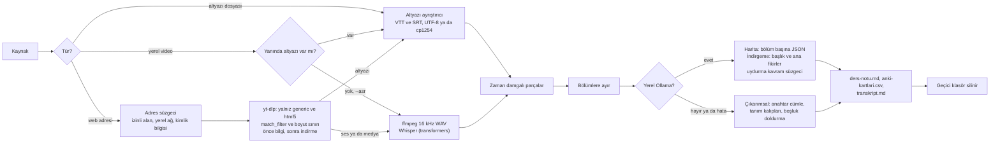

# 02 — Ders videosu → not, soru ve Anki kartı

> **Kullandığı depolar:** [yt-dlp/yt-dlp](../../dallar/04-veri-araclari-otomasyon/yt-dlp/README.md) (Python API;
> kurumun kendi sayfasından altyazı ya da ses) ·
> [huggingface/transformers](../../dallar/05-yapay-zeka-altyapisi/transformers/README.md) (isteğe bağlı Whisper) ·
> [ollama/ollama](../../dallar/05-yapay-zeka-altyapisi/ollama/README.md) (isteğe bağlı yerel LLM) · **Araç:** ffmpeg ·
> **Dil:** Python 3.13, yalnızca standart kütüphane · **Durum:** çalışan MVP; 42 internetsiz birim testi ve gerçek yt-dlp
> ile ffmpeg kullanan 9 entegrasyon testi

Eğitmenin **kendi** ders videosundan (ya da altyazı dosyasından) zaman damgalı ders notu, kavram sözlüğü, "kendini
sına" soruları ve Anki'ye aktarılabilir tekrar kartları üretir. LLM yoksa da çalışır: tanım cümlelerinden kavram ve
boşluk doldurma sorusu çıkarır. Varsayılan kurulumda içerik bilgisayardan çıkmaz.

Katalog kartı: [F16](../README.md#f16). Önkoşul düğümleri: [G3 Python](../../govde/README.md#g3),
[G6 ağ ve HTTP](../../govde/README.md#g6), [G11 LLM API temelleri](../../govde/README.md#g11).

## 1. Problem

- Kurslar ve eğitmenler yüzlerce saatlik ders videosu biriktirir; öğrenci ise "bu dersin özeti ve soruları" ister. Bir
  ders saatinden not ve soru hazırlamak eğitmen için ek mesaidir (varsayım: süre, pilot görüşmelerinde ölçülecek).
- Genel amaçlı özetleyiciler zaman damgası vermez, transkriptte olmayan kavram ekleyebilir ve kurumun içeriğini (canlı
  derslerde öğrenci seslerini de) yurt dışındaki bir servise taşıyabilir.

## 2. Kime

**Kısaca:** Ders videolarını kendi sitesinde ya da LMS'inde yayımlayan YKS/KPSS/ALES hazırlık kursları ile kendi
videosunu satan eğitmenler; ikinci segment olarak İSG gibi zorunlu eğitim videoları olan kurumsal eğitim ekipleri.

| Segment                                        | Persona                                                                                                                   | Neden ilgilenir                                                                                  |
| ---------------------------------------------- | ------------------------------------------------------------------------------------------------------------------------- | ------------------------------------------------------------------------------------------------ |
| YKS/KPSS/ALES hazırlık kursları (özel öğretim) | Ankara'da 3 şubeli bir KPSS kursunun eğitim koordinatörü; 25 öğretmenin canlı ders kayıtlarını kursun LMS'inde yayımlıyor | Öğrenci her ders için not ve soru istiyor; öğretmen mesaisi artmadan ve içerik kurumdan çıkmadan |
| Kendi videosunu satan eğitmen                  | Lise matematiğini anlatan, derslerini kendi sitesinde satan serbest öğretmen                                              | Kurs paketine özet, soru ve Anki destesi eklemek; bunu elle yapacak zamanı yok                   |
| Kurumsal eğitim (L&D) ekipleri ve OSGB'ler     | 300 kişilik bir lojistik firmasında İSG eğitim videolarını yöneten İK uzmanı                                              | Eğitimden sonra tekrar kartı ve kısa bilgi yoklaması                                             |

Persona ve sayılar örnektir (varsayım); ilk görüşmelerde doğrulanmalı.

**İlk 10 müşteri planı**

1. **4 KPSS/ALES kursu (Ankara):** Liste kursların web sitelerinden ve harita aramasından çıkarılır. Yüz yüze ziyaret;
   kursun seçtiği 3 dersin kaydı ücretsiz işlenir, örnek not, soru ve Anki destesi bırakılır.
2. **3 serbest eğitmen:** Eğitmen toplulukları ve LinkedIn. Eğitmenin kendi kaynak dosyasından (platforma yüklediği
   videonun aslından) 3 ders ücretsiz işlenir.
3. **2 OSGB ya da kurumsal eğitim ekibi:** İSG eğitim videoları için bir aylık pilot.
4. **1 YKS kursu (İstanbul):** Çevrim içi canlı ders kayıtları için pilot; ilk segmentin başka bir şehirde
   denenmesi.

Pilotun başarı ölçütü: öğretmenin notu ve soruları küçük düzeltmeyle yayımlanabilir bulması ve ders başına harcadığı
sürenin azalması (varsayım: pilotta ölçülecek). Tanıtım iletilerinin hukuki koşulları §9'da.

## 3. Çözüm

```text
python3 -m ders_notu ornek/kesirler.vtt -o cikti/
→ cikti/ders-notu.md       ana fikirler, [00:09] gibi zaman damgalı bölüm notları, kavram sözlüğü, sorular
→ cikti/anki-kartlari.csv  kavram kartları + soru kartları (HTML açık, etiketli)
→ cikti/transkript.md      zaman damgalı tam metin
```

Kaynak üç biçimde verilebilir:

1. **Altyazı dosyası** (`.vtt`, `.srt`; UTF-8, UTF-16 ya da Windows-1254) — en hızlı ve en doğru yol.
2. **Yerel video ya da ses** — yanında `ad.tr.vtt`, `ad.tr.srt`, `ad.vtt` ya da `ad.srt` varsa o kullanılır; yoksa
   `--asr` ile Whisper.
3. **Kurumun kendi ders sayfası** — `--izinli-alan kursum.com` ile verilen alan adlarında yt-dlp sayfadaki HTML5
   `<video>` ve `<track kind="subtitles" srclang="tr">` etiketlerini okur; altyazı varsa **video indirilmez**.

Özetleme iki yoldan biriyle yapılır:

| Yol                          | Ne yapar                                                                                                                                                                                                                                                                                                                |
| ---------------------------- | ----------------------------------------------------------------------------------------------------------------------------------------------------------------------------------------------------------------------------------------------------------------------------------------------------------------------- |
| Yerel LLM (harita-indirgeme) | Transkript yaklaşık 2.500 karakterlik bölümlere ayrılır; her bölüm için özet, kavram ve 4 seçenekli soru (JSON şeması), sonra bölüm özetlerinden başlık, giriş ve ana fikirler. Transkriptte kelime başı olarak geçmeyen kavram atılır; şıkları tekrarlanan, boş olan ya da doğru şık sırası geçersiz olan soru atılır. |
| Çıkarımsal (LLM'siz)         | Kelime sıklığıyla anahtar cümleler; "...kesirlere **basit kesir** denir", "**Pay**, ... demektir" kalıplarından kavramlar; tanım cümlesinden boşluk doldurma soruları (4+ kavram varsa diğer terimler çeldirici olur).                                                                                                  |

LLM'e ulaşılamazsa ya da model bozuk yanıt verirse not yine üretilir, başında uyarı yazar. Her notun başında kaynak
(adresin sorgu kısmı ve kimlik bilgisi gizlenmiş, yerel dosyada yalnızca dosya adı), yöntem, Türkiye saatiyle
oluşturulma zamanı ve "öğretmen kontrol etmeli" uyarısı bulunur.

## 4. Depoları nasıl kullanıyor

**yt-dlp/yt-dlp — kütüphane olarak Python API** (`412e7f0`, 2026-11-04, sürüm 2026.10.26)

- `YoutubeDL(ayar)` + `extract_info(url, download=False)` ile önce altyazı var mı bakılır; varsa `skip_download`,
  `writesubtitles` ve `subtitleslangs` ile yalnızca altyazı, yoksa `format: bestaudio/worst` ile yalnız ses indirilir
  (yalnız ses biçimi yoksa en düşük kaliteli ses ve görüntü biçimi; yt-dlp `README.md`, "Format selection"). Dosya
  yolları `requested_subtitles[dil]['filepath']` ve `requested_downloads[i]['filepath']` alanlarından okunur.
- Güvenlik ayarları: `allowed_extractors: ["generic", "html5"]`, `match_filter` (her adres izinli alanda mı),
  `max_filesize` ve `progress_hooks` (boyut sınırı), `playlist_items: "1"`, `socket_timeout`, `retries`,
  `sleep_interval_requests`. `subtitleslangs` düzenli ifade olarak eşleştiği için dil kodu `re.escape` ile verilir.
- Doğrulandığı yer: `yt_dlp/YoutubeDL.py` (parametre belgesi, `_match_entry`, `process_subtitles`, `_write_subtitles`),
  `yt_dlp/utils/_utils.py` (`orderedSet_from_options`), `yt_dlp/downloader/http.py` (`max_filesize`),
  `yt_dlp/extractor/genericembeds.py` (`HTML5MediaEmbedIE`), `yt_dlp/extractor/common.py`
  (`_parse_html5_media_entries`). Gerçek yt-dlp 2026.10.26 ile 9 entegrasyon testi bu ortamda koştu.

**huggingface/transformers — kütüphane olarak `pipeline` API'si** (`b255688`, 2026-11-09, 5.23.0.dev0)

- `pipeline("automatic-speech-recognition", model="openai/whisper-small", local_files_only=...)` ve
  `boru(wav, return_timestamps=True, generate_kwargs={"language": "turkish", "task": "transcribe"})` çağrısı;
  zaman damgaları `chunks[].timestamp` alanından okunur.
- 30 saniyeden uzun seste Whisper'ın kendi uzun biçim çözümlemesi devreye girer (`truncation=False`); bunun için
  `return_timestamps=True` gerekir. Dosya yolu verilince dosyanın tamamı belleğe okunup ffmpeg ile çözüldüğü için önce
  16 kHz tek kanal WAV çıkarılır (bir ders saati yaklaşık 115 MB).
- Doğrulandığı yer: `src/transformers/pipelines/__init__.py` (`local_files_only`),
  `src/transformers/pipelines/automatic_speech_recognition.py` (`preprocess`, `postprocess`),
  `src/transformers/models/whisper/generation_whisper.py` (`language`, `return_timestamps`). Gerçek modelle bu ortamda
  denenmedi (ağırlıklar internetten iner); birim test sahte boru kullanır.

**ollama/ollama — REST API** (`d63b702`, 2026-11-07)

- `POST /api/chat`, `stream: false`, `format: <JSON şeması>` (yapılandırılmış çıktı), `options.temperature`; yanıt
  `message.content` alanındadır. Harita ve indirgeme için iki ayrı şema kullanılır.
- Model adı `:cloud` etiketli ya da `-cloud` ile bitiyorsa Ollama'nın bulut modelidir; `--bulut-modeline-izin` olmadan
  reddedilir. Yerel ağ dışındaki bir Ollama sunucusu da `--uzak-ollama` olmadan kullanılmaz.
- Doğrulandığı yer: `docs/api.md` ("Generate a chat completion", "Structured outputs"), `internal/modelref/modelref.go`
  (`parseSourceSuffix`), `docs/faq.mdx` (`OLLAMA_NO_CLOUD`), `docs/cloud.mdx`. Gerçek Ollama sunucusuyla bu ortamda
  denenmedi; testler belgelenen yanıt biçimini döndüren yerel sahte HTTP sunucusu kullanır.

**İsteğe bağlı entegrasyonlar ve yedekleri**

- **yt-dlp yoksa:** Adres verilirse "yt-dlp gerekir" hatası çıkar; altyazı dosyası ve yerel video modları çalışır.
- **transformers ya da torch yoksa:** `--asr` anlaşılır bir hata verir; altyazı dosyası gerekir.
- **Ollama yoksa, yanıt vermezse ya da bozuk JSON dönerse:** Çıkarımsal özet üretilir, notun başına uyarı yazılır.
- **ffmpeg yoksa:** `--asr` "ffmpeg bulunamadı" der; altyazı yolları ffmpeg'e ihtiyaç duymaz.

## 5. Mimari



| Dosya                   | Görev                                                                                                      |
| ----------------------- | ---------------------------------------------------------------------------------------------------------- |
| `ders_notu/altyazi.py`  | VTT/SRT ayrıştırma (`<c>`, `<v>`, kelime zamanı imleri, `align:` ayarları, NOTE blokları, kodlama tespiti) |
| `ders_notu/kaynak.py`   | Yerel kaynak, adres süzgeci, yt-dlp sarmalayıcısı (`match_filter`, boyut kancası)                          |
| `ders_notu/asr.py`      | ffmpeg ile ses çıkarma, Whisper ile yazıya dökme                                                           |
| `ders_notu/llm.py`      | Ollama istemcisi, bulut modeli ve uzak sunucu denetimi                                                     |
| `ders_notu/ozet.py`     | Bölümleme, LLM harita-indirgeme, çıkarımsal yedek, soru üretimi                                            |
| `ders_notu/cikti.py`    | Markdown not, transkript ve Anki dosyası; Türkçe tarih; atomik yazma                                       |
| `ders_notu/__main__.py` | Komut satırı ve `calistir()` akışı                                                                         |

**Güvenlik ve sağlamlık**

- **Adres süzgeci** (`kaynak.adres_reddi`): Yalnızca http ve https; kullanıcı adı/parola, ters bölü ya da boşluk içeren
  adres reddedilir. Alan adı küçük harfe ve punycode'a çevrilip karşılaştırılır (`çiçek.com` = `xn--iek-1lab.com`).
  Loopback, özel, bağlantı-yerel ve çok noktaya yayın adresleri, `localhost`, tek etiketli adlar ve `2130706433` gibi
  sayısal IP yazımları `--yerel-aga-izin` olmadan reddedilir.
- **yt-dlp içinde:** `allowed_extractors: ["generic", "html5"]` ile YouTube, Vimeo gibi platform okuyucuları yüklenmez;
  sayfaya gömülü platform videosu indirilmez. `match_filter`, yönlendirme sonrası sayfa adresini, seçilen altyazıyı ve
  indirilecek medya adresini indirme başlamadan aynı süzgeçten geçirir. Sayfada birden çok video varsa yalnızca ilki
  işlenir ve notta uyarı çıkar. Boyut sınırı (varsayılan 2.048 MB) iki katmanlıdır: sunucu boyutu bildirirse
  `max_filesize`, bildirmezse indirilen baytı sayan `progress_hooks` kancası. `socket_timeout: 30`, `retries: 3`,
  istekler arasında 1 saniye bekleme.
- **Dil kodu:** Sayfadan gelen `srclang` dosya adına girdiği için yalnızca `tr`, `tr-TR`, `tr_TR` biçimindeki kodlar
  kabul edilir; dili yazılmamış `<track>` (yt-dlp'de anahtar `None`) atlanır.
- **ffmpeg** mutlak yollarla, `-nostdin` ve zaman aşımıyla çağrılır; hatalar Türkçe mesaja çevrilir.
- **Ollama istemcisi** bulut modelini ve yerel ağ dışındaki sunucuyu izinsiz reddeder, ortamdaki vekil sunucu
  (`HTTP_PROXY`) ayarını yok sayar ve yanıtı 20 MB ile sınırlar; HTTP hatasını, JSON olmayan yanıtı ve şemaya uymayan
  öğeleri yakalar. İstem, transkriptteki talimatlara uyulmamasını söyler (istem enjeksiyonuna karşı tam koruma değildir;
  JSON şeması ve öğretmen onayı asıl güvencedir).
- **Çıktılar:** Markdown'da `&`, `<`, `>` kaçışlanır (altyazıdaki `&lt;script&gt;` nota etiket olarak girmez). Anki
  alanının başındaki `=`, `+`, `-`, `@` HTML varlığına çevrilir; dosya tabloda açılırsa formül çalışmaz. Dosyalar önce
  geçici dosyaya yazılıp yerine konur.
- **Ara dosyalar** (indirilen altyazı ya da medya, WAV) çıktı klasöründeki geçici bir klasörde tutulur ve iş bitince,
  hata olsa da, silinir. `--ara-dosyalari-sakla` verilirse `cikti/ara/` altında kalır.

**Bilinen sınırlar**

- İzinli bir adresin indirme sırasında yaptığı HTTP yönlendirmesini yt-dlp'nin ağ katmanı kendisi izler
  (`yt_dlp/networking/_urllib.py`, `RedirectHandler`); HLS/DASH parça adresleri de indirme sırasında okunur. Bu ikisi
  süzgeçten geçmez, boyut sınırı yine uygulanır.
- Sayfa başka bir alana yönlendirirse (HTTP 302, `meta refresh`, `twitter:player`) yt-dlp'nin genel okuyucusu hedef
  sayfayı bir kez okuyabilir (`yt_dlp/extractor/generic.py`); indirme yine `match_filter`'da durur.
- Yerel IP'ye çözülen bir alan adı DNS'e bakılmadan anlaşılamaz. Barındırılan hizmette indirme işçisi iç ağa erişimi
  olmayan, yalnızca dışarıya çıkabilen bir ortamda çalışmalıdır.
- Çıkarımsal kavram bulma yalnızca "... denir / denilir / adı verilir" ve "X, ... demektir / anlamına gelir" kalıplarını
  tanır; konuşma dilindeki "... diyoruz" gibi kalıpları tanımaz.

## 6. Kurulum ve çalıştırma

```bash
cd repo-atlasi/is-fikirleri/02-ders-notu
python3 -m ders_notu ornek/kesirler.vtt -o cikti                     # bağımlılıksız
python3 -m venv .venv && .venv/bin/pip install -r requirements.txt   # yt-dlp
.venv/bin/python -m ders_notu https://ders.kursum.com/kesirler -o cikti --izinli-alan kursum.com
.venv/bin/python -m ders_notu ornek/kesirler.vtt --ollama-url http://127.0.0.1:11434 --model qwen2.5:7b
.venv/bin/pip install "transformers>=5,<6" torch && .venv/bin/python -m ders_notu ders.mp4 --asr
```

| Seçenek                                            | Ne yapar                                                                                                 |
| -------------------------------------------------- | -------------------------------------------------------------------------------------------------------- |
| `--izinli-alan ALAN`                               | Size ait ya da kullanma hakkınız olan alan adı; alt alan adlarını da kapsar, birden çok verilebilir      |
| `--yerel-aga-izin`                                 | `127.0.0.1`, `10.x`, `localhost` gibi yerel ağ adreslerine izin verir (kurum içi LMS, test)              |
| `--azami-boyut-mb N`                               | İndirilecek dosya için MB cinsinden üst sınır (varsayılan `2048`)                                        |
| `--ara-dosyalari-sakla`                            | İndirilen dosyaları ve WAV'ı `cikti/ara/` altında tutar (varsayılan: silinir)                            |
| `--dil KOD`                                        | Altyazı dili tercihi (varsayılan `tr`; `tr-TR`, `TR`, `tr_TR` de eşleşir)                                |
| `--ollama-url URL`, `--model AD`                   | Yerel Ollama; verilmezse çıkarımsal özet                                                                 |
| `--bulut-modeline-izin`                            | `:cloud` / `-cloud` modellerine ya da ollama.com'a gönderime izin verir (KVKK md. 9, §9)                 |
| `--uzak-ollama`                                    | Yerel ağ dışındaki bir Ollama sunucusuna (ör. kiralık GPU) gönderime izin verir (§9)                     |
| `--asr`, `--whisper-model`, `--yalniz-yerel-model` | Whisper ile yazıya dökme; son seçenek modeli indirmez, yalnızca yerel önbellekten ya da klasörden yükler |
| `--deste AD`                                       | Anki deste adı                                                                                           |

Anki'de **Dosya → İçe aktar** ile `anki-kartlari.csv` seçilir; dosya başındaki `#separator`, `#html`, `#tags column`
ve `#deck` satırları ayarları kendisi bildirir (Anki 2.1.55+ biçimi; doğrulanmadı, kendi Anki sürümünüzde deneyin).
Not türü dosyada belirtilmez; içe aktarma ekranında iki alanlı temel not türünü seçin.

Tamamen çevrimdışı çalışmak için: Ollama'yı `OLLAMA_NO_CLOUD=1` ile başlatın (`docs/faq.mdx`), Whisper modelini bir kez
indirip sonra `--yalniz-yerel-model` kullanın ya da `--whisper-model` ile yerel model klasörünü verin.

## 7. Test

```bash
cd repo-atlasi/is-fikirleri/02-ders-notu
PYTHONDONTWRITEBYTECODE=1 python3 -m unittest discover -s tests -t .        # 51 testten 42'si koşar, 9'u atlanır
PYTHONDONTWRITEBYTECODE=1 .venv/bin/python -m unittest discover -s tests -t .  # yt-dlp kuruluysa 51 test
```

- **42 birim testi** internetsiz ve ek paket olmadan çalışır: VTT/SRT ayrıştırma (karşılaştırma işaretleri, bozuk zaman
  damgası, cp1254 ve UTF-16), bölümleme, çıkarımsal kavram ve boşluk doldurma ("Paydanın" içindeki "pay" boşluğa
  dönmez), iki satıra bölünmüş cümlenin zamanı, sahte LLM ile harita-indirgeme, uydurma süzgeci ve bozuk JSON, sahte
  boruyla Whisper çıktısı ve hataları, yerel sahte HTTP sunucusuyla Ollama hataları, bulut modeli ve uzak sunucu reddi,
  adres süzgeci (yerel ağ, `@`, ters bölü, punycode), sahte `YoutubeDL` ile indirme ayarları, Markdown/Anki kaçışları,
  Türkçe tarih ve saat dilimi, ara dosyaların silinmesi ve komut satırı.
- **9 entegrasyon testi** (`tests/test_entegrasyon_ytdlp.py`; yt-dlp ve ffmpeg kuruluysa): ffmpeg ile 2 saniyelik
  video üretilir, `127.0.0.1`'de `http.server` ile "kurumun ders sayfası" olarak sunulur. **Gerçek yt-dlp** altyazılı
  sayfada yalnızca altyazıyı indirir; altyazısız ve dilsiz `<track>` olan sayfada medyayı indirir ve ffmpeg 16 kHz
  tek kanal WAV üretir. Başka sunucudaki medya (`localhost`) ve başka alana yönlendirme reddedilir; boyut sınırı hem
  `Content-Length` olan hem olmayan yanıtta uygulanır; iki videolu sayfada yalnızca ilki iner.
- "Şimdi" açıkça verilebilir: `calistir(..., simdi=datetime(...))` ve `not_md(..., simdi=...)`; verilmezse
  `Europe/Istanbul` saatiyle o an kullanılır.

## 8. Gelir modeli ve örnek fiyatlar

**Fiyat özeti:** Eğitmen 600 TL/ay (20 ders saati); kurs 4.000 TL/ay (150 ders saati); arşiv dönüştürme 60 TL/ders
saati; kurum içi kurulum 25.000 TL tek seferlik (KDV hariç; ilk müşterilerle doğrulanacak varsayımlar).

| Paket             | İçerik                                                                                         | Örnek fiyat (varsayım) |
| ----------------- | ---------------------------------------------------------------------------------------------- | ---------------------- |
| Eğitmen           | Ayda 20 ders saati; not, soru, Anki                                                            | 600 TL / ay            |
| Kurs              | Ayda 150 ders saati; öğretmen onay ekranı ve kurum logolu PDF not (ikisi de henüz yok, §11)    | 4.000 TL / ay          |
| Arşiv dönüştürme  | Geçmiş video arşivinin tek seferde işlenmesi                                                   | 60 TL / ders saati     |
| Kurum içi kurulum | Kurumun sunucusuna Ollama, Whisper ve bu aracın kurulumu; içerik dışarı çıkmaz (donanım hariç) | 25.000 TL tek seferlik |

- Fiyatlar 2026 sonu için **varsayımdır**; pazar büyüklüğü ve ödeme isteği ölçülmedi. İlk 10 müşteriyle görüşülerek
  doğrulanmalıdır.
- Değişken maliyet yerel modelde sunucu ve GPU süresidir; ders saati başına işlem süresi ölçülmedi, pilotta ölçülecek.
- Araç yerel çalıştığı için aylık paket ancak hizmet olarak (videoyu biz işleriz) ya da lisans anahtarıyla
  uygulanabilir; MVP'de lisans denetimi yoktur. Hizmet modelinde içerik müşterinin bilgisayarından çıkar: "içerik dışarı
  çıkmaz" vaadi yalnızca kurum içi kurulumda geçerlidir ve hizmet modelinde §9'daki veri işleyen yükümlülükleri doğar.

## 9. KVKK, hukuk ve lisanslar

**Kişisel veriler (6698 sayılı KVKK).** Bu bölüm hukuki görüş değildir; maddeler ve yorumlar bir avukata teyit
ettirilmelidir.

- **Roller.** Videoyu işleyen kurs ya da kurum veri sorumlusudur. Kurum içi kurulumda biz yalnızca yazılım
  sağlayıcısıyız ve veriye erişmeyiz. Hizmet modelinde veri işleyen oluruz: yazılı veri işleme sözleşmesi, md. 12
  kapsamında teknik ve idari tedbirler ve saklama-imha politikası gerekir.
- **Hangi veri?** Canlı ders kaydında öğrencinin sesi, adı ve sorusu, eğitmenin sesi bulunur; transkript ve not bu
  verileri taşıyabilir. Derste öğrencinin sağlığı gibi konular konuşulursa özel nitelikli veri (md. 6) oluşur. Bu MVP
  konuşmacıyı tanımaz; "konuşmacı ayrımı" eklenirse kişiyi sesinden tanıma biyometrik veri sayılabileceği için yalnızca
  "Konuşmacı 1 / 2" etiketiyle, kimlik tespiti olmadan yapılmalı (doğrulanmadı).
- **Aydınlatma (md. 10) ve hukuki sebep (md. 5–6).** Kayıt başlamadan önce öğrenciye ve eğitmene, kaydın not ve soru
  üretmek için işleneceği, kimlerin eriştiği ve ne kadar saklanacağı bildirilmelidir. Dayanak (sözleşmenin ifası, meşru
  menfaat ya da açık rıza) kurumca belirlenmeli; açık rızaya dayanılacaksa rıza hizmet şartına bağlanmamalıdır
  (doğrulanmadı).
- **Veri azaltma ve silme (md. 4, md. 7).** Altyazı varsa video hiç indirilmez. İndirilen dosyalar ve WAV iş bitince
  silinir; bu silme dosya sistemi düzeyindedir (SSD'de iz kalabilir; disk şifreleme önerilir). Not, transkript ve Anki
  dosyası kurumundur; notun başındaki oluşturulma zamanı saklama süresini izlemeye yarar. Öğrenci adı geçen notlar
  yayımlanmadan önce öğretmen tarafından ayıklanmalıdır.
- **VERBİS (md. 16).** Kayıt yükümlülüğü veri sorumlusunundur; çalışan sayısı ve yıllık mali bilanço eşiğine bağlı
  istisnalar Kurul kararlarıyla belirlenir ve güncellenir (eşikler doğrulanmadı).
- **Yurt dışına aktarım (md. 9).** Varsayılan kurulumda transkript bilgisayardan çıkmaz. Ollama'nın bulut modellerinde
  istem ve yanıtlar ollama.com'da işlenir (`docs/cloud.mdx`); bu yurt dışına aktarım sayılabilir (sunucu konumu
  doğrulanmadı). 2024 değişikliğiyle getirilen yeterlilik kararı, uygun güvence ve standart sözleşme şartları
  (doğrulanmadı) uygulanır. Ürün bu yüzden `:cloud` / `-cloud` modellerini ve ollama.com adresini `--bulut-modeline-izin`
  olmadan reddeder; Ollama tarafında `OLLAMA_NO_CLOUD=1` bulutu tümüyle kapatır. `--ollama-url` yerel ağ dışındaki bir
  sunucuyu (ör. yurt dışında kiralanmış GPU) gösteriyorsa transkript oraya gider; araç bunu da `--uzak-ollama` olmadan
  reddeder. Whisper modeli ilk kullanımda Hugging Face Hub'dan indirilir; bu indirmede ders içeriği gönderilmez, yalnızca
  model dosyaları çekilir.

**Telif (5846 sayılı FSEK).** Ders videosu ve anlatım eser sayılabilir; ondan özet, not ve soru üretmek işlenme eser
(md. 6) ve işleme hakkı (md. 21) kapsamına girebilir (doğrulanmadı). Bu yüzden araç yalnızca müşterinin kendi ürettiği
ya da işleme hakkını sözleşmeyle aldığı içerik içindir: kurs, serbest çalışan öğretmenin videoları için bu hakkı
sözleşmede açıkça almalıdır. Videodaki kitap sayfası, görsel ve müzik ayrı hak sahiplerine ait olabilir. Müşteri
sözleşmesinde "yalnızca hakkınız olan içerik" taahhüdü ve kötüye kullanımda hesap kapatma maddesi bulunmalıdır.

**Platform koşulları, robots.txt ve hız.** Video YouTube, Vimeo ya da bir kurs platformundaysa platformun kullanım
koşulları indirmeyi kısıtlayabilir (koşul metinleri bu çalışmada okunmadı). Araç bu platformların okuyucularını
yüklemez ve sayfaya gömülü platform videosunu indirmez; eğitmen kendi kaynak dosyasını ya da platformun kendi dışa
aktarma aracıyla aldığı dosyayı **yerel dosya** olarak verir. Araç yalnızca müşterinin kendi alan adında, müşterinin
verdiği tek sayfayı okur; bu yüzden robots.txt okunmaz. İstekler arasında 1 saniye beklenir.

**Tanıtım iletileri (6563 sayılı Kanun ve İYS).** İlk müşterilere gönderilecek e-posta ya da SMS ticari elektronik
iletidir. Tacir ve esnafa önceden onay alınmadan gönderilebildiği, ancak ret hakkının her iletide sunulması gerektiği
istisnası vardır (doğrulanmadı). Tacir olmayan serbest eğitmenlere gönderim için önceden onay ve İYS kaydı gerekir
(doğrulanmadı). Bu yüzden ilk müşteriler yüz yüze ziyaret ve topluluk etkinlikleriyle aranır.

**Sektör kuralları.** Özel öğretim kursları 5580 sayılı Kanun kapsamında MEB denetimindedir; tanıtımda başarı vaadi
gibi yanıltıcı ifadelerden kaçınılmalı (doğrulanmadı). Ürün öğretmenin yerini almaz ve sınav başarısı vaat etmez. İSG
eğitimlerinde (6331 sayılı Kanun) üretilen sorular mevzuatın istediği ölçme ve değerlendirmenin yerine geçmez
(doğrulanmadı).

**Lisanslar.**

| Bileşen                            | Lisans                                                                                                             | İş modeli için anlamı                                                                                                                                                                                                                |
| ---------------------------------- | ------------------------------------------------------------------------------------------------------------------ | ------------------------------------------------------------------------------------------------------------------------------------------------------------------------------------------------------------------------------------ |
| yt-dlp (PyPI paketi)               | Unlicense (`LICENSE`, `412e7f0`)                                                                                   | Kapalı kaynak ticari kullanım serbest. yt-dlp `README.md` "Licensing": PyPI paketi yalnızca Unlicense kod içerir; PyInstaller ile paketlenmiş yt-dlp çalıştırılabilirleri GPLv3+ olduğundan onları dağıtmayın, pip paketini kullanın |
| transformers                       | Apache-2.0 (`LICENSE`, `b255688`)                                                                                  | Ticari kullanım serbest; kurulum paketinde dağıtılırsa lisans metni korunmalı                                                                                                                                                        |
| ollama                             | MIT (`LICENSE`, `d63b702`)                                                                                         | Ticari kullanım serbest; kurum içi kurulumda telif ve izin metni eklenmeli                                                                                                                                                           |
| ffmpeg                             | Derlemeye göre LGPL ya da GPL (yt-dlp `README.md`: "License depends on the build"; ffmpeg'in kendisi doğrulanmadı) | Ayrı program olarak çağrılır; kurulum paketinde dağıtılırsa o derlemenin lisansına uyulmalı                                                                                                                                          |
| torch                              | BSD tarzı (doğrulanmadı)                                                                                           | Kurulum paketinde lisans metni eklenmeli                                                                                                                                                                                             |
| Model ağırlıkları (Whisper, Qwen…) | Yazılım lisansından ayrıdır (doğrulanmadı: model kartları)                                                         | Ticari kullanımdan önce model kartını ve `ollama show --license <model>` çıktısını (`cmd/cmd.go`, `d63b702`) kontrol edin                                                                                                            |

[ornek/kesirler.vtt](ornek/kesirler.vtt) bu depo için yazılmış özgün bir ders metnidir.

## 10. Riskler

| Risk                                                      | Önlem                                                                                                                  |
| --------------------------------------------------------- | ---------------------------------------------------------------------------------------------------------------------- |
| Türkçe ASR hataları (terimler, özel adlar)                | Önce altyazı; daha büyük Whisper modeli; terim sözlüğüyle düzeltme (sonraki adım); öğretmen onayı                      |
| LLM'in uydurma kavram ya da yanlış cevap üretmesi         | Transkriptte geçmeyen kavram atılır; şık ve doğru indeksi denetlenir; notta "öğretmen kontrol etmeli"                  |
| Platform ve LMS'lerin benzer özellikleri yerleşik sunması | Yerel işleme, Türkçe tanım kalıpları, Anki ve kurs çıktıları; LMS'lere eklenti olarak dağıtım                          |
| Telif ihlali için kötüye kullanım                         | İzinli alan adı, platform okuyucularının kapalı olması, sözleşmede açık yasak; hizmet modelinde iş kaydı (planlanıyor) |
| Hizmet modelinde iç ağa istek (SSRF)                      | Adres süzgeci ve yerel ağ reddi; indirme işçisi iç ağa erişimi olmayan ayrı bir ortamda                                |
| Kişisel verinin bulut modele ya da uzak sunucuya gitmesi  | Bulut modeli ve yerel ağ dışı sunucu varsayılan olarak reddedilir; `OLLAMA_NO_CLOUD=1`; kurum içi kurulum paketi       |

## 11. Sonraki adımlar

1. Öğretmen onay ekranı (soruları düzenle ve onayla) ve onaylananları dışa aktarma; kurum logolu PDF not.
2. Moodle için soru bankası dışa aktarımı (ör. GIFT biçimi) ve LMS eklentisi.
3. Ders kazanımlarıyla eşleme (müfredat kazanım listesi müşteriden alınır).
4. Terim sözlüğüyle ASR düzeltmesi (Whisper'ın `prompt_ids` özelliği, `generation_whisper.py`) ve kimlik tespiti
   yapmayan konuşmacı ayrımı.
5. Konuşma dilindeki tanım kalıpları ("... diyoruz", "... deriz") ve öğrenci adlarını nottan ayıklayan bir süzgeç.
6. Toplu işleme: [03-fiyat-radar](../03-fiyat-radar/README.md)'daki gibi bir n8n akışıyla "yeni ders yüklenince not
   üret".

Diğer fikirler ve tüm katalog: [is-fikirleri/README.md](../README.md).
