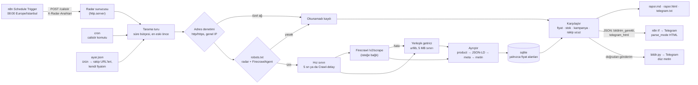

# 03 — Rakip fiyat ve kampanya radarı

> **Kullandığı depolar:** [firecrawl/firecrawl](../../dallar/04-veri-araclari-otomasyon/firecrawl/README.md) (REST API ile
> sayfa getirme, isteğe bağlı ürün profili) · [n8n-io/n8n](../../dallar/04-veri-araclari-otomasyon/n8n/README.md)
> (içe aktarılabilir iş akışı: zamanlama → HTTP → koşul → Telegram) · **Dil:** Python, yalnızca standart kütüphane
> (3.13 ile sınandı; tür ipuçları yüzünden 3.10 ve üstü gerekir) · **Durum:** çalışan MVP, 56 test, internetsiz

**Kime:** Kendi e-ticaret sitesinde 50–500 ürün satan ve fiyatını 3–10 rakibin kendi sitelerine bakarak her gün elle
ayarlayan KOBİ'ler (ilk odak: ev aletleri ve ev tekstili) ile bu firmalara hizmet veren dijital ajanslar.

**Fiyat:** Başlangıç 750 TL/ay (50 URL) · Büyüme 2.500 TL/ay (500 URL) · Ajans 7.500 TL/ay (2.000 URL, beyaz etiket
rapor) · Kendi sunucunda kurulum 10.000 TL tek seferlik. Hepsi KDV hariç ve ilk 10 müşteriyle doğrulanacak
varsayımdır.

Radar rakiplerin ürün sayfalarını her sabah tarar. Türkçe fiyat biçimlerini ("1.299,90 TL", "₺1.299,90"), üstü çizili
eski fiyatı, stok durumunu ve kampanya metinlerini ("Sepette %10 indirim", "3 al 2 öde", "Kargo bedava", "9 taksit")
çıkarır. Geçmişi sqlite'ta tutar ve yalnızca **bir şey değiştiğinde** Telegram'a kısa bir özet gönderir. Fiyatı kendisi
değiştirmez; karar müşteridedir.

## 1. Problem

- Kendi sitesi olan KOBİ fiyatını rakiplere göre ayarlamak ister. Bugün bunu çoğunlukla bir çalışan her sabah sekme
  sekme bakarak yapıyor (varsayım: ilk görüşmelerde harcanan süre ölçülmeli).
- Hazır fiyat izleme araçları çoğunlukla büyük pazaryerlerine odaklanır. Küçük rakiplerin kendi siteleri, Türkçe
  kampanya dili ve "sepette indirim" gibi yerel kalıplar ayrıca uğraş ister (varsayım: rakip ürünlerle
  karşılaştırılmadı).
- Sorun fiyatı görmek değil, **değişikliği zamanında fark etmek**: rakip gece indirime girdiğinde ertesi sabah
  bilmek.

## 2. Kime

| Segment                                        | Persona                                                                                                                                         | İlk müşteriler nereden                                                                                                                                                                                                |
| ---------------------------------------------- | ----------------------------------------------------------------------------------------------------------------------------------------------- | --------------------------------------------------------------------------------------------------------------------------------------------------------------------------------------------------------------------- |
| **Birincil:** kendi e-ticaret sitesi olan KOBİ | İzmir'de küçük ev aletleri satan 8 kişilik firmanın kurucusu; 150 ürünü 6 rakibin sitesiyle karşılaştırıyor, bu iş her sabah bir saat alıyor    | Hazır e-ticaret altyapısı sağlayıcılarının iş ortağı ağları ve kullanıcı toplulukları (hangi sağlayıcının iş ortağı programı olduğu doğrulanmadı); il ticaret odalarının e-ticaret eğitimleri                         |
| Dijital ajanslar (kanal)                       | İstanbul'da 12 e-ticaret müşterisine performans pazarlaması yapan ajansın müşteri yöneticisi; aylık raporuna rakip fiyat bölümü eklemek istiyor | Ajansa beyaz etiket rapor: bir ajans birden çok müşteri getirir                                                                                                                                                       |
| Hem kendi sitesinde hem pazaryerinde satanlar  | Ev tekstili satan, aynı ürünü birkaç kanalda listeleyen satıcı; rakiplerinin **kendi sitelerindeki** kampanyaları kaçırmak istemiyor            | Satıcı eğitimleri, satıcı forumları; muhasebecisi ve kargo firması üzerinden tavsiye. Pazaryeri ilan sayfaları taranmaz (bkz. §9): pazaryerindeki rekabet için pazaryerinin satıcıya verdiği resmî veriler kullanılır |

**İlk 10 müşteri planı (varsayım, 8 hafta):**

1. Beş dijital ajansla görüşme; bunlardan ikisiyle ücretsiz bir aylık pilot. Her ajans kendi müşterilerinden 3–4
   firmayı getirirse 6–8 müşteri olur.
2. Kalan 2–4 müşteri doğrudan: e-ticaret altyapısı topluluklarında ve yerel e-ticaret buluşmalarında "rakibiniz dün
   gece ne yaptı?" örnek raporu gösterilir. Örnek rapor yalnızca izin veren, kamuya açık sayfalardan hazırlanır.
3. Başarı ölçütü: pilot sonunda müşteri başına haftada en az 2 işe yarar bildirim, yanlış alarm oranı %10'un altında,
   okunamayan sayfa oranı %5'in altında. Bu eşikler de varsayımdır.

Tanıtım iletileri için §9'daki 6563 sayılı Kanun notuna bakın: toplu ve otomatik mesaj yok, her ileti kişiye özel ve
elle yazılır.

## 3. Çözüm

```text
python3 -m fiyat_radar calistir --ayar ornek/ayar.json --db radar.sqlite --cikti rapor
→ rapor/rapor.md     değişiklikler, süren "rakip ucuz" durumları, güncel tablo, okunamayanlar, sonraki tura kalanlar
→ rapor/rapor.html   e-posta gövdesi olarak gönderilebilir HTML
→ rapor/telegram.txt 4.000 karakteri aşmayan düz metin özet
```

Örnek özet (testteki ikinci tur):

```text
Fiyat radarı · 10.11.2026 08:00
3 değişiklik, 1 hata · 2 sayfa tarandı

• Kahve makinesi / Rakip A: Fiyat düştü: 2.599,90 TL → 2.399,90 TL (%7,7)
• Kahve makinesi / Rakip A: Yeni kampanya: Kargo bedava
• Kahve makinesi / Rakip A: En ucuz rakip Rakip A (2.399,90 TL), sizin fiyatınızın (2.499,90 TL) %4,0 altında
• Kahve makinesi / Rakip B: Okunamadı: robots.txt bu sayfaya izin vermiyor: …
```

**Fiyat şu sırayla aranır;** ilk bulunan kullanılır ve raporun `Kaynak` sütununa yazılır:

1. Firecrawl'ın `product` biçimi (açıksa): ilk varyantın fiyatı, para birimi, indirim öncesi fiyatı ve stok bilgisi.
2. Sayfadaki JSON-LD: `schema.org` `Product` ya da `ProductGroup` (`hasVariant`), `@graph` ve `mainEntity` içinde de
   aranır, **belge sırasıyla** (önce ana ürün, sonra "benzer ürünler"). `offers` listesi, `AggregateOffer.lowPrice` ve
   `priceSpecification` okunur.
3. `product:price:amount` / `itemprop="price"` meta etiketleri (`product:price:currency` ile).
4. Görünür metindeki ilk "… TL" ya da "₺…" (üstü çizili eski fiyat hariç). Binlik ayırıcı olarak nokta ve bölünmez
   boşluk tanınır; düz boşluk tanınmaz, çünkü etiketler silinince "X100" model adı "100 TL" ile yan yana gelir.

Sıfır fiyat ("fiyat sorunuz" sayfaları) fiyat sayılmaz. Para birimi TRY değilse ölçüm "okunamadı" olarak işaretlenir ve
karşılaştırılmaz. Eski fiyat `<del>`/`<s>` etiketlerinden, sınıf adında `old`, `eski`, `original`, `strike` parçası
olan öğelerden ve Markdown'daki `~~…~~`'den alınır. "price-holder" ya da "bold" gibi adlar eski fiyat sayılmaz.

**Değişiklik türleri:**

- Fiyat: eşik üstü değişim, varsayılan %1.
- Stok: "Stokta kalmadı", "stokta değil", "bulunmamaktadır" gibi olumsuzlar stokta **yok** sayılır.
- Kampanya: yeni ya da biten kampanya. Yalnızca büyük/küçük harfi değişen kampanya değişiklik sayılmaz.
- "Rakip sizden ucuz": `kendi_fiyatim` ile karşılaştırılır. Yalnızca durum değişince bildirilir: yeni en ucuz rakip,
  fiyatı değişti, sizin fiyatınız değişti ya da artık hiçbir rakip ucuz değil. Süren durum yalnızca raporda görünür,
  her gün mesaj atılmaz.
- Okunamayan sayfa: robots.txt yasağı, HTTP hatası, fiyat bulunamaması, para birimi. Yapı değişikliğini erken fark
  etmek için bildirilir.

**Büyük listeler:** Her tur `tur_butcesi_sn` (varsayılan 600 sn) ile sınırlıdır. Sayfalar "hiç ölçülmemiş, sonra en uzun
süredir ölçülmeyen" sırasıyla taranır. Bütçe dolarsa kalanlar raporda listelenir ve sonraki turda en başa geçer.

## 4. Depoları nasıl kullanıyor

### firecrawl/firecrawl — `a0535ec` (2026-11-09)

- **Kullanım:** `POST {api_url}/v2/scrape`, gövde
  `{"url", "formats": ["markdown", "rawHtml", {"type": "product"}?], "onlyMainContent": false, "maxAge": 0, "storeInCache": false}`.
  Yanıt `{"success", "warning"?, "data": {"markdown", "rawHtml", "metadata": {"statusCode"}, "product"?, "warning"?}}`.
  Bulutta `Authorization: Bearer <anahtar>` gönderilir; kendi sunucunuzda (port 3002) varsayılan kurulum kimlik
  doğrulamasızdır. Doğrulandığı yer: `apps/api/src/routes/v2.ts`, `apps/api/src/controllers/v2/types.ts`
  (`scrapeOptionFields`, `Document`, `ScrapeResponse`), `apps/python-sdk/firecrawl/v2/utils/http_client.py`,
  `SELF_HOST.md` (`USE_DB_AUTHENTICATION=false`, port `3002`).
- **`maxAge: 0`:** belirtilmezse Firecrawl iki güne kadar eski önbellek kaydını döndürebilir
  (`apps/api/src/scraper/scrapeURL/engines/index/index.ts`, `defaultMaxAge`). Fiyat izlemede taze sayfa şarttır.
- **`storeInCache: false`:** taranan sayfa Firecrawl'ın dizinine yazılmaz (aynı dosyada `shouldCache`). Sayfada
  rastlantısal kişisel veri (yorum yazan adı gibi) olabileceği için veri en aza indirilir.
- **`product` biçimi:** profil varyant düzeyindedir: `variants[].price.amount` ve `.currency`,
  `variants[].sale.originalPrice.amount`, `variants[].availability.inStock` (`apps/api/src/types/product.ts`). Ayrı bir
  ürün çıkarma servisine bağlıdır. Kendi kurulumda `PRODUCT_EXTRACTION_SERVICE_URL` yoksa Firecrawl yanıta "Product
  format is not available (service not configured)." uyarısı ekler
  (`apps/api/src/scraper/scrapeURL/transformers/product.ts`). Radar bu uyarıyı rapora not düşer ve JSON-LD/metin
  yoluna geçer. Bu dosyadaki ücretlendirmede `product` biçimi için ek kredi yoktur; temel tarama 1 kredidir
  (`apps/api/src/lib/scrape-billing.ts`).
- **robots.txt:** Firecrawl tek sayfalık taramada robots.txt'e yalnızca ekip bayrağı ya da güvenli kip açıksa bakar
  (`apps/api/src/scraper/scrapeURL/shouldCheckRobots.ts`) ve baktığında `FireCrawlAgent`/`FirecrawlAgent` adlarını
  kullanır (`apps/api/src/lib/robots-txt.ts`). Bu yüzden radar, isteği göndermeden önce robots.txt'i **hem kendi adıyla
  hem Firecrawl'ın adıyla** kendisi denetler; yasaksa sayfa Firecrawl'a hiç sorulmaz.
- **İsteğe bağlı `konum`:** `"konum": "TR"` gövdeye `location: {"country": "TR", "languages": ["tr-TR"]}` ekler. Yurt
  dışından gelen isteğe başka fiyat ya da para birimi gösteren siteler için buluttadır. Kendi kurulumdaki `playwright`
  ve `fetch` motorları konumu desteklemez (`apps/api/src/scraper/scrapeURL/engines/index.ts`); orada istek başarısız
  olabilir ve radar yerleşik getiriciye düşer. Özel başlık (`headers`) gönderilmez, çünkü Firecrawl onu kısıtlı seçenek
  sayar (`apps/api/src/routes/shared.ts`, `restrictedOptionsCountryCheck`).
- **Yedek yol:** Firecrawl yapılandırılmamışsa, anahtar yoksa ya da Firecrawl hata verirse yerleşik getirici (urllib)
  kullanılır. Yedek istek de robots.txt ve hız sınırına uyar.

### n8n-io/n8n — `5ee06d3` (2026-11-09)

- **Kullanım:** [n8n/fiyat-radar.workflow.json](n8n/fiyat-radar.workflow.json) dört düğümlü bir akıştır: Schedule
  Trigger (`scheduleTrigger` 1.2, her gün 08:00) → HTTP Request (`httpRequest` 4.2, `POST /calistir`, Header Auth,
  zaman aşımı 900.000 ms) → If (`if` 2.2, `bildirim_gerekli` doğru mu?) → Telegram (`telegram` 1.2, `sendMessage`).
  Dosya `fiyat_radar/n8n.py` ile üretilir; test, depodaki dosyanın üretilenle aynı olduğunu denetler.
- **Saat dilimi:** iş akışında `settings.timezone: "Europe/Istanbul"` vardır. Yoksa zamanlama n8n'in
  `GENERIC_TIMEZONE` ayarına düşer; varsayılanı `America/New_York`'tur ve "08:00" İstanbul'da 15:00 ya da 16:00 olur
  (`packages/@n8n/config/src/configs/generic.config.ts`; `packages/workflow/src/workflow.ts` iş akışı ayarını öne alır).
- **Telegram biçimi:** düğüm `parse_mode` boşsa "Markdown" (eski sürüm) kullanır
  (`packages/nodes-base/nodes/Telegram/GenericFunctions.ts`, `addAdditionalFields`). O kipte URL'deki `_` ya da `[`
  iletiyi bozar. Akış bu yüzden `parse_mode: "HTML"` seçer ve radarın HTML kaçışlı `telegram_html` alanını gönderir;
  n8n imzası (`appendAttribution`) kapalıdır.
- **Neden komut değil HTTP:** Execute Command düğümü varsayılan olarak yüklenmez (`NODES_EXCLUDE` varsayılanı
  `packages/@n8n/config/src/configs/nodes.config.ts`). Radar küçük bir HTTP uç noktası açar.
- **Zaman aşımı:** HTTP Request düğümünün varsayılan zaman aşımı 10.000 ms'dir (`HttpRequest/V3/Description.ts`). Tur
  dakikalar sürebilir; akış 15 dakika bekler, radarın süre bütçesi 10 dakikadır. n8n'in genel yürütme sınırı
  varsayılan olarak yoktur (`EXECUTIONS_TIMEOUT` = -1, `packages/@n8n/config/src/configs/executions.config.ts`).
- Diğer doğrulanan dosyalar: `packages/nodes-base/nodes/Schedule/ScheduleTrigger.node.ts`,
  `packages/nodes-base/nodes/If/V2/IfV2.node.ts` ve `If/test/v2/IfV2.boolean.json` (koşul yapısı, filtre sürümü 2),
  `packages/nodes-base/credentials/HttpHeaderAuth.credentials.ts` (alanlar `name`, `value`),
  `packages/nodes-base/credentials/TelegramApi.credentials.ts` (`{baseUrl}/bot{accessToken}`).
- **n8n'siz yedek yol:** `calistir --telegram` aynı isteği (`sendMessage`, `chat_id`, `text`) doğrudan Bot API'ye
  gönderir; zamanlama için cron kullanılır (§6).

## 5. Mimari



| Dosya                     | Görev                                                                                                    |
| ------------------------- | -------------------------------------------------------------------------------------------------------- |
| `fiyat_radar/fiyat.py`    | Fiyat metnini kuruşa çevirme (sıfır/NaN reddedilir), `1.299,90 TL` ve `%7,7` yazımı, TRY denetimi        |
| `fiyat_radar/ayristir.py` | Ürün profili, JSON-LD, meta, metin; eski fiyat, para birimi, stok (olumsuzlar dahil), kampanya kalıpları |
| `fiyat_radar/getir.py`    | Adres ve şema denetimi, robots.txt + Crawl-delay, hız sınırı, boyut/süre sınırı, Firecrawl, yedeğe düşme |
| `fiyat_radar/depo.py`     | sqlite şeması, son başarılı ölçüm, "rakip ucuz" durumu, saklama süresi (`secure_delete` açık)            |
| `fiyat_radar/radar.py`    | Ayar doğrulama, saat dilimi, süre bütçeli tur, değişiklik bulma, "rakip sizden ucuz" durum makinesi      |
| `fiyat_radar/rapor.py`    | Markdown, HTML, Telegram düz metni ve HTML kaçışlı sürümü, n8n'in okuduğu JSON                           |
| `fiyat_radar/sunucu.py`   | `POST /calistir` (önce anahtar, sonra en çok 64 KiB gövde; aynı anda tek tur), `GET /saglik`             |
| `fiyat_radar/n8n.py`      | İş akışı JSON'unu üretir; depodaki dosya bununla aynı olmak zorundadır (test denetler)                   |
| `fiyat_radar/bildir.py`   | n8n'siz kurulum için Telegram Bot API'ye doğrudan düz metin gönderimi; belirteç hiçbir iletiye yazılmaz  |

## 6. Kurulum ve çalıştırma

```bash
cd repo-atlasi/is-fikirleri/03-fiyat-radar
cp ornek/ayar.json ayar.json        # rakip URL'lerini, kendi fiyatlarınızı ve iletişim adresinizi yazın
python3 -m fiyat_radar calistir --ayar ayar.json --db radar.sqlite --cikti rapor
```

`ayar.json` alanları ([ornek/ayar.json](ornek/ayar.json)):

| Alan                | Varsayılan        | Anlamı                                                                                          |
| ------------------- | ----------------- | ----------------------------------------------------------------------------------------------- |
| `kullanici_ajani`   | `FiyatRadar/0.1`  | Kendini tanıtan ad; iletişim adresi ekleyin: `FiyatRadar/0.1 (+mailto:…)`                       |
| `istekler_arasi_sn` | `5`               | Aynı alan adına iki istek arası en az bekleme; robots.txt Crawl-delay daha uzunsa o uygulanır   |
| `esik_yuzde`        | `1`               | Bundan küçük fiyat oynaması bildirilmez                                                         |
| `saat_dilimi`       | `Europe/Istanbul` | Rapordaki tarih ve saklama süresi bu dilimde hesaplanır                                         |
| `tur_butcesi_sn`    | `600`             | Bir turun en uzun süresi; n8n ile kullanırken 900 sn'lik HTTP zaman aşımının altında kalmalı    |
| `saklama_gun`       | `400`             | Bundan eski ölçümler her tur sonunda silinir                                                    |
| `ozel_aglara_izin`  | `false`           | Yalnızca kendi iç ağınızdaki test sunucuları için `true`                                        |
| `firecrawl`         | yok               | `api_url`, `api_anahtari_ortam` (anahtarı tutan ortam değişkeninin adı), `urun_bicimi`, `konum` |
| `telegram`          | yok               | n8n'siz gönderim: `sohbet_kimligi`, `belirtec_ortam` (varsayılan `TELEGRAM_BOT_TOKEN`)          |
| `urunler`           | (zorunlu)         | `ad`, `kendi_fiyatim`, `rakipler: [{magaza, url}]`; aynı üründe aynı mağaza iki kez olamaz      |

Ayar her turda doğrulanır; eksik ürün adı, boş rakip listesi, `http/https` dışı adres, okunamayan `kendi_fiyatim` ya da
geçersiz saat dilimi Türkçe bir iletiyle reddedilir (çıkış kodu 2).

**Firecrawl ile:** bulut için `export FIRECRAWL_API_KEY=...` ve `"firecrawl": {}`; kendi sunucunuz için
`"firecrawl": {"api_url": "http://firecrawl:3002"}`. `firecrawl` alanı yoksa ya da bulut anahtarı yoksa yalnızca
yerleşik getirici kullanılır. Firecrawl'ı yalnızca JavaScript ile çizilen sayfalarda açmak maliyeti düşürür (§8).

**n8n ile** (n8n'i kendi işi için kendisi işleten müşteriler):

```bash
export RADAR_ANAHTARI="$(python3 -c 'import secrets; print(secrets.token_urlsafe(24))')"
python3 -m fiyat_radar sunucu --ayar ayar.json --db radar.sqlite --cikti rapor --port 8765
python3 -m fiyat_radar n8n --radar-url http://127.0.0.1:8765/calistir --chat-id -1001234567890 > is-akisi.json
```

1. n8n'de **Import from file** ile `is-akisi.json` dosyasını içe aktarın.
2. "Radarı çalıştır" düğümünde **Header Auth** kimlik bilgisi oluşturun: Name `X-Radar-Anahtari`, Value
   `RADAR_ANAHTARI` değişkenindeki anahtarın kendisi.
3. "Telegram'a gönder" düğümünde Telegram bot kimlik bilgisini seçin; sohbet kimliğini kontrol edin.
4. Saat dilimi akışın ayarındadır (`--saat-dilimi`, varsayılan `Europe/Istanbul`); saat `--saat 0-23` ile seçilir.
5. n8n Docker'da çalışıyorsa `127.0.0.1` konteynerin kendisidir: radarı aynı Docker ağına alın ve adresi servis adıyla
   verin. Sunucu düz HTTP konuşur; `--adres 0.0.0.0` yalnızca dışarıya kapalı bir ağda, açık ağda TLS'li ters vekille.
6. Radar 409 (önceki tur sürüyor) ya da 500 dönerse HTTP Request düğümü hata verir ve o gün Telegram mesajı gitmez.
   Bunu kaçırmamak için akışın ayarlarında `errorWorkflow` olarak bir Error Trigger akışı seçin
   (`packages/workflow/src/interfaces.ts` → `IWorkflowSettings.errorWorkflow`;
   `packages/nodes-base/nodes/ErrorTrigger/ErrorTrigger.node.ts`).

**n8n'siz** (barındırılan paketler, n8n kullanmayan müşteriler): sunucunun saat dilimini `Europe/Istanbul` yapın ve
cron'a günlük bir satır ekleyin. Bot belirteci crontab'a ya da `ayar.json`'a yazılmaz; yalnızca radarı çalıştıran
kullanıcının okuyabildiği bir ortam dosyasında durur:

```bash
printf 'export TELEGRAM_BOT_TOKEN=%s\n' "<bot belirteci>" > /srv/fiyat-radar/ortam.env && chmod 600 /srv/fiyat-radar/ortam.env
# crontab -e   (sunucu saat dilimi Europe/Istanbul)
0 8 * * * cd /srv/fiyat-radar && . ./ortam.env && python3 -m fiyat_radar calistir --ayar ayar.json --telegram
```

`--telegram`, yalnızca değişiklik ya da hata varsa `ayar.json`'daki `telegram.sohbet_kimligi`'ne düz metin gönderir.
Cron'da n8n zaman aşımı olmadığından büyük listelerde `tur_butcesi_sn` yükseltilebilir.

## 7. Test

```bash
cd repo-atlasi/is-fikirleri/03-fiyat-radar
PYTHONDONTWRITEBYTECODE=1 python3 -m unittest discover -s tests -t .
```

56 test internetsiz çalışır. `tests/yerel_sunucu.py` 127.0.0.1'de "rakip mağaza" (robots.txt'li), sahte Firecrawl
`/v2/scrape` ve sahte Telegram `/bot…/sendMessage` sunar; ad çözümlemesi gereken güvenlik testleri sahte çözümleyiciyle
çalışır. Sınananlar:

- **Ayrıştırma:** fiyat biçimleri, sıfır/NaN fiyat, JSON-LD (`@graph` sırası, `ProductGroup`, `mainEntity`,
  `priceSpecification`), meta, metin, eski fiyat, para birimi, stok olumsuzları, bozuk ürün profili.
- **Getirme:** robots.txt (izin, yasak, 404, ulaşılamayan sunucu, Firecrawl adına yasak, Crawl-delay), hız sınırı
  (sahte saat), şema ve özel ağ engeli (bağlantı anında yerel adrese çözülen ad dahil), yönlendirme denetimi, bilinmeyen
  karakter kodlaması ve `<meta charset>`, boyut sınırı, geçici hatada tek yeniden deneme, Firecrawl isteğinin gövdesi ve
  `Authorization` başlığı, bozuk Firecrawl yanıtları, yedeğe düşerken hız sınırı.
- **Tur ve rapor:** iki turda fiyat düşüşü/kampanya/"rakip ucuz", "rakip ucuz"un yalnızca durum değişince bildirilmesi,
  saat dilimi, TRY dışı para birimi, tek sayfanın beklenmeyen hatası, süre bütçesi ve sıra, ayar doğrulama, saklama
  süresi ve dosyada gerçekten silinme, Markdown/HTML/Telegram kaçışları ve uzunluk sınırı.
- **Sunucu ve n8n:** anahtar, gövde sınırları (kimliksiz büyük gövde, geçersiz uzunluk, parçalı gövde), iş akışının
  yapısı (saat dilimi, `parse_mode`, zaman aşımı, bağlantılar, depodaki JSON'un üreticiyle aynı olması), komut satırı ve
  doğrudan Telegram gönderimi (belirtecin hata iletisine sızmaması).

Hataların her biri için bir gerileme testi vardır; testler gerçek siteye, Firecrawl'a ya da Telegram'a bağlanmaz.

## 8. Gelir modeli ve örnek fiyatlar

Fiyatlar 2026 sonu için **varsayımdır**, KDV hariçtir ve ilk 10 müşteriyle doğrulanmalıdır. Piyasa büyüklüğü ve rakip
araçların fiyatları burada ölçülmedi.

| Paket           | İçerik                                                                                                        | Örnek fiyat            |
| --------------- | ------------------------------------------------------------------------------------------------------------- | ---------------------- |
| Başlangıç       | 50 rakip URL, günde 1 tarama, Telegram özeti                                                                  | 750 TL / ay            |
| Büyüme          | 500 URL, günde 3 tarama (cron kipinde), Telegram; e-posta özeti ve fiyat geçmişi grafiği sonraki adımda (§11) | 2.500 TL / ay          |
| Ajans           | 2.000 URL, müşteri başına ayrı rapor, beyaz etiket                                                            | 7.500 TL / ay          |
| Kendi sunucunda | Müşterinin sunucusuna kurulum + n8n akışı + 1 saat eğitim (n8n'i müşteri kurar)                               | 10.000 TL tek seferlik |

**Maliyet modeli (doğrulanacak):** aylık sayfa = URL × günlük tarama × 30. Başlangıç 1.500, Büyüme 45.000, Ajans
60.000 sayfa eder. Yerleşik getiricinin sayfa başına maliyeti yalnızca sunucu ve bant genişliğidir. Firecrawl bulutta
her temel tarama 1 kredidir (`apps/api/src/lib/scrape-billing.ts`, `a0535ec`). Kredinin TL karşılığı burada
doğrulanmadı; Büyüme paketinde bütün sayfalar Firecrawl'dan geçerse kredi gideri paket fiyatını aşabilir. Bu yüzden
Firecrawl yalnızca gereken sitelerde açılmalı ya da kendi sunucunuzda çalıştırılmalıdır.

**Kapasite (ölçülmeli):** tarama sıralıdır ve aynı alan adına en az 5 sn arayla gidilir. Sayfa başına 1–3 sn varsayımıyla
500 URL'lik tur 10–25 dakika sürer. n8n kipinde her çağrı 10 dakikalık bütçeyle sınırlı olduğundan kalan sayfalar
sonraki çağrıda taranır. Büyüme paketinin "günde 3 tarama" vaadi cron kipini ve gerçek ölçümü gerektirir.

## 9. Hukuk ve etik notları

Bu bölüm hukuki görüş değildir; mevzuat atıfları bu ortamda internetten doğrulanamadı ve satıştan önce bir hukukçuyla
gözden geçirilmelidir.

- **robots.txt ve hız:** Radar her sitenin robots.txt'ine uyar. Yasaksa sayfa hiç istenmez ve Firecrawl'a da
  sorulmaz. Kural radarın adına ve Firecrawl kullanılıyorsa `FirecrawlAgent` adına birlikte uygulanır. robots.txt'e
  ulaşılamazsa (5xx, 401/403) hiçbir sayfa çekilmez. Aynı alan adına istekler arasında en az 5 sn ya da Crawl-delay
  kadar beklenir. Crawl-delay 60 sn'yi aşarsa sayfa atlanır ve raporda gösterilir. Yerleşik getirici, iletişim adresli
  bir kullanıcı ajanıyla gider. Firecrawl yolunda hedef siteyi Firecrawl'ın altyapısı ister; hedefin hangi ajan adını
  göreceği motorlarına bağlıdır (doğrulanmadı).
- **Kullanım koşulları ve pazaryerleri:** robots.txt izin verse bile sitenin koşulları otomatik erişimi yasaklayabilir.
  Büyük pazaryerlerinin koşulları çoğunlukla otomatik veri toplamayı yasaklar (güncel metinler doğrulanmadı). Bu yüzden
  radar pazaryeri ilan sayfaları için satılmaz; rakiplerin kendi siteleri izlenir. Pazaryerindeki rekabet için
  pazaryerinin satıcıya verdiği resmî paneller ya da API'ler kullanılmalıdır. Rakip listesi müşteriden alınırken
  müşteri, koşulları okuduğunu sözleşmede beyan eder.
- **5846 sayılı FSEK:** Fiyat ve stok bilgisi tek başına eser sayılmaz; ürün açıklamaları ve fotoğraflar ise eser
  olabilir. Radar yalnızca fiyat, eski fiyat, stok ve kısa kampanya ifadelerini saklar; açıklama, fotoğraf ya da sayfa
  kopyası saklamaz. Bir veri tabanının önemli bir bölümünün sistematik olarak alınması, veri tabanı yapımcısının
  haklarına (FSEK ek madde 8) dokunabilir (doğrulanmadı). Bu yüzden müşterinin seçtiği sınırlı ürün sayfaları izlenir;
  bütün katalog taranmaz.
- **Rekabet hukuku (4054 sayılı Kanun):** Rakip fiyatını izlemek olağandır. İzlemeyi rakiplerle fiyatı birlikte
  belirlemenin ya da otomatik fiyat eşlemenin aracına çevirmek md. 4 kapsamında risk doğurabilir. Ürün yalnızca bilgi
  verir, fiyatı değiştirmez. Bir tedarikçinin bayisinin yeniden satış fiyatını belirlemesi (asgari ya da sabit satış
  fiyatı) md. 4 ve Dikey Anlaşmalara İlişkin Grup Muafiyeti Tebliği kapsamında ağır ihlal sayılır (doğrulanmadı). Bu
  yüzden radar, markaların bayi fiyatlarını denetleme ("asgari ilan fiyatı") aracı olarak satılmaz.
- **KVKK (6698):**
  - _Kapsam ve en aza indirme:_ Hedeflenen veri kamuya açık fiyat ve kampanya bilgisidir. Sayfalarda yine de
    rastlantısal kişisel veri olabilir (yorum yazan adı, şahıs işletmesi satıcı adı). Radar sayfanın HTML'ini ya da
    metnini saklamaz; yalnızca fiyat alanlarını saklar. Firecrawl isteğinde `storeInCache: false` gönderilir.
  - _Kişisel veri nerede:_ Telegram sohbet kimliği ve bildirim alan çalışanlar, `kullanici_ajani`'ndaki iletişim
    adresi, abonelik için müşteri yetkilisinin iletişim bilgileri.
  - _Roller ve aydınlatma (md. 10):_ Kendi abonelik kayıtlarımız için veri sorumlusuyuz; müşteri yetkilisine aydınlatma
    metni verilir. Barındırılan pakette müşterinin bildirim alıcıları için müşteri veri sorumlusu, biz veri işleyeniz;
    bunun için sözleşmede veri işleme hükümleri bulunur ve çalışanlarını müşteri aydınlatır.
  - _Hukuki sebep (md. 5–6):_ Sözleşmenin kurulması ve ifası ile meşru menfaat yeterli görünür; açık rızaya dayanmak
    gerekmeyebilir (doğrulanmadı). Özel nitelikli veri işlenmez.
  - _Yurt dışına aktarım (md. 9):_ Telegram ve Firecrawl bulutu yurt dışındaki hizmetlerdir (sunucu konumları
    doğrulanmadı). md. 9, 7499 sayılı Kanunla 2024'te değişti (yeterlilik kararı, uygun güvenceler, standart
    sözleşmenin Kurula bildirimi, arızi aktarım istisnaları); ayrıntılar güncel Kurul düzenlemelerinden kontrol
    edilmeli (doğrulanmadı). Kaçınmak isteyen müşteri için yerleşik getirici ya da kendi Firecrawl sunucusu ve yurt içi
    bir e-posta hizmeti seçenekleri vardır.
  - _VERBİS:_ Kayıt yükümlülüğü çalışan sayısı ve yıllık mali bilanço eşiklerine bağlıdır. Eşikler Kurul kararlarıyla
    güncellenir (güncel eşik doğrulanmadı). Muafiyet aydınlatma ve güvenlik yükümlülüklerini kaldırmaz.
  - _Saklama ve imha:_ Ölçümler `saklama_gun` sonunda her tur kendiliğinden silinir. sqlite `secure_delete` açıktır,
    silinen satır dosyada okunabilir kalmaz (testle denetlenir). Müşteri ayrılınca veritabanı dosyası, `rapor/`
    klasörü ve yedekler silinir.
- **Ticari elektronik ileti (6563 sayılı Kanun, İYS):** Abone müşteriye giden Telegram özeti hizmetin kendisidir,
  tanıtım iletisi değildir (yorum; doğrulanmadı). İlk müşterilere e-posta ya da SMS ile yapılacak tanıtım ise ticari
  elektronik iletidir. Tacir ve esnafa önceden onay almadan gönderilebildiği ama her iletide ret hakkı tanınması
  gerektiği istisnası vardır; İYS kurallarının bu alıcılara nasıl uygulandığı doğrulanmadı. LinkedIn gibi
  platformlarda toplu ve otomatik mesaj ya da profil kazıma platform koşullarına aykırıdır (güncel koşullar
  doğrulanmadı).
- **Lisanslar:**
  - _Firecrawl:_ Çekirdek AGPL-3.0'dır (kökteki `LICENSE`); SDK'lar MIT'dir (`apps/python-sdk/LICENSE`,
    `apps/js-sdk/LICENSE`). Bu MVP Firecrawl kodu içermez, yalnızca REST API'sini çağırır; bu genel yorumla AGPL
    yükümlülüğü doğurmaz. Firecrawl'ı değiştirip ağ üzerinden kullanıcılara sunarsanız AGPL md. 13 gereği değiştirilmiş
    kaynak kodu o kullanıcılara sunulmalıdır; en basiti Firecrawl'ı değiştirmeden çalıştırmaktır. Bulut kullanımı
    Firecrawl'ın hizmet koşullarına tabidir (doğrulanmadı).
  - _n8n:_ "Sustainable Use License" (`LICENSE.md` → "Limitations") kullanımı kendi iç iş amaçlarına ya da ticari
    olmayan kullanıma sınırlar. Başkalarına dağıtım ancak ücretsiz ve ticari olmayan amaçla yapılabilir. Adında `.ee.`
    geçen dosyalar ayrı Enterprise lisansındadır (`LICENSE_EE.md`). Bu yüzden n8n'i biz barındırıp erişimini satmayız.
    "Kendi sunucunda" paketinde n8n'i müşteri kendisi kurar ve kendi iç işi için kullanır; biz kendi yazdığımız iş akışı
    dosyasını ve kurulum hizmetini veririz. Kurulum danışmanlığının bu lisansla uyumlu olduğu n8n'in lisans SSS'sinde
    yazar (doğrulanmadı). Barındırılan paketler n8n'e dayanmaz: cron ve `--telegram` ile çalışır. n8n'i kendi
    sunucumuzda yalnızca iç zamanlayıcı olarak kullanmanın "internal business purposes" kapsamına girip girmediği net
    değildir; bunun için n8n'den yazılı teyit ya da ticari lisans gerekir (doğrulanmadı).
  - _Bu MVP:_ Kod özgündür ve yalnızca Python standart kütüphanesini kullanır; iki depodan kod kopyalanmadı.
  - _Telegram:_ Bot kullanım koşulları geçerlidir; bot kullanıcı önce yazmadan sohbet başlatamaz (doğrulanmadı).

## 10. Riskler

| Risk                                                     | Önlem                                                                                                                                                |
| -------------------------------------------------------- | ---------------------------------------------------------------------------------------------------------------------------------------------------- |
| Bot korumaları ve JavaScript ile çizilen fiyatlar        | Firecrawl (tarayıcıyla işleme); engelleyen site zorlanmaz, "okunamadı" olarak raporlanır                                                             |
| Sayfa yapısının değişmesi                                | Önce yapılandırılmış veri (ürün profili, JSON-LD); "fiyat bulunamadı" ayrı bir uyarı olarak bildirilir                                               |
| Gürültülü bildirimler                                    | Yüzde eşiği, harf farkını yok sayan kampanya karşılaştırması, "rakip ucuz"un yalnızca durum değişince bildirilmesi, geçici hatada tek yeniden deneme |
| Yanlış ürün ya da varyant                                | Rakip URL'lerini müşteri seçer ve doğrudan varyanta verir; sonraki adımda GTIN/SKU ile eşleştirme                                                    |
| Yurt dışı isteğe farklı fiyat veya para birimi           | TRY dışı fiyat karşılaştırılmaz; bulutta `konum: "TR"`                                                                                               |
| Kötüye kullanım: müşterinin verdiği adresle iç ağa istek | Yalnızca http/https; bağlantı anında yerel/özel adres reddi; 5 yönlendirme sınırı; 5 MB ve toplam süre sınırı                                        |
| Firecrawl kredi maliyeti                                 | Yerleşik getirici varsayılan; Firecrawl site bazında açılır ya da kendi sunucuda çalışır                                                             |
| Büyük listelerde tur süresi                              | Süre bütçesi ve "en eski önce" sırası; cron kipinde bütçe yükseltilir                                                                                |
| Rakip: hazır fiyat izleme hizmetleri, kolay taklit       | Türkçe kampanya dili, "rakip sizden ucuz" mesajı, kendi sunucusunda çalışabilme, ajans kanalı                                                        |

## 11. Sonraki adımlar

1. Pilot: iki ajans ve iki doğrudan müşteriyle dört hafta; yanlış alarm, okunamayan sayfa ve kazanılan süre ölçülür.
2. Ürün başına fiyat geçmişi grafiği (HTML rapora küçük SVG çizgi grafik).
3. Varyant seçimi: Firecrawl ürün profilindeki `variants[].sku`/`gtin` alanlarıyla (`apps/api/src/types/product.ts`)
   ve JSON-LD `gtin` ile doğru varyantı seçme; aynı ürünün farklı paketlerini ayırma.
4. Alan adı başına paralel tarama (her alan adı kendi hız sınırıyla) ve ölçülmüş kapasiteye göre paket sınırları.
5. Haftalık e-posta özeti (yurt içi bir e-posta hizmetiyle) ve müşterinin kendi fiyatını, onayıyla, kendi mağaza
   altyapısının API'sinden okuma.

Bilinçli olarak kapsam dışı: fiyatı otomatik değiştirme, pazaryeri ilan sayfalarını tarama ve bayi fiyatı denetimi
(§9).

Diğer fikirler ve tüm katalog: [is-fikirleri/README.md](../README.md).
