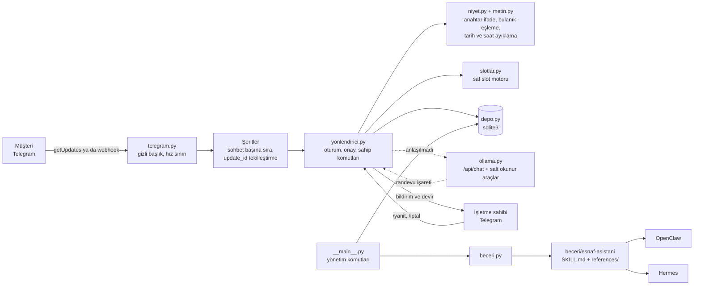
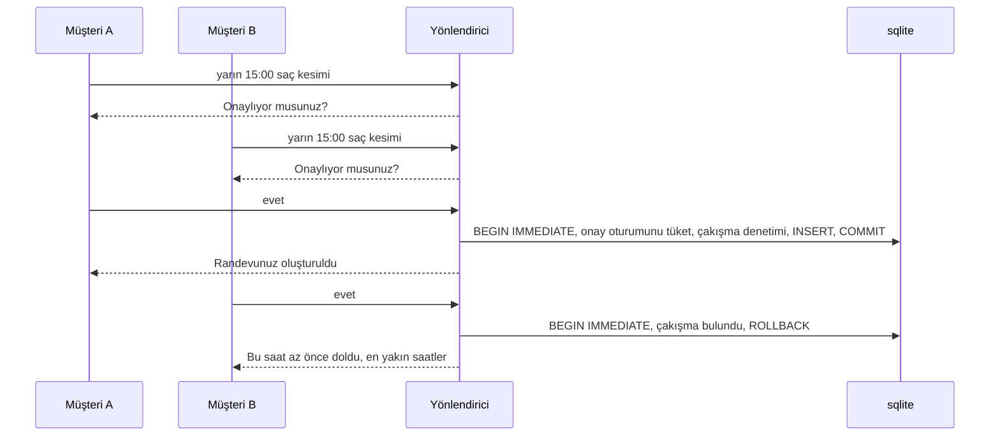

# 04 — Esnaf mesaj ve randevu asistanı

> **Kime:** randevuyla çalışan, mesajları sahibinin ya da tek sekreterin yanıtladığı mikro işletmeler; ilk segment 1–3
> koltuklu berber ve kuaförler, sonra diş muayenehanesi, veteriner ve 24:00'e kadar açık halı saha.
>
> **Ne:** Telegram'dan gelen "yarın 3'e yer var mı, saç kesimi kaç para, otopark var mı" mesajlarını 7/24 yanıtlayan,
> randevuyu onaylı ve çakışmasız kuran, gerektiğinde işletme sahibine devreden bir asistan. Aynı işletme bilgisini
> OpenClaw ve Hermes'in yüklediği **beceri (skill)** biçiminde de dışa aktarır. Yalnız Python standart kütüphanesi.
>
> **Fiyat (varsayım, doğrulanmalı):** kurulum 2.500 TL (bir kez) + Esnaf 699 TL/ay ya da Klinik 1.499 TL/ay; yerel
> model eki +600 TL/ay (KDV hariç).

## 1. Problem

Küçük işletmede mesajları yanıtlayan kişi, aynı anda hizmeti veren kişidir. Makas elindeyken gelen mesajlar akşama
kalır; cevapsız mesaj kaçan randevudur. Soruların çoğu tekrar eder: fiyat, adres, çalışma saati, "şu saatte yer var
mı". Kâğıt defter ya da ezber takvimde iki kişiye aynı saati vermek (çifte rezervasyon) sık yaşanır. Hazır randevu
uygulamaları ise müşteriyi yeni bir uygulama indirmeye zorlar; esnafın müşterisi zaten bir mesajlaşma uygulamasında
yazıyor.

Bu paragraftaki iş yükü ve kayıp randevu iddiaları **varsayımdır**; ilk görüşmelerde ölçülecek: günde kaç mesaj geliyor,
kaçı tekrar eden soru, haftada kaç randevu kaçıyor.

## 2. Kime

| Segment                         | Neden acı çekiyor                                    | Özel ihtiyaç                                        | Bu MVP'de durum                     |
| ------------------------------- | ---------------------------------------------------- | --------------------------------------------------- | ----------------------------------- |
| Berber, kuaför, güzellik salonu | Gün boyu eller dolu; mesajlar akşama kalıyor         | Birden fazla koltuk/personel, öğle arası            | Hazır (ilk segment)                 |
| Diş muayenehanesi, veteriner    | Sekreter telefon ve mesaj arasında sıkışıyor         | Sağlık verisi hassasiyeti (KVKK md. 6), insan devri | `hassas_veri` modu; hukukçu onayı   |
| Halı saha, stüdyo, oda kiralama | Saat dilimleri dolu/boş sorusu tekrar tekrar geliyor | Saha/oda = kaynak, 60–90 dk süreler                 | 24:00'e kadar; gece yarısını aşamaz |

**Somut persona 1:** Murat (38), Kadıköy'de iki koltuklu berber. Yoğun saatlerde telefona bakamıyor; cumartesi aynı
saate iki müşteri yazdığı oluyor. Teknik bilgisi yok ama Telegram ve WhatsApp kullanıyor. Ödeme gücü: aylık birkaç yüz
TL'lik bir araç için "bir müşteri fazla gelirse kendini öder" diye düşünüyor (persona varsayımdır).

**Somut persona 2:** Elif (29), iki hekimli bir diş muayenehanesinin sekreteri. Hastalar mesajla randevu ve fiyat
soruyor; bazıları şikâyetini (sağlık verisi) mesaja yazıyor. Elif'in derdi hem iş yükü hem KVKK riski.

**İlk 10 müşteri (plan):**

1. Kadıköy–Moda'da yürüme mesafesindeki yaklaşık 30 berber ve kuaföre yerinde 15 dakikalık demo: telefonda `sohbet`
   komutu ya da deneme botu. Hedef 10 pilot; karşılığında ilk ay ücretsiz kurulum, referans ve haftalık geri bildirim.
2. Google Haritalar'da "randevu için mesaj atın" yazan işletmeler; Instagram işletme hesaplarında "DM'den randevu"
   ifadesi geçenler.
3. Berberler ve kuaförler odası toplantıları; diş hekimleri için bölge diş hekimleri odası, veterinerler için meslek
   odası etkinlikleri.
4. Halı sahalar: aynı semtteki tesisler birbirini izler; biri kullanınca diğerleri görür (gözlem, doğrulanmadı).

**Karar ölçütü:** pilotlar müşterilerini Telegram'a (dükkândaki QR afişiyle) yönlendirmeyi kabul etmeli. 30 ziyarette
5'ten az kabul çıkarsa WhatsApp bağdaştırıcısı (bkz. §12) ilk işe alınır. Pilotta ölçülenler: yanıtlanan mesaj, kurulan
randevu, "anlayamadım" oranı, sahibe devredilen konuşma sayısı.

## 3. Çözüm

- **Kural tabanlı çekirdek, yapay zekâ isteğe bağlı.** Niyet bulma Türkçeye göre ayarlı anahtar ifade + bulanık
  eşleme (`randvu`, `fiat`, `çocuğum` gibi yazımları anlar; `randevusuz` kelimesini randevu isteği, `geliyorum`
  kelimesini iptal sanmaz). Anlaşılmayan mesaj, varsa yerel Ollama modeline gider; model **randevu kuramaz**, yalnız
  salt okunur araç çağırır. Model yoksa ya da yanıt vermezse bot menüyle devam eder.
- **Onaysız işlem yok.** Randevu, iptal ve veri silme yalnız açık bir "Evet" ile yapılır. "uygun değil", "tamam,
  silmeyin", "evet ama 16:00 olsun" onay sayılmaz; saat içeren cevapta yeni saat önerilir, belirsizde soru yinelenir.
- **Slot motoru:** çalışma saatleri (öğle arası dahil, kapanış en geç 24:00), hizmet süreleri, birden fazla kaynak
  (koltuk/personel/saha), tatiller, en erken haber süresi (60 dk) ve en ileri tarih (14 gün). İstenen saat doluysa
  **en yakın 6 boş saat** önerilir; ileri tarih istenirse "dolu" değil "henüz randevu vermiyoruz" denir.
- **Doğru saat:** "şimdi" işletmenin saat dilimiyle (`saat_dilimi`, varsayılan `Europe/Istanbul`) hesaplanır; sunucu
  UTC'de olsa bile bot geçmiş saat önermez.
- **Çifte rezervasyon yok:** onay oturumu, sqlite işleminin (`BEGIN IMMEDIATE`) içinde tüketilir ve çakışma aynı
  işlemde yeniden denetlenir. Aynı sohbetin mesajları sırayla işlenir; iki müşteri aynı anda "evet" derse ikincisine
  alternatif saatler gider. Bir sohbet en çok `musteri_basina_azami` (varsayılan 2) aktif randevu alabilir.
- **İnsan devri:** "yetkili", "şikâyet" gibi mesajlar işletme sahibinin Telegram'ına iletilir. Sahip bota kendi
  hesabından `/yanit <no> <mesaj>` yazarak müşteriye bot üzerinden yanıt verir; talep kapanınca mesaj metni silinir.
- **KVKK:** ilk mesajda kısa aydınlatma (md. 10), "verilerimi sil" komutu (md. 7 ve 11), saklama süresi dolan
  kayıtların her gün kendiliğinden silinmesi, mesaj içeriğinin saklanmaması (tek istisna: yetkiliye iletilmesi
  istenen mesaj, yanıtlanana kadar, en çok `devir_saklama_gun` gün), hassas sektör modu.
- **Beceri dışa aktarma:** aynı işletme bilgisi `beceri/esnaf-asistani/` klasörüne Agent Skills biçiminde yazılır;
  işletme sahibi kendi OpenClaw ya da Hermes ajanına "şu müşteriye ne yazayım?" diye sorabilir.

Bilerek **yapılmayanlar:** ödeme almak, hatırlatma mesajı göndermek, kampanya mesajı göndermek, WhatsApp (bkz. §12).

## 4. 51 depodan hangileri, nasıl?

| Depo                                                                                  | Nasıl kullanılıyor                                                                                                                                                                                                                                                                                         | Doğrulandığı yer (incelenen commit)                                                                                                                                                                                                                                                                                                                                   |
| ------------------------------------------------------------------------------------- | ---------------------------------------------------------------------------------------------------------------------------------------------------------------------------------------------------------------------------------------------------------------------------------------------------------- | --------------------------------------------------------------------------------------------------------------------------------------------------------------------------------------------------------------------------------------------------------------------------------------------------------------------------------------------------------------------- |
| [ollama/ollama](../../dallar/05-yapay-zeka-altyapisi/ollama/README.md)                | **API:** `esnaf/ollama.py` `POST /api/chat` (`stream: false`, `think: false`, `tools`), yanıttaki `message.tool_calls`, araç sonucu `{"role": "tool", "tool_name": …}`; açılışta `POST /api/show` (`capabilities`, `remote_host`). `OLLAMA_HOST` Ollama'nın kuralıyla çözülür; bulut modelleri reddedilir. | `d63b702`: `docs/api.md` (494–508, 882–939, 1409–1420), `api/types.go` (`ChatRequest.Think` 164, `Message`/`ToolCall` 202–235, argüman 298–307, `ShowResponse` 806–828), `server/routes.go` 3211–3215 (`think` verilmezse düşünen modelde true), `envconfig/config.go` (`Host`, `ConnectableHost`, `Var`), `internal/modelref/modelref.go`, `docs/cloud.mdx` 78 ve 90 |
| [openclaw/openclaw](../../dallar/06-ajan-platformlari/openclaw/README.md)             | **Dosya biçimi:** beceri klasörü, `{baseDir}`, kurulum komutları. **Mimari:** Telegram kanalının işleme modeli (önce kuyruğa al, hemen 200 dön, sohbet başına şeritlerde işle) ve güvenlik kuralları (gizli başlık, boş gizli anahtarı reddetme, gövde sınırı, tek sahipli botta izin listesi).            | `7c78826`: `docs/tools/skills.md` (268–270, 375–376, 448–449), `docs/tools/creating-skills.md` 58, `docs/tools/slash-commands.md` 461, `src/skills/discovery/command-name.ts`, `docs/channels/telegram/transports.md` 40–42, `extensions/telegram/src/webhook.ts` (128–150, 197–201, 368–371, 465–467), `docs/channels/telegram/access-control.md` 34                 |
| [NousResearch/hermes-agent](../../dallar/06-ajan-platformlari/hermes-agent/README.md) | **Dosya biçimi:** beceri dizinleri (`~/.hermes/skills/`, `external_dirs`, proje becerileri + `hermes skills trust`), `${HERMES_SKILL_DIR}` belirteci, `metadata.hermes.tags`. Webhook gizli anahtarının zorunlu tutulması tasarıma örnek oldu.                                                             | `8c1a9c0`: `website/docs/user-guide/features/skills.md` (11, 75–86, 204, 414, 473, 489), `agent/skill_preprocessing.py` 17, `agent/skill_utils.py` (YAML hatasında satır bölme yedeği), `website/docs/reference/cli-commands.md` 128–132, `website/docs/user-guide/security.md` 675 ve 738, `website/docs/user-guide/messaging/telegram.md` 306, 317, 402             |
| [anthropics/skills](../../dallar/08-ajan-becerileri/anthropic-skills/README.md)       | **Dosya biçimi ve doğrulama kuralları:** `esnaf/beceri.py` içindeki `on_bilgi_denetle()` aynı kuralları uygular: izinli anahtarlar, `name` küçük harf-rakam-tire (≤ 64, `--` yok), `description` ≤ 1024 ve `<` `>` içermez. Üretilen her beceri yazılmadan önce denetlenir.                                | `2c5958e`: `skills/skill-creator/scripts/quick_validate.py`, `template/SKILL.md`, `skills/docx/SKILL.md` (tırnaklı `description` örneği)                                                                                                                                                                                                                              |
| [obra/superpowers](../../dallar/08-ajan-becerileri/superpowers/README.md)             | **Yazım ilkesi:** açıklama yalnız "ne zaman kullanılır" der, iş akışını özetlemez.                                                                                                                                                                                                                         | `22f0b46`: `skills/writing-skills/SKILL.md` 95–97                                                                                                                                                                                                                                                                                                                     |

Kod bu depolardan kopyalanmadı; biçimler belgelerden ve kaynak koddan okunup özgün olarak yazıldı. Telegram Bot API 51
deponun biri değildir; kanal olarak kullanılır. Satır numaraları incelenen commit'e aittir.

## 5. Mimari



Randevu onayı, iki müşteri yarışırken bile tek doğru sonucu verir:



**İşleme modeli (OpenClaw'dan uyarlandı):** webhook isteği doğrulanınca güncelleme kuyruğa alınır ve hemen `200`
döner; iş, sohbet başına sıralı ve sohbetler arasında paralel çalışan "şeritlerde" yapılır. Yavaş bir model çağrısı
diğer müşterileri bekletmez; Telegram aynı güncellemeyi yeniden gönderirse `update_id` bir kez işlenir. **Fark:**
OpenClaw kuyruğu diske yazar; burada kuyruk bellektedir, süreç çökerse işlenmemiş birkaç mesaj kaybolur (§11).

**Klasörler:**

```text
04-esnaf-asistani/
  esnaf/
    yapilandirma.py   işletme JSON'unu okur ve sıkı doğrular (saatler, hizmet kodları, sınırlar, saat dilimi)
    zaman.py          işletmenin yerel "şimdi"si (Europe/Istanbul; tzdata yoksa sabit UTC+3 yedeği)
    metin.py          Türkçe küçültme/sadeleştirme, bulanık eşleme, tarih ve saat ayıklama
    niyet.py          öncelik sıralı niyetler, hizmet ve SSS eşleme
    slotlar.py        saf slot motoru (veritabanı ve saat okumaz, test edilebilir)
    depo.py           sqlite3: kişiler, randevular, oturumlar, devirler; silme ve saklama süresi
    yonlendirici.py   kanal bağımsız sohbet yöneticisi; onay, iptal, veri silme, sahip komutları
    telegram.py       Bot API: getUpdates döngüsü, webhook sunucusu, şeritler, hız sınırı
    ollama.py         isteğe bağlı yerel model, araç çağırma döngüsü, yerellik denetimi
    beceri.py         OpenClaw/Hermes becerisi üretici ve ön bilgi denetleyicisi
    __main__.py       yönetim komut satırı
  ornek/isletme.json  örnek işletme (Makas Berber)
  beceri/esnaf-asistani/  örnekten üretilmiş, kuruluma hazır beceri
  tests/              çevrimdışı birim testleri (sahte Telegram ve sahte Ollama sunucuları)
```

## 6. Kurulum ve çalıştırma

Gereken: Python 3.11+ (geliştirme 3.13 ile yapıldı). Dış paket yok.

```bash
cd repo-atlasi/is-fikirleri/04-esnaf-asistani
cp ornek/isletme.json isletme.json        # kendi işletmenize göre düzenleyin
python3 -m esnaf sohbet                    # Telegram olmadan, terminalden müşteri gibi deneyin
```

`sohbet` varsayılan olarak bellekte çalışır ve hiçbir dosyaya yazmaz; gerçek veritabanını denemek için `--vt` verin.

**Yapılandırmanın önemli alanları:** `saat_dilimi` (varsayılan `Europe/Istanbul`; sunucunun saat dilimi önemli değil),
`adim_dk` (5–240), `en_erken_dk`, `en_gec_gun`, `saklama_gun`, `devir_saklama_gun`, `musteri_basina_azami`,
`hassas_veri`, `kvkk_url`, `sahip_sohbet_id`. Hizmet kodları yalnız küçük harf, rakam ve tire içerebilir; çalışma
saatlerinde kapanış en geç `24:00`'tür. Hatalı yapılandırma açılışta anlaşılır bir hatayla durur.

**Telegram (uzun yoklama, sunucu ve alan adı gerekmez):** BotFather'dan bot oluşturun, belirteci ortam
değişkenine koyun (komut satırı argümanı kabuk geçmişine düştüğü için kabul edilmez):

```bash
export TELEGRAM_BOT_TOKEN='123456:ABC...'
python3 -m esnaf yoklama
```

**İşletme sahibinin kimliği:** botu çalıştırın, sahibin kendi Telegram hesabından bota `/kimlik` yazın; çıkan numarayı
`isletme.json` içindeki `sahip_sohbet_id` alanına yazıp botu yeniden başlatın. Bu alan boşsa randevu ve devir
bildirimleri gitmez, bot açılışta uyarır.

**Sahip komutları (yalnız `sahip_sohbet_id` hesabından):** `/devirler`, `/yanit <no> <mesaj>`, `/kapat <no>`,
`/randevular [gün]`, `/iptal <randevu no>` (müşteriye haber verilir), `/yardim`.

**Webhook (sunucuda):** önüne TLS sağlayan bir ters vekil (Caddy, nginx) koyun. Gizli anahtar 16–256 karakter olmalı
ve yalnız `A-Z a-z 0-9 _ -` içermeli (karakter kuralı Telegram Bot API belgesindeki `secret_token` kuralıdır,
doğrulanmadı; en az 16 karakter bizim tercihimiz):

```bash
export TELEGRAM_WEBHOOK_SECRET="$(python3 -c 'import secrets; print(secrets.token_hex(32))')"
python3 -m esnaf webhook --url https://alanadiniz.com.tr/telegram --port 8080
```

Telegram her istekte `X-Telegram-Bot-Api-Secret-Token` başlığını gönderir; sunucu bunu `hmac.compare_digest` ile
karşılaştırır, yanlışsa 401, 1 MB üstü gövdede 413, bozuk gövdede 400 döner; doğruysa güncellemeyi kuyruğa alıp hemen
200 döner. Grup mesajları yok sayılır, sohbet başına dakikada 20 mesaj sınırı vardır.

**Sürekli çalıştırma (systemd örneği):** bağlantı hataları süreci durdurmaz (yeniden deneme 5 sn'den 60 sn'ye kadar
artar), yine de çökmeye karşı yeniden başlatma ekleyin. Belirteçleri izni 600 olan bir dosyada tutun. Saklama süresi
dolan kayıtlar bot açıkken günde bir kendiliğinden silinir; ayrı cron gerekmez.

```ini
[Service]
WorkingDirectory=/srv/esnaf
EnvironmentFile=/srv/esnaf/gizli.env
ExecStart=/usr/bin/python3 -m esnaf yoklama
Restart=always
RestartSec=5
```

**Yerel dil modeli (isteğe bağlı):** Ollama kurulu ve araç çağırmayı destekleyen bir model indirilmiş olmalı. Açılışta
`/api/show` ile modelin yerel olduğu ve `tools` yeteneği taşıdığı denetlenir; değilse bot başlamaz. `:cloud` ya da
`-cloud` etiketli modeller ve `ollama.com` adresi reddedilir. Ollama'ya çalışma sırasında ulaşılamazsa bot uyarı
yazar ve menüyle devam eder.

```bash
ollama pull qwen2.5:7b                     # model adı örnektir (doğrulanmadı: güncel kütüphaneyi kontrol edin)
OLLAMA_NO_CLOUD=1 ollama serve             # Ollama tarafında bulut özelliklerini kapatın (docs/faq.mdx)
python3 -m esnaf yoklama --ollama-model qwen2.5:7b
```

`OLLAMA_HOST` Ollama'nın kendi biçimiyle verilebilir: `0.0.0.0:11434`, `192.168.1.5`, `http://sunucu:11434`. Şema
yoksa `http` ve 11434 varsayılır; `0.0.0.0` bağlanırken `127.0.0.1` olur.

**Yönetim komutları:**

```bash
python3 -m esnaf randevular --gun 10.11.2026      # ya da 2026-11-10; verilmezse bugün (işletme saatiyle)
python3 -m esnaf musaitlik --hizmet sac-kesimi --gun 2026-11-10 --json   # beceri bu komutu çağırır
python3 -m esnaf iptal 12                         # müşteriye haber vermez; Telegram'dan /iptal 12 haber verir
python3 -m esnaf devirler && python3 -m esnaf devir-kapat 3
python3 -m esnaf veri-sil 123456789               # telefonla gelen silme talebi için
python3 -m esnaf temizle                          # saklama süresi dolanları elle silmek için
python3 -m esnaf beceri-uret ./cikti              # kendi isletme.json'unuzdan beceri üret
```

`musaitlik` veritabanını salt okunur açar; dosya yoksa "her saat boş" demek yerine hata verir (çıkış kodu 3). Bot hangi
`--vt` yoluyla çalışıyorsa beceri de aynı klasörden (`ESNAF_EV`) ve aynı dosyayla çalışmalıdır.

## 7. OpenClaw ve Hermes için beceri

`beceri/esnaf-asistani/` iki dosyadır: `SKILL.md` (ön bilgi + kurallar) ve `references/isletme.md` (fiyat, saat,
adres, SSS). İki platform da Agent Skills biçimini okur; klasör adı ile `name` aynıdır (`esnaf-asistani`). Kendi
işletmeniz için önce `python3 -m esnaf beceri-uret ./cikti` çalıştırın. İşletme adı ön bilgiye tırnaklı yazılır;
`Kuaför: Elif` ya da `Salon #1` gibi adlar YAML'ı bozmaz. Açıklama 160 karakteri geçmeyecek biçimde kısaltılır.
Beceri işletmenin özel bilgisidir: `license` alanı "özel kullanım" der, herkese açık bir beceri pazarına yüklemeyin.

**Önerilen kullanım:** beceri, **işletme sahibinin kendi asistanı** içindir (müşteri mesajına taslak, "yarın kaç
boşluk var?"). Herkese açık müşteri botu için bu depodaki bağımsız bot daha güvenlidir. OpenClaw belgeleri herkese
açık DM politikasını (`dmPolicy: "open"`) yalnız "araçları sıkıca kısıtlanmış, bilerek herkese açık botlar" için
önerir; tek sahipli bot için `allowlist` + sayısal kullanıcı kimliği (`docs/channels/telegram/access-control.md` 34).

**Komut güvenliği:** beceri, boş saat için tek bir salt okunur komut tanımlar; izinli hizmet kodları ve tarih biçimi
`SKILL.md` içinde açıkça yazılıdır. Yine de beceri izin listesi bir kabuk yetkilendirme sınırı değildir: aynı ajan
`exec` kullanabiliyorsa kabuğu ayrıca kısıtlayın (kum havuzu, ayrı işletim sistemi kullanıcısı, exec izin listesi),
müşteri mesajını ajana komut olarak yapıştırmayın (OpenClaw `docs/tools/skills.md` 268–270).

**OpenClaw** (`7c78826` belgeleri ve kaynak koduna göre):

```bash
openclaw skills install ./cikti/esnaf-asistani            # etkin çalışma alanının skills/ klasörüne kopyalar
openclaw skills install ./cikti/esnaf-asistani --global   # ya da tüm yerel ajanlar için ~/.openclaw/skills
openclaw skills list && openclaw skills check             # yüklendi mi, gereksinimleri tamam mı
```

Elle kurulum: klasörü `~/.openclaw/workspace/skills/esnaf-asistani/` altına kopyalamak da yeterlidir (OpenClaw
`SKILL.md` dosyalarını izler; açık oturumda `/new` ile yeni oturum başlatın). **Çağırma:** sohbette
`/skill esnaf-asistani` her zaman çalışır; doğrudan komut adı `/esnaf_asistani` olur, çünkü OpenClaw komut adını
`a-z0-9_` karakterlerine çevirir ve tireyi alt çizgi yapar (`src/skills/discovery/command-name.ts`,
`docs/tools/slash-commands.md` 461). Mesaj içinde `$esnaf-asistani` başvurusu da çalışır (Control UI'daki `$`
seçicisi `$esnaf_asistani` ekler). OpenClaw'ın `docs/tools/creating-skills.md` dosyasındaki `/hello-world` örneği
kaynak kodla çelişir; kaynak kodu esas aldık. Boş saat komutu için `~/.openclaw/openclaw.json` içinde
`skills.entries["esnaf-asistani"].env.ESNAF_EV` alanına bu klasörün yolunu yazın; bu değişken yalnız ana makinedeki
çalıştırmaya enjekte edilir, kum havuzuna (sandbox) geçmez (`docs/tools/skills.md` 448–449). Kum havuzunda beceri,
kural 3'teki "randevu botumuzdan görebilirsiniz" yedeğine düşer.

**Hermes** (`8c1a9c0` belgelerine göre):

```bash
mkdir -p ~/.hermes/skills/esnaf
cp -r ./cikti/esnaf-asistani ~/.hermes/skills/esnaf/      # kategori klasörü isteğe bağlı
echo 'ESNAF_EV=/srv/esnaf' >> ~/.hermes/.env              # boş saat komutu için
hermes chat --toolsets skills,terminal -q "esnaf-asistani becerisiyle: yarın sakal için boş saat var mı?"
```

`terminal` araç seti olmadan boş saat komutu çalışmaz (yalnız `skills` ile beceri fiyat ve SSS yanıtlar).
`ESNAF_EV`'in terminal aracına geçmesi için `~/.hermes/config.yaml` içinde `terminal.env_passthrough: [ESNAF_EV]`
tanımlayın; değişken ortamda yoksa iletilmez (`security.md` 675, 738). Hermes'te beceri `/esnaf-asistani` komutuyla da
yüklenir (`features/skills.md` 75–86). Müşteri mesajını sorguya koyacaksanız `-q` yerine `--query-file` kullanın:
metin kabukta yorumlanmaz (`cli-commands.md` 129). Alternatifler: `skills.external_dirs` listesine beceri klasörünün
üst dizinini eklemek ya da depo içinde `.hermes/skills/` veya `.agents/skills/` kullanıp bir kez
`hermes skills trust` çalıştırmak. Telegram'dan sahip olarak konuşmak için `hermes gateway setup` ve
`TELEGRAM_ALLOWED_USERS` (yalnız sizin kimliğiniz).

**Doğrulama durumu:** biçim ve komutlar iki deponun belgelerinden ve kaynak kodundan okundu (yukarıdaki satırlar);
gerçek bir OpenClaw ya da Hermes kurulumunda uçtan uca **denenmedi (doğrulanmadı)**. Ön bilgi kuralları
`tests/test_beceri_cli.py` içinde sınanır (sistemde PyYAML varsa gerçek YAML ayrıştırıcısıyla da); depodaki beceri
klasörünün örnek yapılandırmayla güncel olduğu da testle denetlenir.

## 8. Test

```bash
cd repo-atlasi/is-fikirleri/04-esnaf-asistani
PYTHONDONTWRITEBYTECODE=1 python3 -m unittest discover -s tests -t .   # 102 test, 1 atlanır (gerçek Ollama)
```

| Dosya                        | Neyi sınar                                                                                                                                                                 |
| ---------------------------- | -------------------------------------------------------------------------------------------------------------------------------------------------------------------------- |
| `tests/test_metin_niyet.py`  | Türkçe küçültme, NFC, yazım hatası/ek/yumuşama, olumsuzluk ("geliyorum" iptal değil), açık tarih önceliği, gün adı ekleri, saat biçimleri, niyetler                        |
| `tests/test_slotlar.py`      | öğle arası, ızgara (açılışa göre, 60'ı bölmeyen adım), 24:00 kapanışı, tatil, ufuk, yapılandırma doğrulaması, UTC sunucuda İstanbul saati                                  |
| `tests/test_yonlendirici.py` | onay ve ret cümleleri, iptal ve veri silme onayı, müşteri sınırı, eşzamanlı onay, ufuk dışı tarih, devir, sahip komutları, hassas mod                                      |
| `tests/test_telegram.py`     | sahte Telegram'la yoklama ve offset, kopan bağlantı ve yarım gövde, artan bekleme, webhook 400/401/404/413, hemen 200, tekrar teslim, hız sınırı                           |
| `tests/test_ollama.py`       | istek biçimi (`think: false`), araç turu, randevu işareti, yanıt süzme, toplam süre, `OLLAMA_HOST` çözümü, bulut reddi, `/api/show` denetimi                               |
| `tests/test_beceri_cli.py`   | ön bilgi kuralları ve zor işletme adları, fiyatsız hizmet, becerinin güncelliği, yönetim komutları, eksik veritabanı, bellekte demo, güvenli silme, kendiliğinden temizlik |

Gerçek model testi (Ollama yoksa atlanır):
`ESNAF_OLLAMA_MODEL=qwen2.5:7b PYTHONDONTWRITEBYTECODE=1 python3 -m unittest tests.test_entegrasyon`.

## 9. Gelir modeli ve örnek fiyat

Aşağıdaki fiyatlar Kasım 2026 için **varsayımdır**; ilk 10 pilotta ödeme isteğiyle doğrulanmalı ve enflasyona göre
güncellenmelidir. Rakip fiyatları araştırılmadı (doğrulanmadı).

| Paket           | Fiyat (KDV hariç)  | İçerik                                                                                     |
| --------------- | ------------------ | ------------------------------------------------------------------------------------------ |
| Kurulum         | 2.500 TL (bir kez) | `isletme.json` hazırlama, bot, dükkân için QR afişi, sahibe 30 dk eğitim                   |
| Esnaf           | 699 TL/ay          | 1 işletme, 3 kaynağa kadar, barındırma, yedekleme                                          |
| Klinik          | 1.499 TL/ay        | 5 kaynak, hassas veri modu, aydınlatma metni şablonu, aylık KVKK kontrol listesi           |
| Yerel model eki | +600 TL/ay         | Ollama'yı Türkiye'deki sunucuda barındırma; anlaşılmayan mesajlar yurt dışı servise gitmez |

Maliyet: kural tabanlı bot hafiftir; tek bir küçük sunucu birçok işletmeyi taşıyabilir (sqlite + stdlib; yük testi
yapılmadı). Asıl maliyet kurulum zamanı ve destektir. Yerel model eki için donanım maliyeti (CPU'da yavaş yanıt ya da
GPU kirası) fiyatı aşabilir; eki satmadan önce ölçün (doğrulanmadı). Değer önerisi tek cümle: "Ayda bir kaçan randevuyu
kurtarırsa kendini öder."

## 10. KVKK ve hukuk notları

Bu bölüm hukuki görüş değildir; işletmeye ve size bir hukukçu bakmalıdır.

- **Roller:** veri sorumlusu işletmedir; botu barındıran siz veri işleyensiniz. Aranızda yazılı veri işleme sözleşmesi
  gerekir; veri güvenliği tedbirlerinden işletmeyle birlikte sorumlusunuz (KVKK md. 12).
- **Aydınlatma (md. 10):** bot ilk mesajda kısa aydınlatma gösterir (veri sorumlusu, amaç, hukuki sebep, yurt dışı
  sunucular, saklama süreleri, silme hakkı); tam metnin bağlantısı `kvkk_url` alanındadır. Metni işletmeye bir hukukçu
  hazırlamalıdır; koddaki metin şablondur.
- **Hukuki sebep:** randevu için sözleşmenin kurulması/ifası (md. 5/2-c); açık rıza gerekmez. Bot kampanya mesajı
  göndermez. Gönderilecek olursa ticari elektronik ileti için 6563 sayılı Kanun kapsamında alıcının onayı (İYS'ye
  kayıtlı) ve pazarlama amaçlı veri işleme için ayrıca KVKK açık rızası gerekir. Randevu onayı gibi işlemsel mesajlar bu
  kapsamda değildir (sınırları hukukçuya doğrulatın).
- **Özel nitelikli veri (md. 6):** klinikler için `hassas_veri: true` açın: bot sağlık bilgisi yazılmamasını ister,
  şikâyet ya da teşhis sormaz ve devir mesajının metnini veritabanına yazmaz (yalnız işletmeye iletir). Hizmet adlarını
  genel tutun ("muayene", "kontrol"): "kanal tedavisi" gibi bir ad bile sağlık verisi sayılabilir.
- **Yurt dışına aktarım (md. 9):** mesajlaşma uygulamasının sunucuları yurt dışındadır; aydınlatmada belirtilir. Botu
  yurt dışındaki bir sunucuda barındırmak da aktarımdır; Türkiye'de barındırmak bu riski azaltır. Bulut dil modeli
  kullanmak üçüncü bir yurt dışı aktarım yaratır; bu yüzden kod yalnız yerel Ollama modelini kabul eder, Ollama'da da
  `OLLAMA_NO_CLOUD=1` açık olmalıdır. md. 9, 7499 sayılı Kanunla 2024'te değişti (yeterlilik kararı, uygun güvenceler
  ve standart sözleşmenin Kurula bildirimi, arızi aktarım istisnaları); ayrıntılar için güncel Kurul düzenlemelerine
  bakın (doğrulanmadı).
- **Silme (md. 7 ve 11):** müşteri "verilerimi sil" yazınca, "Evet, sil" onayından sonra bottaki tüm kayıtları silinir;
  işletme yönetim komutuyla da silebilir. sqlite `secure_delete` açıktır: silinen satırlar dosyanın boş sayfalarında
  okunabilir kalmaz (testle denetlenir). Daha önce işletme sahibinin Telegram'ına iletilmiş devir mesajlarını silmek
  işletmenin sorumluluğudur; bot bunu sahibe hatırlatır. Kanuni saklama yükümlülüğü olan kayıtlar (ör. klinik hasta
  kayıtları) botun dışında, işletmenin kendi sisteminde tutulur; silme talebi onları kapsamaz.
- **Saklama ve imha:** geçmiş randevular `saklama_gun`, açık devir mesajları `devir_saklama_gun` sonunda, bot açıkken
  günde bir kendiliğinden silinir. VERBİS'e kayıtlı veri sorumluları için saklama ve imha politikası ile periyodik imha
  yükümlülüğü vardır (Kişisel Verilerin Silinmesi, Yok Edilmesi veya Anonim Hale Getirilmesi Hakkında Yönetmelik;
  süreleri doğrulayın).
- **VERBİS:** muafiyet eşikleri Kurul kararlarıyla belirlenir ve değişir. Çalışan sayısı ve bilanço eşiklerinin
  altındaki, ana faaliyeti özel nitelikli veri işlemek olmayan küçük işletmeler (çoğu berber) genelde muaftır; ana
  faaliyeti sağlık verisi işlemek olan muayenehaneler genelde muaf değildir. Muafiyet yalnız kayıt yükümlülüğünü
  kaldırır, aydınlatma ve güvenlik yükümlülükleri sürer. Güncel kararı kontrol edin (doğrulanmadı).
- **Sağlık sektöründe tanıtım:** muayenehane ve kliniklerin tanıtım ve reklam faaliyetleri sınırlıdır (Sağlık
  Bakanlığı düzenlemeleri, meslek odalarının etik kuralları; doğrulanmadı). Bot kampanya ya da indirim duyurmamalı; SSS
  metinlerinde "en iyi", "garantili tedavi" gibi ifadeler olmamalı. İlgili meslek odasıyla doğrulayın.
- **Mesajlaşma platformu kuralları:** Telegram botları kullanıcı önce yazmadan sohbet başlatamaz; toplu ve istenmeyen
  mesaj göndermeyin, Telegram'ın bot kullanım koşullarına uyun (güncel metni okuyun; doğrulanmadı).
- **Fikri haklar (5846 sayılı FSEK):** SSS metinleri, fotoğraf ve logolar işletmenin kendisine ait olmalı; başka sitelerin
  metinleri kopyalanmamalı. Dışa aktarılan beceri işletmenin özel bilgisidir, açık lisansla yayımlanmaz.
- **Kullanılan projelerin lisansları:** OpenClaw (MIT, `LICENSE`), Hermes Agent (MIT), Ollama (MIT), obra/superpowers
  (MIT); anthropics/skills deposundaki `skill-creator` Apache 2.0 (`skills/skill-creator/LICENSE.txt`). MVP bu
  projelerin kodunu içermez; yalnız API'lerini ve dosya biçimlerini kullanır, bu yüzden ticari kullanımla lisans
  çatışması yoktur. Ollama'yı müşteriye dağıtırsanız (ör. işletmenin bilgisayarına kurarsanız) MIT telif bildirimini
  ekleyin. Model ağırlıklarının lisansı ayrıdır; seçtiğiniz modelin ticari kullanıma izin verdiğini model kartından
  doğrulayın (doğrulanmadı).

## 11. Riskler

- **Kanal riski:** Türkiye'de işletmelerin müşterisi çoğunlukla WhatsApp'ta yazıyor (gözlem, doğrulanmadı); Telegram ile
  başlamak teknik olarak kolay ama pazarlamada zor. Yönlendirici kanal bağımsız yazıldı; karar ölçütü §2'de.
- **Yanlış anlama:** kural tabanlı niyet bulma her ifadeyi yakalayamaz; anlamadığında açıkça söyler ve menü sunar.
  Yanlış randevu kurmamak için her işlem açık "Evet" ister. "Pazar" kelimesi (çarşı anlamında) gün sanılabilir; onay
  mesajı tarihi açıkça yazdığı için müşteri düzeltebilir.
- **Dil modeli riski:** model fiyat ya da saat uydurabilir, müşteri mesajındaki talimatlara kanabilir (istem
  enjeksiyonu). Önlem: model randevu kuramaz, araçlar salt okunurdur, yanıt 600 karakterle sınırlıdır, "randevunuz
  oluşturuldu" iddiası ya da işletmeye ait olmayan bağlantı içeren yanıt gönderilmez, toplam süre 25 sn'yi aşamaz.
- **Gecikme ve donanım:** CPU'da yerel model yanıtı saniyeler sürebilir; şeritler sayesinde diğer müşteriler beklemez
  ama o müşteri bekler. Model süreyi aşarsa bot menüye düşer.
- **Süreç çökmesi:** kuyruk bellektedir; çökme anında işlenmemiş mesajlar kaybolur (müşteri yeniden yazmalı).
  systemd `Restart=always` ile süre kısalır; kalıcı kuyruk sonraki adımdır.
- **Kapsam sınırları:** gece yarısını aşan vardiya (ör. 18:00–02:00) desteklenmez; tek süreç tek işletme çalıştırır.
- **Sorumluluk:** bot yanlış saat verirse müşteri memnuniyetsizliği işletmeye yansır; sözleşmede hizmet düzeyi ve
  sorumluluk sınırları yazılmalı.
- **Rekabet:** büyük randevu platformları ve WhatsApp Business'ın kendi otomatik yanıtları. Fark: kurulum hizmeti,
  Türkçeye özel anlama, işletmenin kendi verisi ve yerel model seçeneği.

## 12. Sonraki adımlar

1. WhatsApp Business Platform (Cloud API) bağdaştırıcısı (`telegram.py` ile aynı arayüz; platformun mesaj şablonu ve
   müşteri hizmeti penceresi kuralları ayrıca incelenmeli, doğrulanmadı).
2. Kalıcı kuyruk: güncellemeyi sqlite'a yazıp sonra işlemek (OpenClaw'daki dayanıklı giriş kuyruğu gibi).
3. Randevudan 24 saat önce hatırlatma ve "gelemeyeceğim" yanıtıyla onaylı iptal (işlemsel mesaj).
4. Telegram satır içi düğmeleri (inline keyboard) ve takvim görünümü; sahip için web paneli.
5. Çok işletmeli barındırma: işletme başına ayrı veritabanı ve yapılandırma; gece yarısını aşan vardiya.
6. Gelmeyen müşteri (no-show) istatistiği ve kapora seçeneği.

---

Kataloğa dön: [İş fikirleri](../README.md) · Ağaç: [AGAC.md](../../AGAC.md)
