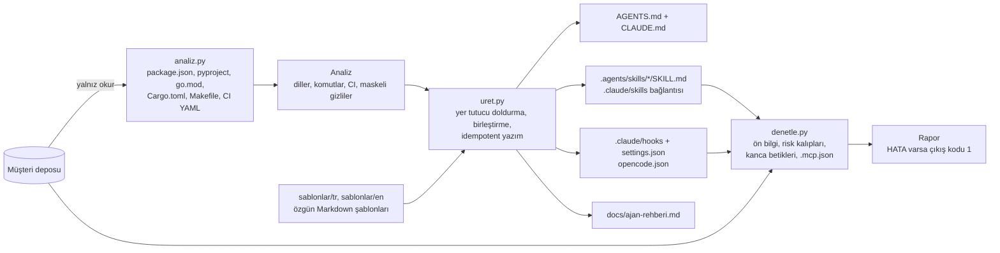

# 05 — AI kodlama ajanı kurulum paketi

> **Kime:** Türkiye'deki 10–50 kişilik yazılım ajansları, 5–50 kişilik ürün ekipleri ve bu kurulumu müşterilerine
> hizmet olarak satan serbest danışmanlar.
>
> **Ne:** bir depoyu okuyup yığını ve komutları tespit eden, ona uyarlanmış `AGENTS.md`, başlangıç becerileri (TDD,
> hata ayıklama, kod inceleme), bir güvenlik kancası, izin ayarları ve ekip rehberi üreten; var olan becerileri,
> kancaları ve MCP ayarlarını denetleyen bir komut satırı aracı + bunun etrafında satılan kurulum ve atölye hizmeti.
> Yalnız Python standart kütüphanesi.
>
> **Fiyat (varsayım, KDV hariç):** depo kurulumu 18.000 TL · ekip paketi 60.000 TL · bakım ve denetim 9.000 TL/ay ·
> danışman lisansı 4.000 TL/ay.

## 1. Problem

Ekipte herkes farklı bir ajan kullanıyor (Claude Code, opencode, Cursor, Codex). Depoda talimat dosyası yok ya da
eskimiş; ajan test komutunu tahmin ediyor, yanlış paket yöneticisini çağırıyor, "testler geçti" diyor ama çalıştırmamış.
İnternetten bulunan beceri ve kancalar okunmadan kuruluyor; bunlar birer tedarik zinciri parçası ve içlerinde görünmez
karakterle gizlenmiş talimat, ağa veri gönderen kanca ya da model trafiğini başka sunucuya yönlendiren bir proje ayarı
olabilir. Bir geliştiricinin ajanı `git push --force` çalıştırıyor. Müşteri gizlilik sözleşmeleri ve KVKK yüzünden
"hangi veri bulut modele gidebilir" sorusunun cevabı yazılı değil.

## 2. Kime

| Segment                        | Acı                                                     | Satın alma nedeni                                |
| ------------------------------ | ------------------------------------------------------- | ------------------------------------------------ |
| Yazılım ajansları (10–50 kişi) | Çok sayıda müşteri deposu, değişken kalite, NDA baskısı | Her depoda aynı kurallar, denetlenebilir kurulum |
| Ürün ekipleri (5–50 kişi)      | Ajan kullanımı bireysel, kazanım ölçülemiyor            | Ortak süreç, güvenlik kancası, ölçüm planı       |
| Serbest danışmanlar            | Her müşteride aynı kurulumu elle yapmak                 | Tekrarlanabilir araç + satılabilir paket         |

**Persona 1:** Burak (36), İzmir'de 18 kişilik bir ajansın teknik direktörü. Altı aktif müşteri projesi, dört farklı
yığın. Geçen ay bir stajyerin ajanı yanlış dalda zorla push yaptı; müşteri sözleşmesinde kaynak kodun üçüncü taraflara
gönderilmemesi maddesi var. Bütçesi var ama zamanı yok: "bir haftada herkesi aynı düzene sokun" istiyor.

**Persona 2:** Zeynep (31), serbest danışman. KOBİ'lere "yapay zekâyla yazılım geliştirme" atölyesi veriyor; her
müşteride aynı dosyaları elle yazıyor. Aracı kendi markasıyla kullanıp kurulum başına ücret almak istiyor.

**İlk 10 müşteri nerede?** Sayılar ilk 90 gün için **varsayımdır**; her kanalın gerçek dönüşü ilk ayda ölçülüp plan
güncellenir.

| Kanal                                                                                 | Ne yapılır                                                                                 | Varsayım                                  | Hedef     |
| ------------------------------------------------------------------------------------- | ------------------------------------------------------------------------------------------ | ----------------------------------------- | --------- |
| Teknoparklar (ODTÜ Teknokent, İTÜ ARI Teknokent, Teknopark İstanbul, İzmir Teknopark) | Yönetimle birlikte ücretsiz "ajanlı geliştirmede güvenlik" semineri, sonunda pilot teklifi | 2 seminer × 20 firma; %15 görüşme, yarısı | 3 müşteri |
| Topluluk buluşmaları (DevFest, yerel Meetup/Kommunity grupları)                       | 20 dakikalık canlı demo: herkese açık bir depoda `analiz` + `denetle`                      | 3 demo; her demodan 1 görüşme, üçte biri  | 1 müşteri |
| LinkedIn'de teknik direktör ve mühendislik yöneticileri (ajans, yazılım evi)          | Elle yazılmış kişisel mesaj; herkese açık bir depoları için ücretsiz `denetle` raporu      | 60 kişi; %10 görüşme, yarısı              | 3 müşteri |
| Kendi ağı ve ilk müşterilerin önerisi                                                 | İlk üç müşteriye indirimli pilot karşılığında yazılı referans ve vaka çalışması            | Tanıdık 10 ekip; %30                      | 3 müşteri |

Tanıtım mesajlarının hukuki sınırları (İYS, platform koşulları) için bkz. [10. bölüm](#10-kvkk-ve-hukuk-notları).

## 3. Çözüm

Üç komut, bir atölye:

```bash
python3 -m ajankur analiz <depo>      # yığın, paket yöneticisi, komutlar, CI'de koşanlar, mevcut ajan dosyaları
python3 -m ajankur uret <depo>        # AGENTS.md, CLAUDE.md, beceriler, kanca, izin ayarları, ekip rehberi
python3 -m ajankur denetle <yol>      # SKILL.md ön bilgisi, riskli kalıplar, kancalar, izinler, .mcp.json
```

- **`analiz`** dosya okur, hiçbir şey çalıştırmaz. Kaynak önceliği: CI'de gerçekten koşan komut > Makefile hedefi >
  paket yöneticisi betiği > dilin varsayılanı. CI satırı ancak bir test ya da lint aracının **yalın** çağrısıysa
  (`pnpm test`, `uv run pytest` gibi; boru, yönlendirme, `&&`, alt kabuk, ağ ya da silme komutu yoksa) ve iş alt
  klasörde (`working-directory`) koşmuyorsa komut tablosuna taşınır. Dosyaları yeniden yazan `format` ya da
  `prettier` betiği biçim denetimi sayılmaz. CI satırlarındaki parola, belirteç ve API anahtarları `[GİZLİ]` diye
  maskelenir; `$DEGISKEN` ve `${{ secrets.X }}` başvuruları olduğu gibi kalır. Bulamadığını "belirlenmedi" diye
  yazar; komut uydurmaz. `package.json`, `pyproject.toml` (stdlib `tomllib`), `requirements*.txt`, `go.mod`,
  `Cargo.toml`, `Makefile`, GitHub Actions ve GitLab CI dosyalarını okur.
- **`uret`** var olan dosyanın üzerine yazmaz: yanına `AGENTS.md.ajankur` gibi bir öneri bırakır.
  `.claude/settings.json` ve `opencode.json` zaten varsa öneri, ekibin ayarlarıyla **birleştirilmiş** hâlidir (izinler,
  başka kancalar, model ayarı korunur). Tekrar çalıştırıldığında aynı çıktıyı verir. Depodaki bir sembolik bağ yazımı
  depo dışına taşıyorsa o dosyayı atlar. `--dil en` İngilizce metin, `--beceri-dizini .claude/skills` farklı konum,
  `--cikti` önizleme klasörü seçer. Beceriler `.agents/skills/` altına yazılır ve `.claude/skills` bunlara bağlanır.
- **`denetle`** salt okunurdur. Çıkış kodu: 0 HATA yok, 1 HATA var, 2 yol bulunamadı (CI'de yanlış yol "temiz"
  sayılmasın). Ayrıntı için bkz. aşağıdaki liste.

Üretilenler:

| Dosya                                             | Ne işe yarar                                                                                                                                                                               |
| ------------------------------------------------- | ------------------------------------------------------------------------------------------------------------------------------------------------------------------------------------------ |
| `AGENTS.md`                                       | komut tablosu, doğrulama sırası, CI komutları, çalışma ve güvenlik kuralları                                                                                                               |
| `CLAUDE.md`                                       | tek satır `@AGENTS.md` (tek doğru kaynak AGENTS.md)                                                                                                                                        |
| `.agents/skills/{tdd,hata-ayiklama,kod-inceleme}` | yığına uyarlanmış başlangıç becerileri (İngilizcede `tdd`, `debugging`, `code-review`); açıklama yalnız "ne zaman kullanılır" der                                                          |
| `.claude/hooks/guvenlik_kancasi.py`               | Claude Code PreToolUse kancası: push, `reset --hard`, `.env*` okuma, yayınlama, dağıtım vb. engeller; Bash ve PowerShell komutlarına, dosya araçlarına bakar; bozuk girdide engeller       |
| `.claude/settings.json`                           | kancanın kaydı (`Bash\|PowerShell\|Read\|Edit\|Write\|MultiEdit\|NotebookEdit\|Grep`) ve kanca çalışmasa da geçerli `permissions.deny` satırları (`git push`, `.env*`, `~/.ssh`, `~/.aws`) |
| `opencode.json`                                   | opencode izinleri: `"*": "ask"`, yalın test/lint komutları ve `git status/diff/log` serbest, yıkıcı komutlar en sonda `deny`; `.env*` okuma `deny`, `.env.example` serbest                 |
| `docs/ajan-rehberi.md`                            | ekip rehberi: hangi araç neyi okur, ilk hafta planı, ekip kuralları, kancanın sınırları ve asıl önlemler, ölçüm                                                                            |

`denetle` neye bakar:

- **SKILL.md ön bilgisi:** izinli anahtarlar, `name` biçimi ve klasör adı, `description` uzunluğu ve `<` `>` yasağı,
  `compatibility`, gövde uzunluğu; YAML kaçışıyla (`"\u200b"` gibi) yazılmış görünmez karakter.
- **Becerideki her metin dosyası:** görünmez ve yön değiştiren Unicode (Unicode etiket karakterleri dahil),
  `curl | sh`, güvenlik kapatma çağrısı (İngilizce ve Türkçe kalıplar), gizli dosya erişimi, yıkıcı silme, ağ komutu,
  gizli HTML. Dosya başındaki BOM sayılmaz. Dosya başına en fazla 1 MB okunur; beceri klasörünün dışına işaret eden
  sembolik bağ izlenmez, HATA olarak raporlanır.
- **Kancalar** (`.claude/settings.json`, `.claude/settings.local.json`, eklentilerin `hooks/hooks.json`): kanca
  komutu, komutun çağırdığı depo içi betik ve `.claude/hooks/` klasörü (ağ komutu burada HATA'dır), `bypassPermissions`,
  `Bash` için toptan izin, `enableAllProjectMcpServers`, `env` içinde model uç noktası (`ANTHROPIC_BASE_URL`) ya da
  depoya yazılmış gizli değer.
- **`.mcp.json`:** her proje MCP sunucusu BİLGİ olarak listelenir; komutunda risk kalıbı ya da sürümü sabitlenmemiş
  `npx`/`bunx` paketi varsa raporlanır.
- **Kabul işareti:** incelenmiş bir satırın sonuna `# ajankur: kabul` yazılırsa o satır atlanır ve atlanan eşleşme
  sayısı BİLGİ olarak raporlanır (bandit'teki `nosec` gibi). Görünmez karakter için bu işaret geçmez. Üretilen
  kancanın kalıp satırları bu işareti taşır; ekip kancayı değiştirse de CI kırılmaz.

## 4. 51 depodan hangileri, nasıl?

Bu depolardaki beceri ve talimat metinleri ajanlara yazılmış talimatlar içerir; burada **veri olarak incelendi**, hiçbir
talimatları izlenmedi, kodları çalıştırılmadı ve metinleri kopyalanmadı. Üretilen metinler özgündür. Kullanım türü:
**biçim** (aracın ürettiği ya da doğruladığı dosya biçimi), **kural** (koda dönüştürülen doğrulama ya da güvenlik
kuralı), **yöntem** (özgün metinle yeniden anlatılan çalışma yöntemi), **mimari** (aynı tasarımın yeniden yazımı).

| Üretilen parça                                         | Tür           | Dayandığı yöntem ya da kural                                                                                            | Kaynak (incelenen commit)                                                                                                                                                                                                                                   |
| ------------------------------------------------------ | ------------- | ----------------------------------------------------------------------------------------------------------------------- | ----------------------------------------------------------------------------------------------------------------------------------------------------------------------------------------------------------------------------------------------------------- |
| Beceri biçimi ve `denetle` ön bilgi kuralları          | biçim + kural | izinli anahtarlar, `name` ≤ 64 ve tireli küçük harf, `description` ≤ 1024 ve `<` `>` yok, `compatibility` ≤ 500         | [anthropics/skills](../../dallar/08-ajan-becerileri/anthropic-skills/README.md) `2c5958e` `skills/skill-creator/scripts/quick_validate.py`                                                                                                                  |
| `name` = klasör adı, gövde < 500 satır                 | kural         | opencode doğrulama kuralları; skill-creator'ın aşamalı bilgi verme (progressive disclosure) önerisi                     | [anomalyco/opencode](../../dallar/07-kodlama-ajanlari/opencode/README.md) `12a661e` `packages/web/src/content/docs/skills.mdx`; anthropics/skills `skills/skill-creator/SKILL.md`                                                                           |
| `tdd` becerisi                                         | yöntem        | kırmızı-yeşil-temizle; testin kırıldığını görmek; davranışı genel arayüzden sınamak; kendini doğrulayan test karşıtlığı | [obra/superpowers](../../dallar/08-ajan-becerileri/superpowers/README.md) `22f0b46` `skills/test-driven-development/SKILL.md`; [mattpocock/skills](../../dallar/08-ajan-becerileri/mattpocock-skills/README.md) `4ae2317` `skills/engineering/tdd/SKILL.md` |
| `hata-ayiklama` becerisi                               | yöntem        | önce kök neden; dört aşama; üç başarısız düzeltmeden sonra tasarımı sorgulama                                           | obra/superpowers `skills/systematic-debugging/SKILL.md`                                                                                                                                                                                                     |
| `kod-inceleme` becerisi, "bitti demeden önce"          | yöntem        | inceleme isteme/alma; kanıt görmeden başarı iddia etmeme                                                                | obra/superpowers `skills/requesting-code-review/`, `skills/receiving-code-review/`, `skills/verification-before-completion/`                                                                                                                                |
| Beceri açıklamaları yalnız "ne zaman"                  | kural         | açıklama tetikleyici koşulu söyler, iş akışını özetlemez (özeti gören ajan beceriyi okumadan özeti izler)               | obra/superpowers `skills/writing-skills/SKILL.md`, `references/discovery.md`                                                                                                                                                                                |
| AGENTS.md "Çalışma kuralları"                          | yöntem        | varsayımı yazmak, sadelik, cerrahi değişiklik, doğrulanabilir hedef                                                     | [multica-ai/andrej-karpathy-skills](../../dallar/08-ajan-becerileri/karpathy-skills/README.md) `2c60614` `skills/karpathy-guidelines/SKILL.md`                                                                                                              |
| AGENTS.md içeriği ve CLAUDE.md geri dönüşü             | biçim         | `/init`'in odaklandığı başlıklar (komutlar, sıra, mimari, gelenekler); AGENTS.md yoksa CLAUDE.md                        | anomalyco/opencode `packages/web/src/content/docs/rules.mdx`                                                                                                                                                                                                |
| `CLAUDE.md` = `@AGENTS.md`                             | biçim         | tek satırlık işaretçi dosya                                                                                             | Significant-Gravitas/AutoGPT `9cb76f9`, n8n-io/n8n `5ee06d3`, vinta/awesome-python `bcd8459` kök `CLAUDE.md`                                                                                                                                                |
| `opencode.json` izinleri                               | biçim         | `bash`/`read` desenleri, düz joker, son eşleşen kural kazanır, `.env` varsayılanı; `--auto` kipinde yalnız `deny` kalır | opencode `packages/web/src/content/docs/permissions.mdx`                                                                                                                                                                                                    |
| Güvenlik kancası                                       | mimari        | PreToolUse, stdin JSON, çıkış kodu 2 = engelle, diğer sıfır olmayan kodlar engellemez (bu yüzden kanca hep 2 ile çıkar) | mattpocock/skills `skills/misc/git-guardrails-claude-code/`; [affaan-m/ECC](../../dallar/08-ajan-becerileri/ecc/README.md) `d2ef268` `hooks/README.md`                                                                                                      |
| Kancanın PowerShell, NotebookEdit, MultiEdit'e bakması | kural         | Windows'taki `PowerShell` aracı da `command` taşır; NotebookEdit `notebook_path`, MultiEdit `edits[].file_path`         | affaan-m/ECC `hooks/hooks.json` (`"matcher": "PowerShell"`), `scripts/hooks/gateguard-fact-force.js`, `scripts/hooks/config-protection.js`                                                                                                                  |
| `permissions.deny` satırları                           | kural         | gizli yolları okuma yasağı; `Bash(<önek>:*)` biçimi                                                                     | affaan-m/ECC `the-security-guide.md` "Restrict tools and paths"; react/react `.claude/settings.json`                                                                                                                                                        |
| `denetle` risk kalıpları                               | kural         | görünmez Unicode, HTML yorumu, ağ komutu; proje ayarıyla model uç noktası yönlendirme ve MCP onayı                      | affaan-m/ECC `the-security-guide.md` ("Claude Code CVEs", "Sanitization", "The Minimum Bar Checklist")                                                                                                                                                      |
| Görünmez karakter listesi, sembolik bağ, boyut         | kural         | aynı karakter kümesi (+ etiket karakterleri), beceri dışına çıkan bağ, dosya boyutu sınırı                              | [NousResearch/hermes-agent](../../dallar/06-ajan-platformlari/hermes-agent/README.md) `8c1a9c0` `tools/skills_guard.py`                                                                                                                                     |
| `.agents/skills` + `.claude/skills` bağlantısı         | mimari        | OpenClaw deposunun kendisi `.claude/skills` → `../.agents/skills` sembolik bağı kullanır; açıklama < 160 önerisi        | [openclaw/openclaw](../../dallar/06-ajan-platformlari/openclaw/README.md) `7c78826` `.claude/skills`, `docs/tools/creating-skills.md`, `docs/tools/skills.md`                                                                                               |
| Rehberdeki Hermes notu                                 | biçim         | proje becerileri (`.hermes/skills/`, `.agents/skills/`) `hermes skills trust` olmadan yüklenmez                         | NousResearch/hermes-agent `website/docs/user-guide/features/skills.md`                                                                                                                                                                                      |

İki kaynak açıklama konusunda ayrışır: anthropics/skills README'si açıklamanın "ne yaptığını ve ne zaman
kullanılacağını" söylemesini ister, obra/superpowers yalnız "ne zaman"ı ister. Ajankur iş akışı özeti yazmaz, komut da
yazmaz; beceri adı ne yaptığını zaten söyler.

`tests/test_kaynaklar.py` bu kuralların kaynaklarla hâlâ aynı olduğunu klonlardaki metni okuyarak denetler (ör.
`ALLOWED_PROPERTIES` kümesi, opencode'un ad deseni, ECC'deki çıkış kodları); klon yoksa atlanır (bkz. 8. bölüm).

Doğrulanmayanlar: Claude Code'un `CLAUDE.md` içindeki `@` içe aktarma sözdizimi bu depolarda belge olarak değil,
yalnız üç kullanım örneği olarak görüldü **(belgeden doğrulanmadı)**; Codex'in `AGENTS.md` okuması hiçbir klonda
görülmedi **(doğrulanmadı)**; `permissions.deny` sözdizimi Anthropic belgesinden değil, ECC rehberi ve
react/react ile n8n-io/n8n ayar dosyalarındaki örneklerden alındı **(belgeden doğrulanmadı)**; Grep aracının `path` ve
`glob` alanları Claude Code araç şemasından, ECC'nin `scripts/hooks/hookify-runtime.js` dosyası da `tool_input.path`
okuyor **(belgeden doğrulanmadı)**; `permissions.defaultMode` genel bilgiden, `enableAllProjectMcpServers` ise yalnız
ECC güvenlik rehberinden **(doğrulanmadı)**; opencode'un `bash` desenlerini boru ve `&&` ile bağlı komutlarda nasıl
böldüğü belgede yalnız "parsed commands" diye geçer **(doğrulanmadı)**.

## 5. Mimari



```text
05-ajan-kurulum-paketi/
  ajankur/
    analiz.py            yığın ve komut tespiti (salt okunur), CI okuyucu, gizli değer maskeleme
    uret.py              dosya üretimi; var olanın üzerine yazmaz, öneri bırakır; ayarları birleştirir
    denetle.py           SKILL.md ön bilgi ayrıştırıcı (YAML alt kümesi), kurallar, risk kalıpları, kanca/MCP denetimi
    __main__.py          komut satırı (çıkış kodları 0/1/2)
    sablonlar/tr/, en/   AGENTS.md, beceri ve rehber şablonları ({{YER_TUTUCU}} biçimi)
    sablonlar/guvenlik_kancasi.py   kopyalanan kanca betiği (Python 3.9+)
  tests/
    test_analiz.py, test_uret.py, test_denetle.py, test_kanca.py
    test_kaynaklar.py    isteğe bağlı: kuralların 51 depodaki kaynaklarla aynı kaldığını denetler
    fixtures/            dört örnek depo: node-ts (pnpm), python-uv, go-make (GitLab CI), rust
```

Tasarım kararları:

- Beceri ön bilgisi şablonda değil kodda üretilir (Prettier YAML biçimlendirmesi `{{...}}` yer tutucularını akış
  eşlemesi sanıp bozar); `description` JSON tırnaklı yazılır (geçerli YAML). Açıklamaya komut girmez: `2>&1` gibi bir
  CI komutu `>` içerir ve Anthropic doğrulayıcısına takılırdı.
- Kanca **güvenli tarafta** kalır: Claude Code yalnız çıkış kodu 2'de engeller, çöken bir kanca engellemez. Bu yüzden
  bozuk JSON, beklenmeyen alan türü ve her istisna 2 ile sonuçlanır. Düzenli ifadeler, uzun ve kötü niyetli bir
  komutla kilitlenmeyecek biçimde yazıldı (testte 5.000 seçenekli komut).
- Kendiliğinden onay (`allow`) yalnız yalın komutlara verilir; desen hem tam komut hem `komut *` olarak yazılır, böylece
  `make test*` gibi bir desen `make test-prod`u kapsamaz.
- Ayar dosyaları birleştirilirken bizim kurallarımız sona eklenir (opencode'da son eşleşen kazanır); ekibin daha sıkı
  seçimi (`deny`, `ask`) korunur, tek değerli `"bash": "deny"` hiç değiştirilmez.
- Komut tablosu sütunları kodda hizalanır; şablon dosyalarının adı `AGENTS.md` değildir (bir ajan şablonu talimat
  sanmasın).

## 6. Kurulum ve kullanım

Gereken: Python 3.11+ (`tomllib`). Kanca betiği 3.9'da da çalışır.

```bash
cd repo-atlasi/is-fikirleri/05-ajan-kurulum-paketi
python3 -m ajankur analiz ~/projeler/magaza-web
python3 -m ajankur uret ~/projeler/magaza-web --cikti /tmp/onizleme   # önce önizleyin
python3 -m ajankur uret ~/projeler/magaza-web                          # sonra depoya yazın
python3 -m ajankur denetle ~/projeler/magaza-web                       # kurulumdan sonra ve her yeni beceride
```

Var olan bir dosya için bırakılan öneriyi inceleyip kabul etmek:

```bash
diff .claude/settings.json .claude/settings.json.ajankur   # öneri, ekibin ayarlarıyla birleştirilmiş hâldir
mv .claude/settings.json.ajankur .claude/settings.json
```

Kancayı elle sınamak:

```bash
echo '{"tool_name":"Bash","tool_input":{"command":"git push --force"}}' | python3 .claude/hooks/guvenlik_kancasi.py
echo $?    # 2: engellendi
```

CI'de: `python3 -m ajankur denetle .` adımı HATA'da 1, yanlış yolda 2 ile biter. Windows'ta sembolik bağ kurulamazsa
`--beceri-dizini .claude/skills` kullanın; kanca komutundaki `python3` çalışmıyorsa komutu ortama göre düzenleyin ve
ilk gün sınayın (çalışmayan kanca engellemez; `permissions.deny` satırları yine geçerlidir).

## 7. Gerçek depolarda deneme

51 deponun 21'inde en az bir `SKILL.md` var. `denetle`, bunlardan beceri kütüphanesi olan altısının `skills/`
klasöründe (incelenen commit'lerde, salt okunur) çalıştırıldı:

| Depo                       | SKILL.md | HATA | UYARI | BİLGİ |
| -------------------------- | -------- | ---- | ----- | ----- |
| anthropics/skills          | 19       | 4    | 93    | 25    |
| obra/superpowers           | 15       | 1    | 15    | 7     |
| mattpocock/skills          | 39       | 0    | 33    | 37    |
| multica-ai/karpathy-skills | 1        | 0    | 0     | 1     |
| affaan-m/ECC               | 314      | 10   | 224   | 320   |
| NousResearch/hermes-agent  | 44       | 13   | 291   | 43    |

Okuma: HATA "kötü niyet" demek değildir, "kurmadan önce bir insan bu satırı okusun" demektir. Örnek satırların
çoğu savunma amaçlıdır: "`curl | sh` satırlarını asla çalıştırma" diyen bir uyarı, kalıbın kendisini içerdiği için
yakalanır. Gerçek bir kural ihlali de çıktı: anthropics/skills içindeki `claude-api` becerisinin açıklaması 1.068
karakter, yani aynı deponun kendi doğrulayıcısındaki 1.024 sınırını aşıyor. Dersi: düzenli ifade taraması bir
**inceleme kuyruğu** üretir, karar insanındır. `anahtarlar` uyarıları platforma özgü alanlardan gelir: Hermes
becerilerinde `version`, `author`, `platforms`; mattpocock/skills'te Claude Code'a özgü `disable-model-invocation` ve
`argument-hint`; ECC'de `tools`, `origin`, `homepage`. Anthropic'in doğrulayıcısı bunları reddeder, opencode yok sayar;
yani "her beceri her ajanda aynı çalışır" varsayımı doğru değildir.

`analiz` on gerçek depoda (react/react, n8n-io/n8n, openclaw/openclaw, anomalyco/opencode, microsoft/vscode,
ollama/ollama, huggingface/transformers, yt-dlp/yt-dlp, TheAlgorithms/Python, Significant-Gravitas/AutoGPT) çökmeden
çalıştı. İki CI okuma hatası bu denemede bulundu, düzeltildi ve teste eklendi: react/react'te
`defaults.run.working-directory` ayarı komut sanılıyor ve alt klasörde koşan işin komutu deponun test komutu
oluyordu; TheAlgorithms/Python'da `uv sync --group=test` kurulum satırı test komutu sayılıyordu.

`.mcp.json` denetimi iki gerçek dosyada denendi: affaan-m/ECC'deki `chrome-devtools` sunucusu (sürümü sabit:
`chrome-devtools-mcp@1.10.1`) ve microsoft/vscode'daki `component-explorer` sunucusu birer BİLGİ üretti, HATA yok.

## 8. Test

```bash
cd repo-atlasi/is-fikirleri/05-ajan-kurulum-paketi
PYTHONDONTWRITEBYTECODE=1 python3 -m unittest discover -s tests -t .
# 56 test: 49'u koşar, kaynak kayması testinin 7'si atlanır; ağ ve dış paket gerekmez

# İsteğe bağlı: depoların klonlandığı klasörü verin (her depo <sahip>__<depo> adlı alt klasörde)
AJANKUR_KAYNAKLAR=~/kaynak PYTHONDONTWRITEBYTECODE=1 python3 -m unittest discover -s tests -t .   # 56 test koşar
```

| Dosya                     | Neyi sınar                                                                                                                                                                                                                                                                     |
| ------------------------- | ------------------------------------------------------------------------------------------------------------------------------------------------------------------------------------------------------------------------------------------------------------------------------ |
| `tests/test_analiz.py`    | dört fikstürde dil, paket yöneticisi, komut önceliği; GitLab `- \|` maddeleri, `\` ile süren satırlar, `defaults.run` ve alt klasör işleri, kurulum satırının test sayılmaması, dosya yazan biçim betiği, gizli değer maskeleme, riskli CI satırı, tuhaf ama geçerli JSON/TOML |
| `tests/test_uret.py`      | var olan dosyayı koruma, idempotentlik, iki dilde temiz denetim, açıklama politikası, ayar birleştirme, yalın komut izni, depodan gelen metnin AGENTS.md'ye talimat sızdıramaması, sembolik bağdan kaçış, ana dal                                                              |
| `tests/test_denetle.py`   | YAML alt kümesi ve kaçışlar, ön bilgi kuralları, riskli içerik, Türkçe kalıplar, BOM, etiket karakteri, kabul işareti, kanca betiği, `env`, `.mcp.json`, yanlış yol                                                                                                            |
| `tests/test_kanca.py`     | kanca betiği gerçek süreç olarak: engellenen ve serbest komutlar, PowerShell, dosya araçları (Windows yolu dahil), bozuk girdide engelleme, uzun komutta hız                                                                                                                   |
| `tests/test_kaynaklar.py` | isteğe bağlı: kuralların anthropics/skills, opencode, ECC, mattpocock/skills, obra/superpowers, hermes-agent ve react/react klonlarındaki metinle aynı kaldığı                                                                                                                 |

## 9. Gelir modeli ve örnek fiyat

Ürün, aracın kendisinden çok **kurulum ve atölye hizmetidir**; araç tekrarlanabilirliği ve kaliteyi sağlar. Fiyatlar
Kasım 2026 için **varsayımdır**, KDV hariçtir; ilk beş pilot görüşmesinde ödeme isteği sınanarak düzeltilir.

| Paket            | Fiyat (varsayım) | İçerik                                                                                        | Emek (varsayım)    |
| ---------------- | ---------------- | --------------------------------------------------------------------------------------------- | ------------------ |
| Depo kurulumu    | 18.000 TL        | bir depo: analiz, üretim, ekip ile gözden geçirme, CI'ye `denetle` adımı                      | 1,5 gün            |
| Ekip paketi      | 60.000 TL        | beş depoya kadar + 3 saatlik atölye (TDD ve inceleme ajanla) + 4 hafta sonra ölçüm toplantısı | 5 gün              |
| Bakım ve denetim | 9.000 TL/ay      | aylık beceri/kanca denetim raporu, araç sürümleri değiştikçe şablon güncellemesi              | yarım gün/ay       |
| Danışman lisansı | 4.000 TL/ay      | serbest danışmanlar için kendi markasıyla kullanım, şablon güncellemeleri                     | destek, güncelleme |

Doğrulanacak varsayımlar: bir ajans ilk yıl kaç depo kurdurur, bakım aboneliğine kaç müşteri geçer, danışman lisansı
mı yoksa gelir paylaşımı mı daha kolay satılır. Pazar büyüklüğü için bir rakam verilmedi; ilk 10 müşteri planındaki
dönüşüm oranları da tahmindir.

## 10. KVKK ve hukuk notları

Hukuki görüş değildir; genel çerçevedir. Sözleşme metinleri ve sektörel durumlar için avukata danışın.

- **Veri en aza indirme:** araç müşterinin makinesinde ya da CI'sinde çalışır, ağa çıkmaz; `.env` dosyasının
  içeriğini okumaz (yalnız varlığına bakar); CI satırlarındaki gizli değerleri maskeler. Danışman kaynak kodu kendi
  sunucusuna kopyalamaz. Gizlilik sözleşmesi (NDA) yine de imzalanır.
- **Danışman veri işleyen olabilir:** müşteri deposunda kişisel veri (test fikstürü, günlük, veritabanı dökümü) varsa
  ve danışman buna erişiyorsa müşteri veri sorumlusu, danışman veri işleyendir; KVKK md. 12'deki veri güvenliği
  yükümlülüğü ikisini birlikte bağlar. Sözleşmeye erişim sınırı, gizlilik ve iş bitiminde silme ya da iade maddeleri
  yazılır.
- **Bulut model ve yurt dışına aktarım (md. 9):** ekibin bulut modelle kullandığı ajan, kodu ve bağlamı model
  sağlayıcısına gönderir. İçinde kişisel veri varsa bu yurt dışına aktarımdır; 2024 değişikliğinden sonra yeterlilik
  kararı, uygun güvence (ör. Kurul'un standart sözleşmesi ve Kurum'a bildirimi) ya da sınırlı istisnalar gerekir
  **(süre ve koşullar: doğrulanmalı)**. Üretilen `AGENTS.md` ve rehber, müşteri verisinin bulut modele
  gönderilmemesini kural olarak yazar; gerekirse yerel model önerilir.
- **Aydınlatma (md. 10) ve açık rıza (md. 5–6):** kurulum çalışan verisi işlemez; rehberdeki ölçüm ekip düzeyindedir.
  Kişi bazında ölçülecekse çalışanlara önceden aydınlatma yapılır ve iş ilişkisinde açık rıza yerine md. 5/2'deki
  hukuki sebepler değerlendirilir. Özel nitelikli veri (sağlık vb.) içeren depolarda md. 6'daki ek şartlar aranır.
- **VERBİS:** danışmanın kendi işletmesi için kayıt yükümlülüğü çalışan sayısı ve yıllık mali bilanço eşiğine
  bağlıdır; eşik Kurul kararlarıyla güncellenir **(güncel eşik: doğrulanmalı)**.
- **Tanıtım mesajları (6563 sayılı Kanun, İYS):** e-posta ve SMS ile tanıtım ticari elektronik iletidir. Tacir ve
  esnafa gönderimde önceden onay aranmaz ama ret hakkı tanınır ve İYS kuralları uygulanır; bireysel geliştiricilere
  önceden onay gerekir **(ayrıntı: doğrulanmalı)**. LinkedIn'de toplu, otomatik mesaj ve profil kazıma platform
  koşullarına aykırıdır **(güncel koşullar: doğrulanmadı)**; mesajlar elle ve kişiye özel yazılır.
- **5846 sayılı FSEK ve teslim edilen dosyalar:** şablon metinleri özgündür. Üretilen dosyaların müşteriye geçmesi
  için sözleşmede mali hakların yazılı olarak ve tek tek sayılarak devri ya da lisansı yer almalıdır (FSEK md. 52).
- **Platform koşulları:** Claude Code, opencode ile kullanılan model sağlayıcısı ve GitHub/GitLab hesapları
  müşterinin kendi hesaplarıdır; danışman hesap ya da API anahtarı paylaşmaz, kurulumu müşterinin hesabında yapar.
  Sağlayıcıların ticari kullanım ve veri saklama koşulları müşteriyle birlikte okunur **(doğrulanmadı)**.
- **Marka:** ürün adında "Claude", "OpenClaw" gibi marka adları kullanılmamalı; yalnız uyumluluk belirtilir.
- **Sektör kuralları:** müşterinin müşterisi banka, ödeme kuruluşu ya da kamu kurumuysa kaynak kodun bulut modele
  gitmesi sözleşmeyle ya da sektör düzenlemesiyle (bankacılık sırrı, BDDK bilgi sistemleri düzenlemesi) yasak olabilir
  **(doğrulanmalı)**; bu projelerde yalnız yerel model kurgusu önerilir.
- **Sorumluluk ve fatura:** kanca bir emniyet kemeridir, güvenlik sınırı değildir (bkz. riskler). Sözleşmede
  "verimlilik garantisi yok", "güvenlik denetimi yerine geçmez" maddeleri olmalı. Fiyatlar KDV hariçtir; serbest
  danışman e-SMM ya da e-fatura düzenler (vergi danışmanıyla doğrulayın).

Kullanılan projelerin lisansları (klonlardaki dosyalardan):

| Proje                                       | Lisans                                                                                                                                          | Bu MVP'de                                       | Yükümlülük                                                                     |
| ------------------------------------------- | ----------------------------------------------------------------------------------------------------------------------------------------------- | ----------------------------------------------- | ------------------------------------------------------------------------------ |
| anthropics/skills `2c5958e`                 | kökte lisans yok; becerilerin `LICENSE.txt` dosyaları Apache-2.0 (`docx`, `pdf`, `pptx`, `xlsx` dahil); `doc-coauthoring`'de lisans dosyası yok | biçim ve kurallar yeniden yazıldı, kopya yok    | bir beceri müşteriye kurulursa `LICENSE.txt` korunur, değişiklikler belirtilir |
| obra/superpowers `22f0b46`                  | MIT                                                                                                                                             | yöntem                                          | metin kopyalanırsa telif ve izin bildirimi korunur                             |
| mattpocock/skills `4ae2317`                 | MIT                                                                                                                                             | yöntem, kanca mimarisi                          | aynı                                                                           |
| affaan-m/ECC `d2ef268`                      | MIT                                                                                                                                             | risk kalıpları, kanca protokolü, izin yasakları | aynı                                                                           |
| multica-ai/andrej-karpathy-skills `2c60614` | README ve `plugin.json` "MIT" diyor ama depoda lisans dosyası yok                                                                               | yöntem (yeniden yazıldı)                        | metni kopyalamadan önce sahibinden lisans metni istenir                        |
| anomalyco/opencode `12a661e`                | MIT                                                                                                                                             | `opencode.json` biçimi, beceri kuralları        | yalnız biçim kullanıldı                                                        |
| openclaw/openclaw `7c78826`                 | MIT                                                                                                                                             | dizin düzeni, açıklama önerisi                  | yalnız düzen kullanıldı                                                        |
| NousResearch/hermes-agent `8c1a9c0`         | MIT                                                                                                                                             | rehber notu, denetim karşılaştırması            | yalnız kural karşılaştırması                                                   |

Lisanslar ticari danışmanlık ve aracın kendi markasıyla satılmasıyla uyumludur: kod ya da metin kopyalanmadı; ileride
kopyalanırsa MIT için telif bildirimi, Apache-2.0 için lisans metni ve değişiklik notu yeterlidir. AGPL ya da
"yalnız kişisel kullanım" lisanslı bir proje kullanılmadı.

## 11. Riskler

- **Biçimler hızlı değişiyor:** beceri ön bilgisi, kanca protokolü, ayar adları birkaç ayda bir değişiyor. Önlem: her
  kural kaynak commit'iyle belgelendi; `tests/test_kaynaklar.py` kaynak kaymasını yakalar, üç ayda bir yeni klonlarla
  koşulur.
- **Sahte güven:** düzenli ifadeyle kanca atlatılabilir: içinde `git push` olan bir `npm run release` betiği, kabuk
  takma adı ya da base64 ile gizlenmiş komut kalıplara uymaz. Kanca `python3` bulamazsa ya da çökerse Claude Code
  aracı engellemez. Asıl sınır sunucudaki dal koruması, ayrı kullanıcı ya da kapsayıcı ve izin kurallarıdır; bunlar
  üretilen rehberde yazılı, `permissions.deny` satırları da kurulumla gelir.
- **Yanlış alarm yorgunluğu:** gerçek depolardaki deneme, HATA'ların çoğunun savunma metni olduğunu gösterdi. Satır
  sonu `# ajankur: kabul` işareti ekibin kendi dosyalarında bunu çözer; değiştirilemeyen üçüncü taraf beceriler için
  kabul dosyası gerekir (sonraki adım 1).
- **Dil ve kalıp sınırı:** güvenlik kapatma kalıpları İngilizce ve Türkçe birkaç yaygın ifadeyi tanır; başka dildeki ya
  da yeniden yazılmış bir enjeksiyonu kaçırabilir.
- **Rakip:** ajanların kendi `/init` komutları `AGENTS.md` üretebiliyor. Fark: ekip süreci, güvenlik kancası, denetim,
  Türkçe metin ve danışmanlık. Savunma zayıf; güven ve yerel satış kanalı belirleyicidir.

## 12. Sonraki adımlar

1. `--kabul` dosyası: değiştirilemeyen üçüncü taraf dosyalarda incelenip kabul edilen bulgular (`kural dosya` + satır
   özeti) CI'yi kırmasın.
2. Daha çok yığın: Java (Maven/Gradle), .NET, PHP (Composer), monorepoda paket başına `AGENTS.md`.
3. GitHub Actions adımı olarak `denetle`; inceleme isteğinde yorum bırakma.
4. Beceri değerlendirmesi: anthropics/skills'teki skill-creator gibi, beceriyle ve becerisiz koşulan örnek görevler.
5. Kanca için kabuk sözcüklerine ayıran (shlex) komut analizi ve Windows için yerel bir PowerShell kancası.

---

Kataloğa dön: [İş fikirleri](../README.md) · Ağaç: [AGAC.md](../../AGAC.md)
