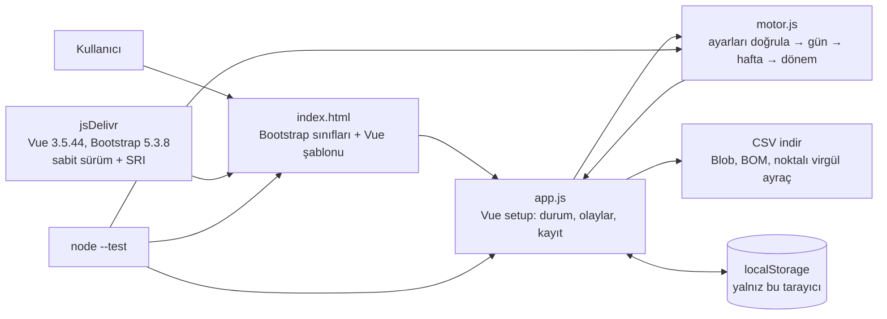

# 06 — Fazla mesai ve çalışma süresi uyum hesaplayıcı

> **Kime:** Ödeyen müşteri: KOBİ bordrosunu yapan serbest mali müşavirler, KOBİ İK/bordro sorumluları ve iş hukuku
> büroları; ücretsiz kullanıcı: fazla çalışmasının karşılığını hesaplamak isteyen çalışanlar; kurumsal lisans:
> sendikalar.
>
> **Fiyat:** Bireysel ücretsiz; Müşavir/İK Pro 349 TL/ay; hukuk bürosu 1.250 TL/ay; sendika lisansı 40.000 TL/yıl
> (KDV hariç örnek fiyatlar; doğrulanması gereken varsayım).
>
> **Ne:** haftalık çalışma çizelgesinden 4857 sayılı İş Kanunu'nun genel kurallarına göre net süreyi, fazla çalışmayı,
> tahmini brüt alacağı ve madde numaralı ihlal listesini çıkaran, CSV veren, tamamen tarayıcıda çalışan bir web
> uygulaması (Vue 3 + Bootstrap 5 arayüz, saf ES modülü hesap motoru).

**Hukuki tavsiye değildir; mevzuat ve toplu sözleşme hükümleri farklılık yaratabilir.** Sonuçlar tahmindir; kesin hesap
için iş hukuku avukatına ya da mali müşavire danışın. Bu uyarı uygulamada, CSV'nin son satırında ve burada yer alır.

## 1. Problem

"Haftada kaç saat fazla çalıştım, karşılığı ne kadar olmalıydı?" sorusunun cevabı dağınık maddelerdedir: haftalık 45
saat sınırı, sözleşmede daha az süre yazıyorsa %25'lik "fazla sürelerle çalışma", yıllık 270 saat tavanı, günlük 11
saat, ara dinlenmesinin süreden sayılmaması, gece çalışmasının 7,5 saat sınırı, hafta tatili, ulusal bayram ve genel
tatil (UBGT) günleri. Bunlara kanunda yazmayan ama sonucu değiştiren yargı uygulamaları eklenir (saat ücreti böleni,
günlük aşımların fazla çalışma sayılması). Çalışan bunları tek tek bilmez; küçük işletmedeki İK sorumlusu ve bordroyu
dışarıdan yapan mali müşavir puantajı çoğu zaman elle, tabloda denetler. Hata da, ihlal de buradan doğar.

## 2. Kime

| Segment                         | İhtiyaç                                              | Ne verir                                     | Öder mi?                   |
| ------------------------------- | ---------------------------------------------------- | -------------------------------------------- | -------------------------- |
| Mali müşavirler                 | Onlarca müşterinin puantajında hızlı kontrol         | Aynı kurallarla tekrarlanabilir hesap, CSV   | Pro paket (ilk hedef)      |
| İK ve bordro sorumluları (KOBİ) | Puantajın kanuna uygunluğunu ödeme öncesi denetlemek | İhlal listesi, uyarılar, denkleştirme        | Pro paket                  |
| İş hukuku büroları              | Dava öncesi ön hesap ve müvekkile açıklama           | Gün gün döküm, alacak kalemleri, varsayımlar | Hukuk bürosu paketi        |
| Sendikalar                      | Üyelere güvenilir, reklamsız bir araç                | Kendi adlarıyla sunulabilecek hesaplayıcı    | Yıllık lisans              |
| Çalışanlar                      | "Fazla mesaim ne kadar etmeliydi?"                   | 5 dakikada tahmin, madde numaralı açıklama   | Hayır; güven ve görünürlük |

**Persona 1 (ilk ödeyen müşteri):** Hakan Bey (52), 40 KOBİ'nin bordrosunu yapan serbest mali müşavir. Müşterilerinden
gelen puantaj tablolarında 11 saati aşan günleri ve eksik ara dinlenmesini elle arıyor; bir müşterisinin denetimde
ceza almasından ve yanlış bordrodan çekiniyor.

**Persona 2 (ücretsiz kullanıcı):** Deniz (27), Ankara'da bir yazılım şirketinde geliştirici. Teslim haftalarında
09:00–21:00 çalışıyor, bordrosunda fazla mesai yok, sözleşmesinde "fazla çalışma ücrete dahildir" yazıyor. Avukata
gitmeden önce ne konuşacağını bilmek istiyor; verisini kimseye göndermek istemiyor. Araç ona haftada 21 saat fazla
çalışmayı ve sözleşme hükmünün tutarı değiştirebileceğini gösterir.

**Persona 3:** Av. Selin Hanım (38), iş hukuku alanında çalışan küçük bir büronun ortağı. Müvekkilin anlattığı çalışma
düzeninden ilk görüşmede hızlı bir ön hesap ve hangi varsayımla hesaplandığını gösteren gün gün döküm istiyor.

**İlk 10 ücretli müşteri (hedef: 6 mali müşavir, 3 hukuk bürosu, 1 sendika ya da dernek):**

1. Mali müşavirler (6): SMMM odalarının eğitim günleri ve bordro yazılımı kullanıcı grupları. En kısa yol: üç müşavire
   bir ay ücretsiz Pro, karşılığında geri bildirim; ardından onların tavsiyesiyle üç müşavir daha.
2. Hukuk büroları (3): baroların iş hukuku komisyonlarının etkinlikleri; LinkedIn'de iş hukuku üzerine yazan avukatlar.
   Bir dosyanın ön hesabını birlikte yapan deneme görüşmesi.
3. Sendika ya da çalışan hakları derneği (1): eğitim ve hukuk birimlerine kendi adlarıyla sunulabilecek sürüm.
4. Çalışanlar ücretsiz kullanır: "fazla mesai hesaplama" aramalarında görünürlük ve iş hukuku üzerine yazan hesaplarla
   paylaşım güven ve tanınırlık getirir; gelir buradan beklenmez. Tanıtım e-postası ya da SMS için §11'deki ticari
   ileti kurallarına bakın.

## 3. Çözüm

- Haftalık çizelge: her gün için çalıştı mı, başlangıç, bitiş (gece yarısını aşabilir; başlangıçla aynıysa 24 saatlik
  nöbet), verilen mola, UBGT (yok / tam gün / yarım gün). Birden çok hafta eklenebilir (denkleştirme ve hafta sınırını
  aşan vardiyalar için). Çakışan vardiyalar ve hatalı saatler hesaba katılmaz, uyarı olarak gösterilir.
- Ayarlar: aylık çıplak brüt ücret, sözleşmedeki haftalık süre, saat ücreti böleni, bu takvim yılında önceden yapılan
  fazla çalışma, isteğe bağlı dönem başlangıç tarihi ve önceki haftadan taşan vardiyanın bitişi, ara dinlenmesinin
  nasıl düşüleceği, gece dönemi (md. 69 çerçevesi denetlenir), denkleştirme, günlük aşımların fazla çalışma sayılması.
- Sonuç: net süre, fazla çalışma (%50), fazla sürelerle çalışma (%25), saat ücreti, kalem kalem tahmini brüt alacak,
  bu iki kalemin yerine işçi isterse kullanılabilecek serbest zaman, madde numaralı ihlaller, ayar ve giriş uyarıları,
  varsayımları açıklayan notlar; CSV (Türkçe Excel için `;` ayraçlı, ondalık virgüllü, UTF-8 BOM'lu; girilen ve düşülen
  mola ayrı sütunda; formülle başlayan hücreler etkisizleştirilir).
- **Gizlilik:** hesap tarayıcıda yapılır. Uygulama ağ isteği yapmaz; içerik güvenliği politikası (`connect-src 'none'`,
  `form-action 'none'`) arka planda veri gönderimini tarayıcı düzeyinde de engeller. Çizelge yalnız o tarayıcının
  `localStorage`'ında tutulur; başlangıç durumu hiç saklanmaz, "Bu cihazdaki kaydı sil" kaydı siler.
- "996 örneği" düğmesi 09:00–21:00, haftada 6 gün çizelgesini yükler.

## 4. 996.ICU bağlantısı

"996", sabah 9'dan akşam 9'a, haftada 6 gün çalışma düzeninin adıdır; 996icu/996.ICU deposunun README'si bunun
"en az 60 saatlik hafta" demek olduğunu yazar ve adı "996 düzeninde çalışırsan yoğun bakıma (ICU) düşersin" esprisinden
gelir. 26 Mart 2019'da açılan depo (`ANTI-996 DAY.MD`; `depolar.json`: oluşturma 2019-03-26) Çinli yazılımcıların
GitHub'ı bir protesto alanı olarak kullanmasının simgesi oldu: README hareketin metni, `blacklist/` kanıtlarıyla 996
uygulayan şirketler listesi, buna karşılık 955.WLB gibi "beyaz liste" depoları, MIT lisansından uyarlanıp lisans alanın
çalışma mevzuatına uymasını şart koşan "Anti 996" lisansı (`LICENSE`, taslak 1.0) ve projelere eklenen rozetlerle
yayıldı; konular (issues) yönetilemez hale gelince kapatıldı, depo yine de 277 binden fazla yıldız topladı
(9 Kasım 2026).

`blacklist/README.md`, listenin amacını Çin İş Kanunu'nun uygulanmasına dayanak olmak diye açıklar ve "yasadışı fazla
mesai"yi kanun maddelerine bağlar: sendika ve işçiyle görüşülmeden zorla yaptırılan, günde 3 ya da ayda 36 saati aşan
ya da ücretin en az %150'si ödenmeyen fazla mesai. Bu MVP aynı yaklaşımı Türk hukukuna uygular: her sınır ve her ihlal
dayandığı maddeyle gösterilir. 996 haftası, 1 saat yasal mola ile günde 11 saat, haftada **66 saat** net eder; günlük
11 saat sınırına tam oturur ama haftada **21 saat fazla çalışma** doğurur ve aynı tempo sürerse 270 saatlik yıllık
tavan, önceki fazla çalışma yoksa **13. haftada** aşılır.

## 5. 51 depodan hangileri, nasıl?

| Depo                                                                    | Nasıl kullanılıyor                                                                                                                                                                                                                              | Doğrulama (incelenen commit)                                                                                                                                                                                                                                          |
| ----------------------------------------------------------------------- | ----------------------------------------------------------------------------------------------------------------------------------------------------------------------------------------------------------------------------------------------- | --------------------------------------------------------------------------------------------------------------------------------------------------------------------------------------------------------------------------------------------------------------------- |
| [vuejs/core](../../dallar/01-web-arayuzu/vue3-core/README.md)           | Çalışma zamanı bağımlılığı: Vue 3.5.44 global yapısı (`dist/vue.global.prod.js`, derleyici dahil): `createApp`, `reactive`, `ref`, `computed`, `watch`; şablon `index.html` içinde, tarayıcıda Vue'nun derleyicisiyle derlenir                  | `8b479a8` (2026-11-05): `packages/vue/package.json` (sürüm 3.5.45; `unpkg`/`jsdelivr` alanı `dist/vue.global.js`), `LICENSE` (MIT). npm'de 3.5.44 sürümü 13 Ekim, 3.5.45 sürümü 5 Kasım 2026'da yayımlandı; 3.5.45 henüz iki haftalık olmadığı için 3.5.44 sabitlendi |
| [twbs/bootstrap](../../dallar/01-web-arayuzu/bootstrap/README.md)       | Çalışma zamanı bağımlılığı: Bootstrap 5.3.8 CSS (ızgara, form, tablo, uyarı, rozet, sekme, liste grubu); JavaScript'i gerekmedi                                                                                                                 | `9062790` (2026-11-04): ana dal `package.json` 6.0.0-alpha.1 (npm `next`), `LICENSE` (MIT). Üretim için 5.3.8 (26 Ağustos 2025) sabitlendi; npm `latest` 11 Kasım 2026'dan beri 5.3.9, iki haftalık olunca SRI özeti yenilenerek geçilebilir                          |
| [996icu/996.ICU](../../dallar/10-kuratorluk-topluluk/996-icu/README.md) | Kod bağımlılığı yok: problem tanımı ("996" = haftada en az 60 saat), "996 örneği" çizelgesi ve `blacklist/README.md`'deki "fazla mesaiyi kanun maddeleriyle tanımla" yaklaşımı; aynı yaklaşım motorun madde numaralı ihlal listesinde uygulanır | `f5e35f4` (2025-08-22): `README.md`, `blacklist/README.md`, `ANTI-996 DAY.MD`, `LICENSE` ("Anti 996" lisansı, taslak 1.0; `depolar.json`'da `NOASSERTION`, yani GitHub'ın tanıdığı lisanslardan biri değil)                                                           |

İki kütüphane jsDelivr'dan **sürümü sabitlenmiş adres ve SRI (alt kaynak bütünlüğü) özetiyle** yüklenir; içerik
güvenliği politikası da yalnız bu iki dosyanın tam adresine izin verir. Özetler npm paketlerindeki dosyalardan
hesaplandı (12 Kasım 2026'da yeniden doğrulandı) ve sayfa başsız Chrome'da bu özetlerle açıldı (özet tutmasa tarayıcı
dosyayı yüklemez). Kütüphaneler depoya kopyalanmadı: küçültülmüş dosyalar Prettier denetimini bozar ve sürüm takibini
zorlaştırır. **Sonuç: sayfa ilk açılışta internet ister;** sonrasında yalnız tarayıcı önbelleği kadar çevrimdışı
çalışır. jsDelivr'a ulaşılamazsa sayfa boş kalmaz, ne olduğunu açıklayan bir metin gösterir.

**Lisanslar:** Vue ve Bootstrap MIT lisanslıdır; ticari kullanım serbesttir, koşul telif ve lisans bildiriminin
korunmasıdır. CDN'deki dosyalar bu bildirimi başlık yorumunda taşır; sendika lisansındaki gibi kütüphaneler kendi
sunucumuzdan dağıtılırsa `LICENSE` metinleri de pakete konmalıdır. 996.ICU'dan kod ya da içerik alınmadığı için
"Anti 996" lisansının koşulları bu ürüne doğrudan uygulanmaz; ürünün amacı zaten lisansın istediği gibi çalışma
mevzuatına uyumu desteklemektir.

## 6. Uygulanan kurallar

| Kural                                                                                                        | Kaynak                                                                 | Motorda                                                                                                                                            |
| ------------------------------------------------------------------------------------------------------------ | ---------------------------------------------------------------------- | -------------------------------------------------------------------------------------------------------------------------------------------------- |
| Haftalık 45 saati aşan süre fazla çalışmadır; saat ücreti %50 zamlı ödenir                                   | 4857 md. 63, md. 41                                                    | haftalık aşım = `max(0, net − 45 sa)`                                                                                                              |
| Günde 11 saati, gece çalışmasında 7,5 saati aşan süre de fazla çalışmadır; haftalık aşımla büyük olan alınır | Yargıtay uygulaması (**doğrulanmadı**); ayarla kapatılabilir           | gün gün `asimDk`; `fc = max(haftalık aşım, Σ asimDk)`                                                                                              |
| Sözleşmede 45'in altı yazılıysa aradaki süre fazla sürelerle çalışmadır; %25 zamlı ödenir                    | md. 41                                                                 | `fsc = min(max(0, net − fc − sözleşme), 45 − sözleşme)`; aynı saat iki kez ödenmez                                                                 |
| Yıllık fazla çalışma en çok 270 saattir                                                                      | md. 41                                                                 | önceki + dönem > 270 → ihlal (aşan saatler yine ücrete girer); değilse sınıra ne zaman ulaşılacağı: tarih varsa yıl sonuna göre, yoksa 52 haftayla |
| İşçi isterse zamlı ücret yerine 1 sa 30 dk / 1 sa 15 dk serbest zaman; 6 ay içinde, ücret kesilmeden         | md. 41                                                                 | `fc × 1,5 + fsc × 1,25`; UBGT ücreti bu seçeneğe girmez                                                                                            |
| Günlük çalışma 11 saati aşamaz; denkleştirmede haftalık 45 saat 2 ayda (TİS ile 4 ayda) ortalama aranır      | md. 63                                                                 | net > 11 sa → ihlal; denkleştirmede fazla çalışma dönem toplamından; 8 ve 17 haftayı aşan dönemde uyarı                                            |
| Ara dinlenmesi 15 dk / 30 dk / 1 saat; çalışma süresinden sayılmaz                                           | md. 68                                                                 | girilen < gereken → ihlal; "en az yasal" yöntemde md. 68'e uyan en kısa mola düşülür                                                               |
| Gece en geç 20:00'de başlar, en erken 06:00'da biter, en çok 11 saat sürer                                   | md. 69                                                                 | ayar bu çerçevenin dışındaysa ya da boşsa uyarı ve 20:00–06:00                                                                                     |
| Gece çalışması 7,5 saati geçemez (turizm, özel güvenlik, sağlıkta işçinin yazılı onayıyla istisna)           | md. 69                                                                 | çalışmanın yarısından fazlası gece dönemindeyse ve net > 7,5 sa → ihlal                                                                            |
| Yedi günde kesintisiz en az 24 saat hafta tatili                                                             | md. 46                                                                 | takvim haftasındaki en uzun kesintisiz dinlenme < 24 sa → ihlal; önceki haftadan taşan vardiya dinlenme sayılmaz                                   |
| UBGT'de çalışılan gün için ilave bir günlük ücret; çalışma için sözleşme hükmü ya da işçinin onayı           | md. 47, md. 44                                                         | gün × aylık brüt / 30; yarım gün tatilde 13:00 sonrası çalışılmışsa 0,5 gün (uygulama)                                                             |
| Saat ücreti = aylık brüt / 225, günlük ücret = aylık brüt / 30                                               | Yargıtay uygulaması (kanunda yazmaz; haftada 45 saatlik tam süre için) | bölen ayarlanabilir; sözleşme 45 saatten kısayken 225 kullanılırsa uyarı                                                                           |

**Kapsam ve sınırlar.** Araç 4857 sayılı Kanun'a tabi, 18 yaşını doldurmuş, tam süreli işçiler için genel kuralları
uygular; aşağıdaki durumları ayırt etmez ve bunlarda "sınır aşımı görünmüyor" sonucu yanıltıcı olabilir:

- 4857 md. 4'ün kapsam dışı bıraktığı işler (deniz ve hava taşıma işleri, belli tarım ve orman işleri, ev hizmetleri,
  çıraklar, sporcular, üç kişinin çalıştığı esnaf işyerleri gibi; liste ayrıntısı **doğrulanmadı**). Gazeteciler 5953
  sayılı Basın İş Kanunu'na, gemi adamları 854 sayılı Deniz İş Kanunu'na, memurlar 657 sayılı Kanun'a tabidir.
- Fazla çalışma yaptırılamayan işçiler: 18 yaşından küçükler, gebe, yeni doğum yapmış ya da emziren, sağlık nedeniyle
  uygun görülmeyen ve kısmi süreli çalışanlar (Fazla Çalışma ve Fazla Sürelerle Çalışma Yönetmeliği; madde numarası
  **doğrulanmadı**). Çocuk ve genç işçiler için daha kısa günlük ve haftalık süreler (md. 71) ve sanayide gece
  çalışması yasağı (md. 73) vardır (ayrıntı **doğrulanmadı**).
- Yer altı maden işleri ve sağlık kuralları gereği günde 7,5 saat ya da daha az çalışılması gereken işler (md. 63;
  ayrıntı **doğrulanmadı**).
- Çalışma saatini kendisi belirleyen üst düzey yöneticiler fazla çalışma ücreti isteyemeyebilir (Yargıtay uygulaması;
  **doğrulanmadı**).
- Zorunlu ve olağanüstü hallerde fazla çalışma (md. 42–43): farklı kurallar uygulanır (ör. işçinin onayı aranmaz;
  **doğrulanmadı**).

**Varsayımlar ve doğrulanmayanlar (açıkça):**

- "Çalışmanın yarısından fazlası gece dönemine düşüyorsa gece çalışmasıdır" ölçütü ilgili yönetmelikten bilinen bir
  kuraldır; madde numarası **doğrulanmadı**. Mola saati bilinmediği için gece süresi brüt aralıktan hesaplanır.
- Fazla Çalışma Yönetmeliği'ne madde numarası verilmedi (**doğrulanmadı**); işçinin yazılı onayı not olarak gösterilir.
- Günlük 11 saat ve gece 7,5 saat aşımlarının fazla çalışma sayılması ve haftalık aşımla "büyük olanı alma" yöntemi
  Yargıtay uygulamasıdır (**doğrulanmadı**); ayar varsayılan olarak açıktır, kapatılınca yalnız haftalık 45 saat aşımı
  hesaplanır ve günlük aşımlar yalnız ihlal olarak gösterilir.
- 270 saatlik tavanda "yıl" takvim yılı varsayıldı (hizmet yılı mı, **doğrulanmadı**). Tavana yalnız %50'lik fazla
  çalışma sayılır (yorum farkı olabilir). Tavanı aşan saatler de ücrete eklenir (Yargıtay uygulaması; **doğrulanmadı**).
- Saat ücreti böleni 225, haftada 45 saat çalışan aylık ücretli tam süreli işçi içindir. Sözleşme 45 saatin altındaysa
  (kısmi süreli ya da 40 saatlik tam süre) bölen farklı olabilir, ör. 5 × sözleşme saati (**doğrulanmadı**); motor bu
  durumda uyarır, bölen ayarlardan değiştirilir.
- Hafta tatili takvim haftası (pazartesi 00:00 – pazar 24:00) içinde aranır. Önceki haftadan taşan vardiya dinlenme
  sayılmaz; 1. haftadan önceki vardiyanın bitişi ayarlardan girilir, girilmezse ilk hafta dinlenmesi olduğundan uzun
  görünebilir. İki haftaya bölünen 24 saatlik dinlenme (ör. pazar 12:00 – pazartesi 12:00) iki haftada da 24 saatin
  altında görünebilir; böyle bir düzende sonucu elle değerlendirin.
- Hafta tatilinde çalışılan gün için ayrıca ücret istenebilir (Yargıtay uygulaması; oran ve yöntem **doğrulanmadı**);
  bu kalem hesaplanmaz, ihlal çıktığında not düşülür.
- UBGT günündeki saatler haftalık toplama da katılır; Yargıtay uygulamasında farklı hesap yöntemleri vardır. Yarım gün
  tatilde (Ramazan ve Kurban bayramı arifeleri, 28 Ekim; 13:00'ten itibaren) 13:00'ten sonra çalışılmışsa yarım günlük
  ilave ücret alınır (uygulama; **doğrulanmadı**). UBGT işareti vardiyanın başladığı güne konur; gece yarısını aşan
  vardiyada ertesi günün tatiline düşen kısım ayrıca sayılmaz.
- "En az yasal" mola yöntemi md. 68 ile tutarlı en kısa molayı düşer (ör. brüt 8 sa 1 dk'da 31 dk); mahkemeler brüt
  süreye göre farklı süre düşebilir, 24 saatlik nöbette daha uzun ara dinlenmesi düşüldüğü de bilinir (**doğrulanmadı**).
- Ücret tabanı çıplak brüt ücrettir; düzenli yol ve yemek gibi yan ödemeler girilirse tutar şişer (**doğrulanmadı**).
- "Toplam tahmini brüt alacak", hesaplanan kalemlerin hiç ödenmediğini varsayar; bordroda ödenmiş fazla çalışma ya da
  UBGT ücreti varsa düşülmelidir. Tutar vergi ve SGK kesintisi öncesidir.
- Tutarı değiştirebilecek ama hesaplanmayanlar: sözleşmedeki "fazla çalışma ücrete dahildir" hükmü (Yargıtay yıllık 270
  saate kadarını ücrete dahil sayabilir, asgari ücretlide durum farklıdır; **doğrulanmadı**), tanıkla ispatta hakkaniyet
  indirimi (**doğrulanmadı**), ücret alacaklarında 5 yıllık zamanaşımı (md. 32; **doğrulanmadı**). Dava açmadan önce
  arabulucuya başvurmak zorunludur (7036 sayılı İş Mahkemeleri Kanunu md. 3).
- Gece çalışmasına kanunda ayrı zam yoktur; toplu ya da iş sözleşmesine bakılır. Turizm sektöründeki daha uzun
  denkleştirme süresi ayırt edilmez (**doğrulanmadı**).
- Çakışan vardiyada sonraki gün hesaba katılmaz ve giriş hatası olarak gösterilir; başlangıç ve bitiş aynıysa 24 saatlik
  nöbet sayılır.

## 7. Mimari



```text
06-mesai-hesap/
  index.html          sayfa ve Vue şablonu; içerik güvenliği politikası (connect-src 'none', dış dosyalar adıyla)
  app.js              Vue bileşeni; Vue parametre olarak alınır (testte sahte Vue verilir); kayıt ve kaydı silme
  motor.js            hesap motoru: ayarlariDuzelt, gunuHesapla, haftayiHesapla, donemiHesapla, csvOlustur
  stil.css            küçük düzeltmeler (v-cloak, tablo genişlikleri)
  test/motor.test.js  kurallar, sınır durumları, Yargıtay ayarı, ücret, 996 örneği, CSV
  test/app.test.js    arayüz mantığı sahte Vue ile; bozuk kayıt, saklama ve silme, kapalı depolama
  test/sayfa.test.js  index.html: SRI, içerik politikası, kapsam ve uyarı metinleri; görünmez karakter taraması
```

Tasarım kararları: hesap motoru DOM'a dokunmaz, bu yüzden Node'da test edilir; tüm süreler tamsayı dakikadır (kayan
nokta hatası yok), para en sonda iki haneye yuvarlanır; ayarlar tek yerde (`ayarlariDuzelt`) doğrulanır ve geçersiz
değer sessizce değil, uyarıyla düzeltilir; motor "bugün"ü hiç kullanmaz, isteğe bağlı tarih yalnız takvim günü olarak
UTC aritmetiğiyle işlenir (saat dilimi kayması olmaz); kanunda yazmayan her yöntem kodda ve arayüzde "uygulama" diye
işaretlidir. Vue global yapısı derleme adımı gerektirmez ama sayfa içi şablon derleyicisi `new Function` kullandığından
politikada `'unsafe-eval'` vardır (derleme adımlı sürümde kaldırılabilir).

## 8. Çalıştırma

ES modülleri `file://` adresinden yüklenmez; küçük bir yerel sunucu yeterlidir:

```bash
cd repo-atlasi/is-fikirleri/06-mesai-hesap
python3 -m http.server 8000 --bind 127.0.0.1   # tarayıcıda http://127.0.0.1:8000
```

`--bind 127.0.0.1` sunucuyu yalnız bu bilgisayara açar (varsayılan, ağdaki herkese açık olmaktır). Yayına almak için
klasör herhangi bir statik barındırmaya (GitHub Pages dahil) olduğu gibi konabilir; içerik güvenliği politikası
`<meta>` etiketinde olduğu için sunucu ayarı gerekmez. Ücretli sürümler için barındırma koşullarına bakın (§11).

## 9. Test

```bash
cd repo-atlasi/is-fikirleri/06-mesai-hesap
node --test                       # 52 test; Node 22, ek paket yok
# depo kökünden: node --test 'repo-atlasi/is-fikirleri/06-mesai-hesap/test/*.test.js'
```

Testlerde beklenen değerler elle hesaplandı: ör. aylık brüt 22.500 TL → saat ücreti 100 TL; 48 saatlik haftada
sözleşme 40 saatse 5 saat × 125 TL + 3 saat × 150 TL; UBGT günü 750 TL; dört 12 saatlik vardiyada
max(48 − 45, 4 × 1) = 4 saat fazla çalışma; pazar gecesi vardiyası pazartesi 08:00'e taşınca sonraki haftanın en uzun
dinlenmesi 23 saat. Bağımsız bir hukuk ve hesap denetiminde bulunan her hata için ayrı bir test vardır (270 saat
notunun takvimde olmayan hafta yazması, haftaya taşan vardiyanın dinlenme sayılması, çakışan vardiyanın iki kez
sayılması, "en az yasal" molanın iki bantta fazla düşülmesi, boş gece ayarının gece denetimini kapatması gibi).

Sayfa ayrıca 12 Kasım 2026'da Playwright ile başsız Chrome'da açıldı (CDN istekleri npm paketlerindeki aynı dosyalarla
yanıtlandı): Vue bağlandı, SRI özetleri ve içerik güvenliği politikası konsolda hata vermedi, "996 örneği" 21 saat
fazla çalışma ve 4.200 TL gösterdi, pazar eklenince md. 46 ihlali çıktı, 22:00 gece başlangıcı uyarı verdi, CSV indi,
"Bu cihazdaki kaydı sil" kaydı sildi, 390 ve 360 piksel genişlikte yatay kaydırma olmadı, Vue yüklenemeyince açıklama
göründü. Bu tarayıcı denemesi depoya konmadı (Chrome ve Playwright gerektirir).

## 10. Gelir modeli ve örnek fiyat

Bireysel kullanım ücretsiz ve reklamsız kalmalı: aracın değeri güvenilir olmasından gelir. Gelir kurumsal taraftan:

| Paket           | Fiyat (örnek, Kasım 2026, KDV hariç) | İçerik                                                                                    |
| --------------- | ------------------------------------ | ----------------------------------------------------------------------------------------- |
| Bireysel        | Ücretsiz                             | bu MVP                                                                                    |
| Müşavir/İK Pro  | 349 TL/ay                            | çok çalışanlı puantaj, puantaj CSV'si içe aktarma, PDF rapor, toplu sözleşme zam oranları |
| Hukuk bürosu    | 1.250 TL/ay                          | dosya bazında hesap raporu, dönem ve tanık beyanı senaryoları                             |
| Sendika lisansı | 40.000 TL/yıl                        | kendi adlarıyla barındırılan sürüm, yıllık kural güncellemesi, üye eğitimi                |

**Fiyatlar doğrulanması gereken varsayımdır**, pazar araştırmasına dayanmaz. Doğrulama yolu: ilk 10 müşteriyle
görüşmede bir puantaj denetimine harcanan süre ve bunun müşavir ya da avukat saat ücretiyle maliyeti sorulur; Pro fiyatı
bu maliyetin altında kalmalıdır. Pazar büyüklüğü ve dönüşüm oranı için bir rakam verilmedi.

## 11. KVKK ve hukuk notları

- **Hukuki tavsiye değildir.** Kanun işlerinde mütalaa vermek avukatlara aittir (1136 sayılı Avukatlık Kanunu md. 35;
  **doğrulanmadı**); ürün bir bilgi ve hesap aracı olarak sunulmalı, "dava kazandırır" gibi vaatlerde bulunulmamalıdır.
  Çalışanları ücret ya da komisyon karşılığı avukata yönlendirmek avukatlık meslek kuralları ve reklam yasağıyla
  çatışabilir (**doğrulanmadı**); gelir modelinde böyle bir kalem yoktur.
- **Bu sürümde veri:** çizelge ve ücret yalnız kullanıcının tarayıcısında tutulur; işleyen tek taraf kullanıcının kendi
  tarayıcısıdır. Sayfayı sunan barındırma hizmeti ve jsDelivr, her web sayfasında olduğu gibi IP adresini ve tarayıcı
  bilgisini görür; girilen veriler bunlara gitmez (uygulama ağ isteği yapmaz, yönlendiren adres de gönderilmez). Yayına
  alınırken bu durum kısa bir aydınlatma metniyle anlatılmalıdır (KVKK md. 10).
- **Pro sürüm (sunucuda puantaj):** işveren veri sorumlusudur; bordroyu yapan mali müşavir ve servis veri işleyendir
  (servis, müşavirin alt işleyeni olur). Zincirin her halkası için yazılı veri işleme sözleşmesi, md. 12 güvenlik
  tedbirleri, erişim kayıtları ve saklama-imha süresi gerekir. Puantaj kişisel veridir ama özel nitelikli değildir;
  işverenin bu veriyi işlemesi kanuni yükümlülük ve sözleşmenin ifası şartlarına dayanır (md. 5/2), açık rıza
  gerekmez. Gebelik, emzirme ya da sağlık raporu gibi bilgiler sağlık verisidir (md. 6): "çalışan türü" özelliği
  eklenirse bu bilgi saklanmamalı ya da md. 6 şartlarıyla işlenmelidir. Avukat kullanımında müvekkil dosyası için veri
  sorumlusu avukattır ve sır saklama yükümlülüğü vardır; dosya verisi şifreli saklanmalı ya da yalnız cihazda kalmalıdır.
- **VERBİS:** kayıt yükümlülüğü veri sorumlularınındır; Kurul'un çalışan sayısı ve yıllık mali bilanço eşiklerinin
  altında kalanlar muaftır (güncel eşikler **doğrulanmadı**). Servis, müşterilerinin puantajı için veri işleyen olarak
  ayrıca kaydolmaz; kendi müşteri hesapları için eşiklere bakmalıdır.
- **Yurt dışına aktarım:** Pro sürüm yurt dışında barındırılırsa KVKK md. 9 uygulanır (7499 sayılı Kanunla 1 Haziran
  2024'ten itibaren yeterlilik kararı ya da standart sözleşme gibi uygun güvenceler; standart sözleşmenin Kurum'a
  bildirilmesi gerekir; ayrıntı **doğrulanmadı**). İlk sürüm için Türkiye'de barındırma en basit yoldur.
- **Platform koşulları:** GitHub Pages'in kullanım koşulları siteyi ticari bir hizmet (SaaS) ya da ticari işlem için
  barındırmayı yasaklar (**doğrulanmadı**); ücretsiz bireysel araç orada yayımlanabilir, ama ücretli paketler ve sendika
  sürümü ticari barındırmada çalışmalıdır. jsDelivr'ın kullanım koşulları da yayın öncesi okunmalıdır.
- **Ticari ileti:** müşavir ve avukatlara tanıtım e-postası ya da SMS gönderilecekse 6563 sayılı Kanun ve İleti
  Yönetim Sistemi (İYS) kuralları uygulanır. Esnaf ve tacirler için tanınan önceden onay istisnasının serbest meslek
  mensuplarını kapsayıp kapsamadığı **doğrulanmadı**; onay alınmalı ve her iletide ret yolu bulunmalıdır.
- **Mevzuat takibi:** kurallar her yıl ve her önemli Yargıtay kararından sonra gözden geçirilmeli; motordaki `KURALLAR`
  nesnesi ve §6 tablosu tek yerden güncellenir. "Uygulama" ya da "doğrulanmadı" diye işaretli her yöntem bir iş hukuku
  avukatına doğrulatılmadan ücretli sürüm satılmamalıdır.
- **Toplu sözleşme:** TİS daha yüksek zam oranı, farklı denkleştirme ya da gece zammı öngörebilir; Pro sürümün ilk
  özelliği bu oranların ayarlanabilmesi olmalı.
- **Sorumluluk:** kullanım koşullarında aracın bilgi amaçlı olduğu ve sorumluluk sınırı açıkça yazılmalı; ücretli
  paketlerin raporlarına varsayım listesi eklenmelidir.

## 12. Riskler

- **Yanlış güven:** kullanıcı tahmini kesin alacak sanabilir. Önlem: her yüzeyde uyarı, kapsam kutusu, madde numaralı
  açıklama, "uygulama" ve "doğrulanmadı" işaretleri, açık varsayım listesi.
- **Yorum farkları:** günlük aşımların fazla çalışma sayılması, saat ücreti böleni, ara dinlenmesinin ispatı, UBGT
  saatlerinin haftalık toplama katılması gibi konularda uygulama farklıdır. Önlem: seçenekler (günlük aşım, bölen, mola
  yöntemi), md. 69 çerçevesi denetlenen gece ayarı ve ücretli sürümden önce avukat incelemesi.
- **Hatalı giriş:** gerçek dışı çizelge gerçek dışı sonuç verir. Önlem: biçim ve çakışma denetimi, uyarı listesi, CSV'de
  gün gün döküm.
- **Rakipler:** bordro programlarının puantaj modülleri ve internetteki ücretsiz fazla mesai hesaplayıcıları
  (özellikleri **doğrulanmadı**). Fark: madde numaralı ihlal denetimi, gün gün döküm, verinin cihazda kalması. Ücretsiz
  araçlar yeterli görülürse gelir yalnız kurumsal paketlerden gelir.
- **Ödeme isteği:** müşavirlerin bu denetime ne kadar ödeyeceği bilinmiyor; fiyatlar ilk 10 müşteriyle doğrulanmalı.
- **CDN bağımlılığı:** jsDelivr erişilemezse arayüz açılmaz (yalnız açıklama görünür). Önlem: sonraki adımda derleme
  adımlı, kütüphaneleri kendi sunan sürüm.

## 13. Sonraki adımlar

1. Hafta tatili çalışma ücreti kalemi; fazla çalışmaya giren saatler ikinci kez sayılmadan.
2. Çalışan türü seçimi: 18 yaş altı, kısmi süreli, gebe ya da emziren (sağlık verisi saklanmadan), yer altı maden;
   kapsam dışı işlerde açık uyarı.
3. Hukuk bürosu paketi: "ücrete dahil 270 saat" ve hakkaniyet indirimi oranı ayarları, bordroda ödenmiş tutarın
   alacaktan düşülmesi, dosya bazında PDF rapor.
4. Resmi tatil takvimi: dönem başlangıç tarihi girilince UBGT günlerinin (arifeler ve 28 Ekim yarım günleri dahil)
   otomatik işaretlenmesi.
5. Puantaj CSV'si içe aktarma (müşavir paketi).
6. Toplu sözleşme ayarları: zam oranları, gece zammı, denkleştirme süresi (turizm dahil).
7. 24 saatlik nöbette ara dinlenmesi yöntemi seçeneği; iki haftaya bölünen hafta tatilinin tanınması.
8. Vite ile derleme: Vue'nun derleyicisiz çalışma zamanı, kütüphanelerin kendi sunulması, `'unsafe-eval'` olmadan daha
   sıkı içerik politikası ve çevrimdışı çalışma (service worker).

---

Kataloğa dön: [İş fikirleri](../README.md) · Ağaç: [AGAC.md](../../AGAC.md)
